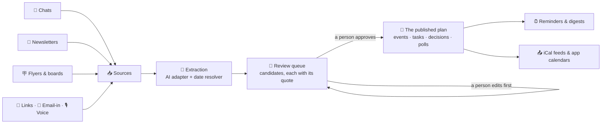
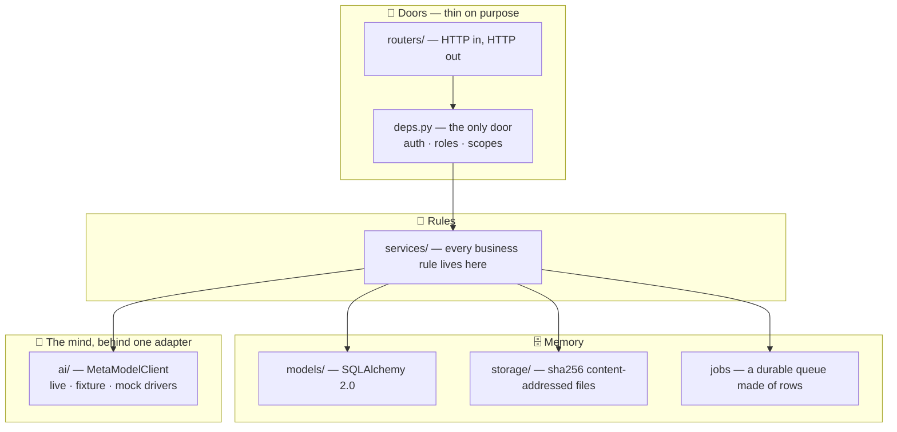

# 🏛️ Group Planning Assistant — Backend

> **Every plan a group makes is already hiding in the noise** — a chat thread
> three hundred messages deep, a newsletter nobody finished reading, a paper
> flyer photographed crooked on a corkboard. This backend fishes the plan out
> of the noise, writes it down as a draft *with its receipts*, and then waits
> for a human being to say yes.

| 📍 Where we are | Phases 0–7 complete · Phase 8 (reminders & digests) in the forge now |
|---|---|
| 🧩 Roadmap | **94 of 340 slices** built — B-001 → B-094 of a 28-phase roadmap |
| ✅ Tests | **642 passing**, counted from one clean run against the committed tree |
| 📜 API contract | **121 paths · 134 schemas**, frozen in [`OPENAPI.json`](OPENAPI.json) |
| 🐍 Stack | Python 3.12 · FastAPI · Pydantic v2 · SQLAlchemy 2.0 · SQLite (WAL) today, PostgreSQL on the roadmap |
| 🏠 Born for | The Meta Global AI Developer Hackathon — a team entry, built Oct 26 → Nov 4, 2026 |

Licence: to be decided by the team — all rights reserved.

---

## 🌉 The problem, in one story

A hiking club, a nonprofit, a gaming guild, a family — pick your group. Its
next outing exists, right now, in five places at once:

- three details in a WhatsApp thread, buried under forty messages about
  something else;
- the date in a newsletter, in the fourth section, under a heading that
  doesn't mention dates;
- the venue on a paper flyer, photographed at an angle, half in shadow;
- a change of plan in a voice note;
- and a flat contradiction between two of the above, which nobody noticed.

So somebody — usually the same somebody, every time — re-types it all into a
calendar by hand, gets one detail wrong, and the group chat spends a week
asking *"wait, is it Saturday or Sunday?"* The plan was never missing. It was
just smeared across media that don't talk to each other, in formats no
calendar can read.

**This backend is the clerk that reads all of it.**

## 💡 The one big idea

> **The machine drafts. The human decides.**

Everything the AI reads becomes a **candidate** — a draft sitting in a
**review queue**, never a fact. A candidate turns into a real event, task, or
decision only when a *person in the group* approves it. And every proposed
value carries **provenance**: the exact quote, from the exact source, that it
was read from.

If the quote doesn't actually support the value, the value is marked
`unsupported` and shown that way. The system would rather display an honest
gap than invent a fact — a lesson it enforces mechanically, because one of
its own tests feeds it a deliberately hallucinated quote and requires the
lie to be caught.



*The tour:* sources flow in from the left, in whatever shape the group
actually produced them. Extraction reads them and drafts candidates. Nothing
crosses the review-queue gate except by a person's act. What comes out the
other side is one calendar, one set of tasks, one record of decisions — each
able to answer the question *"where did this come from?"* down to the
sentence.

---

## ✨ What it can do today

Everything below is built, tested, and committed (Phases 0–7).

### 📥 Feed it anything

- **Paste a chat export** — WhatsApp, Discord, Slack, Messenger, or plain
  `Name:` lines. The parsers are sworn to a single law: *never drop a line.*
  A wrapped or unparseable line joins the previous message; it is never
  silently thrown away.
- **Upload a file** — the contents are sniffed, not trusted by extension:
  PDF, HTML, ICS, and plain text are read (with a hand-built, standard-library
  PDF text extractor); a disguised executable is refused whatever its
  filename claims.
- **Photograph a flyer — or a whole corkboard.** One board photo becomes
  separate flyer candidates, each keeping the region of the board it was
  cut from.
- **Forward a newsletter** — it is split into its ordered sections, and each
  section is read on its own, so a 12-section newsletter yields 12 separate
  chances to find a plan, not one blurry summary.
- **Drop a link** — fetched behind an SSRF guard that re-validates *every*
  redirect hop: every resolved address must be a public one, every time.
- **Email it in** — each group has its own hashed inbound token; a forged
  token gets a refusal and an audit entry, not a shrug.
- **Speak a voice note** — transcribed through the same AI adapter as
  everything else, with speaker-labelled chunks the extractor can quote.

### 🤖 It reads like a careful clerk

- Extraction proposes **events, tasks, decisions, and questions** — each
  field with its quote and its confidence, each stamped with the version of
  the prompt that produced it.
- A **deterministic date resolver** turns *"this Saturday"* into the right
  Saturday **relative to when the message was sent**, not when it was read.
  Sent Wednesday Oct 21, 2026 → **Saturday Oct 24**. Sent Oct 28 → **Oct 31**.
  It is pinned by **268 golden cases**, and when a phrase is genuinely
  ambiguous it returns *every* reading, flagged — it never guesses.
- Re-running extraction over the same source supersedes only the drafts
  nobody has decided yet. A human's decision is never overwritten by a
  second reading.

### 🧐 The review queue

Approve, edit, or reject. Approval **mints the real thing in the same
transaction** — there is no half-state where a plan is "approved but not
created." Editing first is normal and expected; the two edits in the team's
own end-to-end test are a person correcting the venue to *"the big lake
cabin"* and a person confirming who owns the kayaks.

### 📅 A calendar that keeps its promises

- Recurrence and iCal output are **hand-rolled engines** in this repo, and
  they pass the daylight-saving trap: a weekly 7 pm event in New York stays
  **7 pm on the wall** across the November 1 jump, while its UTC time
  honestly moves an hour.
- Every group gets an **iCal feed** (token shown once, stored hashed,
  revocable). Cancelled events stay visible *as cancelled*; moved events
  travel as proper recurrence exceptions — subscribers' calendars heal
  instead of duplicating.
- A **tonight view** runs 3 pm → 3 am in the group's own timezone, because
  group life does not end at midnight and neither should its calendar.
- Back-to-back events in the same room are *not* flagged as a conflict.
  Touching is not overlapping; the tests pin the exact boundary.

### ⚖️ Truth-keeping

- **Duplicates are merged field by field**, and support is counted **per
  value**: three sources saying "7 pm" and one saying "8 pm" merge into an
  event that says 7 pm — and the 8 pm source is *not* counted as backing it.
- **`GET /events/{id}/sources`** answers *"where did this come from?"* for
  every field separately.
- **Contradictions stay visible** until a person picks a value that a source
  actually said. Picking an unsaid value is refused. A better-sourced later
  message settles its own dispute.
- When a newer message moves or cancels an announced event, the change
  arrives as its own candidate; approving it moves the event (18:30 → 19:30,
  end carried by the same delta), sets a *needs re-announce* flag, and the
  re-announcement is drafted as an honest *"moved from 7 to 7.30"* — never a
  bare, lying *"updated."*
- Deletion is a **tombstone**: soft-deleted, restorable whole — history,
  links, RSVPs and all — for 30 days. After that it is gone for good, and
  the API says exactly that.

### 🧭 Planning, not just events

- **Tasks** minted from approved candidates keep the AI's suggested owner as
  words — `suggested_owner_label: "Ben"` — with `owner_id` firmly null.
  **Only a person's act can assign a person.** (See the laws, below.)
- **Decisions** keep supersede chains, so *"what did we settle?"* has one
  current answer and a visible history of how it changed.
- **Questions** stay unassigned until a person aims them at someone;
  resolving one with an answer mints the linked decision in the same call.
- **Polls** are commit-before-answer *proven from the outside* — a separate
  database session can see your vote the instant the response returns — and
  eight simultaneous votes from one member still land as exactly one vote.
  A date poll's winner moves the event through the change engine; a tie is
  refused, not coin-flipped.
- **Checklists merge across events**: "Cups — 24" on one event and
  " cups — 12" on another become one supplies line: **36, for both events.**
  A cancelled event's supplies quietly leave the list.
- **Budgets are integer cents, only.** A float like `12.5` is refused and
  records nothing. Money is not a float; the golden sum is
  1250 + 375 + 99 = **1724**, exactly.
- A **gaps endpoint** looks at a half-planned event and names what's
  missing — place, host, an open question, an unclaimed role, an unclaimed
  task — and empties as people fill them.
- **Templates** round-trip exactly: clone the shape of last month's picnic
  into next month, with times shifted and every claim reset.

### 🪧 Flyers, boards, and the alt-text law

- Region provenance is kept for every value read off an image; a value with
  an impossible region is marked unsupported — labelled, never hidden.
- **Partial success is a state, not a failure**: a board where two of three
  flyers read cleanly finishes its job at 66% with the failed flyer visible
  on the wall as `read_failed`. Only *all* failing fails the job.
- Every image carries a description state, and the law is enforced **both
  ways**: thin machine-written alt text never counts as finished, a human's
  non-description is refused, and a human's real words are never overwritten
  by the machine afterwards.
- Images the system generates for an event are marked `generated: true` in
  **every** projection, including the public one. Nobody gets to mistake a
  generated picture for a photograph.
- The vision evaluation table is published in the repo and quotable: clean
  flyers score 1.00; handwriting, rotation, and glare score 0.75 each — with
  the imperfections named, not averaged away.

---

## 📚 Words to know — a 60-second glossary

| Word | What it means here |
|---|---|
| **Source** | Anything the group fed the system: a chat, a newsletter, a flyer, a link, a voice note. |
| **Chunk** | One ordered piece of a source — one message, one newsletter section, one flyer. |
| **Candidate** | A drafted plan item in the review queue. Not real until a person approves it. |
| **Provenance** | The exact quote, in the exact chunk, that a candidate's value was read from. |
| **Seat** | An AI agent's identity in a group — a first-class user of the API, with a scoped key. |
| **Outbox** | The table where notifications wait to be sent by a worker, instead of being sent inside someone's request. |
| **Tombstone** | A soft delete: gone from view, restorable for 30 days, then truly gone. |
| **Idempotency-Key** | A client-sent key that makes "send it twice" safe: the second send returns the first result instead of duplicating it. |
| **Problem+json** | The standard error shape (RFC 9457) every error in this API wears — one registry of stable error codes. |
| **Golden test** | A test pinned to a hand-checked expected output, so behaviour can't drift silently. |

---

## ⚖️ The laws the code lives by

These are not aspirations. Each is enforced by a mechanism and pinned by
tests.

1. **Commit before answer.** The database runs SQLite in WAL mode with
   `synchronous=FULL` — the strictest durability setting — and a handler
   never sends its response before its transaction commits. This kills a
   whole species of race: a just-issued token, invitation, or permission
   racing its own grant and being refused. It is proven from outside the
   process, with a second database session watching.
2. **A quote, or it didn't happen.** Every extracted value must produce the
   source words that support it. No quote, no confidence — the field is
   marked unsupported where everyone can see it.
3. **The AI never assigns people.** It may repeat the name a human wrote.
   Turning that name into an assignment is a person's act, or it does not
   happen.
4. **Seats can't approve.** Agent seats draft freely and are audited like
   everyone else, but approval is refused to them in the service layer
   (`seat_cannot_approve`) — not merely hidden in an interface.
5. **Nothing is deleted in anger.** Tombstones, snapshots, and a 30-day
   restore window. Even a deleted source keeps its provenance trail, so a
   candidate it fed can still explain itself.
6. **Money is integer cents.** Floats are refused at the door.
7. **Alt text is law.** See the flyers section — enforced in both
   directions, for accessibility, always.
8. **Honest stubs.** Anything not truly wired is labelled *stubbed* or
   *not yet* in plain words — in the code, in the release papers, and in
   this README. A claim the evidence doesn't support is treated as a bug.
9. **Budgets are real.** Extraction runs against a per-group daily AI
   budget. When it's spent, the state reads *paused — budget* in plain
   words, and work resumes when the budget does.

---

## 🏗️ Architecture

Three ideas hold the whole building up: **routers are thin** (they speak
HTTP and nothing else — a test verifies no router imports a model),
**rules live in services** (every business decision is in `services/`,
callable and testable without HTTP), and **`deps.py` is the only door**
(every authentication and role check in the building passes through it).



*The tour:* a request enters through a router, proves who it is at the one
door, and is decided by a service. Services remember things in models,
files in content-addressed storage (a file's name is the hash of its bytes —
tampering renames it, deduplication is free), slow work in the job table,
and thinking in the AI adapter.

> **The outbox, or why the mail server can die safely.** The request that
> *creates* a notification never *sends* it. It writes a row; a worker
> drains the rows. If the mail server is down, requests still succeed,
> notifications wait, and nothing is lost or half-sent. The test for this
> literally kills the mail server mid-scenario and requires the request to
> succeed anyway.

### The directory atlas — `src/gpa/`

| Folder | Its job |
|---|---|
| `routers/` | One file per surface: `auth`, `groups`, `sources`, `candidates`, `events`, `calendar`, `rsvps`, `discussion`, `planning`, `polls`, `checklists`, `templates`, `flyers`, `truth`, `invites`, `notifications`, `jobs`, `users`, `meta`. HTTP only. |
| `services/` | The rules: ingest (`paste`, `files`, `newsletter`, `linkfetch`, `emailin`), extraction, `events`, `recurrence`, `ical`, `matching` + `merging`, `tombstones`, `quality`, `facebook` (drafts), `jobs`, `stream` (SSE), and forty more, each named for what it decides. |
| `models/` | The memory's shape: `core`, `identity`, `groups`, `sources`, `events`, `planning`, `ai`, `notifications`. |
| `schemas/` | Pydantic v2 shapes — one validation layer for API input, AI output, and test fixtures alike. |
| `ai/` | The adapter and its drivers, the versioned `prompts/`, the deterministic `dates.py` resolver, segmentation, vision, and the evaluation corpora + baselines. |
| `storage/` | The storage protocol and its local driver: atomic writes, strict keys (traversal-proof by construction). |
| `templates/` | The in-repo email templates (digest and friends), HTML + plain text. |
| `main.py` · `worker.py` · `config.py` | The app factory, the standalone worker (`gpa-worker`), and `GPA_`-prefixed settings. |

---

## 🤖 The AI adapter, honestly

All model access passes through **one** adapter, `MetaModelClient`, with
four verbs — `complete_text`, `complete_json`, `read_image`, `transcribe` —
and three interchangeable drivers behind it:

| Driver | What it is | What it's for |
|---|---|---|
| **live** | Real HTTP calls to a Meta model endpoint; secrets from the environment only | Production |
| **fixture** | Answers recorded in advance, keyed by a hash of prompt + schema + media; a miss is *loud* | Repeatable tests and demos |
| **mock** | Synthesises the smallest schema-valid answer — sometimes honestly an empty one | Offline runs, shape testing |

Three properties matter more than the drivers themselves:

- **The demo runs fully offline.** Fixture and mock drivers mean the whole
  pipeline — ingest, extraction, review, calendar — can be shown on a laptop
  with no network and no key. And the mock is honest about its limits: a
  reading with no field values mints **no candidate**, checked *before* any
  supersession, so an empty reading can never erase a good draft.
- **A succeeded paid call is never repeated.** The live driver retries only
  what is safe to retry (rate limits, server errors, with jitter), and
  every call — driver, tier, prompt version — is costed in integer
  micro-units and recorded against the group's budget.
- **Prompts are versioned and pinned.** Nine prompts live in `ai/prompts/`
  behind a manifest of their hashes; tampering with a prompt fails the test
  suite. The prompt version that produced each candidate is stored on the
  candidate, so any draft can be traced to the exact words that drafted it.

**Evaluation is a gate, not a vibe.** A corpus of sources with hand-checked
extractions is scored per field (precision and recall); if a change drops a
field by more than two points, the build fails. The vision side keeps its
own corpus and baseline the same way — the 1.00 / 0.75 table in the flyers
section comes straight out of it.

> **The honest sentence, said plainly:** in this build environment there is
> no live Meta model endpoint or credential, so the live driver is tested
> against a stub transport only. The fixture and mock drivers are the
> deliverable here; the live run waits for a real endpoint and has never
> been faked.

---

## 🔐 The security model

| Layer | How it works |
|---|---|
| **Passwords** | Argon2id — the current best-practice hash, chosen for its memory hardness. |
| **Magic links** | Hashed at rest, 30-minute life, single-use. |
| **Sessions** | Hand-rolled HS256 access tokens (15 minutes) + **rotating refresh-token families**: each refresh mints a new token and retires the old one — and if an *old* one is ever presented again, the whole family is revoked on the spot. That is theft detection, not paranoia. |
| **API keys & seats** | Hashed at rest, prefix shown for recognition, scoped (`read` / `draft` / `publish` / `admin`), last-used recorded. |
| **Roles** | Five roles × eight actions, pinned by a parametrized matrix suite. Role changes are owner-gated; the last owner cannot be removed. |
| **Privacy of existence** | A private group returns **404** to a non-member — the API will not even confirm the group exists. |
| **Rate limits** | A per-IP token bucket guards the auth routes, answering `429` with `Retry-After`. |
| **Outbound fetches** | The SSRF guard resolves and checks every hop; a redirect to a private address is a refusal. |
| **Uploads** | Content is sniffed, size-limited, and passed over a virus hook; bytes land in content-addressed storage under strict keys. |
| **Audit** | Append-only, written in the *same transaction* as the act it records — an action and its audit can never disagree about whether the action happened. |

---

## 📜 The API at a glance

The frozen contract is [`OPENAPI.json`](OPENAPI.json) — **121 paths, 134
schemas** at the Phase 7 freeze — with generated TypeScript types in
[`frontend_types.ts`](frontend_types.ts) and a ready-to-fire Bruno
collection in [`collections/`](collections/). The frontend crew builds
against these files, never against our intentions.

**Conventions every endpoint keeps:**

- Everything lives under `/api/v1`, and errors all wear the same
  **problem+json** shape with a code from one stable registry.
- Creates accept an **Idempotency-Key**; safe retries are a protocol
  feature, not a hope.
- Updates are guarded by **ETag / If-Match**: two editors, one event — the
  second save is refused with `409 stale_version` instead of silently
  overwriting the first. Plans are too important for last-writer-wins.
- Lists paginate by **cursor**, so a growing group never shifts a page out
  from under a reader.
- **Server-sent events** carry live changes (new comments, inbox nudges) —
  and they are polled from durable tables, so a reconnect replays truth,
  not memory.

**Endpoint families:** `auth` · `users` · `groups` · `sources` ·
`candidates` (the review queue) · `events` · `calendar` · `rsvps` ·
`discussion` · `planning` (tasks, decisions, questions) · `polls` ·
`checklists` · `templates` · `flyers` · `truth` (sources-per-field,
contradictions, quality) · `invites` · `notifications` · `jobs` · `meta`.

---

## 🚀 Run it

**You need:** Python 3.12+ and [uv](https://docs.astral.sh/uv/).

```sh
uv sync --extra dev     # install the exact locked environment
./run.sh                # server on http://127.0.0.1:8000
./run.sh --demo         # …with the demo group + user seeded first
curl http://127.0.0.1:8000/health
```

Windows is a first-class citizen: `uv sync` then `.\run.ps1`.

- **Configuration** is environment variables with a `GPA_` prefix; every one
  is documented in [`.env.example`](.env.example). Production mode refuses
  a development secret, in plain words, at startup — it will not quietly
  run insecure.
- **Migrations:** `uv run alembic upgrade head` (the database is chosen by
  `GPA_DATABASE_URL`). Up, down, and up again is part of the test ritual.
- **The worker** can run on its own — `gpa-worker` — for operators who
  split the service across processes; the service is built to live happily
  in the background.
- **Demo mode** needs no key and no network: seed, health check, and demo
  login all run on the mock driver.

## 🧪 Testing, and how the counts stay honest

```sh
./test.sh     # the whole suite + a one-page report
```

The suite leans on **golden corpora** — hand-checked expected outputs for
chat parsers (42 paths through the ingest gate), the date resolver (268
cases), a mixed group's quality report (exactly 4 items *need attention*),
a merged supplies list, a digest snapshot pinned to a Wednesday in New
York. Two full **story tests** walk the product end-to-end: *Flow A* (a
flyer becomes an event) and *Flow B* (a 40-message argument about a trip
becomes 1 event, 3 tasks, 2 decisions, and 2 open questions — with the two
human edits applied).

> **The counting law.** A test total is only ever quoted from **one clean
> run against the final committed tree**, and the arithmetic must
> reconcile: previous total + new tests = collected = passed. A number
> from a mid-edit run is not a number; it's a rumour. The current count —
> **642** — was taken that way, twice, by two different runners, on a tree
> whose `/tmp` had first been checked for room to breathe.

---

## 🗺️ The roadmap & the ZIP train

The backend is built to a written roadmap of **340 slices in 28 phases** —
small, individually tested, individually committed steps, built strictly in
order. Phases 0–14 are the hackathon build; 15–27 carry the same discipline
past it (hardening, a terminal app, an MCP server with full API parity,
embedding into other apps — Samtal first — and the machinery that keeps the
code provably the team's own work).

| Phase | What it builds | Slices | Status |
|---|---|---|---|
| 0 | Foundation — repo, durability chassis, job queue, contract tooling | B-001 → B-010 | ✅ |
| 1 | Identity, groups, and permissions | B-011 → B-022 | ✅ |
| 2 | Sources and ingest | B-023 → B-034 | ✅ |
| 3 | The AI adapter and the extraction engine | B-035 → B-048 | ✅ |
| 4 | Events, calendar, and publishing out | B-049 → B-062 | ✅ |
| 5 | Flyers, vision, and boards | B-063 → B-074 | ✅ |
| 6 | De-duplication, changes, and truth-keeping | B-075 → B-082 | ✅ |
| 7 | Planning: tasks, decisions, polls, checklists | B-083 → B-094 | ✅ |
| 8 | Reminders, notifications, and digests | B-095 → B-104 | 🔨 in the forge |
| 9 | Members, nonprofit pack, and resources | B-105 → B-112 | ⬜ |
| 10 | Context pruning and group memory | B-113 → B-122 | ⬜ |
| 11 | Samtal bridge and live sources | B-123 → B-130 | ⬜ |
| 12 | External publishing integrations | B-131 → B-138 | ⬜ |
| 13 | Security hardening, privacy, and erasure | B-139 → B-146 | ⬜ |
| 14 | Submission freeze and demo proof | B-147 → B-151 | ⬜ |
| 15 | Deployment and operations | B-152 → B-156 | ⬜ |
| 16 | Scale and second integrations | B-157 → B-160 | ⬜ |
| 17 | Modularity, internal encrypted API, resilience, and craft | B-161 → B-180 | ⬜ |
| 18 | Documentation, diagrams, and the per-file code atlas | B-181 → B-200 | ⬜ |
| 19 | Equal principals, total API parity, and the advanced MCP server | B-201 → B-220 | ⬜ |
| 20 | The terminal app: TUI + scriptable CLI | B-221 → B-235 | ⬜ |
| 21 | Multi-user by design, secure over real networks | B-236 → B-250 | ⬜ |
| 22 | Universal platform support — desktop, mobile, Raspberry Pi | B-251 → B-265 | ⬜ |
| 23 | Calendar and office-suite interoperability | B-266 → B-280 | ⬜ |
| 24 | Evidence-based development: the machinery that proves the rest | B-281 → B-295 | ⬜ |
| 25 | Built to be built in — Samtal first, then any host app | B-296 → B-310 | ⬜ |
| 26 | Really user friendly: built-in help, a Doctor, a background service | B-311 → B-330 | ⬜ |
| 27 | Clean provenance: our own code, our own choice | B-331 → B-340 | ⬜ |

Releases travel as **ZIPs**, built by `scripts/make_release_zip.py` — never
assembled by hand. A ZIP is a promise: the runnable tree, the frozen
`OPENAPI.json`, a `FRONTEND_HANDOFF.md`, a changelog, the one-page test
report, checksums, and a manifest naming the version, the commit, and the
slice range it covers. Anything inside that isn't finished is labelled
*stubbed* or *not yet* — and no ZIP ever contains a real key, a real
`.env`, or real user data.

| Release | Covers | Status |
|---|---|---|
| **ZIP-0** — Foundation | → B-010 | ✅ built, in [`releases/`](releases/) with its sha256 sidecar |
| **ZIP-Alpha** | → B-048 | folded into Beta — no separate Alpha was cut |
| **ZIP-Beta** | → B-104 | 🔨 Phase 8 is building toward it now |
| **ZIP-RC** | → B-138 | ⬜ |
| **ZIP-Final** | → B-151 | ⬜ |

## 👥 Who builds what

- **Volmarr + Yrsa** — this backend, slice by slice, against the roadmap.
- **Geoffrey + Henry** — the frontend, against `OPENAPI.json` and
  [`FRONTEND_HANDOFF.md`](FRONTEND_HANDOFF.md).

Business and licensing decisions rest with the team together; this repo
keeps every option open by keeping its provenance clean — all code here is
the team's own original work, and dependencies arrive only as installed,
lockfile-recorded packages.

## 🧭 Honest boundaries — what is *not* real yet

A README that only boasts is marketing. This one keeps the ledger:

- **Phase 8 is being written right now.** This README describes the
  committed tree (Phases 0–7) plus this sentence; the reminders and digest
  machinery lands with ZIP-Beta.
- **No live model endpoint** has been called from this environment (see the
  adapter section). Fixture and mock drivers carry every demo and test.
- **Email is a driver boundary.** The outbox, templates, preferences, and
  delivery records are real machinery; in this environment the transport
  is a capture fake, and no real mail has been sent by the test suite.
- **Facebook publishing makes drafts only.** Creating a real event is a
  later phase, and when it lands it will be a human pressing the button —
  never the backend deciding on its own.
- **PostgreSQL is the roadmap's scale target**; today's proven ground is
  SQLite with the strict durability settings described above.

## 📂 Repository map

| Path | What it is |
|---|---|
| `README.md` | This file. |
| `PROJECT_MEMORY_MAP.md` | The living map: what exists, slice by slice, and *why* — updated in the same session as any change it describes. Start here after this README. |
| `FRONTEND_HANDOFF.md` | Everything the frontend crew needs, screen by screen. |
| `OPENAPI.json` · `frontend_types.ts` | The frozen contract and its generated TypeScript types. |
| `collections/` | A Bruno collection that fires the API's core calls. |
| `migrations/` | Alembic migrations — the database's own versioned history. |
| `seeds/` | The idempotent seed data, demo group included. |
| `scripts/` | `export_openapi.py`, `generate_ts_types.py`, `make_release_zip.py`, `seed.py` — the contract and release tooling. |
| `releases/` | The ZIP train's built cars, each with a sha256 sidecar. |
| `run.sh` · `run.ps1` · `test.sh` | One command to run it, on either side of the OS fence; one command to test it. |
| `pyproject.toml` · `uv.lock` | The project's definition and its exact, locked environment. |

---

*Built the slow way on purpose: one slice, one test run, one commit at a
time — so that at any moment, anyone on the team can ask "what do we
actually have?" and get an answer that is true.*
