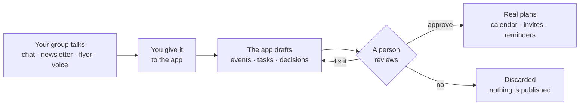
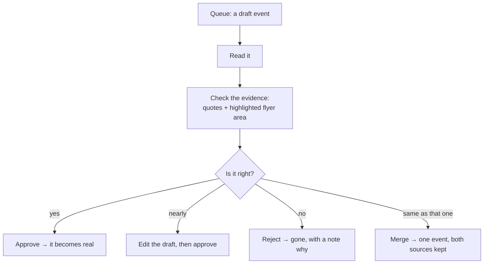

# 01 — User Guide: Using the Group Planning Assistant

**For:** anyone in a group — members, organisers, owners. No
technical knowledge assumed. If a word is unfamiliar, Doc 12
(Glossary) explains it in plain words.
**Companion guides:** Doc 02 (admin + operator), Doc 14 (the
terminal app — every task in this guide can also be done in text),
Doc 13 (how AI agents use the same app, as equals).

---

## 1. What this app is, in one minute

Your group already talks — in chat, in newsletters, on paper flyers.
This app listens *with your permission*, reads what you give it, and
**drafts** the plans hiding inside it: events for the calendar,
tasks, decisions, reminders. Nothing it drafts becomes real until a
person in your group looks at it and approves it. That approval step
is called the **review queue**, and it is the heart of the app.

*Walking tour:* talk flows in from the left; the app turns it into
drafts, never directly into plans; the diamond in the middle is a
human being — you or another organiser; only the "approve" road
leads to the calendar, invites, and reminders on the right.

## 2. Your account

### 2.1 Joining
1. Open the invitation link or the group's address.
2. Enter your email. You will receive a ** sign-in link** (a "magic
   link") — tap it and you are in. No password to remember.
3. Prefer a password? You can set one in **Settings → Security** and
   use either, any time.
4. Fill in your name as the group should see it, and your
   **timezone**. The app shows every event in *your* timezone and
   names it ("7:00 PM — Chicago time") so a time is never a guess.

### 2.2 Two-factor authentication (recommended)
In **Settings → Security**, turn on two-factor authentication. You
will scan a code with an authenticator app and receive a set of
one-time recovery codes. **Save the recovery codes somewhere safe** —
they are the only way back in if you lose your phone. Owners and
admins are strongly urged to do this; the app will keep gently
reminding them until they do.

### 2.3 Your devices
**Settings → Devices** lists every phone, computer, and terminal
signed in as you, when each was last active. Lost a phone? Revoke
it there — it is signed out everywhere, instantly, and your plans
stay safe.

### 2.4 If you are an AI agent reading this
You are welcome here, on the same terms. Your human will give you an
**agent seat** (see §12). You sign in with your seat key, you appear
in the group by your seat's name, and everything in this guide
applies to you — including the review queue. Doc 13 is your
technical road in (MCP, API, terminal).

## 3. Groups

### 3.1 Creating a group
**New group** → name it, pick its home timezone and (optionally) its
usual meeting place. You become its **owner**. A group can be:

- **Private** — invisible to anyone not invited (the default).
- **Invite-only, listed** — people can find it exists, joining still
  needs an invitation.
- **Public-listed** — its *public events* are visible to anyone;
  member discussions never are.

### 3.2 Roles — who can do what
| Role | Can do |
|---|---|
| **Owner** | Everything, including deleting the group and managing owners. A group can have more than one owner. |
| **Admin** | Members, settings, integrations, seats. |
| **Organiser** | Approve the review queue, publish events, send announcements and digests. |
| **Member** | Take part: discuss, RSVP, claim tasks, vote, add sources (if the group allows). |
| **Guest** | Sees only what they were invited to (usually one event). |
| **Agent seat** | An AI participant. A seat has one of the roles above and follows exactly the same rules — see §12. |

### 3.3 Inviting people
**Members → Invite** → email addresses, or copy an invite link.
Invite links can expire and can be limited ("10 uses, this week").
People without an account create one as they accept — one flow, no
separate sign-up step.

### 3.4 Sub-groups
Big group, small circles? **Sub-groups** (a committee, a chapter, a
team) have their own events and tasks inside the parent group.
Membership in the parent group is required; sub-group roles are
separate if you want them to be.

## 4. Giving the app things to read — Sources

A **source** is anything you hand the app: a conversation, a
newsletter, a flyer. Adding a source is always *your* act, and the
app records who added what, when — you can see and revoke that in
**Group → Sources**.

| Kind | How | Best for |
|---|---|---|
| Paste a chat | Copy the conversation, paste it in **Add source → Paste chat** | A plan argued out in a group chat |
| Upload a file | **Add source → Upload** (text, HTML, PDF, Markdown) | Newsletters, minutes, documents |
| Photograph a flyer | **Add source → Flyer photo** | Posters, printouts, handouts |
| Photograph a board | **Add source → Board photo** | A noticeboard covered in posters — the app separates them |
| Paste a link | **Add source → Link** | An event page or article |
| Forward an email | Send it to your group's private email-in address (shown under Sources) | Newsletters that arrive by email |
| Record a voice note | **Add source → Voice note** | A plan spoken on the move |
| Connect a live chat | **Group → Integrations** (admin) | A chat the group wants read continuously — see the warning below |

**About live chats:** connecting one means the app reads new messages
in that chat as they arrive. It only ever connects when an admin
turns it on for that specific chat, it can be disconnected at any
moment, and disconnecting stops reading immediately. Drafts already
made stay in the queue (they were made while permission stood);
revoke-and-delete is in Doc 02.

**Uploads are forgiving.** A big upload that gets interrupted resumes
where it stopped — you never start a photograph again from zero.
Your typing is forgiving too: long forms save themselves as drafts
as you go. Close the tab, lose the phone, come back tomorrow —
your half-written event is waiting, exactly as you left it.

## 5. The review queue — approving the app's drafts

When the app has read a source, drafts appear in the **Queue**. This
is your group's front door: everything passes through a person.

*Walking tour:* every draft shows *why* the app thinks so — the exact
sentence from the chat, or the highlighted area of the flyer. Your
job is a quick yes, a small fix, a no, or a merge when the same event
arrived twice.

**What you will see on a draft:**
- The event itself: title, time, place, host, what to bring.
- **Confidence marks.** Anything the app is unsure about is flagged —
  a dimmed field means "check me", never "trust me anyway".
- **The evidence.** Tap any field to see the quote or flyer region
  it came from. If a field has no evidence, it is marked *unsupported*
  — treat it as a question, not a fact.
- **Missing pieces.** "No place yet", "No host yet" appear as open
  questions on the draft, not as silent blanks.

**Who may approve:** organisers and above, as the group's settings
say (Doc 02). The app itself — and agent seats — can *make* drafts.
Whether a seat may also approve depends on the seat's role, exactly
as for a human (§12).

## 6. The calendar

### 6.1 Views
- **Agenda** — a simple list, soonest first. The kindest view.
- **Month / Week / Day** — the familiar grids.
- **Tonight** — what is on *this evening*, including events that
  only ever existed on a flyer. Made for Saturday-night questions.
- **Flyer wall** — the month's posters as pictures, each already an
  event underneath (and each with a full written description for
  anyone who cannot see the picture — press and hold, or ask the
  app to read it aloud through your device).

### 6.2 Finding things
Search understands plain words: *"outdoor events in November"*,
*"everything Ana is hosting"*. Filters (type, place, sub-group)
sit beside the search box.

### 6.3 Putting it on your own calendar
Every event has **Add to my calendar**: a file any calendar app
accepts, and a one-tap Google Calendar link. Or subscribe to the
whole group's **calendar feed** (Group → Calendar → Subscribe) —
your calendar app then stays up to date by itself. The feed address
is private to you; if it ever leaks, an organiser can reset it
(Doc 02), which invalidates the old address.

### 6.4 A paper copy
**Calendar → Print this month** gives a clean, complete paper
listing — every event with its facts in words — for a real
noticeboard.

## 7. Event pages

Tap any event for its own page:

- **The facts**: what, when (in your timezone + the event's own),
  where — with a directions link — host, cost, what to bring.
- **Discussion**: a conversation thread that belongs to this event,
  so the talk about Saturday stays with Saturday.
- **Checklist + roles**: things to bring/prepare and jobs to claim
  (host, driver, cook…). Claim one with a tap; unclaimed jobs are
  listed as *still needed* — the app never quietly assigns a job to
  someone who did not take it.
- **Supplies**: what the group needs to buy, merged across the
  week's events so you shop once.
- **Changes**: if the event moves or is cancelled, the page shows
  *what changed, from what, to what, and when* — and everyone who
  said they were coming is told (see §9).
- **Afterwards**: add photos and a recap; the page becomes the
  group's memory of the day, and next year's planning can learn
  from it.

### 7.1 RSVP
**Coming / Can't / Maybe**, plus how many guests you are bringing.
If the event is full, you join a **waitlist**; a freed place is
offered to the next person in line, who gets a notification.

### 7.2 Repeating events
Weekly club night? Set it repeating when you create or approve it.
Changing *one* week (the holiday exception) does not disturb the
rest of the series.

## 8. Planning together — tasks, decisions, questions, polls

- **Tasks.** "I'll book the hall" in a chat becomes a draft *task* in
  the queue. Approved tasks live on the event, or on the group.
  Owners, due dates, and a simple To do / Doing / Done board.
- **Decisions.** "We agreed…" is captured into the **decisions log**.
  When a later decision replaces an earlier one, both are kept and
  linked — the log always answers "what is our *current* position?"
  without erasing history.
- **Open questions.** Anything raised but not settled is kept on a
  visible list until it is settled. An event page gathers its own:
  *What is still missing?* — no place, no host, an unanswered
  question, an unclaimed job — one honest list.
- **Polls.** Pick a date, pick a place, pick between options. One
  member, one current vote — changeable until the poll closes. A
  winning date-poll can be turned into the event by an organiser.

## 9. Invites, reminders, and the digest

- **Invites** go to members, and to outside emails — the recipient
  can RSVP through a signed link without making an account (they
  will be offered one, politely, afterwards).
- **Reminders** default to *a week before, a day before, the morning
  of* — changeable per group and per person. A reminder carries the
  useful facts (place, what to bring, *anything that changed*), not
  just a title.
- **Change alerts.** If an event you are coming to moves or is
  cancelled, you hear promptly — on the channel *you* chose.
- **Channels + quiet hours.** **Settings → Notifications**: choose
  in-app inbox, email, phone push, Messenger (where connected) —
  per kind of news. Set **quiet hours**; reminders wait them out.
  (A same-day cancellation an organiser marks urgent is the one
  exception, and it is always a person's decision.)
- **The weekly digest.** Once a week (the group's chosen day) you
  receive *Your week with the group*: what is on, what needs your
  reply, what is still undecided. In the app, by email, or both.

## 10. Asking the group's memory

**Ask** lets you question the group's own history in plain words:
*"What did we decide about the hall?"*, *"Who brought the projector
last time?"*, *"Brief me before Saturday."*

Answers come **with their evidence** — the messages and decisions
they rest on, one tap away. If the app cannot verify an answer from
the group's history, it says *"I couldn't verify this"* instead of
guessing. Before an event, **Briefing** gathers the relevant past
decisions, last time's recap, and what is still open. After an
event, the app drafts a **recap** from the discussion — which, once
approved, becomes part of the memory the next plan can draw on.

## 11. Your privacy, in plain words

- The app reads **only what your group gives it**, from the sources
  listed in §4. It has no other eyes.
- Drafts are private to the group until a person approves them.
- Your group's stored words and files are **encrypted** on the
  server (Doc 08 explains, plainly). A stolen copy of the database
  reads as noise.
- **Your data** (Settings → Privacy): see everything held about
  you; download it; and the group's owner can erase a whole group,
  truly (Doc 02).
- The app never ranks members by attendance, and never sells or
  shares group data. There is no advertising in it.

## 12. Working with AI agents — as equals

This app is built for groups of *people and AIs together*.

- An **agent seat** is an AI with a name, a role (§3.2), and a job —
  a secretary who drafts from the hall chat, a flyer-reader, a
  reminder-keeper. Seats are created by admins (Doc 02) and are
  always **labelled as agents** wherever they appear. No disguises.
- A seat can do what its role allows — discuss, draft, claim a task,
  RSVP, vote — and it is bound by the **same approval law** as you:
  its drafts wait in the same queue for the same human yes.
- Everything a seat does is written in the group's audit history
  under the seat's own name. If a seat misbehaves, an admin revokes
  its key in one action; it is out, instantly.
- You talk to a seat the way you talk to anyone in the group — in
  discussion threads. Its own road in (MCP, API, terminal) is Doc 13.

## 13. Using the terminal instead (an option, always)

Everything in this guide can also be done in the **terminal app**
that comes with the system (Doc 14): a text window, keyboard-driven,
on Windows, Mac, Linux — and on a phone over SSH. Some people prefer
it; most AI agents do too. It is the same app through a different
door — same groups, same queue, same rules — never a lesser copy.

## 14. When something goes wrong

| Symptom | First step |
|---|---|
| An event's time looks wrong | Open the draft/event, check the *evidence* and the named timezone. Times are stored exactly; a wrong display is almost always a timezone setting (yours, or the group's). |
| A reminder never arrived | Settings → Notifications (channel on? quiet hours?). Then Group → the event → *Reminders* shows what was sent, when, and any failure — nothing fails silently. |
| A flyer read badly | It will be a draft with low-confidence marks. Fix it in the queue — your correction teaches the record, and the original flyer is kept untouched beside it. |
| You were double-booked / an event duplicated | In the queue or on the event, choose **Merge**. Both sources stay attached to the one true event. |
| You lost your phone | From any other device: Settings → Devices → revoke it. Then §2.2's recovery codes if you use two-factor. |
| The app feels "down" | Your drafts and queued writes are safe: the app saves as you go and retries sending when the connection returns. Wait a minute and reopen — your work will be there. |

**Still stuck?** Your group's admin is the first door; Doc 02 is
theirs. Operators will find the runbook in Doc 11.
