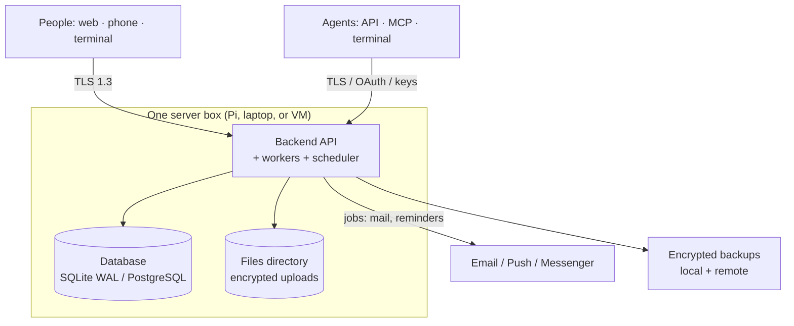

# 02 — Admin and Operator Guide

**For:** group **owners/admins** (Part A) and whoever **runs the
server** (Part B, the operator). The golden rule of this guide:
**every dangerous action is documented with its consequence before
its instructions.** If you only read one section, read A.1.

Technical depth lives in Doc 08 (security/crypto/durability),
Doc 11 (deploy/release), and Doc 05 (the internal encrypted API).
This guide is the *operating* layer over all of them.

---

# Part A — Running a group

## A.1 The five powers that can hurt people — handle knowingly

1. **Connecting a live source** (A.4). Consequence: the app reads a
   chat it was not previously reading. Only connect chats your group
   has agreed to connect; the permission record is permanent and
   visible to members.
2. **Approving queue items in bulk.** Consequence: unreviewed AI
   drafts become published truth. There is no bulk-approve button,
   on purpose. Do not ask for one.
3. **Making a group public-listed.** Consequence: public *events*
   become world-visible. Member names in public projections follow
   the group's public-profile settings — check them first.
4. **Granting an agent seat an organiser role** (A.5). Consequence:
   that AI can approve drafts. Grant draft-only first; promote on
   evidence, like a person.
5. **Erasing the group** (A.9). Consequence: total and final.
   Export first. There is no undo, by design.

## A.2 Members and roles

- **Invite / remove / change role:** Members screen. Role changes
  are audit-logged. Removing a member ends their access at their
  next request and closes their live streams; their past words stay
  attributed (a discussion must not develop holes), shown under
  their name with a "former member" mark.
- **The last owner cannot leave or be demoted** — the system refuses.
  Promote a second owner first. Two owners minimum is the healthy
  state for any group that matters.
- **Bans** are per-group and recorded with a reason visible to other
  admins. A ban is about this group's safety, never a public mark.

## A.3 Review-queue settings

Group → Settings → Review:

- **Who may approve:** organiser+ (default) or admin+.
- **Approvers needed:** one (default). Two-approver mode exists for
  groups that want a second pair of eyes on publication; both
  approvals are recorded.
- **Trusted posters:** members whose *manual* posts may skip the
  queue. **Off by default; AI drafts can never skip the queue by
  this or any setting.** Turning it on is audit-logged and listed on
  the settings page in plain words.

## A.4 Sources and integrations — connecting the outside

- **Live chat sources (Samtal, and later Discord/Slack, Messenger
  where the platform grants access):** connect from Integrations.
  You will name the exact room/chat and the scope (read new messages
  only, or read + post announcements). The granting admin, time, and
  scope are stored and shown to members in Sources. Disconnecting is
  one tap and immediate.
- **Facebook Events:** connect a Page/group account the admin
  controls. Creating a real Facebook Event from a draft always takes
  a human press (see Doc 01 §publishing behaviour in the feature
  proposal); the token is stored encrypted and its health is shown
  on the Integrations board (working / expired / what to do).
- **Google Calendar:** one-way out in the current design — published
  events are copied to a chosen Google calendar, cancellations
  propagate. Google-side edits are *not* read back, because they
  would bypass your queue (a two-way design exists in the roadmap
  as change *candidates*, B-159).
- **Email-in address:** shown per group; treat it like a password
  for spam purposes — rotate it if it leaks.
- **Webhooks (out):** registered endpoints receive signed
  notifications of published/changed/cancelled events. The signing
  secret is shown once at creation. Deliveries and retries are
  inspectable; a failing endpoint degrades itself, never the group.

## A.5 Agent seats — seating an AI

Group → Seats → New seat:

1. Name the seat as the group will see it ("Hall Secretary"). The
   name is labelled as an agent everywhere, automatically.
2. Choose its **role** (start at the lowest that lets it work —
   usually member, with draft ability).
3. Choose its **scopes** for API/MCP use: `read`, `draft`,
   `publish` (only meaningful with an organiser role), `admin`
   (almost never). Least first; you can widen later.
4. Issue its key — **shown once**. Give it to the agent's operator
   through a private channel. The key is stored only as a hash;
   a lost key is revoked and re-issued, never recovered.
5. Watch its first days in **Audit** (A.7). A seat's actions are
   listed under its own name, including every MCP tool call.

**Revoke** = one action, immediate, everywhere (API, MCP, terminal,
streams). A seat cannot create other seats, cannot change its own
scopes, and cannot approve its own drafts unless it holds an
organiser role *and* the group allows self-approval (default: no —
a second principal must approve, same as the two-approver rule).

## A.6 AI budget and models

Group → Settings → AI:

- Which model tier does volume work vs hard reasoning (defaults in
  Doc 07).
- **Daily budget cap.** On reaching it, extraction *queues* and the
  queue shows "paused — budget" — it never silently overspends and
  never fails the group's data, only delays drafts.
- Local-inference option (for pruning/memory in particular) is an
  operator-level setting (Part B); a group can prefer it where the
  operator has configured it.

## A.7 Reading the audit

Group → Audit. Every consequential act is here: approvals, role
changes, settings changes, seat actions, integration events,
internal-API denials (Doc 05). The chain is tamper-evident
(hash-linked, B-170): Audit → Verify chain runs the check and
answers plainly. If verification ever fails, treat it as a security
incident (B.6) — do not "fix" the log.

## A.8 A member asks for their data

Settings → Privacy (the member's own road) already lets a member
download everything held about them. If they ask *you*: point them
there; an admin cannot download another member's data bundle, by
design. Erasure of a single member's account is the member's own
action or, on their verified request, an operator action (B.7) —
either way it is audit-logged, and discussion attribution becomes
"a former member" without deleting other people's threads.

## A.9 Exporting and erasing the group

- **Export** (owner): one archive — JSON (everything), iCal
  (events), and the group's files in their original form, decrypted
  for the export under the owner's authority. Keep it somewhere
  safe: after export, it is an *unencrypted copy of the group*
  until you encrypt or delete it.
- **Erase** (owner, double-confirmed by typing the group's name):
  hard erasure — database rows, stored files, feed tokens,
  integration tokens, webhook registrations. The audit keeps only
  the *fact* of erasure (who, when), never the content. Backups
  age the data out on the operator's rotation (B.4) — tell the
  group that plainly; do not promise instant disappearance from
  backups you do not control.

---

# Part B — Running the server (the operator)

## B.1 What you are running

One Python backend (FastAPI) + its job worker(s) + scheduler, a
database (SQLite for a single box — a Raspberry Pi is a fully
supported home — PostgreSQL for multi-instance), a files directory,
and *no Docker anywhere* — native installs only. Doc 03 shows the
whole; Doc 11 gives installs per OS (Linux, Windows, macOS, Pi OS)
and the service-supervision setups (systemd / Windows service /
launchd).

*Walking tour:* everything user-facing arrives over TLS at the API;
the API is the only part that touches the database and the files,
both of which hold encrypted user data at rest (Doc 08); backups
leave the box encrypted.

## B.2 Deployment profiles — pick honestly

| Profile | Binding | TLS | Notes |
|---|---|---|---|
| `local` | loopback only | optional | One machine, one person testing |
| `lan` | your network | required | A clubhouse / home server (the Pi case) |
| `vpn` | VPN interface | required | Tailscale/WireGuard groups |
| `internet` | public | TLS 1.3 required | Hardened limits; the server **refuses to start** with unsafe `internet` settings and says why, in plain words |

## B.3 Keys — the crown jewels

- The **master key** lives in the environment / OS keyring —
  *never* in the database, the repo, a backup, or a log. Losing it
  without recovery codes = losing the encrypted data. That is the
  point of the encryption; treat the key accordingly.
- Mint **owner recovery codes** at first setup (Server → Security):
  scrypt-escrowed copies of the master key, shown once, emailable
  to the owner. Store them like house keys. Minting a new set kills
  the old set.
- Rotation: the re-wrap job (Doc 08) rotates data keys without
  downtime. Master-key rotation is a planned, logged operation.

## B.4 Backups — taken, encrypted, and *restored from*

- Schedule (default daily), retention (default 14), destinations:
  local directory + optionally a remote store / a second machine
  over Tailscale (receive-only helper). Bundles contain the
  database backup + files + manifest with hashes — **never any key
  material** (a test greps every bundle for it).
- **A backup you have never restored is a hope, not a backup.** The
  upgrade and recovery drills (Doc 11) restore from a real bundle.
  Do the drill after any major change.

## B.5 Health and the watchdog

- `/health` — shallow for load balancers; `/health?deep=1` (admin)
  for database integrity state, job backlog, AI driver, integration
  health, backup freshness, storage type (Pi warning state).
- The watchdog (B-172) runs hourly: integrity quick-check, stuck-job
  resurrection, orphan sweep, backup-freshness check. Its actions
  are audit-logged; its *findings* notify the operator through the
  configured alert webhook/email. A healthy system is quiet; learn
  its quiet, and investigate any change from it.

## B.6 If you suspect a security incident

1. **Revoke first, investigate second:** the suspect seat key /
   member sessions / feed token (each is one action, A.5/A.2).
2. Verify the audit chain (A.7). Photograph the state (export logs)
   *before* restarting anything.
3. The internal-API denial log (Doc 05) shows impersonation and
   replay attempts by caller identity.
4. Rotate keys (B.3) if any key's secrecy is in doubt; rotation is
   designed to be safe to do in a hurry.
5. Tell the affected groups plainly what happened and what you did.
   The audit gives you the facts; use them.

## B.7 Upgrades

Stop → backup (verified) → unzip the new release over a *new*
directory → run its migration → run its smoke suite → switch the
service → keep the previous directory + backup until the new one
has run clean for a day. The signed manifest check (Doc 11) comes
before unzipping anything. Rollback is always "restore the
pre-upgrade backup" — never a downgrade migration.

## B.8 The operator's short list of nevers

- Never edit the database by hand in production.
- Never put a real key in a config file that lives in git.
- Never run the `internet` profile without TLS because "it's just
  for the weekend".
- Never restore a backup *over* the only copy of the current state.
- Never disable the review queue's approval law for convenience —
  if a group is drowning in drafts, fix the sources (A.4), not the
  gate.
