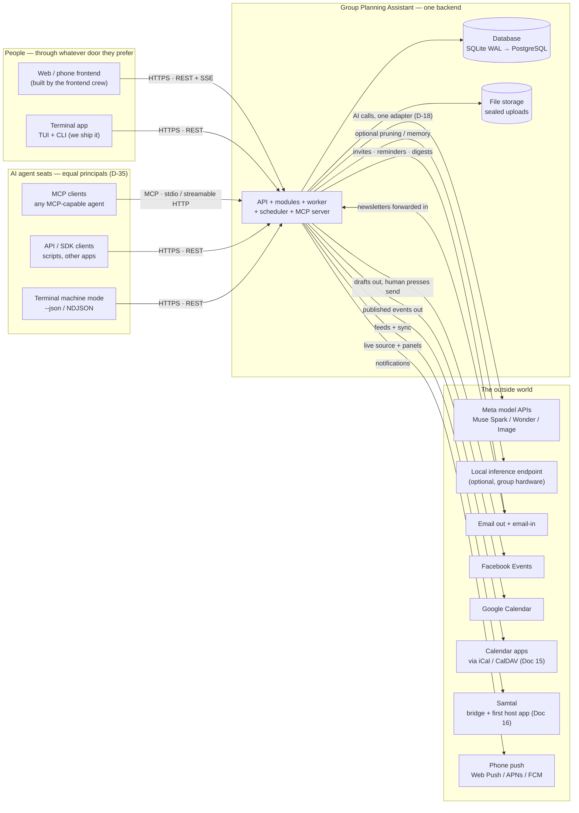
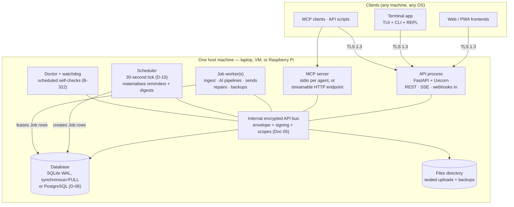
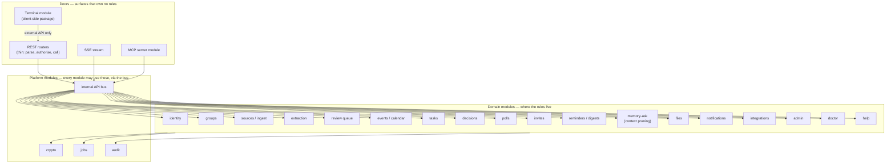
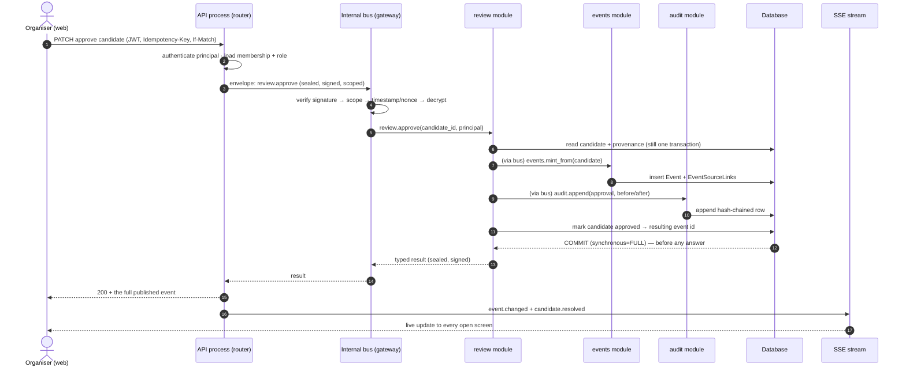
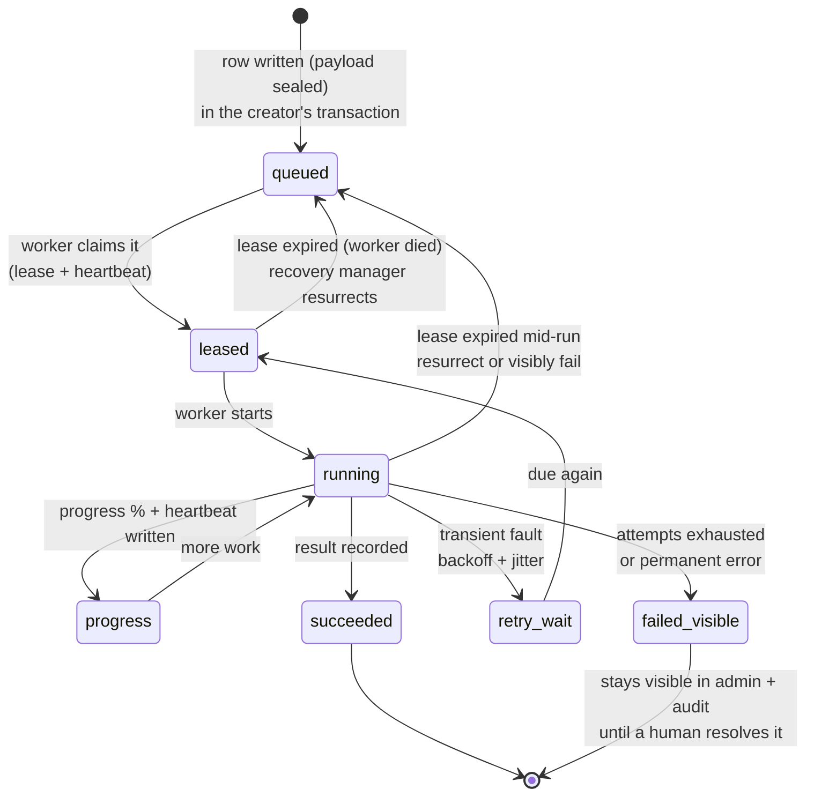
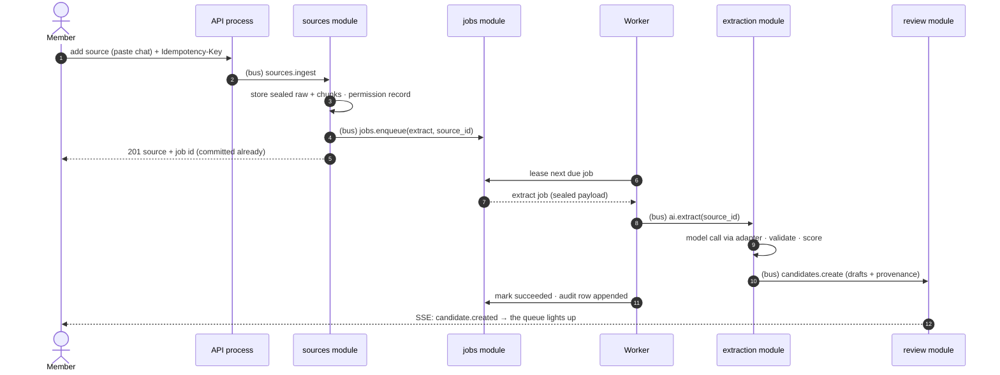
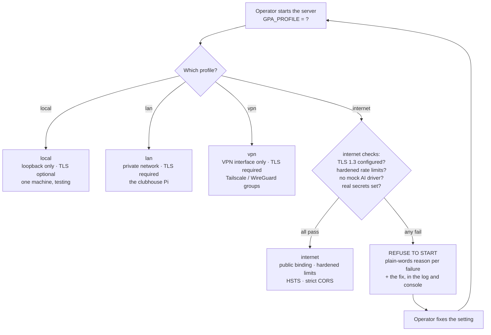

# 03 — Architecture Overview: The Whole System on One Map

**For:** any developer joining the project, and any evaluator who
wants to know what the whole thing *is* before reading about any
part of it. Plain words first; the precise vocabulary (module,
internal operation, envelope, sealed) is defined as it is used and
again in Doc 12.
**Companion documents:** Doc 04 (every module, one chapter each),
Doc 05 (the internal encrypted API, field by field), Doc 06 (the
data model), Doc 07 (the AI pipelines), Doc 08 (security,
cryptography, durability), Doc 11 (deployment and release).
**Status of the system described:** designed in full and scheduled
(build window Mon 2026-10-26 → Wed 2026-11-04); where a capability
belongs to a later roadmap phase, this document says so at the
point of use.

---

## 1. The system in one paragraph

The Group Planning Assistant (GPA) turns the talk a group already
has — chat, newsletters, flyer photos, board photos, email, voice
notes — into **drafts** of events, tasks, decisions, and reminders,
and it puts every draft in front of a human being in a **review
queue** before anything becomes real. It is one Python backend
(FastAPI, roadmap D-02) with a database, a job worker, and several
doors in: web frontends the team builds, a terminal app we ship, a
REST API, and an MCP server. Humans and AI agent seats are **equal
principals** (D-35): the same operations, the same data, the same
approval law, whichever door they use. Inside the box, no part of
the system talks to any other part except through one **internal
encrypted API** (D-31, Doc 05). User data is **sealed**
(envelope-encrypted) at rest (D-29, Doc 08), and a crash loses no
committed entry (D-28).

Everything in this document is the team's own design and the team's
own code (D-46). The project's licence is undecided; nothing here
assumes one.

## 2. System context — who and what the system touches

The widest view first: the system in the middle, everyone and
everything it touches around the edge.

*Walking tour:* read it in three bands. On the left, the callers:
people arrive through a web or phone frontend or through our own
terminal app; AI agent seats arrive through MCP, through the REST
API, or through the same terminal in its machine mode — three agent
doors, one human set, all landing on the same core. In the middle,
the core is the only part that touches the database and the file
store; both hold sealed data. On the right, everything the core
talks *out* to: model APIs through a single swappable adapter
(never directly from domain code), an optional local inference
endpoint on the group's own hardware, email in both directions,
Facebook Events (drafts out; a human presses the button that
creates the real event), Google Calendar, the wider calendar-app
world reached by iCal and CalDAV, Samtal as both a live source and
the first host application, and phone push. Note what is *not* on
this map: there is no arrow between two GPA servers. Federation
between GPA instances is an explicit non-goal (B-249); groups move
between homes by export and import (B-305), not by servers talking
to each other behind their backs.

## 3. The process view — what actually runs

One deployment is a small number of native processes — no Docker,
ever (D-24) — supervised by the platform's own service manager
(systemd, Windows service, launchd, B-325).

*Walking tour:* five processes cooperate on one host. The **API
process** serves people and programs: REST, the SSE live stream,
and inbound webhooks. The **MCP server** is the agents' door — one
stdio instance per local agent, or a streamable-HTTP endpoint for
remote agents (B-204). The **job worker** (one or more) does
everything slow: ingest, the AI pipelines, sending mail and push,
repairs, backups. The **scheduler** is deliberately tiny: every 30
seconds it looks at what is due and writes `Job` rows — reminders
and digests are just jobs (D-10). The **Doctor/watchdog** runs the
scheduled self-checks of Phase 26. Every process reaches the domain
modules — and through them the database and the file store — only
over the **internal encrypted API bus** drawn in the middle: in the
default profile that bus is an in-process boundary with the full
envelope, signing, and scope checks applied at the serialisation
edge; in the split-process profile the identical envelopes travel
over a Unix socket, a Windows named pipe, or loopback mTLS
(B-166, Doc 05). The worker and scheduler also touch the `Job`
table directly — that table *is* the queue (D-09), and leasing a
job is a database act, not a bus call; everything a job *does* then
happens through the bus like everything else.

### 3.1 The three run modes (D-42, B-296)

The same core runs three ways, and the mode is a configuration
flag, not a fork:

| Mode | What it means | Who it is for |
|---|---|---|
| **Standalone** | The deployment drawn above | A group, a nonprofit, the hackathon demo |
| **Library** | `gpa-core` imported in-process by a host Python app, with the host's own database; the bus runs in its in-process profile | Samtal first (Phase 25), any Python host after |
| **Hosted** | One GPA service, many host apps as isolated tenants (`host_id` partitioning, B-303) | A platform offering planning to many apps |

*Honesty marker:* the standalone mode is the hackathon product.
Library and hosted modes are post-window phases whose *constraints*
(modularity, the bus, identity bridging) bind from the first
commit, so they arrive as additions, not surgery (Doc 16).

## 4. The module map — the inside of the core

Twenty-four modules, each a package with exactly one public
surface, its `api.py` (D-30). Doc 04 gives each module a full
chapter; this is the map they all hang on.

*Walking tour:* three storeys. The top storey is **doors**: REST
routers (kept thin by law — a router parses, authorises, calls a
service, returns a schema; it never contains a business rule), the
SSE stream, the MCP server module, and the terminal module. Doors
own no tables and no rules. The middle storey is the **domain
modules** — identity, groups, sources, extraction, the review
queue, events/calendar, tasks, decisions, polls, invites,
reminders/digests, memory-ask, files, notifications, integrations,
admin, doctor, help — each owning its tables and its rules, each
offering named operations and consuming other modules' operations
*only* through the bus drawn at the centre. The bottom storey is
the **platform modules** every domain module stands on: the
**internal API bus** itself (envelope, registry, scope checks),
**crypto** (sealing, key management), **jobs** (the queue and its
leases), and **audit** (the hash-chained record). The terminal
module is the one deliberate exception to "doors talk to the bus":
it is a *client* package that ships to the user's machine, so it
speaks the external REST API exactly like any frontend the team
builds — that is what makes it a parity proof rather than a
privileged back door (B-221). Architecture tests fail the build if
any module reaches around the bus into another module's tables or
private code (B-161).

## 5. A request lifecycle — one approval, end to end

The most important journey in the system: an organiser approves a
draft event in the review queue. Every safety property the product
promises is visible somewhere along this one path.

*Walking tour:* follow the numbers. (1) The organiser's approve
arrives as an ordinary REST call carrying three safety artefacts: a
JWT saying who they are, an `Idempotency-Key` so a double-tap or a
retry can never approve twice (D-15), and an `If-Match` etag so a
stale screen cannot approve over someone else's edit. (2) The
router authenticates the principal and loads their membership —
role checks happen against the *group*, never against a global
flag. (3) The router does not call the review module directly; it
hands the bus a sealed, signed envelope naming the operation
`review.approve`. (4) The bus verifies in a fixed order —
signature, scope, freshness — and only then decrypts (Doc 05 §4);
a failure at any step is a denial, audit-logged, with the payload
never opened. (5–6) The review module reads the candidate and its
provenance, then asks the events module — again through the bus —
to mint the real event. (7–9) The event, its source links, the
audit row, and the candidate's new status are all written inside
one transaction. (10) The commit lands **before** any answer is
sent: commit-before-answer is the durability law (D-28), so the
"approved" the organiser sees is a fact about the disk, not a
hope. (11–13) The typed result travels back sealed and signed; the
API returns the full event, and the SSE stream tells every open
screen — including an agent seat watching the queue — what changed.
If the principal had been an agent seat of organiser role, every
step above is identical; if the seat were below organiser role,
step 4's scope check or the review module's role check would deny
it, because there is one approval law for both kinds of principal
(B-203).

## 6. A job lifecycle — work that cannot silently vanish

Everything slow is a job: ingest, extraction, sends, repairs. A job
is a row before it is work (D-09), and "silently gone" is not a
state this system has (B-172).

*Walking tour:* a job is born as a `queued` row whose payload is
already sealed — written in the same transaction as whatever asked
for the job, so the request and the work it implies commit or fail
together. A worker *leases* the row (a lease with a heartbeat, so
two workers never run the same job and a dead worker is
detectable), moves it to `running`, and writes progress as it goes
— that progress is what the queue screen and the terminal show.
Transient faults (a model API 429, a mail server down) move the job
to `retry_wait` with backoff and jitter; it becomes due again on
its own. The two arrows back to `queued` are the crash story: if a
worker dies, its lease expires and the recovery manager resurrects
the job — a job interrupted mid-extraction resumes or restarts
visibly, it never evaporates. Only two ends exist: `succeeded`,
with its result recorded, and `failed_visible`, where the job sits
in the admin surfaces and the audit until a human looks at it. The
scheduler's reminders, the Doctor's repairs, and the backup runs
all live this same lifecycle; there is no second, quieter queue
anywhere in the system.

A second view of the same life, as a sequence, for the ingest case
(the full pipeline story is Doc 07 §2):

*Walking tour:* the member's request returns as soon as the source
and the job are committed — the member is never held hostage to a
model call. The worker picks the job up under lease, the extraction
module does the AI work through the single adapter (Doc 07), and
its only way onward is `candidates.create` into the review module:
the pipeline can draft, it cannot publish. The final arrow is the
SSE nudge that lights up the queue on every open screen.

## 7. Deployment profiles — one system, four honest postures

Where the system runs changes what "safe" means, so the posture is
a named profile (D-38, B-241), chosen at startup and enforced —
the server **refuses to start** on an unsafe configuration and
says why, in plain words.

*Walking tour:* the profile is a promise the operator makes out
loud, and the server holds them to it. `local` is one machine and
loopback only. `lan` and `vpn` bind to a private network or a VPN
interface and require TLS, because "private network" has never
meant "trusted network" in this design (§6A.11). `internet` is the
strict one: before binding publicly, the server checks TLS 1.3,
hardened rate limits, that the mock AI driver is not still
configured, and that real secrets are set — and any failure is a
refusal to start, with one plain-words line per failure naming the
fix. The Doctor (Doc 04 §23, B-319) re-runs the same profile checks
on demand, so a configuration that drifts after startup is a
finding, not a surprise. Multi-instance deployments (PostgreSQL,
several API processes, B-247) are a later phase built on the same
profiles; the single-box shape above is the supported hackathon
and small-group form, and a Raspberry Pi is a first-class host for
it (D-39).

## 8. Where each promise is kept — a reader's index

| Promise | Mechanism | Deep document |
|---|---|---|
| Nothing publishes without a human | Review queue is the only mint for published entities (B-043) | Doc 01 §5, Doc 04 §5 |
| Humans and agents are equals | One operation registry; parity checker (B-201) | Doc 13, Doc 04 §21 |
| A crash loses nothing committed | WAL + `synchronous=FULL`, commit-before-answer, leases (D-28) | Doc 08 |
| A stolen disk reads as noise | Envelope sealing of fields and files (D-29) | Doc 08, Doc 06 §3 |
| Parts cannot impersonate each other | Internal encrypted API: signing, scopes, replay defence (D-31) | Doc 05 |
| The past is answerable, with receipts | Context pruning with citations (explicitly not RAG) | Doc 07 §7 |
| Every claim about the system is checkable | Evidence registry `EV-###` (D-41) | Doc 11 |
| The system can explain and repair itself | The Doctor (B-319 → B-323) | Doc 02 Part B, Doc 04 §23 |
| Help is inside the product | Help ids on every surface, one content source (D-44) | Doc 04 §24 |

## 9. What this architecture deliberately does not do

- **No federation.** GPA servers do not discover or sync with each
  other (B-249). Portability is a group-level export/import act
  (B-305), owned by the group's owner.
- **No member-to-member end-to-end encryption.** Data is sealed at
  rest; the server can read what it serves. That boundary is
  stated, not implied (Doc 08 §1).
- **No second channels.** No module-to-module side doors, no
  "temporary" direct table access, no admin back door that skips
  the bus and the audit. If it is not on these maps, it does not
  exist — and the architecture tests (B-161) keep it that way.
- **No licence is assumed.** The code is the team's own (D-46);
  what licence it will carry is the team's later decision, and no
  architectural choice in this document depends on the answer.
