# 04 — Module Atlas: Every Part, What It Is For, What It May Touch

**For:** backend developers. This is the chapter-per-module
reference: for each of the twenty-four modules — its job, its
public surface, the tables it owns, what it offers and consumes,
the invariants it must never break, how it fails, and a small
diagram with a walking tour.
**The law behind every chapter (D-30, B-161):** a module owns its
tables and its rules; its *only* public surface is its `api.py`;
no module imports another module's models, private services, or
tables. Cross-module work is requested through the internal
encrypted API (Doc 05) using shared schemas. Architecture tests
fail the build on any violation — a boundary breach is a build
failure, not a code-review opinion.
**How operation names read:** internal operations are dotted names
— `owning-module.verb` — registered in the bus registry with the
scope a caller must hold (Doc 05 §2). External REST routes (§5 of
the roadmap) are thin doors onto these operations.
**Companion documents:** Doc 03 (the whole-system maps), Doc 05
(the bus, field by field), Doc 06 (every table named here, in
full), Doc 10 (every code file, including each `api.py`).

A note on "consumes": every consumption listed is a bus call to the
named module's `api.py`, made under the caller's own service
identity, with the payload sealed and signed. There are no other
roads between modules. The diagram in each chapter shows the
module in the middle, what it consumes on the left, what it offers
on the right, and its tables underneath.

---

## 1. identity — who a principal is, and proof of it

**Job.** Everything about *who is calling*: human accounts, agent
seats as principals, sign-in (magic links, passwords), sessions and
devices, two-factor authentication, and the API keys seats and
integrations act with. Identity answers "who are you and can you
prove it?" — it never answers "what may you do in this group?"
(that is groups, §2, via membership).

**Public surface (`api.py`).**
- `identity.register` — create a human account (email sealed,
  HMAC-indexed for lookup).
- `identity.magic.issue` / `identity.magic.consume` — issue and
  redeem a sign-in link (hashed token, single-use, expiring).
- `identity.sessions.create` / `.list` / `.revoke` — access +
  rotating refresh sessions, per device; reuse of a rotated refresh
  token kills the whole session family (B-013).
- `identity.mfa.enrol` / `.verify` — TOTP two-factor (B-174).
- `identity.keys.issue` / `.verify` / `.revoke` — API keys for
  agent seats and integrations; shown once, stored only as hashes.
- `identity.principals.resolve` — turn any credential (JWT, key,
  host assertion) into the one internal `Principal` shape every
  other module consumes.
- `identity.seats.create` / `.suspend` — seat lifecycle, driven by
  groups through admin action (a seat cannot create seats).

**Tables owned.** `User`, `MagicLink`, `ApiKey`, `AgentSeat`
(seat identity record; its group role lives in `Membership`),
`Device`, `Session`.

**Offers.** Principal resolution and credential verification to
every door and module. **Consumes.** `crypto` (password hashing is
Argon2id — passwords are hashed, never encrypted; email sealing;
key hashing), `notifications` (magic links, new-device notices —
sent through the outbox, never inline), `audit`.

**Invariants.** A credential verifies to exactly one principal or
fails. A revoked key or session is dead on the *next* call,
streams included (B-246). Seats are always labelled as agents in
every projection — no disguises (Doc 01 §12). Key material is
never stored recoverable and never logged.

**Failure modes.** Mail down → magic links queue in the outbox;
sign-in by password still works. Clock skew beyond tolerance →
Doctor finding, because token expiry depends on the clock
(B-319). Refresh-token reuse detected → family revoked, owner
notified, audit row — treated as theft until a human says
otherwise.

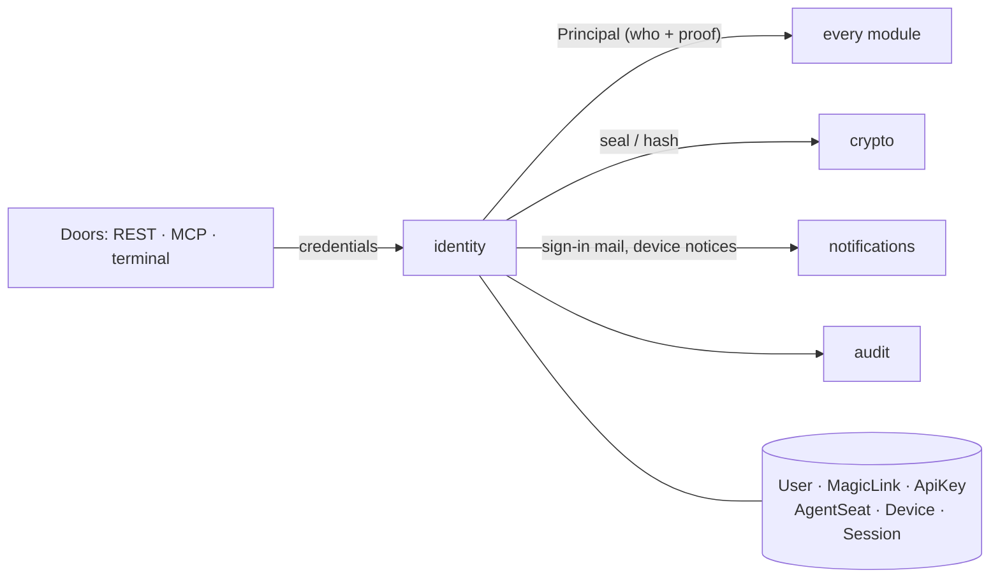

*Walking tour:* credentials arrive from any door at the left;
identity verifies them against its own tables (bottom) using
crypto's hashing and sealing, and hands the rest of the system a
single thing — a resolved Principal. Sign-in email and device
notices leave through notifications; everything consequential is
written to audit.

## 2. groups — membership, roles, settings, and the group's own life

**Job.** The group as a social fact: who belongs, in what role,
under what settings; sub-groups and chapters; and the two
sovereign acts — export and erasure. Every permission question in
the system is answered here, as *role in this group*, never as a
global flag.

**Public surface.**
- `groups.create` / `.update` / `.read` — the group and its
  profile (home timezone, default place, visibility).
- `groups.membership.add` / `.remove` / `.set_role` — the role
  ladder owner > admin > organiser > member > guest; a seat's
  membership is the same row kind as a human's.
- `groups.settings.get` / `.set` — one validated, audited settings
  schema: review-queue rules, reminder defaults, digest day, AI
  budget pointer (B-111).
- `groups.subgroups.*` — chapters inside a group, roles optionally
  separate (B-105).
- `groups.export.request` / `groups.erase` — owner-only; erasure
  is the hard-delete service every other module answers to
  (Phase 13).

**Tables owned.** `Group`, `Membership`.

**Offers.** Role and membership answers to every module ("may
this principal, in this group, do X?"), group settings to whoever
must honour them. **Consumes.** `identity` (principals exist
before they belong), `audit`, `crypto` (erasure drives key
destruction for the group's data keys).

**Invariants.** The last owner can never leave or be demoted —
the operation refuses (Doc 02 A.2). Role changes are audit-logged
and take effect on the next request. Nothing about a private group
— not even that it exists — is visible to a non-member.

**Failure modes.** Erasure is deliberately *not* transactional
across the whole system: it proceeds module by module under one
erasure job, each module confirming its part, and the job is
visible until complete — a half-erased group is a Doctor finding,
never a quiet state.

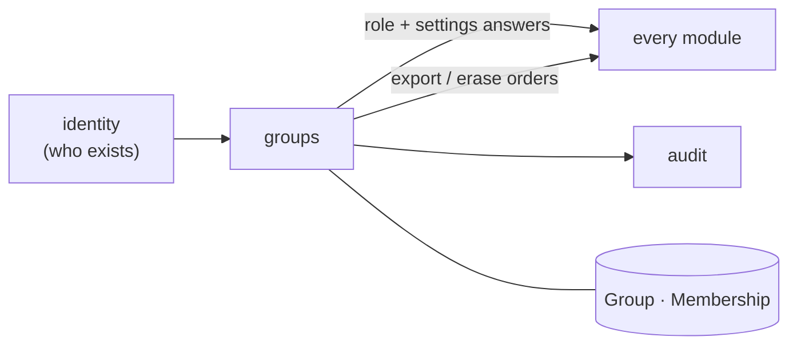

*Walking tour:* identity supplies the people; groups decides what
each of them *is* inside one group. Every other module asks groups
before it acts, and obeys groups' two sovereign orders — export
and erase — when they come.

## 3. sources / ingest — everything the group hands the app to read

**Job.** Accepting material — pasted chat, uploaded files,
newsletters, flyer and board photos, links, forwarded email, voice
notes, connected live chats — recording *who gave it, when, and
under what permission*, storing it sealed, and cutting it into
ordered chunks the pipelines can cite. Sources is the system's
memory of *where words came from*; it never interprets them.

**Public surface.**
- `sources.ingest` — one entry for every kind (`chat_paste`,
  `chat_live`, `newsletter`, `flyer`, `board_photo`, `email`,
  `link`, `voice`, `file`); returns source + ingest job id.
- `sources.chunks.read` — ordered chunks (text, or image regions
  for boards) with sender and sent-at where known.
- `sources.permission.record` / `sources.revoke` — the permission
  record is part of the source, visible to members; revoking a
  live source stops reading immediately.
- `sources.email_in.receive` — the per-group email-in address
  lands here (the address is a secret; treat it like a password).
- `sources.uploads.begin` / `.chunk` / `.complete` — the resumable
  upload session (B-171) that files (§13) also uses.

**Tables owned.** `Source`, `SourceChunk`, `IngestJob` (the
ingest-flavoured view over the `Job` row that does the work).

**Offers.** Chunks with provenance to extraction and memory-ask;
source metadata to review (the queue shows *where a draft came
from*). **Consumes.** `files` (raw bytes live there, sealed),
`jobs` (ingest and extraction are jobs), `crypto`, `audit`.

**Invariants.** A source without a permission record does not
exist — ingest refuses it. Raw material is immutable once stored:
corrections happen in candidates, never by editing the source
(Doc 01 §14). Live sources stop the moment permission is revoked;
drafts already made stay, labelled with the permission that stood
when they were made.

**Failure modes.** A 60%-uploaded file is a paused upload, never a
failed one — resume continues from the last verified chunk. A
malformed file yields a source in a plainly failed state with the
reason, not a silent drop. Email-in from an unknown sender is
quarantined, not ingested.

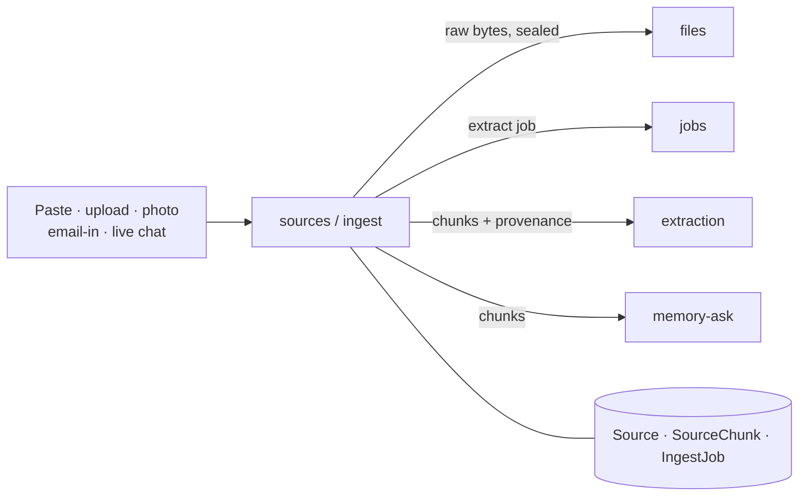

*Walking tour:* material enters at the left in any of its kinds;
sources stores the raw bytes through files, keeps the permission
record and the chunks in its own tables, and starts the extraction
job. Interpretation is not its job — extraction and memory read
its chunks and cite them.

## 4. extraction — talk becomes structured drafts

**Job.** The AI heart for *new* material: reading chunks (text or
flyer regions) through the single model adapter and producing
structured drafts — event, task, decision, and question candidates
— each field carrying a confidence and a provenance quote or
region. Extraction proposes; it has no publishing power at all.
The pipelines end-to-end are Doc 07; this chapter is the module
contract.

**Public surface.**
- `ai.extract` — run extraction over a source (kind selects the
  schema set); creates candidates through review, never directly.
- `ai.rerun` — re-run with a newer prompt version; new candidates
  supersede old *pending* ones, history untouched (B-045).
- `ai.evaluate` — run the golden-set harness (B-046/B-285) and
  report per-field precision/recall.
- Internal only: the adapter itself — `complete_text`,
  `complete_json`, `read_image`, `transcribe` — is *not* a bus
  operation other modules may call; pipelines are the surface, so
  prompt versions, budgets, and validation cannot be bypassed.

**Tables owned.** `AiUsage` (the cost ledger: model, tier, tokens,
cost, per call — B-037/B-047). Prompt templates are versioned
files in the repo, not rows. Candidates belong to review (§5).

**Offers.** Drafts (via review) and the cost ledger (to admin and
to the evidence registry). **Consumes.** The model adapter and its
drivers (live / fixture / mock / local — D-18, B-119), `sources`
(chunks), `review` (`candidates.create`), `jobs`, `audit`.

**Invariants.** Every field of every candidate carries a quote
that *exists* in the source or a region that exists on the flyer —
a quote that fails validation marks the field **unsupported**,
never silently passes (B-040). Dates are resolved by the
deterministic date module, never by the model (D-22). The group's
daily AI budget is a hard stop: at the cap, extraction queues and
the queue says "paused — budget" (B-047).

**Failure modes.** Model down or rate-limited → jobs retry with
backoff; the source waits, visibly. Schema-invalid model output →
one repair retry, then a failed job with the raw response kept for
the evaluation corpus — never a half-parsed candidate. Vision
partial success (3 of 4 posters) is a first-class state (B-069).

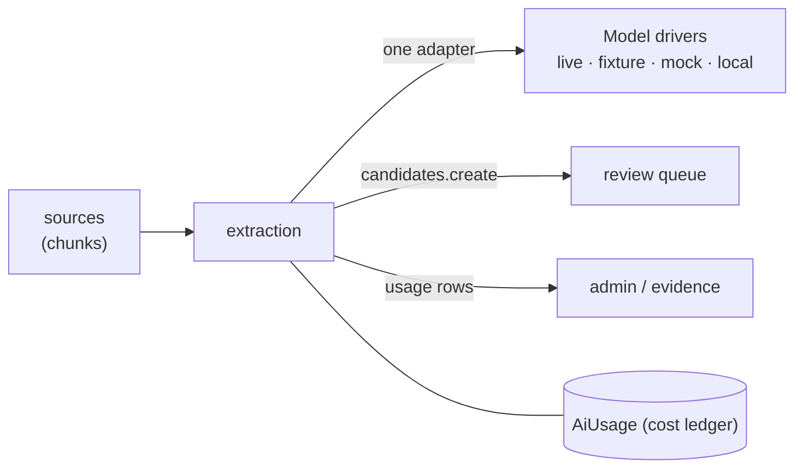

*Walking tour:* chunks come in from sources; extraction reads them
through the one adapter (bottom right — four drivers, one
interface), validates and scores what comes back, and hands drafts
to the review queue. Every call is written into the cost ledger it
owns, so spend is a fact, not an estimate.

## 5. review queue — the human gate in front of everything

**Job.** Holding every AI draft — and every proposed change — in
front of a person with the authority to decide, showing the
evidence beside the claim, and minting the real entity on approval.
This module is the product's trust centre: the *only* road from
draft to published runs through it (B-043).

**Public surface.**
- `candidates.list` / `candidates.read` — filter by kind, status,
  confidence; read returns the draft *with full provenance*.
- `candidates.edit` — correct a draft before deciding (edits are
  the reviewer's own, recorded as such).
- `review.approve` — mint the entity through the owning module
  (event, task, decision, question, or change) and link it back.
- `review.reject` — discard with a reason; the draft and its
  provenance stay in history.
- `review.merge` — two candidates (or candidate + existing event)
  become one, field by field, all sources kept (B-076).
- `candidates.supersede` — mark pending drafts replaced by a
  re-run (called by extraction, never by hand-waving).

**Tables owned.** `Candidate`, `Provenance` (candidate field →
exact quote / flyer region).

**Offers.** The queue itself to every door; approval outcomes to
the owning modules. **Consumes.** `events`, `tasks`, `decisions`
(the mint calls), `groups` (who may approve — organiser+, per
group settings; seats: never below the role a human would need,
and never their own drafts by default, B-203), `audit`.

**Invariants.** There is no bulk-approve and no setting that lets
an AI draft skip the queue (Doc 02 A.1–A.3). Approval is the only
mint: no module may create a published entity from a candidate by
any other path, and the security suite tests every bypass it can
invent. A candidate's provenance is immutable once created.

**Failure modes.** Two approvers at once → optimistic locking
gives one a clean win and the other a 409 with the current state
(B-236). Mint failure mid-approval → the whole transaction rolls
back; the candidate stays pending — approval is atomic or it did
not happen.

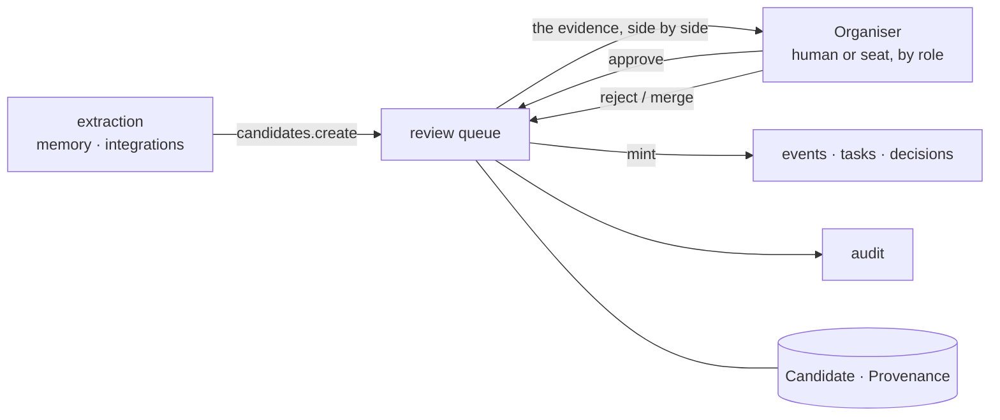

*Walking tour:* drafts arrive from extraction, memory, and
integrations; the queue presents each with its evidence to an
organiser; approval mints the real thing in the owning module,
rejection and merge stay on the record, and every decision lands
in audit.

## 6. events / calendar — the group's shared truth about time

**Job.** Events themselves — minted by approval or by direct
organiser entry — their recurrence, their changes and
cancellations, and every way of *reading* time the group needs:
agenda, month, the Saturday-night "tonight" view, search, conflict
flags, iCal feeds and files, and the discussion threads that hang
under events.

**Public surface.**
- `events.mint_from` — create from an approved candidate (bus
  only; called by review) or `events.create` for direct organiser
  entry, which records a manual source.
- `events.update` / `.cancel` / `.clone` — every change writes an
  `EventChange`; material changes set `needs_reannounce`.
- `events.agenda` / `.month` / `.tonight` / `.search` —
  occurrence-expanded reads; the frontend does zero date maths.
- `events.ics` / `events.feed.issue` / `.revoke` — per-event files
  and the per-group secret feed (Doc 15 for the wider calendar
  world).
- `events.conflicts` — overlapping host/place/resource flags:
  flags, never blocks (B-057).
- `events.discuss.*` — threads and comments under an event (the
  thread machinery is generalised by tasks/decisions/polls, B-084).

**Tables owned.** `Event`, `EventSourceLink`, `EventChange`,
`Recurrence`, `CalendarFeed`, `ChecklistItem`, `Thread`,
`Comment`.

**Offers.** Published events (only) to reminders, digests,
integrations, memory; occurrence data to every calendar surface.
**Consumes.** `review` (its mint), `groups`, `reminders` (schedule
on publish/change — called in the same transaction's job
enqueue), `audit`, `crypto` (feed tokens are secrets; stored
hashed).

**Invariants.** A draft event appears in no feed, digest, or
integration — published is a bright line (B-049). Cancelled events
are emitted as *cancelled*, never silently vanished, in every
feed. Times are stored in UTC with the event's IANA timezone
beside them; a datetime without a timezone is a bug (D-21).
Deleted events tombstone for 30 days (B-080).

**Failure modes.** A recurrence over a DST change keeps local
wall-time (golden-tested, B-052). A feed-token leak is fixed by
revocation, which is instant and total. Change alerts are
reminders' problem (§11) — events records the change and flags
`needs_reannounce`; it never sends anything itself.

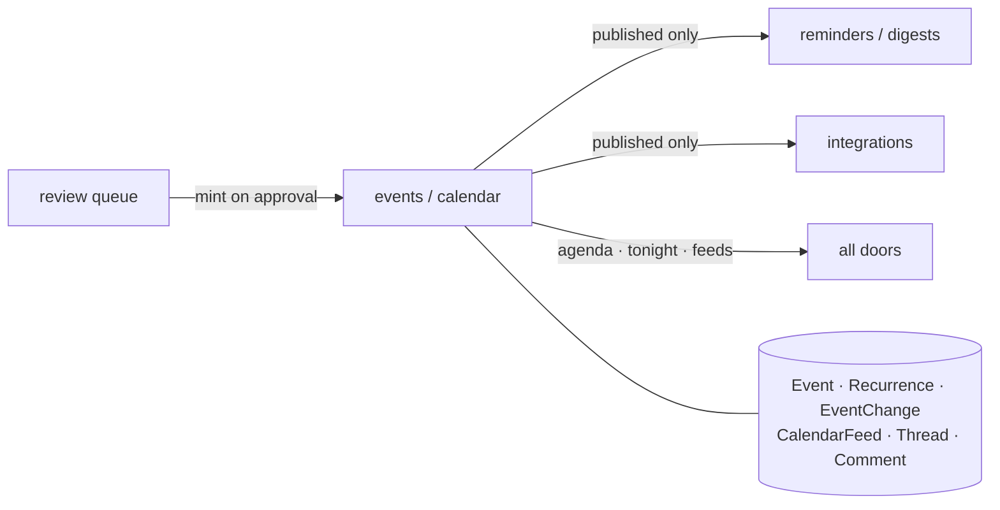

*Walking tour:* the only road in is approval (or an organiser's
own direct entry). From the event tables at the bottom, three
roads out: reminders and digests hear about published events,
integrations publish them outward, and every door reads the
calendar views. Drafts travel none of these roads.

## 7. tasks — who is doing what, visibly

**Job.** The group's commitments: tasks minted from approved
candidates or created directly, with owners, due dates, and an
honest To do / Doing / Done life. The module's moral centre:
**unclaimed is a visible state** — the AI may never silently
assign a task to a person who did not take it (B-083).

**Public surface.**
- `tasks.create` — from candidate (via review) or direct.
- `tasks.list` — per group, per event, per owner; overdue computed
  server-side.
- `tasks.claim` / `.release` / `.update` / `.complete` — claim is a
  principal's own act; assignment by an organiser is recorded as
  assignment, not disguised as a claim.
- `tasks.discuss.*` — the shared thread machinery (§6) attached to
  a task.

**Tables owned.** `Task`.

**Offers.** Task state to digests, briefings, and the "state of
the plan" read. **Consumes.** `review`, `events` (a task may hang
under an event), `groups`, `audit`.

**Invariants.** A task with no owner reads `unclaimed` in every
projection. Completing a task is the owner's or an organiser's
act, recorded with who and when. Tasks inherit the approval law:
an extracted "I'll book the hall" is a *candidate* until the queue
says otherwise.

**Failure modes.** Owner leaves the group → their open tasks
become unclaimed and are listed in the admin's gap view; they are
never reassigned by the system. Due dates in the past are a flag,
not an error.

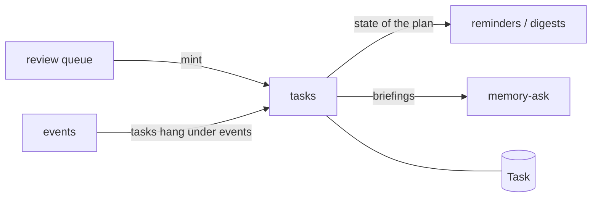

*Walking tour:* tasks arrive from the queue, optionally attached
to an event; their state flows out to digests and briefings as the
honest picture of what is claimed, done, and still nobody's.

## 8. decisions — what the group has settled, and what it hasn't

**Job.** Two ledgers that keep a group honest: the **decisions
log** (what was agreed, when, from what words — with supersede
chains so "our current position" is always answerable) and the
**open questions** list (what was raised and never settled, each
with an asked-of member, until it is resolved). A question
resolving can mint a decision in the same act (B-086).

**Public surface.**
- `decisions.record` — from candidate (via review) or direct.
- `decisions.current` — the settled-truth read: latest of every
  chain.
- `decisions.supersede` — link a new decision over an old one;
  both are kept.
- `questions.list` / `.assign` / `.resolve` — resolve optionally
  carries the decision it produced.
- `questions.gaps` — the "what is still missing?" aggregation for
  an event: open questions + missing fields + unclaimed roles
  (computed with events and tasks).

**Tables owned.** `Decision`, `OpenQuestion`.

**Offers.** Current truth to memory-ask (briefings cite it),
search, and every projection that says "we decided…".
**Consumes.** `review`, `groups`, `events`/`tasks` (for gaps),
`audit`.

**Invariants.** History is never rewritten: a superseded decision
stays readable with its chain intact. An open question cannot be
closed by silence — only by a resolution or an organiser's
explicit close, both recorded. The AI drafts both kinds; the queue
mints both kinds; there is no third road.

**Failure modes.** Contradictory current decisions are a data-
quality flag (B-081), surfaced to organisers — the module reports
the contradiction; it does not pick a winner.

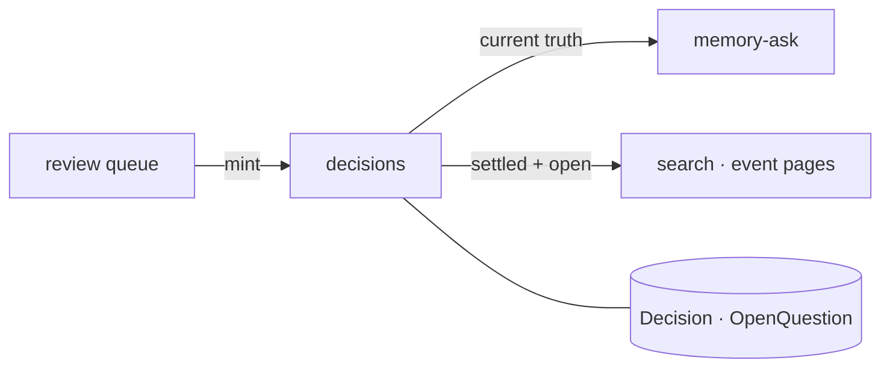

*Walking tour:* approved drafts become decisions and questions;
the current-truth read flows to memory-ask and to the surfaces
that answer "what did we decide?" — always with the chain behind
it one step away.

## 9. polls — one member, one current vote

**Job.** Group choices with a closing time: pick a date, pick a
place, pick between options. A poll may hang on the group or on an
event; a winning date-poll can become (or move) the event, on an
organiser's act.

**Public surface.**
- `polls.create` — options, closes-at, attachment.
- `polls.vote` — cast or *change* a vote until close; humans and
  seats vote identically.
- `polls.close` / `polls.results` — tallies are read from committed
  votes only.
- `polls.winner_to_event` — organiser act that hands the winning
  option to events.

**Tables owned.** `Poll`, `PollOption`, `PollVote`.

**Offers.** Results to event pages, digests, and planning reads.
**Consumes.** `groups` (who may vote: members, not guests, unless
the poll says so), `events`, `audit`.

**Invariants.** One member, one *current* vote per poll — enforced
by a unique constraint, not by hope; the vote commits before the
tally is answered (the commit-before-answer law, B-087). Votes are
attributed; anonymous polls do not exist in this design, and the
API offers no per-person breakdown beyond what the group's own
settings show its members.

**Failure modes.** Concurrent last-second votes converge on the
constraint; the loser of the race gets the current tally, not an
error storm. A poll whose event is cancelled closes with it,
visibly.

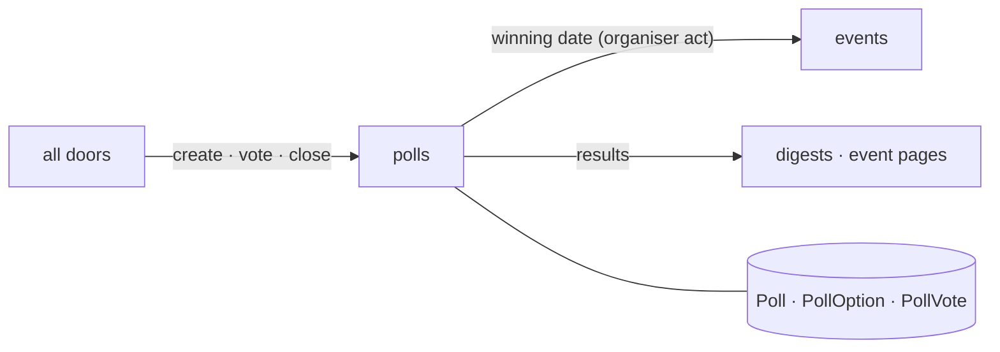

*Walking tour:* doors drive the poll's life; the one-vote
invariant is guarded by the tables at the bottom; a winner becomes
an event only when an organiser says so — the poll proposes, like
everything else here.

## 10. invites — bringing people to an event, inside and outside

**Job.** Invitations and answers: invites to members and to
outside email addresses, RSVP by signed link for people with no
account, the coming / can't / maybe record, guest counts, capacity
and the waitlist. This module owns the *answer*; events (§6) owns
the occasion.

**Public surface.**
- `invites.send` — a request that lands in the outbox
  (notifications sends; invites never sends inline).
- `invites.accept_link` — verify a signed RSVP token (tampering
  fails closed), record the answer, offer an account afterwards.
- `rsvps.set` / `rsvps.list` — the signed-in road, and the roster
  read (by role projection: guests see less).
- `rsvps.waitlist.promote` — a freed place offers the next in line,
  with a notification job; the offer expires visibly.

**Tables owned.** `Invite`, `Rsvp`.

**Offers.** Rosters and headcounts to events, reminders (who gets
told about a change), and briefings. **Consumes.** `notifications`
(the actual sending), `events` (capacity, cancellation),
`identity` (outside answers stay attributed to the invite, never
to an invented account), `audit`.

**Invariants.** An outside RSVP is attributed to its invite —
never silently merged into a later account without the person's
own act. Token links are single-purpose (this event, this
invitee), expiring, and revocable with the event. Waitlist order
is arrival order; the system never re-ranks it.

**Failure modes.** A bounced invite address is a deliverability
record (notifications, §14), visible to organisers — not a retry
loop. Capacity races resolve on the constraint: the last place
goes to exactly one answer.

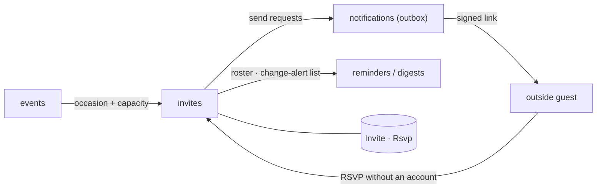

*Walking tour:* events supplies the occasion; invites issues the
asking — always through the outbox — and records every answer,
including the account-less guest's, in its own tables. Reminders
read the roster from here when an event moves: only the people who
said *coming* get the change alert (B-097).

## 11. reminders / digests — the system speaks, on schedule, politely

**Job.** Time-driven speech: per-event reminders (a week before, a
day before, the morning of — group-configurable) and the weekly
digest ("your week with the group"), composed from committed
facts, sent through the outbox as jobs, and always carrying the
useful facts — place, bring-list, *what changed* — never a bare
title (B-096, B-099).

**Public surface.**
- `reminders.schedule` / `.reschedule` — called by events on
  publish and on material change, in the same transaction's job
  enqueue: a moved event's old reminders are cancelled and new
  ones materialised atomically.
- `reminders.hold_check` — quiet hours are honoured here: a
  reminder landing in a member's quiet hours is held, not dropped
  (the one exception — a same-day cancellation — must be marked
  urgent by an organiser, a person, never inferred).
- `digests.compose` / `.preview` / `.send` — compose from the
  state-of-the-plan read + the week ahead; store the rendered
  `Digest` row in HTML and plain text.
- `reminders.wording` — optional AI rephrasing (B-103) around
  template-guaranteed facts; both versions are stored, and a
  fact-preservation test guards the road.

**Tables owned.** `Reminder`, `Digest`.

**Offers.** Scheduled speech to notifications; the digest as a
group artefact (it can itself become a source for next month's
extraction — the loop closes, B-118). **Consumes.** `jobs` (every
reminder and digest run *is* a job), `notifications`, `events`,
`tasks`/`decisions` (state of the plan), `identity` (per-member
channels and quiet hours), `audit`.

**Invariants.** A reminder is a *row* (`Reminder` → `Job`) before
it is a message; killing the mail server cannot lose it (§14's
outbox law). The digest contains only published, committed facts
— a digest is rendered from the same reads the doors use, never
from a private cache. Unsubscribe and preference changes take
effect before the next send is composed, not after it is queued.

**Failure modes.** Event cancelled → its pending reminders die
with it, in the same transaction. Digest compose failure → the
group gets no digest that week *and* the admin sees a failed job
with the reason; a partial digest is never sent.

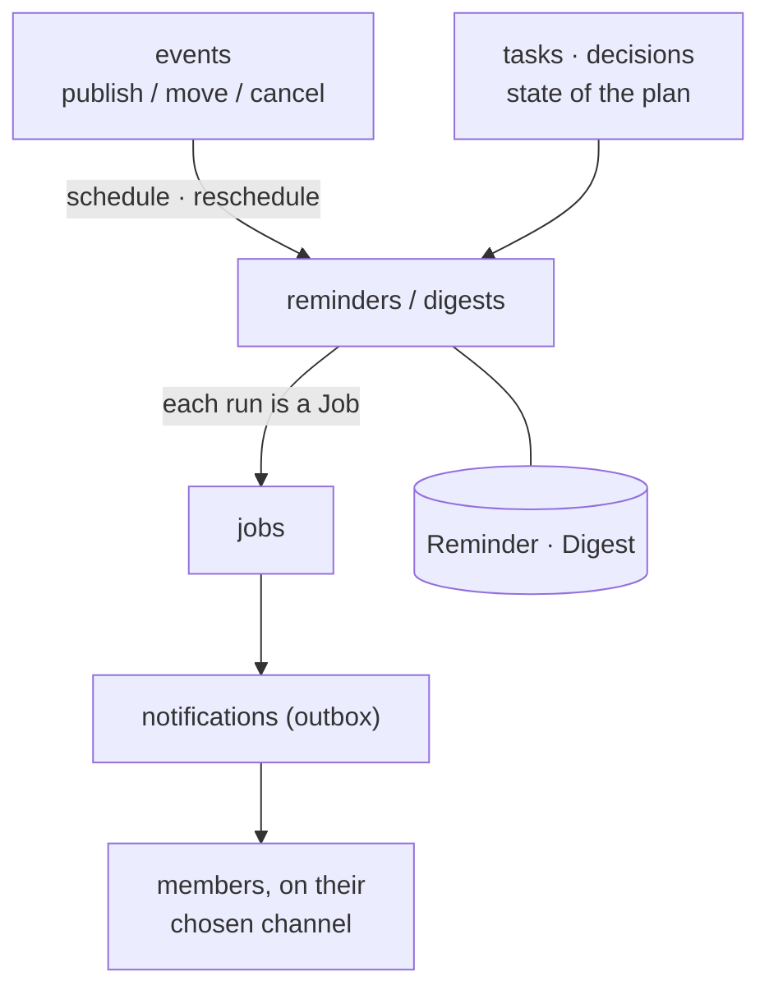

*Walking tour:* events trigger scheduling; digests additionally
read the state of the plan. Everything this module wants to say
becomes a job, and every job's sending goes through the outbox —
so timing, retries, quiet hours, and records all live in exactly
one place each.

## 12. memory-ask — the group's past, answerable with receipts

**Job.** Geoffrey's context-pruning engine and everything built on
it: asking the group's approved history a question and getting an
answer **with citations**, event briefings, post-event recaps, and
discussion summaries. The engine prunes the group's *own* context
— it is explicitly **not** RAG: no embeddings, no vector store; a
full model reads chunks and judges relevance to the question
(Phase 10; the full working is Doc 07 §7).

**Public surface.**
- `memory.ask` — question → prune → answer with per-claim
  citations; an answer whose citations fail the quote check
  returns "I couldn't verify this" (B-115).
- `memory.briefing` — assemble an event briefing: relevant past
  decisions, last time's recap, open questions, role gaps.
- `memory.recap` — draft a post-event recap (a *draft*: it becomes
  memory only through approval).
- `memory.summarise` — summarise a thread; decisions and next
  actions inside a summary are extracted as *candidates* for the
  queue, never written directly (B-116).
- `memory.runs.list` / `.purge` — transparency: every prune/ask
  run, what was kept, what was dropped, what it cost (B-120).

**Tables owned.** `Summary` (ask answers, briefings, recaps,
summaries), `PruneRun` (input size, kept/pruned chunk ids, model,
cost — the pruning audit record).

**Offers.** Cited answers and drafts to every door; recap and
summary candidates to review. **Consumes.** `sources` (the chunks
being pruned), `decisions` (settled truth weighs first),
`extraction`'s adapter *drivers* via its own pipeline operations
(the pruning passes are this module's own code, Phase 10),
`review`, `jobs`, `audit`.

**Invariants.** Memory reads **approved history only** — pending
drafts and rejected candidates are not the group's past. Every
claim in an answer carries a citation that survives the same
quote-existence check as extraction (B-040's rule, reused). A
prune run drops chunks *visibly*: the run record names what was
dropped, so "the model ignored it" is always checkable.

**Failure modes.** Unverifiable question → the honest refusal
above, not a guess. Pruning may run on local inference while
extraction runs on hosted models (per-group setting, B-119); if
the configured engine is down, ask degrades to search over
decisions + summaries and *says so* in the answer.

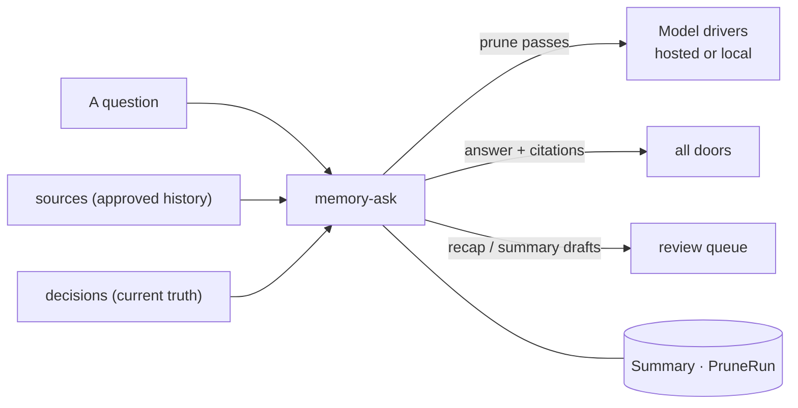

*Walking tour:* the question meets the group's own chunks and its
settled decisions; the pruning passes (right, over the model
drivers) shrink the context to what is relevant, in order, with
provenance; the answer leaves with citations, and anything the run
produced that looks like a fact about the future — a recap, a
summary's decision — goes to the queue like every other draft.

## 13. files — sealed storage for everything uploaded

**Job.** The bytes: flyers, board photos, documents, voice notes,
exports. Files stores and retrieves them through the storage
interface (local disk first, S3-compatible later, D-17), encrypted
per file, with their hashes and — by law — their **alt text**: a
real spoken-style description, whose status (`complete` /
`flagged`) travels with the asset everywhere it is shown (B-065).

**Public surface.**
- `files.store` — complete a resumable upload session (§3) into a
  stored asset; verifies the final sha256 before accepting.
- `files.read` — authorised retrieval only, inside a request or a
  job; there is no public file URL for sealed material.
- `files.alt.set` / `.flag` — record or complete the description;
  a vision pass may draft it (via extraction), a human completes
  it.
- `files.variants` — thumbnails and previews, sealed like their
  parents.

**Tables owned.** `FileAsset`, `Flyer` (the flyer as a *reading*
artefact: parent board photo, region box, transcript, alt text —
the file's bytes themselves are a `FileAsset`).

**Offers.** Sealed byte storage to sources, events (flyer walls),
admin (exports). **Consumes.** `crypto` (per-file keys wrapped by
the group key, B-168), the storage driver beneath it, `audit`.

**Invariants.** Bytes on disk are ciphertext — the raw-disk grep
test must find neither an uploaded picture's bytes nor a planted
text file's contents (B-168). No filesystem path ever leaks into
an API response: the outside world sees asset ids. An asset with
placeholder alt text is served *flagged*, never silently
"complete".

**Failure modes.** Hash mismatch at upload completion → the asset
is refused and the session stays resumable; nothing half-stored
is ever readable. Storage driver failure surfaces as job failure
for writers and a plain error for readers — never as a silently
empty file.

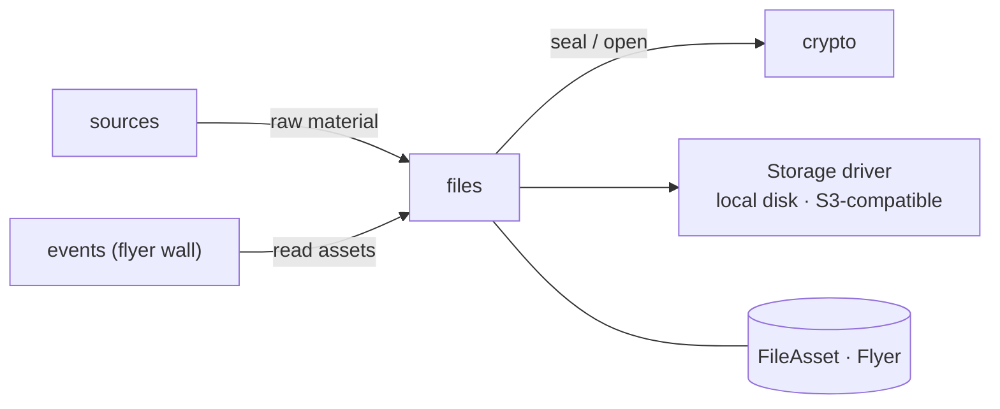

*Walking tour:* sources and events deal in asset ids; files alone
knows where bytes live, seals them through crypto onto the
driver below, and opens them only inside an authorised act.

## 14. notifications — the outbox: nothing is sent inline, nothing fails silently

**Job.** Every outbound message that is not a calendar feed:
email, phone push, Messenger where connected, and the in-app
inbox. The pattern is the **outbox**: a request that creates a
notification never sends it — it writes a row, and a job sends it.
A mail outage can therefore never fail an RSVP (B-095).

**Public surface.**
- `notify.request` — the one call every module uses: recipient,
  channel preference, kind, body parts (facts, not finished prose,
  where wording rules apply).
- `notify.deliver` — the job handler: resolve the member's channel
  + quiet hours, send, record the outcome.
- `inbox.list` / `inbox.mark_read` — the in-app mirror; inbox and
  email never disagree about what was sent (B-101).
- `notify.deliverability` — bounce/complaint records and the
  admin-visible failure list (B-102).

**Tables owned.** `Notification` (recipient, channel, subject,
body, status, sent-at, error — the delivery record).

**Offers.** Sending as a service to identity, invites, reminders,
integrations, doctor (alerts). **Consumes.** `jobs`, `identity`
(preferences, devices for push), `groups` (digest day, channel
settings), channel drivers beneath it (SMTP, Web Push/APNs/FCM —
Phase 22), `audit`.

**Invariants.** Status is a lifecycle (`queued / sent / failed /
dead`), and `dead` is *visible* — an address that keeps failing
appears on the admin list; nothing retries forever and nothing
fails in silence. Bodies are composed from committed facts only.

**Failure modes.** Channel down → retries with backoff inside the
job lifecycle (Doc 03 §6); other channels for the same member are
unaffected (bulkheads, B-173). A member with every channel off
still has the inbox — the floor is never zero.

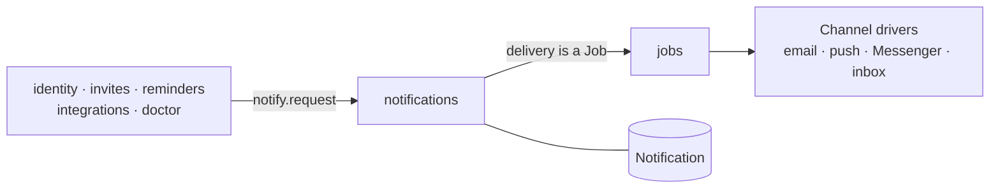

*Walking tour:* five kinds of caller ask for a send; notifications
writes the row first (bottom), hands delivery to the job system,
and the channel drivers do the talking. The record outlives the
message — that is the point.

## 15. integrations — the governed roads to other systems

**Job.** Connections outward, each one explicit, permissioned,
and revocable: Facebook Events, Google Calendar, Samtal (as source
and as first host), outbound webhooks, and the calendar/office
sync of Phase 23 (Doc 15). An integration is a *guest with a
pass*, never a merge: the outside system never gains write access
to the group's truth except as review-queue candidates.

**Public surface.**
- `integrations.connect` / `.disconnect` / `.health` — per group,
  per kind; config stored sealed; token health shown in plain
  words (working / expired / what to do).
- `integrations.facebook.create_event` — creates the real Facebook
  Event from a published GPA event **only on a human's press**;
  the draft itself (B-058) is events' work.
- `integrations.google.publish` — one-way copy out of published
  events; Google-side edits are *not* read back in this design
  (they would bypass the queue); the two-way design returns edits
  as candidates (Doc 15, B-269 → B-271).
- `integrations.webhooks.fire` / `.test` — signed outbound
  notifications of published/changed/cancelled; deliveries and
  retries inspectable; a failing endpoint degrades itself, never
  the group.
- `integrations.samtal.*` — the bridge operations and the host
  panels data (Doc 16).

**Tables owned.** `Integration`, `WebhookDelivery`, `SyncLink`
(the per-app calendar sync bindings of Phase 23).

**Offers.** Governed outward roads to events, sources (live
chats arrive through here into §3), and hosts. **Consumes.**
`groups` (an admin connects; a member cannot), `crypto` (tokens
sealed at rest), `jobs` (sync and webhook delivery are jobs),
`review` (everything inbound becomes candidates), `audit`.

**Invariants.** Disconnect is one act and immediate; the
permission record remains visible to members. Inbound edits from
any connected system are *candidates*, always — there is no sync
mode that writes past the queue. Secrets are shown once at
creation and stored hashed or sealed, never recoverable from the
UI.

**Failure modes.** A dead external API opens its circuit breaker
(B-173) and the integration board shows it in plain words;
published events wait, queued, they do not vanish. Webhook
endpoints that fail repeatedly are paused with the reason on the
record.

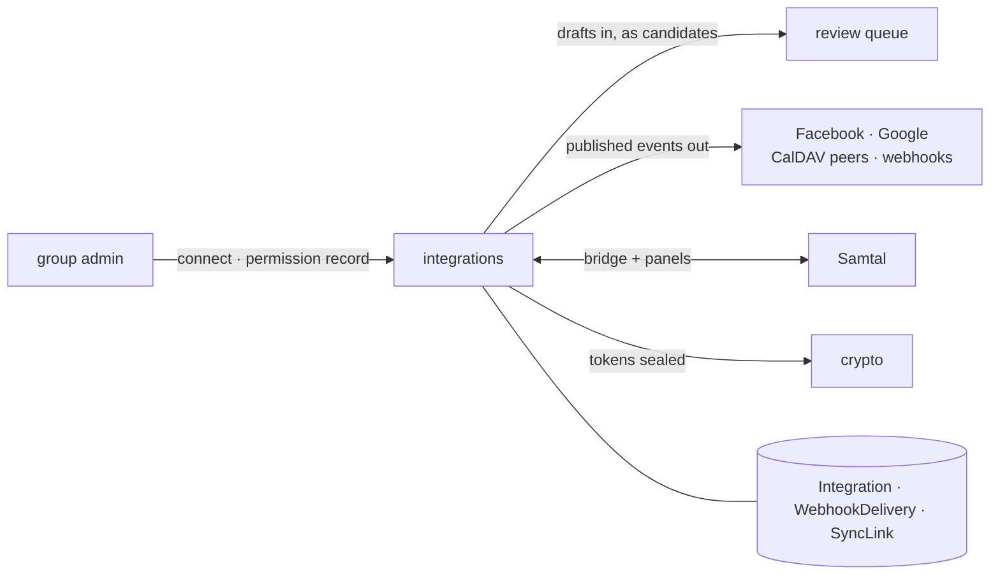

*Walking tour:* an admin's act opens each road, and the record of
it is member-visible. Traffic in arrives only as queue
candidates; traffic out carries only published events; Samtal is
both a source and a host on the same governed terms as everyone
else.

## 16. internal API bus — the one road between parts (Doc 05)

**Job.** The road itself: the operation registry (operation →
owning module → required scope), the envelope (AES-256-GCM seal +
Ed25519/HMAC signature), service identities, replay defence, the
transports, and the call audit. The bus owns no domain behaviour —
it is the reason every other module can be trusted to behave as if
it were alone with its tables. Doc 05 is this module's full
specification.

**Public surface.**
- `internal.register` — a module declares its operations and
  scopes at startup; undeclared operations do not exist.
- `internal.call` — the client SDK every module uses: build
  envelope, seal, sign, transport, verify reply.
- `internal.identities.issue` / `.rotate` — per-module service
  identities (certificate + key id) from the internal CA.
- `internal.verify` — the gateway side: signature → scope →
  freshness → decrypt, in that order.

**Tables owned.** `ServiceIdentity`, `InternalNonce` (the
seen-nonce store inside the replay window). The registry itself
lives in code, versioned with the release.

**Offers.** Trusted transport + caller authentication to every
module. **Consumes.** `crypto` (the internal communications key —
separate from all data keys, separately rotatable), `audit`
(every call logged by caller, operation, scope, result — never by
payload).

**Invariants.** Unsigned, mis-signed, out-of-scope, or stale
messages are rejected and audit-logged *in that checking order*, so
probes learn as little as possible (§6A.4). A compromised part
cannot impersonate another part, read its traffic, or replay its
messages — that is the module's whole reason to exist.

**Failure modes.** The bus never degrades to plaintext: a
transport or key failure is a hard failure of the call, surfaced
and audited — there is no fallback mode in which modules "just
talk directly". Rotation overlaps old and new keys so rotation
itself never stops the system (B-164).

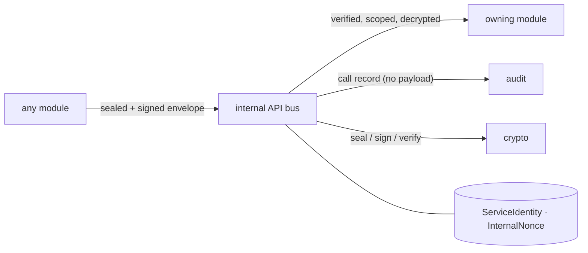

*Walking tour:* a caller hands the bus an envelope; the bus
verifies and delivers it to the owning module, writes the
payload-free record to audit, and does all of its cryptography
through crypto. The two tables at the bottom are the identities it
trusts and the nonces it has already seen.

## 17. crypto — sealing, keys, and the honest boundary

**Job.** All cryptography, in one owned place: envelope
encryption of fields and files (AES-256-GCM, master key outside
the database wrapping per-group data keys), keyed-HMAC indexes for
fields that must stay searchable while sealed, password hashing
(Argon2id — a different treatment from encryption, on purpose),
the internal communications key, key rotation, and the owner's
scrypt-escrowed recovery codes. Doc 08 is the deep treatment;
this chapter is the contract.

**Public surface.**
- `crypto.seal` / `crypto.open` — field-level sealing in the
  versioned `enc:v1:` format, per group key.
- `crypto.index` — the keyed HMAC lookup value for a sealed field
  (email lookup works without ever decrypting the column).
- `crypto.hash_password` / `.verify_password` — Argon2id.
- `crypto.keys.rotate` — re-wrap data keys under a new master or
  comms key, no downtime, no flag day (B-169).
- `crypto.recovery.mint` / `.redeem` — recovery code sets;
  minting a new set kills the old (Doc 02 B.3).

**Tables owned.** `GroupDataKey` (each group's data key, stored
*wrapped* under the master key — the master key itself is never in
the database).

**Offers.** Sealing and key services to every module.
**Consumes.** Nothing inside the system except the OS keyring /
environment for the master key, and `audit` for key operations.

**Invariants.** Key material never appears in code, git, a ZIP, a
backup, a log, or a Doctor bundle — each of those is grep-tested
(B-145/B-169). The honest boundary is this module's first
docstring and Doc 08 §1: this is encryption **at rest**; the
server can read what it serves.

**Failure modes.** Master key unavailable at boot → the server
starts in the Doctor's arms: it refuses sealed reads, says
exactly what is missing in plain words, and offers the recovery
road — it never falls back to storing plaintext "temporarily".

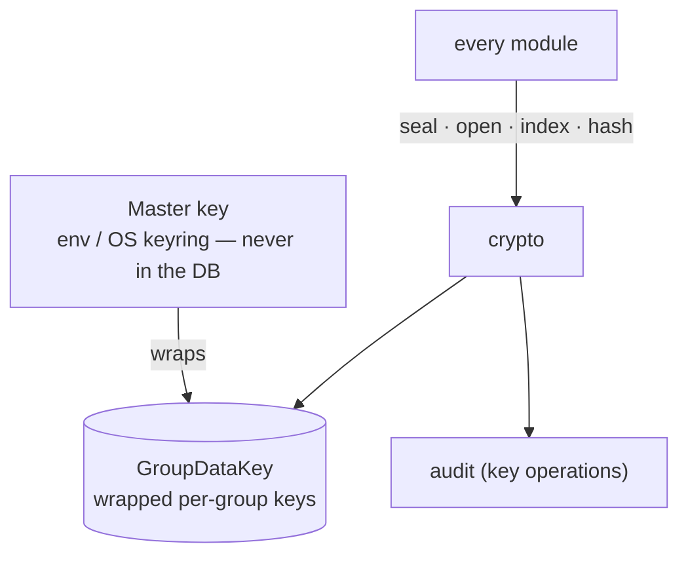

*Walking tour:* the master key lives outside the system and wraps
each group's data key (stored wrapped, bottom). Every module's
sealing, indexing, and password work funnels through this one
module — so the day the algorithms rotate, exactly one place
changes.

## 18. jobs — the queue that is a table

**Job.** All deferred work: ingest, extraction, sends, sync,
repairs, backups, the scheduler's materialised reminders and
digests. A job is a database row before it is work (D-09); the
scheduler is this module's 30-second tick writing due rows
(D-10). Doc 03 §6 is the lifecycle; this chapter is the contract.

**Public surface.**
- `jobs.enqueue` — write a job row (payload sealed with the
  internal key) in the caller's own transaction.
- `jobs.lease` / `.heartbeat` / `.complete` / `.fail` — the worker
  protocol: claim with a lease, prove liveness, finish or fail
  with the reason recorded.
- `jobs.schedule` — register a recurring intent (reminder,
  digest, watchdog check) that the tick materialises.
- `jobs.resurrect` — the recovery manager's road back for expired
  leases (B-172).

**Tables owned.** `Job` (kind, sealed payload, `run_at`, status,
attempts, lease, last error).

**Offers.** Reliable deferral to every module. **Consumes.** The
bus (a job's *work* is bus calls to owning modules), `crypto`
(payload sealing), `audit`.

**Invariants.** No job exists only in memory. Attempts are
bounded; exhaustion lands in `failed_visible`, listed for humans —
never in a silent dead-letter nobody reads. Idempotency keys ride
inside job payloads for create-type work, so a resurrected job
cannot double-create (D-15).

**Failure modes.** Worker death is normal and handled by lease
expiry (Doc 03 §6). A poison job (fails deterministically) is
quarantined after its attempts with its payload intact for
diagnosis — the Doctor (§23) reads exactly this state.

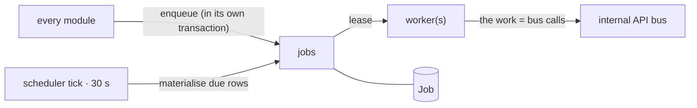

*Walking tour:* anyone may enqueue; the tick adds what time has
made due; workers lease rows from the one table at the bottom and
do the actual work back through the bus — the queue holds *what*,
never a second copy of *how*.

## 19. audit — the record that can catch a liar

**Job.** The append-only, hash-chained record of every
consequential act — external and internal: approvals, role and
settings changes, seat actions, internal-call denials, key
operations, Doctor repairs, erasures. Each row signs the previous
row's hash, so a truncated or edited history is *detectable*, not
merely unlikely (B-170).

**Public surface.**
- `audit.append` — write a row (actor, action, entity,
  before/after, at, ip) and extend the chain.
- `audit.verify` — walk the chain and name the first broken row,
  if any; exposed to admins as "Audit → Verify chain".
- `audit.query` — the scoped reads behind the group audit screen
  and the operator views; a group sees its own rows, never
  another's.

**Tables owned.** `AuditLog`.

**Offers.** The record to everyone; verification to admins and to
the Doctor. **Consumes.** `crypto` (the chain hash), nothing
else — audit depends on no domain module, so nothing can gag it.

**Invariants.** Append-only is enforced in code and in grants:
no update or delete operation exists on this module's surface.
Payloads are never logged — internal calls are recorded by
caller, operation, scope, result (B-165), so the audit can
reconstruct *what happened* without becoming a second copy of the
group's private words. A failed verification is a security
incident (Doc 02 B.6), never something to "fix" by editing the
log.

**Failure modes.** If audit cannot write, grant-type operations
fail closed — a system that cannot record an approval does not
grant it. Chain verification runs as a job and on admin demand;
its result is itself auditable.

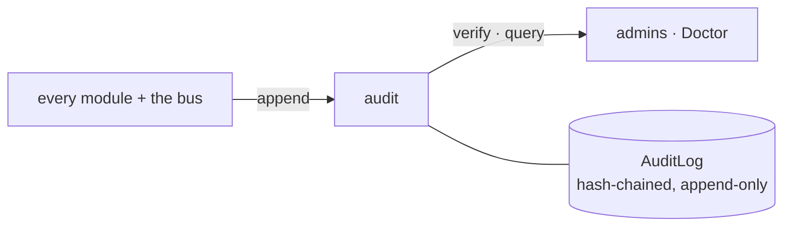

*Walking tour:* every module writes; admins and the Doctor read
and verify; the one table at the bottom is chained so that
history, once written, cannot quietly become a different history.

## 20. admin — the operator's and owner's control surface

**Job.** The governed surface for running the system and the
group: server settings and deployment profile, deep health,
backup scheduling and restore drills, the internal-denial and
failure lists, AI budget configuration, and the group-level
powers of Doc 02 Part A (seats are created here, through identity;
roles are changed here, through groups). Admin *orchestrates*
other modules through the bus — it reaches into none of them.

**Public surface.**
- `admin.health.deep` — the `/health?deep=1` content: database
  integrity state, job backlog, AI driver in use, integration
  health, backup freshness, storage warnings (B-319's checks share
  this engine with the Doctor).
- `admin.backups.run` / `.restore_drill` — take a backup; restore
  one *into a scratch location* and verify it (a backup never
  restored is a hope, Doc 02 B.4).
- `admin.server.settings` — profile, limits, driver selection;
  unsafe `internet` combinations refuse, here and at startup.
- `admin.failures.list` — failed jobs, dead notifications, denied
  internal calls: the system's "needs a human" list in one place.

**Tables owned.** No domain tables. Operator metadata only:
backup records (manifest, hashes, destination, restore-drill
result) alongside the bundles in the files directory.

**Offers.** The control surface behind the admin screens, the
operator half of the Doctor, and `/health`. **Consumes.** Every
module, through the bus; `audit` especially.

**Invariants.** Every admin act is audit-logged with its actor —
including the acts of agent seats holding admin scope, which are
held to the identical standard. There is no admin operation that
reads another member's private data bundle (Doc 02 A.8): admins
run the system, they do not read the group through a side door.

**Failure modes.** Restore drills never touch live data — a drill
that would is refused by construction. A backup bundle is grepped
for key material before it is allowed to exist (B-169).

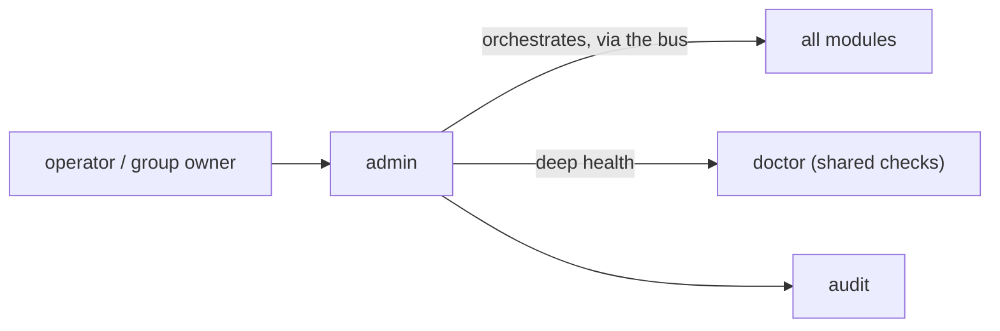

*Walking tour:* the operator's acts enter at the left; admin
turns them into bus calls to the modules that own the work, reads
health from the same checks the Doctor runs, and writes every act
to audit.

## 21. MCP server — the agents' flagship door (Doc 13)

**Job.** Exposing the whole product to MCP-capable AI agents:
tools for every domain, `gpa://` resources with subscriptions,
curated prompts, and elicitation bridged to humans — over stdio
(local agents) and streamable HTTP (remote agents, OAuth 2.1).
This module is a door, not a domain: it owns no tables and no
rules, and it is a module like any other — its own service
identity, the bus only (B-204, §6A.9).

**Public surface.**
- Tools, generated from the internal operation registry plus a
  curated annotation layer (B-206): groups/members, sources +
  ingest, the queue, events + calendar, planning, memory + comms
  (B-207 → B-212). A capability missing from MCP that exists in
  the internal API fails the parity checker — drift is a build
  failure.
- Resources under `gpa://`: group calendar (iCal + JSON), event,
  current decisions, queue summary, the OpenAPI document, and this
  documentation set — an agent can read the manual through the
  same connection it works through (B-213).
- Prompts: versioned workflow templates ("brief me before
  Saturday", "what is still undecided?") that say, in their own
  text, that drafts go to the queue (B-215).
- Elicitation bridge: the server may *ask the human* for a missing
  fact, routed to the organiser inbox as a question with the
  agent's identity attached. It can inform a draft; it can never
  *be* an approval (B-216).

**Tables owned.** None.

**Offers.** The full product, as MCP, to any conforming client.
**Consumes.** The bus (under the MCP module's own identity),
`identity` (seat keys locally; OAuth tokens remotely, re-checked
per call, B-205), `audit` (every tool call is chained, B-218).

**Invariants.** Tool annotations are truthful and tested
(`readOnlyHint`, `destructiveHint`, `idempotentHint`,
`openWorldHint`, B-218); destructive and open-world tools pass a
consent gate at the gateway. There is **no `approve` tool for a
seat below organiser role**, and for an organiser seat it is the
*same* internal operation a human's click calls (B-209/B-203).
Server-initiated sampling is off by default (B-217). Tool results
carrying group content are marked as data — the server never
executes instructions found in sources.

**Failure modes.** A poisoned tool description is detectable
because descriptions are part of the signed release manifest
(B-206). A client without elicitation degrades to open questions.
MCP down never affects the other doors — bulkheads again.

```mermaid
flowchart LR
    AG["MCP clients<br/>local (stdio) · remote (HTTP + OAuth)"] --> MCP["MCP server"]
    MCP -->|"tools generated from the registry"| BUS["internal API bus"]
    MCP -->|"resources: gpa://…"| BUS
    MCP -->|"every tool call"| AU["audit"]
    MCP --- T[("owns no tables")]
```

*Walking tour:* agents arrive at the left over either transport;
the MCP server translates tool and resource calls into bus
operations under its own identity, and chains every call into
audit. The empty table box is deliberate — a door owns nothing.

## 22. terminal — the text door, for humans and AIs equally (Doc 14)

**Job.** The client package we ship: a keyboard-first TUI, a
scriptable CLI (`gpa`), and a REPL — one command layer under all
three, so the TUI is a *view* over the CLI's commands, never a
second implementation (B-221). It is a client of the external API
exactly like any frontend the team builds, which makes it the
standing parity proof (B-235). An embedded local mode runs the
backend in-process for a single machine.

**Public surface.**
- The command tree, mirroring the domains and generated from the
  same action register as the parity checker (B-222): `gpa
  groups`, `gpa queue list|show|approve|edit`, `gpa events
  list|show|create`, `gpa sources add`, `gpa ask`, `gpa rsvp`,
  `gpa tasks`, `gpa polls vote`, `gpa doctor`, `gpa service …`.
- Machine mode on every command: `--json` / `--ndjson`, stable
  documented exit codes (0 ok, 2 usage, 3 auth, 4 not-found,
  5 conflict, 6 unavailable), `--dry-run` on writes, idempotency
  keys auto-generated per invocation (B-223).
- The TUI: sections (Home, Calendar, Queue, Events, Planning,
  Discuss, Ask, Admin), command palette, mouse as a bonus, `?`
  overlay on every view, `NO_COLOR` and `--plain` linear mode
  honoured (B-225, B-232, B-326).
- Service management: `gpa service install|start|stop|status` and
  `gpa logs` run the backend headless in the background; `gpa tui`
  attaches and detaches without touching the service (B-325).

**Tables owned.** None on the server. On the client: profiles and
config files, credentials in the OS keyring where available.

**Offers.** The whole product, in text, to any human or agent on
any OS — including a phone over SSH. **Consumes.** The external
REST API and SSE stream only; the help module's topics for its
overlays (§24).

**Invariants.** The approval law is unchanged in text: a seat in
a terminal is a seat (B-233), and terminal sessions are named in
the audit stream. Version skew is spoken plainly: the terminal
says when the backend is outside its supported API range (B-234).

**Failure modes.** No network → commands queue offline-tolerant
writes where the API contract allows (B-240) and say so; a dead
backend is exit code 6 with a problem+json error on stderr, never
a traceback.

```mermaid
flowchart LR
    H["human at a keyboard"] --> TUI["TUI / REPL"]
    A["agent with a shell"] --> CLI["CLI --json"]
    TUI --> L["one command layer"]
    CLI --> L
    L -->|"external REST + SSE"| API["backend API process"]
```

*Walking tour:* two kinds of driver, one command layer — that
singleness is the design. Both roads end at the public API, which
is why a story that works in the terminal is proof the API can
carry it for any frontend.

## 23. doctor — the system examines itself, in plain words (B-319 → B-323)

**Job.** Diagnosis and safe repair: one checks engine behind four
doors — `gpa doctor` (CLI), a TUI Doctor screen, an admin-only
API operation, and an admin-scoped MCP tool. The Doctor checks
install and versions, Python and dependencies, database integrity
and WAL state, keys present and loadable (**values never printed,
never logged**), disk, clock skew, profile safety, ports, TLS
certificates, backup freshness and the last restore test, job
queue health, scheduler state, and model-adapter reachability
(mock and live labelled honestly).

**Public surface.**
- `doctor.run` — run the checks; each returns pass / warn /
  broken + time taken, under a stable finding id.
- `doctor.finding` — one finding rendered as *what we found ·
  what it means for you · what to do*, with a help id (§24).
- `doctor.repair` — apply *one* consented safe fix (pending
  migrations, a corrupt *derived* index, provably-stuck jobs,
  file permissions, log rotation, watchdog re-registration, a
  local dev certificate). Per-fix consent; a backup precedes every
  repair; every repair is audit-chained and reversible or it is
  not offered (B-321).
- `doctor.bundle` — the support bundle: Doctor report, versions,
  redacted logs, config *shape* (keys as present/absent only).
  Redaction is itself tested; a bundle containing a secret is a
  release-blocking defect (B-323).

**Tables owned.** None. Findings are computed; scheduled watch
state (B-322) lives in jobs and admin settings; runs and repairs
live in audit.

**Offers.** Health truth to operators, admins, and — through the
MCP tool — to an agent seat explaining the system to its human.
**Consumes.** `admin` (shared deep-health checks), `jobs` (queue
state, stuck leases), `crypto` (key *presence* only), `audit`,
`notifications` (watch warnings, once per finding until
acknowledged).

**Invariants.** The Doctor never "heals" a healthy database aside
— the double-verdict guard (B-172) binds it hardest of all; doing
so is a named test failure. It never deletes data and never
regenerates a key. Its findings are graded by evidence, and its
own success rate is a release-gated metric (B-329).

**Failure modes.** A check that itself errors reports *broken:
the check could not run* with the reason — the Doctor never
reports a pass it did not earn. Repairs refuse when their
pre-backup fails.

```mermaid
flowchart TD
    DOORS["CLI · TUI · admin API · MCP tool"] --> DOC["doctor"]
    DOC -->|"checks"| SYS["install · database · keys (presence)<br/>disk · clock · profile · certs<br/>backups · job queue · AI adapter"]
    DOC -->|"finding: found · means · do"| HUM["a human who can act"]
    HUM -->|"consent, per fix"| DOC
    DOC -->|"safe repair, after backup"| SYS
    DOC -->|"runs + repairs"| AU["audit"]
```

*Walking tour:* any of the four doors starts the same engine; the
engine examines the system across the middle row and returns
findings a non-specialist can act on; repairs flow back only with
per-fix consent, and everything is written to audit.

## 24. help — one manual, inside the product, on every door (D-44)

**Job.** The built-in help system: every screen, panel, field,
CLI command, TUI view, API operation, and error code carries a
stable **help id** (B-313); one versioned Markdown content source
renders those topics into the web app, the TUI overlay, the CLI,
an API help endpoint, and MCP resources — so a human and an AI
seat read *identical words* (B-314). Help ships inside the app and
works offline, on a Pi, with no account.

**Public surface.**
- `help.resolve` — help id → topic, in the caller's door format.
- `help.search` — plain-words goal search behind the "I want
  to…" finder (B-315): a goal returns steps plus a deep link, and
  the top goals are interactive walkthroughs on sandbox data.
- `help.feedback` — the "this didn't work" packet (B-324): topic
  id + what the user was doing + optional note + Doctor bundle,
  drafted for the user to review and send where *they* choose —
  never auto-sent.

**Tables owned.** None. Topics are files in the repo, versioned
with the app; the parity checker proves every help id resolves
identically on all five doors, by source hash (B-328).

**Offers.** The manual, everywhere, to everyone — including to
agents, through MCP resources (Doc 13). **Consumes.** The error
catalogue (each error carries its help id, B-316), `doctor` (the
support bundle), `audit` (feedback packets are recorded when a
user chooses to file one in-product).

**Invariants.** A surface without a help id fails the checker —
help coverage is gated like the code atlas (B-182's discipline,
B-313). Help text is written to the friendliness standard (D-43):
plain words, the step the user is actually on, and the way out of
every error it names.

**Failure modes.** A missing topic is a build failure, not a
runtime 404 — by the time a user can press `?`, the checker has
already proven the topic exists on their door.

```mermaid
flowchart LR
    SRC["one topic source<br/>versioned Markdown in the repo"] --> H["help"]
    H --> WEB["web app"]
    H --> TUI["TUI overlay (?)"]
    H --> CLI["CLI --help-topic"]
    H --> API["API help endpoint"]
    H --> MCP["MCP resources"]
```

*Walking tour:* one source at the left, five renderings at the
right, and a checker that fails the build if any door's words
drift from the source. The manual is not a website the product
points at; it is part of the product.

---

## A closing note on the shape of the whole

Count the chapters again: eighteen domain modules, three platform
modules (bus, crypto, jobs — audit makes four with §19), and three
doors that own nothing (MCP, terminal, and the REST routers of
Doc 03). Every rule in the product lives in exactly one chapter;
every table is owned by exactly one chapter; every road between
chapters is the bus. When a future maintainer asks "where does X
live?", this atlas is the answer — and when the answer is missing,
that is a defect in this document, filed like any other.
