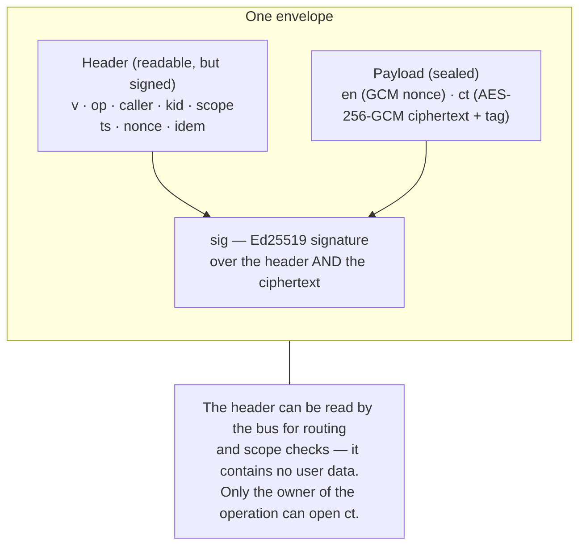
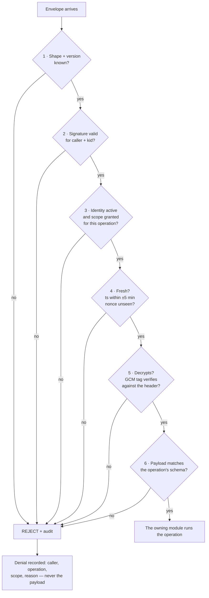
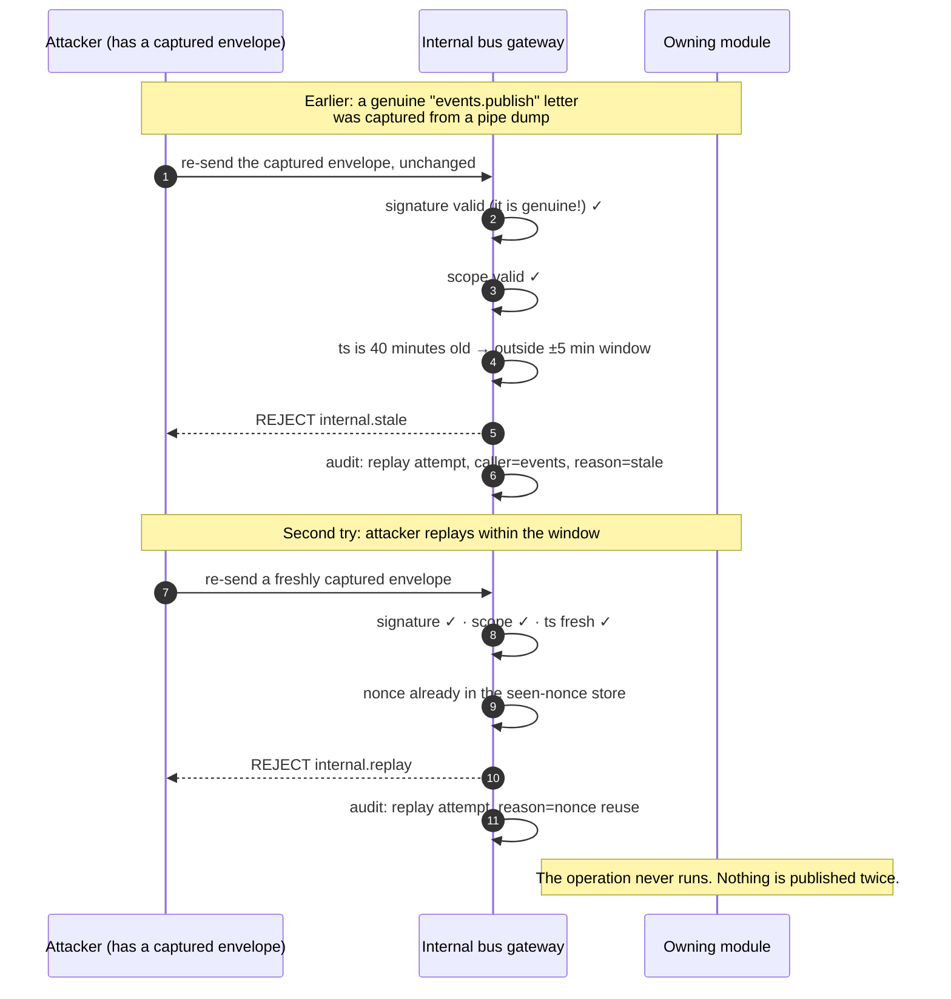
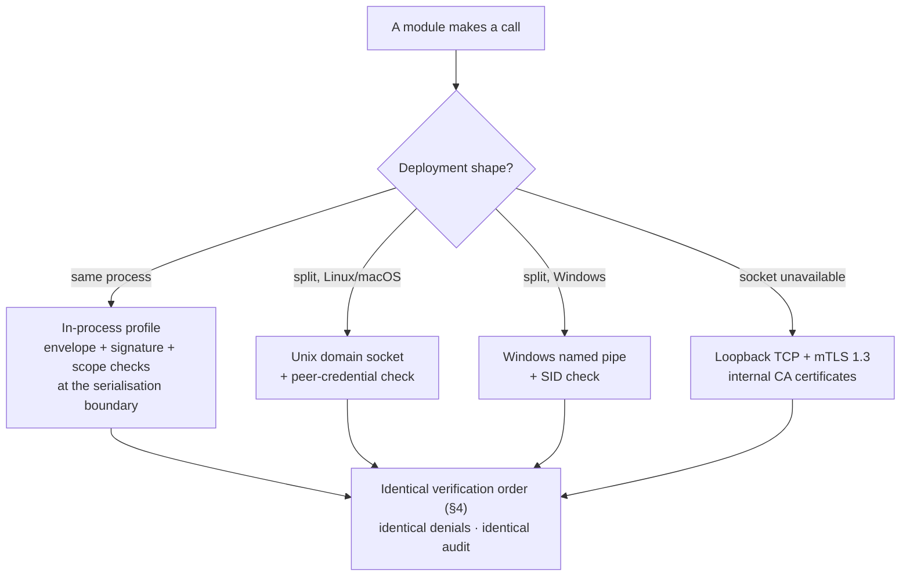
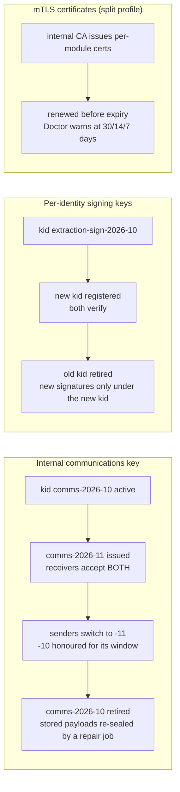
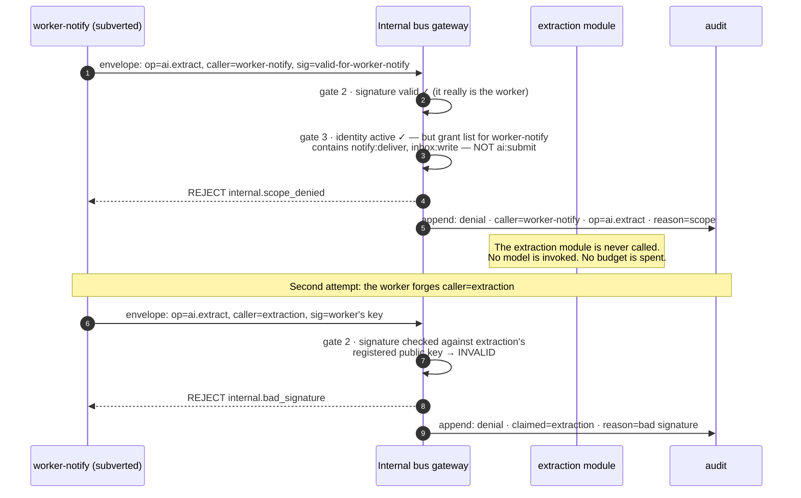

# 05 — The Internal Encrypted API: How the Parts Talk, Exactly

**For:** backend developers. This is the full specification of the
one road every part of the system uses to talk to every other part
(roadmap D-31, §6A.4, B-162 → B-166).
**Plain-words summary, first:** whenever one part of the system
asks another part to do something, the request travels as a sealed
(sealed = encrypted), signed letter. The letter says who sent it,
what it is asking for, and when; it can be opened only by the part
it is addressed to, it cannot be forged, it cannot be re-sent
later to repeat the action, and the asking part is only ever
allowed to ask for the few things its own identity permits. There
is no second, quieter channel. If a part of the system is buggy —
or one day compromised — it cannot read another part's letters,
cannot pretend to be another part, and cannot replay an old letter
to make something happen twice. The blast radius of any single
part failing is that part.
**Companion documents:** Doc 04 §16 (the bus module's chapter),
Doc 08 (how this fits the whole security design), Doc 06 §7 (the
two small tables the bus owns).

---

## 1. What travels, and what never does

An internal call is one **operation**: a named, typed request
registered in advance — `candidates.create`, `events.publish`,
`notify.request`, `ai.extract`, `integrations.facebook.create_event`
— with a declared owning module and a declared **scope** a caller
must hold. Undeclared operations do not exist: the registry is
part of the code, a module declares its operations at startup
(`internal.register`, Doc 04 §16), and the registry is also the
single source the MCP tool catalogue is generated from (B-206),
so the inside and the agent-facing outside can never quietly drift
apart.

Three things never travel on this API:

- **Plaintext user data across a process boundary.** Payloads that
  cross processes — and payloads *stored* for another part to pick
  up (job payloads, queued notifications, integration requests) —
  are envelope-encrypted (§3). Inside one process, see the honest
  profile in §7.1.
- **Credentials of people.** A call carries the acting *principal*
  (a user id or seat id, resolved by identity, Doc 04 §1) as data
  inside the sealed payload — never a password, token, or key.
- **Direct database access.** There is no operation "read table
  X". A caller asks the owning module for an operation; the owner
  decides. This is what makes the module boundaries of D-30 real
  rather than decorative.

## 2. The envelope, field by field

Every call — and every reply — is one envelope: a JSON object with
exactly these fields. The shape is versioned (`v`) so it can
evolve without breaking callers mid-flight during a rollout.

| Field | Type | What it is | Rules the receiver enforces |
|---|---|---|---|
| `v` | integer | Envelope format version (currently `1`) | Unknown version → reject |
| `op` | string | The operation name, from the registry | Must exist; must belong to the receiving module |
| `caller` | string | The sending module's identity name (e.g. `extraction`, `worker-ai`, `mcp-server`) | Must match the identity the signature proves |
| `kid` | string | Key id of the caller's signing key | Must be a known, active key for `caller` (old ids live through their rotation window, §8) |
| `scope` | string | The internal scope this call exercises (e.g. `candidates:create`) | Must be a scope the registry requires for `op` **and** a scope the caller's identity is granted |
| `ts` | integer | Sender's Unix timestamp, seconds | Must be within ±5 minutes of the receiver's clock |
| `nonce` | string (base64) | 128-bit random value, unique per call | Must not appear in the seen-nonce store for this caller inside the window |
| `idem` | string or absent | Idempotency key (D-15) | **Required** for create-type operations; a retry with the same key returns the first result instead of repeating the act |
| `en` | string (base64) | The 96-bit AES-GCM nonce for this message | Never reused under the same communications key — it is random per message and the key rotates (§8) |
| `ct` | string (base64) | The payload, AES-256-GCM-encrypted (ciphertext with the GCM authentication tag appended) | Tag must verify under the internal communications key, with the header as associated data (§3) |
| `sig` | string (base64) | Ed25519 signature over the canonical bytes of every field above | Must verify under the caller's public key for `kid` (§4) |

Replies are envelopes too, with two differences: `op` is the
request's operation name, and one extra field rides along:

| Field | Type | What it is |
|---|---|---|
| `reply_to` | string | The `nonce` of the request being answered — a reply cannot be attached to the wrong question |

A result payload is either a typed success value (matching the
operation's declared result schema) or an error in the **same
problem+json shape as the external API** (D-13) — one error
language inside and out, with internal-only `code` values for
denials (`internal.bad_signature`, `internal.scope_denied`,
`internal.stale`, `internal.replay`, `internal.undecryptable`).

An example envelope, with every value shortened and obviously
illustrative — no real key material ever appears in documentation:

```json
{
  "v": 1,
  "op": "candidates.create",
  "caller": "extraction",
  "kid": "extraction-sign-2026-10",
  "scope": "candidates:create",
  "ts": 1792953600,
  "nonce": "EXAMPLE-nonce-…",
  "idem": "src_01J…-extract-3",
  "en": "EXAMPLE-gcm-nonce-…",
  "ct": "EXAMPLE-ciphertext-…",
  "sig": "EXAMPLE-signature-…"
}
```



*Walking tour:* the envelope has three parts. The **header** is
readable — the bus needs it to route and to check scopes — and it
contains no user data, only names, times, and ids. The **payload**
is the sealed part: the actual request, encrypted, openable only
with the internal communications key. The **signature** at the
bottom covers *both* parts, so changing a single header word — the
operation, the scope, the timestamp — invalidates the letter as
surely as forging the payload would.

## 3. Encryption in depth — AES-256-GCM, and what the header has to do with it

- **Algorithm.** AES-256-GCM, one fresh random 96-bit nonce
  (`en`) per message. GCM gives confidentiality and an
  authentication tag in one construction; the tag travels appended
  to the ciphertext inside `ct`.
- **The key.** The **internal communications key** — a 256-bit key
  that exists *only* for this API. It is separate from every data
  key of Doc 08 (the master key and the per-group data keys are
  different keys with different lives), and it rotates on its own
  schedule (§8). It lives with the crypto module (Doc 04 §17),
  never in code, git, a backup, or a log.
- **Associated data.** The canonical header bytes (everything
  except `en`, `ct`, `sig`) are fed to GCM as *additional
  authenticated data*. Consequence: the ciphertext is bound to its
  header. A sealed payload lifted out of one envelope and pasted
  into another — different operation, different caller, later
  timestamp — does not decrypt. The signature (§4) makes the same
  promise a second, independent way; both must fail before a
  tampered letter could pass, and either failing is enough to
  reject it.
- **Payloads at rest.** A job payload waiting in the `Job` table is
  an envelope payload without the transport around it: sealed under
  the same communications key, so a copied database yields no
  readable job payloads (B-166). The Doctor and the backup system
  treat these bytes as opaque, always.

## 4. Signing in depth — who sent this, provably

- **Default profile: Ed25519.** Each service identity holds an
  Ed25519 key pair; the private half never leaves the identity's
  own process (in split deployments it is provisioned with the
  module's certificate, §6), the public half is registered with
  the bus under the identity's `kid`.
- **What is signed.** The canonical serialisation of the header
  fields in a fixed order, followed by `en` and `ct`. Canonical
  means byte-exact: the same envelope always signs to the same
  bytes, on Windows, macOS, and Linux alike (the cross-platform
  matrix, B-177, includes signature fixtures).
- **HMAC profile.** Where an operator configures the shared-secret
  profile (some single-box deployments prefer it), signatures are
  HMAC-SHA256 under a per-identity secret instead of Ed25519. The
  envelope, the checking order, and the denial behaviour are
  identical; the profile in force is a startup fact the Doctor
  reports (Doc 04 §23). Ed25519 is the default and the one the
  test suite treats as canonical.
- **Verification order — fixed, and chosen so probes learn as
  little as possible** (§6A.4):



*Walking tour:* six gates, in an order that matters. Shape and
signature come first, so an unsigned or forged letter is refused
before its contents are even considered — and its payload is never
decrypted on the way to refusal. Scope comes before freshness, and
both come before decryption: the system opens a letter only for a
proven caller, asking for something it is allowed to ask for,
inside its freshness window. Only after all five gates does the
owning module see a schema-checked payload and do the work. Every
refusal lands in the audit with the caller's claimed identity, the
operation, and the reason — never the payload, which may not even
be genuine.

## 5. Service identities and least-privilege scopes

Every module, every worker, and every door-side component holds
its **own** identity (B-164): a name, a signing key (with `kid`),
in split deployments an mTLS certificate from the internal CA, and
a **grant list** — the small set of operations it may call. The
grant list is the least-privilege rule made concrete: an identity
can ask only for what its work actually needs.

A representative slice of the grant table (the full table is
generated from the registry and ships in Doc 10's atlas):

| Caller identity | May call (examples) | Notably may NOT call |
|---|---|---|
| `extraction` | `candidates.create`, `sources.chunks.read`, `files.read` | `events.publish`, `identity.keys.issue`, anything in admin |
| `worker-notify` | `notify.deliver`, `inbox.write` | `candidates.create`, `ai.extract` |
| `review` (via the API process) | `events.mint_from`, `tasks.create`, `decisions.record` — each only as the *mint* half of an approval | anything at all without a resolved principal inside the payload: the bus checks the seat, the module checks the person |
| `mcp-server` | the registry operations its tools map to, each additionally gated per tool call by the *seat's* scopes (B-205) | `internal.identities.issue`, `crypto.keys.rotate` |
| `doctor` | `admin.health.deep`, `jobs.resurrect` (repair operations individually granted), `doctor.*` | `candidates.*`, `events.*` — the Doctor diagnoses and repairs plumbing; it never touches group content |
| `scheduler` | `jobs.enqueue` only | everything else — the tick proposes work; workers do it |

Two layers of authorisation, always: the **bus** checks the
caller's identity and scope (may this *part* ask?), and the
**owning module** re-checks the principal and role carried inside
the payload (may this *person or seat* do this, in this group?).
Neither layer trusts the other to have checked — that is the
zero-trust-inside-the-box rule of §6A.4 applied honestly.

## 6. Replay defence — a captured letter cannot be sent twice

Three mechanisms, each defeating a different replay:

1. **Timestamp window.** `ts` must be within ±5 minutes of the
   receiver's clock. A letter older than that is stale on its
   face (`internal.stale`). This is also why clock skew is a
   Doctor check (Doc 04 §23): the whole system's freshness
   arithmetic stands on honest clocks.
2. **Nonce store.** Each accepted `nonce` is recorded per caller
   in the `InternalNonce` table until it ages out of the window.
   The same letter re-sent inside its window is recognised and
   refused (`internal.replay`). Nonces are 128-bit random values —
   unguessable, so an attacker cannot pre-poison the store with
   predicted nonces.
3. **Idempotency for acts.** Freshness stops *old* letters;
   idempotency stops *duplicate effects*. A create-type call
   carries `idem`; if a legitimate retry (or a resurrected job,
   Doc 04 §18) presents the same key, the owner returns the first
   call's result — the event is not created twice, the reminder
   is not sent twice (D-15).



*Walking tour:* the uncomfortable truth this diagram starts from
is that a captured genuine letter has a *valid signature* — signing
alone cannot stop replay, which is why freshness and the nonce
store exist. The first replay dies on its timestamp; the second,
smarter replay dies because its nonce was recorded when the
original was accepted. The owning module is never troubled in
either attempt, and both attempts leave an audit record an
operator can see (Doc 02 B.6).

## 7. Transports — the same letters, four roads

The envelope does not care how it travels. Four transports are
defined, chosen by deployment shape; the checks are identical on
all of them.

| Transport | When | Peer identity | Notes |
|---|---|---|---|
| **In-process** (default, §7.1) | All modules in one process (the hackathon shape) | Logical: each module signs with its own key; the bus client SDK enforces the envelope at the call boundary | Encryption applies at the serialisation boundary for anything leaving the process or resting in a table (job payloads) |
| **Unix domain socket** | Split processes on Linux / macOS | Socket peer credentials (uid/pid) checked against the claimed identity, *in addition* to the signature | Filesystem permissions on the socket are the outer fence; the envelope is still the lock |
| **Windows named pipe** | Split processes on Windows | Pipe client SID checked against the claimed identity, in addition to the signature | Same law, Windows spelling (B-163) |
| **Loopback TCP + mTLS 1.3** | Socket/pipe unavailable, or a part must live on another loopback-reachable host | Per-module certificates from the internal CA; mutual TLS | mTLS is **additional, never a substitute**: the payload stays sealed inside the TLS, so TLS terminating early at a relay never exposes plaintext |



*Walking tour:* the caller's question is only about the road. The
important box is the one at the bottom: whichever road was taken,
the letter faces the identical six gates of §4. A deployment can
move a heavy module (the AI pipeline first, B-166) from the
in-process profile onto a socket without any other module changing
a line — that is the split test the roadmap gates on.

### 7.1 The in-process profile, honestly

Where modules share one process, the roadmap does **not** pretend
that wire encryption between them is meaningful — a letter that
never leaves the process has no wire to protect. What the
in-process profile *does* guarantee, and test:

- the envelope is still built, signed, scope-checked, and
  nonce-checked at every call boundary, so behaviour — including
  denials — is identical to the split profile;
- anything that *rests* for another part (job payloads, queued
  notifications) is sealed exactly as if it had crossed a wire;
- the same module test-suite passes unchanged in both profiles
  (B-166's acceptance test).

Honesty here is a security property: a system that claims theatre
will eventually believe its own claims somewhere it matters.

## 8. Key rotation — changing the locks without stopping the house

Three kinds of key rotate, on three rhythms, all with overlap —
rotation never stops the system (B-164, B-169):



*Walking tour:* read each row as a timeline. The communications
key rotates by *overlap*: the new key is issued while the old one
still verifies, senders switch, the old key is honoured until its
window closes, and a repair job re-seals any stored payloads still
under it before it retires. Signing keys rotate per identity the
same way, keyed by `kid` — a receiver always knows which public
key a letter claims, and a retired `kid` is a rejection, not a
mystery. Certificates are renewed ahead of expiry, and the Doctor
warns at 30, 14, and 7 days out (B-322) so a certificate never
expires as a surprise at 3 a.m.

Rotation events — issue, switch, retire — are audit rows, and a
rotation can be run *in a hurry* (a suspected compromise) by the
same road it uses on schedule: revoke the identity, and every
letter it ever signed stops verifying at once (Doc 02 B.6).

## 9. The rejected impersonation — the attack this API exists to stop

The acceptance test of B-164, drawn out. A notify worker — a real
part of the system, with a real identity — is subverted (or simply
buggy) and tries to call an AI operation its identity was never
granted, hoping to spend the group's AI budget or fabricate drafts.



*Walking tour:* two attacks, two different gates. In the first,
the attacker is honest about *who* it is and dishonest about
*what it may do* — the signature passes and the scope gate refuses
it, because `worker-notify` was granted sends, not AI submissions.
In the second, the attacker lies about who it is — and dies one
gate earlier, because it cannot produce extraction's signature
with the worker's key. Either way the owning module is never
called, no money is spent, and the attempt is in the audit with
enough detail for an operator to act on (Doc 02 B.6, step 3 names
exactly this log).

## 10. The audit of calls — a story with no content in it

Every call is logged by **caller, operation, scope, result, and
time — never by payload** (B-165). Consequences worth stating:

- A full demo flow's internal story can be reconstructed from the
  audit alone — who called what, in what order, with what
  outcome — with zero user content in the reconstruction.
- Denials are first-class rows, so "is something probing us?" is
  a query, not a hunch.
- The call log is part of the tamper-evident chain (B-170): an
  attacker who could rewrite it could hide everything, so it is
  the one log in the system that can catch its own liar
  (Doc 04 §19).

## 11. What this design prevents — and its honest limits

**Prevents:** a buggy or compromised part reading another part's
traffic; forging an approval or a publish; replaying a captured
message; spending another part's budget; quietly widening its own
authority. Each of those is a tested gate, not a hope (B-163,
B-164 acceptances).

**Limits, stated plainly:** the bus protects parts from *each
other*. It does not protect the system from an attacker who owns
the whole host and its key store — no design on one box can; that
is what the at-rest sealing and backup discipline of Doc 08 are
for. And the envelope's confidentiality stands on the
communications key: its rotation rhythm (§8) and its separation
from every data key are what keep a single key's compromise a
bad day instead of the end of the story.
