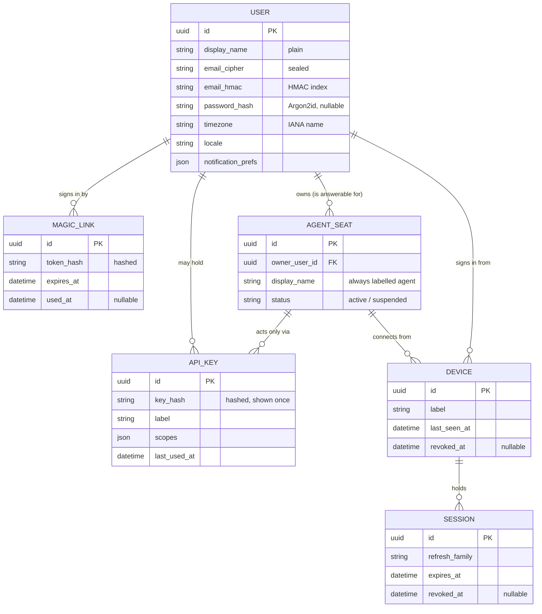
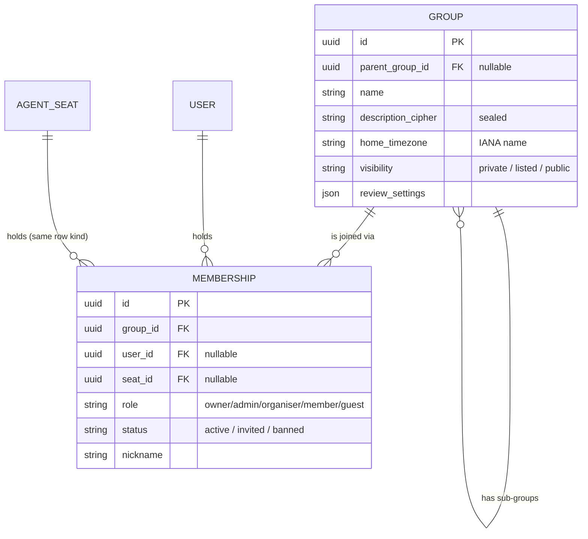
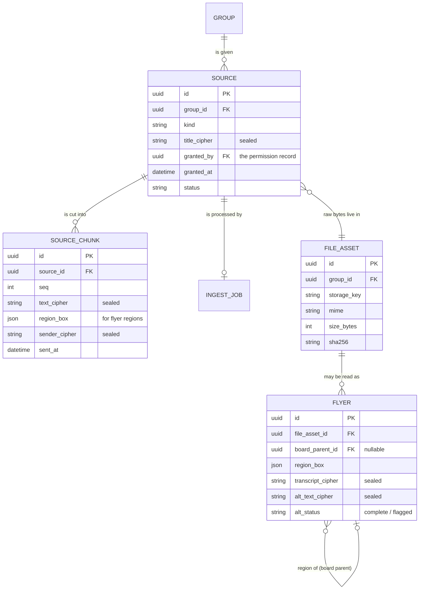
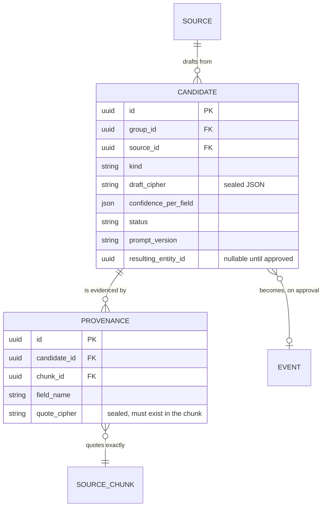
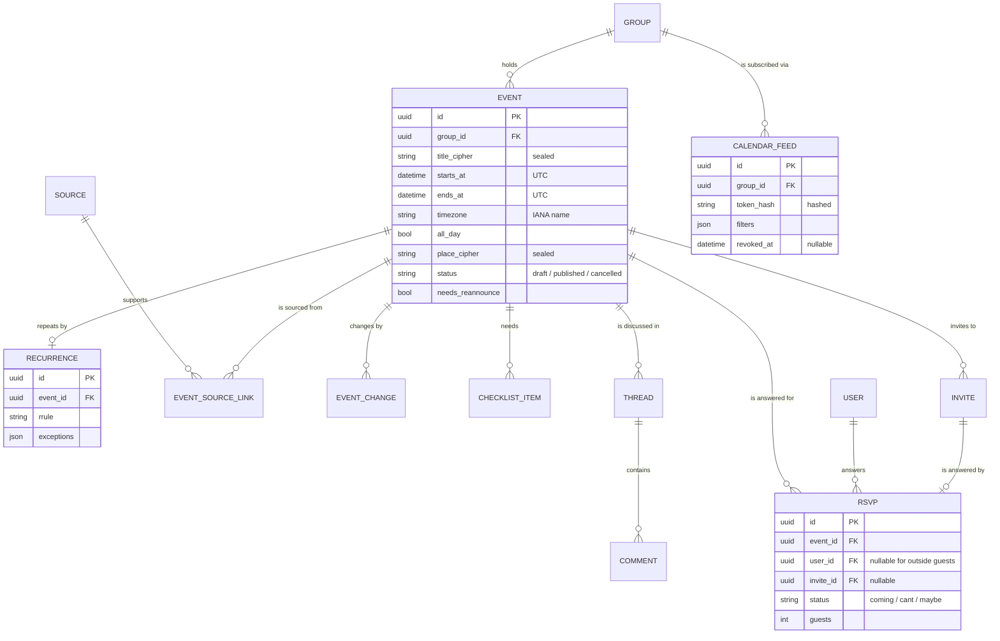
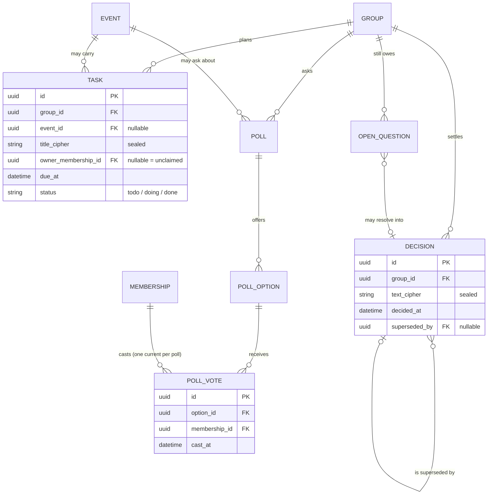
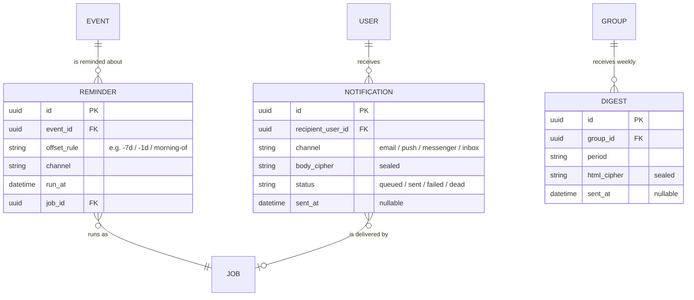
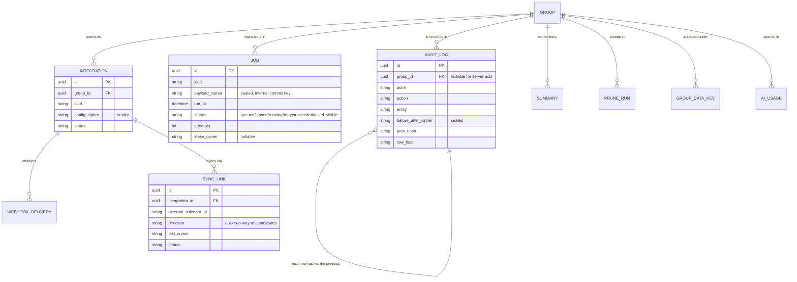
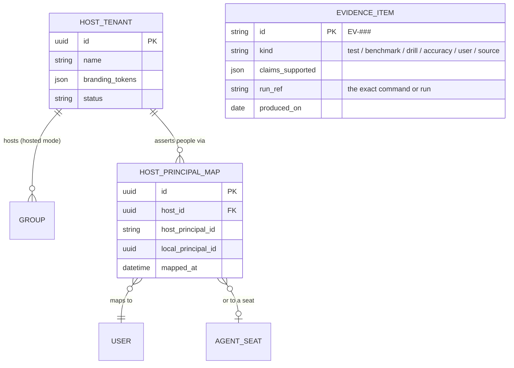

# 06 — Data Model: Everything the System Remembers, and How It Is Protected

**For:** backend developers. The complete entity list (roadmap §4,
extended by Phases 17–27), what each entity holds, which fields
are sealed, which are searchable without unsealing, and the full
entity-relationship diagrams, split by area.
**Plain words first:** the system remembers a group's people, its
sources (the talk and flyers it was given), the drafts the AI made
from them, the plans a human approved, and a chained record of
everything consequential. The group's *words* — message text,
notes, email addresses, uploaded bytes — are **sealed**
(envelope-encrypted) before they touch the disk, so a copied
database reads as noise (D-29, Doc 08). The *shape* — ids, times,
roles, statuses — stays plain, because the system must be able to
sort, count, and schedule without unsealing the world.
**Companion documents:** Doc 04 (which module owns which tables —
ownership is exclusive), Doc 05 §7 (job payloads at rest), Doc 08
(the key hierarchy and the raw-disk grep proof).

---

## 1. Conventions every table obeys

- Every table has `id` (UUID), `created_at`, `updated_at`.
- Every group-owned table has `group_id`; every query is
  group-scoped — cross-group leakage is the unforgivable bug
  class, fuzz-tested (B-146/B-246).
- Soft delete (`deleted_at`) on anything a user can delete, with
  30-day tombstones where recovery is promised (B-080);
  hard delete happens only through the group-erasure service
  (Doc 04 §2).
- Times are UTC instants *plus* the IANA timezone they belong to,
  wherever a human meaning attaches (D-21).
- Money is integer cents, never floats (B-089).
- Field-protection marks used in every table below:
  **[S]** sealed (AES-256-GCM under the group's data key) ·
  **[H]** keyed-HMAC index stored beside the sealed value, so the
  field is *lookable-up* without unsealing · **[#]** one-way
  hashed (passwords Argon2id; keys and tokens hashed) ·
  **[W]** a key stored wrapped under the master key ·
  **[P]** plain (shape, not content).

## 2. Identity area — who exists and how they prove it

| Entity | Key fields | Notes |
|---|---|---|
| `User` | name [P], email [S]+[H], password_hash [#, nullable], timezone [P], locale [P], notification prefs [P] | Email is sealed *and* HMAC-indexed: lookup by email never unseals the column |
| `MagicLink` | token_hash [#], expires_at, used_at | The link itself is never stored; single-use |
| `ApiKey` | key_hash [#], label [P], scopes [P], last_used_at | Belongs to a `User` **or** an `AgentSeat` (exactly one); shown once at issue |
| `AgentSeat` | display_name [P], role pointer via `Membership`, owner_user_id, status [P] | A seat is a principal in its own right, always labelled as an agent (B-202) |
| `Device` | principal, device label [P], first/last seen, revoked_at | Per-device credentials, listed and revocable (B-243) |
| `Session` | principal, device, refresh_family [P], expires_at, revoked_at | Rotating refresh with reuse detection: reuse kills the family (B-013) |

*Walking tour:* a human (`User`) signs in by magic link or
password, from a `Device`, holding a `Session`. An `AgentSeat` is
its own principal — drawn separately on purpose — owned by (and
answerable to) a user, and it can act **only** through an
`ApiKey`, whose hash is all the database ever holds. The seat's
*role* is deliberately not on this diagram: roles live in
membership (next area), because a seat, like a person, has
standing per group, not globally.

## 3. Groups area — belonging and standing

| Entity | Key fields | Notes |
|---|---|---|
| `Group` | name [P], description [S], home_timezone [P], default_place [S], visibility [P], review_settings [P] | `parent_group_id` nullable → sub-groups/chapters (B-105) |
| `Membership` | user_id *or* seat_id (exactly one), role [P], status [P], nickname [P] | Unique together: one principal, one membership per group |

*Walking tour:* the single most important line in this diagram is
that `User` and `AgentSeat` reach `Membership` by the *same* road.
One row kind, one uniqueness rule, one role ladder — that is what
"equal principals" (D-35) looks like when it reaches the schema.
Sub-groups are groups with a parent, inheriting membership unless
their own roles say otherwise.

## 4. Sources area — what the group handed over, and its provenance

| Entity | Key fields | Notes |
|---|---|---|
| `Source` | kind [P], title [S], permission granted_by/at [P], raw storage ref → `FileAsset`, status [P] | Kind ∈ chat_paste / chat_live / newsletter / flyer / board_photo / email / link / voice / file |
| `SourceChunk` | order [P], text [S] *or* region box [P] on a flyer, sender [S], sent_at [P] | The citable unit: provenance quotes must exist in a chunk (B-040) |
| `IngestJob` | status/progress/error [P] | The ingest-flavoured record over the `Job` row doing the work |
| `FileAsset` | storage_key [P], mime [P], size [P], sha256 [P], alt_text [S], alt_status [P] | Bytes on disk are sealed per-file (B-168); no path ever reaches an API |
| `Flyer` | file_asset_id, board parent (nullable), region box [P], transcript [S], alt_text [S] | A region of a board photo becomes its own `Flyer` (B-064) |

*Walking tour:* a group is *given* sources; each source is cut
into ordered chunks — the exact units a candidate's provenance
will cite. Raw bytes belong to `FileAsset` (sealed on disk); a
`Flyer` is a *reading* of an asset, and a board photo's flyers
point back at their parent. Note what is plain here: kinds,
orders, boxes, hashes, times — the shape. What is sealed: every
word and every name.

## 5. Review area — drafts and their evidence

| Entity | Key fields | Notes |
|---|---|---|
| `Candidate` | kind [P] (event/task/decision/question/change), draft JSON [S], confidence per field [P], status [P], prompt_version [P], resulting entity id (nullable) | Status ∈ pending / approved / edited / rejected / merged / superseded |
| `Provenance` | candidate_id, field name [P], quote [S] *or* region ref, chunk_id | One row per supported field; a field without a row reads **unsupported** |

*Walking tour:* candidates hang off the source that produced
them; every field's evidence is a `Provenance` row pointing at
the exact chunk it claims — the database form of "show your
work". The arrow to `Event` is drawn dashed by convention in
prose if not in syntax: it exists only after approval, and the
same nullable link serves tasks, decisions, and questions, which
is why the column is named `resulting_entity_id` and not
`event_id`.

## 6. Events area — the calendar and everything hanging on an event

| Entity | Key fields | Notes |
|---|---|---|
| `Event` | title [S], description [S], start/end UTC [P] + timezone [P], all_day [P], place name/address [S], lat/lng [P], host → principal, cost cents [P], bring_list [S], access_notes [S], status [P] (draft/published/cancelled), needs_reannounce [P] | Published is a bright line: drafts reach no feed (B-049) |
| `EventSourceLink` | event × source, quote [S] | The de-duplication record — every survivor field stays answerable (B-076) |
| `EventChange` | field [P], old [S], new [S], changed_by, at, reason [S] | Drives change alerts (B-050) |
| `Recurrence` | RRULE [P], exceptions [P] | Series lives here; occurrences are computed, never stored |
| `CalendarFeed` | token_hash [#], filters [P], revoked_at | Per group; revocation is instant and total |
| `ChecklistItem` | label [S], claimed_by (nullable), done [P], quantity [P] | Unclaimed is a visible state (B-088) |
| `Thread` / `Comment` | polymorphic parent, author (user or seat), body [S], edited_at | The discussion machinery (§6 of Doc 04) shared by events, tasks, decisions, polls |
| `Invite` | event, invitee email [S]+[H] or member, token_hash [#], expires_at, status [P] | Single-purpose, expiring, revocable with the event |
| `Rsvp` | status [P] (coming/cant/maybe), guests [P], note [S] | `User` × `Event` unique together; outside answers hang on the `Invite`, not an invented account |

*Walking tour:* the event sits at the centre with five families
around it: its *sources* (with the quotes that support it), its
*changes* (the old→new record reminders quote from), its
*discussion* (threads and comments, authored by users and seats
alike), its *repetition* (a rule, expanded at read time), and its
*people* — invites out, RSVPs back, with outside guests anchored
to their invite so no answer is ever attributed to an account
that does not exist. The group's calendar feed hangs off the
group, not the event, because a subscription is to the group's
life, filtered — and its token is stored only as a hash.

## 7. Planning area — tasks, decisions, questions, polls

| Entity | Key fields | Notes |
|---|---|---|
| `Task` | title [S], notes [S], owner (nullable principal), due_at [P], status [P] (todo/doing/done), source candidate (nullable) | No owner = `unclaimed`, everywhere (B-083) |
| `Decision` | text [S], decided_at [P], source quote [S], superseded_by (nullable self-ref) | Current truth = chain heads (B-085) |
| `OpenQuestion` | text [S], asked_of (nullable), resolved_at, resolution [S] | Resolving may mint a `Decision` in the same act |
| `Poll` / `PollOption` / `PollVote` | question [S], closes_at [P]; options [S]; vote unique per membership per poll | Changeable until close; tallies read committed votes only |

*Walking tour:* four small families, one shared habit — all of
them can be *minted by the queue* or created directly, and all of
them keep their history: the decision chain by self-reference, the
question by its resolution arrow, the poll by votes cast through
**membership** (so a seat's vote is the same kind of row as a
person's — equality again, at the schema level).

## 8. Communications area — reminders, notifications, digests

| Entity | Key fields | Notes |
|---|---|---|
| `Reminder` | event, offset_rule [P], channel [P], run_at [P], job_id | A row before it is a message; a moved event reschedules its rows in the same transaction (B-096) |
| `Notification` | recipient, channel [P], subject [S], body [S], status [P], sent_at, error [P] | The outbox delivery record (B-095/B-102) |
| `Digest` | group, period [P], rendered HTML [S] + text [S], sent_at | A stored artefact — it can itself become a source (B-118) |

*Walking tour:* everything this area says is a row first and a
message second — reminders point at the job that will speak them,
notifications record their own delivery fate (including `dead`,
which is a visible admin fact, never a silent end), and digests
are kept, because next month's planning may legitimately read
last month's digest as a source.

## 9. Platform area — jobs, audit, integrations, memory runs, keys

| Entity | Key fields | Notes |
|---|---|---|
| `Job` | kind [P], payload [S — sealed under the *internal comms* key], run_at, status [P], attempts [P], lease [P], last error [P] | The queue itself (D-09) |
| `AuditLog` | actor [P], action [P], entity [P], before/after JSON [S], at, ip [P], prev_hash [P], row_hash [P] | Hash-chained, append-only (B-170) |
| `Integration` | kind [P], config [S], status [P] | facebook / google / samtal / webhook / email_in (Doc 04 §15) |
| `WebhookDelivery` | endpoint [P], event kind [P], payload [S], response [P], retries [P] | A failing endpoint degrades itself, never the group |
| `SyncLink` | integration, external calendar id [P], direction [P], last sync cursor [P], status [P] | Phase 23's per-app bindings (Doc 15); inbound edits return as candidates |
| `Summary` | kind [P] (discussion / event_brief / recap / newsletter / ask), body [S], source range [P] | Ask answers live here, citations included |
| `PruneRun` | question [S], input size [P], kept chunk ids [P], pruned chunk ids [P], model [P], cost [P] | The pruning audit record — drops are visible (B-113) |
| `AiUsage` | model [P], tier [P], tokens [P], cost [P], operation [P] | The cost ledger (B-037/B-047) — extraction owns it (Doc 04 §4) |
| `Template` | kind [P], name [P], defaults JSON [S] | Group-owned or global starters (B-091) |
| `GroupDataKey` | group, wrapped_key [W], key version [P], retired_at | The master key itself is **never** a row (Doc 04 §17) |
| `ServiceIdentity` | name [P], public key [P], kid [P], scopes [P], status [P] | The bus's registry of who may call what (Doc 05 §5) |
| `InternalNonce` | caller [P], nonce [P], seen_at | Inside-window replay defence (Doc 05 §6); aged out by a job |
| `IdempotencyKey` | key [P], principal, operation [P], result ref [P], expires_at | The external D-15 record: a retried create returns its first result |

*Walking tour:* the platform tables share one trait — they are
about the *system's own behaviour*, so most of their fields are
plain shape. The exceptions prove the rule: job payloads are
sealed under the internal key (a copied database yields no
readable payloads, Doc 05 §3), audit before/after images are
sealed (the audit records *that* a thing changed, and shows the
change only to those allowed to see the thing), and the group's
data key exists only wrapped. The audit chain's self-arrow is
the tamper-evidence: each row's hash covers its predecessor, so
history cannot be edited without the chain naming the edit.

## 10. Hosted-mode and evidence area — tenants, mappings, proof

*Honesty marker:* this area is post-window design (Phases 24–25)
whose shapes bind now so the earlier areas never need surgery.

| Entity | Key fields | Notes |
|---|---|---|
| `HostTenant` | host name [P], branding tokens [P], default profile [P], data-residency note [P], status [P] | One GPA service, many hosts (B-303) |
| `HostPrincipalMap` | host, host principal id [P], local user/seat id, mapped_at | A Samtal principal arrives as *the same person* — mapped, never duplicated by name-guessing (B-297) |
| `EvidenceItem` | id (`EV-###`) [P], kind [P], claims [P], run ref [P], produced_by [P], date [P] | Test run / benchmark / drill log / accuracy report / user-evidence / external source (B-281) |

*Walking tour:* a host's groups are ordinary groups with a
`host_id` partition over them (data, files, keys, and audit all
partition with it — cross-host leakage is fuzz-tested like
cross-group leakage). The mapping table is how a person keeps one
identity across the bridge. `EvidenceItem` stands alone in the
diagram because that is what it is: a registry of *proof about
the system*, linked to claims and slices by id, not a piece of
any group's data.

## 11. The indexes that act as arbiters

Some constraints are load-bearing design, not tuning:

- `Membership (group_id, principal)` unique — one standing per
  group (§3).
- `Rsvp (user_id, event_id)` unique — one answer per person.
- `PollVote (poll_id, membership_id)` unique per option-set —
  one *current* vote (B-087).
- `User.email_hmac` unique — one account per email, found
  without unsealing.
- `IdempotencyKey (principal, key)` unique — the duplicate-create
  race is settled by the database, not by timing.
- `InternalNonce (caller, nonce)` unique inside the window —
  replay loses the race at the constraint.
- `AuditLog.row_hash` unique — a forked chain cannot be written
  twice.
- Lookup indexes on `Job (status, run_at)`, `Candidate (group_id,
  status)`, `Event (group_id, starts_at)` — the three reads the
  system lives on.

## 12. What is never stored

The negative space is part of the model, and each item is tested:

- **No plaintext password, API key, feed token, or webhook
  secret** — hashes only, shown once at issue.
- **No master key, ever** — not a row, not a config value in the
  database, not in a backup (grep-tested, B-169).
- **No per-person attendance ranking** — attendance exists only
  as organiser-marked aggregates for planning (B-109); the schema
  offers no road to a league table.
- **No plaintext job payloads or internal payloads at rest** —
  sealed under the internal communications key (Doc 05 §3).
- **No claim without its evidence row** — the evidence registry
  (§10) is the only place a claim about the system may point.

## 13. One-paragraph summary for the maintainer

Forty-plus tables, five protection marks, one rule that explains
almost every choice: **content is sealed, shape is plain, history
is chained, and the database — not timing, not goodwill — is the
arbiter of every race that matters.** If a proposed change breaks
one of those four, it is not a small change, whatever its diff
looks like.
