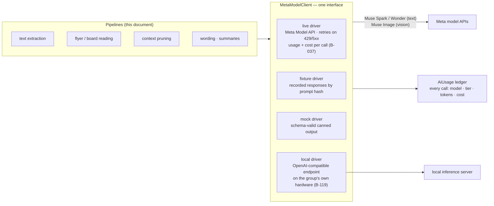
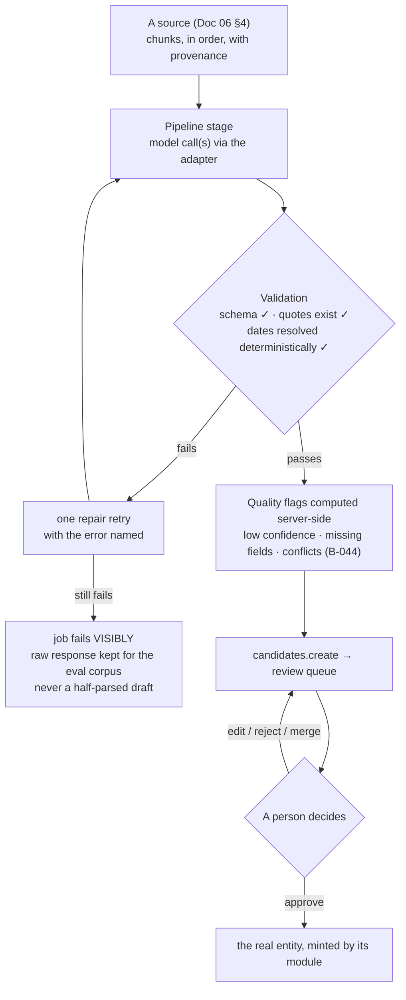
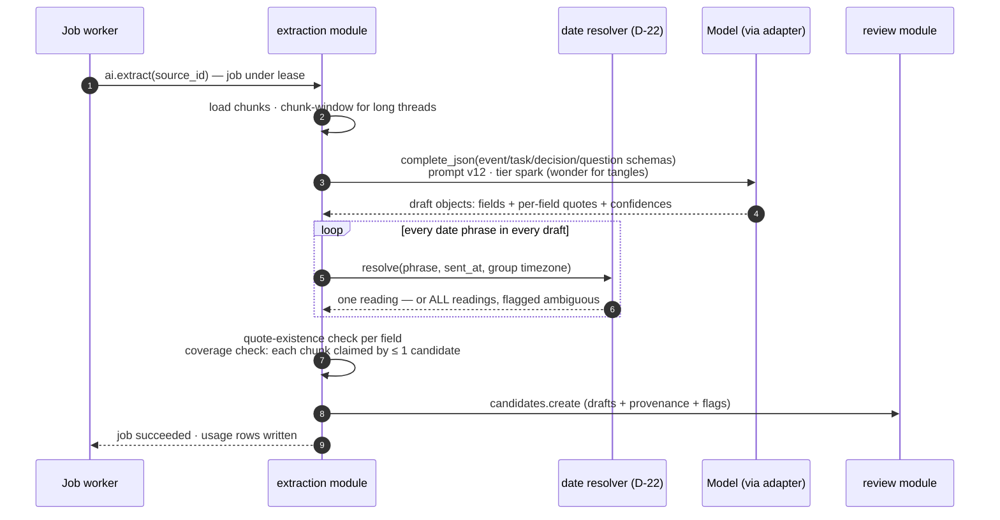
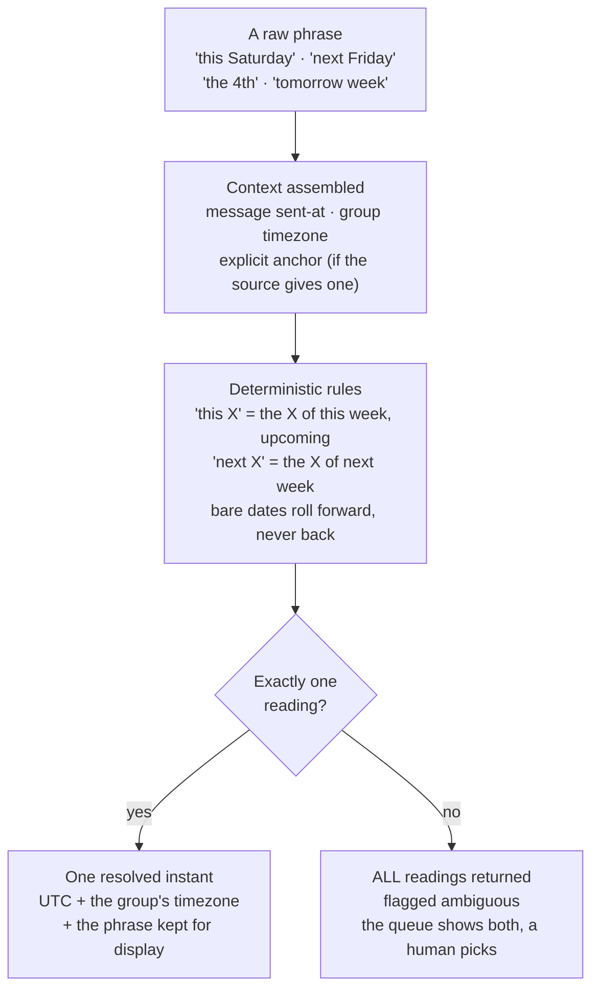
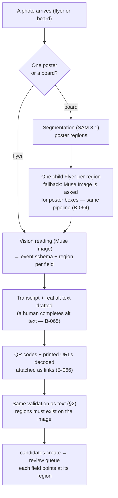
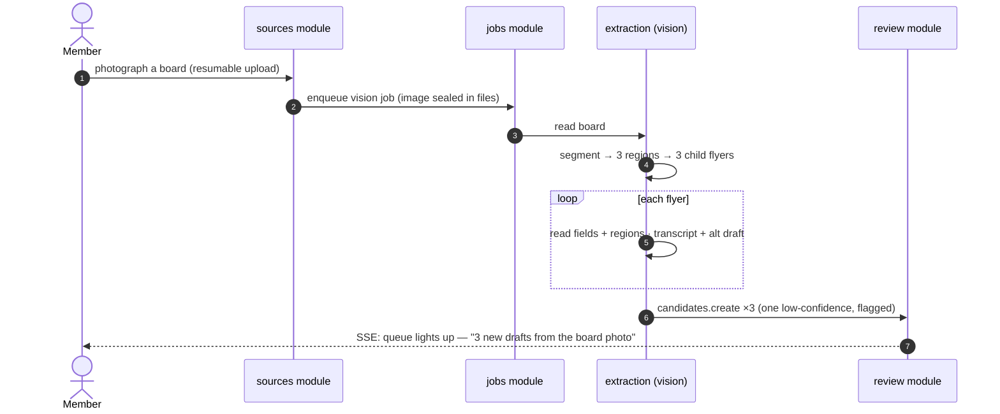
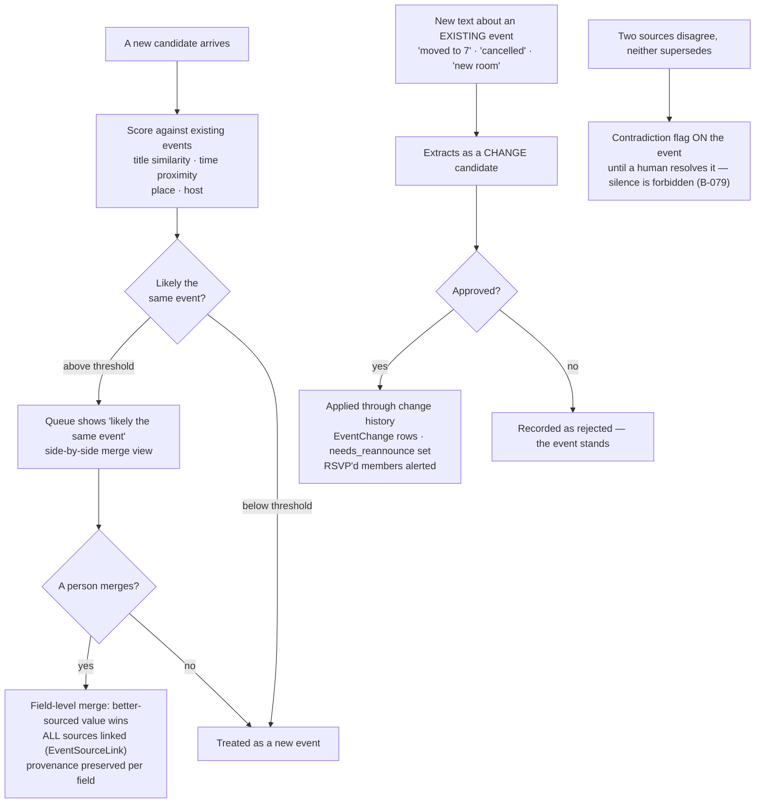
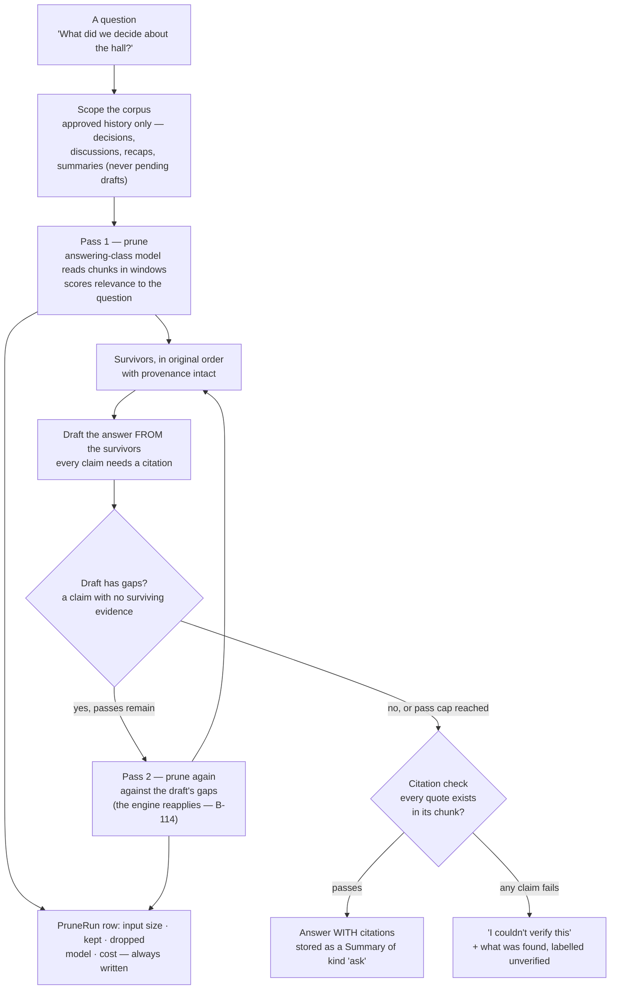
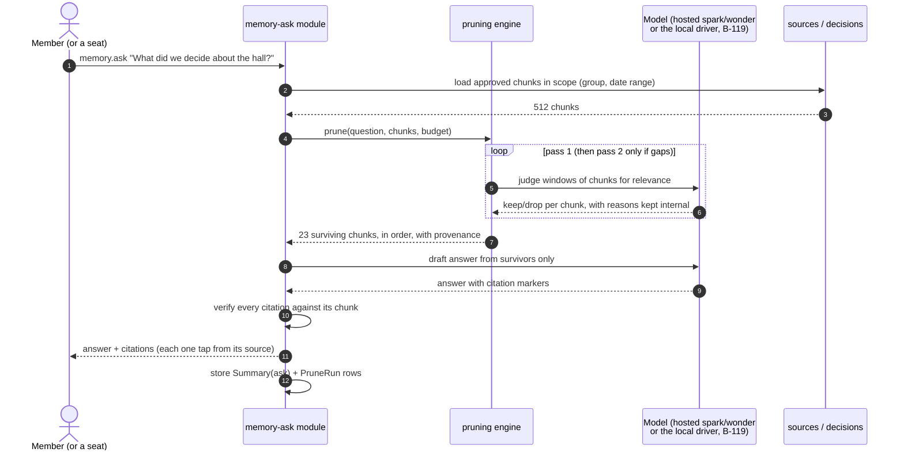

# 07 — AI Pipelines: How Talk Becomes Drafts, and Drafts Become Truth Only by Hand

**For:** backend developers, evaluators, and judges. How the
system reads text, reads flyers and boards, keeps one truth out of
three announcements, detects changes, and answers questions from
the group's own past — with flowcharts, sequence diagrams, and
short worked examples on fixture data.
**The law every pipeline in this document obeys, stated once and
applied everywhere:** the AI **drafts**, a human **decides**.
Every pipeline's only exit is the review queue (Doc 04 §5).
Nothing here can publish, send, or decide — there is no code path
from a model response to a published entity that does not pass
through `candidates.create` and a person's approval (B-043).
**Companion documents:** Doc 04 §4 (the extraction module
contract), Doc 04 §12 (memory-ask), Doc 06 §4–§5 (sources,
candidates, provenance), Doc 11 (the evaluation evidence).

---

## 1. One adapter, four drivers — the only road to a model

All model access flows through a single interface,
`MetaModelClient` (D-18): `complete_text`, `complete_json(schema)`,
`read_image`, `transcribe`, each taking a model tier — **spark**
for volume work, **wonder** for hard reasoning (B-035). No domain
code imports a vendor SDK, ever.



*Walking tour:* the four pipelines on the left know one interface
and nothing else. Behind it, four drivers: the **live** driver
(talks to the Meta model APIs; retries with jitter on 429/5xx
only; never duplicates a paid call that succeeded), the **fixture**
driver (recorded responses keyed by prompt hash — the whole demo
and the whole golden test suite run offline, with no API key),
the **mock** driver (schema-valid canned output for fast unit
tests), and the **local** driver (an OpenAI-compatible endpoint on
the group's own hardware — pruning in particular may run local
while extraction runs hosted, per group setting). Every call,
from every driver, writes the `AiUsage` ledger at the bottom:
spend is recorded, not estimated (§10).

Prompts are a **versioned library** (B-038): one template per
pipeline task, each with its output JSON Schema beside it; the
prompt version is stored on every candidate it produces, and
changing a prompt without bumping its version fails CI.

## 2. The shape every pipeline shares



*Walking tour:* five ideas, in order. (1) Pipelines read
**chunks** — the ordered, citable units of a source — never raw
files. (2) Model output is *untrusted input* until validation:
the schema must match, every provenance quote must actually
exist in the source, and every date phrase must resolve through
the deterministic date module (§4). (3) A validation failure gets
exactly one repair retry; a second failure fails the *job*
visibly, keeping the raw response for the evaluation corpus —
the system never emits a half-parsed draft and hopes. (4) Flags
are computed by the server, not the model: the model proposes
confidences, but "this field is unsupported" is our verdict, and
the frontend renders `flags[]` verbatim (B-044). (5) The queue is
the only exit, and the diamond at the bottom is a person.

## 3. Text extraction — chat and newsletters become candidates



*Walking tour:* extraction is a job (Doc 03 §6) — the member who
added the source is never held hostage to a model call. The model
proposes draft objects whose fields carry *quotes*: the exact
words each field rests on. Date phrases are then taken *away* from
the model and resolved by the deterministic resolver (§4) —
"this Saturday" must mean the same thing in the demo, in tests,
and in production. The quote-existence check is the
anti-hallucination gate: a quote that is not a substring of the
source fails validation, and the field is marked **unsupported**
rather than silently believed (B-040). A long newsletter is
**split** into N candidates by the model's boundaries, verified
by coverage: every chunk is claimed by at most one candidate
unless flagged shared — the twelve-event newsletter yields twelve
candidates (B-041). Tasks ("I'll book…", "someone needs to…"),
decisions ("we agreed…"), and open questions (asked, never
answered in-thread) run the same pipeline against three more
schemas (B-042).

### Worked example 1 — a four-message chat

Fixture source (chat paste, sent **Wed 2026-10-21**, group
timezone Europe/London — actually the demo group is US Eastern;
the resolver uses whatever the group declares; here:
America/New_York):

```text
[Wed 2026-10-21 19:02] Ana:  hall is booked!! club night this Saturday, doors 7
[Wed 2026-10-21 19:04] Ben:  I'll bring the projector
[Wed 2026-10-21 19:05] Ana:  and we agreed the quiz is postponed to November
[Wed 2026-10-21 19:07] Cleo: who is doing the door rota?
```

What reaches the queue — four candidates, three kinds:

```json
{ "kind": "event",
  "draft": { "title": "Club night", "place": "the hall",
             "starts_at": "2026-10-24T19:00:00-04:00",
             "fields": {
               "title":  { "value": "Club night", "confidence": 0.93,
                           "quote": "club night this Saturday" },
               "starts": { "value": "2026-10-24 19:00", "confidence": 0.88,
                           "quote": "this Saturday, doors 7",
                           "date_phrase": "this Saturday",
                           "resolved_from": "sent Wed 2026-10-21 → Sat 2026-10-24" },
               "place":  { "value": "the hall", "confidence": 0.81,
                           "quote": "hall is booked" } },
             "flags": ["no host yet"] } }
{ "kind": "task",
  "draft": { "title": "Bring the projector", "owner": "Ben",
             "quote": "I'll bring the projector", "confidence": 0.95 } }
{ "kind": "decision",
  "draft": { "text": "The quiz is postponed to November",
             "quote": "we agreed the quiz is postponed to November",
             "confidence": 0.9 } }
{ "kind": "question",
  "draft": { "text": "Who is doing the door rota?",
             "quote": "who is doing the door rota?", "confidence": 0.97 } }
```

*Reading the example:* note what the system did **not** do. It did
not invent a host (the flag says so), did not turn "doors 7" into
anything but 19:00 with the phrase preserved, and did not answer
Cleo's question — it filed the question, which is where unanswered
questions belong. Ben's task arrives *unclaimed-by-default in
effect*: the candidate names Ben because Ben volunteered in the
quote, and the queue shows exactly that; approval is what makes
it his task (Doc 04 §7).

## 4. The date resolver — deterministic, never a prompt side-effect (D-22)

Relative dates are where a planning tool earns or loses trust, so
they are resolved by a **named, tested module**, not by the model.
The model proposes raw phrases; the resolver owns their meaning.



*Walking tour:* a phrase meets its context — when the message was
sent, in whose timezone — and a small set of stated rules. The
critical branch is the diamond: ambiguity is a **result**, not an
error. The resolver returns every reading with an `ambiguous`
flag, and the queue makes a person choose. A silent guess is the
one outcome the module is forbidden to produce.

The golden suite (B-039) pins 200 cases, including month/year
boundaries and DST weeks. The two demo-critical ones:

| Phrase | Sent | Resolves to |
|---|---|---|
| "this Saturday" | Wed 2026-10-21 | **Saturday 2026-10-24** |
| "this Saturday" | Wed 2026-10-28 | **Saturday 2026-10-31** |

## 5. Flyers and boards — paper becomes drafts, with regions for evidence



*Walking tour:* a board photo is first *separated* — SAM 3.1
finds the posters; each region becomes a child flyer and runs the
same reading pipeline as a single flyer. SAM is used **only** for
this separation (D-19): the reading itself is Muse Image against
the same event schema as text. The decided fallback matters:
if SAM access lags, Muse Image is asked for the poster boxes and
the identical region pipeline runs — the demo never depends on
one model's paperwork. Provenance for vision is a **bounding
box**, not a quote: in the queue, tapping a field highlights the
area of the poster it came from. Partial success is a first-class
state — three of four posters read is reported as exactly that
(B-069).



*Walking tour:* the sequence adds one fact to the flowchart: the
member hears back *per result*, honestly counted. If one poster
was glare-ruined, its candidate arrives with low-confidence flags
and the flyer wall (B-070) shows it as `pending_review` — never
invisible, never silently dropped.

### Worked example 2 — one poster off the board

Region 2 of the fixture board photo reads:

```json
{ "kind": "event",
  "draft": { "title": "Harvest Supper",
             "starts_at": "2026-11-06T18:30:00-05:00",
             "place": "Village Hall", "cost": "£6",
             "bring": "a dish to share",
             "fields": {
               "title":  { "region": [0.41, 0.08, 0.88, 0.22], "confidence": 0.97 },
               "starts": { "date_phrase": "Fri Nov 6", "region": [0.44, 0.30, 0.80, 0.38],
                           "confidence": 0.9,
                           "resolved_from": "Fri 2026-11-06 (year from photo context: 2026)" },
               "cost":   { "region": [0.52, 0.61, 0.66, 0.70], "confidence": 0.86 } },
             "flags": [] },
  "flyer": { "transcript": "HARVEST SUPPER — Fri Nov 6, 6.30pm, Village Hall. £6. Bring a dish to share!",
             "alt_text": "A cream paper poster, red headline 'Harvest Supper', a drawn pumpkin border; text gives Friday Nov 6, 6.30pm, Village Hall, £6, bring a dish to share.",
             "alt_status": "complete" } }
```

*Reading the example:* every field names the rectangle it was
read from; the date phrase was resolved by §4's module (the year
came from the photo's context and is *shown* as an assumption a
reviewer can correct); and the flyer carries both a transcript
(what it says) and alt text (what it *is* — layout, imagery, and
facts), because the accessibility law counts a flyer undescribed
as a defect (B-065).

## 6. De-duplication and change detection — one truth, visibly kept

The same event announced three ways must become **one** event;
an event that moves must be *seen* to move. Both are proposals to
a human, never silent edits (Phase 6).



*Walking tour:* the top half is de-duplication: scoring proposes,
the side-by-side view persuades or doesn't, and a merge keeps
*both* sources attached so the merged event can still answer
"where did this time come from?" field by field (B-076). The
bottom half is change detection: words about an existing event
extract as a **change candidate**, and approval applies it through
the change-history machinery — which is what sets
`needs_reannounce` and alerts the people who said they were
coming. The last box is the contradiction rule: disagreement is
displayed, never averaged away.

### Worked example 3 — the harvest supper, three times

1. **Chat (Oct 19):** "supper club is back — Friday week, hall,
   bring a dish" → event candidate, place confident, date phrase
   "Friday week" resolved *ambiguous* (two readings flagged).
2. **Newsletter (Oct 22):** "Harvest Supper — Friday 6 November,
   Village Hall, 6.30pm" → second candidate; scoring vs (1):
   title 0.9, place 1.0, time within the flagged readings → merge
   proposed.
3. **Flyer (board photo, §5's example):** full facts. The
   organiser merges all three in the queue: date and cost from
   the flyer (best sourced), "bring a dish" agreed by all three.
   The published event carries three `EventSourceLink` rows — and
   when (a week later) a chat message says "supper moved to
   7.30!", that arrives as a *change candidate* against this
   event, not as a fourth supper.

## 7. The context-pruning engine — the group's past, made answerable (Geoffrey's engine, B-113)

### 7.1 What it is — and the one thing it is not

It is **not RAG**. There are no embeddings, no vector store, no
similarity index anywhere in this design, and the code and these
documents say so plainly wherever the engine is described
(B-113). Retrieval-by-embedding guesses which chunks *look like*
the question; Geoffrey's engine instead has a full model **read**
the group's context and judge, chunk by chunk, what is *relevant
to the question actually asked* — including the chunk whose words
share nothing with the question but whose meaning settles it
(three-month-old landmines are rarely phrased like the questions
they answer).

What it is: a **pruning** pipeline over the group's own approved
history. The input is chunks (the same citable units as §3); the
output is a smaller, ordered context — survivors kept in their
original order, each with its provenance — plus a `PruneRun`
record naming what was kept, what was dropped, which model did
it, and what it cost. Dropping is *visible*, never silent
(B-120).

### 7.2 The pipeline



*Walking tour:* the engine works in passes. Pass 1 prunes the
scoped corpus down to what is relevant; the answer is drafted
*from the survivors only*; if the draft has gaps — claims it wants
to make with no surviving evidence — a second pass prunes again,
this time aimed at the gaps (Geoffrey's "this can be reapplied
multiple times" made literal; pass count and token budget are
settings with hard caps). The verification diamond is the same
honesty gate as extraction: any claim whose citation fails the
quote-existence check converts the whole answer into the plain
refusal at the bottom right, with what *was* found labelled as
unverified. Nothing about the group's *pending* or *rejected*
material is in scope — the past the engine answers from is the
approved past.



*Walking tour:* note the numbers, because they are the product
claim: a 512-chunk corpus (roughly a season of a busy group's
talk) pruned to 23 chunks — under the roadmap's budget of ≤ 25%
of original tokens, with a recall floor on human-marked relevant
chunks enforced by the golden set (B-113/B-121). The member's
answer carries citations they can open; the run's full account —
input, kept, dropped, model, cost — is a row the group can
inspect and purge (B-120).

### 7.3 Worked example 4 — the hall question, and its honest failure twin

**Corpus (fixture):** 512 chunks across three months: two hall
bookings, a pricing argument, a decision ("we agreed: the hall,
not the school gym, for club nights — the gym double-booked us
twice"), forty messages about a quiz, a rota, and a lost key.

**Question:** "What did we decide about the hall?"
Pass 1 keeps 23 chunks, including the decision chunk (words:
"agreed", "hall", "gym" — phrased nothing like a question, kept
on meaning). Pass 2 is not needed; no gaps. The answer:

> "You decided club nights use **the hall**, not the school gym —
> because the gym double-booked the group twice. *(from the
> decision recorded Sep 12 · Ana, seconded in-thread)* The
> booking itself is £40 a night as of the October invoice
> discussion. *(from Oct 3 thread)*"

Every claim carries its citation. **The failure twin:** asked
"What did we decide about parking?", the corpus contains one
joke about parking and nothing decided. The draft cannot cite a
decision; the answer returned is *"I couldn't verify this — the
group's history mentions parking once (a joke in the Sep 19
thread) but records no decision."* That refusal is a designed
success state (B-115's acceptance test *is* this behaviour), and
it is what separates this engine from a confident guesser.

### 7.4 What is built on the engine

- **Briefings** (B-117): prune the group's history for *this
  event's* terms — relevant past decisions, last time's recap,
  open questions, role gaps. The golden briefing must contain the
  landmine planted three months back in the fixture, or the
  phase gate fails.
- **Recaps and newsletter drafts** (B-118): post-event, the
  discussion + attendance aggregate + photos' alt text become a
  recap *draft*; approved recaps become part of the corpus, and a
  month of them can be drafted into a newsletter — which then
  arrives back as a source. The loop closes, through the queue,
  every time.
- **Discussion summaries** (B-116): a thread summarised — and any
  decision or next action inside the summary is extracted as a
  **candidate**, because summaries propose and the queue disposes.

## 8. Confidence and flags — how a reviewer knows what to trust

Confidence is **per field, never per document**, and it is not
the model's word alone. The server computes the final picture
(B-044):

| Signal | Effect |
|---|---|
| Model's own per-field confidence | The starting number, shown as the reviewer sees it |
| Quote/region fails existence check | Field marked **unsupported** — displayed as a question, never a fact (B-040) |
| Date phrase ambiguous | Both readings flagged; no confidence number can launder an ambiguity (§4) |
| Required field missing (no place, no start) | `flags[]` entry — "no place yet" is a queue-visible fact (B-044) |
| Sources conflict on a field | Conflict flag + both values shown (B-079) |
| Same field agreed by two independent sources | Confidence raised after merge — agreement is evidence (B-076) |

The flags vocabulary is closed and server-owned: the frontend
renders `flags[]` verbatim and cannot soften "unsupported" into
"probably fine". That inversion — the UI *may not* decide what is
trustworthy — is a security property as much as a UX one.

## 9. Cost — the ledger, the budget, the soft stop

Every adapter call writes an `AiUsage` row (model, tier, tokens,
cost, operation, group). Three disciplines stand on that ledger:

1. **Per-group daily budget** (B-047): at the cap, extraction and
   pruning *queue* — the queue screen says "paused — budget" in
   plain words. The system never silently overspends, and never
   fails the group's data to save money: it delays drafts.
2. **Cost per operation is evidence** (B-293): cost per extracted
   event, per flyer read, per answered question is published in
   the release's RESULTS.md with the corpus described, so a
   nonprofit can budget from numbers, not adjectives.
3. **Tier discipline**: volume work rides the spark tier; the
   wonder tier is spent where tangles justify it (long threads,
   hard pruning passes); the local driver (B-119) can take
   pruning off the meter entirely where a group runs its own
   hardware — a per-group setting, visible in the budget view.

## 10. Evaluation — the pipelines are graded, in the open

The golden sets (B-046, B-073, B-121, deepened by B-285) score
every pipeline against human-labelled fixtures: per-field
precision/recall for extraction, field accuracy per flyer type
(clean print, handwriting, rotated, glare), pruning recall
against human-marked relevant chunks. Rules of the house:

- A regression greater than 2 points on any field **fails the
  phase gate** (B-046) — not the demo, the *gate*: the work does
  not advance until the regression is understood.
- The scores print into the test report that ships in the ZIP —
  the team quotes real numbers in the submission, and every
  number traces to an evidence item (`EV-###`, B-281).
- Second-labeller agreement is itself reported (B-285): the
  humans grading the machine are also graded, gently, by their
  agreement rate.

## 11. The pipelines in one sentence each

- **Extraction:** read the chunks, propose drafts with receipts,
  let the date module do dates.
- **Vision:** separate the posters, read each one, point at the
  rectangle every fact came from.
- **De-duplication:** score, propose, merge by hand, keep every
  source.
- **Change detection:** words about an old event are a *change
  candidate*, never a silent edit.
- **Pruning:** a model reads the group's own past and keeps what
  the question needs — no embeddings, no guessing, citations or
  an honest refusal.
- **All of them:** the queue decides. Always.
