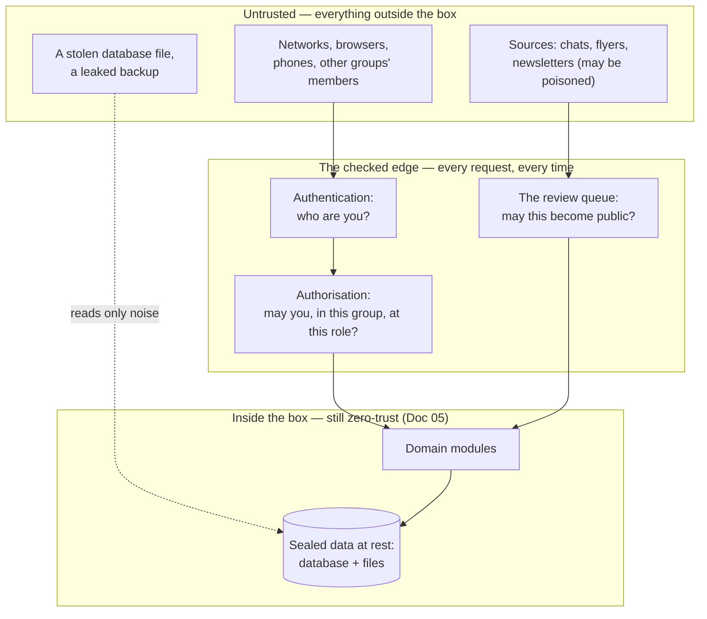
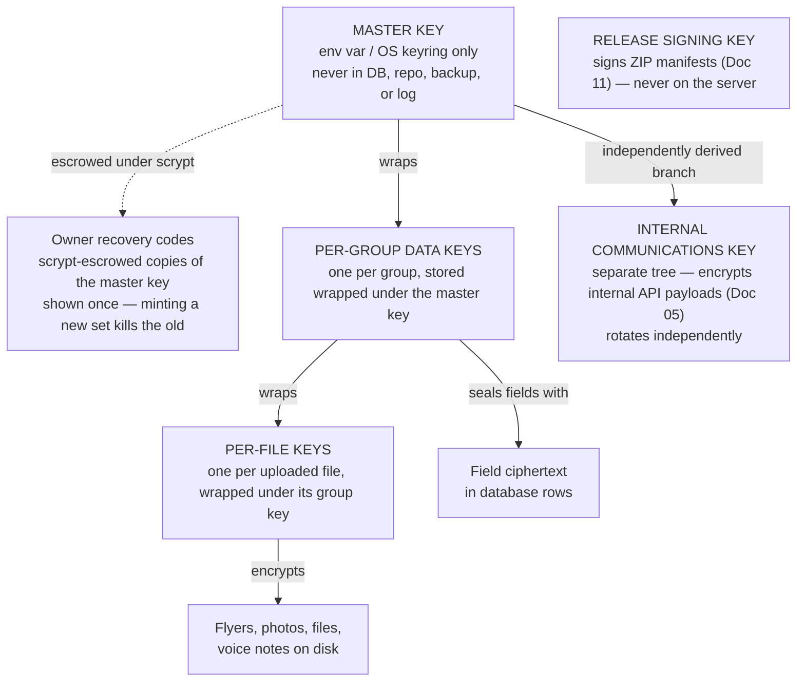
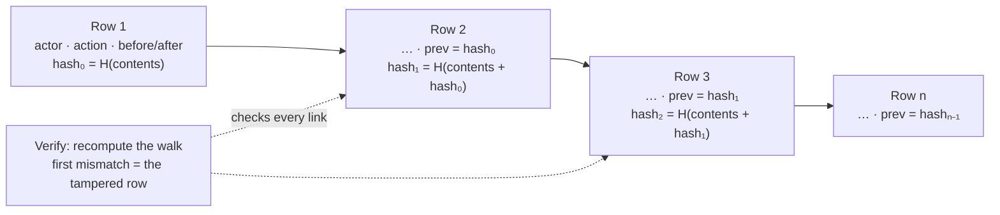
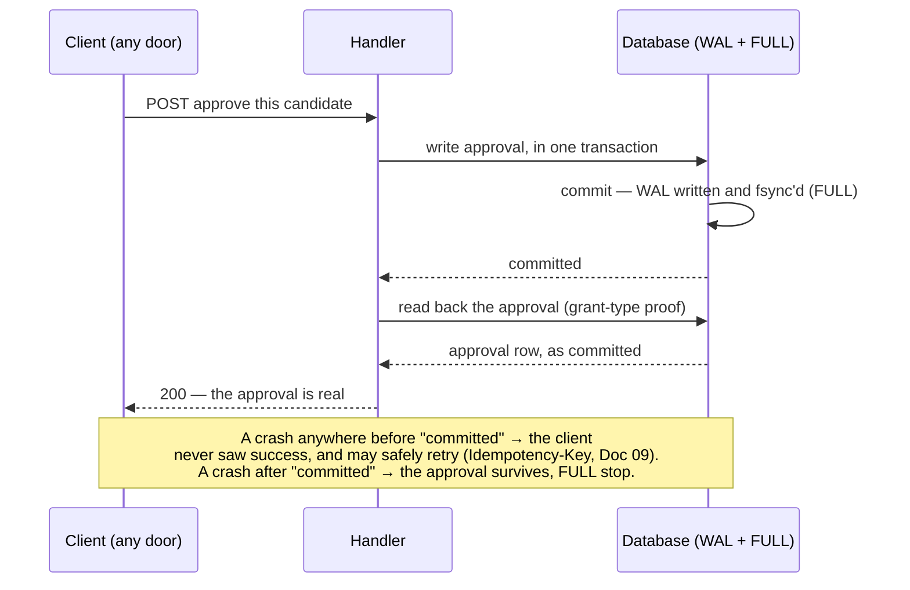
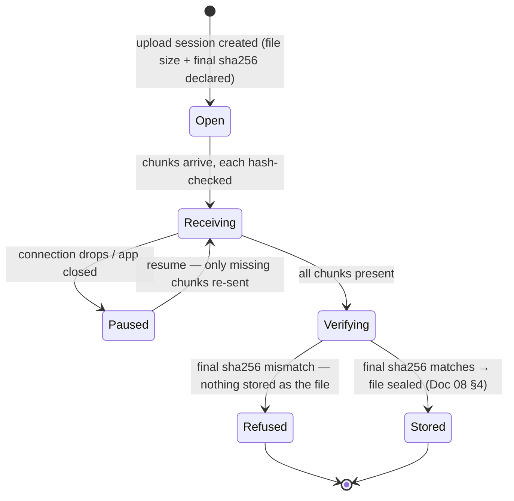
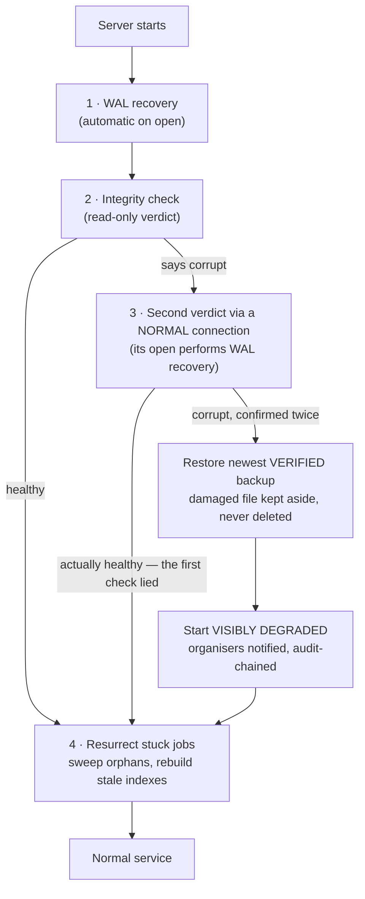

# 08 — Security, Cryptography, and Durability

**For:** backend developers, operators, and any reviewer who wants
to check the safety claims rather than take them on trust.
**Companion guides:** Doc 05 (the internal encrypted API, in full),
Doc 02 Part B (operating the server day to day), Doc 11 (the test
suites that prove what this document claims), Doc 12 (plain-words
glossary — every term used here is defined there).

**The whole document in three sentences.** User data is encrypted
before it reaches the disk, so a stolen database or backup reads as
noise. A crash — even a power cut mid-sentence — cannot lose data a
user has entered, because the database commits before it answers and
drafts save themselves as they are typed. And §9 states, in plain
words, what is **not** claimed, because an honest boundary is part
of the security design.

Where this document names a test, the test is the claim's evidence
(roadmap Phase 24): if a protection has no failing-then-passing test
behind it, it is written here as an intention, not a fact.

---

## 1. The threat model (B-139)

Security work starts from a written list of what we protect, from
whom, and how each attack is answered. The threat model lives in
the repo, one abuse case per route family, each mapped to a test.

**Assets, in order of value:** (1) the group's words — messages,
sources, notes, decisions; (2) uploaded files — flyers, photos,
voice notes; (3) credentials — password hashes, session tokens,
seat keys, integration tokens; (4) keys — the master key and
everything it wraps; (5) the audit history's trustworthiness;
(6) availability — the group's ability to reach its own plans.

**Actors:** an outsider with a stolen database file or backup; an
outsider probing the public routes; a member of *another* group
trying to peek sideways; a member of the *same* group exceeding
their role; a malicious or manipulated source (a flyer or chat that
tries to give the AI instructions); a compromised internal part (one
worker or integration gone wrong); and an honest operator making a
mistake at 2 a.m. The design must survive all seven.

**Case #1 in the threat model is a true story.** Henry's first
version of this product idea, some twenty years ago, let *anyone*
create pages about *anyone* — no permission step. Every abuse case
in the model is checked against that shape of failure: *unauthenticated
or unapproved content becoming public truth.* In this system it
cannot happen, because publication always passes a human approval
in the review queue (Doc 01 §5) and the authorisation fuzz (B-140)
proves no route skips the check.



*Walking tour:* three untrusted things press on the system from the
left — networks and people, handed-in sources, and a thief holding
our own files. The thief's arrow is dotted and stops at "reads only
noise": that is §3–§5 doing their work. People pass two gates,
authentication then group-and-role authorisation, before reaching
the core; sources pass a different gate, the human review queue,
because their danger is not *who* sent them but *what they claim*.
Inside the box the core stores only sealed data — and even inside,
parts authenticate to each other (Doc 05), because "inside" is not
treated as "trusted".

### 1.1 The standing attack suites (Phase 13, B-139 → B-146)

| Suite | What it attacks | The unforgivable failure it hunts |
|---|---|---|
| Authorisation fuzz (B-140) | Every role × random ids from other groups | **Cross-group leakage — the one unforgivable bug class** |
| Upload attacks (B-141) | Content sniffing, embedded payloads, quota abuse, guessed file URLs | A file readable by anyone who was not granted it |
| Injection + poisoned sources (B-142) | Prompt injection in flyers/chats, stored XSS | Source text ever executed as instructions or markup |
| Secrets audit (B-145) | Logs, configs, bundles, the repo itself | A token, key, or magic link written anywhere it can be read |
| Erasure proof (B-143) | Export → erase → grep the whole system | A "deleted" group's words surviving anywhere |
| Internal impersonation/replay (B-164) | One module's credentials calling another's operations; captured messages re-sent | A part acting as another part, or an action happening twice |

Each suite runs per release; each fixed vulnerability is only
called fixed when the attack that found it fails in a *later* run,
filed as evidence (B-290).

---

## 2. The key hierarchy (B-167, B-169)

One key to rule the deployment, and it never touches the database.
Everything else hangs below it in a tree of *wrappings*: a key is
stored only encrypted ("wrapped") under the key above it, so
rotating a key means re-wrapping its children — never re-encrypting
the group's life, and never a flag day.



*Walking tour:* the master key sits alone at the top, held in the
process environment or the operating system's keyring. It wraps one
data key per group; a group key does two jobs — sealing that group's
sensitive fields directly, and wrapping one key per uploaded file,
so a single file can be destroyed by destroying its key. The owner
recovery codes hang off the master key by a dotted line: they are
scrypt-escrowed *copies* of it (§5), the way back in if the master
key is lost. The internal communications key is a separate branch
with a separate life — compromising stored data keys must not open
internal traffic, or the reverse. The release key never lives on the
server at all; it signs the ZIPs the team ships (Doc 11 §8).

**Rotation, plainly:** group keys and the internal key rotate by
re-wrap/re-issue with old and new overlapping, so rotation never
stops the system (B-164, B-169). Master-key rotation is a planned,
logged operator operation (Doc 02 B.3). Ciphertext is versioned
(§3) precisely so an algorithm can be retired the same way.

---

## 3. Field-level envelope encryption (B-167)

"Envelope" because the data travels inside two wrappings: the value
is sealed under its **group key**, and the group key is itself
sealed under the **master key**. The database never holds either key
in the clear.

### 3.1 What is sealed, and what is not

**Sealed:** message and chat text, source raw text and transcripts,
notes, decision text, event descriptions, names-and-places in
drafts — in general, anything a group *said*. Also sealed beside
the value where needed: email addresses.

**Not sealed, deliberately:** ids, timestamps, roles, statuses,
counts — the structural facts the database must index and sort by.
Encrypting those would buy nothing and cost every query. Passwords
are neither sealed nor stored: they are **Argon2id-hashed**, a
different and stronger treatment (§7).

**Searchable while sealed:** where a sealed field must still be
looked up — an email address at sign-in — a **keyed HMAC index**
sits beside the ciphertext: a one-way fingerprint of the value,
computable only with the key. Lookup compares fingerprints; the
value itself is never decrypted for searching, and the fingerprint
cannot be reversed into the address.

### 3.2 The stored format: `enc:v1:`

```
enc:v1:<key-id>:<nonce>:<ciphertext>
```

- `enc:` — this value is sealed; anything reading the raw database
  knows it is looking at ciphertext, not at a fact.
- `v1` — the format/algorithm version (AES-256-GCM). A future `v2`
  can roll out row by row; old rows stay readable until re-sealed.
- `key-id` — *which* wrapped group key sealed this, so rotation
  never has to guess.
- `nonce` — a fresh random nonce per value. The same sentence sealed
  twice produces two different ciphertexts; patterns in the group's
  words do not leak through repetition.
- `ciphertext` — the sealed value **plus its GCM authentication
  tag**: tampering with even one byte makes opening fail loudly
  rather than returning altered text.

### 3.3 Sealing and opening, step by step

```mermaid
sequenceDiagram
    participant S as Service (a module)
    participant C as Crypto module
    participant DB as Database
    Note over S,DB: SEALING — a member posts a message
    S->>C: seal(group, "see you at the hall at 7")
    C->>C: unwrap group key under master key (memory only)
    C->>C: fresh nonce; AES-256-GCM seal; build enc:v1: string
    C-->>S: enc:v1:k7:…ciphertext…
    S->>DB: store row (ciphertext + HMAC index if searchable)
    Note over S,DB: OPENING — an authorised member reads it
    S->>DB: fetch row
    S->>C: open(row value, reader's group)
    C->>C: check group matches key-id's group
    C->>C: verify GCM tag, then unseal
    alt tag fails or wrong group
        C-->>S: refuse — audit-logged, nothing returned
    else ok
        C-->>S: "see you at the hall at 7"
    end
```

*Walking tour:* top half, a write: the service never touches keys
itself — it hands plaintext to the crypto module, which unwraps the
group key in memory only, seals with a fresh nonce, and returns the
`enc:v1:` string that is all the database ever sees. Bottom half, a
read: the crypto module checks the reader's group against the key
that sealed the value *before* unsealing, then verifies the GCM tag.
A wrong group or a tampered byte ends in a refusal that is written
to the audit chain (§6) — never in silently returned garbage.

**The proof:** the raw-database grep test (B-167) seeds known
secrets, names, and message text, then searches the raw database
file for them. They must be **absent**, while the API serves them
correctly to authorised readers. This test runs in CI and its
result is quoted in every release's test report.

---

## 4. Encrypted file storage (B-168)

Uploads — flyer and board photos, files, voice notes — never sit on
the disk as themselves. Each file is encrypted with its own
**per-file key** (AES-256-GCM), and that key is stored wrapped under
the group's key (§2). Thumbnails and transcripts inherit the same
treatment; a thumbnail is a picture of the flyer and is protected
like one. Decryption happens only inside an authorised request or
job, in memory, for the duration of that use.

Two consequences the design leans on:

- **Destroying a file can be cryptographic.** Delete the per-file
  key and the bytes on disk are unrecoverable noise — this is how
  group erasure (B-143) makes "gone" mean gone even before backups
  age out.
- **A copied storage directory is worthless alone.** The
  raw-upload grep test (B-168) plants a recognisable picture and a
  text file, then greps the storage directory: neither the picture's
  bytes nor the text's contents may be found.

Downloads are authorised exactly as views are (B-141): there is no
"guess the file URL" road, and storage paths never appear in the API
(D-17).

## 5. Owner recovery keys — losing the key is not losing the group (B-169)

The master key is the one secret whose loss would orphan every
sealed byte. So at first setup the operator mints **owner recovery
codes**: a small set of one-time codes, each holding a copy of the
master key **escrowed under scrypt** — a deliberately slow,
memory-hard password derivation, so a photographed code sheet is
still hard to brute-force, and a code is useless without being
presented to a live server that rate-limits attempts.

- Shown **once**, at minting; emailable to the owner (Doc 02 B.3).
- Minting a new set **kills the old set** — there is exactly one
  living generation of codes.
- Restoring is a ceremony, not a button: present a code, the server
  unwraps the master key into its keyring, the code is consumed,
  and the whole event is audit-chained.
- Codes are never stored in the database in usable form, never in a
  backup (a test greps every backup bundle for key material,
  B-146/B-169), and never logged.

```mermaid
sequenceDiagram
    participant O as Owner / operator
    participant S as Server
    participant K as OS keyring
    Note over O,S: THE BAD DAY — the server was rebuilt, the master key is gone
    O->>S: present recovery code (from the printed/emailed set)
    S->>S: scrypt-unwrap the escrowed master key copy
    S->>S: verify it unwraps a known group key (proof it is the right key)
    alt wrong code or wrong key
        S-->>O: refused, attempt audit-logged, code not consumed on typo alone
    else verified
        S->>K: install master key
        S->>S: consume the code; chain the recovery in the audit log
        S-->>O: "Recovered. Your groups' data is readable again."
    end
```

*Walking tour:* the owner presents a code from the set they saved at
setup. The server unwraps its escrowed copy and *proves* it before
trusting it — the candidate key must successfully unwrap a group
key the system already holds. Only then is it installed into the
keyring, the code consumed, and the recovery written into the
tamper-evident audit (§6). A wrong code changes nothing and leaves
a record.

## 6. The tamper-evident audit chain (B-170)

An audit log you can quietly edit is a story, not evidence. So each
audit row carries a **hash of the previous row** alongside its own
contents, and is itself hashed into the next — a chain. Editing,
deleting, or reordering history breaks every link after the touch,
and a verification job (also an admin endpoint, Doc 02 A.7) walks
the chain and names the first broken row.



*Walking tour:* each row points backwards at the hash of the row
before it and is hashed forward into its successor, so history is a
single interlocked chain rather than a pile of independent lines.
The verifier recomputes the walk from the first row; the first
place the recomputed hash disagrees with the stored one is where
history was touched (the tamper fixture test, B-170: one edited row
→ verification names it). What the chain records: every
consequential act — approvals, role changes, seat actions, settings,
integration events, internal-API denials, Doctor repairs, recoveries.
What it never records: message content (Doc 05's rule — caller,
operation, result; never payloads). On group erasure the chain keeps
only the *fact* of erasure (Doc 02 A.9).

## 7. Account security (B-013, B-014, B-174)

- **Sessions.** JWT access tokens live **15 minutes**; refresh
  tokens live 30 days and **rotate on every use**. Presenting an
  already-rotated refresh token is treated as theft: the whole
  token family is revoked (B-013). Doc 09 diagrams both flows.
- **Passwords** are Argon2id-hashed, screened against breached-
  password lists, and never required at all — magic links are the
  front door (Doc 09 §2). Progressive lockout slows guessing;
  new-device sign-ins notify the member.
- **Two-factor.** TOTP is offered to everyone and persistently
  urged on owners/admins, with one-time recovery codes (Doc 01
  §2.2). Passkeys/WebAuthn are the post-window stretch on the same
  session chassis.
- **Devices.** Every session is a listed device the member can
  revoke individually, from anywhere, effective immediately
  (B-174) — a lost phone is a revocation, not a disaster.
- **Seat keys** are hashed at rest, shown once at issue, scoped
  least-first (`read`, `draft`, `publish`, `admin`), and revocable
  in one action everywhere — API, MCP, terminal, streams (Doc 02
  A.5). A seat cannot widen its own scopes or create other seats.

## 8. The internal boundary

Modules, workers, the AI pipeline, and integrations do not trust
each other either: every cross-part call travels the **internal
encrypted API** — envelope-encrypted, Ed25519-signed, sent under a
per-module service identity with least-privilege scopes, protected
against replay, and audit-logged without payloads. A compromised
worker cannot forge an approval or read another part's traffic; its
blast radius is itself. The full protocol — envelope fields,
transports, scope registry, rotation — is **Doc 05**; the operator
consequences are in Doc 02 B.6. This document only insists on the
principle: *there is no second, quieter channel.*

---

## 9. The honest boundary — what is NOT claimed

Read this section to any judge, reviewer, or group before you quote
the rest of the document at them.

1. **This is encryption at rest, not end-to-end encryption between
   members.** Sealing protects the data when it is *stored* — a
   stolen disk, a copied database, a leaked backup all read as
   noise. The server itself can read what it serves: it must, in
   order to extract events, prune context, and answer questions.
   Member-to-member end-to-end encryption would make most of those
   features impossible and is a different product decision. It is
   **not** silently implied anywhere, and any document that seems to
   imply it is a bug — report it.
2. **A fully compromised, running server is out of scope for the
   sealing.** An attacker who owns the live process owns its
   memory, where keys are unwrapped for use. The internal API (§8)
   limits what one *part* can do to another; it does not repeal
   operating-system reality. Keep the box patched and the operator
   account honest.
3. **Metadata is structural, not sealed** (§3.1): who is in which
   group, when events happen, that a message exists. A group whose
   *existence* must be secret needs operational care beyond this
   product.
4. **Erasure ages out of backups on the operator's rotation**
   (Doc 02 A.9/B.4) — stated to the group in plain words, never
   promised as instant everywhere.
5. **No federation.** Deployments never talk to each other
   (B-249): each server is sovereign. Remote *access* (a member
   reaching their own server from anywhere) is fully supported;
   server-to-server federation is a deliberate non-goal, so nobody
   should promise it to a user or a judge.
6. **Telemetry is opt-in and content-free** (B-287): off by default,
   aggregate counts and timings only, never content, never
   per-person tracking — and a group's admin can see exactly what
   is collected.

---

## 10. Durability — a crash loses nothing entered (D-28)

Security keeps data *private*; durability keeps it *in existence*.
The promise, in the words it was ordered with: **even a crash does
not lose data entered so far.**

### 10.1 The database settings, and why (B-003)

SQLite runs in **WAL mode** (write-ahead logging) with
**`synchronous=FULL`** and **`foreign_keys=ON`** on **every**
connection, plus a busy timeout. FULL — not the more common NORMAL —
is the whole point: a committed transaction must survive a **power
cut**, not merely a process crash. (On PostgreSQL later, D-06, the
equivalent full-synchronisation settings hold; the models do not
change.) On a Raspberry Pi the law does not bend silently: FULL is
kept, WAL size is capped and checkpoints scheduled to bound SD-card
wear, and any operator override is explicit, logged, and bannered
in `/health` (B-254).

### 10.2 Commit-before-answer

A handler never returns a result its own transaction has not
committed. This is mechanical, not a habit: a session wrapper
refuses to serialise a response from inside an open write
transaction for the grant-type handlers — sessions, approvals,
votes, feed tokens — the exact writes a client will immediately act
on. Grant-type writes are additionally verified by read-back or by
a unique-constraint proof before the answer is sent (B-171). The
lesson is carried from Samtal's live deploy, where answering before
the commit was visible made freshly granted credentials race their
own grants and get refused.



*Walking tour:* the write happens inside one transaction; the
database commits it to the write-ahead log with a full sync before
anyone celebrates; the handler reads the grant back as proof; only
then does the client hear "done". The note at the bottom is the
contract: before the commit point, failure is *visible and
retryable*; after it, the data is durable. There is no middle state
where the user was told "saved" and it was not.

### 10.3 Drafts are data (B-171)

Anything a user spends time entering — an event being edited, a
candidate being corrected, group settings, a long description —
**autosaves server-side as a draft row**, on a short interval and on
field-group changes. A dead browser, a dead laptop, or a dead
server loses at most the last few seconds of typing; reopening, on
any device, offers the draft back (B-259). Drafts obey the same
sealing as the content they will become.

### 10.4 Uploads resume (B-171)

Uploads are **chunked**: each chunk arrives with its own hash; the
session remembers which chunks are safely stored; an interrupted
upload is a *paused* upload — the client resumes from the first
missing chunk, never from zero. The assembled file's final SHA-256
must match the declared hash or the upload does not complete. A
flyer photographed on flaky clubhouse Wi-Fi is exactly the case
this exists for.



*Walking tour:* an upload is a small state machine the server keeps
in a row, not a hope in a socket. Chunks move it from Open to
Receiving; any interruption parks it in Paused — a state, not a
failure; resume re-enters Receiving with only the gaps. When the
last chunk lands, the whole file's hash is verified: match, and the
file is sealed and Stored; mismatch, and it is Refused outright —
a corrupt or swapped file never quietly becomes the group's flyer.

### 10.5 Jobs never vanish

A job is a **database row before it is work** (B-008): enqueue
writes the row (its payload envelope-encrypted under the internal
key, B-166), a worker claims it by lease, and a worker that dies
mid-job leaves a lease that expires — whereupon the recovery manager
resurrects the job or marks it visibly failed (§11). "Silently
gone" is not a state this system has. Job payloads at rest being
sealed means the durability store and the secrecy store are the
same store, with the same protections.

---

## 11. Self-healing — carefully (B-172, B-173, B-175)

### 11.1 Boot recovery and the double-verdict guard

Every boot runs the same ceremony, in order: WAL recovery →
integrity check → job resurrection → orphan sweep → stale-index
rebuild. The integrity step carries the document's most important
guard, learned the hard way on Samtal's live deploy: **a read-only
integrity check on a hot WAL can falsely report corruption.** A
healthy database nearly got "healed" aside there. So here, a
verdict of "corrupt" from a read-only check must be **confirmed by
a second verdict through a normal connection** — whose very opening
performs WAL recovery — before corruption is declared. Two agreeing
verdicts, or nothing happens. Healing a healthy database is a named
test failure (B-172).

Only on a true double verdict does the manager restore — the newest
**verified** backup — and even then the damaged file is **kept
aside, never deleted**, and the system starts in a visibly degraded
state with organisers notified. The hourly watchdog repeats the
cheap checks: integrity quick-check, stuck leases, orphan files,
backup freshness, expiring tokens.



*Walking tour:* the boot walks down the left: recover the log, then
ask the database if it is well. "Healthy" goes straight to step 4,
the housekeeping of stuck jobs and orphans. "Corrupt" does **not**
go to restore — it goes to the confirmation box, where a normal
connection's opening replays the WAL and the question is asked
again. Most alarms die there, as the Samtal one should have. Only a
second, agreeing verdict reaches the restore box, and that road
still keeps the damaged file, starts degraded *visibly*, and tells
the organisers. Every road ends at normal service with the audit
chain holding the whole story.

### 11.2 Error correction, not just error handling (B-173)

- **Retries** with backoff and jitter for transient faults —
  a reminder that fails to send is retried, then visibly failed,
  never silently dropped and never reported as sent.
- **Circuit breakers and bulkheads** per external dependency
  (Meta model API, mail, Facebook, Google): one integration's
  outage cannot starve the job worker or take unrelated features
  down with it.
- **Repair jobs** recompute derived data from source rows
  (counters, provenance links, stale digests), fix forward, and log
  every fix they make — a repair that hides itself would be
  indistinguishable from tampering, and §6 exists.
- **A written degradation matrix**: for each dependency down, what
  the user sees — queued, cached, or plainly unavailable. Never a
  stack trace; never silent loss.

### 11.3 The chaos harness — proof, not promises (B-175)

Fault injection is a first-class suite: the process is `kill -9`'d
at random points during ingest, extraction, approval, upload, and
digest send; power loss is simulated by hard-killing during fsync
windows (on a native test rig — no containers, D-24); disk-full and
read-only-database faults are injected. After **every** fault, the
invariant is asserted automatically:

> **No committed user entry is lost. No half-written entity is
> visible. Every interrupted job is resumed or visibly failed.**

The suite runs **100 chaos passes** before ZIP-Final, and its
invariant report ships in the ZIP's test report (Doc 11). The
combined drill (B-180) stages the whole story at once — resumable
flyer upload, process killed mid-extraction, self-healing restart,
approval over the internal encrypted API, raw-disk greps finding no
plaintext, audit chain verifying — on a second operating system,
with the drill log in the ZIP.

---

## 12. Claims, and the tests that carry them

| Claim in this document | Carried by |
|---|---|
| Sealed fields are absent from the raw database | B-167 raw-DB grep test |
| Uploaded bytes are absent from raw storage | B-168 raw-upload grep test |
| A lost master key is recoverable; an old code set is dead | B-169 mint → lose → restore round-trip |
| An edited audit row is detected and named | B-170 tamper fixture |
| A reused refresh token revokes its family | B-013 theft-reuse test |
| No route leaks another group's data, even fuzzed | B-140 / B-246 fuzz reports |
| A crash loses no committed entry (100 runs) | B-175 chaos invariant report |
| A healthy database is never healed aside | B-172 healthy-DB drill (named failure if it fires) |
| No key material exists in any backup bundle | B-146/B-169 bundle grep |
| Backups are real | B-146 restore drill — restored from, not merely taken |

If a future release cannot point at the current run of the test in
the right column, the claim in the left column comes out of the
documentation until it can. That is the evidence law (D-41), and
this document obeys it like every other.
