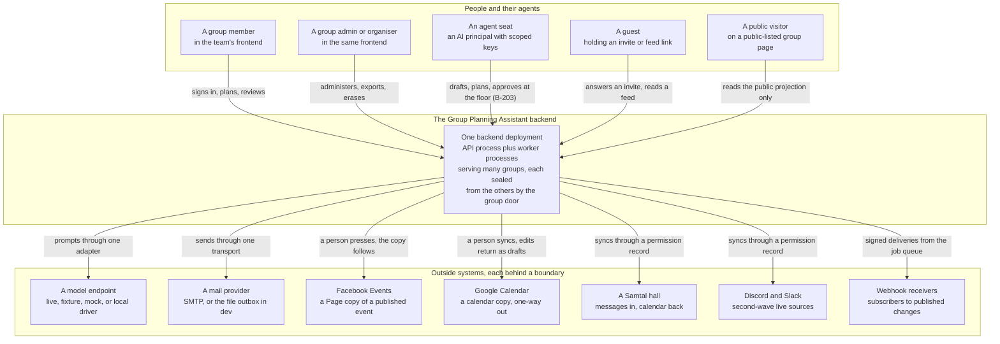
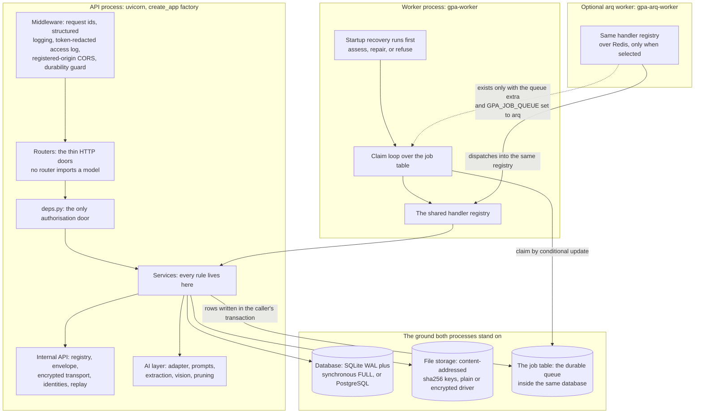
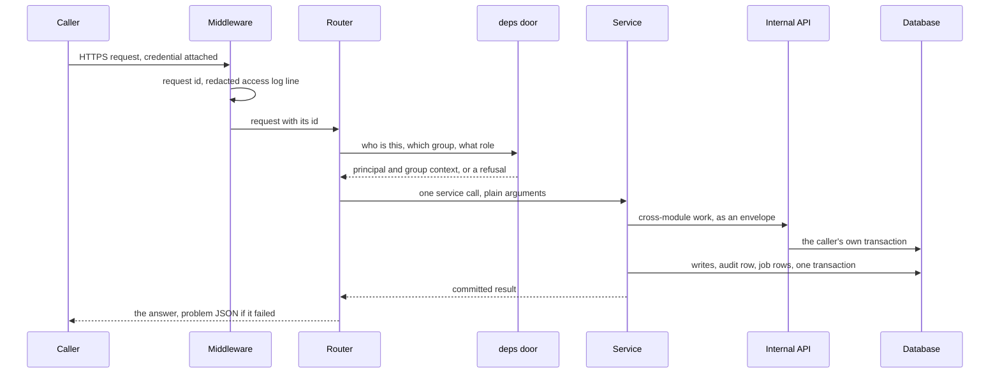
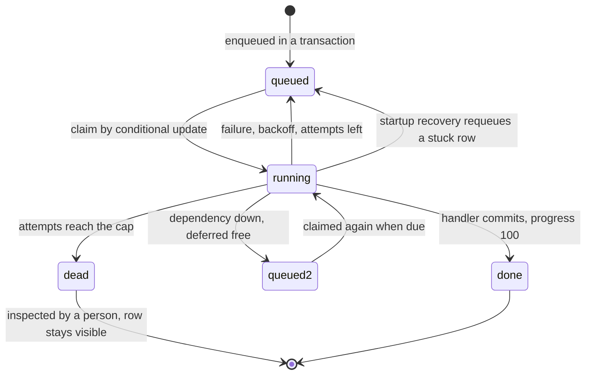
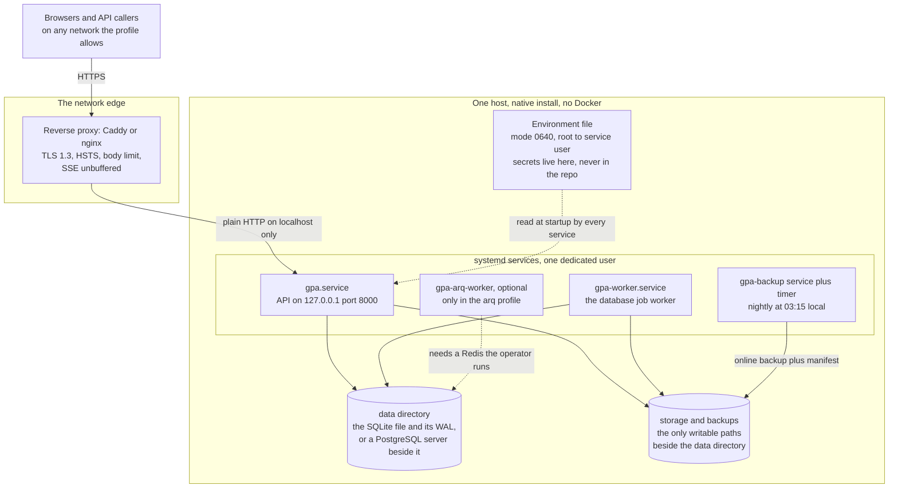

# Architecture diagram pack

*The Phase 18 architecture chapter (slice B-189). For
backend developers and maintainers. Six lengthy Mermaid
diagrams — system context, the process view, the module
map, the request lifecycle, the job lifecycle, and the
deployment topology — each followed by a walking tour in
prose that names every box and arrow, so the chapter reads
whole through a screen reader with no diagram visible.*

*Verified against `PROJECT_MEMORY_MAP.md` at this slice:
the module names are the B-161 module map's own names,
the process names are the shipped composition roots, and
the contract stands at the Phase 17 gate's count. Where a
diagram names a surface a later phase builds, the tour
says so at the point of use. The module atlas (B-190)
goes one level deeper, module by module; the internal
encrypted API (B-191) specifies the wire the module map
only draws.*

## 1. System context — who and what the system talks to

**Walking tour.** Five kinds of caller stand on the left.
A **member** and an **admin** arrive through the team's
frontend, which works against the frozen `OPENAPI.json`;
their difference is role, not road — the same doors serve
both, and the group door (`deps.py`, diagram 4) decides
what each may do. An **agent seat** is an AI principal
holding a scoped API key: it drafts and plans at its role
and stands under the one approval law exactly as a person
of that role does (B-203) — below the group's review floor
its approval is refused in the service layer
(`seat_cannot_approve`); at the floor, holding publish, it
approves through the same door, audited as itself. A **guest** holds only what a link carries — an
invite token or a calendar feed token, each shown once
and kept hashed. A **public visitor** reaches only the
public projection of a public-listed group, where
member-only fields are absent, not blanked.

Every arrow into the backend lands on the one box,
**the deployment**: the API and worker processes of
diagram 2 over one database. Groups share the deployment
and nothing else — no route reads across the group door.

The seven outside systems each sit behind a client
boundary with the same three faces: the real client
shape, a recorded-fixture double the tests run against,
and an honest unavailable default that refuses in plain
words. The backend calls the **model endpoint** only
through the one adapter (`MetaModelClient`), so a driver
swap is configuration, never a code change; **mail**
leaves only through the one transport (SMTP in a real
deployment, the dev file outbox otherwise). **Facebook**
and **Google** copies move only when a person presses
the door, and outside edits never write back directly —
they return as review-queue change candidates.
**Samtal**, **Discord**, and **Slack** feed live sources
through a person's permission record. **Webhook
receivers** are called by signed deliveries from the job
queue, never synchronously from a request. Honest
boundary: in the build environment behind this book no
live third-party account is connected, so every outside
arrow is proven against its fixture double and recorded
NOT RUN live where the phase papers say so.

## 2. The process view — what runs, and what each piece owns

**Walking tour.** The **API process** is a uvicorn server
running the `create_app` factory. A request crosses the
**middleware** first — request ids, structured logging
whose access log redacts the segment after any
token-carrying path part, CORS answered only for origins
a group has registered, and the B-171 durability guard
that refuses an answer whose writes never committed.
**Routers** are thin doors: parse, authorise, call one
service, answer — a pinned rule of the codebase is that
no router imports a model. **deps.py** is the only
authorisation door: every route's principal, group
context, role, and scope come through it. **Services**
hold every rule. Cross-module service work travels the
**internal API** (diagram 3 names its parts), and model
work travels the **AI layer** behind the services, never
beside the routers.

The **worker process** (`gpa-worker`) drains the same
database's job table. **Startup recovery runs first**:
it assesses the ground, repairs what is safely
repairable, and refuses to start on damaged ground
rather than working over it. Its **claim loop** takes
jobs by conditional update and dispatches them into the
**shared handler registry** — the same registry the API
process registers, so a handler means the same thing in
either process, and its effects land in the **services**.

The **arq worker** is the optional twin: only in a
deployment that installed the queue extra and selected
it (`GPA_JOB_QUEUE=arq` with a Redis address) does it
exist, and even then it dispatches into the same
registry — the transport is the only thing that changed.
The dashed arrow is that conditional existence.

Both live processes stand on the same **ground**: the
**database** (SQLite in WAL mode with `synchronous=FULL`
by default; PostgreSQL is the promoted deployment of
Phase 15, same schema, same code), the **file storage**
(content-addressed by sha256, written atomically, served
by the plain driver or the per-file-key encrypted
driver), and the **job table** inside that same database
— jobs are rows, not messages, which is why the SSE
stream can poll the table as the durable record instead
of trusting an in-memory bus. Not drawn as a process,
because it is not one in this build: the MCP server and
the database bus are Phase 28's topology, specified
there and not claimed here.

## 3. The module map — who may call whom

```mermaid
flowchart TB
    subgraph dom["Domain modules"]
        IDN["identity<br/>accounts, sessions, keys, seats"]
        GRP["groups<br/>groups, memberships, sub-groups"]
        SRC["sources<br/>every ingest road in"]
        EXT["extraction<br/>candidates, vision, matching"]
        EVT["events<br/>lifecycle, RSVP, discussion"]
        CAL["calendar<br/>recurrence, iCal, views"]
        PLN["planning<br/>tasks, polls, checklists"]
        NPO["nonprofit<br/>announcements, shifts, resources"]
        NTF["notifications<br/>the outbox and send roads"]
        ITG["integrations<br/>every outside system"]
        MEM["memory<br/>pruning and group memory"]
        TRU["truth<br/>quality, tombstones"]
        PRV["privacy<br/>export, erasure, retention"]
    end
    subgraph plat["Platform and common modules"]
        JOB["jobs<br/>the background-work chassis"]
        AUD["audit<br/>shared: the same-transaction writer"]
        CRY["crypto<br/>shared: sealing and key lifecycle"]
        PLT["platform<br/>health, recovery, resilience"]
        INT2["internal<br/>the encrypted API between modules"]
    end
    COMP["composition<br/>main, worker, arq worker, deps<br/>wires everything, owns no rules"]
    IDN --> INT2
    GRP --> INT2
    SRC --> INT2
    EXT --> INT2
    EVT --> INT2
    CAL --> INT2
    PLN --> INT2
    NTF --> INT2
    ITG --> INT2
    MEM --> INT2
    EVT --> CAL
    EXT --> SRC
    NTF --> JOB
    DOM2["every domain module"] -->|"audit rows in its own transaction"| AUD
    DOM2 -->|"sealing primitives"| CRY
    COMP -.->|"imports and wires"| IDN
    COMP -.->|"imports and wires"| PLT
```

**Walking tour.** The thirteen **domain modules** are
the B-161 module map's own families, each owning its
tables and its service logic: **identity** (accounts,
sessions, keys, seats), **groups**, **sources** (every
ingest road), **extraction** (candidates, vision,
matching and merging), **events**, **calendar**
(recurrence, iCal, the views), **planning**,
**nonprofit**, **notifications** (the outbox),
**integrations**, **memory** (pruning over approved
history), **truth** (the quality report, tombstones),
and **privacy** (export, erasure, retention).

The rule the arrows draw: a domain module that needs
another module's work asks through the **internal API**
— the registry, envelope, and encrypted transport of
B-191 — never by reaching into the other module's
internals. The solid arrows from each domain box to
**internal** are that one road, taken thirteen times.
The few direct service-to-service edges that remain
are pinned by name in the architecture test — **events**
building on **calendar**, **extraction** reading
**sources**, **notifications** enqueueing through
**jobs** — and the pinned set may only shrink. The
architecture checker fails the build on an unmapped
service file or an unpinned new edge.

Two modules are **shared targets**, exempt as
destinations because they are machinery, not domains:
**audit**, the append-only writer every act calls inside
its own transaction, and **crypto**, the sealing
primitives (the `DOM2` box stands for every domain
module for these two arrows — drawing thirteen identical
arrows would hide the map, and the tour names the
exemption plainly instead). **jobs** and **platform**
(health, startup recovery, the circuit breakers) are
platform modules: used by all, owning no group's data.
**Composition** — `main.py`, the two workers, `deps.py`
— is the wiring layer: it imports everything and owns
no rules, which is why its arrows are dashed and why
the service-edge inventory does not apply to it.

## 4. The request lifecycle — one request, end to end

**Walking tour.** A **caller** sends one request with
its credential — a session token, an API key in its
header, a seat key, or a link token in the path. The
**middleware** stamps a request id, keeps the access log
honest (the credential segment of a token-carrying path
is logged as REDACTED, never as itself), and will later
refuse to let an uncommitted answer leave. The
**router** asks the **deps door** the only authorisation
questions there are — who is this, which group, what
role, what scope — and receives either a principal with
its group context or a refusal in problem JSON; a
private group's existence itself is part of the secret,
so an outsider's refusal is a 404, not a 403. The router
then makes **one service call** with plain arguments.

Inside the **service**, cross-module work is dispatched
through the **internal API** as a signed, sealed
envelope that executes in the caller's own transaction
(B-191) — so the callee's writes, the caller's writes,
the audit row, and any job rows (a notification and its
send job, a reminder and its delivery) commit together
or not at all. Only after that commit does the service
return, and only then does the router answer:
**commit-before-answer** is structural here, guarded by
the durability middleware, not a habit. A failure at any
step answers in the same shape — the RFC 9457
problem JSON with the registry's error code — and an
act that did not commit left no audit row, while an
audit row means its act did.

## 5. The job lifecycle — background work as rows

**Walking tour.** A job is born **queued**: `queue`
writes the row inside the caller's transaction (the
outbox law — a notification and its send job exist
together or not at all), or `enqueue` commits one on
its own. Its payload rests sealed (B-166), and its
`run_at` is its due time; chained work — the weekly
digest, the nightly reconcile and retention sweeps —
queues its own successor as it runs.

A worker moves a row to **running** by **claim**: one
conditional update that only lands while the row is
still queued, scanning up to sixteen due candidates so
a worker that loses the head row still finds the work
behind it. Two workers can never run the same row — a
lost race is a clean outcome, never an exception and
never a double-run (B-157). The handler runs from the
shared registry. Success commits and the row is
**done** at progress 100. A failure spends an attempt:
while attempts remain (five by default) the row returns
to **queued** with exponential **backoff** —
the base delay doubled per attempt — and its error is
recorded on the row in plain words. One failure is
free: when the job's dependency is down (its circuit
breaker open, its bulkhead full), the row is **deferred
back to queued without spending an attempt**, its error
field saying what is down and that the work is waiting,
not lost (the second queued box is that same state,
drawn apart so the free road is visible). At the cap
the row is **dead** — out of the queue, never deleted,
its error inspectable by a person. And a row left
**running** by a worker that died is not lost either:
startup recovery (diagram 2) requeues it before the
next claim, which is the arrow from running back to
queued at the bottom. The SSE stream reads this same
table, so what a member watches is the durable record
itself.

## 6. Deployment topology — where it all lives

**Walking tour.** Nothing here is a container: the
deployment is a **native install** (decision D-24) —
`deploy/install.sh` lays the tree down, creates one
dedicated user, renders the systemd units, and enables
them without starting them. **Callers** reach only the
**reverse proxy** (the shipped Caddy example is
live-validated; the nginx example ships reviewed, its
live validation NOT RUN — the proxy guide says so at
the point of use). The proxy terminates TLS, sets HSTS,
enforces the upload body limit itself, and passes SSE
unbuffered; the **API service** behind it binds
localhost only, on purpose, so the proxy is the public
face. The **worker service** drains the job table the
API enqueues to — claim-by-update makes the pair safe
side by side, and more workers (or the optional
**arq worker**, dashed because it exists only in the
arq profile, against a Redis the operator runs) scale
the same way.

The **backup service and timer** take the nightly
bundle at 03:15 local — after the retention sweep,
before anyone's morning — an online backup plus its
sha256 manifest, written into **backups**. The
**environment file** (mode 0640, owned root to the
service user, generated at install and never
overwritten) carries every secret; no secret lives in
the repo or a release ZIP. The services run hardened —
no new privileges, private tmp, a read-only system —
with exactly three writable places: the **data
directory** (the SQLite file and its WAL, or the
connection out to a PostgreSQL server in the promoted
profile), the **storage** tree, and **backups**. The
named deployment profiles (local / lan / vpn /
internet) and their startup refusals are Phase 21's
chapter in the roadmap; this topology is the shape
every one of them deploys.

## Keeping this pack true

This pack is verified against `PROJECT_MEMORY_MAP.md`
per release, per its roadmap line: when a slice changes
a process, a module, or a road between them, the
diagram and its tour change in the same commit, and
the Mermaid gate (`scripts/check_mermaid.py`, run by
`test.sh` before the suite) fails the release on a
diagram that does not parse. A diagram that disagrees
with the map is a bug with a slice number — the same
docs-as-code law (B-181) every Phase 18 chapter lives
under.
