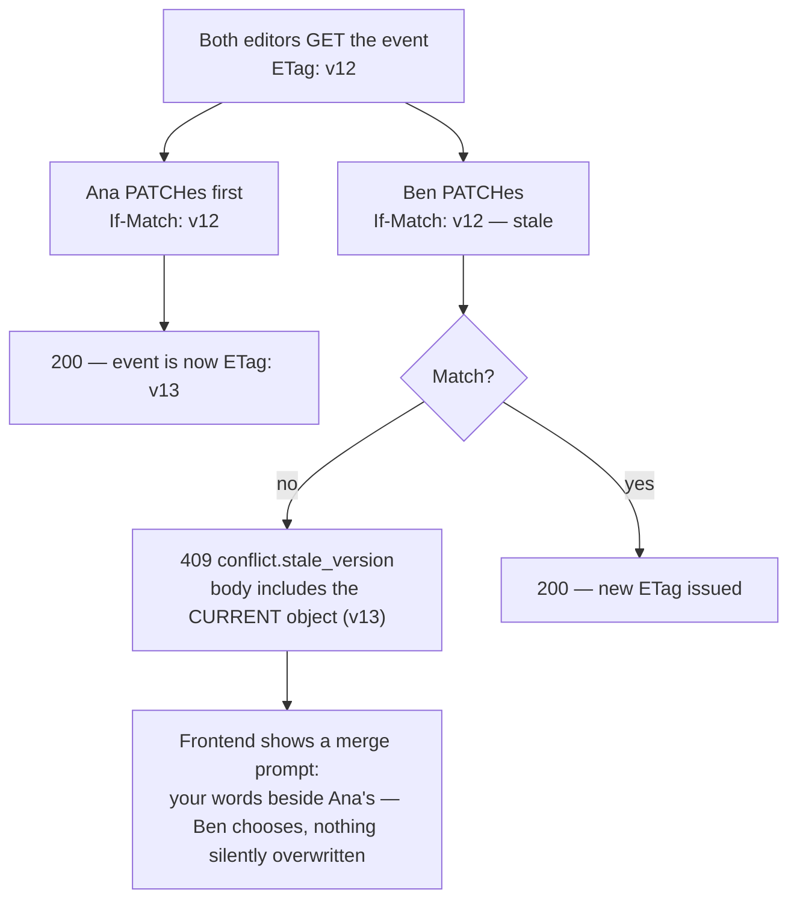
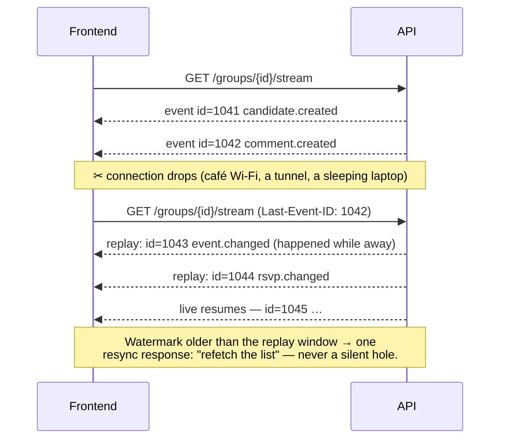

# 09 — API and Frontend Guide

**For:** Geoffrey and Henry — the frontend crew — and anyone else
building a screen, a script, or a client against this backend.
**Companion guides:** Doc 13 (the same capabilities over MCP),
Doc 14 (the terminal client, which lives on this API and proves it),
Doc 12 (glossary). The per-release `FRONTEND_HANDOFF.md` — which
ships inside every ZIP — is this guide's living companion: it says
what changed, what you can build now, and what is still stubbed, in
plain words first.

**The contract in one paragraph.** REST over `/api/v1`, JSON,
OpenAPI 3.1 generated from the code. Each ZIP freezes an
`OPENAPI.json` — the exact contract that ZIP's tests passed against.
If it is not in `OPENAPI.json`, it does not exist yet; if you need
it, it becomes a numbered backend slice and ships in the next ZIP.
You will never need to read backend code to build a screen: this
guide, the Bruno collection, and the frozen contract are the whole
road.

---

## 1. First five minutes

1. Unzip the release. Run `./demo.sh` (or `./run.sh` for an empty
   server). The demo seed loads a fictional nonprofit and a local
   club — fictional, labelled fictional, no real people.
2. Check `GET /health` — no auth — it answers with the version, the
   database status, and **which AI driver is live** (`live`,
   `fixture`, or `mock`). When something "doesn't work", this is
   the first place to look; half of all confusion is the driver.
3. Open the interactive docs at `/docs` (rendered from the same
   OpenAPI the ZIP froze) and the Bruno collection (§10).

**Mock mode is your time machine** (§9): with the mock or fixture
driver you never wait on Meta API access, on a key, or on us.

---

## 2. Authentication — three kinds of caller

| Caller | Credential | Header | Lifetime |
|---|---|---|---|
| A person (browser, app, terminal) | JWT access token | `Authorization: Bearer <jwt>` | 15 minutes |
| A person, renewing | Rotating refresh token | cookie or body, per client profile | 30 days, rotates every use |
| An agent seat or integration | Scoped API key | `X-Api-Key: <key>` | Until revoked |

Two errors are never conflated: **401** means *not signed in* (no
credential, expired, revoked); **403** means *signed in but not
allowed* (wrong group, wrong role, missing scope). Branch on that
distinction — it is the difference between "send them to sign in"
and "show them a polite no".

### 2.1 Magic-link sign-in (the front door)

No password is required to join. The flow:

```mermaid
sequenceDiagram
    participant U as User
    participant F as Frontend
    participant A as API
    participant M as Mailbox
    U->>F: enters email on the sign-in screen
    F->>A: POST /api/v1/auth/magic-link {email}
    A-->>F: 202 — "if that email exists, a link is on its way"
    A->>M: email containing a one-time signed link (short-lived, single-use)
    U->>F: taps the link → lands on the frontend's callback route
    F->>A: POST /api/v1/auth/magic-link/consume {token}
    A->>A: verify signature + expiry + not-yet-used; COMMIT
    A-->>F: {access JWT (15 min), refresh token, user}
    Note over F,A: The consume call commits BEFORE it answers (Doc 08 §10.2) —<br/>the tokens in the response are usable the instant they arrive.
```

*Walking tour:* the user gives an email; the API answers 202 with
deliberately vague wording — the response never reveals whether the
email has an account, so the form cannot be used to probe who is a
member. The emailed link is one-time and short-lived. Tapping it
lands on *your* callback route, which exchanges the token at
`consume`. That handler commits the session before responding —
the grant-race lesson of Doc 08 §10.2 — so the tokens you receive
work immediately, with no retry dance. From here the user exists;
profile completion (name, timezone) is a normal `PATCH /users/me`.

A password can be set later in Settings (`POST /auth/password/set`,
then `POST /auth/password/login` on the same token chassis) — for
members who prefer one. Both doors open into the same session.

### 2.2 Refresh rotation — and what theft looks like

Access tokens are short (15 min) so a leaked one dies quickly.
Refresh tokens live longer but **rotate on every use**, and reuse
of an old one is treated as theft:

```mermaid
sequenceDiagram
    participant F as Frontend
    participant A as API
    F->>A: POST /auth/refresh {refresh: R1}
    A->>A: R1 valid → mark R1 used; issue R2; COMMIT
    A-->>F: {access JWT, refresh: R2}
    Note over F,A: Later — an old token is presented (leaked copy, or a second device racing)
    F->>A: POST /auth/refresh {refresh: R1}
    A->>A: R1 was already rotated → THEFT SIGNATURE
    A->>A: revoke the entire token family; audit-chain the event
    A-->>F: 401 auth.refresh_reused — every device must sign in again
```

*Walking tour:* each refresh spends the old token and mints its
successor in the same commit, so at any moment exactly one refresh
token is valid. If a *spent* token ever reappears, either it leaked
or two copies of the client exist — both are treated the same safe
way: the whole family is revoked, the event is audit-chained, and
everyone signs in again. Your frontend's job is small: store the
newest refresh token, replace it atomically on every refresh, and
on `auth.refresh_reused` clear local credentials and show the
sign-in screen with a plain explanation.

### 2.3 API keys for agent seats (scopes, least first)

A seat's key is created by an admin (Doc 02 A.5), shown once, and
stored only as a hash — a lost key is revoked and re-issued, never
recovered. Scopes are the whole authority story:

| Scope | May |
|---|---|
| `read` | Read what its role may see. Nothing else — not even a draft. |
| `draft` | + create sources, candidates, drafts |
| `publish` | + approve/publish (only meaningful with an organiser role) |
| `admin` | + administer the group. Almost never granted; think twice, then once more |

A key is also bound by its seat's **role** — scope and role are
both checked, on every call; the tighter one wins. Test B-014's
shape is worth internalising: a `read` key attempting to create a
candidate gets **403 with a stable `code`** (§5), never a partial
success. Keys carry a last-used stamp admins can see; revocation is
one action and immediate on every surface (API, MCP, terminal,
streams).

---

## 3. The shape of every request and response

- **Lists** are cursor-paginated (§4). Filters ride as query
  parameters (`?group_id=`, `?q=` where search exists, status
  filters per resource — all in the OpenAPI).
- **Creates** return **201 and the full created object**, never
  just an id. Honour `Idempotency-Key` (§6).
- **Updates** are `PATCH` with `ETag`/`If-Match` (§7).
- **Times** are UTC ISO-8601 on the wire, with the object's own
  IANA timezone named beside them (`start_at`, `timezone:
  "America/Chicago"`). A datetime without a timezone is a bug —
  ours or yours; report it (D-21).
- **Projections differ by role, by design.** A guest sees the
  public projection of an event; a member sees more; an organiser
  more still. The same URL, different content — never build a
  screen that assumes a field exists for every role. The OpenAPI
  marks role-conditional fields.
- **Errors** are problem+json, always (§5). Even 500s: a stack
  trace never crosses the wire.

---

## 4. Cursor pagination (D-14)

Offset pagination lies under live data — page 2 shifts when
something is inserted into page 1. This API paginates by **cursor**:
an opaque marker meaning "everything after this point, in this
stable order".

```
GET /api/v1/groups/{id}/candidates?limit=25
→ { "items": [ …25 items… ], "next_cursor": "cur_9f3…" }

GET /api/v1/groups/{id}/candidates?limit=25&cursor=cur_9f3…
→ { "items": [ … ], "next_cursor": null }        ← null means: the end
```

Rules of the road: `limit` defaults to 25, maximum 100; treat the
cursor as opaque (never parse it, never store it across sessions);
`next_cursor: null` is the only end-of-list signal — never count
pages. The ordering behind a cursor is stable (created-at + id), so
an item inserted mid-scroll appears in its proper place on the next
fetch from the top, never as a duplicate in the stream you are
already walking.

---

## 5. Errors — RFC 9457 problem+json (D-13)

Every error, from every route, in one shape:

```json
{
  "type": "https://gpa.example/problems/stale-version",
  "title": "This event changed while you were editing it",
  "status": 409,
  "code": "conflict.stale_version",
  "detail": "The event was updated at 19:02 by Ana. Your copy is from 18:57.",
  "errors": [
    { "field": "start_at", "code": "field.changed", "message": "Now 20:00, was 19:00" }
  ],
  "help_id": "errors.conflict.stale_version"
}
```

- **`code` is the contract.** Branch on `code`, never on `title` or
  `detail` text — texts are written for humans and may improve;
  codes are **never renamed, only added** (additions are flagged in
  the changelog).
- `title` and `detail` are plain words, safe to show a user
  directly — that is what they are for (the friendly-errors
  programme, B-316: what happened, what to do, how to undo).
- `errors[]` carries per-field problems on validation failures —
  render them beside their fields.
- `help_id` resolves in the built-in help system (D-44): every
  error has a help page, on every door.

### 5.1 The error-code families (representative — the handoff enumerates them all)

| Family | Examples | Frontend move |
|---|---|---|
| `auth.*` | `auth.unauthenticated` (401), `auth.refresh_reused` (401), `auth.forbidden` (403), `auth.scope_missing` (403) | Sign-in screen, or a polite no |
| `validation.*` | `validation.failed` (422, with `errors[]`), `validation.missing_field` | Mark fields, keep the user's typing (their draft is also autosaved server-side, Doc 08 §10.3) |
| `conflict.*` | `conflict.stale_version` (409, carries the current object), `conflict.duplicate` (409, carries the existing object) | Merge prompt (§7) or "already exists — open it" |
| `not_found` | 404 — also the answer for *another group's* object (existence itself is not leaked) | Missing screen, no apology tour |
| `idempotency.duplicate_in_flight` | 409 — the same `Idempotency-Key` is still processing | Wait a breath, then GET the result |
| `rate.*` | `rate.limited` (429, with `Retry-After`) | Back off; show "busy", never "broken" |
| `ai.*` | `ai.budget_paused` (drafts queue, nothing is lost), `ai.driver_unavailable` | Queue states, not error states — show the draft as pending |
| `server.*` | `server.unavailable` (503) | Retry with backoff; the user's drafts and queued writes are safe server-side once accepted |

---

## 6. Idempotency — double-taps never double-create (D-15)

Every POST that creates something honours an **`Idempotency-Key`**
header. Send a fresh random key **per user intention** (one per
"Approve" tap, one per form submission — reuse the *same* key
across retries of that same intention):

```
POST /api/v1/groups/{id}/events
Idempotency-Key: 7d2e…(uuid)
→ 201 { the event }

(same key, same body — retried after a network drop)
→ 201 { the SAME event, identical id }
```

The first response is stored and replayed for retries; a retry
with the same key but a *different* body gets
`idempotency.key_reused` (409) — that is a client bug, surfaced
loudly on purpose. This is what makes the offline queue in §12
safe: a client can flush its queued writes on reconnect and the
server guarantees each lands **once**.

## 7. Optimistic locking — two editors, one winner, no lost work (D-15, B-236)

Every mutable object carries an `ETag`. Send it back as `If-Match`
on PATCH:



*Walking tour:* two organisers open the same event; both hold
version 12. Ana saves first and the event becomes version 13. Ben's
save arrives carrying the old version — instead of overwriting
Ana's work (the classic silent-loss bug), the API refuses with 409
and **includes the current object in the error body**. Ben's screen
shows both versions side by side and lets him merge. The collision
suite (B-236) proves exactly-one-winner for the known races — two
approvers, two editors, RSVP vs capacity, vote vs poll-close — and
the loser always gets this clean 409 with the winning state.

## 8. Live updates — SSE and the watermark resync (D-16, B-238)

One-way is all this product needs, so live updates are
**Server-Sent Events**, not WebSockets:

```
GET /api/v1/groups/{id}/stream
Authorization: Bearer <jwt>
```

Events: `candidate.created`, `candidate.resolved`,
`event.changed`, `comment.created`, `rsvp.changed`,
`job.progress` — plus a periodic heartbeat. Each event carries an
id that is also a **watermark**: a position in the group's change
history.

Networks drop. When yours does, reconnect **with your last
watermark** (as `Last-Event-ID`, natively supported by
`EventSource`, or `?since=<watermark>`), and the server replays
exactly the gap, then resumes live:



*Walking tour:* the stream flows until it is cut mid-flight. The
frontend reconnects naming the last event id it actually saw —
1042 — and the server replays 1043 and 1044, the two things that
happened during the gap, *before* live events resume. Nothing is
missed and nothing arrives twice. If the gap is older than the
replay window, the server says so in one resync response and the
frontend refetches the list — a healed stream or an honest refetch,
never silence mistaken for "nothing happened". Slow consumers are
dropped to resync rather than allowed to stall the group (B-237).

**The stream is an enhancement, never a requirement.** A frontend
that ignores it and polls the lists works completely — design your
screens against the REST resources, and let the stream make them
feel alive.

## 9. The AI drivers — mock, fixture, live (D-18)

One adapter (`MetaModelClient`), three drivers, chosen by
`GPA_AI_DRIVER`:

| Driver | What answers | Needs | Use it for |
|---|---|---|---|
| `mock` | Deterministic canned extractions | Nothing — no key, no network | Frontend development, the offline demo |
| `fixture` | Recorded real model responses, replayed | Nothing | Reproducible demos, evaluation runs |
| `live` | The Meta Model API | The operator's key | The real thing |

The whole demo runs **offline** on mock/fixture: seed + demo script
+ zero network. Driver switches change *who answers*, never the
shape of an answer — extraction results, confidence marks, and
provenance quotes arrive identically, so screens built against mock
are correct against live. `/health` always names the live driver;
believe it over any config file.

## 10. The Bruno collection — the shared language (§9 of the roadmap)

`collections/gpa.bru` ships in every ZIP: **every endpoint, as a
runnable Bruno request**, with example bodies and the expected
response. Bruno is free, files are plain text, and the collection
*is* the worked example set for this guide.

The walkthrough, first run:

1. Install Bruno; **Open Collection** → point it at
   `collections/gpa.bru` from the unzipped release.
2. Pick the **demo environment** (base URL `http://127.0.0.1:8000`,
   driver `mock`) — values are per-environment, never edited into
   requests.
3. Run **auth → magic-link (dev mode)**: in the demo profile the
   sign-in link is printed to the server console, so no mailbox is
   needed to walk the flow.
4. Run **auth → consume**, then **users → me**. You are signed in;
   the collection stores the token for the rest.
5. Walk the story in folder order: **groups → sources (paste the
   sample chat) → candidates (read the queue) → approve → events →
   calendar (agenda + `.ics`) → stream** (open it and watch
   `job.progress` and `candidate.*` arrive while another request
   approves something).
6. A question about an endpoint, in team chat, is answered by
   pointing at the Bruno request that demonstrates it — if a
   request is missing or wrong, that is a backend bug against a
   slice id, filed like any other (§8, rule 5 of the train).

## 11. The frozen contract, TS types, and versioning (D-12, D-15)

- **`OPENAPI.json` in the ZIP is the contract that ZIP's tests
  passed.** Build against the ZIP you are running, not against
  memory or chat.
- **TypeScript types are generated from it** (`scripts/
  generate_ts_types.py`, output ships in the ZIP), so your client
  is typed from day one even if you hand-write everything else.
- **Breaking changes bump `/api/v2`**; the v1 surface keeps working
  through the transition, announced in advance in the handoff note
  with the migration spelled out. **Additive changes** — new
  optional fields, new endpoints — stay in v1 and are flagged
  `ADDITIVE` in the changelog. During the build window the answer
  to "can you just change…?" is almost always "yes, additively".
- Unknown fields in responses must be ignored by your client
  (additive fields are how the backend grows without breaking you);
  unknown fields in requests are rejected, so a typo'd field name
  fails loudly instead of vanishing.

## 12. Poor networks and offline-tolerant clients (B-239, B-240)

The API is designed for café Wi-Fi and phone hotspots, not a LAN
fantasy: gzip compression, `ETag`/`If-None-Match` caching on reads
(a 304 costs almost nothing), delta agenda sync (changes since a
watermark, not the whole calendar), cursor pages sized for WAN
latency. The recommended client pattern for flaky connections:

1. **Queue writes locally**, each with its Idempotency-Key minted
   at the moment of the user's intention (§6).
2. **Flush on reconnect**, in order; the server lands each exactly
   once, or answers a clean 409 with the winning state (§7).
3. **Mark stale reads as stale** — show the last-synced data with
   its age, never pretend it is current.
4. Nothing in the protocol punishes a client for disappearing
   mid-request. Disappearing is normal here.

The terminal app implements exactly this pattern (Doc 14) and its
airplane-mode drill is part of the test report — copy its behaviour
with confidence.

## 13. Route inventory (summary — the OpenAPI is the full list)

~110 routes across: `auth` (6) · `users/me` (4) · `groups` +
`memberships` (12) · `agent-seats` (5) · `sources` + `ingest` (10,
incl. resumable upload sessions, Doc 08 §10.4) · `candidates` — the
review queue (8) · `events` (14, incl. `.ics`, change history,
clone, cancel) · `threads/comments` (6) · `rsvps` (3) · `tasks` (6)
· `decisions` (4) · `open-questions` (4) · `polls` (6) ·
`checklists` (4) · `flyers` (6) · `files` (4) · `calendar` (agenda,
month, tonight view, feed-token management) (6) · `reminders` (4) ·
`notifications` (3) · `digests` (3) · `integrations` (8, incl.
webhook test-fire) · `summaries` + `ask` (5) · `templates` (4) ·
`admin/audit` (3) · `jobs` (2, status) · `health/meta` (3).

Two routes worth knowing by heart: **calendar feeds** are per-user
secret URLs (`/calendar/feed/{token}.ics`) — treat the token like a
password in the UI (masked, resettable, Doc 01 §6.3); and
**public projections** (a group's public events) live on their own
routes with public fields only, so a public page can never
accidentally render a member projection.

## 14. The parity law — why this API has no gaps (D-35, B-201)

Everything the human UI can do exists in this API, and everything
in the API is callable by an authorised agent seat — total parity,
machine-checked per release: a register of every user-facing action
is asserted to exist as an API route *and* an internal operation,
and a UI-only capability fails the build by name. The MCP server
(Doc 13) is generated from the same registry, and the terminal
(Doc 14) is generated from the same action register — four doors,
one set of operations, one approval law over all of them (§6A.9–
6A.10 of the roadmap). If you ever find a screen the team wants
that the API cannot express, that is not a workaround opportunity;
it is a missing slice. Name it, and it ships in the next ZIP.
