# Module atlas

*The Phase 18 module chapter (slice B-190). For backend
developers and maintainers. One chapter per module in the
B-161 module map (`src/gpa/internal/modulemap.py`): each
module's job, its public surface, the tables it owns, the
internal operations it offers and consumes, its invariants,
its failure modes, and its diagram. The architecture pack
(B-189) draws the whole system; this atlas is the same
system one module at a time, at the depth a maintainer
needs before changing that module.*

*Verified against the live tree at this slice: the module
names and service-file assignments are the module map's
own, the table names are the models' own `__tablename__`
values, and the operation names, owners, and scopes are
the internal registry's own (`src/gpa/internal/registry.py`
and `handlers.py`). Where the roadmap's B-190 line says
"public surface (`api.py`)", the shipped truth is stated
plainly: there is no single `api.py` file in this build —
each module's public surface is its router family in
`src/gpa/routers/` plus the public functions of its
services, wired together by the composition root
`src/gpa/main.py`. The atlas documents the surface that
exists, under the name it actually carries.*

## How to read this atlas

- **Job** is the one responsibility the module owns. Work
  that is not in a module's job belongs to another module,
  reached through the internal API or not at all.
- **Tables owned** names the one owner of each table. A
  model *file* and a table's *owner* are not always the
  same word: the models layer is shared by design (the
  B-161 judgement recorded in the module map), so
  `models/groups.py` physically holds rows owned by three
  modules — groups, identity (agent seats), and extraction
  (candidates). Ownership here means: this module's
  services are the only writers of that table's rules.
- **Internal operations** are the seven registered
  operations of the internal encrypted API (B-162, specified
  in full by B-191): `candidates.create`, `events.publish`,
  `notify.request`, `notify.rsvp_promotion`, `jobs.enqueue`,
  `ai.submit_job`, `integrations.emit`. Most modules offer
  and consume none — cross-module work that is not one of
  these seven runs as same-transaction direct calls pinned
  by name in the architecture test, a set that may only
  shrink. "Offered: none registered" is a fact about the
  wire, never a claim that the module does no work for
  others.
- **Invariants** are the rules a change must never break;
  each is enforced in the module's service layer, not in
  its routers. **Failure modes** are how the module refuses
  or degrades — in plain words, at the door it owns.
- Every diagram is a small flowchart of the module's own
  shape: its surface on the left, its services in the
  middle, its tables and its neighbours on the right. Each
  diagram's chapter text names every box and arrow in
  prose, so the atlas reads whole without the picture.

## Ownership at a glance

| Module | Tables owned |
|---|---|
| identity | `users`, `one_time_tokens`, `refresh_tokens`, `user_devices`, `api_keys`, `agent_seats` |
| groups | `groups`, `memberships`, `subgroups`, `subgroup_memberships` |
| sources | `sources`, `source_chunks`, `provenance`, `flyers`, `inbound_addresses` |
| extraction | `candidates`, `ai_usage` |
| events | `events`, `event_source_links`, `event_contradictions`, `announcement_drafts`, `event_changes`, `threads`, `comments`, `rsvps` |
| calendar | `recurrences`, `calendar_feeds` |
| planning | `tasks`, `decisions`, `open_questions`, `polls`, `poll_options`, `poll_votes`, `checklist_items`, `role_slots`, `cost_lines`, `availability_slots`, `availability_marks`, `templates` |
| nonprofit | `announcements`, `resources`, `resource_bookings`, `attendance_marks`, `candidate_approvals` |
| notifications | `notifications`, `notification_preferences`, `member_notification_settings`, `event_invites`, `digests`, `mail_events` |
| integrations | `external_account_links`, `live_sync_states`, `integrations`, `webhook_endpoints`, `webhook_receipts`, `external_event_links`, `outbound_webhooks`, `outbound_deliveries` |
| memory | `summaries`, `prune_runs` |
| truth | `tombstones` |
| jobs | `jobs` |
| audit | `audit_log`, `audit_chain_head` |
| crypto | `group_keys`, `recovery_escrow` |
| platform | `draft_autosaves`, `upload_sessions` |
| storage | `file_assets` |
| ai, internal, privacy, demo, composition | none — see their chapters |

## 1. identity — who a principal is

- **Job:** accounts and every way a principal proves
  itself: passwords, magic links, sessions, MFA, API keys,
  devices, and agent seats as principals in their own
  right. Services: `identity`, `account_security`, `mail`
  (the dev file outbox), `agent_pack`.
- **Public surface:** the `auth` and `users` routers —
  register, sign-in and its MFA challenge, magic links,
  refresh and logout, password and email change, profile,
  devices, API keys, and seat administration.
- **Tables owned:** `users`, `one_time_tokens`,
  `refresh_tokens`, `user_devices`, `api_keys`, and
  `agent_seats` (the seat rows physically live in
  `models/groups.py`; the seat is an identity principal,
  so identity owns its rules).
- **Internal operations — offered:** none registered.
  **Consumed:** none. Identity is a foundation others
  stand on through `deps.py`, never a caller of the wire.
- **Invariants:** secrets are hashed at rest and shown
  once; a reused refresh token revokes its whole family;
  password, email, and reset acts revoke existing
  sessions; a seat can draft and plan at its role and is
  bound by the one approval law exactly as a person of
  that role (B-203: below the review floor,
  `seat_cannot_approve`, enforced in the services it
  touches; at the floor with publish, it approves as
  itself), with identity supplying the principal truth.
- **Failure modes:** wrong credentials refuse identically
  whether the account exists or not; auth routes are
  per-IP token-bucketed (429 with `Retry-After`); MFA has
  no recovery codes in this build, and the guides say so.

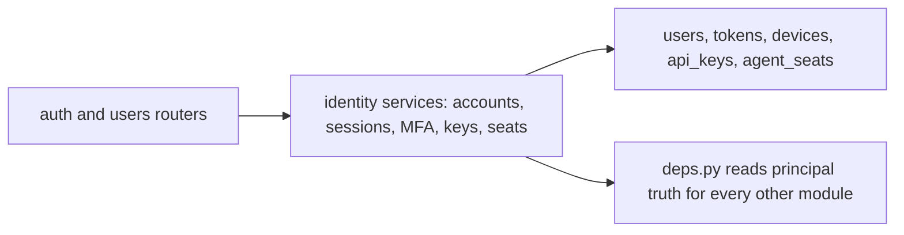

The **auth and users routers** hand every credential act
to the **identity services**; the services write the
**account tables** and answer the one question
**`deps.py`** asks on every other module's behalf — who is
calling, and as what kind of principal.

## 2. groups — the group door and its membership

- **Job:** groups themselves: creation, visibility,
  membership and its roles, invites that create claimable
  passwordless accounts, sub-groups and enrolment, and
  the group settings dials' home row. Services: `groups`,
  `subgroups`.
- **Public surface:** the `groups` router (group CRUD,
  members, invites, settings, the candidate approve door
  whose policy groups owns jointly with extraction and
  nonprofit) and the `subgroups` half of the `nonprofit`
  router file, which serves this module's sub-groups.
- **Tables owned:** `groups`, `memberships`, `subgroups`,
  `subgroup_memberships`.
- **Internal operations — offered:** none registered.
  **Consumed:** `candidates.create` (scope
  `candidates:write`, drafting candidate stubs) and
  `integrations.emit` (scope `integrations:write`).
- **Invariants:** a private group is 404, never 403, to a
  non-member; the last owner can never be removed or
  demoted; scoped-out sub-group content is absent, not
  blanked, on member-facing reads; only an active member
  can be enrolled in a sub-group.
- **Failure modes:** slug collisions are resolved, never
  overwritten; deleting a sub-group that still scopes
  content is refused 409 with counts, because a delete
  must never silently widen an audience.

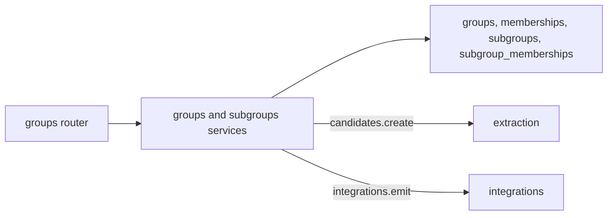

The **groups router** reaches the **groups services**,
which own the **membership tables** and ask
**extraction** to draft stubs and **integrations** to
announce group acts, each through its registered
operation rather than a direct call.

## 3. sources — every road in

- **Job:** everything a group receives: paste, file,
  newsletter, image, board, link, email-in, voice, and
  live-chat registration — each landing as a source with
  chunks, provenance, and the permission record of who
  granted it and in what scope. Services: `sources`,
  `paste`, `files`, `uploads`, `newsletter`, `images`,
  `links`, `linkfetch`, `emailin`, `voice`, `live`,
  `stream`.
- **Public surface:** the `sources` router (including its
  `email_router` webhook-shaped receiver) and the
  `uploads` router, the resumable road that completes
  into this module's file ingest.
- **Tables owned:** `sources`, `source_chunks`,
  `provenance`, `flyers`, `inbound_addresses`. The flyer
  rows are created here at ingest; extraction's vision
  services are the stewards of a flyer's transcript and
  reading state once it exists.
- **Internal operations — offered:** none registered.
  **Consumed:** `ai.submit_job` (scope `ai:submit`,
  submitting the transcription job for a voice note).
- **Invariants:** nothing ingested is ever dropped —
  unparsed lines join the previous chunk; every source
  carries its permission record verbatim; a failed link
  fetch archives nothing; deletion removes chunks and
  provenance at once while candidates are never deleted
  (they gain `source_deleted_at`); the guarded fetch
  re-validates every redirect hop and blocks metadata
  addresses.
- **Failure modes:** a disguised executable is refused
  whatever its extension says; a forged email-in token is
  refused 401 and audited; an undescribed image ships
  flagged `awaiting_description` — a visible defect,
  never a silent gap.

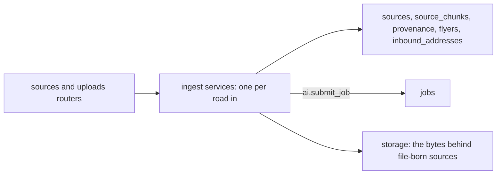

Nine roads enter through the **sources and uploads
routers** into the **ingest services**, which write the
**source tables**, put file bytes in **storage**, and ask
**jobs** to transcribe voice through the `ai.submit_job`
operation.

## 4. extraction — drafts from evidence

- **Job:** turning sources into reviewable drafts: the
  extraction pipeline, candidates and their quality
  flags, vision reading and flyers' transcripts,
  transcription, de-duplication matching and merging,
  and AI usage accounting. Services: `candidates`,
  `extraction`, `usage`, `vision`, `flyers`, `transcribe`,
  `matching`, `merging`.
- **Public surface:** the `candidates` router (the review
  queue: list, detail with provenance, edit, reject,
  merge, approve's extraction half) and the `flyers`
  router (the flyer wall, reads, descriptions).
- **Tables owned:** `candidates` (physically in
  `models/groups.py`) and `ai_usage` (physically in
  `models/ai.py`, written through `services/usage.py`).
- **Internal operations — offered:** `candidates.create`
  (scope `candidates:write`). **Consumed:** `ai.submit_job`
  (scope `ai:submit`) and `integrations.emit` (scope
  `integrations:write`).
- **Invariants:** every drafted field carries a verified
  quote or is marked `supported: false` — shown, never
  hidden; flags are computed server-side from a closed
  vocabulary, never sent by a client; re-runs supersede
  only undecided drafts of the same source and kind;
  decided rows are never touched; the budget gate is
  checked before spend and re-read fresh, never paced by
  stale settings.
- **Failure modes:** at the daily budget cap a run defers
  to the next UTC midnight as a new job and says
  `paused` / `budget` in plain words; a reading with no
  field values at all mints no candidate — nothing
  readable is a result, not a draft; one failed board
  child is a partial success state, never a silent loss.

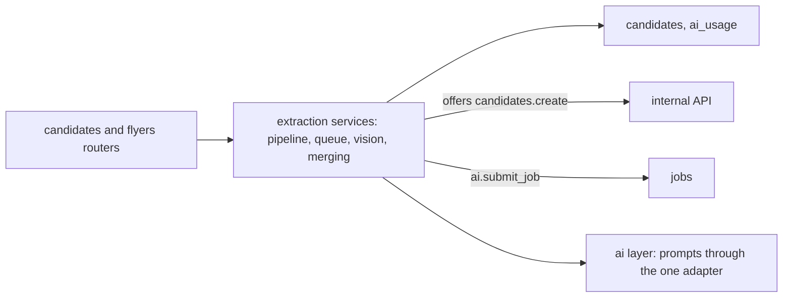

The **review routers** drive the **extraction services**,
which own the **candidate and usage tables**, offer
`candidates.create` on the **internal wire**, submit AI
work to **jobs**, and reach models only through the
**ai layer**.

## 5. events — the event lifecycle

- **Job:** events from mint to tombstone's door: direct
  entry and candidate minting, editing with version law,
  cancel and clone, RSVPs and the waitlist, discussion
  on any parent, invites, and re-announce drafts.
  Services: `events`, `rsvps`, `discussion`, `announce`,
  `invites`.
- **Public surface:** the `events`, `discussion`,
  `rsvps`, and `invites` routers (invites carries both a
  group door and a public token door).
- **Tables owned:** `events`, `event_source_links`,
  `event_contradictions`, `announcement_drafts`,
  `event_changes`, `threads`, `comments`, `rsvps`.
  Recurrences and feeds are calendar's tables, below.
- **Internal operations — offered:** `events.publish`
  (scope `events:publish`). **Consumed:** `notify.request`
  and `notify.rsvp_promotion` (scope `notify:write`) and
  `integrations.emit` (scope `integrations:write`).
- **Invariants:** drafts are 404 below organiser on every
  surface; approval mints in the approval's own
  transaction — a refusal rolls the whole act back; edits
  require `If-Match` and a stale version is a 409 naming
  the current one; the waitlist is strict next-in-line —
  a party that does not fit blocks the line; a merge is
  settled by distinct-source support and an unsupported
  claim never moves anything.
- **Failure modes:** a cancelled event refuses edits; a
  draft with no resolved start is refused in plain words
  and its candidate stays pending; a change candidate
  with no target, a gone target, or an unbacked claim is
  refused whole, never half-applied.

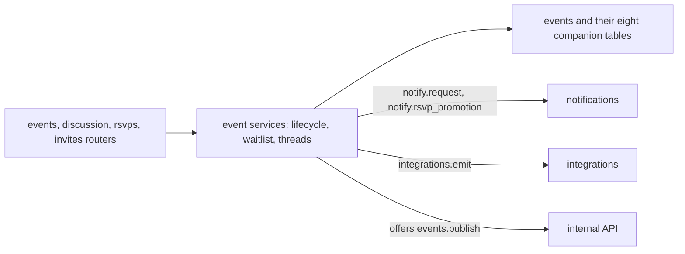

The **event routers** drive the **event services** over
the **event tables**; the services ask **notifications**
to write (never send) through its two operations and
**integrations** to announce outward, and they offer
`events.publish` on the **wire** in return.

## 6. calendar — events rendered in time

- **Job:** time itself: recurrence expansion, the iCal
  serialiser and feeds, and the agenda, month, and
  tonight views. Services: `ical`, `calendar_views`,
  `recurrence`.
- **Public surface:** the `calendar` router family —
  the member views, the public projection route, the
  embed route, per-event `.ics`, and the token feed.
- **Tables owned:** `recurrences`, `calendar_feeds`.
  Everything else calendar shows is events' data,
  expanded — this module owns no event facts.
- **Internal operations — offered:** none registered.
  **Consumed:** none. Calendar is a pure rendering of
  events' truth inside the caller's transaction.
- **Invariants:** the wall-clock law — expansion walks
  local candidates and converts each through the zone,
  so a weekly 19:00 stays 19:00 across a DST change
  while its UTC instant moves; the API returns
  occurrences, never rules; a cancelled event is emitted
  `STATUS:CANCELLED`, never vanished; feed tokens are
  shown once and stored hashed, and revocation is
  instant.
- **Failure modes:** an invalid recurrence rule is
  refused at write time, in plain words; a draft is 404
  on every calendar surface, feeds included.

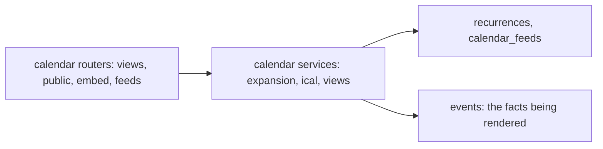

The **calendar routers** ask the **calendar services**
to expand **events' facts** against the **recurrence and
feed tables** — the module renders time and owns no
facts of its own beyond the rules and the feed tokens.

## 7. planning — the group's forward work

- **Job:** tasks, decisions, open questions, polls,
  checklists and role slots, budget-lite, availability,
  and templates. Services: `planning`, `polls`,
  `checklists`, `budget`, `availability`, `templates`.
- **Public surface:** the `planning`, `polls`,
  `checklists`, and `templates` routers, plus the search
  and planning-digest doors on the planning router.
- **Tables owned:** all twelve planning tables —
  `tasks`, `decisions`, `open_questions`, `polls`,
  `poll_options`, `poll_votes`, `checklist_items`,
  `role_slots`, `cost_lines`, `availability_slots`,
  `availability_marks`, `templates`.
- **Internal operations — offered:** none registered.
  **Consumed:** none.
- **Invariants:** the owner law — extraction words land
  only in `suggested_owner_label`; a real `owner_id` is
  set solely by a person's act, so the AI never assigns
  a silent victim; money is integer cents end to end —
  a float body is a 422 before any service runs; one
  current vote per person per poll, held by the unique
  constraint; apply-winner refuses a tie or zero votes
  in plain words — the backend never picks a winner;
  availability marks exist only against proposed slots,
  so no private-calendar data is ever read or stored.
- **Failure modes:** claiming another person's line or
  slot is a 409; superseding a non-current decision is
  a 409; a mint whose draft names a non-member owner
  rolls its whole approval back.

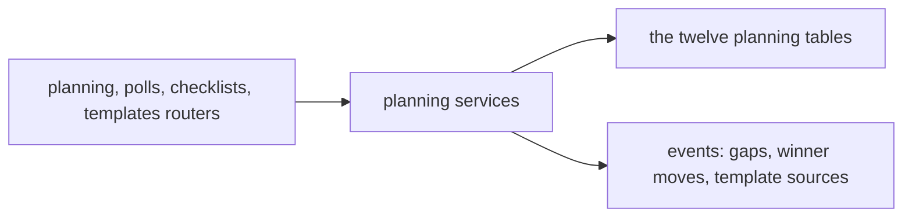

The **planning routers** drive the **planning
services** over the **twelve planning tables**, leaning
on **events** where a plan touches a gathering — its
gaps, its poll-winner moves, its templated shape.

## 8. nonprofit — the member-organisation pack

- **Job:** announcements, shifts, resources and their
  bookings, attendance counts, member import and export,
  the settings pack, and the multi-approver review
  policy's records. Services: `announcements`, `shifts`,
  `resources`, `attendance`, `member_io`, `settings_pack`.
- **Public surface:** the `nonprofit` router family —
  announcements, shifts, resources, attendance, members
  import/export, and settings (the sub-groups router in
  the same file serves the groups module, chapter 2).
- **Tables owned:** `announcements`, `resources`,
  `resource_bookings`, `attendance_marks`,
  `candidate_approvals`.
- **Internal operations — offered:** none registered.
  **Consumed:** none — the review policy is enforced
  inside the groups approve door's transaction.
- **Invariants:** attendance reads are counts only — no
  person's identity appears in any aggregate payload,
  and per-person attendance routes do not exist;
  double-booking a resource is allowed and flagged,
  never silently prevented and never hidden; the
  settings pack is one validated transaction — one bad
  dial changes nothing, and every change is audited
  per-field old to new; a dry-run import is the identical
  work rolled back, audited as having happened to
  nobody.
- **Failure modes:** booking a cancelled event is a
  422; a duplicate resource name or booking is a 409;
  a repeat approval by the same approver under a
  multi-approver policy is a 409, and the candidate
  stays pending until distinct approvers meet the count.

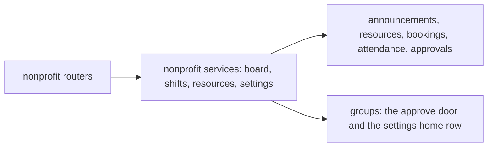

The **nonprofit routers** drive the **pack's services**
over **its five tables**, meeting **groups** at the two
shared doors: candidate approval policy and the group
settings the pack validates.

## 9. notifications — the outbox

- **Job:** every word the system sends: notification
  rows and their preferences, reminders materialised
  from rules, change alerts, guest invites' mail leg,
  the weekly digest, and delivery with its attempts.
  Services: `notifications`, `mailer`, `reminders`,
  `digests`, `messenger_transport`.
- **Public surface:** the `notifications` router family —
  the member inbox (`me`), the group doors (failures,
  resend, re-announce approval), and the provider
  webhook receiver.
- **Tables owned:** `notifications`,
  `notification_preferences`,
  `member_notification_settings`, `event_invites`,
  `digests`, `mail_events`.
- **Internal operations — offered:** `notify.request`
  and `notify.rsvp_promotion` (both scope
  `notify:write`). **Consumed:** `jobs.enqueue` (scope
  `jobs:write`, for the committing send and digest job
  submissions; same-transaction sends use the jobs
  module's in-process `queue()` surface instead — the
  registry says so itself).
- **Invariants:** creating a notification writes the row
  and its job in the caller's transaction — the outbox
  law; policy is decided once, at creation: preferences
  choose channels, both-off is an audited suppression
  with no row; quiet hours hold, urgent is never held,
  and cancellation alerts are urgent; a reminder move
  supersedes the old rows and deletes their queued jobs
  in the same act; the failure record commits before the
  delivery error is raised, so the record survives the
  job chassis' rollback.
- **Failure modes:** delivery dies at the attempt cap
  (5, the job cap) with the row kept visible on the
  failures list for an organiser to resend; AI reminder
  wording ships only if the formatted start, the place,
  and every bring item survive verbatim — otherwise the
  template ships and both versions are kept.

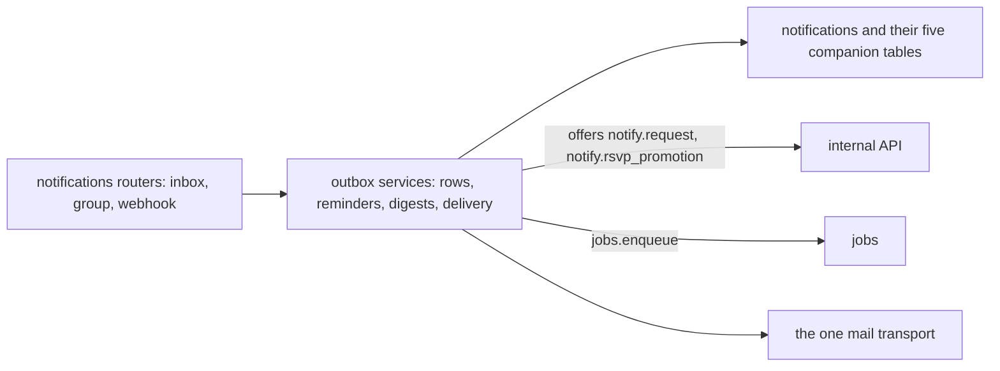

The **notification routers** serve the **outbox
services**, which own the **notification tables**, offer
the two `notify` operations on the **wire**, submit send
work to **jobs**, and let mail leave only through the
**one transport**.

## 10. integrations — every outside system

- **Job:** every boundary with the outside: the
  integration framework and its sealed configs, Facebook
  and Google copies, the Samtal hall, Discord, Slack and
  Messenger live sources, inbound and outbound webhooks,
  embeds, reconciliation, and the health board.
  Services: `integrations`, `outbound`, `facebook`,
  `facebook_events`, `google_calendar`, `google_inbound`,
  `samtal`, `samtal_calendar`, `livechat`, `messenger`,
  `discord`, `slack`, `webhooks_in`, `embed`,
  `health_board`, `reconcile`.
- **Public surface:** the `integrations` router and its
  inbound `webhook_router`.
- **Tables owned:** `external_account_links`,
  `live_sync_states`, `integrations`, `webhook_endpoints`,
  `webhook_receipts`, `external_event_links`,
  `outbound_webhooks`, `outbound_deliveries`.
- **Internal operations — offered:** `integrations.emit`
  (scope `integrations:write`). **Consumed:**
  `candidates.create` (scope `candidates:write`),
  `notify.request` (scope `notify:write`), and
  `jobs.enqueue` (scope `jobs:write`).
- **Invariants:** outside edits never write back
  directly — they return as review-queue change
  candidates; reconcile never writes outward; a person
  presses the Facebook and Google doors — nothing posts
  itself; configs are sealed whole and reads show key
  names only; webhook secrets are shown once and hashed,
  with a 300-second replay window refused outside itself.
- **Failure modes:** every outside system has the same
  three faces — the real client shape, a recorded-fixture
  double, and an honest unavailable default that refuses
  in plain words (`driver_unavailable`); a failed
  delivery retries through the job chassis and dies at
  its cap, visible on the health board, which reads
  records and pings nothing.

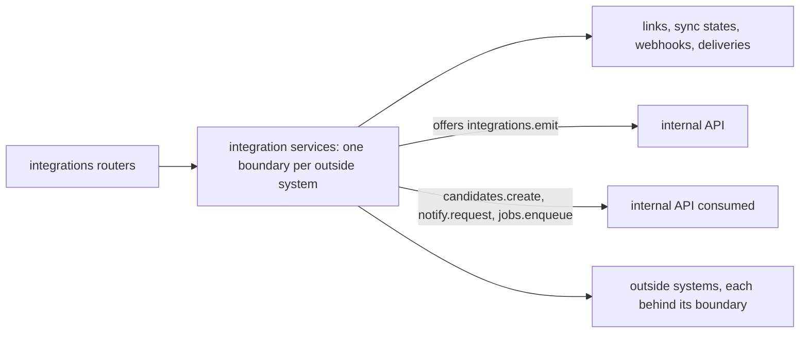

The **integration routers** drive **one boundary service
per outside system** over the **integration tables**;
the module offers `integrations.emit` on the **wire**,
consumes three operations through it, and touches
**outside systems** nowhere else.

## 11. memory — the group's remembered past

- **Job:** group memory: summaries of approved history,
  briefings and recaps, the context-pruning engine's
  runs, and asking the memory with verified citations.
  Service: `memory` (with the `ai` layer's pruning
  engine, chapter 17).
- **Public surface:** the `memory` router — summaries,
  briefings, recaps, the ask door, runs, and purge.
- **Tables owned:** `summaries`, `prune_runs`.
- **Internal operations — offered:** none registered.
  **Consumed:** `candidates.create` (scope
  `candidates:write` — approving a summary files it as a
  source-shaped draft through the queue's discipline).
- **Invariants:** the corpus is approved history only —
  unapproved material is never summarised or cited;
  pruning is not embedding RAG: selection is by the
  pruning engine's scored passes, and every citation is
  verified against its source before an answer ships;
  the budget is checked per pass, and a stopped run says
  `budget_stopped`; summaries are drafts until a person
  approves.
- **Failure modes:** an answer whose citations cannot be
  verified is refused with "I couldn't verify this" —
  the module would rather say nothing than invent;
  purge removes run receipts and keeps the summaries
  themselves, and says which is which.

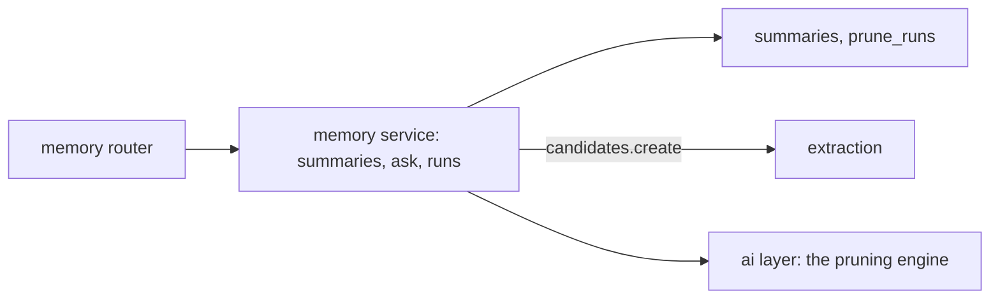

The **memory router** drives the **memory service**
over the **summary and run tables**, drafting through
**extraction's** operation and selecting context through
the **ai layer's** pruning engine.

## 12. truth — quality and the tombstone ledger

- **Job:** the group's truth-keeping: the quality report
  and its attention badge, and tombstones — soft-delete,
  restore, and the purge of expired records for events
  and sources alike. Services: `quality`, `tombstones`.
- **Public surface:** the `truth` router — the quality
  report, tombstone lists, restore, and purge doors.
- **Tables owned:** `tombstones` (physically in
  `models/core.py`, shared ground truth keeps).
- **Internal operations — offered:** none registered.
  **Consumed:** none.
- **Invariants:** a tombstoned event is gone from every
  read — events, calendar, feeds, the flyer wall,
  matching — and restores whole inside 30 days; a
  post-window restore is refused in plain words even
  before the purge runs; the purge hard-deletes expired
  events children-first and drops expired stones; the
  quality report counts published truth only — drafts
  are allowed to be unfinished.
- **Failure modes:** restoring what the purge already
  took is a plain refusal, never a partial rebuild;
  a source restore rebuilds with the original ids and
  lifts its candidates' `source_deleted_at` marks, or
  does not happen at all.

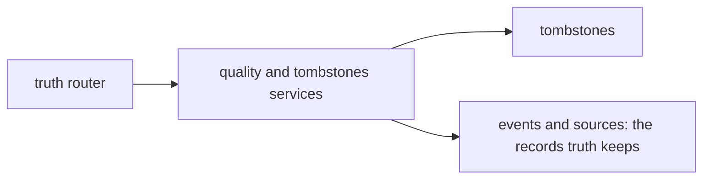

The **truth router** drives the **quality and
tombstone services** over the **tombstone ledger**,
standing guard over **events and sources** — the two
record families whose deletion this module makes
reversible, then final.

## 13. jobs — background work as rows

- **Job:** the job chassis itself: enqueue and its
  no-commit twin `queue()`, claim-by-update, backoff,
  dead-lettering, job progress, and the queue-backend
  interface with its optional arq twin. Services: `jobs`,
  `jobqueue`. The roadmap's B-190 line names this module
  first ("job, public surface…") — its chapter stands in
  map order here, and the job lifecycle diagram is
  B-189's fifth.
- **Public surface:** the `jobs` router — one door,
  `GET /jobs/{id}`, members-only by the B-140 view.
- **Tables owned:** `jobs` (physically in
  `models/core.py`).
- **Internal operations — offered:** `jobs.enqueue`
  (scope `jobs:write`) and `ai.submit_job` (scope
  `ai:submit`, whose handler refuses any kind that is
  not extraction, vision, or transcription).
  **Consumed:** none — every other module consumes this
  module, directly or through the wire.
- **Invariants:** a job is a row before it is work;
  submission commits the row, `queue()` joins the
  caller's transaction — both shapes exist because the
  outbox depends on the second; a claim is a conditional
  update scanning up to 16 due candidates, so two
  workers racing get exactly one winner and a lost race
  is a clean outcome, never an exception; payloads at
  rest are sealed (`enc:v1:` under the internal comms
  key); progress reaches 100 only on completion.
- **Failure modes:** failure retries with exponential
  backoff (base doubled per attempt), a deferral while a
  dependency's breaker is open is free — it spends no
  attempt; at the attempt cap the job is dead — kept
  visible forever, never silently dropped, and the
  worker lives on; stuck rows are requeued by startup
  recovery (platform, chapter 19).

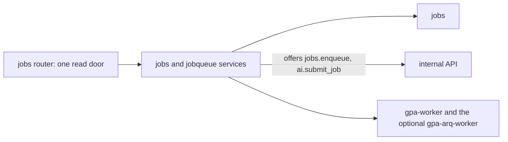

The **jobs router** is a single read door over the
**chassis services** and the **jobs table**; the
chassis offers its two submission operations on the
**wire** and feeds both **worker processes** from the
same rows and the same handler registry.

## 14. audit — the append-only stream

- **Job:** the audit stream every act writes into, in
  its own transaction, and the hash chain that makes the
  stream tamper-evident. Services: `audit`,
  `audit_chain`. A named common module (§6A.3): every
  module imports its writer the way it imports `errors`,
  so it is exempt as an import target in the architecture
  inventory — its public functions are its whole surface.
- **Public surface:** no router of its own; the audit
  reading doors live on the groups router (the group
  audit list) and the privacy router (verification).
- **Tables owned:** `audit_log`, `audit_chain_head`
  (both physically in `models/core.py`).
- **Internal operations — offered:** none registered.
  **Consumed:** none.
- **Invariants:** append-only — no update or delete path
  exists; the writer runs in the caller's transaction,
  so an act and its audit row commit or roll back
  together (commit-before-answer's other half); the
  chain head is read `FOR UPDATE` and a missing head is
  created inside a nested transaction, so concurrent
  writers on PostgreSQL extend one chain, never fork it.
- **Failure modes:** a chain that does not verify is an
  incident, not a warning — the operator guide says so;
  a lost head-creation race re-chains onto the winner's
  head instead of failing the act being audited.

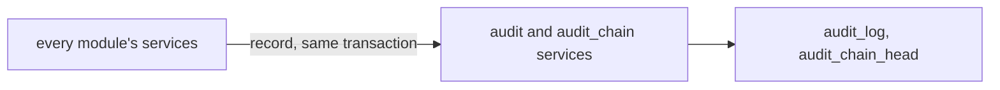

**Every module's services** write through the **audit
services** in the same transaction as the act itself,
extending the **chained log** — the one arrow in this
atlas that leaves every other chapter.

## 15. crypto — sealing and the key lifecycle

- **Job:** the sealing primitives and the keys' lives:
  field sealing for secrets at rest, the internal comms
  key, group keys, rotation, and recovery escrow.
  Services: `sealing`, `keymgmt`; primitives in
  `src/gpa/crypto/` and `src/gpa/internal/crypto.py`.
  A named common module, exempt as an import target like
  audit: a box of primitives every module may open.
- **Public surface:** no router of its own; key acts are
  doors on the admin surfaces the operator guide covers.
- **Tables owned:** `group_keys`, `recovery_escrow`.
- **Internal operations — offered:** none registered.
  **Consumed:** none.
- **Invariants:** a seal is bound to its exact use by
  additional data — a blob replayed into another sealed
  column does not open; key material never rests in the
  repo or a release ZIP, and an in-repo key path for
  release signing is refused outright; rotation keeps
  old material readable until its rows are re-sealed —
  a rotation that strands data is a failed rotation.
- **Failure modes:** a blob that does not open is
  tampering until proven otherwise and refuses loudly;
  the backup road refuses to run at all without key
  material accounted for, rather than produce a backup
  nobody can restore.

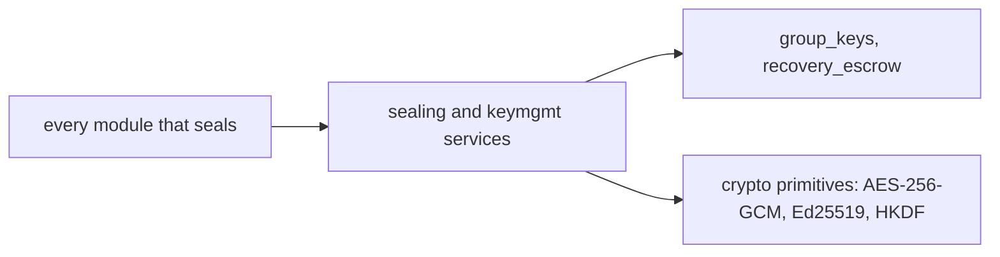

**Every sealing module** calls the **crypto services**
over the **key tables**, standing on the named
**primitives** — the atlas names the algorithms here
because B-194 specifies them.

## 16. internal — the encrypted API between modules

- **Job:** the internal API itself: the operation
  registry, the envelope, client identities and scopes,
  replay defence, the transport profiles, the module
  map, and the architecture checker that guards the
  borders this atlas describes. Files:
  `src/gpa/internal/` — `registry`, `handlers` (the one
  composition root that wires operations to services),
  `client`, `envelope`, `crypto`, `identity`, `ca`,
  `replay`, `transport`, `auditing`, `modulemap`,
  `architecture`.
- **Public surface:** no external router — this module's
  surface is the wire itself, offered to modules, plus
  the checker `test.sh` and the architecture test run.
  B-191 is this module's full protocol document.
- **Tables owned:** none. Its registry lives in-process;
  the payloads it seals rest in jobs' table, and its
  audit of internal acts lands in audit's tables.
- **Internal operations — offered:** all seven (it is
  the road they travel). **Consumed:** it consumes every
  owning service through `handlers.py`, lazily, because
  the services import the client and an eager import
  would close the circle.
- **Invariants:** a handler takes ids and values, never
  ORM rows, and returns plain data; a handler keeps its
  direct call's transaction discipline exactly —
  non-committing calls stay non-committing, job
  submission still commits; grants are least-privilege,
  written from the call sites that exist, and a widened
  grant lands in the same commit as the call that needs
  it; cross-module direct edges outside the wire are
  pinned and may only shrink.
- **Failure modes:** a malformed internal payload fails
  loudly as `internal_bad_payload` — a bug in a caller,
  surfaced like a bad request at the external door; an
  unregistered operation or an ungranted scope is a
  refusal, never a fallback to a direct call; a replayed
  envelope is refused by the replay defence (B-191
  specifies the window).

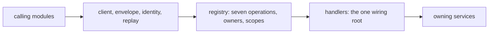

A **calling module** speaks through the **client and
envelope**, the **registry** checks the operation and
its scope, and the **handlers root** — the one place
allowed to import every owner — reaches the **owning
service**.

## 17. ai — the model layer

- **Job:** everything that talks to a model: the one
  adapter and its drivers, the versioned prompt library,
  the date resolver, extraction's model half, vision and
  segmentation clients, transcription's model half, the
  pruning engine, and both evaluation harnesses. Files:
  `src/gpa/ai/` — `client`, the four drivers, `prompts`
  via `promptlib`, `dates`, `extraction`, `vision`,
  `segmentation`, `pruning`, `evaluation`,
  `vision_evaluation`.
- **Public surface:** no router. Its surface is the
  `MetaModelClient` protocol (`complete_text`,
  `complete_json`, `read_image`, `transcribe`,
  `generate_image`) that extraction and memory call.
- **Tables owned:** none. The usage ledger it accounts
  into is extraction's `ai_usage`; prompts live as
  versioned files with a hash-pinned manifest.
- **Internal operations — offered:** none registered —
  AI work is submitted as jobs (`ai.submit_job` is jobs'
  operation; the kinds are this layer's names).
  **Consumed:** none on the wire; the layer imports no
  service except through the architecture test's pinned
  edges, which may only shrink.
- **Invariants:** no vendor SDK imports anywhere in
  domain code — the live driver speaks httpx directly,
  so a driver swap is configuration only; every
  candidate records its prompt name and version, and
  editing a prompt without a version bump fails load
  and tests; a succeeded call is never duplicated —
  parsing happens outside the retry loop; the date
  resolver never guesses: unknown is `matched: false`,
  and a genuinely ambiguous reading flags both.
- **Failure modes:** the fixture driver refuses a miss
  loudly (`FixtureMissError`) and never invents an
  answer; the live driver's `generate_image` refuses in
  plain words — no image endpoint is wired in this
  build; retries happen only on 429, 5xx, and transport
  errors.

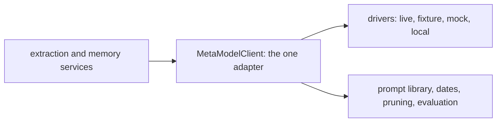

**Extraction and memory** call the **one adapter**,
which selects a **driver** and draws on the **prompt
library, date resolver, pruning engine, and evaluators**
— no other road to a model exists in the tree.

## 18. storage — bytes at rest

- **Job:** file storage behind one protocol: the local
  sha256 content-addressed driver, atomic writes, and
  the encrypted driver that seals bytes at rest. Files:
  `src/gpa/storage/` — `base`, `local`, `encrypted`.
- **Public surface:** no router. Its surface is the
  storage protocol the sources and flyer services call.
- **Tables owned:** `file_assets` (physically in
  `models/core.py`) — the row that names a stored blob,
  its hash, and its owner.
- **Internal operations — offered:** none registered.
  **Consumed:** none.
- **Invariants:** the key pattern is strict and
  traversal-proof — a key names content by its hash, so
  the same bytes are the same asset; writes are atomic,
  so a reader never meets a half-written blob; the
  encrypted driver seals at this boundary, so the disk
  holds ciphertext wherever the deployment asks for it.
- **Failure modes:** a key outside the pattern is
  refused before the filesystem is touched; a blob whose
  hash does not match its key is corruption, reported —
  never served as if sound.

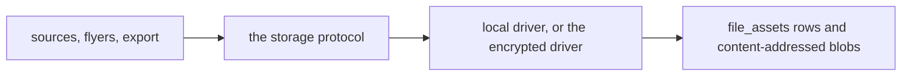

**Sources, flyers, and export** speak the **storage
protocol**; the chosen **driver** writes the
**`file_assets` row and the blob** under the blob's own
hash.

## 19. platform — health, durability, recovery

- **Job:** the whole-app platform: health truth, draft
  autosaves, startup recovery, dependency breakers and
  bulkheads, the fix-forward data-repair crew, and the
  chaos harness's core. Services: `health`, `autosaves`,
  `recovery`, `resilience`, `repair`, `chaos`.
- **Public surface:** the `meta` router (`/health`,
  `/meta`) — the deployment's own doors; the rest of the
  module is worker-startup and operator surface.
- **Tables owned:** `draft_autosaves`, `upload_sessions`
  (the upload sessions' completion road belongs to
  sources, chapter 3; the session rows rest here with
  the durability machinery that guards them).
- **Internal operations — offered:** none registered.
  **Consumed:** none.
- **Invariants:** startup recovery runs before the
  worker claims anything — assess, repair, or refuse,
  with the double-verdict guard on boot state; health
  answers from records, never from a live ping dressed
  as truth; a breaker deferral spends no job attempt
  (jobs, chapter 13); repair moves data forward to the
  current schema's truth, never backward over it.
- **Failure modes:** a database the assessor cannot
  prove sound refuses startup in plain words rather
  than serving on doubt; the chaos harness exists to
  make crash corruption reproducible before it is
  believed fixed — its verdicts are records, not vibes.

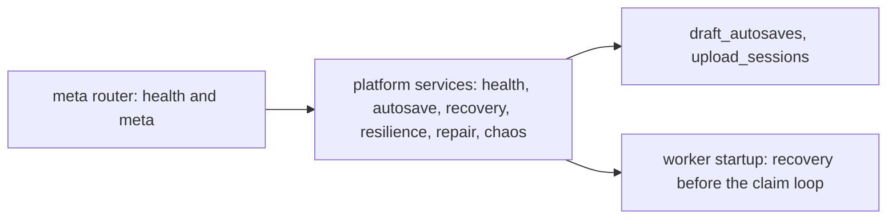

The **meta router** and the **platform services** share
the **durability tables**, and the same services stand
at **worker startup**, where recovery runs before any
job is claimed.

## 20. privacy — export, erasure, retention

- **Job:** a person's and a group's data rights: the
  member data answer, the group export, hard erasure,
  and the retention sweep. Services: `me_data`,
  `erasure`, `retention`.
- **Public surface:** the `privacy` router — data,
  export, erase, and retention doors.
- **Tables owned:** none — deliberately. This module
  acts across every other module's tables; owning none
  is the honest shape of a right that reaches everywhere.
- **Internal operations — offered:** none registered.
  **Consumed:** `jobs.enqueue` (scope `jobs:write`, the
  retention sweep's follow-up jobs).
- **Invariants:** the member data answer carries no
  password or token hashes by construction — the columns
  are never selected; export is owner + live person
  session only — no API key can export, and secrets are
  withheld by column rule; the export's audit row
  commits before the answer is sent; erasure is hard,
  total, and irreversible, planned to a fixed point over
  the foreign keys and swept through storage, leaving
  exactly one audit row that keeps only the fact.
- **Failure modes:** erasure's double confirmation —
  the group's exact name plus `ERASE` — erases nothing
  on any mismatch; a retention candidate another module
  still owns is left standing and reported, never forced.

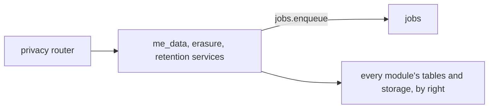

The **privacy router** drives the **three privacy
services**, which submit sweep work to **jobs** and act
across **every module's tables and storage** — the one
module whose reach is the whole system, by design and
under audit.

## 21. demo — the seed story

- **Job:** the demonstration world: the idempotent seed
  loader and the demo data a cold reader can sign into.
  Services: `seed`, `demo`.
- **Public surface:** no router. Its surface is
  `./run.sh --demo` and the seed entry points composition
  calls.
- **Tables owned:** none — it writes other modules'
  tables through their own doors, by natural keys.
- **Internal operations — offered:** none registered.
  **Consumed:** none.
- **Invariants:** seeding is idempotent — natural keys,
  never blind inserts, so a second run creates nothing;
  the demo runs fully offline on the mock driver: no API
  key, no network.
- **Failure modes:** a seed that meets a half-made world
  completes it by its natural keys or refuses naming the
  collision — it never duplicates a group or a person.

```mermaid
flowchart LR
    RUN["run.sh --demo and composition"] --> SVC["seed and demo services"]
    SVC --> DOORS["every module's own doors, by natural keys"]
```

**Composition and the demo flag** invoke the **seed
services**, which build the demonstration world through
**every module's own doors** — the demo owns no data
because it borrows everyone's rules.

## 22. composition — the wiring that owns no rules

- **Job:** wiring modules together and nothing else:
  `main.py` (the app factory and its router table),
  `worker.py` and `arq_worker.py` (the two worker entry
  points), and `deps.py` (the only authorisation door).
  The module map names these files `composition` and
  exempts them from the service-edge inventory — their
  imports are the wiring itself, reviewed in the open.
- **Public surface:** the whole external API is mounted
  here; `deps.py`'s doors (`require_group_role`,
  `require_scope`) are the surface every router stands
  behind.
- **Tables owned:** none.
- **Internal operations — offered:** the `core` caller
  grant (`events:publish`) is composition's own — it
  exists so the publish operation is real and exercised
  from the application process, not decorative.
  **Consumed:** `events.publish` under that grant.
- **Invariants:** no router imports a model as its way
  of doing business — `deps.py` and services are the
  doors, and the handful of pinned router-to-model
  projection fetches may only shrink; a rule that appears
  in a composition file is a bug with a home waiting in
  a service.
- **Failure modes:** production refuses the development
  secret at startup, in plain words — composition's
  oldest refusal, from B-002, still first at the door.

```mermaid
flowchart LR
    MAIN["main.py: the app factory"] --> RT["all routers, behind deps.py"]
    WRK["worker.py and arq_worker.py"] --> REG["the shared handler registry"]
    DEPS["deps.py: the only authorisation door"] --> RT
```

The **app factory** mounts **all routers behind
`deps.py`**, and the **worker entry points** run the
**shared handler registry** — wiring on the left of
every diagram in this atlas, rules in none of it.

## Keeping this atlas true

A new service file fails the architecture test until the
module map places it — that act, in the same commit,
updates this atlas's chapter for its module. A table
that changes owner, an operation that is registered or
retired, a grant that widens: each lands here in the
commit that makes it true, or the B-200 documentation
proof fails the release on the disagreement. The
per-code-file atlas (B-197) goes one level deeper, file
by file; where the two disagree, the file's own header
comment (D-26) is the truth both must be repaired to.
