# 10 — The Code-File Atlas: Every Code File, in Detail

**Written for:** backend developers and maintainers — the
reader who has just opened the repository and asks, of any
file, "what is this *for*?"
**Roadmap home:** B-197 (the atlas slice), gated by the atlas
checker: **a code file with no entry in this document fails
the release.** Standards behind it: D-26 (comments like a book),
D-30 (module boundaries), D-46 (every file is the team's own
original work, with a provenance-register entry — B-332).

## How to read an entry

Every file gets the same eight answers, in the same order:

- **For** — its purpose, in plain words.
- **Module** — which module owns it (D-30); a file's module is
  who may change it and whose `api.py` surface it hides behind.
- **Public symbols** — the names other code may use, and what
  each is for. Anything not listed is private (`_`-prefixed by
  convention) and may change without notice.
- **May use / Must never** — its allowed and forbidden
  dependencies. The architecture tests (B-161) enforce these;
  this document is where a human reads them first.
- **Data** — what data it owns or touches. "Owns" means its
  tables/files; other modules reach that data only through the
  owner's internal operations (D-31).
- **On failure** — how it behaves when things go wrong: what it
  raises, logs, queues, or degrades to. No file in this tree
  fails silently.
- **Tests** — the suites that cover it.
- **Created by** — the roadmap slice (`B-###`) that creates it;
  later slices that extend it are named in the entry text.

**The tree below is roadmap §3, expanded** with the areas the
later phases added: `internal/` (Phase 17), `crypto/` and
`resilience/` (Phase 17), `mcp/` (Phase 19), `terminal/`
(Phase 20), `interop/` (Phase 23), `evidence/` (Phase 24 —
tooling lives in `src/gpa/evidence/`, records in the repo-level
`evidence/`), `embed/` and `sdk/` (Phase 25), `help/` and
`doctor/` (Phase 26). The rules of §3 never bend: routers are
thin, one domain = four parallel files
(`models/`, `schemas/`, `services/`, `routers/`), no pseudocode
in code files, every file opens with a purpose header that must
agree with its entry here (B-197).

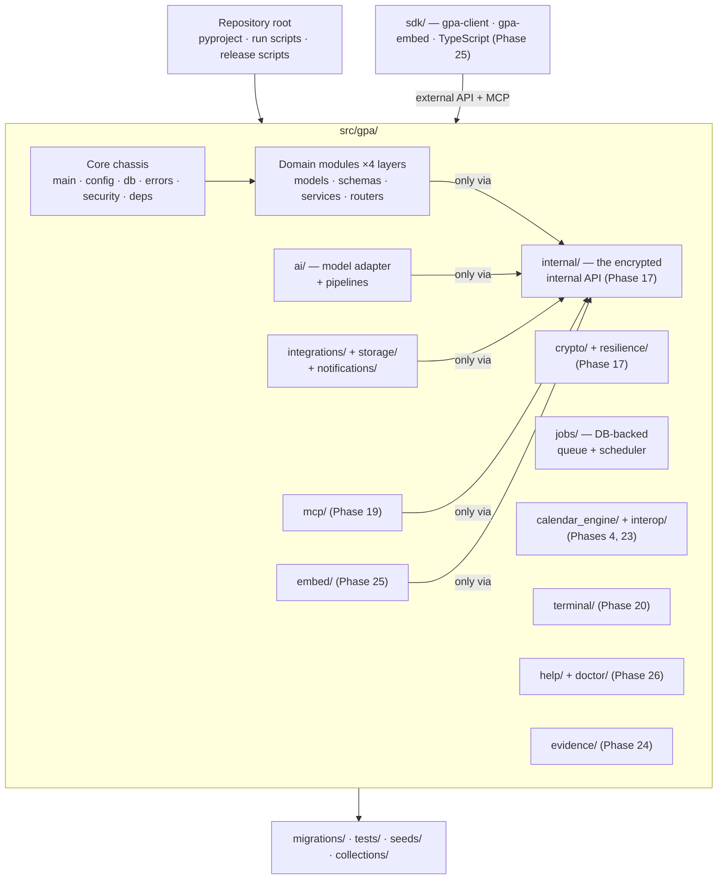

**Walking tour.** The repository root holds the packaging and
the scripts that build releases. Inside `src/gpa/`, the core
chassis (app factory, config, database, errors, security)
carries the domain modules, which are drawn as one box because
they all share the same four-layer shape. Around them sit the
specialist packages: the AI adapter and pipelines, the job
queue, the calendar engine and the Phase 23 interoperability
package, the outside-world integrations with storage and
notification channels, and the later-phase packages — MCP, the
terminal, help and the Doctor, embedding, evidence. Read the
arrows: every specialist package reaches domain data **only
via the internal encrypted API** — that is D-30/D-31 drawn as a
picture, and the architecture tests fail any import that tries
another road. The SDK box sits outside `src/gpa/` because hosts
install it without installing the server; it speaks the
external API and MCP, like any other client. Migrations, tests,
seeds, and the Bruno collection are the operational shell every
release ZIP carries.

---

## A. Repository root and release scripts

#### `pyproject.toml`
- **For:** The project's one manifest: dependencies (pinned,
  permissive-licence-reviewed per B-334), tool configuration
  (ruff, mypy, pytest), and the `gpa` console entry point.
  **Module:** build/release.
- **Public symbols:** none (declarative). The `[project]`
  metadata carries the licence position exactly as undecided —
  the notice text, never an SPDX id or a licence classifier
  (B-338, §6A.17).
- **May use:** the package indexes at install time. **Must
  never:** name a dependency that fails the B-252 platform rule
  (installs cleanly on every Tier-1 target, Raspberry Pi
  included) or the B-334 licence rule.
- **Data:** none. **On failure:** a lock mismatch fails the
  install loudly before any code runs.
- **Tests:** B-177 platform matrix installs from it on all
  three OSes. **Created by:** B-001.

#### `uv.lock`
- **For:** The exact, hashed dependency set `pyproject.toml`
  resolves to, so every machine installs the tested
  environment. **Module:** build/release.
- **Public symbols:** none. **May use:** —. **Must never:** be
  hand-edited; it is regenerated by uv and verified at install
  (hashes checked, B-179).
- **Data:** dependency names/versions/hashes only — no
  secrets. **On failure:** hash mismatch = install refused.
- **Tests:** release verification (B-179). **Created by:**
  B-001.

#### `run.sh` / `run.ps1`
- **For:** The native start scripts — POSIX shell and
  PowerShell twins kept in feature parity (D-24: no Docker,
  ever; D-27: all OSes first-class). Each prepares the uv
  environment and starts Uvicorn. **Module:** operations.
- **Public symbols:** the scripts themselves; flags mirror each
  other (`--profile`, `--port`).
- **May use:** `uv`, the local filesystem. **Must never:**
  diverge in behaviour between the pair — parity is a matrix
  test, not a hope.
- **Data:** reads `.env` via the app config. **On failure:**
  non-zero exit with a plain-words message naming the failed
  step; no half-started server.
- **Tests:** B-177 matrix; B-151 freeze drill starts from them.
  **Created by:** B-001; service-mode flags added by B-325.

#### `demo.sh`
- **For:** One command from a fresh unzip to the running demo:
  seed the demo group, start in fixture-AI mode, print the
  sign-in. **Module:** operations/demo.
- **Public symbols:** the script. **May use:** `run.sh`, the
  seed loader. **Must never:** touch a non-demo database — it
  refuses if the target data directory holds real groups.
- **Data:** writes only the demo seed (B-147). **On failure:**
  stops at the failed step, database left unseeded or fully
  seeded, never half.
- **Tests:** B-148 (demo script → tests). **Created by:** B-010;
  demo content finalised by B-147.

#### `test.sh` / `test.ps1`
- **For:** The whole quality gate as one command — suites,
  linters, type checks, comment gate, atlas checker, diagram
  render check — reproducing CI exactly on a fresh checkout.
  **Module:** quality.
- **Public symbols:** suite selectors (`test.sh security`,
  `test.sh golden`, …).
- **May use:** every checker in `scripts/`. **Must never:**
  skip a gate quietly; a skipped gate is a failed gate unless
  the waiver is written in the handoff (B-177).
- **Data:** a throwaway test database per run. **On failure:**
  exits at the first failed gate, naming it.
- **Tests:** itself the test entry point (B-178). **Created
  by:** B-005 (chassis), completed by B-178.

#### `.env.example`
- **For:** Every setting the app reads, documented with its
  meaning and a safe placeholder — the operator's checklist.
  **Module:** operations.
- **Public symbols:** the setting names (they are a contract
  with `config.py`).
- **May use:** nothing. **Must never:** contain a real value —
  a secret-scanning test reads it as if it were a leak
  (B-145).
- **Data:** none. **On failure:** n/a.
- **Tests:** config tests assert every `config.py` field
  appears here (B-002/B-145). **Created by:** B-002.

#### `OPENAPI.json`
- **For:** The frozen API contract of *this* release — the
  exact schema the ZIP's contract tests passed against (§5).
  **Module:** contract.
- **Public symbols:** the whole file; frontends and the TS SDK
  generate from it (B-006, B-301).
- **May use:** generated only by `scripts/export_openapi.py`.
  **Must never:** be hand-edited — a hand edit desynchronises
  it from the code, and the contract suite diffs them.
- **Data:** schema only, no values. **On failure:** generation
  failing blocks the release.
- **Tests:** contract suite (B-006). **Created by:** B-006.

#### `FRONTEND_HANDOFF.md` / `CHANGELOG.md` / `README.md`
- **For:** The handoff trio: what the frontend crew must read
  first (regenerated every release), what changed and whether
  it was `ADDITIVE` or breaking, and the project's front door
  (install, start, demo, links to the docs set). **Module:**
  documentation.
- **Public symbols:** their contents; error `code` values are
  enumerated in the handoff and never renamed (§5).
- **May use:** generated data from the release scripts.
  **Must never:** state or imply a licence (B-338) — the README
  carries the undecided notice verbatim.
- **Data:** none. **On failure:** a release whose handoff
  regeneration fails does not ship (B-010).
- **Tests:** docs checks (B-181). **Created by:** B-010; README
  submission content by B-150.

#### `PROJECT_MEMORY_MAP.md`
- **For:** The living map of the project's architecture and
  decisions, updated in the same session as any architectural
  change (§3's standing rule). **Module:** documentation.
- **Public symbols:** the map itself; Doc 03's diagrams are
  verified against it per release (B-189).
- **May use:** —. **Must never:** describe an architecture the
  code has moved away from — drift here is a review failure.
- **Data:** none. **On failure:** n/a.
- **Tests:** B-189 diagram verification. **Created by:** B-001
  era; maintained by every architecture slice.

#### `scripts/export_openapi.py`
- **For:** Boots the app factory in schema-only mode and
  writes `OPENAPI.json`. **Module:** build/release.
- **Public symbols:** `main()`.
- **May use:** `gpa.main.create_app`. **Must never:** start a
  server, open the real database, or call a live driver.
- **Data:** writes `OPENAPI.json` only. **On failure:** exits
  non-zero; the release stops.
- **Tests:** contract suite. **Created by:** B-006.

#### `scripts/generate_ts_types.py`
- **For:** Generates the TypeScript types package from
  `OPENAPI.json` for the frontend crew and, later, the TS SDK.
  **Module:** build/release.
- **Public symbols:** `main()`.
- **May use:** `OPENAPI.json`. **Must never:** invent types the
  schema does not contain.
- **Data:** writes `sdk/typescript/` type files. **On failure:**
  non-zero exit, previous types left untouched.
- **Tests:** SDK conformance (B-301). **Created by:** B-006;
  promoted to the SDK by B-301.

#### `scripts/make_release_zip.py`
- **For:** Builds the release ZIP (§8 anatomy): source, docs,
  seeds, Bruno collection, test report, SBOM — plus the sha256
  and the signed manifest (B-179). **Module:** build/release.
- **Public symbols:** `main()`, `build_manifest()`.
- **May use:** `scripts/export_openapi.py`, the SBOM
  generator, the release key (held outside the repo).
  **Must never:** include a secret, a real database, or real
  user data — a content scanner greps the staged tree for all
  three before zipping (D-25).
- **Data:** writes the ZIP + `.sha256` + detached signature.
  **On failure:** refuses to zip; a half-built ZIP is deleted,
  never shipped.
- **Tests:** B-151 freeze drill unzips and runs its output;
  tampered-ZIP fixture (B-179). **Created by:** B-010;
  signing/SBOM by B-179.

#### `scripts/verify_release.py`
- **For:** The receiver's half of B-179: verify a ZIP's sha256
  and manifest signature before unzipping, the way Geoffrey
  and Henry are told to. **Module:** build/release.
- **Public symbols:** `main()`.
- **May use:** the team's public release key. **Must never:**
  "verify" by trusting the ZIP's own internal manifest alone.
- **Data:** reads the ZIP + signature. **On failure:** one
  flipped byte → refusal, loudly (B-179's fixture).
- **Tests:** tamper fixtures. **Created by:** B-179.

#### `scripts/backup.py` / `scripts/restore.py`
- **For:** The operator's backup pair: snapshot the database
  file + encrypted uploads + config shape into one verified
  bundle (keys never inside — B-169), and restore from a bundle
  with integrity verification before anything is replaced.
  **Module:** operations.
- **Public symbols:** `main()` in each.
- **May use:** `gpa.crypto` (to verify sealed material),
  `gpa.resilience`. **Must never:** include key material in a
  bundle — a test greps every bundle for it (B-146).
- **Data:** owns the bundle format. **On failure:** an
  unverifiable bundle restores nothing; the live data is
  untouched.
- **Tests:** B-146 backup/restore drill; Doctor reads their
  timestamps (B-319). **Created by:** B-146.

#### `scripts/upgrade.py`
- **For:** In-place upgrade: backup → migrate → verify → swap,
  with rollback to the pre-upgrade backup on any failed step.
  **Module:** operations.
- **Public symbols:** `main()`.
- **May use:** Alembic, `scripts/backup.py`. **Must never:**
  migrate without a verified backup first.
- **Data:** the deployment's database, via migrations only.
  **On failure:** automatic rollback; the deployment runs the
  old version or none — never a half-migrated schema.
- **Tests:** B-156 upgrade-path suite. **Created by:** B-156.

#### `scripts/check_comments.py`
- **For:** The §6A.1 comment gate as tooling: AST checks that
  every module/class/function carries a docstring, every file
  its purpose header, and each module stays above the
  comment-quality floor. **Module:** quality.
- **Public symbols:** `main()`, `audit_file(path)`.
- **May use:** the stdlib `ast`. **Must never:** pass a file
  whose comments merely restate code where the checker can
  detect it (density + duplication heuristics, B-176).
- **Data:** reads source files. **On failure:** reports by file
  and line; gate failure blocks the slice closing.
- **Tests:** stripped-fixture module fails by name (B-176).
  **Created by:** B-176.

#### `scripts/check_atlas.py`
- **For:** Diffs the real file tree against this atlas (and
  the provenance register): an undocumented file, a missing
  file the atlas promises, or a file header that disagrees
  with its entry fails the release. **Module:** quality.
- **Public symbols:** `main()`.
- **May use:** this document, the repo tree. **Must never:**
  be satisfied by an entry that exists but is empty — entries
  must contain all eight fields.
- **Data:** reads the tree + Doc 10. **On failure:** names the
  offending file.
- **Tests:** add-a-file fixture fails until documented
  (B-197). **Created by:** B-197.

#### `scripts/check_provenance.py`
- **For:** The Phase 27 linter: no vendored directories, no
  file missing a provenance-register entry, no licence
  presumption anywhere (no SPDX id, no "open source" /
  "proprietary" claim in metadata or headers — B-338).
  **Module:** quality.
- **Public symbols:** `main()`.
- **May use:** the provenance register (B-332). **Must never:**
  whitelist a violation silently; waivers are register entries
  with reasons.
- **Data:** reads the tree. **On failure:** names file + rule.
- **Tests:** vendored-file and licence-string fixtures fail
  (B-335). **Created by:** B-335.

---

## B. The core chassis — `src/gpa/`

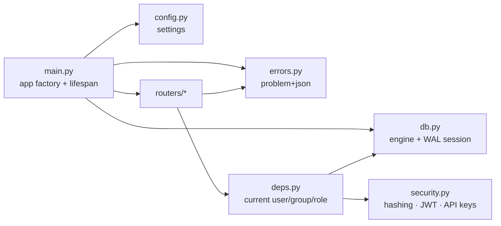

**Walking tour.** `main.py` stands in the middle: the app
factory builds everything at startup. It reads `config.py` for
settings, opens `db.py` for the engine and session discipline,
and installs `errors.py` so every failure leaves as
problem+json. The routers enter through `deps.py`, which
resolves who is calling (from `security.py`'s tokens and keys)
and what group and role the call is scoped to. Nothing else in
the tree talks to FastAPI's request machinery directly — the
chassis is the only doorframe.

#### `src/gpa/__init__.py`
- **For:** Package marker + the single `__version__` the whole
  product reports (health endpoint, CLI, Doctor). **Module:**
  core.
- **Public symbols:** `__version__`.
- **May use:** nothing. **Must never:** import anything (import
  order safety).
- **Data:** none. **On failure:** n/a.
- **Tests:** version-consistency test across surfaces (B-234).
  **Created by:** B-001.

#### `src/gpa/main.py`
- **For:** The application factory: `create_app()` builds the
  FastAPI app, installs middleware and error handlers, mounts
  every router, and owns the lifespan (startup recovery runs
  here, worker starts here). **Module:** core.
- **Public symbols:** `create_app(settings=None) -> FastAPI`.
- **May use:** `config`, `db`, `errors`, all `routers/*`,
  `resilience.recovery`, `jobs.worker`. **Must never:** contain
  business rules — it wires, it does not decide.
- **Data:** none directly. **On failure:** a failed startup
  check (unsafe profile, D-38; missing key, B-145) refuses to
  serve, with the reason in plain words in the log and health
  output.
- **Tests:** app-factory tests; B-151 freeze drill. **Created
  by:** B-002; lifespan hardening by B-172.

#### `src/gpa/config.py`
- **For:** Every setting, typed, env-driven
  (pydantic-settings): paths, profile, AI driver choice, key
  locations, limits. **Module:** core.
- **Public symbols:** `Settings`, `get_settings()`.
- **May use:** pydantic-settings, stdlib. **Must never:** hold
  a default secret, or log a secret's value (config *shape* is
  what the Doctor and support bundles see — B-323).
- **Data:** reads environment + `.env`. **On failure:** an
  invalid setting fails startup with the setting named (never
  its value).
- **Tests:** config tests; `.env.example` completeness
  (B-002/B-145). **Created by:** B-002.

#### `src/gpa/db.py`
- **For:** The database chassis: engine factory, session
  factory, and the D-28 discipline on every connection — WAL,
  `synchronous=FULL`, `foreign_keys=ON` — plus the
  commit-before-answer session wrapper the durability manager
  builds on. **Module:** core.
- **Public symbols:** `make_engine(url)`, `SessionLocal`,
  `get_session()`, `write_transaction()` (context manager).
- **May use:** SQLAlchemy 2.0. **Must never:** be bypassed by
  a raw connection anywhere in the tree (grep-guarded).
- **Data:** owns the connection to the one database file (or
  PostgreSQL, B-152). **On failure:** a connection that cannot
  set its pragmas is refused — the app would rather not start
  than run below the durability law.
- **Tests:** durability suite; chaos harness (B-175).
  **Created by:** B-003; PostgreSQL profile by B-152.

#### `src/gpa/errors.py`
- **For:** The error chassis (D-13): the problem+json shape,
  the stable `code` registry, and the handlers that turn
  domain exceptions into responses the frontend can branch on.
  **Module:** core.
- **Public symbols:** `ProblemException`, `register_error_handlers(app)`,
  `ERROR_CODES` (the enumerated registry), domain exception
  bases (`NotFound`, `Forbidden`, `Conflict`, `ValidationFailed`).
- **May use:** FastAPI/Starlette. **Must never:** let a raw
  exception reach a client — the catch-all handler converts,
  logs with context, and returns `code: internal` (and the
  B-316 sweep tests every surface for leakage).
- **Data:** none. **On failure:** the handler itself falls back
  to a static 500 problem body.
- **Tests:** error-shape contract tests (B-004). **Created
  by:** B-004; user-facing catalogue alignment by B-316.

#### `src/gpa/security.py`
- **For:** Credential mechanics: password hashing, JWT
  issue/verify (15-minute access), rotating refresh tokens,
  API-key hashing and scope checks. **Module:** core/identity.
- **Public symbols:** `hash_password`, `verify_password`,
  `issue_access_token`, `verify_access_token`,
  `rotate_refresh_token`, `hash_api_key`, `key_scopes`.
- **May use:** `cryptography`-class primitives via the locked
  dependency set, `db`. **Must never:** store a plaintext
  password, refresh token, or API key (hashes only — B-013,
  B-014); never log a token.
- **Data:** touches `User`, `ApiKey`, session rows via the
  identity service — it computes, it does not own tables.
  **On failure:** verification fails closed (401/403 kept
  distinct, §5); a stolen refresh token dies by the rotation
  rule even with MFA on (B-174).
- **Tests:** auth suites, B-140 authorisation fuzz, B-174 MFA
  suite. **Created by:** B-013/B-014; MFA additions B-174.

#### `src/gpa/deps.py`
- **For:** The FastAPI dependencies every router shares:
  current principal (human user *or* agent seat — one type,
  D-35), current group, role guard. **Module:** core/identity.
- **Public symbols:** `CurrentPrincipal`, `current_principal()`,
  `require_role(min_role)`, `current_group()`.
- **May use:** `security`, `db`, identity/group models (read).
  **Must never:** contain per-route authorisation logic of its
  own beyond role/scope checks — object-level rules live in
  services (B-017).
- **Data:** reads `User`, `AgentSeat`, `Membership`. **On
  failure:** 401 (not signed in) vs 403 (not allowed) — never
  conflated (§5).
- **Tests:** role-matrix suite (B-016/B-022). **Created by:**
  B-017.

---

## C. The data layer — `src/gpa/models/` and `src/gpa/schemas/`

One file per domain in each layer, same filenames both sides
(§3's four-file rule). Models are SQLAlchemy 2.0; every table
carries `id` (UUID), `created_at`, `updated_at`, group-owned
tables carry `group_id`, and user-deletable things carry
`deleted_at` (soft delete; hard delete exists only in the
erasure service). Schemas are Pydantic v2 — the same schemas
validate API input, AI output, and test fixtures (D-04).
Sealed fields (Doc 06/08) are marked in the model entries:
they are stored through `crypto.fields` and never appear in a
schema in sealed form.

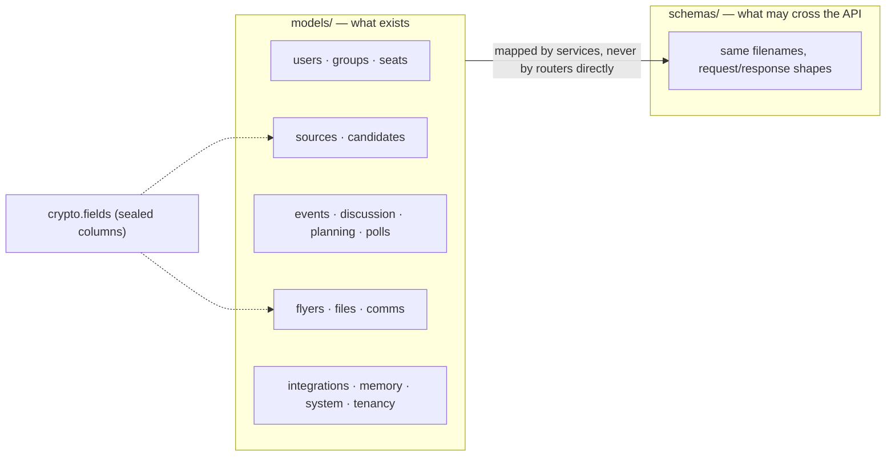

**Walking tour.** The left box is the model layer grouped by
family: identity (users, groups, seats), the trust pipeline
(sources, candidates), the planning heart (events, discussion,
planning, polls), the media and messaging families (flyers,
files, comms), and the system family (integrations, memory,
system, tenancy). The right box is the schema layer — identical
filenames, but holding request/response shapes rather than
tables. The arrow between them runs through services on
purpose: routers never map a model to a schema by hand, and a
schema never exposes a column the API does not promise. The
dotted arrows mark where sealed columns enter the model layer
— source text and communication content are sealed at rest, so
their models route those fields through `crypto.fields`.

### C.1 `src/gpa/models/`

#### `src/gpa/models/__init__.py`
- **For:** Imports every model module so Alembic and the app
  see one metadata registry. **Module:** data.
- **Public symbols:** `Base` (re-exported from `db` lineage),
  all model classes by domain import.
- **May use:** the sibling model modules. **Must never:**
  define a model itself.
- **Data:** the metadata registry. **On failure:** a model
  module missing here fails loudly at migration time — which
  is the point.
- **Tests:** migration-vs-model diff checker (B-192). **Created
  by:** B-003.

#### `src/gpa/models/users.py`
- **For:** `User` (name, **sealed** email where not needed for
  lookup + HMAC lookup index, password hash nullable for
  magic-link-only and bridged accounts, timezone, locale,
  notification prefs) and `MagicLink` (hashed token, expiry,
  used-at). **Module:** identity.
- **Public symbols:** `User`, `MagicLink`.
- **May use:** `crypto.fields` for sealed columns. **Must
  never:** store a plaintext email beside its sealed form, or
  a plaintext magic-link token.
- **Data:** owns `users`, `magic_links`. **On failure:** the
  unique email-index constraint is the final arbiter against
  duplicate accounts (B-011).
- **Tests:** identity suites (B-011/B-012). **Created by:**
  B-011/B-012; bridged-account fields by B-297.

#### `src/gpa/models/groups.py`
- **For:** `Group` (name, description, home timezone, default
  place, visibility, review settings) and `Membership` (role,
  status, nickname; unique user×group). **Module:** groups.
- **Public symbols:** `Group`, `Membership`, `Role` (enum:
  owner/admin/organiser/member/guest).
- **May use:** stdlib only. **Must never:** encode a permission
  rule — roles are data; rules live in services (B-017).
- **Data:** owns `groups`, `memberships`. **On failure:**
  duplicate membership is refused by the unique constraint.
- **Tests:** B-015/B-016 suites. **Created by:** B-015/B-016.

#### `src/gpa/models/seats.py`
- **For:** `AgentSeat` (display name, role, permissions, owner
  user) and `ApiKey` (hashed key, label, scopes, last-used;
  belonging to a user or a seat). **Module:** identity/seats.
- **Public symbols:** `AgentSeat`, `ApiKey`.
- **May use:** stdlib. **Must never:** store a usable key —
  hashes only (B-014).
- **Data:** owns `agent_seats`, `api_keys`. **On failure:** a
  revoked key row remains (revocation is a state, for audit),
  it simply never verifies again.
- **Tests:** seat suites (B-018, B-202). **Created by:**
  B-014/B-018.

#### `src/gpa/models/sources.py`
- **For:** `Source` (kind, title, permission granted-by/at,
  raw storage ref) and `SourceChunk` (ordered text or region,
  sender, sent-at, page/region box), plus `IngestJob` linkage.
  Raw text columns are **sealed**. **Module:** sources.
- **Public symbols:** `Source`, `SourceChunk`, `SourceKind`.
- **May use:** `crypto.fields`. **Must never:** hold raw file
  bytes — files live behind the storage interface; a source
  holds references.
- **Data:** owns `sources`, `source_chunks`, `ingest_jobs`.
  **On failure:** a chunk write failure aborts the ingest job
  atomically — a half-chunked source is never visible.
- **Tests:** ingest suites (B-023 → B-034). **Created by:**
  B-023.

#### `src/gpa/models/candidates.py`
- **For:** `Candidate` — the review-queue item (kind:
  event/task/decision/question; draft JSON; per-field
  confidence; status pending/approved/edited/rejected/merged)
  and `Provenance` (candidate field → exact supporting quote
  or flyer region). Draft text fields are **sealed**.
  **Module:** candidates.
- **Public symbols:** `Candidate`, `Provenance`,
  `CandidateStatus`.
- **May use:** `crypto.fields`. **Must never:** allow a status
  transition the state machine in `services/candidates.py`
  does not define — transitions are service law, the model
  only records them.
- **Data:** owns `candidates`, `provenance`. **On failure:**
  approval and publication are one transaction (B-043) — a
  candidate never reads "approved" without its entity minted.
- **Tests:** queue suites (B-043/B-044). **Created by:** B-043.

#### `src/gpa/models/events.py`
- **For:** `Event` (the full §4 field set: UTC times + IANA
  timezone, place, host, cost, bring-list, access notes,
  status draft/published/cancelled), `EventSourceLink`,
  `EventChange` (field-level history), `Recurrence` (RRULE +
  exceptions), and `CalendarFeed` (per-group secret feed
  token, filters, revoked-at). **Module:** events.
- **Public symbols:** `Event`, `EventSourceLink`,
  `EventChange`, `Recurrence`, `CalendarFeed`.
- **May use:** stdlib. **Must never:** store a naive datetime
  — the column types reject one (D-21: a datetime without a
  timezone is a bug).
- **Data:** owns `events`, `event_source_links`,
  `event_changes`, `recurrences`, `calendar_feeds`. **On
  failure:** a timezone-less write raises before it reaches
  the database.
- **Tests:** event suites (B-049 → B-057). **Created by:**
  B-049/B-052.

#### `src/gpa/models/discussion.py`
- **For:** `Thread` / `Comment` — discussion under an event, a
  candidate, or standalone; author is a user **or** a seat
  (polymorphic principal, never two code paths). **Module:**
  discussion.
- **Public symbols:** `Thread`, `Comment`.
- **May use:** `crypto.fields` (bodies sealed). **Must
  never:** hard-delete a comment — edits keep history
  (edited-at), deletes soft-delete.
- **Data:** owns `threads`, `comments`. **On failure:** a
  comment on a deleted parent is refused by service rule.
- **Tests:** B-060/B-084 suites. **Created by:** B-060.

#### `src/gpa/models/planning.py`
- **For:** `Task`, `Decision` (with superseded-by chain),
  `OpenQuestion`, `ChecklistItem`, `Rsvp` (unique user×event),
  and `Template`. **Module:** planning.
- **Public symbols:** `Task`, `Decision`, `OpenQuestion`,
  `ChecklistItem`, `Rsvp`, `Template`.
- **May use:** stdlib. **Must never:** let an `Rsvp` duplicate
  exist — the unique constraint is the concurrency arbiter
  (B-236).
- **Data:** owns `tasks`, `decisions`, `open_questions`,
  `checklist_items`, `rsvps`, `templates`. **On failure:**
  racing RSVPs resolve to exactly one row; the loser gets the
  409 path (B-236).
- **Tests:** planning suites (B-061, B-083 → B-091). **Created
  by:** B-061/B-083 → B-091.

#### `src/gpa/models/polls.py`
- **For:** `Poll` / `PollOption` / `PollVote` — one vote per
  member per poll, changeable until close. **Module:**
  planning/polls.
- **Public symbols:** `Poll`, `PollOption`, `PollVote`.
- **May use:** stdlib. **Must never:** store who voted how in
  any aggregate projection — aggregates are computed in the
  service under the poll's own visibility rule.
- **Data:** owns `polls`, `poll_options`, `poll_votes`. **On
  failure:** vote-vs-close races resolve by the close
  timestamp + unique constraint (B-236 collision suite).
- **Tests:** B-087 suite. **Created by:** B-087.

#### `src/gpa/models/flyers.py`
- **For:** `Flyer` — image asset ref, board-photo parent,
  region box, vision transcript, **alt text** (mandatory field;
  the model refuses a flyer row whose alt text is empty once
  processed — the alt-text law as a constraint). **Module:**
  flyers.
- **Public symbols:** `Flyer`.
- **May use:** stdlib. **Must never:** hold image bytes (the
  storage layer's job).
- **Data:** owns `flyers`. **On failure:** a flyer whose image
  fails processing stays visibly `failed` with a reason — it
  never vanishes (B-069).
- **Tests:** vision suites (B-063 → B-073). **Created by:**
  B-063/B-065.

#### `src/gpa/models/files.py`
- **For:** `FileAsset` (storage key, mime, size, sha256, alt
  text) — every uploaded thing's identity card. **Module:**
  files.
- **Public symbols:** `FileAsset`.
- **May use:** stdlib. **Must never:** contain a filesystem
  path — storage keys only (D-17).
- **Data:** owns `file_assets`. **On failure:** a sha256
  mismatch at finalise refuses the asset (resumable-upload
  law, B-171).
- **Tests:** file suites (B-025, B-141). **Created by:** B-025.

#### `src/gpa/models/comms.py`
- **For:** `Reminder` (event, offset rule, channel, `run_at`),
  `Notification` (recipient, channel, status, sent-at, error —
  the retryable delivery record), `Digest` (period, rendered
  HTML + text, sent-at). Bodies **sealed**. **Module:** comms.
- **Public symbols:** `Reminder`, `Notification`, `Digest`.
- **May use:** `crypto.fields`. **Must never:** mark a
  notification sent before the channel confirms (commit-
  before-answer, D-28).
- **Data:** owns `reminders`, `notifications`, `digests`.
  **On failure:** a failed delivery stays `failed` with its
  error and is retryable — never silently dropped (B-102).
- **Tests:** comms suites (B-095 → B-104). **Created by:**
  B-095/B-096/B-099.

#### `src/gpa/models/integrations.py`
- **For:** `Integration` (kind, **sealed** config, status) and
  `WebhookDelivery` (endpoint, event kind, payload hash,
  response, retries). **Module:** integrations.
- **Public symbols:** `Integration`, `WebhookDelivery`.
- **May use:** `crypto.fields`. **Must never:** store an
  OAuth token or webhook secret unsealed.
- **Data:** owns `integrations`, `webhook_deliveries`. **On
  failure:** a broken integration records status + last error
  for the health board (B-136); it does not take the group
  down with it.
- **Tests:** integration suites (B-127/B-128). **Created by:**
  B-127.

#### `src/gpa/models/memory.py`
- **For:** `Summary` (kind, body, source range) and `PruneRun`
  (input size, kept/pruned chunk ids, question, model, cost —
  the pruning audit record). Bodies **sealed**. **Module:**
  memory.
- **Public symbols:** `Summary`, `PruneRun`.
- **May use:** `crypto.fields`. **Must never:** record a
  summary without its source range — an unsourced summary is
  an unaccountable one (B-120).
- **Data:** owns `summaries`, `prune_runs`. **On failure:** a
  failed prune run records the failure; ask falls back per
  B-115's stated behaviour, never to a silent empty answer.
- **Tests:** memory suites (B-113 → B-122). **Created by:**
  B-113/B-116.

#### `src/gpa/models/system.py`
- **For:** `Job` (kind, payload — envelope-encrypted at rest
  per B-166, `run_at`, status, attempts, last error) and
  `AuditLog` (actor, action, entity, before/after, at, ip —
  append-only, hash-chained per B-170). **Module:** system.
- **Public symbols:** `Job`, `JobStatus`, `AuditLog`.
- **May use:** `crypto` (payload sealing, chain hashing).
  **Must never:** allow an audit row to be updated or deleted
  by any code path — the writer is insert-only and the chain
  makes tampering detectable.
- **Data:** owns `jobs`, `audit_logs`. **On failure:** a job
  that exhausts attempts lands in a visible failed state with
  its error (never silently gone — B-175's invariant).
- **Tests:** job suites (B-008), audit-chain verification
  (B-170). **Created by:** B-008/B-019; chaining by B-170.

#### `src/gpa/models/tenancy.py`
- **For:** Host-tenancy records for embedded mode: `Host`
  (identity, public keys for the bridge, branding tokens,
  settings) and `HostPrincipalMap` (host principal ↔ GPA
  identity), plus embed-token records. **Module:** embed.
- **Public symbols:** `Host`, `HostPrincipalMap`,
  `EmbedToken`.
- **May use:** stdlib, `crypto.fields`. **Must never:** map
  principals by name matching — maps are created only by a
  verified token exchange (B-297).
- **Data:** owns `hosts`, `host_principal_maps`,
  `embed_tokens`; its `host_id` is the partition key B-303
  enforces across the other modules in hosted mode. **On
  failure:** an unknown host id refuses every operation —
  tenancy fails closed.
- **Tests:** tenancy + cross-host fuzz (B-303). **Created by:**
  B-297/B-303.

### C.2 `src/gpa/schemas/` — one entry for the layer, per-file notes

The schema files mirror the model filenames exactly:
`users.py`, `groups.py`, `seats.py`, `sources.py`,
`candidates.py`, `events.py`, `discussion.py`, `planning.py`,
`polls.py`, `flyers.py`, `files.py`, `comms.py`,
`integrations.py`, `memory.py`, `system.py`, `tenancy.py`,
plus `__init__.py` (re-exports for router convenience).

- **For (the layer):** Every request and response shape of the
  API, and — by D-04 — the validation shapes for AI output and
  test fixtures too. A response schema is a *promise*: fields
  not in it do not leave, including sealed columns, other
  groups' ids, and internal scopes.
- **Module:** contracts (owned jointly by the domain modules;
  a schema change is an API change and follows §5's freezing
  rules — additive within v1, breaking bumps v2).
- **Public symbols:** per file, `<Domain>Create`,
  `<Domain>Update`, `<Domain>Out`, list wrappers carrying
  `next_cursor` (D-14). Notable shared shapes: `ProblemOut`
  (in `system.py`, mirroring `errors.py`), `CandidateDraft`
  (the versioned draft JSON the AI must produce, in
  `candidates.py`), `AskIn`/`AskOut` with citation objects (in
  `memory.py`).
- **May use:** Pydantic v2, stdlib, sibling schema modules for
  shared shapes. **Must never:** import a model, a service, or
  FastAPI — schemas are pure shapes; and never carry a field
  whose only source is a sealed column without the unsealing
  happening in the service that owns the read.
- **Data:** owns no data; defines what may cross. **On
  failure:** validation failure is a 422 problem+json with
  per-field `errors[]` (D-13) — in the AI pipeline the same
  failure routes the model output to repair/retry (Doc 07).
- **Tests:** contract suite per router; schema snapshot tests
  guard `OPENAPI.json` drift (B-006). **Created by:** each
  domain's first slice (B-011 onward), one file per domain as
  its §6 phase lands.

---

## D. The service layer — `src/gpa/services/`

Services hold **all** business rules (§3: routers never
contain rules). A service function is where a slice's
acceptance test points. Every service talks to other modules
only through their published internal operations (B-161/B-162)
— the entries below name each service's own operations; the
internal-API mechanics are Doc 05.

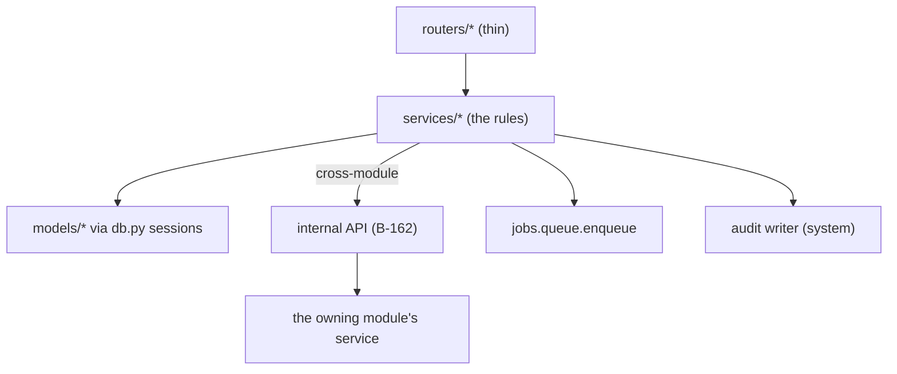

**Walking tour.** Routers (top) parse and authorise, then hand
over to services — the box where every rule lives. A service
reads and writes its own module's models through `db.py`
sessions, enqueues background work through the job queue, and
writes audit as it goes. The moment a service needs *another*
module's capability — publishing an event, asking the AI,
sending a notification — it does not import that module: it
calls the internal API, which delivers the request to the
owning module's service (bottom right). That detour is the
whole modularity law in one picture.

#### `src/gpa/services/__init__.py`
- **For:** Package marker; no exports — services are imported
  by module path so the architecture tests can see the graph.
  **Module:** services. **Public symbols:** none.
- **May use:** nothing. **Must never:** re-export services
  (that would hide cross-module imports from the linter).
- **Data:** none. **On failure:** n/a. **Tests:** architecture
  tests (B-161). **Created by:** B-002.

#### `src/gpa/services/identity.py`
- **For:** Accounts end to end: registration, magic-link
  request/consume, password set/change, sessions (issue,
  rotate, revoke-per-device), account recovery and email
  change, MFA enrolment (B-174). **Module:** identity.
- **Public symbols:** `register_user`, `request_magic_link`,
  `consume_magic_link`, `login_password`, `refresh_session`,
  `revoke_session`, `start_recovery`, `complete_recovery`,
  `enrol_totp`, `verify_totp`.
- **May use:** `security`, identity models, notifications (via
  internal API, for link mail). **Must never:** send a magic
  link through a channel it does not verify, or complete a
  grant-type write before commit (D-28 session wrapper).
- **Data:** owns writes to `users`, `magic_links`, sessions.
  **On failure:** recovery and email-change revoke all
  sessions on completion (B-020); a failed consume leaves the
  link unused-or-expired, never half-used.
- **Tests:** B-011 → B-014, B-020, B-174 suites. **Created by:**
  B-011 → B-014.

#### `src/gpa/services/permissions.py`
- **For:** The object-level permission rules behind `deps.py`:
  "may this principal, with this role/scope, do this to this
  object in this group?" — including seat-scope evaluation
  (B-014/B-018, restated B-203). **Module:** identity.
- **Public symbols:** `can(principal, action, obj) -> bool`,
  `require(...)` (raising variant), `scope_allows(scopes, op)`.
- **May use:** models (read). **Must never:** be bypassed by a
  router checking roles itself — one evaluator, everywhere.
- **Data:** reads memberships, seats, group settings. **On
  failure:** denies by default; an unknown action is denied,
  not permitted.
- **Tests:** role-matrix suite (B-016), authorisation fuzz
  (B-140). **Created by:** B-017.

#### `src/gpa/services/groups.py`
- **For:** Group lifecycle: create, update settings, sub-groups
  and chapters (B-105), settings pack (review rules, B-111),
  export archive assembly and **erasure** (B-143/B-305).
  **Module:** groups.
- **Public symbols:** `create_group`, `update_group`,
  `create_subgroup`, `export_group`, `erase_group`,
  `import_group_archive` (portability road, B-305).
- **May use:** groups models, storage (for archives), audit.
  **Must never:** erase without the owner double-confirmation
  and a completed export offer (B-143); never hard-delete
  outside this service.
- **Data:** owns `groups`, group settings; the erasure path is
  the tree's one hard-delete. **On failure:** erasure is
  transactional per stage and resumable; a half-erased group is
  visibly `erasing`, never silently partial.
- **Tests:** B-015, B-105, B-143 suites. **Created by:** B-015;
  erasure/export by B-143, portability by B-305.

#### `src/gpa/services/memberships.py`
- **For:** Invites by email, accept/decline, role changes,
  removal, member import/export (CSV, B-110), and the privacy
  surface "everything we hold about me" (B-144, with
  identity). **Module:** groups.
- **Public symbols:** `invite_member`, `accept_invite`,
  `change_role`, `remove_member`, `import_members_csv`,
  `export_members`, `member_data_dump`.
- **May use:** groups models, notifications via internal API.
  **Must never:** let the last owner be removed or demoted —
  a group always keeps an owner.
- **Data:** owns `memberships` writes. **On failure:** CSV
  import is all-or-nothing per file with a row-level error
  report — never a partial silent import.
- **Tests:** B-016, B-110, B-144 suites. **Created by:** B-016.

#### `src/gpa/services/seats.py`
- **For:** Agent seats: create/retire, key issue/revoke,
  profile (name, avatar, description), seat equality
  projections (B-202), and host-bridge seat mapping (B-297).
  **Module:** identity/seats.
- **Public symbols:** `create_seat`, `retire_seat`,
  `issue_seat_key`, `revoke_key`, `update_seat_profile`,
  `map_host_seat`.
- **May use:** seats models, `security`, audit. **Must
  never:** attribute a seat's action to its owner — audit and
  projections name the seat (B-202).
- **Data:** owns `agent_seats`, `api_keys`. **On failure:**
  retiring a seat revokes its keys in the same transaction.
- **Tests:** B-018, B-202 suites. **Created by:** B-018.

#### `src/gpa/services/sources.py`
- **For:** Source lifecycle and permission truth: create a
  source with its recorded permission, revoke a source (and
  say what happens to its data), list/read under role rules.
  **Module:** sources.
- **Public symbols:** `create_source`, `revoke_source`,
  `get_source`, `list_sources`, `source_chunks`.
- **May use:** sources models, storage, files service. **Must
  never:** accept a source without a granted-by/at permission
  record — permission is a column, not a comment (Doc 01 §4).
- **Data:** owns `sources`, `source_chunks` writes. **On
  failure:** revocation stops future ingest immediately;
  already-approved entities remain (they were approved),
  unapproved candidates from it are flagged.
- **Tests:** B-023 suite. **Created by:** B-023.

#### `src/gpa/services/ingest.py`
- **For:** The ingest pipelines behind B-024 → B-033: paste,
  file, newsletter (HTML → clean text + chunks), image,
  board photo, link fetch, email-in, voice note, live-chat
  registration — each normalising into ordered chunks and an
  `IngestJob` with progress. **Module:** sources.
- **Public symbols:** `ingest_paste`, `ingest_file`,
  `ingest_newsletter`, `ingest_image`, `ingest_board`,
  `ingest_link`, `ingest_email`, `ingest_voice`,
  `register_live_chat`, `ingest_status`.
- **May use:** sources/files models, storage, jobs (vision and
  transcription run as jobs), the office readers in `interop`
  (via internal API) for document files. **Must never:**
  extract or publish — ingest ends at chunks; extraction is
  the AI pipeline's job, approval is a human's.
- **Data:** writes chunks, ingest jobs, file assets. **On
  failure:** every ingest is resumable or visibly failed with
  a reason (B-033); EXIF orientation is fixed and location
  metadata stripped by default at image ingest (B-027,
  §6A.12).
- **Tests:** B-024 → B-034 suites incl. the golden corpus gate.
  **Created by:** B-024 → B-033.

#### `src/gpa/services/candidates.py`
- **For:** The review queue's rules: candidate creation (from
  extraction, from sync roads, from hosts), the status state
  machine, edit/approve/reject/merge, change candidates
  (B-077), contradiction handling (B-079), and the approvals
  that mint real entities. **Module:** candidates.
- **Public symbols:** `create_candidate`, `edit_candidate`,
  `approve_candidate`, `reject_candidate`, `merge_candidates`,
  `create_change_candidate`, `flag_contradiction`,
  `queue_for_group`.
- **May use:** candidates models; the minting modules (events,
  planning) **only via internal API**. **Must never:** approve
  on behalf of a principal — approval is always a named
  principal's act (human or seat of sufficient role, B-203).
- **Data:** owns `candidates`, `provenance`. **On failure:**
  approval + minting commit together or not at all (B-043);
  a failed mint leaves the candidate pending with the error
  recorded.
- **Tests:** B-043/B-044, B-077/B-079 suites; bypass suite
  (B-203). **Created by:** B-043.

#### `src/gpa/services/events.py`
- **For:** Event truth: minting **only** from approved
  candidates or direct organiser creation under the same
  rules, editing with field-level change history (B-050),
  cancel (with reason + notification), clone, recurrence
  series handling (B-052), conflict/impossibility flags
  (B-057). **Module:** events.
- **Public symbols:** `mint_event`, `edit_event`,
  `cancel_event`, `clone_event`, `event_history`,
  `series_occurrences`.
- **May use:** events models, comms via internal API (change
  alerts). **Must never:** mint from an unapproved candidate —
  the invariant the whole product stands on.
- **Data:** owns `events`, `event_changes`, `recurrences`,
  `event_source_links`. **On failure:** a materially changed
  event is flagged `needs_reannounce` for B-078 rather than
  silently diverging from what members were told.
- **Tests:** B-049 → B-057 suites. **Created by:** B-049.

#### `src/gpa/services/calendar_queries.py`
- **For:** The read projections of the calendar: agenda, month,
  the Saturday-night/tonight view (B-056), public vs member
  projections (B-059), print view data (B-072), search across
  planning (with `planning.py`, B-092). **Module:** events.
- **Public symbols:** `agenda`, `month_view`, `tonight`,
  `public_projection`, `print_month`.
- **May use:** events/planning models (read). **Must never:**
  leak a member-only field into a public projection — the
  projection functions are the one place visibility is
  decided, and they are fuzz-tested for it (B-140).
- **Data:** reads only. **On failure:** a bad timezone on a
  group surfaces as a Doctor-visible data error, never a
  silent UTC guess (D-21).
- **Tests:** B-055/B-056/B-059 suites. **Created by:** B-055.

#### `src/gpa/services/discussion.py`
- **For:** Threads and comments under events, candidates,
  tasks, and standalone; posting as the calling principal
  (human or seat, identically). **Module:** discussion.
- **Public symbols:** `open_thread`, `post_comment`,
  `edit_comment`, `thread_for`.
- **May use:** discussion models, memory via internal API
  (summaries request threads, threads do not summarise
  themselves). **Must never:** let a comment exist without an
  attributed principal.
- **Data:** owns `threads`, `comments`. **On failure:** posts
  are idempotent per `Idempotency-Key` (D-15) — a retried post
  is one comment.
- **Tests:** B-060/B-084 suites. **Created by:** B-060.

#### `src/gpa/services/planning.py`
- **For:** Tasks (minted from candidates or directly, claim,
  status), checklists and event roles, budget-lite lines
  (B-089), availability finder (B-090), templates applied
  (B-091). **Module:** planning.
- **Public symbols:** `create_task`, `claim_task`,
  `set_task_status`, `claim_checklist_item`,
  `add_budget_line`, `availability`, `apply_template`.
- **May use:** planning models, events (read). **Must never:**
  notify on its own — reminders are the comms module's job,
  requested via internal API.
- **Data:** owns `tasks`, `checklist_items`, budget lines,
  `templates` writes. **On failure:** claiming a claimed item
  returns the current claim (409 path), never a double-claim.
- **Tests:** B-083 → B-091 suites. **Created by:** B-083.

#### `src/gpa/services/decisions.py`
- **For:** The decisions log and open questions: mint from
  candidates or directly, supersede (never rewrite) a decision,
  assign and resolve questions. **Module:** planning.
- **Public symbols:** `record_decision`, `supersede_decision`,
  `current_decisions`, `ask_question`, `resolve_question`.
- **May use:** planning models. **Must never:** edit a decided
  decision in place — supersession keeps the chain (Doc 06).
- **Data:** owns `decisions`, `open_questions`. **On failure:**
  a supersede that fails leaves the original current.
- **Tests:** B-085/B-086 suites. **Created by:** B-085/B-086.

#### `src/gpa/services/polls.py`
- **For:** Polls: create (group- or event-attached), vote (one
  per member, changeable until close), close, results under
  the poll's visibility. **Module:** planning/polls.
- **Public symbols:** `create_poll`, `vote`, `close_poll`,
  `results`.
- **May use:** polls models. **Must never:** accept a vote at
  or after close — the boundary is the stored close instant,
  not the client's clock.
- **Data:** owns `polls`, `poll_options`, `poll_votes`. **On
  failure:** concurrent vote/close resolves per B-236.
- **Tests:** B-087 suite. **Created by:** B-087.

#### `src/gpa/services/flyers.py`
- **For:** The flyer wall and flyer lifecycle: wall queries by
  period (B-070), duplicate-flyer detection (B-071),
  transcript/alt-text completion states (B-065), board-parent
  relationships. **Module:** flyers.
- **Public symbols:** `flyer_wall`, `mark_duplicate`,
  `flyer_detail`, `board_children`.
- **May use:** flyers/files models; vision runs in `ai/` via
  jobs. **Must never:** publish a flyer to the wall without
  alt text (the model constraint backs this).
- **Data:** owns `flyers` writes. **On failure:** unprocessed
  flyers appear as processing/failed with reasons (B-069).
- **Tests:** B-070/B-071 suites. **Created by:** B-070.

#### `src/gpa/services/files.py`
- **For:** Upload sessions (resumable, chunked, per-chunk
  hashes, final sha256 — B-171), asset finalise, authorised
  download, and upload hardening hand-off (content sniffing,
  B-141). **Module:** files.
- **Public symbols:** `begin_upload`, `upload_chunk`,
  `complete_upload`, `open_asset`, `asset_info`.
- **May use:** storage drivers, crypto (per-file sealing),
  files models. **Must never:** serve an asset without an
  authorisation check per request, or trust a client-supplied
  mime type.
- **Data:** owns `file_assets` and upload-session state. **On
  failure:** an interrupted upload resumes from the last good
  chunk; a hash mismatch refuses finalise and keeps the
  session for inspection.
- **Tests:** B-025, B-141, resumable-upload drills (B-171).
  **Created by:** B-025; resumable sessions by B-171.

#### `src/gpa/services/notifications.py`
- **For:** The notification core: create delivery records,
  channel dispatch (email/Messenger/in-app), retries,
  deliverability records (B-102), preferences and quiet hours
  (B-100), the in-app inbox (B-101). **Module:** comms.
- **Public symbols:** `notify`, `dispatch_due`, `retry_failed`,
  `inbox_for`, `set_preferences`.
- **May use:** comms models, `notifications/` channel drivers,
  jobs. **Must never:** send during a member's quiet hours
  except for the channels the member marked urgent-allowed;
  never mark sent before channel confirmation.
- **Data:** owns `notifications`. **On failure:** circuit
  breakers per channel (B-173) — a dead mail provider queues,
  it does not cascade.
- **Tests:** B-095, B-100 → B-102 suites. **Created by:** B-095.

#### `src/gpa/services/reminders.py`
- **For:** Reminder rules per event (B-096), scheduling them
  as jobs, change alerts (B-097), and re-announce drafting for
  materially changed events (B-078, wording tier B-103).
  **Module:** comms.
- **Public symbols:** `schedule_reminders`, `cancel_reminders`,
  `raise_change_alert`, `draft_reannounce`.
- **May use:** comms/events models (read), notifications via
  internal API. **Must never:** remind about a cancelled event
  — cancellation cancels its reminders in the same
  transaction.
- **Data:** owns `reminders`. **On failure:** a missed tick is
  caught by the scheduler's catch-up scan; reminders fire
  late-labelled, never silently never.
- **Tests:** B-096/B-097 suites. **Created by:** B-096.

#### `src/gpa/services/digests.py`
- **For:** The weekly digest (B-099): assemble a group's
  period (events, decisions, open questions, queue state),
  render HTML + text from the shared document model (B-275),
  schedule and record sends. **Module:** comms.
- **Public symbols:** `build_digest`, `preview_digest`,
  `send_digest`.
- **May use:** comms models, calendar/planning reads via
  internal API, `interop.mail_render` for client-proof HTML.
  **Must never:** include another group's data — assembly is
  group-scoped by construction and fuzz-checked (B-140).
- **Data:** owns `digests`. **On failure:** a failed render
  leaves the digest `draft` with the error; nothing partial is
  sent.
- **Tests:** B-099 suite; mail-client fixtures (B-279).
  **Created by:** B-099.

#### `src/gpa/services/integrations.py`
- **For:** Integration lifecycle: connect/disconnect, sealed
  config custody, status for the health board (B-136), the
  nightly reconciliation job's home (B-137). **Module:**
  integrations.
- **Public symbols:** `connect`, `disconnect`,
  `integration_status`, `reconcile_all`.
- **May use:** integrations models, the `integrations/`
  drivers via internal API. **Must never:** hold a plaintext
  provider token outside the sealed config.
- **Data:** owns `integrations`. **On failure:** a failing
  integration degrades to its B-173 matrix entry (queued /
  cached / plainly unavailable), group unaffected.
- **Tests:** B-127/B-136/B-137 suites. **Created by:** B-127.

#### `src/gpa/services/memory.py`
- **For:** Group memory's verbs: ask (B-115, via the pruning
  pipeline), discussion summaries (B-116), event briefings
  (B-117), recaps and newsletter drafts (B-118), and the
  transparency read of prune runs (B-120). **Module:** memory.
- **Public symbols:** `ask_group`, `summarise_thread`,
  `brief_event`, `draft_recap`, `memory_runs`.
- **May use:** memory models, `ai.pruning` via internal API.
  **Must never:** answer an `ask` without citations into the
  group's own sources — an uncited answer is a failed answer.
- **Data:** owns `summaries`, reads `prune_runs`. **On
  failure:** budget exhaustion (B-047) returns a plain
  budget answer, never a fabricated one.
- **Tests:** B-115 → B-121 suites. **Created by:** B-115.

#### `src/gpa/services/admin.py`
- **For:** The admin/audit surface's rules: audit reads (with
  chain verification status), privacy data dumps (B-144),
  group data-quality report (B-081). **Module:** admin.
- **Public symbols:** `read_audit`, `verify_audit_chain`,
  `data_quality_report`.
- **May use:** system models, `crypto.audit_chain`. **Must
  never:** offer any audit mutation — the surface is read-only
  by construction.
- **Data:** reads `audit_logs`, all domains (report only).
  **On failure:** a broken chain is reported as broken, with
  the row named (B-170) — never quietly re-chained.
- **Tests:** B-081, B-144, B-170 suites. **Created by:**
  B-019/B-081.

#### `src/gpa/services/health.py`
- **For:** Health's truth: shallow `/health` (§5) and the deep
  health the Doctor and operators read (DB, job backlog, AI
  driver in use, B-155). **Module:** system.
- **Public symbols:** `shallow_health`, `deep_health`.
- **May use:** `db`, jobs models, config. **Must never:**
  report a driver as live that is fixture/mock (honest
  labelling, D-18).
- **Data:** reads system state. **On failure:** deep health
  degrades per-part (a part that cannot answer is `unknown`,
  not `ok`).
- **Tests:** B-155 suite; Doctor check fixtures (B-319).
  **Created by:** B-010 (shallow), B-155 (deep).

---

## E. The HTTP layer — `src/gpa/routers/`

Routers are thin (§3): parse → authorise (via `deps`) → call
one service → return one schema. A router file mirrors its
domain; the entries below are therefore short — the rules they
invoke live in §D. Shared failure behaviour for the whole
layer: errors leave as problem+json via `errors.py`;
`Idempotency-Key` is honoured on every POST create (D-15);
`ETag`/`If-Match` on every PATCH (stale write → 409 + current
object); list endpoints use cursor pagination (D-14). Tests
for the layer are the contract suites per router plus the
B-140 authorisation fuzz over the role × route matrix.

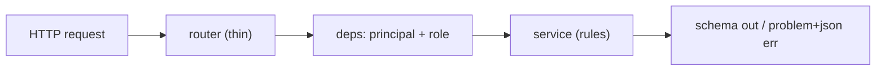

**Walking tour.** A request enters a router, which does no
thinking of its own: it resolves the principal and role
through `deps`, calls exactly the service operations the route
promises, and shapes the result through the domain schema —
or, on any failure, through the problem+json handler. If you
find a business rule in a router while reading, that is a bug
to file, by §3's first rule.

#### `src/gpa/routers/__init__.py`
- **For:** Mounts every router under `/api/v1` in one ordered
  list `create_app` consumes. **Module:** http. **Public
  symbols:** `all_routers`. **May use:** sibling routers.
  **Must never:** mount a router twice or under a second
  prefix. **Data:** none. **On failure:** an import failure
  stops startup (a missing router is a missing product area).
  **Tests:** route-inventory contract test (~110 routes, §5).
  **Created by:** B-010.

#### `src/gpa/routers/auth.py`
- **For:** The 6 auth routes: register, magic-link request +
  consume, password login, refresh, logout. **Module:** http/
  identity. **Public symbols:** `router`. **May use:**
  `services.identity`, `deps`. **Must never:** distinguish
  "no such account" from "wrong password" in responses
  (account-enumeration rule). **Data:** none directly. **On
  failure:** rate limits (B-021) answer 429 + problem body.
  **Tests:** auth contract suite. **Created by:** B-011 → B-013.

#### `src/gpa/routers/users.py`
- **For:** `users/me` (4): profile read/update, notification
  preferences, my-data dump, devices/sessions list + revoke.
  **Module:** http/identity. **Public symbols:** `router`.
  **May use:** identity + memberships services. **Must
  never:** expose another user's record — `me` is resolved
  from the token, never from a path id. **Data:** none. **On
  failure:** standard problem paths. **Tests:** B-144 privacy
  suite. **Created by:** B-011; devices view by B-243.

#### `src/gpa/routers/groups.py`
- **For:** Groups + memberships (12): CRUD, invites, role
  changes, sub-groups, import/export, settings pack.
  **Module:** http/groups. **Public symbols:** `router`. **May
  use:** groups + memberships services. **Must never:** accept
  a `group_id` the principal does not belong to (403, via
  `deps`). **Data:** none. **On failure:** standard. **Tests:**
  role-matrix suite. **Created by:** B-015/B-016.

#### `src/gpa/routers/seats.py`
- **For:** Agent-seats (5): create, list, profile, key issue/
  revoke, retire. **Module:** http/identity. **Public
  symbols:** `router`. **May use:** seats service. **Must
  never:** return a key's value after its one creation
  response. **Data:** none. **On failure:** standard.
  **Tests:** B-018 suite. **Created by:** B-018.

#### `src/gpa/routers/sources.py`
- **For:** Sources + ingest (10): create per kind, upload
  session hand-off, status/progress, revoke, chunks read.
  **Module:** http/sources. **Public symbols:** `router`.
  **May use:** sources + ingest + files services. **Must
  never:** accept an upload body directly where the resumable
  session exists (large files go through `files`).
  **Data:** none. **On failure:** ingest failures surface as
  job state, not HTTP 500s. **Tests:** B-023 → B-033 suites.
  **Created by:** B-023.

#### `src/gpa/routers/candidates.py`
- **For:** The review queue (8): list with filters, read with
  provenance, edit, approve, reject, merge, change-candidate
  and contradiction views. **Module:** http/candidates.
  **Public symbols:** `router`. **May use:** candidates
  service. **Must never:** offer an approve route a
  below-organiser seat can call into existence — the service
  re-checks (B-203) regardless of what the route allows.
  **Data:** none. **On failure:** a failed mint returns the
  candidate still-pending (never a phantom approval).
  **Tests:** queue contract suite. **Created by:** B-043.

#### `src/gpa/routers/events.py`
- **For:** Events (14): CRUD, `.ics` download, change history,
  clone, cancel, occurrences, flyer-wall and tonight hand-offs
  are separate routers below. **Module:** http/events.
  **Public symbols:** `router`. **May use:** events +
  calendar_queries services. **Must never:** serve a naive
  datetime — the schema layer refuses one (D-21). **Data:**
  none. **On failure:** stale PATCH → 409 + current object
  (§5). **Tests:** event contract suite. **Created by:** B-049.

#### `src/gpa/routers/calendar.py`
- **For:** Calendar (6): agenda, month, tonight, feed-token
  management, per-event add-links pack (B-272), print data.
  **Module:** http/events. **Public symbols:** `router`.
  **May use:** calendar_queries service, `calendar_engine`.
  **Must never:** expose a feed token in a list response —
  tokens show once, masked thereafter (B-226's terminal rule
  applies API-side too). **Data:** none. **On failure:**
  standard. **Tests:** B-055/B-056 suites. **Created by:**
  B-055; links pack by B-272.

#### `src/gpa/routers/discussion.py`
- **For:** Threads/comments (6): read thread, post, edit,
  list per parent. **Module:** http/discussion. **Public
  symbols:** `router`. **May use:** discussion service. **Must
  never:** accept an author field from the client — the author
  is the principal. **Data:** none. **On failure:** standard.
  **Tests:** B-060 suite. **Created by:** B-060.

#### `src/gpa/routers/rsvps.py`
- **For:** RSVPs (3): set mine, list per event (under
  visibility), counts. **Module:** http/planning. **Public
  symbols:** `router`. **May use:** planning service. **Must
  never:** let one principal set another's RSVP except an
  organiser recording a phoned-in reply — which is audited as
  such. **Data:** none. **On failure:** capacity races → 409
  path (B-236). **Tests:** B-061 suite. **Created by:** B-061.

#### `src/gpa/routers/planning.py`
- **For:** Tasks (6), checklists (4), budget lines,
  availability, templates (4) — the planning routes not owned
  by narrower routers. **Module:** http/planning. **Public
  symbols:** `router`. **May use:** planning + decisions
  services. **Must never:** mint a task from an unapproved
  candidate (service law, restated at the boundary).
  **Data:** none. **On failure:** standard. **Tests:**
  B-083 → B-091 suites. **Created by:** B-083.

#### `src/gpa/routers/decisions.py` and `src/gpa/routers/questions.py`
- **For:** Decisions (4) and open-questions (4): record, list
  current truth, supersede; ask, assign, resolve. **Module:**
  http/planning. **Public symbols:** `router` in each. **May
  use:** decisions service. **Must never:** offer an edit-in-
  place route for a decision (supersede only). **Data:** none.
  **On failure:** standard. **Tests:** B-085/B-086 suites.
  **Created by:** B-085/B-086.

#### `src/gpa/routers/polls.py`
- **For:** Polls (6): create, read, vote, close, results.
  **Module:** http/planning. **Public symbols:** `router`.
  **May use:** polls service. **Must never:** return
  per-person votes where the poll's visibility forbids it.
  **Data:** none. **On failure:** late vote → 409 with the
  closed state. **Tests:** B-087 suite. **Created by:** B-087.

#### `src/gpa/routers/flyers.py`
- **For:** Flyers (6): wall, detail, board children, duplicate
  marking, transcript/alt-text read. **Module:** http/flyers.
  **Public symbols:** `router`. **May use:** flyers + files
  services. **Must never:** serve the raw image without the
  asset authorisation path. **Data:** none. **On failure:**
  processing state is data in the response, never an error.
  **Tests:** B-070 suite. **Created by:** B-070.

#### `src/gpa/routers/files.py`
- **For:** Files (4): upload-session begin/chunk/complete and
  authorised download. **Module:** http/files. **Public
  symbols:** `router`. **May use:** files service. **Must
  never:** stream an asset before its sha256 finalise.
  **Data:** chunk bodies in transit only. **On failure:** a
  bad chunk returns its expected hash range so the client can
  resume precisely (B-171). **Tests:** upload suites.
  **Created by:** B-025.

#### `src/gpa/routers/comms.py`
- **For:** Reminders (4), notifications (3), digests (3):
  rules per event, inbox, digest preview/send, preferences
  hand-off to `users.py`. **Module:** http/comms. **Public
  symbols:** `router`. **May use:** reminders + notifications
  + digests services. **Must never:** let a member read
  another's inbox. **Data:** none. **On failure:** standard.
  **Tests:** B-095 → B-101 suites. **Created by:** B-095.

#### `src/gpa/routers/integrations.py`
- **For:** Integrations (8): connect/disconnect per kind,
  status board, webhook test-fire, CalDAV app-password hand-off
  (B-268), sync controls (B-269/B-270). **Module:**
  http/integrations. **Public symbols:** `router`. **May use:**
  integrations service. **Must never:** echo a provider token
  in any response. **Data:** none. **On failure:** a provider
  outage is a status in the response, not a 500. **Tests:**
  B-127/B-136 suites. **Created by:** B-127; interop routes by
  Phase 23.

#### `src/gpa/routers/memory.py`
- **For:** Summaries + ask (5): ask the group memory,
  briefings, recaps, memory-run transparency. **Module:**
  http/memory. **Public symbols:** `router`. **May use:**
  memory service. **Must never:** return an ask answer whose
  citations failed validation — uncited is an error state,
  not an answer. **Data:** none. **On failure:** budget
  exhaustion → problem body naming the budget (B-047).
  **Tests:** B-115/B-120 suites. **Created by:** B-115.

#### `src/gpa/routers/admin.py`
- **For:** Admin/audit (3) + Doctor's API door: audit read,
  chain verification, data-quality report, and the admin-only
  Doctor run/findings operations (B-319). **Module:**
  http/admin. **Public symbols:** `router`. **May use:** admin
  service, `doctor.engine` via internal API. **Must never:**
  expose Doctor repair through a non-admin route — repair
  consent is an admin act (Doc 17 §3.3). **Data:** none. **On
  failure:** standard. **Tests:** B-170, B-319 suites.
  **Created by:** B-019 (audit), B-319 (Doctor door).

#### `src/gpa/routers/jobs.py`
- **For:** Jobs (2, status only): read a job, list a group's
  recent jobs. **Module:** http/system. **Public symbols:**
  `router`. **May use:** jobs models (read) via the jobs
  service surface. **Must never:** offer job mutation — jobs
  are steered by their owning modules, never by clients.
  **Data:** none (payloads are sealed and never returned).
  **On failure:** standard. **Tests:** B-033 suite. **Created
  by:** B-008/B-033.

#### `src/gpa/routers/meta.py`
- **For:** Health/meta (3): `/health`, deep health (admin),
  version/build info. **Module:** http/system. **Public
  symbols:** `router`. **May use:** health service. **Must
  never:** require auth for shallow health, or leak config
  values in build info (shape only). **Data:** none. **On
  failure:** health that cannot answer reports `unknown`
  parts, not a crash. **Tests:** B-155 suite. **Created by:**
  B-010/B-155.

#### `src/gpa/routers/stream.py`
- **For:** The SSE live stream (D-16): per-group event feed
  (`candidate.created`, `event.changed`, `rsvp.changed`, …)
  with watermark resume (B-238). **Module:** http/system.
  **Public symbols:** `router`, `stream_group_events`.
  **May use:** the internal event bus projection, `deps`.
  **Must never:** hold a slow client against the group —
  backpressure drops the client to resync (B-237).
  **Data:** events in transit only. **On failure:** a dropped
  stream is a normal state; clients resync by watermark and
  lose nothing.
  **Tests:** B-237/B-238 suites. **Created by:** B-016
  (stream), watermark protocol by B-238.

#### `src/gpa/routers/help.py`
- **For:** The API help endpoint (B-314): resolve a help id,
  list topics, run the goal finder (B-315) for API clients.
  **Module:** http/help. **Public symbols:** `router`. **May
  use:** `help.registry`, `help.finder`. **Must never:** serve
  a topic body that differs from the source hash the parity
  checker recorded (B-328). **Data:** help topics (read).
  **On failure:** an unknown help id returns the topic index,
  never a bare 404 dead end (Doc 17 §1.2). **Tests:** B-313/
  B-328 suites. **Created by:** B-314.

#### `src/gpa/routers/embed.py`
- **For:** The embed surface (Phase 25): widget data
  endpoints, token-exchange endpoint for hosts, panel data
  for Samtal (queue badge, tonight card, event card).
  **Module:** http/embed. **Public symbols:** `router`. **May
  use:** `embed.*` services. **Must never:** accept an embed
  token outside its widget/group/origin scope (B-299), or a
  host assertion with a wrong audience (B-297). **Data:**
  none. **On failure:** scope failures are 403 with the scope
  named — hosts debugging an integration need the truth.
  **Tests:** B-297/B-299 suites, host conformance kit (B-307).
  **Created by:** B-299.

---

## F. The AI layer — `src/gpa/ai/`

Domain code never calls a model vendor directly (D-18): it
calls `MetaModelClient`, and a driver answers. Prompts are
versioned files, not string literals. The pipelines here
produce **candidates and drafts only** — nothing in this
package can publish (§6.1 of Doc 07).

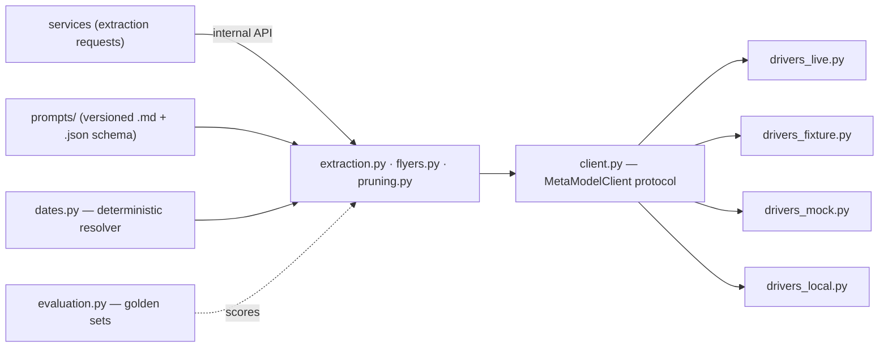

**Walking tour.** A service's request arrives through the
internal API at the pipeline files — extraction, flyer
reading, pruning. The pipelines compose prompts from the
versioned prompt library and resolve every relative date
through `dates.py` (deterministically — the model never gets
to decide what "this Saturday" means, D-22). All model contact
passes through the `MetaModelClient` protocol in `client.py`,
which fans out to exactly one driver per deployment: live,
recorded-fixture, mock, or local. `evaluation.py` stands to
the side with a dotted arrow: it scores the pipelines against
the golden corpora and is the reason accuracy numbers exist
at all (B-046, B-285).

#### `src/gpa/ai/client.py`
- **For:** The `MetaModelClient` protocol (D-18): the methods
  every driver implements — `complete_text`, `read_image`,
  `segment_board`, `transcribe` — with shared request/response
  types and cost accounting hooks. **Module:** ai.
- **Public symbols:** `MetaModelClient` (Protocol),
  `TextRequest`/`TextResult`, `VisionRequest`/`VisionResult`,
  `get_client(settings)`.
- **May use:** config, schemas (AI output shapes). **Must
  never:** know a vendor's name — the protocol is the whole
  contract; drivers are chosen by settings, never by callers.
- **Data:** requests/responses in transit; every call records
  its cost into the B-047 ledger via the caller's job context.
  **On failure:** a driver error raises `ModelUnavailable`
  with the driver named; pipelines degrade per B-173's matrix,
  never silently.
- **Tests:** protocol conformance suite runs against all
  drivers. **Created by:** B-035.

#### `src/gpa/ai/drivers_live.py`
- **For:** The live driver: Meta Model API over httpx, with
  timeouts, bounded retries, and per-call cost capture.
  **Module:** ai.
- **Public symbols:** `LiveDriver`.
- **May use:** `client` types, httpx, config (key from env
  only). **Must never:** log a prompt or a response body at
  default levels (content stays out of logs, B-204's rule
  applied everywhere), or retry a non-idempotent call blindly.
- **Data:** in transit only. **On failure:** timeouts and 5xx
  feed the circuit breaker (B-173); budget exhaustion
  (B-047) refuses before the call.
- **Tests:** recorded-integration suite; kill-the-dependency
  suite (B-173). **Created by:** B-037.

#### `src/gpa/ai/drivers_fixture.py` / `src/gpa/ai/drivers_mock.py`
- **For:** The offline drivers: fixture replays responses
  recorded from the live API, keyed by prompt-template version
  + input hash (this is what makes the demo and the test suite
  run with no network); mock returns small hand-written
  responses for unit tests. **Module:** ai.
- **Public symbols:** `FixtureDriver`, `MockDriver`.
- **May use:** the fixtures store under `tests/fixtures/` (and
  the demo fixture set in `seeds/`). **Must never:** be
  selectable in a deployment profile that claims live AI —
  health reports the driver honestly (D-18).
- **Data:** fixture files (all sample content written by the
  team for this project — B-337). **On failure:** a missing
  fixture is a loud miss in tests, and in demo mode a visible
  "no recorded answer" state — never an invented one.
- **Tests:** the whole golden suite runs on the fixture
  driver. **Created by:** B-036.

#### `src/gpa/ai/drivers_local.py`
- **For:** The optional local-inference driver (B-119): same
  protocol, an on-device model endpoint — the Pi-class road.
  **Module:** ai.
- **Public symbols:** `LocalDriver`.
- **May use:** `client` types, httpx to a local endpoint.
  **Must never:** quietly fall back to a cloud driver when the
  local endpoint dies — a deployment that chose local chose
  it for a reason.
- **Data:** in transit, on-device. **On failure:**
  `ModelUnavailable`; extraction queues until the endpoint
  returns.
- **Tests:** driver conformance suite. **Created by:** B-119.

#### `src/gpa/ai/prompts/` (directory) + `src/gpa/ai/prompts/__init__.py`
- **For:** The versioned prompt library (B-038): one `.md`
  template + one `.json` output schema per task (extract
  events, split multi-event, read flyer, prune, summarise…),
  and the loader that renders a template at an exact version.
  **Module:** ai.
- **Public symbols:** `load_prompt(name, version)`,
  `PROMPT_REGISTRY` (name → versions → schema path).
- **May use:** the directory's own files. **Must never:** let
  code inline a prompt string — a prompt change is a versioned
  file change with an evaluation run (B-285), or it does not
  happen.
- **Data:** owns the template/schema files. **On failure:** a
  missing version raises at startup for the demo profile and
  at call time otherwise — a prompt is code, and missing code
  is loud.
- **Tests:** every template is exercised by the golden suites
  at its pinned version. **Created by:** B-038.

#### `src/gpa/ai/extraction.py`
- **For:** The extraction engine: chunk-window strategy for
  long sources, event extraction (B-040), multi-event
  splitting (B-041), task/decision/question extraction
  (B-042), confidence + quality flags (B-044), producing
  candidates with per-field provenance quotes. **Module:** ai.
- **Public symbols:** `extract_from_source(source_id, job_ctx)`,
  `ExtractionResult`.
- **May use:** `client`, `prompts`, `dates`, candidates +
  sources via internal API. **Must never:** write an entity
  directly — its only output is candidates; and never resolve
  a date itself (that is `dates.py`, always).
- **Data:** reads chunks (sealed, unsealed inside the job),
  writes candidates via the candidates module. **On failure:**
  a schema-invalid model reply goes to bounded repair/retry,
  then the candidate lands flagged low-confidence rather than
  not landing (B-044) — a human decides.
- **Tests:** golden extraction set (B-046), accuracy evidence
  (B-285). **Created by:** B-040 → B-042.

#### `src/gpa/ai/flyers.py`
- **For:** The vision pipeline: flyer image → Muse Image
  reading (B-063), board photo → SAM 3.1 segmentation into
  per-poster regions (B-064, D-19: segmentation only), QR +
  printed-URL extraction (B-066), transcript + alt-text
  drafting (B-065), optional generated event image (B-067).
  **Module:** ai.
- **Public symbols:** `read_flyer(asset_id, job_ctx)`,
  `segment_board(asset_id, job_ctx)`.
- **May use:** `client`, files + flyers via internal API,
  jobs progress reporting. **Must never:** treat SAM output
  as reading — segmentation proposes regions; the vision read
  is what produces text (the honest D-19 mapping).
- **Data:** reads image assets (decrypted inside the job,
  B-168), writes transcripts/regions via the flyers module.
  **On failure:** a failed read leaves the flyer visibly
  failed with a reason and a retry; a board region that reads
  as noise is dropped with the drop recorded.
- **Tests:** vision golden set (B-073). **Created by:**
  B-063/B-064.

#### `src/gpa/ai/dates.py`
- **For:** The deterministic relative-date resolver (D-22):
  "this Saturday", "next Friday", "the 3rd", "tomorrow
  evening" → exact dates/times against a reference instant and
  the group's timezone, with the resolution rule recorded for
  provenance. **Module:** ai.
- **Public symbols:** `resolve_date_phrase(phrase, ref, tz)`,
  `Resolution` (value + rule + confidence).
- **May use:** stdlib (`datetime`, `zoneinfo`) only. **Must
  never:** call a model, read the wall clock implicitly (the
  reference instant is a parameter), or guess silently — an
  unresolvable phrase returns `None` + reason, and the
  pipeline flags the field instead.
- **Data:** none. **On failure:** see above — abstention is
  the designed failure mode.
- **Tests:** the date fixture battery incl. DST edges, per-OS
  timezone fixtures (B-177). **Created by:** B-039.

#### `src/gpa/ai/pruning.py`
- **For:** Geoffrey's context-pruning engine (B-113/B-114):
  chunk a source range, score chunks against a question, keep
  what carries signal, prune the rest — in passes, with a
  `PruneRun` audit record for every run. Explicitly **not**
  retrieval/RAG: no embeddings store, no vector index; the
  method is selection over the group's own chunks with the
  reasoning recorded. **Module:** ai/memory.
- **Public symbols:** `prune(chunks, question, budget)`,
  `multi_pass_prune(...)`, `PruneOutcome`.
- **May use:** `client`, `prompts`, memory models via
  internal API. **Must never:** prune without writing the
  PruneRun (kept/pruned ids are the transparency surface,
  B-120), or exceed the run's token/cost budget.
- **Data:** reads chunks, writes `prune_runs` + hands kept
  chunks to the ask pipeline. **On failure:** an over-budget
  run stops at the pass boundary and reports partial — an
  ask built on a partial prune says so.
- **Tests:** pruning evaluation set (B-121). **Created by:**
  B-113.

#### `src/gpa/ai/evaluation.py`
- **For:** The golden-set runner and scoring (B-046): runs the
  extraction/flyer/pruning evaluation corpora against the
  configured driver, scores per field, and emits the accuracy
  tables the numbers page (B-149) and evidence registry
  (B-285) consume. **Module:** ai/quality.
- **Public symbols:** `run_golden(suite)`, `score_run(run)`,
  `main()` (CLI form for the test report).
- **May use:** the pipelines, fixture corpora. **Must never:**
  be edited to make a run pass — corpora change by adding
  cases, and a threshold change is a Phase 24 record (B-283).
- **Data:** reads corpora, writes run reports into the test
  report / `evidence/`. **On failure:** a corpus case that
  errors scores as failed, with the error attached.
- **Tests:** is itself test tooling; its scoring is unit-tested
  against hand-scored fixtures. **Created by:** B-046;
  evidence extensions by B-285.

---

## G. Background work — `src/gpa/jobs/`

#### `src/gpa/jobs/queue.py`
- **For:** The job chassis API (D-09): `enqueue(kind, payload,
  run_at)` into the `Job` table, lease/ack/fail primitives,
  and the payload sealing hand-off (job payloads are
  envelope-encrypted at rest, B-166). **Module:** system/jobs.
- **Public symbols:** `enqueue`, `lease_next`, `ack`, `fail`,
  `JobContext`.
- **May use:** `db`, system models, `crypto`. **Must never:**
  execute a job inline on the request path — enqueue is the
  whole contract.
- **Data:** owns `jobs` writes with the worker. **On failure:**
  a failed enqueue fails the caller's transaction — a request
  never reports success for work that was not queued.
- **Tests:** B-008 suite; chaos invariants (B-175). **Created
  by:** B-008.

#### `src/gpa/jobs/worker.py`
- **For:** The in-process worker loop: lease due jobs, run
  handlers, heartbeat leases, resurrect expired leases at
  startup (with `resilience`), and the 30-second scheduler
  tick that makes reminders/digests "just jobs" (D-10).
  Multi-instance claiming arrives with B-157. **Module:**
  system/jobs.
- **Public symbols:** `run_worker(stop_event)`,
  `register_handler(kind, fn)` (consumed by `handlers.py`).
- **May use:** `queue`, `handlers`, `db`. **Must never:** run
  two leases of one job concurrently (the lease is the lock).
- **Data:** `jobs` state transitions. **On failure:** a
  handler exception fails the job with the error recorded and
  attempts incremented; poison jobs stop at the attempt cap in
  a visible failed state.
- **Tests:** worker suites; stuck-job drill (B-172). **Created
  by:** B-008; multi-instance by B-157.

#### `src/gpa/jobs/handlers.py`
- **For:** The handler registry: one function per job kind —
  ingest steps, extraction runs, vision reads, notification
  dispatch, reminder firing, digest builds, reconciliation,
  Doctor watch runs (B-322), backup verification — each a thin
  call into the owning module via the internal API.
  **Module:** system/jobs.
- **Public symbols:** `HANDLERS` (kind → callable), populated
  by `register_all()`.
- **May use:** the internal client (`internal.client`) only,
  for domain work. **Must never:** import a domain service
  directly — a handler is a *caller*, and callers use the
  internal API (B-162/B-166).
- **Data:** none of its own. **On failure:** unknown job kind
  fails the job visibly (a kind with no handler is a deploy
  bug, and it looks like one).
- **Tests:** handler registration completeness test (every
  enqueued kind has a handler). **Created by:** B-008; kinds
  added by their owning slices (B-033 onward).

---

## H. Calendars — `src/gpa/calendar_engine/` and `src/gpa/interop/`

`calendar_engine/` is the standards heart (B-053's line);
`interop/` is Phase 23's per-vendor depth. Doc 15 is the
user-facing account of everything in this section.

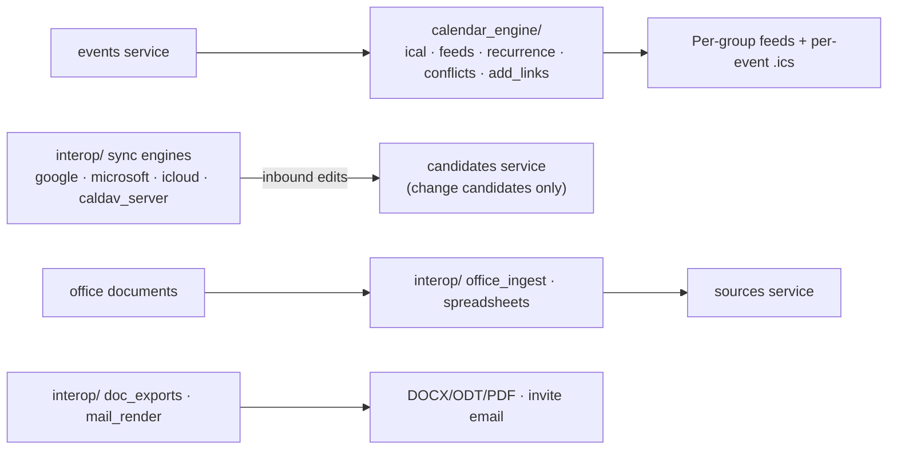

**Walking tour.** The events service feeds the calendar
engine, which produces the standards outputs — feeds and
`.ics` files — that every calendar app can consume. The
interop sync engines sit on the far side of that line: they
talk to Google, Microsoft, iCloud, and CalDAV clients, and
their one arrow into the core lands on the **candidates**
service — inbound change is a proposal, never a write (Doc 15
rule 2). Below, office documents enter through the ingest side
of interop into the sources service, and leave through the
export side as documents and invitation email.

#### `src/gpa/calendar_engine/ical.py`
- **For:** The iCal engine (B-053, deepened B-267): builds
  `VCALENDAR`/`VEVENT` output via the `icalendar` library —
  per-event downloads and the emitter the feeds and profiles
  build on, with per-target dialect profiles where a fixture
  proves a quirk (VTIMEZONE completeness, folding, escaping,
  VALARM, all-day conventions). **Module:** calendar.
- **Public symbols:** `event_to_ical(event, profile)`,
  `calendar_to_ical(events, profile)`, `PROFILES` (per-app
  profile registry).
- **May use:** `icalendar`, events schemas (read shapes).
  **Must never:** hand-roll RFC 5545 text — the library emits;
  profiles adjust properties, never raw strings.
- **Data:** reads event projections. **On failure:** an event
  that cannot be represented (missing timezone) raises — a
  feed with a silently-wrong time is worse than a failed feed.
- **Tests:** per-app round-trip conformance suites (B-267).
  **Created by:** B-053; profiles by B-267.

#### `src/gpa/calendar_engine/feeds.py`
- **For:** The per-group secret feed: token check, filter
  application, cache headers, revocation. **Module:** calendar.
- **Public symbols:** `render_feed(token, filters)`,
  `rotate_feed_token(group_id)`.
- **May use:** `ical`, events models (read), `security` (token
  hashing). **Must never:** log a feed token, or serve a
  revoked token "one last time".
- **Data:** reads `calendar_feeds`, events. **On failure:** an
  unknown/revoked token is a 404 (not 403 — the feed's
  existence is itself member information).
- **Tests:** B-053 feed suite. **Created by:** B-053.

#### `src/gpa/calendar_engine/recurrence.py`
- **For:** RRULE storage semantics and occurrence expansion
  (B-052): series → concrete occurrences inside a window,
  exceptions applied, in the event's timezone. **Module:**
  calendar.
- **Public symbols:** `expand(event, window)`,
  `next_occurrence(event, after)`.
- **May use:** `icalendar`'s rrule machinery, `zoneinfo`.
  **Must never:** expand unboundedly — every expansion is
  windowed, and the window is a parameter.
- **Data:** reads `recurrences`, events. **On failure:**
  a malformed stored RRULE surfaces as a data-quality flag
  (B-081), not a crash of the calendar view.
- **Tests:** recurrence edge battery incl. DST (B-052/B-267).
  **Created by:** B-052.

#### `src/gpa/calendar_engine/conflicts.py`
- **For:** Overlap and impossibility detection (B-057): same
  host double-booked, event inside another's setup time,
  travel-impossible sequences — as flags for humans, never
  blocks. **Module:** calendar.
- **Public symbols:** `conflicts_for(event)`,
  `group_conflict_scan(group_id, window)`.
- **May use:** events models (read), `recurrence`. **Must
  never:** reject or move an event — flags advise, people
  decide.
- **Data:** reads only. **On failure:** a scan failure reports
  "conflicts unknown", visibly distinct from "no conflicts".
- **Tests:** B-057 suite. **Created by:** B-057.

#### `src/gpa/calendar_engine/add_links.py`
- **For:** The universal add-to-calendar pack (B-272; first
  Google/webcal links B-054): per event, the Google, Outlook
  web, Office 365, Yahoo, and Apple link set, each guarded by
  golden-string tests against the vendor's current scheme.
  **Module:** calendar.
- **Public symbols:** `add_links_for(event) -> dict`.
- **May use:** events schemas. **Must never:** build a link
  from an unencoded title (the golden tests include hostile
  titles).
- **Data:** reads event projection. **On failure:** a scheme
  that fails its golden test drops out of the pack — a missing
  button, never a broken link.
- **Tests:** B-272 golden-string suite. **Created by:** B-054;
  full pack by B-272.

#### `src/gpa/interop/registry.py`
- **For:** The interoperability registry (B-266): the
  machine-readable matrix behind Doc 15 — every target app,
  road, direction, tier, and its conformance fixtures.
  **Module:** interop.
- **Public symbols:** `TARGETS`, `conformance_table()`
  (generates the release's table from live suite results).
- **May use:** the fixture corpus index. **Must never:**
  contain a hand-asserted "supported" — entries without a
  passing suite render as unproven in the generated table.
- **Data:** the registry data + suite results. **On failure:**
  generation with a missing suite reports the row as untested.
- **Tests:** B-266 suite. **Created by:** B-266.

#### `src/gpa/interop/ical_profiles.py`
- **For:** The per-app iCal dialect work (B-267's engine
  half): profile definitions for Google, Apple, Outlook
  desktop, Outlook web/365, Yahoo, Thunderbird, Samsung —
  timezone vintage handling, recurrence dialect, VALARM
  behaviour, organiser semantics — applied by
  `calendar_engine.ical`. **Module:** interop.
- **Public symbols:** `profile_for(target)`, `ALL_PROFILES`.
- **May use:** `calendar_engine`. **Must never:** encode a
  quirk without a fixture id in the profile's comment (every
  quirk cites its evidence — D-41 at the smallest scale).
- **Data:** profile definitions. **On failure:** an unknown
  target gets the strict-RFC profile, labelled generic.
- **Tests:** the conformance suites themselves (B-267).
  **Created by:** B-267.

#### `src/gpa/interop/caldav_server.py`
- **For:** The CalDAV service (B-268): group calendars as
  CalDAV collections (read + write), sync-token/CTag/ETag
  discipline, per-device app passwords (B-243). Inbound writes
  become change candidates. **Module:** interop.
- **Public symbols:** `caldav_router` (mounted by `main` under
  its own prefix), `apply_remote_write(...)`.
- **May use:** events + candidates via internal API, `deps`
  equivalents for app-password auth. **Must never:** write an
  event directly from a CalDAV PUT — the candidates detour is
  the law (Doc 15 rule 2), enforced here.
- **Data:** reads events; writes candidates. **On failure:** a
  client whose write became a rejected candidate sees the true
  event on next sync — convergence by design.
- **Tests:** CalDAV client fixtures (Apple/Thunderbird
  request captures). **Created by:** B-268.

#### `src/gpa/interop/google_sync.py`
- **For:** Google Calendar two-way (B-269; one-way out was
  B-132): watch channels + sync tokens in, change candidates
  out of them, approved writes back. **Module:** interop.
- **Public symbols:** `sync_calendar(integration)`,
  `push_event(event, integration)`.
- **May use:** Google API client via `integrations` custody,
  candidates via internal API. **Must never:** overwrite a
  Google-side change or a GPA-side change silently — a
  both-sides-moved event is a contradiction flag (B-079).
- **Data:** reads/writes the provider calendar; locally writes
  candidates only. **On failure:** an expired watch channel
  re-registers and full-syncs; sync state is on the health
  board (B-136).
- **Tests:** provider-fixture suites; B-280 drill. **Created
  by:** B-269 (B-132 lineage).

#### `src/gpa/interop/microsoft_sync.py`
- **For:** The Microsoft Graph twin (B-270): Outlook personal
  + Microsoft 365 calendars via delta queries, same
  two-way-as-candidates discipline. **Module:** interop.
- **Public symbols:** `sync_calendar(integration)`,
  `push_event(event, integration)`.
- **May use:** Graph client via integrations custody,
  candidates via internal API. **Must never:** treat a delta
  token loss as "no changes" — token loss means full resync.
- **Data:** as `google_sync`. **On failure:** resync +
  health-board status; no partial silent state.
- **Tests:** Graph fixture suites; B-280 drill. **Created by:**
  B-270.

#### `src/gpa/interop/icloud.py`
- **For:** iCloud calendars via CalDAV with app-specific
  passwords (B-271) — B-268's machinery in the client
  direction, documented as the only road Apple offers.
  **Module:** interop.
- **Public symbols:** `sync_icloud(integration)`.
- **May use:** a CalDAV client, candidates via internal API.
  **Must never:** imply an iCloud API exists in any string a
  user can read (Doc 15 §1.6 honesty).
- **Data:** provider calendar ↔ candidates. **On failure:** an
  app-password rejection surfaces as a plain reconnection
  instruction, not a raw auth error.
- **Tests:** CalDAV fixture suites. **Created by:** B-271.

#### `src/gpa/interop/office_ingest.py`
- **For:** Office-document reading (B-273): DOCX/XLSX/PPTX/
  ODT/ODS/ODP/PDF → structure-preserving chunks (headings,
  table rows, slides, speaker notes), images lifted out as
  flyer-class assets, tracked changes/comments surfaced as
  provenance. Pure-Python readers (python-docx / openpyxl /
  python-pptx / odfpy class) per B-252. **Module:** interop.
- **Public symbols:** `read_document(asset) -> ChunkStream`,
  `SUPPORTED_FORMATS`.
- **May use:** files + sources via internal API, the reader
  libraries. **Must never:** merge a tracked change into text
  silently, or execute anything a document carries (macros
  are inert bytes here — B-141).
- **Data:** reads file assets; writes chunks via the sources
  module. **On failure:** an unreadable file declines with the
  reason in plain words; a `.pages` file declines with the
  export step named (Doc 15 §2.5).
- **Tests:** interop fixture corpus (B-266). **Created by:**
  B-273.

#### `src/gpa/interop/spreadsheets.py`
- **For:** Both spreadsheet roads (B-274): rota import
  (XLSX/ODS/CSV → column mapping → bulk candidates) and
  formatted planning exports (tasks, budgets, attendance,
  member lists as styled XLSX/ODS/CSV with real date cells).
  **Module:** interop.
- **Public symbols:** `propose_mapping(asset)`,
  `import_rota(asset, mapping)`, `export_planning(kind, group_id)`.
- **May use:** office readers/writers, candidates via internal
  API. **Must never:** guess a column's meaning — an
  unmappable column is flagged for the human mapping step.
- **Data:** reads assets; writes candidates + export files.
  **On failure:** row-level errors are reported per row; one
  bad row never sinks a 300-row rota silently.
- **Tests:** rota fixtures (B-266/B-274). **Created by:** B-274.

#### `src/gpa/interop/doc_exports.py`
- **For:** Document exports (B-275): briefings, agendas,
  minutes, recaps, newsletters rendered from the one source
  document model to DOCX + ODT + PDF + Markdown + HTML, with
  group templates stored as editable DOCX/ODT. **Module:**
  interop.
- **Public symbols:** `render_document(doc_model, format, template)`.
- **May use:** the document model from comms/memory,
  writer libraries. **Must never:** fork the content per
  format — formats are renderings of one model, so the DOCX
  and the digest can never disagree.
- **Data:** reads doc models + templates; writes files via
  storage. **On failure:** a template that fails to parse
  falls back to the built-in template and says so.
- **Tests:** export-open fixtures (Word/LibreOffice/Docs,
  B-280). **Created by:** B-275.

#### `src/gpa/interop/google_workspace.py`
- **For:** Google Workspace (B-276): Drive files as sources
  (via Google's own converters into `office_ingest`), Docs/
  Sheets as export targets, Gmail-by-label as an email-in
  source, Contacts import. **Module:** interop.
- **Public symbols:** `drive_source(integration, file_ref)`,
  `drive_export(...)`, `gmail_label_poll(integration)`.
- **May use:** Google clients via integrations custody.
  **Must never:** parse a Google-native format locally — the
  converter is Google's, the road is documented as such.
- **Data:** provider files ↔ sources/files. **On failure:**
  scope revocation surfaces as a reconnection state on the
  health board.
- **Tests:** Workspace fixture suites. **Created by:** B-276.

#### `src/gpa/interop/microsoft365.py`
- **For:** Microsoft 365 (B-277): OneDrive/SharePoint files as
  sources via Graph, Outlook mail by folder as email-in,
  contacts import, and Teams/Meet/Zoom join-link recognition
  hooks for extraction. **Module:** interop.
- **Public symbols:** `onedrive_source(...)`,
  `outlook_folder_poll(...)`, `MEETING_LINK_PATTERNS`.
- **May use:** Graph client via integrations custody,
  `office_ingest`. **Must never:** treat a meeting link as
  ordinary link text — recognised links are first-class event
  fields (Doc 15 §2.6).
- **Data:** provider files/mail ↔ sources. **On failure:** as
  `google_workspace`.
- **Tests:** Graph fixture suites. **Created by:** B-277.

#### `src/gpa/interop/wide_pack.py`
- **For:** The wide office pack (B-278): OnlyOffice/Nextcloud
  Office source conventions, WPS and Zoho via open formats +
  their cloud APIs where available, and the optional
  operator-side LibreOffice headless conversion driver for
  legacy `.doc/.xls/.ppt` (natively installed, never Docker —
  D-24), with the absence degradation stated. **Module:**
  interop.
- **Public symbols:** `convert_legacy(asset)`,
  `conversion_available()`.
- **May use:** a local LibreOffice binary if the operator
  installed one. **Must never:** pretend the legacy road
  exists when the driver is absent — ingest declines with the
  reason (Doc 15 §2.5).
- **Data:** reads/writes assets via storage. **On failure:**
  conversion losses (decoration) are reported; text loss is
  treated as conversion failure.
- **Tests:** legacy fixture set. **Created by:** B-278.

#### `src/gpa/interop/mail_render.py`
- **For:** Mail-client universality (B-279): the table-based,
  inline-styled HTML renderer with plain-text twin and
  dark-mode discipline, plus `invite.ics` (`METHOD:REQUEST`)
  attachment assembly — used by notification email and digests
  alike. **Module:** interop.
- **Public symbols:** `render_email(model) -> (html, text, ics|None)`.
- **May use:** `calendar_engine.ical` for the attachment.
  **Must never:** emit script, external CSS, or a
  layout the Outlook conditional-comment road cannot carry.
- **Data:** reads message models. **On failure:** if HTML
  rendering fails, the plain-text + ICS still send — an invite
  is never lost to decoration.
- **Tests:** golden renders, screenshot-diff where automatable
  (B-279). **Created by:** B-279.

---

## I. The outside world — `integrations/`, `storage/`, `notifications/`

#### `src/gpa/integrations/framework.py`
- **For:** The integration framework (B-127): the driver
  protocol every integration implements (connect, health,
  receive, send), config custody hand-off, status reporting.
  **Module:** integrations.
- **Public symbols:** `IntegrationDriver` (Protocol),
  `register_driver(kind, cls)`.
- **May use:** integrations models, crypto (config unsealing
  at use time). **Must never:** let a driver hold an unsealed
  token beyond a single operation.
- **Data:** reads `integrations` (config sealed). **On
  failure:** a driver exception marks the integration degraded
  (health board), with the B-173 degradation entry applying.
- **Tests:** driver conformance suite. **Created by:** B-127.

#### `src/gpa/integrations/facebook_events.py`
- **For:** Facebook Events both halves: draft building
  (B-058) and creation on an organiser's confirmation
  (B-131). **Module:** integrations.
- **Public symbols:** `build_draft(event)`, `create_event(integration, event)`.
- **May use:** framework, events via internal API. **Must
  never:** create or edit a Facebook event without the
  organiser's explicit per-event confirmation — drafts are
  the default state.
- **Data:** provider-side event ids recorded on the
  integration link. **On failure:** provider rejection is
  stored as the draft's status with the reason in plain words.
- **Tests:** B-058/B-131 fixture suites. **Created by:** B-058;
  creation by B-131.

#### `src/gpa/integrations/google_calendar.py`
- **For:** The B-132 one-way-out Google sync driver (the
  two-way engine is `interop/google_sync.py`, which this
  driver's credentials and connection custody serve).
  **Module:** integrations.
- **Public symbols:** `push_event`, `remove_event`,
  `connection_health`.
- **May use:** framework, Google client. **Must never:**
  read a Google calendar (that is the sync engine's job,
  under the candidates law).
- **Data:** provider calendar writes. **On failure:** failed
  pushes queue as jobs with backoff (B-173).
- **Tests:** B-132 suite. **Created by:** B-132.

#### `src/gpa/integrations/samtal.py`
- **For:** The Phase 11 Samtal bridge: Samtal hall as a
  `chat_live` source (B-123) and the calendar return path
  (B-124). The Phase 25 Samtal *pack* (Doc 16 §3) builds on
  this driver from `embed/samtal_pack.py`. **Module:**
  integrations.
- **Public symbols:** `poll_hall(integration)`,
  `post_event_to_samtal(event, integration)`.
- **May use:** framework, sources/events via internal API.
  **Must never:** write into Samtal's own tables or files —
  the bridge speaks Samtal's API as a guest (Doc 16 §3).
- **Data:** Samtal messages (as source material, permission-
  recorded), GPA events out. **On failure:** a Samtal outage
  pauses the source; nothing already ingested is affected.
- **Tests:** B-123/B-124 suites; B-130 bridge gate. **Created
  by:** B-123/B-124.

#### `src/gpa/integrations/webhooks.py`
- **For:** Webhooks in both directions: the generic inbound
  source (B-126, any tool that can POST JSON becomes a source)
  and outbound delivery (B-128) with signing, retries, and
  delivery records. **Module:** integrations.
- **Public symbols:** `receive_webhook(...)`,
  `deliver_webhook(delivery_id)`, `sign_payload`.
- **May use:** framework, jobs, sources via internal API.
  **Must never:** accept an unsigned inbound webhook where a
  secret is configured, or deliver to a URL the group's admin
  has not registered.
- **Data:** writes `webhook_deliveries`. **On failure:**
  retries with backoff to the cap, then a visible failed
  delivery — never an infinite retry.
- **Tests:** B-126/B-128 suites. **Created by:** B-126/B-128.

#### `src/gpa/integrations/email_in.py`
- **For:** Email-in: the per-group inbound address token
  (B-030), the real mail provider wiring (B-133), forwarding
  rules, and the path from an email to a source (shared with
  B-026's newsletter normalisation). **Module:** integrations.
- **Public symbols:** `receive_email(raw, token)`,
  `poll_mailbox(integration)`.
- **May use:** framework, sources via internal API,
  `interop.mail_render` conventions in reverse. **Must
  never:** treat an email's *instructions* as commands —
  email content is source material for the queue, subject to
  B-142's injection law.
- **Data:** writes sources. **On failure:** a malformed email
  still lands as a raw source with a parse flag — a group
  never loses a forwarded plan to a parser's fussiness.
- **Tests:** B-030/B-133 suites. **Created by:** B-030.

#### `src/gpa/integrations/messenger.py`
- **For:** Messenger's two halves: the read path where the
  platform's access exists (B-125, a source) and notifications
  where it exists (B-134). Both are permission-explicit — the
  driver exists for the access a group actually has, and says
  so when it has none. **Module:** integrations.
- **Public symbols:** `poll_thread(integration)`,
  `send_notification(integration, notification)`.
- **May use:** framework, sources/notifications via internal
  API. **Must never:** imply broader platform access than the
  configured one in any status string (honesty rule, Doc 15
  rule 1 applied to social platforms).
- **Data:** thread messages as source material. **On failure:**
  platform refusal degrades the integration visibly
  (B-136 board).
- **Tests:** fixture suites (B-125/B-134). **Created by:**
  B-125/B-134.

#### `src/gpa/integrations/health.py` / `src/gpa/integrations/reconcile.py`
- **For:** The health board's data (B-136: per-integration
  status, last success, last error, in admin terms) and the
  nightly reconciliation job (B-137: external copies vs the
  true events — drift becomes a data-quality flag, never a
  silent fix). **Module:** integrations.
- **Public symbols:** `health_board()`, `reconcile_group(group_id)`.
- **May use:** framework, integrations models. **Must never:**
  auto-correct drift toward the external copy — GPA's
  approved events are the truth; drift is reported, people
  decide.
- **Data:** reads integrations + events projections. **On
  failure:** a reconciliation failure is next night's first
  job + a health-board note, not a silent skip.
- **Tests:** B-136/B-137 suites. **Created by:** B-136/B-137.

#### `src/gpa/storage/base.py`
- **For:** The storage interface (D-17): `StorageBackend`
  protocol — put/get/delete/exists over opaque keys, streaming
  for large files. **Module:** storage.
- **Public symbols:** `StorageBackend` (Protocol), `get_storage()`.
- **May use:** config. **Must never:** leak a filesystem path
  or a bucket URL into an API shape — keys only.
- **Data:** none itself. **On failure:** drivers raise
  `StorageError`; callers degrade per B-173.
- **Tests:** driver conformance suite (all drivers).
  **Created by:** B-007.

#### `src/gpa/storage/local.py`
- **For:** The local-disk driver: content under the data
  directory by key, atomic writes (temp + rename), per-file
  hashes on write. **Module:** storage.
- **Public symbols:** `LocalStorage`.
- **May use:** `base`, stdlib (`pathlib` only — D-27). **Must
  never:** build a path from an unvalidated key (traversal is
  refused by key validation).
- **Data:** owns the uploads tree (bytes sealed by
  `storage/encrypted.py` above it). **On failure:** a failed
  write leaves no partial file at the final key.
- **Tests:** conformance + B-141 hardening fixtures. **Created
  by:** B-007.

#### `src/gpa/storage/s3.py`
- **For:** The S3-compatible driver (post-window scale road,
  D-17's "later" made concrete). **Module:** storage.
- **Public symbols:** `S3Storage`.
- **May use:** `base`, the locked S3 client. **Must never:**
  make an object public — presigned, authorised reads only,
  through the files service.
- **Data:** objects by key in the configured bucket. **On
  failure:** retries bounded; failure surfaces as
  `StorageError` with the operation named.
- **Tests:** conformance suite against a local fake.
  **Created by:** B-160 (developer pack era).

#### `src/gpa/storage/encrypted.py`
- **For:** The encrypting wrapper driver (B-168): wraps any
  backend, sealing each file per-file (AES-256-GCM, per-file
  key wrapped by the group key via `crypto`) — thumbnails and
  transcripts inherit the treatment. **Module:** storage.
- **Public symbols:** `EncryptedStorage(inner)`.
- **May use:** `base`, `crypto.files`. **Must never:** pass
  plaintext through when a group key is unavailable — a
  missing key is a refusal, not a fallback.
- **Data:** ciphertext at rest in the inner driver. **On
  failure:** decryption failure on read is a loud integrity
  error naming the asset (Doctor-visible).
- **Tests:** raw-disk grep test (B-168). **Created by:** B-168.

#### `src/gpa/notifications/email.py`
- **For:** The email channel driver: hands rendered messages
  (from `interop.mail_render`) to the configured mail provider
  (B-133), records delivery truth. **Module:** notifications.
- **Public symbols:** `send(message) -> DeliveryResult`.
- **May use:** `mail_render`, the provider client. **Must
  never:** compose HTML itself — rendering is one place
  (B-279), channels only carry.
- **Data:** message in transit. **On failure:** provider
  errors return as delivery results for the retry machinery;
  the breaker (B-173) protects the worker.
- **Tests:** B-095/B-133 suites. **Created by:** B-095.

#### `src/gpa/notifications/messenger.py`
- **For:** The Messenger notification channel, delegating to
  `integrations/messenger.py` access where a group has it.
  **Module:** notifications.
- **Public symbols:** `send(message) -> DeliveryResult`.
- **May use:** the integrations framework via internal API.
  **Must never:** report `sent` for a queued-for-access
  message — delivery states are literal (B-102).
- **Data:** in transit. **On failure:** no-access is a visible
  channel-down state, not a silent skip.
- **Tests:** B-134 suite. **Created by:** B-134.

#### `src/gpa/notifications/digest.py`
- **For:** The digest *channel* shim: delivering the digest
  the digests service built (email, or a Samtal hall post via
  the bridge where the group chose that — B-298). Kept
  separate from `services/digests.py`, which owns content;
  this file owns carriage. **Module:** notifications.
- **Public symbols:** `deliver_digest(digest_id)`.
- **May use:** channels above. **Must never:** rebuild digest
  content at send time (what was previewed is what sends).
- **Data:** reads the stored digest rendering. **On failure:**
  a failed delivery retries the *same* rendering.
- **Tests:** B-099 suite. **Created by:** B-099.

---

## J. The internal encrypted API — `src/gpa/internal/`

Doc 05 specifies the protocol; these are its files. The
principle in one line: zero trust *inside* the box — every
cross-module call is a typed envelope, scope-checked, and —
where it crosses a process boundary — encrypted and signed
(D-31, §6A.4).

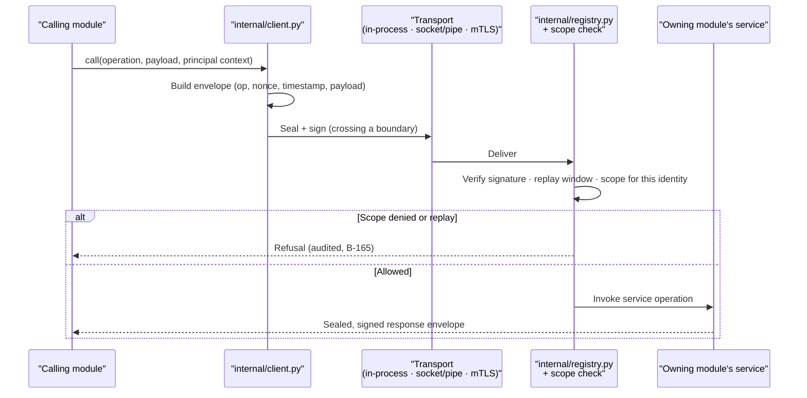

**Walking tour.** A calling module never touches the owning
module directly; it hands the call to the internal client,
which wraps it in an envelope carrying the operation name, a
fresh nonce, a timestamp, and the payload. If the call crosses
a process boundary, the transport seals and signs it. On the
far side, the registry side verifies three things — the
signature against the caller's service identity, the nonce
against the replay window, and the caller's scopes against the
operation's requirement. A failure at any of the three is a
refusal, audited, with no partial execution. Only then does
the owning module's service run, and its answer travels home
in a sealed, signed response envelope of the same shape.

#### `src/gpa/internal/__init__.py`
- **For:** Package surface: re-exports the client entry point
  and envelope types so callers import `gpa.internal` and
  nothing deeper. **Module:** internal.
- **Public symbols:** `call`, `Envelope`, `InternalRefusal`.
- **May use:** the package's own modules. **Must never:**
  re-export transport internals.
- **Data:** none. **On failure:** n/a.
- **Tests:** B-162 suite. **Created by:** B-162.

#### `src/gpa/internal/envelopes.py`
- **For:** The envelope types and their (de)serialisation:
  operation, caller identity, scopes presented, nonce,
  timestamp, payload (typed per operation), and the response
  mirror. **Module:** internal.
- **Public symbols:** `Envelope`, `ResponseEnvelope`,
  `encode`, `decode`.
- **May use:** Pydantic v2, stdlib. **Must never:** allow an
  untyped (free-dict) payload for a registered operation —
  payloads validate against the operation's schema at encode
  *and* decode.
- **Data:** messages in transit. **On failure:** a malformed
  envelope is a refusal before any service code runs.
- **Tests:** envelope fuzz suite (B-163/B-164). **Created by:**
  B-162.

#### `src/gpa/internal/registry.py`
- **For:** The operation registry: operation → owning module
  → required internal scope → payload/response schemas → the
  service callable. The single source B-206's MCP generation
  and B-201's parity checker also read. **Module:** internal.
- **Public symbols:** `register_operation(...)`,
  `OPERATIONS`, `dispatch(envelope, identity)`.
- **May use:** `envelopes`, `identities`, `replay`. **Must
  never:** dispatch without the scope + replay checks — there
  is no "trusted caller" fast path.
- **Data:** the registry (code-declared). **On failure:** an
  unregistered operation is refused and audit-logged.
- **Tests:** registry completeness (every cross-module call in
  the tree resolves here) — B-162 acceptance. **Created by:**
  B-162.

#### `src/gpa/internal/client.py`
- **For:** The local client SDK every module uses to call:
  identical call shape in-process or across a transport
  (B-162/B-166). **Module:** internal.
- **Public symbols:** `call(operation, payload, ctx)`,
  `InternalClient` (bound-identity variant for workers).
- **May use:** `envelopes`, the configured transport.
  **Must never:** cache a "the owner is local" shortcut that
  skips envelope + scope discipline in-process (B-166's honest
  profile: the boundary is real even when the wire is not).
- **Data:** in transit. **On failure:** refusals raise
  `InternalRefusal` with the registry's reason code; transport
  failures raise `InternalUnavailable` for the caller's
  degradation matrix.
- **Tests:** the same module suites pass in in-process and
  split-process profiles, unchanged (B-166 acceptance).
  **Created by:** B-162.

#### `src/gpa/internal/transport_socket.py`
- **For:** Same-machine transport: Unix domain socket
  (Linux/macOS) / Windows named pipe, carrying sealed,
  signed envelopes (payload encryption lives in the envelope
  layer — TLS ending early can never expose plaintext to a
  relay, B-163). **Module:** internal.
- **Public symbols:** `SocketTransport`,
  `serve_socket(registry, path)`.
- **May use:** stdlib sockets/pipes (`pathlib` paths only),
  `envelopes`, `crypto` sealing. **Must never:** accept a
  connection whose first envelope fails verification "to be
  helpful" — unverified is disconnected.
- **Data:** bytes in transit. **On failure:** a dead peer is
  `InternalUnavailable` at the client; the server side keeps
  serving other modules (bulkhead, B-173).
- **Tests:** pipe-dump test finds no readable user data
  (B-163 acceptance); per-OS transport tests (B-177).
  **Created by:** B-163.

#### `src/gpa/internal/transport_mtls.py`
- **For:** The loopback-TCP transport with mutual TLS 1.3 for
  where a socket/pipe is unavailable: internal CA, one
  certificate per module identity. **Module:** internal.
- **Public symbols:** `MtlsTransport`, `InternalCA` (issue/
  rotate per-module certificates).
- **May use:** stdlib `ssl`, `crypto.keys`. **Must never:**
  fall back to plaintext TCP on a TLS failure — failure is
  refusal.
- **Data:** bytes in transit; CA material sealed at rest.
  **On failure:** an unknown certificate is refused at
  handshake; rotation overlaps old/new (B-164) so rotation
  never stops the system.
- **Tests:** B-163/B-164 suites incl. mid-flight rotation.
  **Created by:** B-163.

#### `src/gpa/internal/identities.py`
- **For:** Service identities (B-164): each module/worker's
  identity (certificate + key id), its granted internal
  scopes, and rotation bookkeeping. **Module:** internal.
- **Public symbols:** `ServiceIdentity`, `identity_for(module)`,
  `scopes_for(identity)`.
- **May use:** `crypto.keys`, config. **Must never:** grant a
  scope by default — grants are explicit declarations in the
  registry, reviewed like permissions (they *are* permissions).
- **Data:** identity records + key ids (private keys sealed,
  never in this file's objects beyond use). **On failure:** an
  identity with no record can call nothing.
- **Tests:** impersonation test — worker A's credentials
  calling an AI-only operation → denied (B-164 acceptance).
  **Created by:** B-164.

#### `src/gpa/internal/replay.py`
- **For:** Replay defence (B-164): timestamp window (5
  minutes) + seen-nonce store; a captured message re-sent is
  refused. **Module:** internal.
- **Public symbols:** `check_and_record(identity, nonce, ts)`.
- **May use:** `db` (nonce store), stdlib. **Must never:**
  evict nonces younger than the window — the store's retention
  *is* the defence.
- **Data:** owns seen-nonce records (short-lived, swept by a
  job). **On failure:** store unavailable → dispatch refuses
  (fail closed).
- **Tests:** replay test (B-164 acceptance). **Created by:**
  B-164.

#### `src/gpa/internal/audit_bridge.py`
- **For:** Internal-call audit (B-165): every call logged
  (caller identity, operation, scope result — never the
  payload) into the hash-chained audit stream with a module
  tag. **Module:** internal.
- **Public symbols:** `record_call(...)`.
- **May use:** system audit writer. **Must never:** accept a
  payload or a payload hash that could be dictionary-attacked
  for small payloads — metadata only.
- **Data:** writes audit rows. **On failure:** audit write
  failure fails the call (an unaudited internal call is not
  allowed to succeed quietly).
- **Tests:** demo-flow reconstruction from audit alone
  (B-165 acceptance). **Created by:** B-165.

#### `src/gpa/internal/scopes.py`
- **For:** The internal scope vocabulary: the named scopes
  (per domain: `candidates.write`, `events.publish`,
  `ai.invoke`, …), their definitions, and the human-readable
  registry the docs and the plugin protocol (B-302) share.
  **Module:** internal.
- **Public symbols:** `SCOPES` (name → meaning + owning
  module), `is_scope(name)`.
- **May use:** nothing. **Must never:** let a scope be defined
  in two places — plugins and modules read this one list.
- **Data:** declarations only. **On failure:** an unknown
  scope string is invalid everywhere it appears.
- **Tests:** registry/scope consistency suite. **Created by:**
  B-164.

---

## K. Protection — `src/gpa/crypto/` and `src/gpa/resilience/`

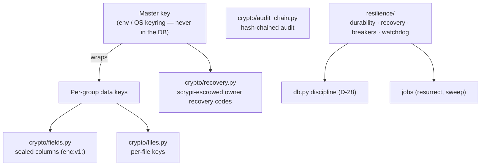

**Walking tour.** At the top, the master key — held in the
environment or OS keyring, never in the database — wraps
per-group data keys. Those keys feed the two sealing engines:
field-level sealing for database text, and per-file sealing
for uploads. To the right, the recovery path: owner recovery
codes escrow the master key under scrypt, so losing the key
does not mean losing the group's data. Below, the audit chain
signs each audit row with the previous row's hash. The
resilience box is separate on purpose: it owns *behaviour*
(startup recovery, watchdogs, circuit breakers) and leans on
the database discipline and the job queue rather than on
cryptography.

#### `src/gpa/crypto/__init__.py`
- **For:** Package surface: `seal`/`unseal`, key handles, the
  `enc:v1:` format version constant. **Module:** crypto.
- **Public symbols:** `seal_text`, `unseal_text`, `FORMAT_VERSION`.
- **May use:** the package's modules. **Must never:** expose a
  raw key object to callers — keys are handles, used inside.
- **Data:** none. **On failure:** n/a.
- **Tests:** B-167 suite. **Created by:** B-167.

#### `src/gpa/crypto/fields.py`
- **For:** Field-level envelope sealing (B-167): AES-256-GCM
  over sensitive text, versioned stored format (`enc:v1:…`),
  plus the keyed-HMAC lookup index that lets sealed emails
  remain findable without being readable. **Module:** crypto.
- **Public symbols:** `seal_field(plaintext, group_key)`,
  `unseal_field(stored, group_key)`, `lookup_index(value)`,
  `SealedText` (SQLAlchemy type used by models).
- **May use:** `keys`, the `cryptography` library. **Must
  never:** reuse a nonce, or seal with a key the caller
  supplies as a string — keys come from `keys.py` only.
- **Data:** ciphertext + index values for the models that
  declare sealed columns. **On failure:** an unseal failure
  raises `SealedDataError` naming the field class, never
  returning partial plaintext; the Doctor sees it as an
  integrity finding.
- **Tests:** raw-database grep test (B-167 acceptance).
  **Created by:** B-167.

#### `src/gpa/crypto/keys.py`
- **For:** The key hierarchy's custody (B-169): master key
  load (env/OS keyring), per-group key wrap/unwrap, rotation
  (re-wrap, never a flag day), key-id versioning. **Module:**
  crypto.
- **Public symbols:** `load_master_key()`, `group_key(group_id)`,
  `rotate_master(new_key)`, `KeyHandle`.
- **May use:** OS keyring bindings, `cryptography`. **Must
  never:** write a key to the database, a log, a backup, or
  an exception message — its tests grep all four.
- **Data:** wrapped group keys (stored via system models).
  **On failure:** no master key at startup = the app refuses
  to serve sealed data (and says why, in plain words).
- **Tests:** rotation + grep suites (B-169). **Created by:**
  B-169.

#### `src/gpa/crypto/files.py`
- **For:** Per-file encryption (B-168's crypto half): a fresh
  per-file AES-256-GCM key, wrapped by the group key, stored
  beside the ciphertext envelope. **Module:** crypto.
- **Public symbols:** `seal_file(stream, group_key)`,
  `unseal_file(stream, group_key)`.
- **May use:** `keys`, stdlib streaming. **Must never:**
  buffer a whole large file in memory (streaming chunks —
  the Pi rule, §6A.12).
- **Data:** ciphertext streams for `storage/encrypted.py`.
  **On failure:** mid-stream failure aborts the write; no
  partial file becomes visible (pairs with local driver's
  atomic rename).
- **Tests:** raw-upload grep test (B-168). **Created by:**
  B-168.

#### `src/gpa/crypto/recovery.py`
- **For:** Owner recovery (B-169): minting a set of one-time
  recovery codes that escrow the master key under scrypt,
  shown once, and the restore path that consumes one. Minting
  a new set kills the old set. **Module:** crypto.
- **Public symbols:** `mint_recovery_set()`,
  `recover_with_code(code)`.
- **May use:** `keys`, stdlib `hashlib.scrypt`. **Must
  never:** store a usable code (hashes only), or email codes
  anywhere except the owner's chosen address at mint time.
- **Data:** code hashes + the escrow blob. **On failure:** a
  wrong code is a refusal with attempt counting; five wrong
  attempts lock recovery until an owner session re-opens it.
- **Tests:** mint → lose → restore round-trip (B-169
  acceptance). **Created by:** B-169.

#### `src/gpa/crypto/audit_chain.py`
- **For:** The tamper-evident audit chain (B-170): each audit
  row signs the previous row's hash; the verifier that proves
  a chain intact and names the first broken row. **Module:**
  crypto.
- **Public symbols:** `chain_hash(prev, row)`, `verify_chain(from_row)`.
- **May use:** stdlib hashing + the master-key-derived chain
  key from `keys`. **Must never:** "repair" a broken chain —
  verification reports; humans investigate.
- **Data:** reads/writes chain fields on `audit_logs`. **On
  failure:** a mismatch is a security finding (admin + Doctor
  visible), never a silent re-chain.
- **Tests:** tamper fixture — one edited row is named
  (B-170 acceptance). **Created by:** B-170.

#### `src/gpa/resilience/durability.py`
- **For:** The D-28 stack as one owned module (B-171):
  transaction-discipline helpers, the commit-before-answer
  session guard for grant-type handlers, server-side draft
  autosave primitives, and write-verification reads.
  **Module:** resilience.
- **Public symbols:** `grant_transaction()` (session wrapper),
  `save_draft`, `load_draft`, `verify_write`.
- **May use:** `db`, models of the calling module (via its
  service). **Must never:** let a grant-type handler serialise
  a response from inside an open write transaction — the
  wrapper refuses, by construction (the Samtal lesson, in
  code).
- **Data:** draft rows for the autosave surfaces. **On
  failure:** a failed verification read rolls the grant back
  and answers failure — never "probably saved".
- **Tests:** browser-killed-mid-form drill (B-171 acceptance).
  **Created by:** B-171.

#### `src/gpa/resilience/recovery.py`
- **For:** Startup recovery + self-healing manager (B-172):
  the ordered boot sequence — WAL recovery, integrity check
  under the **double-verdict guard**, verified-backup restore
  if truly corrupt (corrupt file kept aside, never deleted),
  stuck-job resurrection, orphan sweep, stale-index rebuilds.
  **Module:** resilience.
- **Public symbols:** `run_startup_recovery(app)`,
  `integrity_verdict()` (returns the two-step verdict).
- **May use:** `db`, `jobs`, storage, notifications (organiser
  notice on degraded start). **Must never:** declare
  corruption on a read-only verdict alone, or delete a
  corrupt file — both are named test failures.
- **Data:** the database file, verified backups, orphan
  files. **On failure:** the system starts degraded and
  organiser-notified rather than not starting at all, where
  the data allows.
- **Tests:** corrupted-DB and healthy-DB drills (B-172);
  chaos harness (B-175). **Created by:** B-172.

#### `src/gpa/resilience/breakers.py`
- **For:** Error-correction plumbing (B-173): circuit breakers
  per external dependency with half-open probes, bulkhead
  limits so one integration cannot starve the worker, and the
  data-repair job helpers (recompute counters, re-link
  provenance, re-render digests — fix forward, log the fix).
  **Module:** resilience.
- **Public symbols:** `Breaker`, `guarded(name)`,
  `repair_jobs` registry.
- **May use:** jobs, audit. **Must never:** let a breaker
  swallow an error silently — an open breaker is a visible
  state on the health board.
- **Data:** breaker state (in-process + health projection).
  **On failure:** repeated dependency failure opens the
  breaker; user-facing behaviour follows the written
  degradation matrix, never a stack trace.
- **Tests:** kill-each-dependency suite (B-173). **Created
  by:** B-173.

#### `src/gpa/resilience/watchdog.py`
- **For:** The periodic watchdog (B-172's hourly half): cheap
  integrity checks, queue-depth and lease health, backup
  freshness — feeding both operator health (B-155) and the
  Doctor watch (B-322 reads the same findings). **Module:**
  resilience.
- **Public symbols:** `run_watchdog_tick()`, `WatchdogFinding`.
- **May use:** `db`, jobs, backup metadata. **Must never:**
  page a human for a self-healed condition — findings sort
  into healed / watching / act, and only "act" notifies.
- **Data:** findings history (system models). **On failure:**
  a watchdog that cannot check reports that — a silent
  watchdog is a broken watchdog.
- **Tests:** B-172/B-322 suites. **Created by:** B-172; Doctor
  watch surface by B-322.

---

## L. The MCP server — `src/gpa/mcp/`

The MCP server is its own module (D-30) and a *client* of the
core like any other: it talks only through the internal
encrypted API under its own service identity (B-204). Doc 13
is the agent-facing guide to this surface.

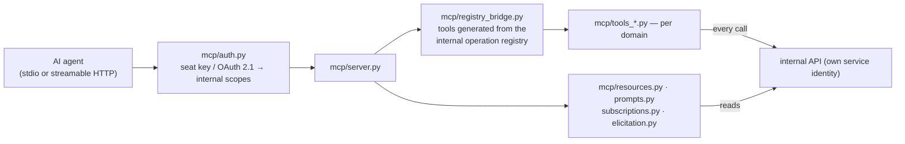

**Walking tour.** An agent connects — locally over stdio or
remotely over streamable HTTP — and meets `auth.py` first:
its seat key or OAuth 2.1 token becomes internal scopes, and
every later call is re-checked against them. The server
builds its tool list from the registry bridge, which generates
tools from the *same* internal operation registry the rest of
the system uses — a capability cannot exist internally and be
missing here (B-206). The per-domain tool files shape those
operations into MCP tools; the resources/prompts/subscriptions
files expose the read side. Every tool call and resource read
crosses the internal API under the MCP module's own service
identity, so an agent's power in GPA is exactly a seat's
power — no more, ever (B-203).

#### `src/gpa/mcp/__init__.py`
- **For:** Package marker + server identity constants (name,
  protocol versions supported). **Module:** mcp.
- **Public symbols:** `SERVER_NAME`, `PROTOCOL_VERSIONS`.
- **May use:** nothing. **Must never:** import the server
  (import-order safety for stdio startup).
- **Data:** none. **On failure:** n/a.
- **Tests:** B-204 startup suite. **Created by:** B-204.

#### `src/gpa/mcp/server.py`
- **For:** The MCP server core (B-204): official MCP Python
  SDK, stdio + streamable HTTP transports, protocol-version
  negotiation, structured logging that never logs payloads or
  secrets. **Module:** mcp.
- **Public symbols:** `create_mcp_server()`, `main()` (stdio
  entry), `mount_http(app)`.
- **May use:** the MCP SDK, `registry_bridge`, `auth`. **Must
  never:** call a domain service — the internal client is the
  only road out (B-204).
- **Data:** sessions in memory; nothing persisted here. **On
  failure:** a transport failure drops the session; the
  agent's seat and its audit trail are unaffected.
- **Tests:** conformance runs with the MCP Inspector (B-219).
  **Created by:** B-204.

#### `src/gpa/mcp/auth.py`
- **For:** MCP authentication + authorisation (B-205): seat
  API keys locally; OAuth 2.1 resource-server profile remotely
  (audience + scope claims) — mapped onto internal scopes,
  re-checked at **call time**, not connect time. **Module:**
  mcp.
- **Public symbols:** `authenticate(transport_ctx)`,
  `require_scope(tool, ctx)`.
- **May use:** `security`, internal scopes vocabulary. **Must
  never:** cache a scope decision across a key revocation.
- **Data:** reads key/token records via identity. **On
  failure:** expired, wrong-audience, and under-scoped tokens
  each fail with the MCP-correct error, tested (B-205).
- **Tests:** B-205 suite. **Created by:** B-205.

#### `src/gpa/mcp/registry_bridge.py`
- **For:** Tool generation from one source of truth (B-206):
  MCP tools generated from the internal operation registry +
  the curated annotation layer (truthful hints, Doc 13),
  signed into the release manifest so a swapped tool
  description (tool poisoning) is detectable. **Module:** mcp.
- **Public symbols:** `build_tool_catalogue()`,
  `annotations_for(operation)`.
- **May use:** `internal.registry`, `internal.scopes`. **Must
  never:** hand-write a tool that has no internal operation —
  the parity checker (B-201) fails the build.
- **Data:** the catalogue (generated). **On failure:** a
  registry/annotations mismatch fails server startup in test
  profiles — drift is a build error, not a runtime surprise.
- **Tests:** B-201/B-206 parity suites. **Created by:** B-206.

#### `src/gpa/mcp/tools_groups.py`
- **For:** MCP tools — groups, members, own profile (B-207):
  read group, list members, read/update the seat's own
  profile, *propose* an invite (sending obeys the approval
  law). **Module:** mcp.
- **Public symbols:** the tool functions (generated wrappers +
  curated shaping).
- **May use:** internal client only. **Must never:** expose an
  invite-*sending* tool beyond the seat's role.
- **Data:** via internal API. **On failure:** internal refusals
  surface as MCP errors with the same `code` vocabulary.
- **Tests:** B-207 tool suites; parity story (B-220).
  **Created by:** B-207.

#### `src/gpa/mcp/tools_sources.py`
- **For:** MCP tools — sources + ingest (B-208): submit text,
  submit a file via resumable-upload session, submit a flyer/
  board image, ingest status, read a source's chunks.
  **Module:** mcp.
- **Public symbols:** the tool functions.
- **May use:** internal client only. **Must never:** accept a
  raw file body beyond the upload-session protocol (large
  media goes through B-171's road, on every surface).
- **Data:** via internal API. **On failure:** a stalled upload
  session is resumable by id, MCP-side as everywhere.
- **Tests:** B-208 suites. **Created by:** B-208.

#### `src/gpa/mcp/tools_queue.py`
- **For:** MCP tools — the review queue (B-209): list/read
  candidates with provenance, create drafts, edit own drafts,
  comment. **Module:** mcp.
- **Public symbols:** the tool functions.
- **May use:** internal client only. **Must never:** contain
  an `approve` path for a below-organiser seat — for organiser
  seats the tool calls the *same* internal operation a human
  click calls (B-203/B-209).
- **Data:** via internal API. **On failure:** standard refusal
  mapping.
- **Tests:** B-209 + B-203 bypass suite. **Created by:** B-209.

#### `src/gpa/mcp/tools_events.py`
- **For:** MCP tools — events + calendar (B-210): agenda,
  month, tonight, event reads (role projections), propose an
  event change (lands as a change candidate), RSVP as the
  seat, read/post discussion. **Module:** mcp.
- **Public symbols:** the tool functions.
- **May use:** internal client only. **Must never:** offer a
  direct event-edit tool — proposals are the agent road, by
  the same law as sync roads (Doc 15 rule 2).
- **Data:** via internal API. **On failure:** standard.
- **Tests:** B-210 suites. **Created by:** B-210.

#### `src/gpa/mcp/tools_planning.py`
- **For:** MCP tools — planning (B-211): tasks (read, claim,
  update own, propose new), decisions (read current truth,
  propose), open questions (read, answer-as-proposal), polls
  (read, vote as the seat), checklists (read, claim, check
  off own claims). **Module:** mcp.
- **Public symbols:** the tool functions.
- **May use:** internal client only. **Must never:** let a
  seat check off another principal's checklist claim.
- **Data:** via internal API. **On failure:** standard.
- **Tests:** B-211 suites. **Created by:** B-211.

#### `src/gpa/mcp/tools_memory.py`
- **For:** MCP tools — memory + comms (B-212) and the Doctor
  tool (B-319's MCP door): ask the group memory (citations as
  MCP content), request a briefing, request a digest draft,
  propose a reminder, read own inbox; `doctor_run` (admin
  scope only). **Module:** mcp.
- **Public symbols:** the tool functions.
- **May use:** internal client only. **Must never:** let
  `doctor_run` trigger a repair — via MCP the Doctor
  diagnoses; repairs need the admin surfaces' consent flow
  (Doc 17 §3.3).
- **Data:** via internal API. **On failure:** standard.
- **Tests:** B-212, B-319 suites. **Created by:** B-212;
  Doctor tool by B-319.

#### `src/gpa/mcp/resources.py`
- **For:** MCP resources (B-213): read-only `gpa://` URIs —
  group calendar (iCal + JSON), event, current decisions,
  queue summary, the OpenAPI document, and the docs set
  (including the help topics, B-314) — with resource templates
  per group/event and correct MIME types. **Module:** mcp.
- **Public symbols:** `RESOURCE_TEMPLATES`, `read_resource(uri)`.
- **May use:** internal client (read operations). **Must
  never:** serve a resource the calling seat could not read
  via the API — resources are projections, not a side door.
- **Data:** via internal API. **On failure:** an unknown URI
  is an MCP resource error naming the template space.
- **Tests:** B-213 suite. **Created by:** B-213.

#### `src/gpa/mcp/subscriptions.py`
- **For:** Resource subscriptions + notifications (B-214):
  `resources/subscribe` for calendar and queue resources,
  `list_changed` notifications, and server→client update
  notifications driven from the same event model as SSE
  (B-237), translated at this boundary. **Module:** mcp.
- **Public symbols:** `subscribe(ctx, uri)`,
  `fan_out(event)`.
- **May use:** the internal event projection. **Must never:**
  let a slow subscriber stall the event source (the B-237
  backpressure law, at this boundary too).
- **Data:** subscription state per session. **On failure:** a
  dropped subscription is re-established by the client's
  resubscribe; watermarks make the gap recoverable.
- **Tests:** B-214 suite. **Created by:** B-214.

#### `src/gpa/mcp/prompts.py`
- **For:** MCP prompts (B-215): curated, versioned prompt
  templates with typed arguments — *plan an event with this
  group*, *brief me before Saturday*, *recap last night*,
  *what is still undecided?*, *prepare the weekly digest
  draft* — each composing the group's own resources/tools and
  stating in its text that drafts go to the queue. **Module:**
  mcp.
- **Public symbols:** `PROMPTS`, `render_prompt(name, args)`.
- **May use:** resource references. **Must never:** contain a
  prompt that instructs an agent to bypass the approval law.
- **Data:** template files (versioned like `ai/prompts/`).
  **On failure:** a bad argument set is a typed prompt error.
- **Tests:** B-215 suite. **Created by:** B-215.

#### `src/gpa/mcp/elicitation.py`
- **For:** The elicitation bridge (B-216): where a client
  supports elicitation, the server may ask the *human* for a
  missing fact — routed to the organiser inbox / queue as a
  question with the agent's identity attached. **Module:** mcp.
- **Public symbols:** `elicit(ctx, question, fields)`.
- **May use:** internal client (open-questions operations).
  **Must never:** treat an elicited answer as an approval —
  it can inform a draft, full stop; clients without
  elicitation degrade to open questions (B-086).
- **Data:** questions via internal API. **On failure:** no
  elicitation support → the open-question road, same record.
- **Tests:** B-216 suite. **Created by:** B-216.

#### `src/gpa/mcp/sampling.py`
- **For:** The sampling policy gate (B-217): server-initiated
  sampling is **off by default**; where an operator enables
  it, requests pass here for scope, budget-cap (B-047), and
  audit checks. **Module:** mcp.
- **Public symbols:** `request_sample(ctx, request)`.
- **May use:** config, audit, the cost ledger. **Must never:**
  sample when the policy is off — the default is a code path,
  not a setting someone must remember.
- **Data:** audit + ledger records per call. **On failure:**
  over-budget → refusal with the budget named.
- **Tests:** B-217 suite. **Created by:** B-217.

#### `src/gpa/mcp/security.py`
- **For:** MCP security hardening (B-218): truthful tool
  annotations asserted in tests (`readOnlyHint`,
  `destructiveHint`, `idempotentHint`, `openWorldHint`),
  consent gates for destructive/open-world tools, per-seat
  rate limits, and the data-marking of tool results carrying
  group content (results are data; the server never executes
  instructions found in sources — B-142 at this boundary).
  **Module:** mcp.
- **Public symbols:** `guard(tool, ctx)`, `annotate(tool)`.
- **May use:** `auth`, audit. **Must never:** annotate a tool
  as read-only that writes — annotation lies are test
  failures, by name.
- **Data:** rate-limit state. **On failure:** the guard
  refuses before the tool body runs.
- **Tests:** B-218 suite. **Created by:** B-218.

#### `src/gpa/mcp/catalogue.py`
- **For:** The generated tool catalogue (B-219): every tool,
  its scopes, its annotations, worked examples — published as
  documentation (Doc 13) and as an MCP resource. **Module:**
  mcp.
- **Public symbols:** `render_catalogue() -> str`.
- **May use:** `registry_bridge`. **Must never:** be
  hand-edited — it renders from the registry or it is wrong.
- **Data:** the registry. **On failure:** a render failure
  fails the docs gate (B-181).
- **Tests:** B-219 conformance pack. **Created by:** B-219.

---

## M. The terminal app — `src/gpa/terminal/`

One command layer, two faces: the scriptable CLI (humans and
agents) and the Textual TUI (a *view over the CLI's commands*,
never a second implementation — B-221). The terminal is a
client of the same API as any frontend; local mode embeds the
backend in-process with the same operations. Doc 14 is its
user guide; Doc 17 §1.7 covers its optional, background-first
posture (B-325).

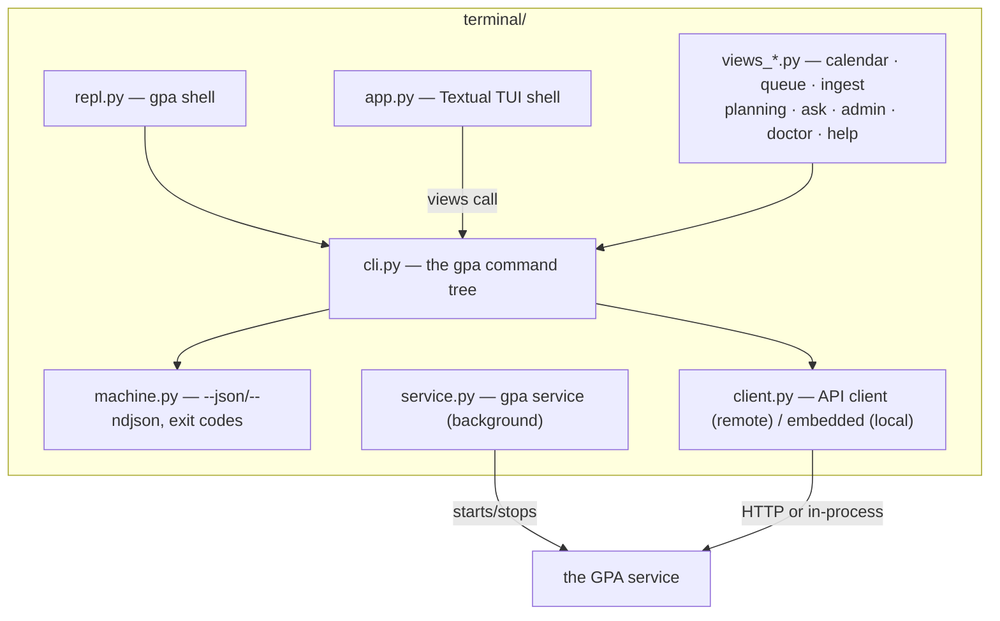

**Walking tour.** Everything hangs off `cli.py`: the command
tree is the one implementation. `machine.py` gives every
command its `--json`/`--ndjson` face and stable exit codes;
`repl.py` wraps the same commands in a persistent shell;
`client.py` is how commands reach a backend — over HTTP to a
remote service, or in-process in local mode. The TUI's
`app.py` and its view files do not reimplement anything: a
view is a screen that calls CLI commands and renders results,
which is why TUI/API parity (B-235) is provable at all. Off to
the side, `service.py` manages the backend as a background
service — start it once, attach a TUI when you feel like it,
or never.

#### `src/gpa/terminal/__init__.py`
- **For:** Package marker + terminal version (must match the
  shipped backend's, B-234). **Module:** terminal.
- **Public symbols:** `__version__`.
- **May use:** nothing. **Must never:** drift from
  `gpa.__version__` in a release (a test compares them).
- **Data:** none. **On failure:** n/a.
- **Tests:** B-234 suite. **Created by:** B-221.

#### `src/gpa/terminal/client.py`
- **For:** The terminal's backend client (B-221): remote mode
  (HTTP against the external API, credentials from the OS
  keyring via `keyring_store`) and embedded local mode
  (in-process backend, same operations); per-server profiles
  in the user's config. **Module:** terminal.
- **Public symbols:** `TerminalClient`, `get_client(profile)`.
- **May use:** httpx, the API schemas (imported shapes), or
  the in-process app. **Must never:** store a credential
  outside the keyring where a keyring exists.
- **Data:** profiles + keyring entries (user's machine). **On
  failure:** an unreachable server is exit code 6
  (unavailable) with the profile named — never a hang.
- **Tests:** B-221/B-234 suites. **Created by:** B-221.

#### `src/gpa/terminal/keyring_store.py`
- **For:** Credential custody for terminal profiles: OS
  keyring where available, a permissions-locked local file
  (with a printed warning) where not. **Module:** terminal.
- **Public symbols:** `store_secret`, `get_secret`,
  `delete_secret`.
- **May use:** the keyring library, stdlib. **Must never:**
  write a seat key into a config file or a transcript.
- **Data:** the user's credential store. **On failure:** no
  keyring + no consent to the file fallback = the profile
  stays signed out.
- **Tests:** B-233 seat sign-in suite. **Created by:** B-221.

#### `src/gpa/terminal/cli.py`
- **For:** The `gpa` command tree (B-222), mirroring the
  domains — `gpa groups`, `gpa events list|show|create`,
  `gpa queue list|show|approve|edit`, `gpa sources add`,
  `gpa ask`, `gpa rsvp`, `gpa tasks`, `gpa polls vote`, … —
  with help generated from the B-201 action register, so a
  parity gap is visibly missing here and fails the checker.
  Also home to `gpa doctor` and `gpa service` command groups.
  **Module:** terminal.
- **Public symbols:** `main(argv)`, the command registry
  `COMMANDS`.
- **May use:** `client`, `machine`, `help.registry` (topic
  resolution for `--help-topic`, B-313). **Must never:**
  implement a rule — commands call the API/internal
  operations like every other client.
- **Data:** via the client. **On failure:** errors print as
  problem+json on stderr in machine mode, as the friendly
  catalogue text in human mode (B-316); exit codes per
  `machine.py`.
- **Tests:** CLI golden-task runs (B-235). **Created by:**
  B-222; doctor/service groups by B-319/B-325.

#### `src/gpa/terminal/machine.py`
- **For:** Machine mode for agents (B-223): `--json` (stable
  schemas, API field names) and `--ndjson` for lists/streams,
  deterministic ordering, documented stable exit codes
  (0 ok, 2 usage, 3 auth, 4 not-found, 5 conflict,
  6 unavailable), `--dry-run` on writes, per-invocation
  idempotency keys. **Module:** terminal.
- **Public symbols:** `emit(obj, mode)`, `EXIT` (code table),
  `MachineMode` (argparse mixin).
- **May use:** stdlib json. **Must never:** print a human
  sentence to stdout in machine mode — stdout is data, stderr
  is words.
- **Data:** stdio only. **On failure:** the failure *is* the
  contract: problem+json on stderr + the mapped exit code.
- **Tests:** B-223 suite incl. an agent end-to-end script
  (B-233). **Created by:** B-223.

#### `src/gpa/terminal/repl.py`
- **For:** `gpa shell` (B-224): a persistent session (signed
  in, group selected), line editing + history, the same
  commands un-prefixed, output paging, saveable transcripts —
  drivable by a person or an agent harness (stable prompt
  format). **Module:** terminal.
- **Public symbols:** `run_shell(client, profile)`.
- **May use:** `cli` command registry, `client`. **Must
  never:** keep session state the CLI doesn't have — the REPL
  is the CLI with memory of two variables (profile, group).
- **Data:** history + transcripts on the user's machine
  (transcripts are audit-attributable, B-233). **On failure:**
  a failed command leaves the session alive and the error
  printed; `exit` is the only fatal verb.
- **Tests:** B-224 suite. **Created by:** B-224.

#### `src/gpa/terminal/app.py`
- **For:** The Textual TUI shell (B-225): header (principal,
  group, connection state), sidebar of sections (Home,
  Calendar, Queue, Events, Planning, Discuss, Ask, Admin,
  Doctor, Help), keyboard-first navigation + command palette,
  mouse as a bonus. **Module:** terminal.
- **Public symbols:** `GpaApp` (Textual `App`), `run_tui(profile)`.
- **May use:** Textual, the view modules, `cli` (commands).
  **Must never:** call the backend except through the command
  layer (the parity rule, §M diagram).
- **Data:** UI state only. **On failure:** a backend drop
  shows the connection state in the header and offers
  reconnect/resync (watermark, B-238) — the TUI never
  pretends to be live when it is not.
- **Tests:** TUI golden tasks (B-235), size-extremes fixtures
  (B-232). **Created by:** B-225.

#### `src/gpa/terminal/views_calendar.py`
- **For:** TUI calendar + events (B-226): month/agenda,
  tonight view, event detail with discussion inline, RSVP by
  key, `.ics` export to a path, masked feed-token display.
  **Module:** terminal.
- **Public symbols:** `CalendarScreen`, `EventScreen`.
- **May use:** `cli` commands, `views_help` overlay. **Must
  never:** render an unmasked feed token.
- **Data:** via commands. **On failure:** standard view error
  state with the friendly catalogue text + help id.
- **Tests:** B-226/B-235 suites. **Created by:** B-226.

#### `src/gpa/terminal/views_queue.py`
- **For:** The TUI review queue (B-227): the trust screen in
  text — list with confidence/flags, detail with provenance
  quoted, in-flow editing, approve/reject/merge by key,
  change candidates + contradictions identical to the API.
  **Module:** terminal.
- **Public symbols:** `QueueScreen`, `CandidateScreen`.
- **May use:** `cli` commands. **Must never:** offer an
  approval keystroke the principal's role forbids — the
  command layer refuses as well (defence in depth, B-203).
- **Data:** via commands. **On failure:** a mint failure
  shows the candidate still pending.
- **Tests:** B-227/B-235 suites. **Created by:** B-227.

#### `src/gpa/terminal/views_ingest.py`
- **For:** TUI ingest (B-228): paste a chat (clipboard file,
  stdin, or path), add newsletter/flyer/board by path, live
  job progress (SSE translated to the terminal), resumable
  upload resume. **Module:** terminal.
- **Public symbols:** `IngestScreen`.
- **May use:** `cli` commands, the stream client. **Must
  never:** read a clipboard without the user's keystroke
  asking it to.
- **Data:** local paths the user names. **On failure:** an
  interrupted upload offers resume on the same screen
  (B-171).
- **Tests:** B-228 suite. **Created by:** B-228.

#### `src/gpa/terminal/views_planning.py`
- **For:** TUI planning + discussion (B-229): tasks board in
  text, decisions log, open questions, polls (vote by key),
  checklists, event discussion read/post as the signed-in
  principal. **Module:** terminal.
- **Public symbols:** `PlanningScreen`, `DiscussScreen`.
- **May use:** `cli` commands. **Must never:** distinguish a
  seat's screens from a human's (equal principals, B-202).
- **Data:** via commands. **On failure:** standard.
- **Tests:** B-229 suite. **Created by:** B-229.

#### `src/gpa/terminal/views_ask.py`
- **For:** TUI ask + inbox (B-230): ask the group memory with
  citations shown, briefings, digest preview, notification
  inbox. **Module:** terminal.
- **Public symbols:** `AskScreen`, `InboxScreen`.
- **May use:** `cli` commands. **Must never:** render an
  answer's citations as decoration — each citation is
  selectable and opens its source chunk.
- **Data:** via commands. **On failure:** standard.
- **Tests:** B-230 suite. **Created by:** B-230.

#### `src/gpa/terminal/views_admin.py`
- **For:** TUI admin (B-231): members/roles, seats,
  integrations status, AI budget, audit tail, settings —
  every dangerous action behind a typed confirmation naming
  its consequence. **Module:** terminal.
- **Public symbols:** `AdminScreen`.
- **May use:** `cli` commands. **Must never:** shorten a
  confirmation for a frequent user — consequence text is the
  feature.
- **Data:** via commands. **On failure:** standard.
- **Tests:** B-231 suite. **Created by:** B-231.

#### `src/gpa/terminal/views_doctor.py`
- **For:** The TUI Doctor screen (B-319's TUI door): run
  checks, read findings in the three-part plain-words form,
  consent per-fix and apply safe repairs (with the backup
  gate visible), make a support bundle. **Module:** terminal.
- **Public symbols:** `DoctorScreen`.
- **May use:** `cli` doctor commands. **Must never:** offer a
  bulk "fix all" — the screen's shape *is* per-fix consent
  (Doc 17 §3.3).
- **Data:** via commands. **On failure:** a failed repair
  reports the backup + rollback state in plain words.
- **Tests:** B-319/B-330 stranger drill (terminal arm).
  **Created by:** B-319.

#### `src/gpa/terminal/views_help.py`
- **For:** The TUI help overlay (B-313/B-326): `?` on every
  view resolves that view's help id; the "I want to…" finder
  as a palette; walkthrough launcher. Rendered from the one
  help source (`help.render`). **Module:** terminal.
- **Public symbols:** `HelpOverlay`, `open_help(help_id)`.
- **May use:** `help.render`, `help.finder`. **Must never:**
  carry its own copy of any help text (parity, B-328).
- **Data:** help topics (bundled). **On failure:** an
  unresolvable id opens the topic index — never a dead end.
- **Tests:** B-326/B-328 suites. **Created by:** B-326
  (overlay mechanics B-313).

#### `src/gpa/terminal/plain.py`
- **For:** Terminal accessibility (B-232): `--plain` linear
  mode (screen-reader friendly, no boxes), `NO_COLOR`
  honouring, ASCII-safe fallback rendering, and the layout
  rules for size extremes (80×24 → ultrawide → phone-over-SSH
  narrow). **Module:** terminal.
- **Public symbols:** `PlainRenderer`, `render_linear(widget_tree)`.
- **May use:** Textual's render tree (read). **Must never:**
  drop information in linear mode — plain is a *rendering* of
  the same content, not a reduced product.
- **Data:** none. **On failure:** an unrenderable widget falls
  back to its text summary, named in tests.
- **Tests:** keyboard-only completeness + linear-mode suites
  (B-232). **Created by:** B-232.

#### `src/gpa/terminal/service.py`
- **For:** Background-service management (B-325): `gpa
  service install|start|stop|status` and `gpa logs` — systemd
  (user/system) on Linux, Windows service, launchd agent on
  macOS, all native (D-24). **Module:** terminal/operations.
- **Public symbols:** `install_service()`, `service_status()`,
  `tail_logs()`.
- **May use:** the platform service managers via their CLIs,
  `config` (paths). **Must never:** require the TUI for any
  service operation, or hide a service failure behind a green
  "started" — status is read from the service manager, not
  assumed.
- **Data:** service unit files in the platform's locations.
  **On failure:** install failures name the platform step
  that failed and the manual command that does the same thing.
- **Tests:** B-325 suite per platform profile. **Created by:**
  B-325.

---

## N. Built-in help — `src/gpa/help/`

Doc 17 Part 2 is the user-facing account; B-314's law is the
architecture: topics are versioned Markdown in
`src/gpa/help/content/`, and everything else in this package
renders or routes them.

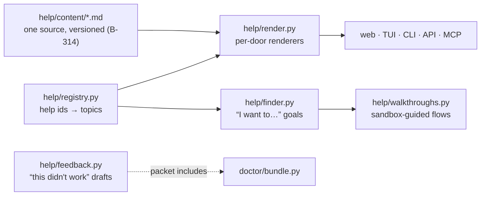

**Walking tour.** The content folder is the single source.
The registry maps every surface's help id to its topic; the
renderers turn that topic into each door's shape (web HTML,
TUI overlay text, CLI output, API JSON, MCP resource). The
finder maps a plain-words goal to topics plus a deep link,
and the walkthrough engine runs the guided, sandbox-first
flows. Feedback sits at the edge: its packet borrows the
Doctor's bundle for the technical half, which is why the
dotted arrow points there.

#### `src/gpa/help/content/` (directory of Markdown topics)
- **For:** The help topics themselves — one file per topic,
  named by help id, written in plain words, versioned with the
  app. Ships inside the app: help works offline (B-314).
  **Module:** help.
- **Public symbols:** the topic ids (they are the contract
  surfaces reference).
- **May use:** Markdown + the topic front-matter schema
  (id, title, goals, related ids). **Must never:** contain a
  secret, a real user's data, or a statement about the licence
  (B-338 applies to help text too).
- **Data:** owns the topic texts. **On failure:** a topic
  failing its front-matter schema fails the docs gate.
- **Tests:** parity checker (B-328), topic schema suite.
  **Created by:** B-314 (topics grow with their features).

#### `src/gpa/help/registry.py`
- **For:** The help-id registry (B-313): every surface's id →
  topic, plus the checker hook that fails the build when a
  registered surface lacks an id. **Module:** help.
- **Public symbols:** `resolve(help_id)`, `topic_for(help_id)`,
  `ALL_HELP_IDS`.
- **May use:** `content/` index. **Must never:** resolve an
  unknown id to a *guess* — unknown resolves to the topic
  index (no dead ends, Doc 17 §1.2).
- **Data:** the id map. **On failure:** see above.
- **Tests:** B-313 checker suite. **Created by:** B-313.

#### `src/gpa/help/render.py`
- **For:** The per-door renderers (B-314): one topic → web
  HTML, TUI text (with the linear mode's rules), CLI text,
  API JSON, MCP resource content — all from the same parse, so
  the parity hash (B-328) is meaningful. **Module:** help.
- **Public symbols:** `render(topic_id, door)`,
  `source_hash(topic_id)`.
- **May use:** a Markdown parser from the locked set. **Must
  never:** post-edit a door's rendering by hand anywhere in
  the tree — rendering differences live here or nowhere.
- **Data:** reads topics. **On failure:** a topic that fails
  to render for one door fails the docs gate for all
  (partial help is drift).
- **Tests:** B-328 parity suite. **Created by:** B-314.

#### `src/gpa/help/finder.py`
- **For:** The "I want to…" goal finder (B-315): plain-words
  goals → ordered steps + a deep link; the goal vocabulary is
  data in the topics' front-matter, matched deterministically
  (no model call — help must work offline and identically
  everywhere). **Module:** help.
- **Public symbols:** `find_goals(query) -> [GoalMatch]`.
- **May use:** `registry`. **Must never:** return a goal whose
  deep link the caller's role cannot open — matches are
  role-filtered, with the filter visible ("sign in as an
  organiser to…").
- **Data:** goal index. **On failure:** no match → the topic
  index + the feedback action (a failed finder query is
  evidence for B-329).
- **Tests:** B-315 suite; finder-success metric fixtures.
  **Created by:** B-315.

#### `src/gpa/help/walkthroughs.py`
- **For:** Interactive walkthroughs (B-315): step scripts for
  the top goals, run against sandbox (sample-group) data
  first, then offered against the real group; completion and
  abandonment are measured for the B-329 gate. **Module:**
  help.
- **Public symbols:** `WALKTHROUGHS`, `start_walkthrough(id, ctx)`,
  `WalkthroughSession`.
- **May use:** the internal client (sandbox-scoped
  operations), `finder`. **Must never:** perform a real-group
  write inside the sandbox half, or a write of any kind
  without the step's own user confirmation.
- **Data:** session state; sample-group data via services.
  **On failure:** abandoning mid-walkthrough leaves the
  sandbox as-is (it is deletable) and the real group untouched.
- **Tests:** B-315/B-329 suites. **Created by:** B-315.

#### `src/gpa/help/feedback.py`
- **For:** "This didn't work" (B-324): drafts the support
  packet — help/error id, context, optional user note, Doctor
  bundle — into the user's hands. **Drafts only: this file
  contains no send function, deliberately.** **Module:** help.
- **Public symbols:** `draft_packet(help_id, context, note)`.
- **May use:** `doctor.bundle`. **Must never:** transmit
  anything anywhere — the absence of a network call in this
  file is a tested property.
- **Data:** the packet (a file the user keeps/sends).
  **On failure:** if the bundle half fails, the packet still
  drafts with the failure noted.
- **Tests:** no-network assertion test (B-324). **Created by:**
  B-324.

#### `src/gpa/help/parity.py`
- **For:** The help parity checker (B-328) as importable
  tooling (the release gate calls it via `test.sh`): every
  help id resolves identically on all five doors — same
  source hash per topic per door. **Module:** help/quality.
- **Public symbols:** `check_parity() -> [Drift]`.
- **May use:** `render`, `registry`. **Must never:** pass on
  "close enough" — hash equality is the check.
- **Data:** renders in memory. **On failure:** reports the
  topic + door that drifted.
- **Tests:** injected-drift fixture fails (B-328). **Created
  by:** B-328.

---

## O. The Doctor — `src/gpa/doctor/`

One engine, four doors (B-319): the doors live elsewhere (CLI
in `terminal/cli.py`, TUI in `terminal/views_doctor.py`, API
in `routers/admin.py`, MCP in `mcp/tools_memory.py`); the
engine and its rules live here. Doc 17 Part 3 is the
user-facing account.

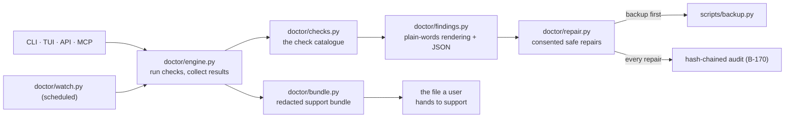

**Walking tour.** All four doors call one engine. The engine
runs the check catalogue and collects results; the findings
module renders each result twice — plain words for people,
JSON with the same finding ids for machines and seats. Where
a finding has a safe fix, the repair module is the only road
to it: its arrows show the two gates every repair passes —
the backup first, and the audit entry always. The watch runs
the same engine on a schedule. The bundle module packages a
run's report (plus versions and redacted logs) into the one
file a user hands to support.

#### `src/gpa/doctor/engine.py`
- **For:** The diagnostics engine (B-319): runs the catalogue,
  times each check, aggregates pass/warn/broken, and returns
  one `DoctorReport` all doors render. **Module:** doctor.
- **Public symbols:** `run_doctor(ctx) -> DoctorReport`,
  `Finding` (id, check, severity, words, fix-ref).
- **May use:** `checks`, `health` service (deep health is a
  shared input), config. **Must never:** perform a repair —
  the engine diagnoses; `repair.py` acts, on consent.
- **Data:** reads system state across modules (via their
  health/read surfaces). **On failure:** a check that crashes
  becomes a `broken` finding for that check (the Doctor
  reports its own failures too), never a crashed Doctor.
- **Tests:** B-319 suite; broken-install fixtures (B-330).
  **Created by:** B-319.

#### `src/gpa/doctor/checks.py`
- **For:** The check catalogue (B-319): one function per
  check — install/manifest, runtime/deps, database integrity
  + WAL, keys present-and-loadable, disk + trend, clock skew,
  profile safety (D-38), ports, TLS, backup freshness +
  restore-test freshness, job queue + scheduler, model
  adapter reachability (honestly labelled), platform
  specifics. **Module:** doctor.
- **Public symbols:** `CHECKS` (id → fn), each returning a
  `CheckResult`.
- **May use:** `db`, `crypto.keys` (presence probes only),
  `resilience.watchdog` findings, storage stats. **Must
  never:** read a secret's value — key checks assert
  present/loadable and stop there (§6A.16).
- **Data:** read-only probes. **On failure:** a probe that
  cannot run reports `broken` with the probe error, in plain
  words.
- **Tests:** per-check fixtures (healthy + each failure
  mode). **Created by:** B-319.

#### `src/gpa/doctor/findings.py`
- **For:** Findings rendering (B-320): each finding in the
  three-part form (*what we found · what it means for you ·
  what to do*), its help id, and the identical JSON shape
  (same finding ids) for `--json`, the API, and MCP.
  **Module:** doctor.
- **Public symbols:** `render_text(report)`,
  `render_json(report)`.
- **May use:** `help.registry` (finding → help id). **Must
  never:** use a word in the JSON form that the text form
  would soften (or vice versa) — one finding, one truth, two
  shapes.
- **Data:** the report. **On failure:** an unrenderable
  finding renders its id + raw check state (a finding is
  never dropped for a rendering bug).
- **Tests:** B-320 golden outputs. **Created by:** B-320.

#### `src/gpa/doctor/repair.py`
- **For:** Safe auto-repair (B-321): the short menu — pending
  migrations, derived-index rebuild, provably-stuck job
  clearing, data-file permissions, log rotation, watchdog
  re-registration, local dev-certificate refresh — each
  executed only with per-fix consent, after a verified
  backup, audit-chained, and reversible-or-not-offered.
  **Module:** doctor.
- **Public symbols:** `available_fixes(report)`,
  `apply_fix(fix_id, consent_token)`.
- **May use:** `scripts/backup.py` machinery, `db`,
  `resilience`, jobs. **Must never:** delete data, regenerate
  keys, or touch a database the double-verdict guard has not
  twice confirmed corrupt (B-172/B-174 rule, binding hardest
  here).
- **Data:** the specific target of the one consented fix.
  **On failure:** mid-repair failure restores from the
  pre-repair backup and reports the restoration — a repair
  never leaves a system worse than it found it.
- **Tests:** B-321 suite incl. the healthy-database refusal.
  **Created by:** B-321.

#### `src/gpa/doctor/watch.py`
- **For:** Doctor watch (B-322): the same engine on the job
  scheduler, admin notification per finding until
  acknowledged, through the group's chosen channel.
  **Module:** doctor.
- **Public symbols:** `watch_job()` (the handler fn),
  `acknowledge(finding_id)`.
- **May use:** `engine`, jobs, notifications via internal
  API. **Must never:** re-notify an acknowledged finding, or
  notify per-check instead of per-finding (the cry-wolf rule).
- **Data:** watch findings + acknowledgement state. **On
  failure:** a failed watch run is itself a finding next run.
- **Tests:** B-322 suite. **Created by:** B-322.

#### `src/gpa/doctor/bundle.py`
- **For:** The support bundle (B-323): Doctor report +
  versions + redacted log excerpts + config *shape* (keys as
  present/absent only) in one file. **Module:** doctor.
- **Public symbols:** `make_bundle(out_path)`,
  `REDACTION_RULES`.
- **May use:** `engine`, config (shape projection), log
  readers. **Must never:** include a raw config value, a log
  line that fails a redaction rule, or a payload — the
  builder greps its own output for planted-secret patterns
  before writing (the B-290-tested property).
- **Data:** writes the bundle file (user's hands). **On
  failure:** a redaction failure aborts the bundle — no
  bundle is better than a leaking one.
- **Tests:** planted-secret suite (B-323/B-290). **Created
  by:** B-323.

---

## P. Evidence tooling — `src/gpa/evidence/`

Phase 24's machinery (Doc 11 tells the release story). The
*records* live in the repo-level `evidence/` directory
(registry, per-slice packs, drill logs); this package is the
tooling that produces and audits them.

#### `src/gpa/evidence/registry.py`
- **For:** The evidence registry (B-281): `EV-###` ids, kinds
  (test run, benchmark, drill log, accuracy report,
  user-evidence record, external source), the claims each item
  supports, and the exact command/run that produced it.
  **Module:** evidence.
- **Public symbols:** `register(item)`, `item_for(claim)`,
  `REGISTRY_PATH`.
- **May use:** the repo-level `evidence/` files. **Must
  never:** let a claim be registered without an item — the
  registry is a join, and both sides must exist.
- **Data:** owns the registry files. **On failure:** a
  duplicate EV id is a hard error (ids are history).
- **Tests:** B-281 suite. **Created by:** B-281.

#### `src/gpa/evidence/packs.py`
- **For:** Slice evidence packs (B-282): assembling
  `evidence/packs/B-###.md` from real tool output — hypothesis
  + threshold (written before), acceptance output,
  measurements, registry links. **Module:** evidence.
- **Public symbols:** `build_pack(slice_id)`,
  `pack_complete(slice_id) -> bool`.
- **May use:** test-report artefacts, `registry`. **Must
  never:** accept a hand-typed number where a tool output
  exists (D-41).
- **Data:** writes pack files. **On failure:** an incomplete
  pack reports its missing pieces; the slice cannot close.
- **Tests:** B-282 suite. **Created by:** B-282.

#### `src/gpa/evidence/benchmarks.py`
- **For:** The benchmark laboratory (B-284): standing
  benchmarks for the budgeted surfaces (API latency per
  profile incl. Pi, extraction throughput, startup/recovery
  times, terminal responsiveness), trended across releases,
  regressions beyond the agreed % failing the gate.
  **Module:** evidence.
- **Public symbols:** `run_benchmarks(profile)`,
  `compare_trend(results)`.
- **May use:** the running app (test profile), stdlib
  timing. **Must never:** average away a per-profile
  regression — the Pi's numbers are reported as the Pi's.
- **Data:** writes results into `evidence/`. **On failure:**
  a benchmark that cannot run reports `unmeasured`, which
  fails the gate like a regression does.
- **Tests:** B-284 suite. **Created by:** B-284.

#### `src/gpa/evidence/telemetry.py`
- **For:** Opt-in, content-free field telemetry (B-287):
  aggregate feature-use counts, error rates, latency
  histograms for *the operator's own deployment* — off by
  default, group-admin-visible, no content, no per-person
  tracking. **Module:** evidence.
- **Public symbols:** `record_event(kind)`, `telemetry_report()`.
- **May use:** system models (aggregate counters). **Must
  never:** record when disabled (the disabled path is a
  no-op function, not a flag other code must remember), or
  record any content field.
- **Data:** owns aggregate counters. **On failure:** telemetry
  failure never affects the operation being counted.
- **Tests:** disabled-by-default + content-free assertions
  (B-287). **Created by:** B-287.

#### `src/gpa/evidence/flags.py`
- **For:** The experiment framework (B-288): feature flags
  with audited rollouts and pre-registered measures for the
  comparisons the team actually runs (reminder timing, digest
  day, queue layouts) — results land in the registry win or
  lose, and losing variants are removed. **Module:** evidence.
- **Public symbols:** `flag_enabled(name, group_id)`,
  `record_outcome(experiment, result)`.
- **May use:** config, audit, `registry`. **Must never:** let
  a flag become a permanent fork — flags carry an expiry
  recorded in the registry.
- **Data:** flag assignments + outcomes. **On failure:** an
  unknown flag is `off` (experiments fail safe to the shipped
  behaviour).
- **Tests:** B-288 suite. **Created by:** B-288.

#### `src/gpa/evidence/claims.py`
- **For:** The claim audit tooling (B-295): sampling claims
  across handoff notes, docs, and RESULTS, tracing each to
  its evidence item, and driving the re-run sub-sample; the
  audit report is itself an evidence item in the ZIP.
  **Module:** evidence.
- **Public symbols:** `audit_claims(sample_size)`,
  `trace(claim)`.
- **May use:** `registry`, the docs/handoff files. **Must
  never:** be run by the claims' author in a gate context —
  the tool records the auditor's identity (independence is
  the point).
- **Data:** reads claims, writes the audit report. **On
  failure:** an untraceable claim blocks the release until
  fixed or removed (B-295).
- **Tests:** planted-false-claim fixture is caught (B-295).
  **Created by:** B-295.

---

## Q. Embedding — `src/gpa/embed/` and `sdk/`

Doc 16 is the host-facing account; these are its files.

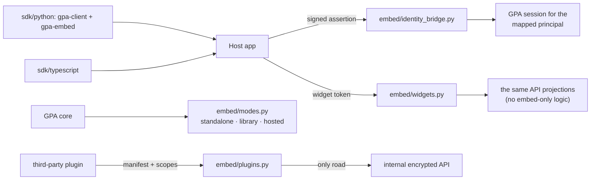

**Walking tour.** A host arrives by two roads: identity (the
bridge verifies its signed assertion and answers with a
session for the mapped principal) and widgets (a scoped token
renders data from the same projections the API serves). The
modes module is the switch that lets the *same core* run
standalone, in-process in a host, or multi-tenant hosted.
Plugins enter through their own gate — manifest and scopes —
and their only road onward is the internal encrypted API. The
two SDKs sit outside the server tree, in the host's hands.

#### `src/gpa/embed/modes.py`
- **For:** The three run modes (B-296): mode detection and the
  mode-specific wiring `create_app` consults (standalone /
  library / hosted), including tenancy activation in hosted
  mode. **Module:** embed.
- **Public symbols:** `RunMode`, `current_mode(settings)`,
  `apply_mode(app, mode)`.
- **May use:** config, `main`. **Must never:** let a mode
  change a capability — modes change wiring, never features
  (B-296 acceptance: the golden story passes in all three).
- **Data:** none. **On failure:** an incoherent mode/config
  pair refuses startup with the pair named.
- **Tests:** three-mode golden suite (B-296). **Created by:**
  B-296.

#### `src/gpa/embed/identity_bridge.py`
- **For:** Host identity bridging (B-297): verifying signed
  host assertions (audience per host, short-lived), resolving
  or creating the mapped GPA identity, seat mapping for host
  agents. **Module:** embed.
- **Public symbols:** `exchange_assertion(token)`,
  `resolve_mapping(host, principal_ref)`.
- **May use:** `crypto` signature verification, tenancy +
  identity models, `security` (session issue). **Must
  never:** map by name similarity, accept an assertion past
  its expiry, or mint a GPA password for a bridged principal.
- **Data:** owns `host_principal_maps` writes. **On failure:**
  an unverifiable assertion is a 401 with the failed check
  named (signature / audience / expiry) for host debugging.
- **Tests:** B-297 suite incl. wrong-audience fixtures.
  **Created by:** B-297.

#### `src/gpa/embed/samtal_pack.py`
- **For:** The Samtal pack (B-298): hall-command mapping, the
  panels data producers (queue badge, tonight card, event
  card), hall-as-source wiring and calendar peer behaviour on
  top of `integrations/samtal.py`, hall announcements/digests
  via the group's GPA seat. **Module:** embed.
- **Public symbols:** `handle_hall_command(...)`,
  `panel_queue_badge`, `panel_tonight`, `panel_event_card`.
- **May use:** internal API only (it is a guest in Samtal's
  house *and* a client of GPA's core). **Must never:** reach
  into Samtal's core or GPA's tables — both sovereignties, one
  file's discipline.
- **Data:** via both APIs. **On failure:** a GPA outage
  degrades the panels to a plain "planning is unavailable"
  card in Samtal — Samtal itself is never taken down.
- **Tests:** B-298 suite; B-308 live drill. **Created by:**
  B-298.

#### `src/gpa/embed/widgets.py`
- **For:** The embed widget data endpoints' core (B-299):
  scoped embed tokens (one widget, one group, one origin),
  and the five widget projections (calendar, tonight, queue,
  event card, ask box) rendered from the same API projections.
  **Module:** embed.
- **Public symbols:** `issue_embed_token(...)`,
  `widget_data(widget, token, viewer)`.
- **May use:** calendar/planning/candidates read projections.
  **Must never:** serve data beyond the token's widget scope —
  a calendar token cannot fetch queue data, tested.
- **Data:** reads projections; owns `embed_tokens` writes.
  **On failure:** an out-of-scope request is a 403 naming the
  scope — hosts debugging deserve the truth (as in
  `routers/embed.py`).
- **Tests:** B-299 scope suite. **Created by:** B-299.

#### `src/gpa/embed/tenancy.py`
- **For:** Headless tenancy enforcement (B-303): the
  `host_id` partition check applied across data, files, keys,
  and audit in hosted mode; per-host export/erase scoping.
  **Module:** embed.
- **Public symbols:** `host_scope(host_id)` (context),
  `assert_same_host(...)`.
- **May use:** `db` session hooks, tenancy models. **Must
  never:** default a missing host context to "any host" —
  missing context in hosted mode is a refusal.
- **Data:** the partition key's enforcement. **On failure:**
  cross-host access attempts are refused + audit-logged as
  security events.
- **Tests:** cross-host fuzz (B-303). **Created by:** B-303.

#### `src/gpa/embed/theming.py`
- **For:** Theming + white-label surface (B-304): applying
  host-supplied brand tokens (name, colour tokens, logo,
  locale, sender name) to widgets, emails, digests, and
  exported documents. **Module:** embed.
- **Public symbols:** `theme_for(host)`, `apply_theme(render_ctx, theme)`.
- **May use:** comms/interop renderers' hooks. **Must never:**
  let a theme hide provenance — exported documents still name
  the capability honestly (B-304).
- **Data:** reads host settings. **On failure:** an invalid
  token set falls back to the GPA default theme, noted on the
  host's status.
- **Tests:** B-304 suite. **Created by:** B-304.

#### `src/gpa/embed/portability.py`
- **For:** Group portability (B-305): export a whole group
  into the move archive and import it as the same group in a
  new home (standalone ↔ embedded), members re-mapped via the
  bridge, provenance intact. **Module:** embed.
- **Public symbols:** `export_move_archive(group_id)`,
  `import_move_archive(archive, host_ctx)`.
- **May use:** groups export (B-143 machinery), identity
  bridge (mapping). **Must never:** import over an existing
  group silently — a collision is a human decision with a
  written diff.
- **Data:** the full group graph, via services. **On
  failure:** import is transactional per stage and resumable;
  the source group is untouched until the target verifies.
- **Tests:** B-305 suite; two-host proof (B-310). **Created
  by:** B-305.

#### `src/gpa/embed/plugins.py`
- **For:** The plugin protocol's host side (B-302): entry-
  point discovery, manifest validation (identity,
  capabilities, internal scopes needed), the operator's scope
  grant, and plugin registration as internal-API identities.
  **Module:** embed.
- **Public symbols:** `discover_plugins()`,
  `validate_manifest(m)`, `grant_scopes(plugin, scopes)`.
- **May use:** `internal.identities`, `internal.scopes`.
  **Must never:** load a plugin whose manifest requests a
  scope the operator has not granted — load and grant are
  separate acts.
- **Data:** plugin registry records. **On failure:** an
  invalid manifest refuses the plugin with the field named.
- **Tests:** B-302 suite incl. over-scope plugin fixtures.
  **Created by:** B-302.

#### `src/gpa/embed/conformance.py`
- **For:** The host conformance kit's engine (B-307): the
  checks a host runs against its own integration (token
  exchange, widget signing, webhook verification, tenancy),
  and the sample host app's harness. **Module:** embed.
- **Public symbols:** `run_conformance(host_ctx)`,
  `SAMPLE_HOST` (path constant to the sample app in `sdk/`).
- **May use:** the embed surface as a client would. **Must
  never:** special-case the sample host — it must pass as a
  stranger would.
- **Data:** a conformance report (the host's evidence pack).
  **On failure:** the report names the failing check + the
  doc section that covers it.
- **Tests:** B-307 suite. **Created by:** B-307.

#### `sdk/python/gpa_client/` (package; key file `client.py`)
- **For:** The Python client SDK (B-300): typed API + MCP
  client helpers generated from the OpenAPI snapshot and the
  internal registry. **Module:** sdk.
- **Public symbols:** `GpaClient`, per-domain client classes.
- **May use:** httpx, the generated types. **Must never:**
  hand-patch a generated file — generation is the pipeline
  (B-006 lineage).
- **Data:** none (client-side). **On failure:** raises the
  API's problem `code` as a typed exception.
- **Tests:** SDK conformance against a live test server
  (B-300). **Created by:** B-300.

#### `sdk/python/gpa_embed/` (package; key file `embed.py`)
- **For:** The Python host-side helpers (B-300): assertion
  minting/verification, widget signing, webhook verification —
  the code a Python host installs to *be* a host. **Module:**
  sdk.
- **Public symbols:** `mint_assertion`, `sign_widget`,
  `verify_webhook`.
- **May use:** stdlib crypto + the host's own keys. **Must
  never:** hold a GPA-side secret — hosts hold host keys;
  GPA holds GPA keys; the bridge is signatures, not shared
  secrets.
- **Data:** none persisted. **On failure:** verification
  helpers return `False` + reason, never raise on hostile
  input.
- **Tests:** B-300/B-307 suites. **Created by:** B-300.

#### `sdk/typescript/` (package; key file `src/index.ts`)
- **For:** The TypeScript SDK pair (B-301): types generated
  from the same OpenAPI snapshot, client + embed helpers for
  JS/TS hosts. **Module:** sdk.
- **Public symbols:** the generated client + `createEmbedHelpers`.
- **May use:** the generated types from
  `scripts/generate_ts_types.py`. **Must never:** diverge from
  the Python SDK's semantics — one contract, two languages,
  conformance-tested both.
- **Data:** none. **On failure:** typed problem errors,
  mirroring the Python SDK.
- **Tests:** B-301 conformance. **Created by:** B-301.

#### `sdk/sample_host/` (the sample host app, B-307)
- **For:** The deliberately tiny proof host: a minimal Python
  host + a static HTML page embedding two widgets — the road,
  proven for a stranger. **Module:** sdk/examples.
- **Public symbols:** its README + `app.py`.
- **May use:** `gpa_embed`, the public embed surface. **Must
  never:** use a private GPA API — if the sample needs one,
  the embed surface has a defect to file (Doc 16 §1).
- **Data:** its own throwaway demo data. **On failure:** the
  sample failing *is* the conformance signal.
- **Tests:** runs in the B-307 kit. **Created by:** B-307.

---

## R. Migrations, tests, seeds, collections

#### `migrations/env.py` (+ `migrations/versions/`)
- **For:** Alembic's environment and the one-migration-per-
  schema-slice history (D-07). **Module:** data/operations.
- **Public symbols:** `env.py`'s Alembic hooks; each version
  file's `upgrade`/`downgrade`.
- **May use:** `gpa.models` metadata, `db` URL discipline.
  **Must never:** edit a shipped migration — corrections are
  new migrations (the ZIP train means old databases exist).
- **Data:** the schema itself. **On failure:** a failed
  migration aborts the upgrade path with rollback
  (`scripts/upgrade.py`).
- **Tests:** migration-vs-model diff (B-192); upgrade suite
  (B-156). **Created by:** B-003; one file per schema slice
  thereafter.

#### `tests/conftest.py`
- **For:** The shared test chassis (B-005): fresh test DB
  fixture, fixture-driver binding, principal factories (human
  + seat), time freezing. **Module:** quality.
- **Public symbols:** the fixtures (`db_session`, `client`,
  `organiser`, `seat`, …).
- **May use:** the whole app in test profile. **Must never:**
  let a test touch a non-test database — the fixture refuses
  a non-test URL.
- **Data:** throwaway databases. **On failure:** fixture
  failure fails the test loudly.
- **Tests:** is test infrastructure. **Created by:** B-005.

#### `tests/` suite directories (`unit/`, `integration/`, `contract/`, `golden/`, `security/`, `fixtures/`)
- **For:** The suite families (D-23): unit (services/dates/
  pruning logic), integration (full flows), contract (API vs
  `OPENAPI.json`, MCP parity, embed conformance), golden (AI
  corpora + interop fixtures + mail renders), security
  (fuzz, injection, sealing greps, chaos), fixtures (recorded
  driver responses + per-app interop files, all sample content
  team-written per B-337). **Module:** quality.
- **Public symbols:** the suites themselves; run via
  `test.sh` selectors.
- **May use:** everything, in test profile. **Must never:**
  contain a skipped-without-waiver test or a fixture with
  real user data.
- **Data:** fixtures only. **On failure:** a red suite blocks
  its gate (§6A.7).
- **Tests:** —. **Created by:** B-005; families grow with
  their phases (security by B-139/B-175, interop fixtures by
  B-266).

#### `seeds/demo_group.json` (+ `seeds/flyers/`)
- **For:** The demo data (B-009 chassis, B-147 final): the
  demo nonprofit + club, their events and sources, and the
  sample flyer images incl. a board photo — the story the
  90-second demo tells. **Module:** demo.
- **Public symbols:** the seed documents (loaded by the seed
  loader in `services`/demo tooling via B-009).
- **May use:** team-made sample content only (B-337). **Must
  never:** contain a real person, a real publication, or a
  real flyer.
- **Data:** owns the demo dataset. **On failure:** a seed
  that fails validation fails `demo.sh` before the server
  starts.
- **Tests:** B-148 demo-script tests run on exactly this data.
  **Created by:** B-009/B-147.

#### `collections/gpa.bru`
- **For:** The Bruno collection: every endpoint, runnable,
  with example bodies — the frontend crew's hands-on contract
  (§5). **Module:** contract.
- **Public symbols:** the collection's requests, organised by
  domain to mirror `routers/`.
- **May use:** generated from the OpenAPI snapshot + curated
  examples. **Must never:** drift from `OPENAPI.json` — the
  contract suite diffs them.
- **Data:** example values only (all sample). **On failure:**
  drift fails the docs/contract gate.
- **Tests:** contract suite. **Created by:** B-010.

---

## Closing note — keeping this atlas true

This atlas is a gate, not a souvenir (B-197): `check_atlas.py`
diffs the tree against it on every release, the provenance
register (B-332) names every file's author and creating
slice, and a new file without an entry here — or an entry
whose "Created by" slice does not exist — fails the build.
When a file changes purpose, this entry changes in the same
commit; when a file is born, it is born here first. That is
what "documentation ships in every ZIP and is gated like
code" (D-34) means at the level of a single file.
