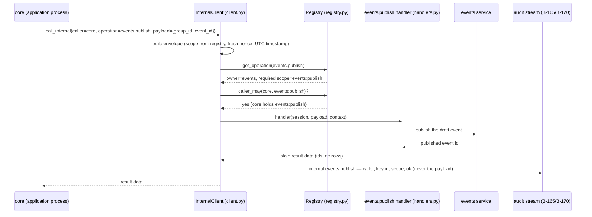
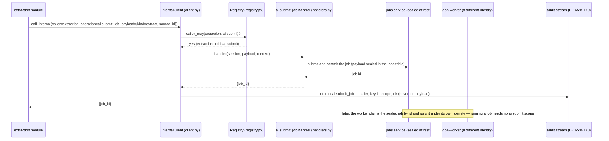
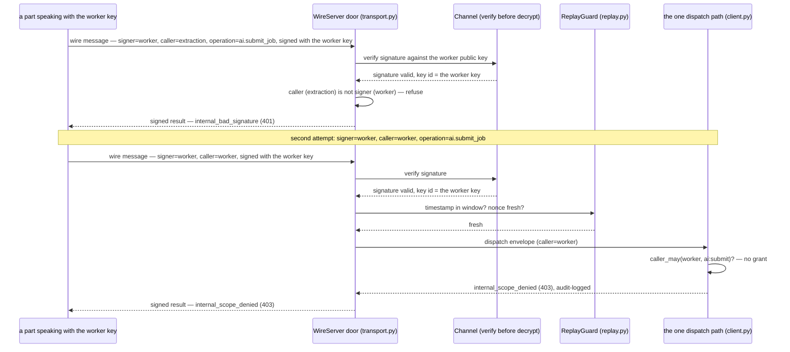

# Internal encrypted API

*The Phase 18 protocol chapter (slice B-191). For backend
developers and maintainers. This is the §6A.4 protocol in
full, as built: the envelope format field by field, the
signing and encryption steps in the order the code runs
them, the transport profiles, the identity and scope
registry, the replay defence, and key rotation — with
sequence diagrams for a publish, an AI extraction job
submission, and a rejected impersonation attempt.*

*Verified against the live tree at this slice: field names
are `src/gpa/internal/envelope.py`'s own, operation names,
owners, and scopes are `src/gpa/internal/registry.py` and
`handlers.py`'s own, the cryptography is
`src/gpa/internal/crypto.py`'s, the wire form and doors are
`src/gpa/internal/transport.py`'s, identities are
`identity.py`'s, and the replay window is `replay.py`'s.
Where a later phase extends this protocol, the chapter
says so at the point of use: the Phase 28 database bus
(B-345/B-346) reuses this envelope, signing, and replay
machinery for cross-process messages, and is not built
yet at this slice.*

## The one rule

Every part of the system talks to every other part through
this API. There is no second, quieter channel. A module
that needs another module's work names a registered
operation, states who it is, and sends ids and values —
never ORM rows, never a direct import of the other
module's internals. The point, in plain words: a buggy or
compromised part cannot read another part's traffic,
cannot forge an approval, cannot replay a "publish"
message, and cannot call an operation its identity was
never granted. The blast radius of any single part failing
— or being subverted — is that part.

## 1. The envelope, field by field

One message shape serves every profile — in-process,
socket, and TCP alike (`InternalRequest` in
`envelope.py`). The roadmap names the fields
`{operation, caller, scope, payload, nonce, timestamp,
signature}`; the shipped model carries exactly those, plus
one optional field the roadmap's D-15 idempotency law
rides in.

| Field | Type | Meaning and law |
|---|---|---|
| `operation` | string | The registered operation name, e.g. `notify.request`. An unregistered name is refused as `internal_unknown_operation` (404) before anything else is decided. |
| `caller` | string | The calling module's service identity name, e.g. `events`. At a wire door this must **be** the signing identity — a message whose caller is not its signer is refused as `internal_bad_signature` (401). |
| `scope` | string | The internal scope this call exercises, copied from the registry entry for the operation — the caller does not choose it. A caller that does not hold it is refused as `internal_scope_denied` (403). |
| `payload` | object | The operation's business: ids and plain JSON values only. ORM rows never ride the envelope — that law is what makes the same call shape possible across a process boundary. The payload is the only part that can carry user data, and the only part that is sealed on the wire. |
| `nonce` | string | A single-use random token (`secrets.token_urlsafe(16)` when the client builds the envelope). Replay protection keys on the pair (signing key, nonce). The audit line for the call carries the nonce as its entity id. |
| `timestamp` | string | ISO-8601 UTC, seconds precision (`utc_now_iso()`). The replay window reads it: a message more than the window away from the door's clock, in either direction, is refused as `internal_replayed` (401). |
| `idempotency_key` | string or null | Optional. For operations that create things: a retried call carrying the same key is one act, not two (D-15). It rides inside the envelope, and inside the sealed-and-signed wire form, so it cannot be swapped in transit. |
| `signature` | string or null | Ed25519 (or HMAC-SHA256 under the shared-secret profile) over the canonical envelope. Empty (`null`) in the plain in-process local profile — the field exists from the first day so the shape never changes; any message crossing a process boundary must carry one, and an unsigned wire message is never accepted. |

The answer rides back in the matching shape
(`InternalResult`): `ok` (boolean), `operation` (the name
answered), `data` (plain result values — ids and counts,
never rows), and `error` (null on success; on failure the
same problem+json shape the external API uses —
`{code, title, status, detail}` — so a caller learns one
error language for the whole system).

### The wire form

On a transport, the envelope becomes one JSON object
(`transport.py`): `{v, operation, caller, scope, nonce,
timestamp, idempotency_key, signer, payload_sealed,
signature}`.

- `v` is the wire-format version, `1` today
  (`WIRE_VERSION` in `crypto.py`). A message with no
  recognised version is refused as `internal_tampered`
  (400) — a future profile change is a negotiation, not a
  flag day.
- `signer` names the identity whose key signed; at the
  door it must equal `caller`.
- `payload_sealed` is the payload, sealed (section 2).
  The header fields ride in the clear **as authenticated
  data** — routing and rejection never require decryption,
  and no tamper with either half survives the checks.
- A wire result mirrors it: `{v, ok, nonce, error,
  data_sealed, signer, signature}`. The echoed `nonce`
  binds the answer to its question: a reply whose nonce
  does not match the request's is refused as
  `internal_tampered` — a response to some other request
  is not an answer to this one. Result data is sealed
  exactly like a request payload, because results can
  carry personal facts too.

## 2. Signing and encryption, step by step

Two independent protections, deliberately separate keys
and separate jobs:

- **Encryption — AES-256-GCM.** `crypto.seal` draws a
  fresh random 12-byte nonce per message, encrypts the
  payload JSON under the 32-byte internal communications
  key, and returns base64(nonce ‖ ciphertext). The
  authenticated data (AAD) is the canonical header bytes,
  so the seal binds the payload to this exact operation,
  caller, scope, nonce, and timestamp: a payload blob
  lifted into another message does not open.
- **Signing — Ed25519** over the canonical bytes of the
  whole wire message. The **HMAC-SHA256 profile**
  (`sign_hmac` / `verify_hmac`, compared in constant time)
  serves deployments that standardise on shared secrets.
  The two profiles never mix on one channel — the profile
  is part of the channel's configuration, because mixing
  them is how downgrade attacks are born.
- **Canonical bytes** are JSON with sorted keys and tight
  separators, computed over every field except the
  signature itself (`canonical_header_bytes`), so both
  ends sign and verify the same bytes.

The communications key (`load_internal_key`) comes from
configuration — base64 in `GPA_INTERNAL__KEY_B64`, which
must decode to exactly 32 bytes — or, as the documented
development fallback, is derived from the app secret under
the domain label `gpa-internal-comms-key-v1`. It is a
**separate key from the data-encryption keys** of B-167
(the field master key has its own setting and its own
domain), and separately rotatable (section 6). One secret,
several derivations, separate blast radii — the same rule
the identity seeds follow.

### The door's checking order

A receiver spends its checks cheapest-and-most-decisive
first, so probes learn as little as possible. The shipped
pipeline (`open_request_detailed`, then `WireServer`,
then the client's one dispatch path) runs:

1. **Shape and version** — not JSON, or no wire version:
   `internal_tampered`.
2. **Signature** — missing, unknown signer, or bad math:
   `internal_bad_signature`. Verification happens
   **before** a single byte is decrypted or dispatched:
   an unsigned or forged message is refused before the
   door spends a decryption on it.
3. **Caller is signer** — the envelope's caller must be
   the authenticated signing identity:
   `internal_bad_signature` (this is the impersonation
   refusal drawn in section 7.3).
4. **Replay** — timestamp outside the window, or the
   (key id, nonce) pair already seen:
   `internal_replayed` (section 5).
5. **Decryption** — the GCM tag covers header and payload
   together; any tamper raises `internal_tampered`.
6. **Registration and scope** — the one dispatch path
   (`InternalClient._dispatch`) both doors share:
   unregistered operation `internal_unknown_operation`,
   then the scope check `internal_scope_denied`, then the
   handler runs. A handler that cannot understand its
   payload refuses as `internal_bad_payload` (422); a
   handler's own `AppError` travels back unchanged.

Every refusal at a wire door is itself returned as a
**signed result** — a caller can trust even the door's
"no". In-process, the same dispatch raises the same
`AppError` codes the external API would surface, so the
law cannot differ by door.

## 3. Transport profiles

The same envelope, the same dispatch, four profiles. The
modules cannot tell which profile carried a call — that
indifference is the point (B-166).

| Profile | Carries | Protection | State |
|---|---|---|---|
| **In-process** (B-166, the default) | Modules sharing one process call through the client SDK (`call_internal`) at the serialisation boundary. | Envelope + registration + scope check + audit on every call; the signature field is empty in this profile, honestly — the roadmap does not pretend in-process calls need wire encryption. Data **leaving** the process is still sealed: job payloads at rest in the `jobs` table are sealed with the internal key (`seal_payload` in the jobs service, a versioned prefix, one opening funnel), so a copied database yields no readable job payloads. | Built; every call site runs it today. |
| **Unix domain socket** (B-163) | Processes on one Linux/macOS machine. | The full wire form: sealed payload + Ed25519 (or HMAC) signature + replay guard at the door. Framing is a 4-byte big-endian length, then one JSON object; one connection carries any number of request/response pairs; a frame over 8 MiB is refused as `internal_tampered` — internal payloads are ids and small drafts by design, so anything bigger is a bug or an attack. | Built (`UnixWireServer`). |
| **Loopback TCP + mutual TLS** (B-163) | Processes in separate local services, still never the open network. | The full wire form **plus** mutual TLS 1.3: certificates per module from the internal CA (`gpa.internal.ca`). TLS is additional, never a substitute — the payload stays sealed even where TLS ends, so a relay that terminates TLS early never sees plaintext. Server leaves are valid only for `localhost`, `127.0.0.1`, and `::1`; client and server leaves carry their distinct extended key usages. | Built (`serve_tcp_mtls`); the CA mints a root and per-module leaves in code. |
| **Windows named pipe** | The same framing behind the same classes, on Windows. | Same wire form as the Unix socket profile. | **NOT RUN on this Linux builder** — recorded honestly, not claimed. The framing and crypto are shared code; the pipe leg itself awaits a Windows run (B-177's matrix). |

Server-side transaction law differs by door, honestly:
in-process, a handler rides the **caller's** transaction
(the outbox pattern depends on it — a notification row and
its job commit or roll back together), except operations
whose direct form committed (job submission), which keep
committing; at the wire door (`execute_envelope`) the
session is per-call and owned by the server, so one call
is one transaction — commit on success, roll back on
refusal or error, and the refusal travels back as data
because the wire cannot carry an exception.

## 4. Identity and scope registry

### Service identities (B-164)

Every module and worker holds its **own** identity: an
Ed25519 key pair named by the module it speaks for, with a
printable **key id** — the first 16 hex characters of the
public key's SHA-256 — that appears in audit lines and
refusals, so "who said this?" always has a checkable
answer. An identity's scopes **are** the registry's caller
grants: `identity.py` binds names to keys, the registry
binds names to scopes, and the transport binds a message
to the key that signed it. Impersonation therefore fails
at the math, not at a policy someone remembered to check.

Identities come from, in order:

1. **An identities directory** (production,
   `GPA_INTERNAL__IDENTITIES_DIR`): one file pair per
   identity — `<name>.seed` (the Ed25519 seed, mode 0600,
   never in the repo) and `<name>.pub` (base64 public
   key), with `<name>.pub.prev` as the rotation overlap
   (section 6). A process's own public keys are always
   accepted for their own names.
2. **Derivation from the app secret** (development): each
   known caller's seed is HMAC-SHA256-derived from the
   secret under the domain label
   `gpa-module-identity-v1:`, so every module still holds
   a **distinct** key and the whole machinery — signing,
   key ids, overlap — runs identically; only the key
   custody differs.

The known identity names are the registry's granted
callers, plus the composition identities `core`, `worker`,
and `arq-worker` — read live from the registry, never
duplicated in the identity module.

### The operation registry (B-162)

Seven operations are registered today. This table is the
registry's own content — name, owning module, required
scope, and the registry's one-sentence summary:

| Operation | Owner | Required scope | What it does |
|---|---|---|---|
| `candidates.create` | extraction | `candidates:write` | Draft one candidate into a group's review queue. |
| `events.publish` | events | `events:publish` | Publish one draft event. |
| `notify.request` | notifications | `notify:write` | Write notification rows for an audience; never sends. |
| `notify.rsvp_promotion` | notifications | `notify:write` | Notify a waitlisted member promoted to a place. |
| `jobs.enqueue` | jobs | `jobs:write` | Commit one queued background job. |
| `ai.submit_job` | jobs | `ai:submit` | Submit one AI job (extraction, vision, transcription). |
| `integrations.emit` | integrations | `integrations:write` | Announce one act to the group's subscribed endpoints. |

Handlers (`handlers.py`, the composition root that wires
operations to their owning services) take ids and values,
re-fetch the rows they need inside the caller's session,
keep the direct call's transaction discipline exactly,
and return plain data. The roadmap's §6A.4 examples name
operations such as `ai.extract` and
`integrations.facebook.create_event`; the shipped
registry folds those families into `ai.submit_job` and
`integrations.emit` — the families exist, under these
names, and this chapter documents the names that exist.

### Caller grants — least privilege, written from the call sites

| Caller | Scopes held |
|---|---|
| `events` | `notify:write`, `integrations:write` |
| `extraction` | `ai:submit`, `integrations:write` |
| `sources` | `ai:submit` |
| `groups` | `candidates:write`, `integrations:write` |
| `integrations` | `candidates:write`, `notify:write`, `jobs:write` |
| `notifications` | `jobs:write` |
| `privacy` | `jobs:write` |
| `memory` | `candidates:write` |
| `core` | `events:publish` |

A module that gains a new internal call gains exactly
that call's scope, in the same commit, where a reviewer
can see the grant widen. Composition roots and tests may
add runtime grants (`registry.grant`); the static table
above is the shipped posture. Note what the table does
**not** grant: no caller holds `events:publish` except
`core` (the application process itself — the door a future
split frontend process would use), and no worker identity
holds `ai:submit` — a worker *runs* AI jobs; submitting
them belongs to `extraction` and `sources`. That asymmetry
is the impersonation test's ground (section 7.3).

## 5. Replay defence (B-164)

A signed message is genuine — but a genuine message sent
twice is a replay, and signature math alone cannot tell
the original from the copy. The door's `ReplayGuard`
therefore checks two things, both refused as
`internal_replayed`:

- **The window.** The message timestamp must sit within
  **5 minutes** (300 seconds,
  `GPA_INTERNAL__REPLAY_WINDOW_SECONDS`) of the door's
  clock, in either direction — clock skew is not a licence
  to reuse.
- **The seen-nonce store.** The pair (signing key id,
  nonce) must be fresh. Entries live only until message
  time + window and are pruned by expiry, because a
  message older than the window is refused by its
  timestamp alone. A message with no readable timestamp
  is refused the same way.

The honest bound, recorded deliberately in `replay.py`
itself: the store is per door process, in memory, so a
door **restart clears it** — a message captured inside its
window could be replayed once across that restart. The
window keeps the residual small and brief; a persistent
nonce table is durability work, named here rather than
pretended away. Idempotency keys are the second, distinct
defence for the operations that create things: even a
legitimate retry — same caller, fresh nonce, same
idempotency key — is one act, not two.

## 6. Key rotation

Three key families rotate on three different clocks, and
none of them is a flag day:

- **Identity (signing) keys rotate with overlap.** The new
  public key lands as `<name>.pub`; the old one moves to
  `<name>.pub.prev`. While the `.prev` file exists, the
  door accepts **both** keys for that name, and signature
  verification tries each accepted key in turn — the key
  id it returns names which one spoke, so audit lines from
  the overlap era attribute correctly. When every speaker
  has moved, the `.prev` file is removed and the old key
  stops verifying. Rotation never stops the system
  because no moment exists where a legitimate key is
  refused.
- **The communications (AES) key does not overlap.**
  Stated plainly: `load_internal_key` holds one key per
  process, and a message sealed under the old key fails
  its tag check (`internal_tampered`) at a door already
  holding the new one. Rotating it is therefore a
  coordinated restart-window act — doors and speakers
  restart onto the new `GPA_INTERNAL__KEY_B64` together —
  and in-flight messages are re-sent by their callers, not
  recovered. The identity overlap above is what keeps that
  window short and safe: signatures stay verifiable
  across it, and only the seal changes.
- **Data keys are a different family.** The field master
  key and per-group data keys (B-167/B-169) wrap and
  re-wrap without re-encrypting content; their rotation
  job and the owner recovery escrow are the security
  chapter's subject (B-194), named here only so no reader
  mistakes one family's rotation story for another's.

No key material of any family ever appears in the repo, a
ZIP, a backup, or a log — seeds live in the identities
directory or an environment file at operator custody, and
the audit stream records key **ids**, never keys.

## 7. Three calls, drawn

Each diagram is a sequence diagram; the prose after it
names every participant and message, so the section reads
whole without the picture.

### 7.1 A publish (`events.publish`)

**The steps.** The application process speaks as `core` —
the one caller granted `events:publish`. The client
builds the envelope, taking the scope from the registry
rather than from the caller. The dispatch checks
registration, then scope, then runs the handler in the
caller's transaction; the events service does the publish;
the handler returns ids, not rows; the audit hook writes
the call's line (section 8) inside the same transaction,
so the story and the act commit or roll back together.
Across a wire door the identical call would be sealed and
signed first and answered by `execute_envelope` in a
per-call transaction — the handler, the scope law, and
the audit line do not change.

### 7.2 An AI extraction submission (`ai.submit_job`)

**The steps.** Extraction may *submit* AI work; it never
runs the model pipeline inline. The submission handler is
one of the operations whose direct form committed, so it
keeps committing: the job row lands with its payload
**sealed** under the internal key, readable only through
the one opening funnel. The worker that later claims the
job speaks as `worker` — an identity with no `ai:submit`
grant, by design. Submitting and running are different
privileges held by different identities, which is exactly
the separation the next diagram attacks.

### 7.3 A rejected impersonation attempt

**The steps.** A compromised or buggy worker tries to
submit AI work — an operation its identity was never
granted. The first attempt lies about who is calling: the
signature is honestly the worker's, but the envelope
claims `caller=extraction`. The door verifies the
signature **before decrypting anything**, learns the true
signer, and refuses because caller ≠ signer —
`internal_bad_signature`, returned as a signed result.
The second attempt stops lying and asks as itself; it
passes signature and replay, and dies at the one dispatch
path on the scope check — the worker holds no `ai:submit`
grant — as `internal_scope_denied`, audit-logged like
every refusal. There is no third door: the same two
refusals, in the same order, are the whole answer, in
every profile.

## 8. Audit — the story without the content (B-165)

Every dispatched call — success, scope denial, handler
refusal — leaves one line in the B-019 audit stream,
written by the client's audit hook inside the caller's own
transaction:

- `actor` — `module:<caller>`: internal actors are
  modules, and the prefix keeps them unmistakable beside
  the `user:` / `seat:` actors of the human stream.
- `action` — `internal.<operation>`.
- `detail` — the caller, its **key id**, the operation,
  the scope exercised, the owning module (the module tag),
  and the result: `ok`, or the refusal's error code.
- `entity_id` — the envelope nonce, so one call's line can
  be picked out of the stream.
- `group_id` — the payload's group id when it carries one:
  an identifier, not content.

Never the payload. A full flow's internal story — who
called what, in what order, with what result — can be
reconstructed from audit alone, with no user content in
it, and the stream it rides is the tamper-evident hash
chain of B-170. Auditing must never break the call it
describes: a hook failure is swallowed by the client (the
audit module's own tests prove the hook works), because a
logging fault turning into a product fault would invert
the design.

## The refusal table

| Code | Status | The door says it when |
|---|---|---|
| `internal_unknown_operation` | 404 | The operation name is not in the registry. |
| `internal_scope_denied` | 403 | The caller does not hold the operation's required scope. |
| `internal_bad_payload` | 422 | A handler cannot understand its payload (a missing key names a caller bug). |
| `internal_tampered` | 400 | Not JSON, no wire version, an oversized frame, a GCM tag failure, or a reply answering a different nonce. |
| `internal_bad_signature` | 401 | No signature, an unknown signer, bad signature math, or caller ≠ signer. |
| `internal_replayed` | 401 | The timestamp is outside the 5-minute window, the (key id, nonce) pair was already seen, or the timestamp is unreadable. |
| `internal_bad_key` | 500 | The key configuration itself is invalid: a comms key that is not 32 bytes, a seed that is not 32 bytes, an unknown channel profile, or a channel end asked to sign with no key. |

*End of the internal encrypted API chapter (B-191). The
data-model chapter (B-192) documents the tables these
operations act on; the security chapter (B-194) tells the
threat story this protocol answers.*
