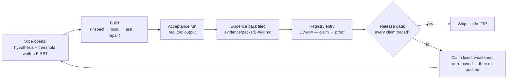
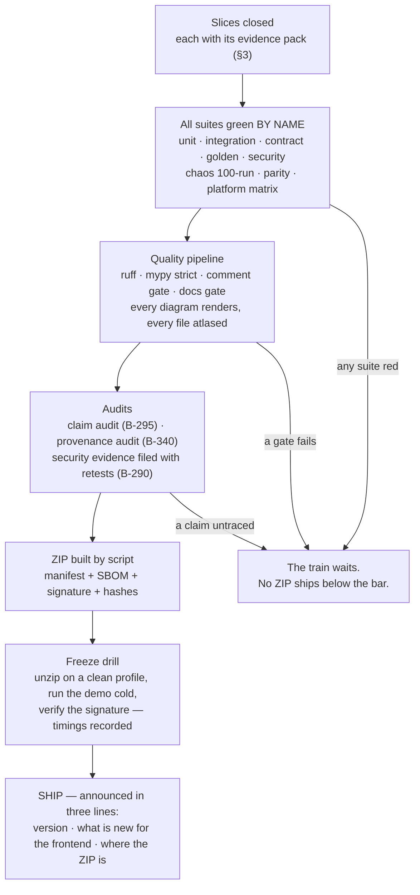

# 11 — Testing, Deployment, and Release

**For:** backend developers and operators — anyone who must prove
the system works, install it somewhere real, or verify a release
ZIP before trusting it.
**Companion guides:** Doc 08 (what the security and durability
suites are defending), Doc 02 Part B (daily operation), Doc 14
(running the terminal door and the background service).

**The philosophy in one sentence** (evidence-based development,
D-41 / Phase 24): *a claim without a test run behind it does not
ship* — not in a handoff note, not in a demo script, not in this
documentation set. Every release ZIP carries its own test report,
and the report is generated from real runs, never hand-typed.

---

## 1. The suites — what each one guards

| Suite | Guards | Key slices |
|---|---|---|
| **Unit** | Every service function, the date resolver (D-22), the crypto module, the pruning engine's arithmetic | D-23 |
| **Integration** | Whole flows over HTTP against a real database: the four proposal flows, approval, publishing, digests | B-148 |
| **Contract** | The frozen `OPENAPI.json` is exactly what the code serves; the parity register (every user action exists as route + internal operation + MCP tool + CLI command) | B-201 |
| **Golden corpora** | AI quality, measured: extraction, flyer/board vision, context pruning — against versioned fixture corpora with human gold labels | B-046, B-073, B-121, B-285 |
| **Security** | Role matrix, cross-group leakage fuzz, upload attacks, SSRF, prompt injection, secrets grep, internal impersonation/replay | B-139 → B-146, B-164 |
| **Durability / chaos** | The crash invariant, 100 fault-injection runs; self-healing drills (corrupt DB, healthy DB) | B-171 → B-175 |
| **Parity proofs** | The same story done by a human via API, by an agent via MCP only, and three ways via the terminal | B-220, B-235 |
| **Platform matrix** | Install + full suite on every Tier-1 platform (§5) | B-177, B-252, B-262 |
| **Interop conformance** | Generated per-app tables: iCal/CalDAV per calendar app, mail rendering per client, office-format round-trips | B-267, B-279, B-292 |
| **Docs + comment gates** | Every code file documented (Doc 10 checker), every module docstringed (comment gate), every Mermaid diagram renders | B-176, B-181, B-197 |
| **Claim audit** | A sample of claims in the handoff/docs/RESULTS traced to evidence ids, a sub-sample re-run live | B-295 |
| **Provenance audit** | Every file traced to an author + affirmation; dependency register reconciled against the lockfile; similarity scan reviewed | B-332 → B-340 |

A slice is not done until its tests pass (D-23) **and** its
evidence pack exists (§3). A red suite means no ZIP — the train
waits a day rather than shipping a promise it cannot prove (§6A.7).

### 1.1 The golden corpora, in plain words

The AI suites do not test against vibes. The corpora are **assets,
versioned in the repo**: real-shaped group chats, newsletters,
flyer images, a photograph of a whole noticeboard, a voice note, a
messy CSV — and a *poisoned* source (a flyer that tries to instruct
the AI; the correct behaviour is a weird candidate in a human's
queue, never obedience, B-142). Each corpus item carries **human
gold labels** — what a careful person says the right extraction
is — labelled twice, with the labellers' agreement score published
(B-285). Scores are reported per field (the date can be right
while the place is wrong) with an error *analysis*: what kinds of
flyers and phrasings fail, and the fix each kind received. New
real-world failures become new fixtures **before** they become
fixes, so a bug, once caught, can never quietly return.

### 1.2 The chaos suite deserves its own paragraph

Fault injection is a first-class suite, not a stunt (B-175): the
process is killed at random points during ingest, extraction,
approval, upload, and digest send; power loss is simulated during
fsync windows on a native rig (no containers, D-24); disk-full and
read-only-database faults are injected. After every fault the
invariant of Doc 08 §11.3 is asserted automatically — *no committed
entry lost, no half-written entity visible, every interrupted job
resumed or visibly failed* — across **100 runs**, and the invariant
report ships in the ZIP. The self-healing drills run beside it:
a genuinely corrupt database (restored from the newest verified
backup, damaged file kept aside) and a **healthy** database falsely
accused (must be left entirely alone — healing it is a named test
failure, the double-verdict guard of Doc 08 §11.1).

## 2. Reading a TEST_REPORT.md

Every ZIP's `TEST_REPORT.md` answers, in this order: the suites by
name with pass/fail counts (never a single blended percentage —
the security and durability suites are reported *complete or not*,
never averaged into a coverage number, B-178); the golden-corpus
evaluation tables (the same generated numbers `RESULTS.md` quotes);
the chaos invariant result; the platform matrix with any red cell
**named** (a red cell blocks that platform's claim, never the whole
truth); the parity report; the reliability ledger's error-budget
spend (B-291); and the claim + provenance audit outcomes for that
release. If a number in a demo or a handoff note cannot be found in
this file, the number is not claimable.

## 3. Evidence packs — the closing ritual of every slice (B-282)

Every slice closes with a pack at `evidence/packs/B-###.md`:

- the **hypothesis and pass threshold**, written *before* the build
  (B-283) — "better" is not a threshold; a number, a test, or a
  named user task is;
- the **acceptance output** — real tool output, pasted by the
  tooling, not a hand-written success story;
- the relevant **measurements** (benchmarks, accuracy runs, drill
  logs);
- **links into the evidence registry** (`EV-###` ids, B-281): the
  registry records each item's kind, the claim it supports, the
  exact command that produced it, and its date.



*Walking tour:* the loop runs left to right and the order is the
point — the threshold exists before the code does, so success
cannot be redefined afterwards to fit whatever got built. The
build's acceptance run produces real output; the output is filed
as the slice's evidence pack; the pack registers its claims in the
evidence registry; and the release gate asks the registry one
question — *is every claim in this release traced to an item?* A
"no" does not argue: the claim is fixed, weakened to what the
evidence supports, or removed, and the loop re-runs. Only a fully
traced release ships.

## 4. Benchmarks (B-284)

Standing benchmarks run per release on defined hardware profiles
(including a Pi-class profile): API latencies per surface,
extraction throughput, startup and recovery times, terminal
responsiveness. Results are **trended across releases**; a
regression beyond the agreed percentage fails the gate. Performance
claims in any document must read off these series — a single fast
run on a developer's laptop is an anecdote, not a benchmark.

---

## 5. The platform matrix (D-27, D-39, Phase 22)

Tier 1 means: installs natively, runs, and passes its platform
suite. **No Docker anywhere — strict law (D-24):** installers are
native scripts, environments are `uv`/venv, services are the
platform's own service manager.

| Target | Role | Installer | Service supervision |
|---|---|---|---|
| Linux x86_64 | Server + terminal | `install.sh` | systemd unit |
| Linux ARM64 | Server + terminal | `install.sh` (arch detected) | systemd unit |
| Raspberry Pi OS 64-bit (Pi 4/5 class) | Server (named profile, B-253) + terminal | `install.sh` with Pi preflight | systemd unit + backup timer |
| Windows 10/11 x86_64 | Server + terminal | `install.ps1` | Windows service registration |
| macOS Intel | Server + terminal | `install-mac.sh` | launchd agent |
| macOS Apple Silicon | Server + terminal | `install-mac.sh` | launchd agent |

Clients reach the server from the same list plus iOS and Android
(responsive web/PWA, Doc 01; terminal on phones over SSH, Doc 14).
The dependency rule keeps the matrix honest: **no dependency ships
unless it installs cleanly on every Tier-1 target** — pure-Python
preferred, wheels verified per platform, and anything failing is
replaced or becomes an optional extra with a working degraded mode
(B-252). The per-release platform results are *generated into* the
test report (B-262): a red cell blocks a platform claim in the
handoff, by name — never silently.

Two platform truths worth repeating here: on the Pi, durability
does not bend — `synchronous=FULL` stays, WAL size is capped and
checkpoints scheduled to bound SD wear, and the installer itself
recommends the encrypted remote backup (B-254, B-247). And every
installer is **idempotent**, runs a preflight report *before
changing anything*, and ends with the server running and `/health`
answering, plus the first-admin step printed in plain words (B-261).

## 6. Installing and running — the operator's roads

- **Development:** `uv sync` → `./run.sh` (`run.ps1` on Windows) →
  http://127.0.0.1:8000, docs at `/docs`, health at `/health`.
- **Demo:** `./demo.sh` — fresh demo database, seed loaded, mock or
  live AI per environment, one command, minutes on any laptop,
  **no network required** in mock/fixture mode.
- **Real deployment:** the platform installer (§5), then a
  **deployment profile** chosen honestly (Doc 02 B.2): `local`,
  `lan`, `vpn`, or `internet`. The server **refuses to start** on
  an `internet` profile with unsafe settings, and says why in plain
  words (B-241).
- **Background service:** once installed, the server runs headless
  under the platform's service manager — it does not need a
  terminal, a TUI, or a logged-in human. The `gpa service` commands
  and the attachable TUI are Doc 14's subject.
- **Backups:** scheduled, encrypted, keyed separately from the data
  keys, and **restored from in drills** — a backup never restored
  is a hope, not a backup (B-146; Doc 02 B.4).
- **Upgrades:** stop → verified backup → new directory → migrate →
  smoke suite → switch service → keep the old directory a day.
  Rollback is always *restore the pre-upgrade backup* — never a
  downgrade migration (B-156, Doc 02 B.7).

---

## 7. The release train (roadmap §8)

Releases are ZIPs built by `scripts/make_release_zip.py` — never
hand-assembled — on a fixed train, so the frontend crew always
knows what lands when:

| Release | When | Slice range | What it proves / enables |
|---|---|---|---|
| **ZIP-0 Foundation** | Sun Oct 25 | B-001 → B-010 | Runs anywhere; `/health`; typed client from real OpenAPI |
| **ZIP-Alpha** | Wed Oct 28 | → B-048 | Review queue + uploads against real extraction (mock always available) |
| **ZIP-Beta** | Sat Oct 31 | → B-104 | Calendar, event pages, discussion, RSVP, digests — feature-complete demo surface |
| **ZIP-RC** | Mon Nov 2 | → B-138 | Live integrations + Samtal screens; full dress rehearsal |
| **ZIP-Final** | Tue Nov 3 (drill) / Wed Nov 4 | → B-151 + cross-cutting gates (Phases 17–20, 24, 26, 27 day-one rules) | The submission artifact itself |

Post-window trains continue through Phases 15–16 and the standing
continuation phases on the same rules; the train is a habit, not a
hackathon stunt.

## 8. Anatomy of a release ZIP — and verifying one (B-179)

```
gpa-backend-v<VERSION>-<DATE>.zip
  gpa-backend/…            the repo tree — runnable as-is, our own code throughout
  OPENAPI.json             the frozen contract for this version
  FRONTEND_HANDOFF.md      what changed · what you can build now · what is stubbed
  CHANGELOG.md             per-slice list; breaking changes flagged, additive marked
  TEST_REPORT.md           this ZIP's own suite results (§2)
  RESULTS.md               generated evaluation numbers (never hand-typed)
  evidence/                the registry + the packs for this release's slices
  SHA256SUMS.txt           a hash of every file in the ZIP
  release-manifest.json    version, git hash, slice range, driver modes, known limits
  release-manifest.sig     detached Ed25519 signature over the manifest
  SBOM.spdx.json           every dependency, pinned, with its licence recorded
```

**Verify before you unzip-and-run** (takes a minute, and the
tampered-ZIP test — one flipped byte → verification refuses it,
loudly — is why you bother):

1. Check the ZIP's own SHA-256 against the value announced with it.
2. Verify `release-manifest.sig` against the manifest with the
   team's release public key (published in the repo and in
   Doc 02's operator notes).
3. Inside, run the manifest check: `SHA256SUMS.txt` must match
   every file present — no extras, no edits.
4. Read the manifest's *known limits* and the handoff's *stubbed*
   list. A ZIP is a promise (§8 of the roadmap): everything the
   handoff claims is covered by a test in its `TEST_REPORT.md`;
   anything else is labelled stubbed or not-yet, in those words.

**What a ZIP never contains** (rule 2 of the train, grep-tested):
no real API key, no real user's data, no `.env`, no database with
real people in it. Demo data is fictional and labelled fictional.

## 9. The release gates — all of them, or it waits



*Walking tour:* five gates stand between finished slices and a
shipped ZIP, and the diagram gives each a box: suites green *by
name* (a blended average cannot hide a red security suite), the
quality pipeline (lint, strict types, the comment and documentation
gates), the two audits (claims traced to evidence; files traced to
authors), the scripted ZIP build with its manifest, SBOM, and
signature, and finally the freeze drill — the actual artifact,
unzipped somewhere clean, demoed cold, signature verified. Three
failure arrows drop to the same box at the bottom, and its wording
is the policy: **the train waits.** A slipped day is recoverable;
a shipped claim that turns out untrue is the trust failure this
whole system exists to prevent.

## 10. Who runs what, when things break

The runbook (B-155, and Doc 02 B.5–B.6) covers the five failures
this product will actually have — mail down, AI quota reached, disk
full, integration token expired, job stuck — each reproduced from a
deliberately broken staging box before it was written down. The
Doctor (Doc 12, Doc 14) runs the same checks from inside the
product and offers the safe fixes in plain words; the watchdog
(B-172) watches hourly between human visits. Start with `/health`,
deep mode if you are an admin: database integrity state, job
backlog, AI driver, integration health, backup freshness — a
healthy system is quiet, and any change from its quiet is the
first clue.
