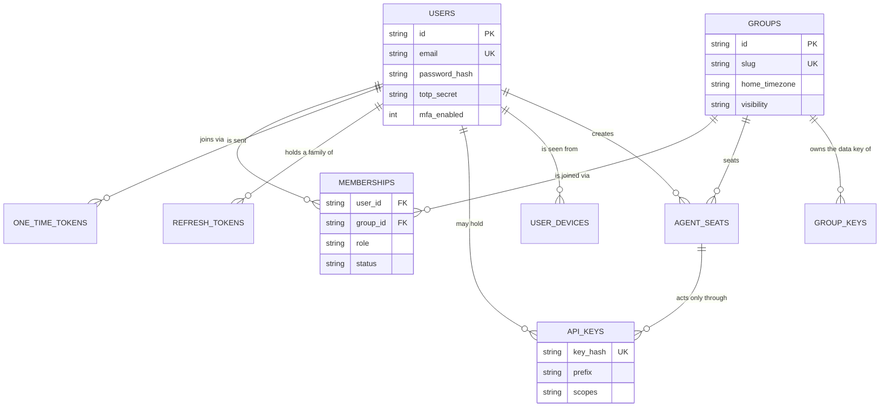
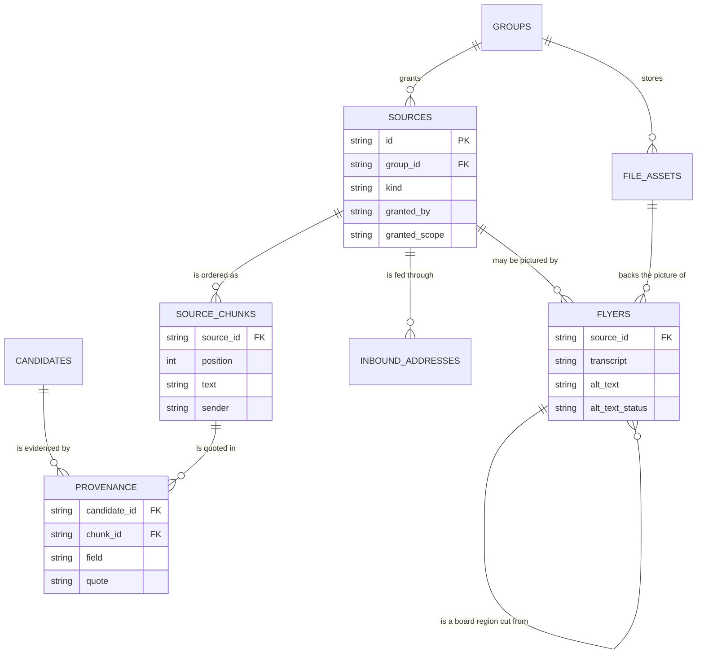
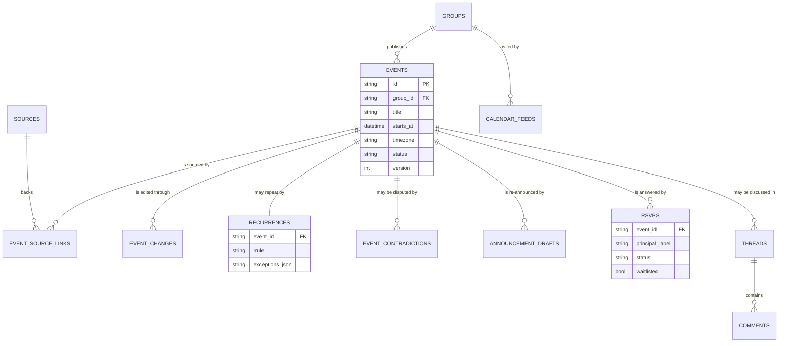
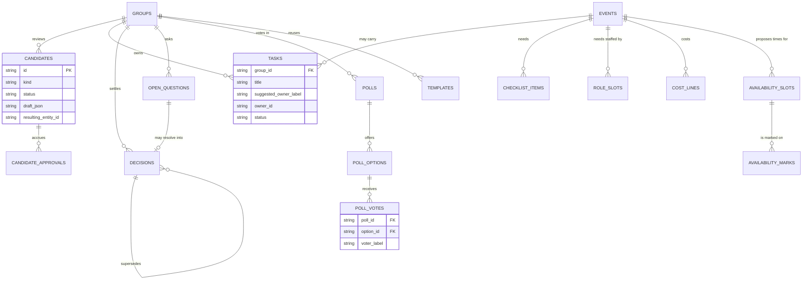
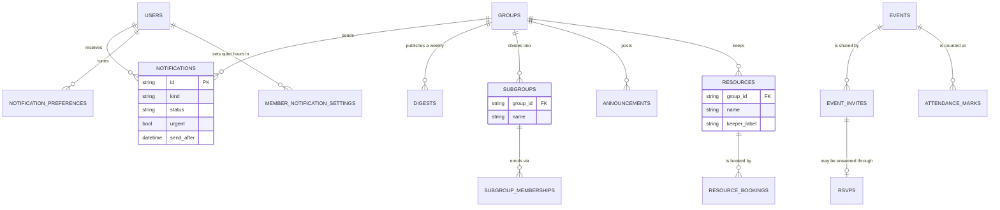
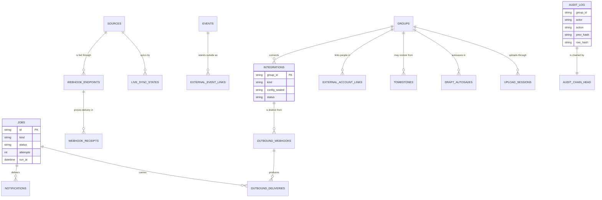

# Data model + ER pack

*The Phase 18 data chapter (slice B-192). For backend
developers and maintainers. Every entity of roadmap §4 —
and every table the code has grown since — with its
purpose, its fields, which fields are sealed and why, its
indexes, and its relationships, plus the full Mermaid
`erDiagram` set: identity, sources, events, planning,
comms, and system.*

*Verified against the live tree at this slice: table and
column names are the models' own `__tablename__` and
column definitions under `src/gpa/models/` (69 tables in
`Base.metadata` when `gpa.models` is imported), the
sealed-field list is the call sites of
`gpa.crypto.fields.seal_text` and
`gpa.services.sealing`, and the migration chain is
`migrations/versions/` 0001 through 0021. A checker in
`tests/test_docs_gate.py` diffs model ↔ document on every
suite run: it parses every `__tablename__` out of the
model files and fails if any table is missing from this
chapter — a new table without a document entry is a red
suite, exactly as the roadmap line for B-192 orders.*

## The shape of the whole store

Three rules shape every table, and a reader who holds
them can predict most of any single table before opening
it:

1. **One group owns almost everything.** Most tables
   carry `group_id`, a foreign key to `groups.id`, and
   every group-facing read is scoped by it first. The
   exceptions are the identity tables (a person exists
   before any group), the system tables (`jobs`,
   `audit_chain_head`, `recovery_escrow`, `mail_events`),
   and child tables whose group arrives through their
   parent (for example `source_chunks` through
   `sources`, and `poll_votes` through `polls`).
2. **Identifiers are text, times are UTC, money is
   integers.** Every primary key is a `VARCHAR(36)` UUID
   string (`id`), which is why there are no database
   sequences to resync on either engine. Datetimes are
   stored in UTC; the timezone that gives a time its
   human meaning lives on the group or the event, never
   implied by the stored value. Money and model cost are
   integers end to end: `amount_cents` on cost lines and
   `cost_micros` on AI usage — a float in either place
   is a bug, not a rounding choice.
3. **Structured payloads ride as JSON text.** Columns
   named `*_json` (and `draft_json`, `payload_json`,
   `snapshot_json`, `region_json`, `filters_json`,
   `events_json`, `changes_json`, `values_json`,
   `kept_json`, `dropped_json`, `citations_json`,
   `range_json`, `exceptions_json`, `parts_json`) hold
   canonical JSON in a `TEXT` column. That keeps SQLite
   and PostgreSQL byte-identical in behaviour for the
   fields the application always reads whole, at the
   honest price that the database cannot index inside
   them — no query in the codebase needs it to.

Timestamps follow one pattern: `created_at` on almost
every table, `updated_at` where a row can change,
`deleted_at` where soft deletion is the law (events),
and specialised stamps (`sent_at`, `read_at`,
`revoked_at`, `used_at`, `expires_at`, `locked_until`,
`last_used_at`) that name the one act they record.
Soft deletion is deliberately rare: events soft-delete
and restorable truth lives in `tombstones`; sources
hard-delete their chunks and provenance at once while
their candidates gain a `source_deleted_at` stamp (the
B-023 law, told in full in the sources chapter).

## Sealed, hashed, and plain — field by field

Encryption at rest in this build is **selective, and
this section is the whole truth about it**. Three
different protections exist, and they are not
interchangeable:

### Sealed fields (reversible, keyed, per group)

Field-level sealing (B-167, `gpa/crypto/fields.py`)
stores `enc:v1:` plus an AES-256-GCM seal under the
owning group's data key, with the field name bound in
as authenticated data — a seal lifted into another
field or another group does not open. The sealed
fields today, named by their sealing call sites, are:

| Stored column | Seal field name | Why this one |
|---|---|---|
| `source_chunks.text` | `chunk.text` | The raw words people wrote — the rawest personal content the system holds. |
| `source_chunks.sender` | `chunk.sender` | Who said it, sealed beside the words for the same reason. |
| `provenance.quote` | `provenance.quote` | An excerpt of that same sealed text, kept as review evidence. |
| `event_source_links.quote` | `event_link.quote` | The same excerpt, carried onto the published event's source link. |
| `flyers.transcript` | `flyer.transcript` | The flyer's read text, whose chunk twin was already sealed — resting one twin plain was the defect the Phase 17 gate drill caught and fixed. |

Whole-value sealing (B-127, `gpa/services/sealing.py`,
an HMAC envelope with a fresh nonce per value) covers
secrets that are configuration, not content:
`integrations.config_sealed` (provider tokens and keys
inside the config JSON — API reads show key NAMES
only), `outbound_webhooks.secret_sealed` (the delivery
signing secret), and `users.totp_secret` (the MFA
secret, sealed at setup in
`services/account_security.py` and opened only to
verify a code).

Key material itself never rests plain:
`group_keys.wrapped_key` is the group's random data
key sealed under the deployment master key (AES-256-GCM,
authenticated data naming the group, rotated by
re-wrapping in B-169 without touching sealed fields),
and `recovery_escrow.sealed_master` is a copy of the
master key sealed under a scrypt key derived from the
owner's recovery code, findable by `code_check` without
trying every seal.

### Hashed fields (one-way, shown once)

Credentials and bearer tokens are never stored in a
form that can be read back: `users.password_hash`
(Argon2id), `api_keys.key_hash`, `one_time_tokens.token_hash`,
`refresh_tokens.token_hash`, `calendar_feeds.token_hash`,
`event_invites.token_hash`, `inbound_addresses.token_hash`,
and `webhook_endpoints.token_hash`. In every token case
the plain value is shown exactly once at creation, the
row keeps a short `prefix` so a person can recognise
which token they hold, and lookups hash the presented
value and compare. Two hash columns are not secrets at
all: `file_assets.sha256` is a content address (the
storage key derives from it), and
`external_event_links.payload_hash` is a drift detector
— hash equality is how a re-press learns it is a no-op.

### Plain fields (the honest boundary)

Everything not named above rests as plain column
values inside the database file. That includes most
group content — event titles and places, task text,
decision text, summaries — as the threat model has
recorded since B-139. The protections for those fields
are the deployment's disk, the per-group permission
wall on every read, the audit chain, and verified
backups — **not** field encryption, and no document in
this set may claim otherwise. The sealing service is
field-generic by design, so extending the sealed list
is a call-site decision, never a redesign.

## 1. Identity — the ER pack, part one

People, their credentials, their groups, and the seats
that act beside them. Roadmap §4's User, MagicLink
(built as the general `one_time_tokens` table, whose
`purpose` also serves password reset and email change),
ApiKey, Group, Membership, and AgentSeat all live here,
with the Phase 17 additions (`user_devices`,
`group_keys`, `recovery_escrow`) that account security
grew.

**Walking tour.** `USERS` stands alone — no group
foreign key — because a person registers before any
group exists. The `USERS` to `MEMBERSHIPS` arrow and
the `GROUPS` to `MEMBERSHIPS` arrow meet in the
membership row, which is unique per (user_id, group_id)
and carries the role and status that the permission
door reads; there is no role column on the user or the
group, because a role is a fact about a pairing.
`ONE_TIME_TOKENS` and `REFRESH_TOKENS` both hang from
`USERS`: the first is short-lived and single-use
(`expires_at`, `used_at`), the second is a rotating
family (`family_id`, `replaced_by_id`, `revoked_at`)
where reuse of an old token revokes the family.
`API_KEYS` may hang from a user (`user_id`) or from a
seat (`seat_id`) — exactly one — and a seat can do
nothing at all without one. `AGENT_SEATS` belongs to a
group and names its creating user, but its acts are
attributed to the seat, never silently to that user.
`USER_DEVICES` is the remembered-device record behind
the account-security screens. `GROUP_KEYS` is drawn
here because its owner is the group, though its story
is cryptography: one row per group, `wrapped_key`,
`version`, and `rotated_at`.

The group row itself is also the group's settings
pack: `groups` carries the reminder rules
(`reminder_rules_json`), the digest dials
(`digest_weekday`, `digest_time`, `digest_enabled`),
the review policy (`review_min_role`,
`review_approvals_required`), the AI dials
(`ai_daily_budget_micros`, `ai_reminder_wording`,
`prune_max_passes`, `prune_token_budget`,
`prune_driver`), the template set, the embed origins,
the upload quota, and the source retention window —
one validated transaction changes any of them (the
admin guide tells each dial's consequence).

## 2. Sources — the ER pack, part two

Everything a group says, posts, emails, photographs,
or records, permissioned before it is stored. Roadmap
§4's Source, SourceChunk, Provenance, Flyer, and
FileAsset live here, with `candidates` drawn at the
edge because provenance binds the review queue to the
chunks it quotes.

**Walking tour.** A `SOURCES` row is created only
with its permission record — `granted_by` and
`granted_scope` are columns, not metadata — and its
`kind` names the road in (chat_paste, chat_live,
newsletter, flyer, board_photo, email, link, voice,
file, manual). `SOURCE_CHUNKS` are ordered by
`position` under their source, and are the unit every
later stage quotes. `FLYERS` specialises a source's
picture: a flyer points at its source and at the
`FILE_ASSETS` row holding the bytes (content-addressed
by `sha256`, never by a filesystem path the API could
leak), and a board photo's children point back through
`parent_flyer_id`. A flyer's `alt_text_status` makes an
undescribed picture a visible defect rather than a
silent one. `INBOUND_ADDRESSES` is the email-in door:
one hashed token per group. `PROVENANCE` is the join
that makes review possible — one row per candidate
field, naming the chunk and carrying the sealed quote
(or, for flyers, the `region_json` box).

## 3. Events — the ER pack, part three

The published heart: events and everything that hangs
from a published fact. Roadmap §4's Event,
EventSourceLink, EventChange, Recurrence, CalendarFeed,
Thread, Comment, and Rsvp live here, with the Phase 6
truth-keeping rows (`event_contradictions`,
`announcement_drafts`) beside them.

**Walking tour.** `EVENTS` carries its own `timezone`
beside the UTC `starts_at` and `ends_at`, because the
wall-clock reading is the fact a group planned by.
`status` separates draft, published, and cancelled —
drafts answer 404 below organiser on every surface —
and `version` is the optimistic-lock counter the
If-Match edit law reads. `EVENT_SOURCE_LINKS` answers
"where did this field come from?" per field after a
merge, with the sealed quote. `EVENT_CHANGES` is the
append-only edit history that drives re-announcement;
material changes set `needs_reannounce` on the event.
`RECURRENCES` is one row per series (unique on
`event_id`): the RRULE plus its exceptions as data.
`EVENT_CONTRADICTIONS` holds a disputed field's rival
values with their source lists until a person settles
it. `ANNOUNCEMENT_DRAFTS` are built from the change
rows and stamped `sent_at` and `sent_by` only when a
person approves the sending. `RSVPS` is unique per
(event, principal_label) — a principal may be a member
(`user_id`), a seat (`seat_id`), or a guest label —
and the waitlist columns record strict next-in-line
order. `THREADS` is parent-generic (`parent_type` plus
`parent_id`), so the same `COMMENTS` system serves
events, tasks, decisions, and polls. `CALENDAR_FEEDS`
belongs to the group: token hashed, filters as JSON,
revocation a stamp, never a deletion of history.

## 4. Planning — the ER pack, part four

The group's forward work. Roadmap §4's Task, Decision,
OpenQuestion, Poll with PollOption and PollVote,
ChecklistItem, and Template live here, with budget and
availability (Phase 7) and the review-queue row itself
(`candidates`, with its Phase 9 `candidate_approvals`)
drawn at the edge, because approval is what mints
planning entities.

**Walking tour.** `CANDIDATES` is the review queue:
`kind` (event, task, decision, question, event_change),
`status` (pending, approved, edited, rejected, merged),
the `draft_json` under review, per-field confidence,
the closed-vocabulary `flags_json`, the prompt name
and version that drafted it, and — only after a
person approves — `resulting_entity_type` and
`resulting_entity_id`, filled in the approval's own
transaction. `CANDIDATE_APPROVALS` records each
distinct approver when a group requires more than one.
`TASKS` keeps the owner law in its columns: the AI's
words rest in `suggested_owner_label`; `owner_id` is
set solely by a person's act. `DECISIONS` chains to
itself both ways (`supersedes_id`, `superseded_by_id`)
so the settled-truth view is a walk, not a guess.
`OPEN_QUESTIONS` may resolve into a decision in the
same act (`resolution_decision_id`). Polls enforce
one current vote per person structurally — `POLL_VOTES`
is unique per (poll_id, voter_label). `CHECKLIST_ITEMS`,
`ROLE_SLOTS`, and `COST_LINES` all hang from an event
and a group; claims are a member id or a seat label,
never both silently. `AVAILABILITY_SLOTS` are proposed
times and `AVAILABILITY_MARKS` are marks against those
slots only — the privacy boundary is the shape: no
private-calendar data exists in this schema at all.
`TEMPLATES` is unique per (group_id, name), the seven
global starters included by the same natural key.

## 5. Comms — the ER pack, part five

What leaves the building, and the record that it did.
Notifications, digests, invites, sub-groups,
announcements, resources, attendance, summaries, and
the AI ledger live in this part and the next; the
split between them is audience: this part is what
members receive, the system part is what operators
watch.

**Walking tour.** A `NOTIFICATIONS` row is created by
policy, not by hope: `NOTIFICATION_PREFERENCES`
(one row per user, group, channel, and kind category)
and `MEMBER_NOTIFICATION_SETTINGS` (quiet hours in the
member's own timezone, unique per user and group)
decide its channels at creation, and a both-channels-off
choice suppresses the row entirely, audited. `urgent`
rows are never held by quiet hours. `DIGESTS` stores
both renderings (`body_text`, `body_html`) of the one
weekly digest per group. `EVENT_INVITES` carries a
hashed token and may land as an RSVP (`rsvp_id`) when
a guest answers. `SUBGROUPS` (unique per group and
name) scopes visibility: `SUBGROUP_MEMBERSHIPS` enrols
members, and scoped events, tasks, and announcements
answer 404 to the unenrolled. `ANNOUNCEMENTS` is the
human board — a seat can never post one, enforced in
the service. `RESOURCES` names a keeper, and
`RESOURCE_BOOKINGS` (unique per resource and event)
allows a double-booking as data — flagged, never
silently refused. `ATTENDANCE_MARKS` is unique per
event and person, and every read of it is a count:
no per-person attendance surface exists in the API.

Two comms-adjacent tables belong with memory rather
than delivery: `summaries` (kinds discussion, recap,
ask, briefing, newsletter; `status` separates draft
from approved, because only approved summaries enter
the memory corpus; `citations_json` carries the
verified citations of an ask) and `prune_runs` (the
context-pruning ledger: input size, `kept_json` and
`dropped_json` chunk ids, passes, model, and
`cost_micros` — transparency that can be purged
without deleting the summaries it produced).
`ai_usage` is the cost ledger behind both: one row
per model call with operation, model, tier, prompt
name and version, token counts, and integer
`cost_micros`, indexed by group, source, operation,
and time so the budget gate and the usage screens
read the same record.

## 6. System — the ER pack, part six

The machinery that keeps the rest honest: jobs, audit,
files, integrations, durability, and erasure's memory.

**Walking tour.** `JOBS` is the one queue (D-09):
`kind`, sealed-or-plain `payload_json` according to
its internal-API road, `status`, `progress`, `run_at`,
`attempts` against `max_attempts`, and `locked_by` —
claim-by-update means two workers cannot run one row.
Notifications and outbound deliveries name their job
(`job_id`), so a stuck delivery is findable from either
end. `AUDIT_LOG` is append-only in the same transaction
as the act it records, and since B-170 each row carries
`prev_hash` and `row_hash`; the single-row
`AUDIT_CHAIN_HEAD` (`last_hash`) is the head those rows
chain from, read for update so concurrent writers
cannot fork the chain. `FILE_ASSETS` (drawn in the
sources pack) is the storage system's only table.
`INTEGRATIONS` holds a sealed config and a recorded
health verdict; `WEBHOOK_ENDPOINTS` (inbound, token
hashed) and `WEBHOOK_RECEIPTS` (unique per endpoint
and signature — exactly-once as a constraint, not a
hope) guard the inbound door, while `OUTBOUND_WEBHOOKS`
(secret sealed) and `OUTBOUND_DELIVERIES` record the
outbound one. `LIVE_SYNC_STATES` is one row per live
source (unique on `source_id`) holding the sync
cursor. `EXTERNAL_ACCOUNT_LINKS` resolves an outside
speaker to a member only where a person made the link
(unique per group, connector, and external id), and
`EXTERNAL_EVENT_LINKS` binds a published event to its
outside copy (unique per event and connector, with the
`payload_hash` drift check). `TOMBSTONES` keeps a
deleted entity's snapshot until `purge_after`.
`DRAFT_AUTOSAVES` (versioned, with an `is_conflict`
flag) and `UPLOAD_SESSIONS` (chunked, resumable, with
its expected `sha256`) are the durability tables of
§6A.5: a crash loses neither a half-written draft nor
a half-uploaded flyer. `MAIL_EVENTS` stands alone —
provider bounce and complaint reports, keyed by
provider and email, with no group of their own.
`RECOVERY_ESCROW` (drawn in the identity pack) is
likewise deliberately groupless: it guards the master
key, which guards every group.

## Migrations — the document kept in sync

The schema's history is the Alembic chain in
`migrations/versions/`: 0001_initial builds the
foundation from the reviewed models, and each later
revision names the phase that grew the store —
0002_phase2_sources, 0003_link_url,
0004_live_registration, 0005_job_progress,
0006_phase3_ai, 0007_phase4_events, 0008_phase5_vision,
0009_phase6_truth, 0010_phase7_planning,
0011_phase8_notifications, 0012_phase9_nonprofit,
0013_phase10_memory, 0014_phase11_integrations,
0015_phase12_publishing, 0016_phase13_privacy,
0017_phase17_crypto, 0018_phase17_keymgmt,
0019_phase17_audit_chain, 0020_phase17_durability,
0021_phase17_account_security. Later migrations are
hand-written and inspector-guarded in the house style;
downgrades are tested on the roads the gate drills
exercise. A table that exists in a model but in no
migration, or in this chapter but in no model, is a
defect with a slice number.

The sync checker (B-192 acceptance, in
`tests/test_docs_gate.py`) is deliberately stdlib-only,
like the Mermaid gate: it parses `__tablename__` values
out of `src/gpa/models/*.py`, parses this chapter, and
fails — naming the table — if any model table is
absent from the chapter, if any of the six ER packs is
missing, or if the sealed and hashed inventories above
lose a field name. It diffs model ↔ document; the
migration half is guarded by the suite's own
up/down/up migration tests, which fail if a model and
its migration disagree about a table's existence.

## Appendix — every table, its fields, keys, and indexes

The complete inventory, generated from the models'
own metadata at this slice and pinned by the checker
above. Columns are listed in definition order;
relationships name the foreign keys; unique sets are
the table's unique constraints beyond its primary key;
indexes are the named indexes the models declare.

| Table | Columns | Foreign keys | Unique sets | Indexes |
|---|---|---|---|---|
| `agent_seats` | id, group_id, name, role, created_by_user_id, created_at | group_id->groups.id, created_by_user_id->users.id | - | ix_agent_seats_group_id |
| `ai_usage` | id, group_id, source_id, operation, model_id, tier, prompt_name, prompt_version, input_tokens, output_tokens, cost_micros, created_at | group_id->groups.id | - | ix_ai_usage_created_at, ix_ai_usage_group_id, ix_ai_usage_operation, ix_ai_usage_source_id |
| `announcement_drafts` | id, event_id, group_id, body, changes_json, created_by, sent_at, sent_by, created_at | event_id->events.id, group_id->groups.id | - | ix_announcement_drafts_event_id, ix_announcement_drafts_group_id |
| `announcements` | id, group_id, subgroup_id, title, body, pinned, expires_at, created_by, author_user_id, created_at, updated_at | group_id->groups.id, subgroup_id->subgroups.id | - | ix_announcements_group_id, ix_announcements_subgroup_id |
| `api_keys` | id, user_id, seat_id, label, prefix, key_hash, scopes, last_used_at, revoked_at, created_at | user_id->users.id, seat_id->agent_seats.id | - | ix_api_keys_key_hash, ix_api_keys_seat_id, ix_api_keys_user_id |
| `attendance_marks` | id, group_id, event_id, user_id, marked_by, created_at | group_id->groups.id, event_id->events.id, user_id->users.id | event_id,user_id | ix_attendance_marks_event_id, ix_attendance_marks_group_id, ix_attendance_marks_user_id |
| `audit_chain_head` | id, last_hash, updated_at | - | - | - |
| `audit_log` | id, group_id, actor, action, entity_type, entity_id, detail_json, created_at, prev_hash, row_hash | - | - | ix_audit_log_group_id |
| `availability_marks` | id, slot_id, voter_label, user_id, seat_id, can_attend, created_at, updated_at | slot_id->availability_slots.id | slot_id,voter_label | ix_availability_marks_slot_id |
| `availability_slots` | id, group_id, event_id, label, starts_at, ends_at, created_by, created_at | group_id->groups.id, event_id->events.id | - | ix_availability_slots_event_id, ix_availability_slots_group_id, ix_availability_slots_starts_at |
| `calendar_feeds` | id, group_id, token_hash, token_prefix, filters_json, created_by, revoked_at, created_at | group_id->groups.id | - | ix_calendar_feeds_group_id, ix_calendar_feeds_token_hash |
| `candidate_approvals` | id, group_id, candidate_id, approver_user_id, approver_label, created_at | group_id->groups.id, candidate_id->candidates.id | candidate_id,approver_user_id | ix_candidate_approvals_approver_user_id, ix_candidate_approvals_candidate_id, ix_candidate_approvals_group_id |
| `candidates` | id, group_id, kind, title, created_by, status, approved_by, draft_json, confidence, flags_json, prompt_name, prompt_version, job_id, merged_into_id, resulting_entity_type, resulting_entity_id, updated_at, source_id, source_deleted_at, created_at | group_id->groups.id | - | ix_candidates_group_id |
| `checklist_items` | id, group_id, event_id, section, label, quantity, note, claimed_by_id, claimed_by_label, claimed_at, done, created_by, created_at | group_id->groups.id, event_id->events.id | - | ix_checklist_items_event_id, ix_checklist_items_group_id |
| `comments` | id, thread_id, author_label, author_user_id, author_seat_id, body, edited_at, hidden_at, hidden_by, deleted_at, created_at | thread_id->threads.id | - | ix_comments_thread_id |
| `cost_lines` | id, group_id, event_id, label, amount_cents, paid_by_id, paid_by_label, created_by, created_at | group_id->groups.id, event_id->events.id | - | ix_cost_lines_event_id, ix_cost_lines_group_id |
| `decisions` | id, group_id, event_id, text, status, supersedes_id, superseded_by_id, candidate_id, created_by, created_at | group_id->groups.id, event_id->events.id, supersedes_id->decisions.id, superseded_by_id->decisions.id | - | ix_decisions_event_id, ix_decisions_group_id, ix_decisions_status |
| `digests` | id, group_id, week_start, week_end, subject, body_text, body_html, created_by, created_at, sent_at | group_id->groups.id | - | ix_digests_group_id |
| `draft_autosaves` | id, group_id, user_id, target_kind, target_id, payload_json, version, is_conflict, updated_at | group_id->groups.id | - | ix_draft_autosaves_group_id, ix_draft_autosaves_target_id, ix_draft_autosaves_user_id |
| `event_changes` | id, event_id, field, old_value, new_value, changed_by, reason, created_at | event_id->events.id | - | ix_event_changes_event_id |
| `event_contradictions` | id, event_id, group_id, field, values_json, status, resolved_by, resolved_at, resolution, created_at | event_id->events.id, group_id->groups.id | - | ix_event_contradictions_event_id, ix_event_contradictions_group_id, ix_event_contradictions_status |
| `event_invites` | id, group_id, event_id, email, user_id, token_hash, token_prefix, invited_by, status, expires_at, rsvp_id, responded_at, created_at | group_id->groups.id, event_id->events.id, user_id->users.id | - | ix_event_invites_event_id, ix_event_invites_group_id, ix_event_invites_token_hash |
| `event_source_links` | id, event_id, source_id, field, quote, created_at | event_id->events.id | - | ix_event_source_links_event_id, ix_event_source_links_source_id |
| `events` | id, group_id, title, description, starts_at, ends_at, timezone, all_day, place_name, place_address, lat, lng, host_label, host_id, cost_text, cost_cents, bring_list, access_notes, event_type, sub_group, subgroup_id, status, needs_reannounce, capacity, flyer_id, candidate_id, created_by, version, cancelled_reason, cancelled_at, deleted_at, created_at, updated_at | group_id->groups.id, subgroup_id->subgroups.id | - | ix_events_group_id, ix_events_starts_at, ix_events_status, ix_events_subgroup_id |
| `external_account_links` | id, group_id, connector_kind, external_user_id, external_name, user_id, created_by, created_at | group_id->groups.id, user_id->users.id | group_id,connector_kind,external_user_id | ix_external_account_links_connector_kind, ix_external_account_links_group_id, ix_external_account_links_user_id |
| `external_event_links` | id, group_id, event_id, connector_kind, external_id, external_url, payload_hash, created_at, updated_at | group_id->groups.id, event_id->events.id | event_id,connector_kind | ix_external_event_links_event_id, ix_external_event_links_group_id |
| `file_assets` | id, group_id, storage_key, filename, mime, size, sha256, created_at | group_id->groups.id | - | ix_file_assets_storage_key |
| `flyers` | id, group_id, source_id, file_asset_id, parent_flyer_id, region_json, thumbnail_key, width, height, transcript, alt_text, alt_text_status, phash, generated, created_at | group_id->groups.id, source_id->sources.id, file_asset_id->file_assets.id | - | ix_flyers_group_id, ix_flyers_source_id |
| `group_keys` | id, group_id, wrapped_key, version, created_at, rotated_at | group_id->groups.id | - | ix_group_keys_group_id |
| `groups` | id, name, slug, description, visibility, home_timezone, default_place, ai_daily_budget_micros, reminder_rules_json, digest_weekday, digest_time, digest_enabled, ai_reminder_wording, review_min_role, review_approvals_required, template_set, prune_max_passes, prune_token_budget, prune_driver, embed_origins_json, upload_quota_bytes, source_retention_days, created_at | - | - | ix_groups_slug |
| `inbound_addresses` | id, group_id, token_hash, token_prefix, created_by, created_at | group_id->groups.id | - | ix_inbound_addresses_group_id, ix_inbound_addresses_token_hash |
| `integrations` | id, group_id, kind, name, config_sealed, status, last_error, last_checked_at, last_success_at, created_by, created_at, updated_at | group_id->groups.id | - | ix_integrations_group_id, ix_integrations_kind |
| `jobs` | id, kind, payload_json, status, progress, run_at, attempts, max_attempts, last_error, locked_by, created_at, updated_at | - | - | ix_jobs_kind, ix_jobs_status |
| `live_sync_states` | id, source_id, group_id, cursor, messages_seen, last_synced_at, last_error, created_at, updated_at | source_id->sources.id, group_id->groups.id | source_id | ix_live_sync_states_group_id, ix_live_sync_states_source_id |
| `mail_events` | id, provider, email, event_type, notification_id, detail, created_at | - | - | ix_mail_events_email |
| `member_notification_settings` | id, user_id, group_id, quiet_start, quiet_end, timezone, updated_at | user_id->users.id, group_id->groups.id | user_id,group_id | ix_member_notification_settings_group_id, ix_member_notification_settings_user_id |
| `memberships` | id, user_id, group_id, role, status, created_at | user_id->users.id, group_id->groups.id | user_id,group_id | ix_memberships_group_id, ix_memberships_user_id |
| `notification_preferences` | id, user_id, group_id, channel, kind_category, enabled, updated_at | user_id->users.id, group_id->groups.id | user_id,group_id,channel,kind_category | ix_notification_preferences_group_id, ix_notification_preferences_user_id |
| `notifications` | id, group_id, event_id, recipient_user_id, recipient_label, recipient_email, kind, send_email, in_app, send_messenger, messenger_status, subject, body_text, body_html, template_body, wording_source, urgent, send_after, status, job_id, reminder_rule, attempts, last_error, sent_at, read_at, created_at, updated_at | group_id->groups.id, recipient_user_id->users.id | - | ix_notifications_event_id, ix_notifications_group_id, ix_notifications_kind, ix_notifications_recipient_user_id, ix_notifications_status |
| `one_time_tokens` | id, user_id, purpose, token_hash, new_email, expires_at, used_at, created_at | user_id->users.id | - | ix_one_time_tokens_purpose, ix_one_time_tokens_token_hash, ix_one_time_tokens_user_id |
| `open_questions` | id, group_id, event_id, text, asked_of_id, asked_of_label, status, resolution_decision_id, resolved_by, resolved_at, candidate_id, created_by, created_at | group_id->groups.id, event_id->events.id, resolution_decision_id->decisions.id | - | ix_open_questions_event_id, ix_open_questions_group_id, ix_open_questions_status |
| `outbound_deliveries` | id, webhook_id, group_id, event_kind, payload_json, status, attempts, last_error, response_status, job_id, created_at, delivered_at | webhook_id->outbound_webhooks.id, group_id->groups.id | - | ix_outbound_deliveries_event_kind, ix_outbound_deliveries_group_id, ix_outbound_deliveries_status, ix_outbound_deliveries_webhook_id |
| `outbound_webhooks` | id, group_id, url, events_json, secret_sealed, active, created_by, created_at | group_id->groups.id | - | ix_outbound_webhooks_group_id |
| `poll_options` | id, poll_id, label, starts_at, ends_at, position, created_at | poll_id->polls.id | - | ix_poll_options_poll_id |
| `poll_votes` | id, poll_id, option_id, voter_label, user_id, seat_id, created_at, updated_at | poll_id->polls.id, option_id->poll_options.id | poll_id,voter_label | ix_poll_votes_option_id, ix_poll_votes_poll_id |
| `polls` | id, group_id, event_id, question, kind, status, closes_at, applied_event_id, created_by, created_at, closed_at | group_id->groups.id, event_id->events.id | - | ix_polls_event_id, ix_polls_group_id, ix_polls_status |
| `provenance` | id, candidate_id, chunk_id, field, quote, region_json, created_at | candidate_id->candidates.id, chunk_id->source_chunks.id | - | ix_provenance_candidate_id, ix_provenance_chunk_id |
| `prune_runs` | id, group_id, purpose, question, input_chunks, input_tokens, kept_json, dropped_json, passes, model_id, cost_micros, created_by, created_at | group_id->groups.id | - | ix_prune_runs_created_at, ix_prune_runs_group_id, ix_prune_runs_purpose |
| `recovery_escrow` | id, code_check, code_hint, salt, sealed_master, created_at, used_at | - | - | ix_recovery_escrow_code_check |
| `recurrences` | id, event_id, rrule, exceptions_json, created_at, updated_at | event_id->events.id | event_id | ix_recurrences_event_id |
| `refresh_tokens` | id, user_id, family_id, token_hash, expires_at, revoked_at, replaced_by_id, created_at, user_agent, ip_address | user_id->users.id | - | ix_refresh_tokens_family_id, ix_refresh_tokens_token_hash, ix_refresh_tokens_user_id |
| `resource_bookings` | id, group_id, resource_id, event_id, booked_by, created_at | group_id->groups.id, resource_id->resources.id, event_id->events.id | resource_id,event_id | ix_resource_bookings_event_id, ix_resource_bookings_group_id, ix_resource_bookings_resource_id |
| `resources` | id, group_id, name, notes, keeper_user_id, keeper_label, created_by, created_at, updated_at | group_id->groups.id | group_id,name | ix_resources_group_id |
| `role_slots` | id, group_id, event_id, role_name, starts_at, ends_at, claimed_by_id, claimed_by_label, claimed_at, created_by, created_at | group_id->groups.id, event_id->events.id | - | ix_role_slots_event_id, ix_role_slots_group_id |
| `rsvps` | id, event_id, principal_label, user_id, seat_id, status, guests, note, waitlisted, waitlist_position, created_at, updated_at | event_id->events.id | event_id,principal_label | ix_rsvps_event_id |
| `source_chunks` | id, source_id, position, text, sender, sender_ref, sent_at, timestamp_text, region_json, created_at | source_id->sources.id | - | ix_source_chunks_source_id |
| `sources` | id, group_id, kind, title, granted_by, granted_scope, status, stage, progress, storage_key, file_asset_id, url, connector_kind, external_id, created_at | group_id->groups.id, file_asset_id->file_assets.id | - | ix_sources_group_id, ix_sources_kind |
| `subgroup_memberships` | id, subgroup_id, group_id, user_id, role, created_at | subgroup_id->subgroups.id, group_id->groups.id, user_id->users.id | subgroup_id,user_id | ix_subgroup_memberships_group_id, ix_subgroup_memberships_subgroup_id, ix_subgroup_memberships_user_id |
| `subgroups` | id, group_id, name, description, created_by, created_at | group_id->groups.id | group_id,name | ix_subgroups_group_id |
| `summaries` | id, group_id, kind, title, body, status, verified, question, citations_json, range_json, event_id, created_by, created_at, updated_at | group_id->groups.id | - | ix_summaries_created_at, ix_summaries_event_id, ix_summaries_group_id, ix_summaries_kind, ix_summaries_status |
| `tasks` | id, group_id, event_id, subgroup_id, title, notes, owner_id, owner_label, suggested_owner_label, due_at, status, completed_at, candidate_id, created_by, created_at, updated_at | group_id->groups.id, event_id->events.id, subgroup_id->subgroups.id | - | ix_tasks_event_id, ix_tasks_group_id, ix_tasks_status, ix_tasks_subgroup_id |
| `templates` | id, group_id, name, description, payload_json, created_by, created_at | group_id->groups.id | group_id,name | ix_templates_group_id |
| `threads` | id, group_id, parent_type, parent_id, title, created_by, created_at | group_id->groups.id | - | ix_threads_group_id, ix_threads_parent_id |
| `tombstones` | id, group_id, entity_type, entity_id, title, snapshot_json, deleted_by, deleted_at, purge_after | group_id->groups.id | - | ix_tombstones_entity_id, ix_tombstones_group_id |
| `upload_sessions` | id, group_id, user_id, filename, total_bytes, chunk_bytes, sha256, parts_json, status, source_id, created_at, completed_at | group_id->groups.id | - | ix_upload_sessions_group_id, ix_upload_sessions_user_id |
| `user_devices` | id, user_id, ip_address, user_agent, first_seen_at, last_seen_at | user_id->users.id | - | ix_user_devices_user_id |
| `users` | id, email, name, password_hash, timezone, locale, created_at, totp_secret, mfa_enabled, mfa_last_step, failed_login_attempts, locked_until | - | - | ix_users_email |
| `webhook_endpoints` | id, group_id, source_id, token_hash, token_prefix, created_by, revoked_at, created_at | group_id->groups.id, source_id->sources.id | - | ix_webhook_endpoints_group_id, ix_webhook_endpoints_source_id, ix_webhook_endpoints_token_hash |
| `webhook_receipts` | id, endpoint_id, signature, received_at | endpoint_id->webhook_endpoints.id | endpoint_id,signature | ix_webhook_receipts_endpoint_id, ix_webhook_receipts_signature |

*End of the data-model chapter (B-192). The AI pipeline
chapter (B-193) traces how extraction, vision, and
pruning move data through these tables; the security
chapter (B-194) tells the threat story the sealed
and hashed columns above answer.*
