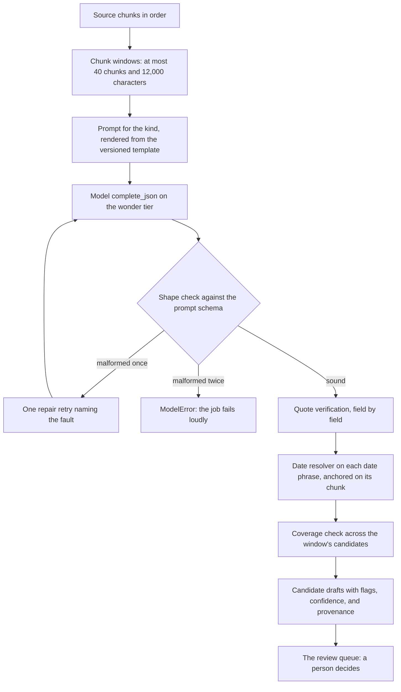
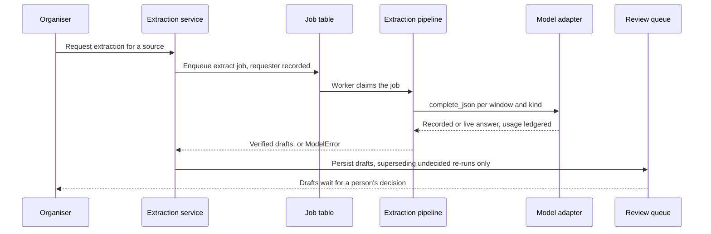
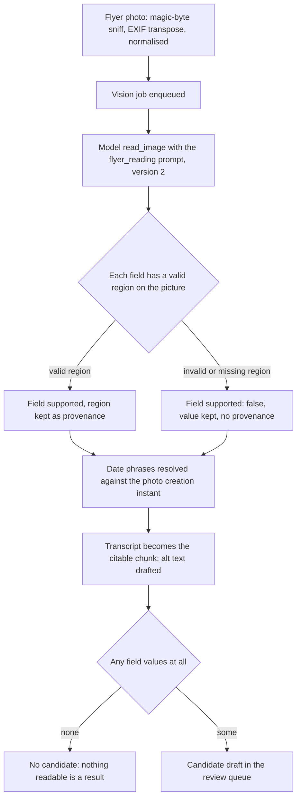
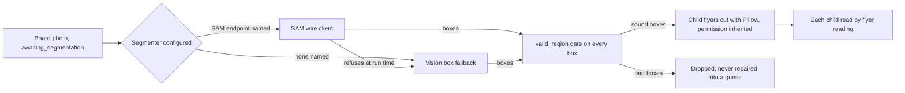
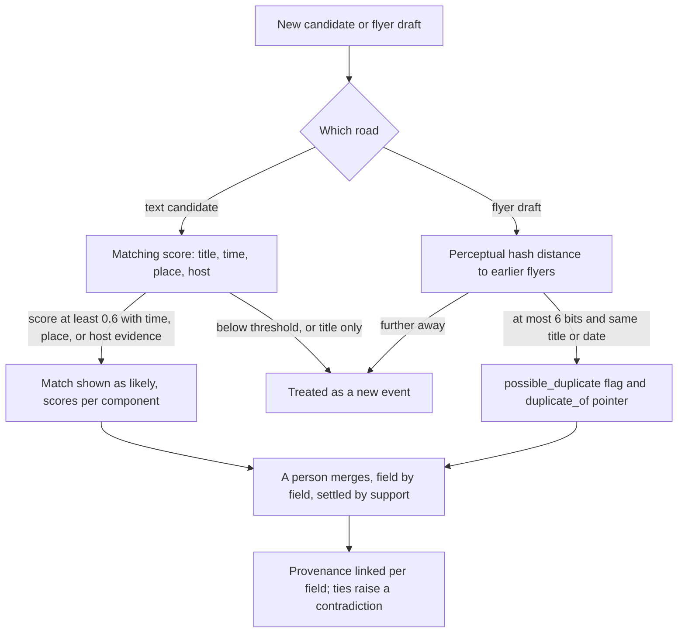
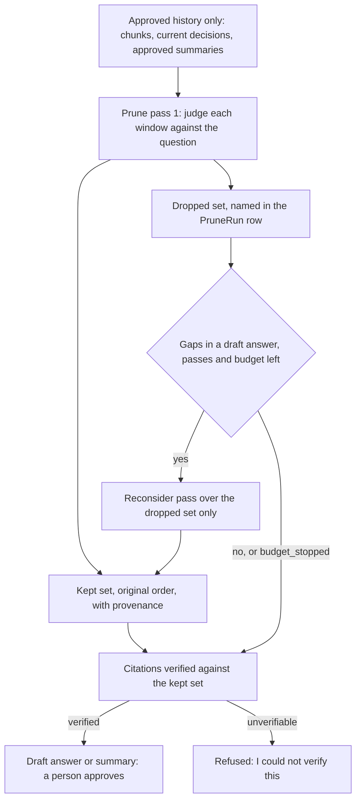

# AI pipeline documents

*The Phase 18 AI chapter (slice B-193). For backend developers
and maintainers. Extraction, flyer reading, board segmentation,
de-duplication, change detection, and the context-pruning
engine — flowcharts and sequence diagrams, the prompt-versioning
rules, the evaluation method, and worked examples traced through
real (fixture) data end to end.*

*Verified against the live tree at this slice: the pipelines are
`src/gpa/ai/extraction.py`, `src/gpa/ai/vision.py`,
`src/gpa/ai/segmentation.py`, `src/gpa/ai/pruning.py`, and
`src/gpa/ai/dates.py`; their service doors are
`src/gpa/services/extraction.py`, `src/gpa/services/vision.py`,
`src/gpa/services/matching.py`, `src/gpa/services/merging.py`,
and `src/gpa/services/memory.py`; the prompts are the fifteen
templates in `src/gpa/ai/prompts/` pinned by `manifest.json`;
the evaluations are `src/gpa/ai/evaluation.py`,
`src/gpa/ai/vision_evaluation.py`, and
`src/gpa/ai/pruning_evaluation.py`. Honesty marker, stated once
here and at every point of use below: no real Meta model
endpoint or credential exists in this environment. Every
pipeline runs through the Phase 3 adapter (`src/gpa/ai/client.py`)
with fixture and mock drivers in tests; the live driver is
stub-transport tested only. The driver boundary is the
deliverable — nothing in this chapter claims a live model ran.*

## The one discipline every pipeline shares

Five rules hold in every pipeline in this chapter, and a reader
who holds them can predict any single pipeline before opening it:

1. **The model's answer is untrusted until it is verified.**
   Text fields must show a quote that is actually in the chunks
   (quote verification); picture fields must name a valid region
   on the picture. A field that fails verification is kept in
   the draft, marked `supported: false`, and carries no
   provenance — it is shown, never hidden, and it can never
   move a published fact on its own.
2. **The model never does date arithmetic.** It returns the
   raw phrase ("this Saturday", "Nov 6"); the deterministic
   date resolver (`src/gpa/ai/dates.py`, decision D-22) owns
   the meaning, resolving against the provenance chunk's
   sent-at — or the photo's creation instant — in the group's
   timezone. Ambiguous phrases return both readings, flagged;
   unknown phrases return no reading. The resolver never
   guesses.
3. **One shape check, one repair retry, then a loud failure.**
   A malformed model answer earns exactly one repair retry
   naming the fault; a second failure raises `ModelError` and
   the job fails honestly. A succeeded call is never
   duplicated to fix a parse problem.
4. **Every call is ledgered and budgeted.** Each model call
   records usage and integer `cost_micros` in the `ai_usage`
   ledger, and the group's daily budget gate is checked before
   work proceeds; at the cap, work defers and says so in plain
   words. Tiers are named, never numbered: `spark` for volume
   work, `wonder` where tangles justify it — extraction and
   pruning judge with `wonder`, reminder wording with `spark`.
5. **The machine drafts; a person decides.** Every pipeline
   ends at a candidate in the review queue (or, for pruning,
   at a draft answer or summary). No pipeline approves,
   assigns an owner, publishes, or sends anything.

## Extraction — text in, verified drafts out

One pipeline, parameterised by kind (`src/gpa/ai/extraction.py`,
slices B-040 → B-042). The kinds differ only in a small table:
`event` (prompt `extraction`, date fields `starts`/`ends`),
`task` (prompt `extraction_tasks`, date field `due`),
`decision` (prompt `extraction_decisions`, no date fields),
`question` (prompt `extraction_questions`, no date fields), and
`event_change` (prompt `extraction_changes` — change detection,
below; deliberately not in the default run). The service door
(`src/gpa/services/extraction.py`, B-045) enqueues one `extract`
job per source, records the machine author as
`system:extraction`, and supersedes only the same source and
kind's undecided drafts on a re-run — decided rows are never
touched. Sources still awaiting transcription or segmentation
are skipped with an audit row, not failed.

Walking tour. The arrow from **source chunks** to **chunk
windows** is the bounding step: windows hold at most 40 chunks
and 12,000 characters, so a forty-message argument is exactly
one window and a long newsletter is several. The window feeds
the **prompt for the kind**; the prompt's rendered text, the
schema beside it, and the media (for vision) are what the
**fixture driver** keys its recorded answers on, by SHA-256.
The **model** box is the adapter's `complete_json` — no domain
code imports a vendor SDK. A sound answer flows to **quote
verification**: each field's quote is searched,
whitespace-normalised, in the window's chunks; a quote found
nowhere marks the field `supported: false`, strips its
provenance, and excludes its confidence — a hallucinated quote
is caught, not published. Date phrases then pass through the
**date resolver** (268-case golden suite, including the demo
lines: a message sent Wednesday 2026-10-21 saying "this
Saturday" resolves to Saturday 2026-10-24). The **coverage
check** flags any chunk claimed by more than one candidate
whose claimants did not flag it themselves
(`shared_chunk_unflagged`). Only then do **candidate drafts**
exist, carrying server-computed quality flags from the closed
vocabulary (`low_confidence`, `missing_required`,
`unsupported`, `ambiguous_date`, `unresolved_date`,
`conflicting`, `shared_chunk_unflagged`) — clients never send
flags. The last arrow is the law: drafts land in the **review
queue**, and approval — a person's act, in the approval's own
transaction — is the only road to a published entity.

Walking tour. The **organiser** starts nothing synchronous:
the **extraction service** writes an **extract job** row and
answers with its id, so progress is read from the durable job
table, never an in-memory bus. The **worker** claims the job by
conditional update; the **pipeline** calls the **model
adapter** window by window and kind by kind, checking the
budget gate before each kind's step. Verified drafts return to
the service, which persists them into the **review queue** in
its transaction; a `ModelError` fails the job with its reason
kept, and no partial draft set is published.

## Flyer reading — the picture twin

Flyer reading (`src/gpa/ai/vision.py`, B-063; service
`src/gpa/services/vision.py`) is the same pipeline with one
difference the medium demands: **provenance is a place, not a
quote.** Every field names its region — `[x, y, w, h]` as
fractions of the picture — and the region is validated the way
a quote is verified: missing, malformed, degenerate, or
off-picture marks the field `supported: false`; the value
stays in the draft, labelled by its verdict, with no evidence
behind it. The one reading also drafts the flyer's transcript
(which becomes its citable chunk) and a description: the
flyer's `alt_text_status` flips to `complete` only for a
genuine description (at least 20 characters, not the
placeholder, not the filename), and a human-written
description is never overwritten by a machine draft. The
reading reports links — codes the model decoded and printed
addresses it read — merged with printed URLs extracted
deterministically from the transcript. Honesty marker:
**no QR decoder was hand-rolled and none is pretended** — decoding
is the vision model's structured output. A reading with no
field values at all mints no candidate: nothing readable is a
result, not a draft. Approval of a flyer-born candidate sets
the published event's `flyer_id` in the mint itself.

Walking tour. Ingest prepares the **photo** (sniffed by magic
bytes, never by extension; EXIF orientation applied; at most
2400px, with a 320px thumbnail). The **vision job** carries
real progress — a board's progress is the share of its posters
read, and partial success is a state: a failed child is
`read_failed` on the flyer wall, the board still completes,
and only all-failed fails the job. The **model** reads with
`flyer_reading` version 2. The region fork is the picture form
of quote verification. Dates resolve through the same
**resolver**, anchored on the photo's `created_at`. The
**transcript and alt text** step is B-065; the final fork is
the honest empty result — the mock driver's schema-shaped
shrug lands exactly there, by design.

## Board segmentation — cutting before reading

A board photo is one source holding many posters. Cutting it
is the one job segmentation does (`src/gpa/ai/segmentation.py`,
B-064, decision D-19: the segmenter separates; it never
reads). Two drivers sit behind one protocol: `SamSegmenter`,
a SAM-shaped wire client (POST the image, receive boxes;
stub-transport tested; with no endpoint configured it raises
`SegmenterUnavailable` in plain words), and
`VisionBoxSegmenter`, the decided fallback, which asks the
vision model for poster boxes through the `board_segmentation`
prompt and runs the same region pipeline on its answer.
`build_segmenter` chooses SAM when settings name an endpoint
and the fallback otherwise; if SAM refuses at run time the run
falls back to vision and **the audit names the driver that
actually cut** (for example `vision (fallback: SAM refused)`).
Every box, from every driver, passes `valid_region` before it
may become a child flyer — an off-picture or degenerate box is
dropped, never repaired into a guess. Children are cut once
with Pillow into child flyer sources, inherit the board's
permission record, and are then read one by one by flyer
reading above.

Walking tour. The board starts as exactly one source in stage
`awaiting_segmentation` with one placeholder chunk. The fork
is configuration, not chance, and the run-time refusal arrow
from **SAM** to the **vision fallback** is the resilience the
roadmap decided in advance. Both drivers converge on the
**valid_region gate** — the same validator flyer reading uses
— before any **child flyer** exists. The golden board yields
its 3 posters as separate flyers in both driver modes.
Honesty marker: no real SAM endpoint exists in this
environment; the client is stub-transport tested only.

## De-duplication — propose, never merge silently

De-duplication has two halves, and neither half ever merges
anything by itself.

**Cross-source matching** (`src/gpa/services/matching.py`,
B-075) scores a new candidate against events the group already
knows: title 0.35, time 0.35, place 0.20, host 0.10 — a
weighted mean over the components actually present. Title
similarity is half Jaccard plus half containment over
article-stripped tokens; an exact date scores 1.0, an ambiguous
reading that includes the event's date earns 0.85, a day away
earns 0.4; a place said shorter ("hall" inside "Village Hall")
counts by containment. At or above `MATCH_THRESHOLD` (0.6) the
candidate detail shows the match as `likely`, best first, with
per-component scores. **A bare title resemblance is halved and
can never propose** — a match needs time, place, or host
evidence too, so two different club nights in different weeks
never propose a merge. Cancelled and tombstoned events never
match. When a person accepts, the merge service
(`src/gpa/services/merging.py`, B-076) settles field by field:
empty fields fill, the fuller form of the same fact refines,
agreement is recorded, and genuine disagreement is settled by
support — distinct sources per value, counted only from
sources recorded backing that value. Unsupported claims never
move anything. All candidate provenance becomes event source
links, so the merged event can answer "where did this come
from?" per field. A tie keeps the event's value and raises a
visible contradiction row for a person to resolve.

**Flyer duplicates** (B-071) use a hand-rolled average-hash
perceptual hash (`src/gpa/services/images.py`: the picture
shrunk to 8x8 greyscale, each pixel compared with the mean,
64 bits as 16 hex characters), computed at ingest. The same
poster photographed twice — hash distance at most 6 bits —
plus the same drafted title or the same resolved date earns
the new draft a `possible_duplicate` flag and a `duplicate_of`
pointer: a merge suggestion in the queue, never a silent
second event, never an automatic merge. An unknown hash is
not a near hash and never reads as a match.

Walking tour. The first fork separates the two roads because
their evidence differs: words score, pictures hash. Both
roads converge on the same law at the bottom — **a person
merges**. The machine's whole authority is to propose, with
its scores and distances shown; the merge itself runs through
the same change-writing door as a human edit, so history and
re-announcement ride along.

## Change detection — words about an event that exists

Change detection (B-077) is extraction aimed backwards: words
about an existing event — a move, a new place, a cancellation —
draft as kind `event_change` (prompt `extraction_changes`
version 1), never as a new event. The kind is requestable but
deliberately **not** in the default four-kind run, so a first
announcement cannot draft "changes" out of itself. The
pipeline links each change to its target at draft time:
`matching.match_by_name` treats an exact name as a reference
(score 1.0) and otherwise uses the weighted score at the same
threshold; an unmatched change is flagged
`change_target_unknown`. Approval applies the change inside
the approval transaction (`merging.apply_change_candidate`):
a partial move keeps the unmoved part, a start move carries
the end by the same delta, and a cancellation flows through
the ordinary cancellation door with the source's quote as its
reason. Refusals are plain and total — no target, target gone
or cancelled, unbacked claim, unresolved time, changes-nothing
— and leave the candidate pending; rejecting the candidate
leaves the event standing.

## The context-pruning engine — memory without embeddings

The pruning engine (`src/gpa/ai/pruning.py`, B-113/B-114;
service `src/gpa/services/memory.py`) answers questions from
the group's own past, and the first fact about it is what it
is **not**: this is **not embedding RAG**. There are no
embeddings, no vector store, and no similarity index anywhere
in it. Retrieval by embedding guesses which chunks look like
the question; this engine has a full model **read** the chunks
and judge, chunk by chunk, what is relevant to the question
actually asked — including the chunk whose words share nothing
with the question but whose meaning settles it.

The corpus is the group's **approved history only**: source
chunks brought in under a permission record, the group's
current decisions, and summaries a person approved. Pending
drafts and rejected candidates never enter it. One pass
windows the corpus and asks the answering-class model
(`wonder` tier, prompts `prune` version 1) to judge each
window; survivors are kept **in their original order, with
provenance**, and the dropped set is named, not vanished —
every run is written to a `PruneRun` row (input, kept,
dropped, passes, model, cost), so "the model ignored it" is
always checkable. Multi-pass (B-114): a second pass
(`prune_reconsider` version 1) re-judges only the dropped set,
aimed at the gaps a draft answer exposed. Pass count and token
budget are hard caps enforced in the engine, whatever the
caller asks: at most 3 passes (`MAX_PASSES_CEILING`), the
budget is checked before each window's call on an estimate, a
pass that would start over budget never starts, its unjudged
chunks stay dropped and visibly so, and the outcome carries
`budget_stopped` so the answer can say so. The doors built on
the engine — ask, summaries, briefings, recaps — verify every
citation against the kept chunks before an answer returns;
an answer whose citations cannot be verified is refused with
"I couldn't verify this", never polished into plausibility.
Everything the engine produces is a draft until a person
approves it.

Walking tour. The corpus box is the privacy boundary —
nothing unapproved is read. **Pass 1** splits the corpus into
the **kept** and **dropped** sets; both are outcomes, both are
recorded. The **reconsider** arrow is the multi-pass loop,
bounded by the pass ceiling and the budget check; when the
budget stops a pass, the flag rides the outcome instead of
being hidden. **Citation verification** is the exit gate:
quotes are found in the kept chunks by the same normalised
search extraction uses, and the unverifiable branch is a
refusal, not a rewrite.

## Prompt-versioning rules

Prompts are code-adjacent artefacts, versioned like code
(`src/gpa/ai/promptlib.py`, B-038). The rules, in full:

- Each template lives at `src/gpa/ai/prompts/<name>.md` with a
  front-matter header (`name`, `version`) and its output JSON
  Schema beside it in `<name>.schema.json`. There are fifteen
  prompts today: `extraction`, `extraction_tasks`,
  `extraction_decisions`, `extraction_questions`,
  `extraction_changes`, `flyer_reading` (version 2 — the only
  prompt yet bumped), `board_segmentation`, `newsletter`,
  `reminder_wording`, `summary`, `briefing`, `recap`,
  `ask_memory`, `prune`, and `prune_reconsider`, all others at
  version 1.
- `manifest.json` pins, per prompt, the current version and
  the **SHA-256** of the template file. Loading a prompt
  verifies both: a template edited without bumping its version
  and regenerating the manifest (`python -m gpa.ai.promptlib
  --write-manifest`) no longer matches its recorded hash and
  **fails loudly at load**, in the test suite and at run time
  alike.
- Every candidate records the prompt name and version that
  produced it, so any draft can answer "which instructions
  made you?".
- Template placeholders are `{{NAME}}` tokens replaced
  literally in a single pass over the template only — values
  substituted in are data and are never rescanned for
  placeholders of their own (B-142), so source text containing
  braces cannot rewrite a prompt.

## The evaluation method

Three harnesses, one habit (B-046's): golden sets with
hand-written expectations, run through the **real** pipeline
with the fixture driver replaying recorded answers keyed by
SHA-256 of prompt, schema, and media — a missing recording is
a loud `FixtureMissError`, never an invented answer. Every
corpus is deliberately imperfect, because a harness that
cannot show red cannot be trusted when it shows green.

- **Extraction** (`evaluation.py`): per-field **precision**
  (of the fields predicted with a value, how many were right)
  and **recall** (of the fields the gold expects, how many
  were got right), dates scored on the resolved date. The
  baseline records place at precision 0.50 / recall 0.50 (one
  wrong place) and event cost at recall 0.00 (one omitted
  cost) on purpose. Any field dropping more than 2 points
  (tolerance 0.02) against `eval_baseline.json` fails the
  gate; improving a prompt means re-recording the baseline in
  the same commit, where the drift is the review.
- **Vision** (`vision_evaluation.py`, B-073): the golden
  flyers — clean, handwriting, rotated, glare — built
  deterministically with Pillow and scored per type over
  title, starts, place, and cost, dates again on the resolved
  date. Baseline: clean 1.00, the other three 0.75 each (a
  missing cost, a missing place, a digit-misread date, all
  deliberate), overall 0.8125, same 0.02 tolerance, with a
  degradation test proving the gate has teeth.
- **Pruning** (`pruning_evaluation.py`, B-121): golden
  questions with human-marked relevant positions; a recorded
  judge's kept positions are replayed through the real engine,
  so the scores measure the engine end to end. The recordings
  are deliberately imperfect — one case drops a relevant
  chunk, one keeps an extra — and the floors the gate asserts
  live in `tests/test_pruning_evaluation.py`.
- The date resolver has its own golden suite (268 cases in
  `tests/test_dates.py`), including the rule that a passed
  "this weekday" returns both readings, flagged.

Run any harness by hand (`python -m gpa.ai.evaluation`,
`python -m gpa.ai.vision_evaluation`) and it prints its table;
the numbers in TEST_REPORT at each gate are those tables,
never hand-typed claims.

## Worked examples — fixture data, end to end

**Worked example 1: the club night chat (extraction).** The
evaluation corpus's `golden-club-night` case: five chunks sent
2026-10-21 in `America/New_York` — Ana announces "Club night
is on! this Saturday at the hall, doors 7pm", Ben offers the
projector, Cleo the playlist, Ana records the committee's
decision that the quiz is postponed to November, Ben asks who
is doing the door rota. One window (5 of 40 chunks). The event
draft carries title "Club night" (quote "Club night is on!",
confidence 0.95) and a start whose phrase "this Saturday"
resolves — Wednesday sending, Saturday still upcoming — to
2026-10-24 at 19:00 local. The same window also yields the
decision ("the quiz is postponed to November") and the
question ("who is doing the door rota") as their own kinds:
one pipeline, three more schemas, each field with its own
quote. The corpus's second case, `quiz-night-imperfect`, is
the deliberate red: its recorded answer names a wrong place
and omits the cost, which is why the baseline above reads
place 0.50 and cost recall 0.00.

**Worked example 2: the twelve-section newsletter.** The
golden newsletter fixture (B-026/B-048) sections under its
headings into twelve event sections behind a greeting
preamble. Extraction runs section by section and yields
exactly 12 candidates — the Phase 3 gate asserts the count —
each candidate's quotes pointing into its own section, none
borrowing a neighbour's evidence.

**Worked example 3: the Harvest Supper flyer (vision).** The
vision corpus's `clean` case, `harvest-supper`: a red printed
poster, built in code, whose recorded reading returns title
"Harvest Supper" (region [0.06, 0.12, 0.8, 0.12], confidence
0.97), place "Village Hall" (0.94), cost "£6" (0.93), bring
"a dish to share" (0.9, no region — that field therefore reads
`supported: false` in a strict run and is exactly the kind of
honest gap the queue shows), and a start whose phrases "Nov 6"
and "6.30pm" resolve against the harness anchor
(2026-10-24 12:00 UTC) to 2026-11-06. The transcript —
"HARVEST SUPPER — Nov 6, 6.30pm, Village Hall. £6. Bring a
dish to share!" — becomes the flyer's citable chunk, and the
drafted alt text ("A red printed poster for a harvest supper
at the Village Hall on Nov 6 at 6.30pm, £6, bring a dish to
share.") is a genuine description, so `alt_text_status` may
complete. The case scores 1.00; the handwriting twin omits
the cost and scores 0.75.

**Worked example 4: the golden board (segmentation).** The
Phase 5 golden board yields its 3 posters as separate flyers
in both driver modes — SAM-shaped boxes and vision-fallback
boxes pass the same `valid_region` gate, are cut once each,
and are read one by one; the board's progress is the share
read (1 of 3, 2 of 3, done), and a child that fails to read
would sit on the wall as `read_failed` while the board still
completes.

**Worked example 5: the trip argument (pruning's neighbour).**
The Phase 7 gate's forty-message trip argument is exactly one
extraction window (40 chunks, the window ceiling): fixture
extraction yields 1 event, 3 tasks, 2 decisions, and 2
questions from it, a reviewer confirms the kayaks' volunteered
owner by naming the member in the edited draft — the
pipeline's own words for that owner had landed only as a
suggested label, because the AI never assigns a silent victim
— and approval mints the plan. The same forty chunks, once
approved into history, are the sort of corpus the pruning
engine later reads when someone asks what was settled about
the trip.

## What this chapter does not claim

No live model, SAM endpoint, or transcription service ran in
this environment: the live driver refuses `generate_image` in
plain words, SAM is stub-transport tested, and every score
above is a fixture-driver measurement of the pipeline's
verification machinery — which is the part this codebase owns.
When a real endpoint is wired, the adapter swaps by
configuration alone, the prompts and their versions do not
change, and the baselines are re-recorded from live runs in
the commit that does it, under the same 2-point rule.
