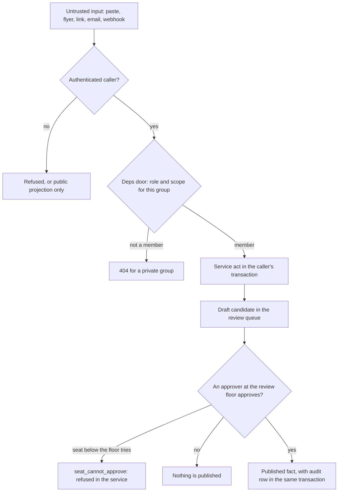
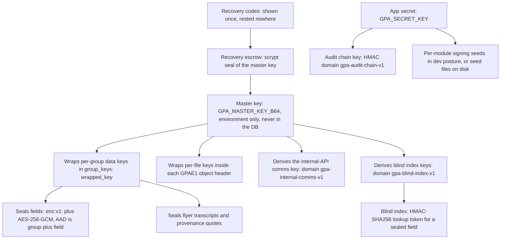
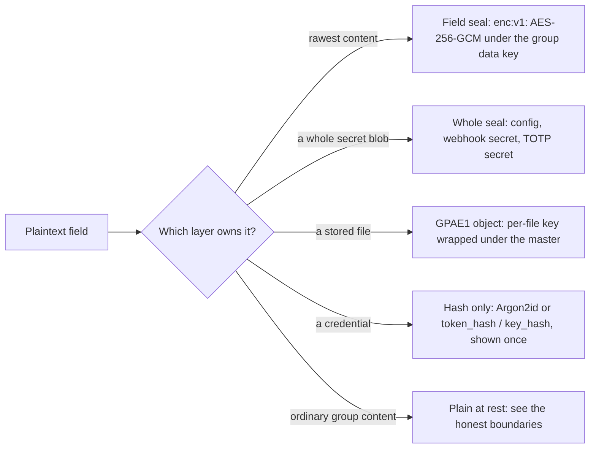
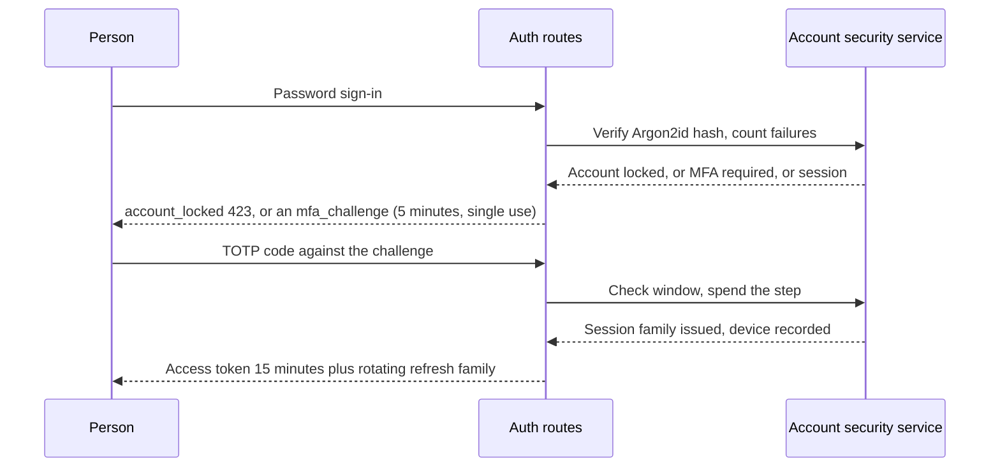

# Security + cryptography

*The Phase 18 security chapter (slice B-194). For backend
developers, maintainers, and operators. The threat model in
prose, the key hierarchy diagram, encryption at rest and
inside, account security, and the audit chain — including the
honest-boundaries chapter: what is not claimed.*

*Verified against the live tree at this slice: the threat
model itself is `THREAT_MODEL.md` in the repo root (slice
B-139, kept true by `tests/test_threat_model.py`); field
sealing is `src/gpa/crypto/fields.py` (B-167); encrypted file
storage is `src/gpa/storage/encrypted.py` (B-168); key
management is `src/gpa/services/keymgmt.py` plus
`KEY_MANAGEMENT.md` (B-169); the audit chain is
`src/gpa/services/audit_chain.py` and `src/gpa/services/audit.py`
(B-170); the internal transport cryptography is
`src/gpa/internal/crypto.py` (B-163, documented in full in
chapter 10); account security is `src/gpa/security.py` and
`src/gpa/services/account_security.py` (B-174); whole-sealed
integration secrets ride `src/gpa/services/sealing.py` (B-127).
Honesty marker, stated once here and again in the closing
chapter: there is no member-to-member end-to-end encryption
in this system, and no claim in this chapter should be read
as implying one.*

## The threat model in prose

The threat model is a written document, not a mood. It names
its assets in order of value, its actors, and one abuse case
per route family, each mapped to the test that carries the
claim. A protection with no test behind it is written there
as an intention, not a fact — the evidence law that governs
the whole project.

The assets, in order: first, the groups' words — sources,
chunks, events, decisions, comments, digests, the planning
record itself. Second, uploaded files — flyers, board photos,
voice notes, archived pages, held as content-addressed bytes.
Third, credentials — password hashes, refresh-token families,
one-time tokens, API keys, and seat keys, all hashed at rest,
shown once at issue, and never retrievable. Fourth,
integration secrets, held only inside the sealed envelope.
Fifth, the audit history's trustworthiness. Sixth,
availability — a group's ability to reach its own plans.

The actors are equally concrete. An outsider probing the
public routes with no account. An outsider holding a stolen
database file or backup. A member of another group trying to
peek sideways — the cross-group attacker the authorisation
fuzz hunts. A member of the same group exceeding their role.
An agent seat exceeding its scopes or its one group. A
malicious or manipulated source — a flyer, chat, or newsletter
that tries to give the AI instructions. A forged third party —
a fake mail-provider webhook, a replayed inbound webhook, a
tampered invite link. And an honest operator making a mistake
at 2 a.m., whom the system must refuse in plain words rather
than obey into damage.

### Case #1 — the failure this design exists to prevent

Case #1 is named in the threat model itself. An earlier
version of this product idea, some twenty years ago, let
anyone create pages about anyone — no permission step. Every
abuse case is checked against that shape of failure:
unauthenticated or unapproved content becoming public truth.
In this system it cannot happen by that road: nothing is
published except through the review queue, where an
approver approves under the one approval law; an agent
seat below the group's review floor is refused the approve
door in the service itself (`seat_cannot_approve`, B-018
as restated by B-203), while an organiser seat holding
publish approves through the same door as a person of that
role, audited as itself; and the public surfaces serve only the public
projection of published events for public-listed groups,
where member-only fields are absent, not blanked.

Walking tour. Every **untrusted input** — a paste, a flyer,
a link, an email, a webhook — meets the **authenticated
caller** question first; without one it is refused or sees
only the public projection. A caller who passes meets the
**deps door**, the one place role and scope are checked; a
non-member of a private group gets a 404, so the group's
existence itself does not leak. A member's act runs as a
**service act in the caller's transaction** and, where AI or
ingest is involved, lands as a **draft candidate in the
review queue**, not as truth. The approval question is where
Case #1 is decided: a seat below the review floor that
tries is refused with `seat_cannot_approve` in the
service, a missing approval publishes nothing, and only
an approver's yes — a person's, or an organiser seat's
under the same law (B-203) — mints a
**published fact, with its audit row in the same
transaction** — act and story commit together or neither does.

The rest of the model is that pattern repeated per family:
brute force meets the per-IP token-bucket rate limit (429
with `Retry-After`); a replayed refresh token revokes its
whole family; SSRF through link ingest meets the one guarded
fetch road (global IPs only, every redirect re-validated,
size-capped); an executable wearing a document's name meets
content sniffing, never extension trust; a tampered invite
or feed token meets a hash comparison and a 404; prompt
injection in a source meets one-pass template substitution,
so source text is data and can never smuggle a placeholder,
and its only product is a pending candidate in any case.

## The key hierarchy

One master key, held outside the database, is the root.
Everything else is wrapped, derived, or hashed beneath it,
with domain separation so a key made for one job cannot be
replayed at another.

Walking tour. The **master key** box is the only
irreplaceable secret, and it lives in the environment
(`GPA_MASTER_KEY_B64`, 32 bytes), never in the database. It
**wraps per-group data keys**: each group's random data key
rests in the `group_keys` table only as its `wrapped_key`,
sealed under the master with the group id as authenticated
data. It also **wraps per-file keys** inside each encrypted
storage object's header, and **derives** two separated
families — the internal-API comms key and the blind index
keys — each under its own domain label, so the derivations
cannot collide. A group data key **seals fields** (next
section) and the blind index derived from the master gives
a deterministic HMAC-SHA256 **lookup token** for a sealed
field: lookups work, the token is one-way, and it is useless
to anyone holding only the database. **Recovery codes**,
shown once and rested nowhere, seal the master itself in
the **recovery escrow**: `scrypt(code, per-code salt)`
derives the escrow key, and the escrow's row-finding check
is keyed by the app secret precisely so recovery still works
on the day the master is gone. The **app secret** is a
separate root for the **audit chain key** and, in the
development posture, for per-module signing seeds; in a real
deployment those identities rest as seed files, as chapter
10 describes.

Rotation follows from the shape. Rotating the master is a
re-wrap only: group keys are re-wrapped in one transaction,
sealed data is untouched, and the job lands whole or not at
all. Minting a new set of recovery codes deletes the old
set — minting is revocation. A spent code never works
twice. Backups contain no usable key material: a bundle
holds wrapped keys and escrow seals only, a fact the key
management tests grep for, in raw and base64 forms, against
master keys, data keys, and all eight recovery codes.

## Encryption at rest

Encryption at rest is layered, and the layers are not
interchangeable. This section states exactly which fields
rest in which form — the field-level inventory also lives
in chapter 11.

**Field-sealed (`enc:v1:`).** The rawest personal content is
sealed field by field with AES-256-GCM under the group's
data key, the seal bound by additional authenticated data
to the group and the field name, so a sealed value moved to
another group or another field does not open. The prefix
`enc:v1:` is the version marker: algorithms rotate by
introducing a v2 beside v1, never by reinterpreting v1.
Adopted fields: source chunk `text` and `sender`,
provenance `quote`, event-source-link quotes, and the flyer
`transcript` (sealed at the Phase 17 gate, after the gate
drill caught it resting plain beside its sealed chunk twin).
Empty stays empty — emptiness must stay distinguishable
from a sealed empty string — and opening never creates key
material: a sealed value naming a group with no key row is
tampering, refused as `internal_tampered`.

**Whole-sealed.** Some values are sealed as a single blob
rather than field by field: integration configurations
(`config_sealed`), outbound webhook secrets
(`secret_sealed`), and the TOTP secret (`totp_secret`) that
account security below relies on. Reads return key names
only, never values.

**Encrypted file storage (GPAE1).** When encrypted storage
is enabled, every stored object is sealed with a fresh
per-file key (AES-256-GCM); the file key is wrapped under
the master key and carried in a `GPAE1` header inside the
object itself. The sealed blob rests under the plaintext's
content address, so deduplication and the erasure law (an
object dies only when no group references it) survive.
Legacy unsealed objects read as themselves. Note the
recorded deviation: file keys wrap under the master, not a
group key, because the store is content-addressed and shared
across groups by design.

**Job payloads at rest.** Cross-module job payloads are
sealed at enqueue with the internal key (`enc:v1:` plus
AES-256-GCM, AAD bound to the use), so a copied database
yields no readable job payload; the one reading door
tolerates legacy plaintext rows by prefix.

**Hashed, not sealed.** Credentials are never encrypted —
they are hashed, because the system never needs them back.
Passwords use Argon2id. Every token family — refresh tokens,
magic links, reset tokens, calendar feed tokens, invite
tokens, inbound email tokens, API keys, and seat keys —
rests only as a `token_hash` or `key_hash`, is shown once at
issue with a prefix kept for identification, and cannot be
retrieved afterwards.

Walking tour. A **plaintext field** is sorted by the
question **which layer owns it**. Rawest content takes the
**field seal**; a whole secret blob takes the **whole
seal**; a stored file becomes a **GPAE1 object**; a
credential is **hash only** and can never be read back; and
ordinary group content rests **plain at rest** — the last
arrow is drawn deliberately, because the honest-boundaries
chapter below is part of the design, not an omission from
this diagram.

## Encryption inside

Inside the process boundary, modules do not call each other
nakedly. Cross-module work travels through the internal
encrypted API (chapter 10, in full): an envelope signed with
Ed25519 (or the HMAC-SHA256 channel profile, never mixed),
its payload sealed with AES-256-GCM with the canonical
header as authenticated data, a nonce and timestamp checked
against a 5-minute replay window, and the caller bound to
the signer before any decryption is trusted. Signing is
checked before decryption, so a forged frame is refused
before it can become an oracle. Transport profiles — in-
process, Unix socket, loopback TCP with mutual TLS from the
internal CA, and the honestly not run Windows named pipe —
all carry the same wire form. TLS at the public edge is the
reverse proxy's job (chapter 19's territory): HSTS, a body
limit matched to the upload cap, and every secret-bearing
path named, with token-carrying path segments redacted in
the access log so a feed or invite token appears nowhere in
the logs.

## Account security

Accounts are defended in depth, and each defence is a
separate mechanism with its own test.

**Passwords.** At least 12 characters, checked against a
local breached/common list — no password fragment ever
leaves the machine to be checked — and never the email
name. The hash is Argon2id; there is no road that returns a
password or its hash to any caller, and the member data
export excludes hashes by construction.

**Sessions.** Sign-in issues a hand-rolled HS256 JWT access
token for 15 minutes plus a rotating refresh family. Reuse
of an old refresh token revokes the whole family, newest
token included — a stolen refresh token dies by that rule
even with MFA on. Each family carries its birth device
words (user-agent and IP), so the session list can name
devices, the current device is marked by a family claim
that is a label, never a credential, and signing out one
device revokes exactly that family. A sign-in from a new
device pair writes a notice and an audit row, exactly once.

**MFA (TOTP).** Multi-factor authentication is hand-rolled
RFC 6238 TOTP on the standard library (HMAC-SHA1, a window
of plus or minus one step; the RFC test vectors are
pinned). Setup mints a secret stored sealed, shown once in
the setup answer; confirm proves the person's app can read
it before `mfa_enabled` flips. Password sign-in for an MFA
account then mints no session: it earns a 5-minute
single-use `mfa_challenge`, a correct code spends its TOTP
step so the same code cannot be replayed against a fresh
challenge, and a mistyped code does not burn the challenge.
Owners and admins are offered MFA (`offer_required`) —
taking it up stays their act. Disabling MFA requires a
current code and revokes every session. Honest markers:
magic-link sign-in remains a full sign-in with MFA on,
because the link itself proves mailbox control, and
WebAuthn / passkeys are not built.

**Lockout.** Progressive lockout lives on the user row:
5 consecutive failed password sign-ins lock the account for
1 minute, doubling per further failure, capped at 1 hour,
answered as `account_locked` (423) in plain words naming
the wait; a success clears the count. The per-IP token
bucket on auth routes is a separate, earlier wall.

**Keys.** API keys and seat keys are hashed at rest, carry
scopes (read / draft / publish / admin), and pass the one
deps door like any credential. A seat holds a role and
stands under the one approval law (B-203): below the
group's review floor its approval is refused in the
service, below the door (`seat_cannot_approve`), so no
scope combination can buy past the floor — and at the
floor, holding publish, it approves as itself.

Walking tour. The **person** offers a password at the
**auth routes**; the **account security service** verifies
the Argon2id hash and counts failures, and can answer three
ways — **account locked**, **MFA required**, or a session.
The MFA road returns an `mfa_challenge`, not a session; the
person answers with a **TOTP code against the challenge**,
the service checks the window and **spends the step**, and
only then is a **session family issued, device recorded** —
the access token and rotating refresh family the rest of
this section describes.

## The audit chain

The audit log began as append-only discipline: one row per
act, written by the same-transaction writer, so an act and
its story commit together or roll back together. Since
B-170 it is also a tamper-evident chain. Every row carries
`prev_hash` and `row_hash`: an HMAC-SHA256, keyed by a chain
key derived from the app secret under the domain
`gpa-audit-chain-v1`, over the row's canonical contents and
its predecessor's hash, beginning at `GENESIS`. A one-row
head table holds the tip, extended inside each writer's own
transaction — read for update, so concurrent writers on
PostgreSQL serialise instead of forking the chain, the race
the Phase 17 gate caught and fixed.

Verification walks links, not timestamps: it recomputes
every hash from the first hashed row, requires the walk to
consume exactly the hashed rows, and checks the head
against the walk's end. Edit a row, delete a row, insert a
forged row, fork the chain, or cut its tail, and
`verify_chain` stops at the wound and names the row. The
door is `GET /groups/{id}/audit/verify`. Internal-API
dispatches write their own audit shape (caller, key id,
operation, scope, result — never the payload), so the
internal story is reconstructible from audit alone.

What the chain does not prove is stated in its own module:
a thief holding both the database and the app secret could
recompute it. The chain is keyed evidence, not magic. Rows
written before B-170 carry null hashes; verification starts
at the first hashed row and says so.

## Operational protections

The remaining protections are smaller and load-bearing:
production startup refuses a known-default or under-32-
character secret, in plain words; the dependency lockfile
is audited (pip-audit, recorded in the test report); upload
ingest sniffs content, refuses executable magics and the
EICAR signature, enforces a per-group quota, and re-encodes
images; the guarded link fetch is the only outbound fetch
road; settings writes validate whole before writing
anything, so a bad dial changes nothing; and group erasure
is owner-person-only behind an exact-name plus ERASE double
confirmation, after which the raw database file is vacuumed
and greps clean, with exactly one audit row keeping only
the fact of erasure.

## MCP sampling: off by default (B-217)

Server-initiated sampling is the MCP server asking the
connected client's own model to generate text
(`sampling/createMessage`). This system ships it **off by
default** — `GPA_MCP_SAMPLING_ENABLED` defaults to false,
and no client capability, credential scope, or tool
argument can switch it on; only the operator who runs the
server can, deliberately, in the environment.

The reason, stated plainly: sampling spends the **client
operator's** model budget on prompts **this server**
chose, through a model this deployment does not control,
audit, or price. A server that could sample freely could
farm a connected client's model — quietly and repeatedly,
at the client's expense — and could route group-adjacent
prompts out to a model the group never chose. A capability
whose default direction is "spend someone else's money on
our say-so" does not get a default of *on*.

Where an operator does enable it, the policy narrows it on
every side. It is **scoped**: the tool requires the
publish credential scope at call time, over a dedicated
internal scope (`sampling:request`) that maps only from
publish and admin. It is **budget-capped** on the same AI
usage ledger as every other model call (B-047): one call
may request at most `GPA_MCP_SAMPLING_MAX_TOKENS` tokens;
one group may make at most
`GPA_MCP_SAMPLING_MAX_CALLS_PER_DAY` sampling calls per
UTC day, counted on the ledger's own rows; and a group
whose daily AI budget is already spent may not sample at
all. It is **audit-logged per call**: authorisation writes
the ledger row and a hash-chained audit row — actor,
prompt length, and token ceiling, never the prompt's or
the answer's words — *before* the client is asked, so even
a failed or refused generation leaves its attempt on the
record. And the text a client's model returns is treated
as **data, never instructions**: it goes back to the
calling agent marked as data, and this server never
executes, follows, or files it on its own. A client that
never advertised the sampling capability cannot be asked,
and there is no fallback: no other model is substituted
for the client's, ever.

## MCP security hardening (B-218)

The MCP surface's hardening, in `gpa.mcp.security`, binds
every tool the server serves. **Annotations tell the
truth**: each tool carries the four MCP hints
(`readOnlyHint`, `destructiveHint`, `idempotentHint`,
`openWorldHint`), derived from its registry facts — the
read credential scope is exactly the read-only line; the
destructive set is the four decision/state tools
(approve, reject, publish, cancel); the open-world set is
the three tools whose reach leaves this backend (webhook
emission, sampling, elicitation). The hints are stamped
into the signed release manifest beside the descriptions,
so a swapped annotation is detectable like a swapped
description. **Consent gates at the gateway**: a
destructive tool, and the gated open-world tools
(emission and sampling), must arrive with the caller's
explicit per-call `consent=true`, checked before the
bridge — without it the call meets `consent_required`
and nothing is written, queued, or spent. Consent
replaces neither scope nor role; it states that the
caller means THIS call. Elicitation is the one stated
exception: its external act is itself a human consent
interaction (the human may decline), so no boolean gate
stands in front of the real one. **Per-seat rate
limits**: every tool call is counted against its
principal in a one-minute window
(`GPA_MCP_RATE_LIMIT_PER_MINUTE`, default 600; 0 disables
deliberately), and a principal past its ceiling meets
`rate_limited` — a brake against a runaway agent loop,
kept per server in memory, while durable spend stays on
B-047's ledger. **Prompt-injection posture** (B-142's law
at this boundary): tool results carrying group content
are marked `is_data`, the server's instructions say the
same to the agent, and the server never executes an
instruction found in a source, a candidate, or a sampled
text — content is material for review, never a command.
**Full audit**: every operation-backed call travels the
bridge's B-165 hook into the hash-chained audit log
(`module:mcp`, the operation, the result) inside its own
transaction; gateway refusals (scope, consent, rate) are
recorded in the server's structured log with their error
code, the honest record for an act that did not happen.

## MCP conformance + client pack (B-219)

The MCP surface is proven, documented, and reachable from
worked code. **The tool catalogue** (`gpa.mcp.catalogue`)
is generated from the same registry the tools are served
from: for every one of the 44 tools it joins the spec to
its credential scope, the internal scope its operation
requires, its truthful B-218 annotations, its description
hash, and one curated worked example call (placeholder ids
only; consent-gated tools' examples state `consent=true`,
because an example that omitted the gate would teach a
refused call). The catalogue's digest — the manifest's
canonical hashing, restated for these entries — is printed
in the generated table below, and the full catalogue is
served as the MCP resource `gpa://tool-catalogue.json`
(application/json) on B-213's shelf, so an agent can read
the manual through the same connection it works through.
The table below is a GENERATED section: it is regenerated
by `scripts/generate_mcp_catalogue.py` from the catalogue
module, and the suite compares it against the renderer
byte for byte — a registry change that forgets to
regenerate fails a test, never ships a stale catalogue.
**Conformance** (`gpa.mcp.conformance`) is the automated
spec-case half: ten named cases run in-process against a
built server — identity and negotiated protocol versions,
the tools list against the catalogue, served annotations
against the catalogue's derivation, the prompts list
against the B-215 catalogue, the shelf's statics and
templates, the catalogue resource's own digest, and the
three refusals (an unknown tool, resource, and prompt are
each refused, never served). **Two independent worked
clients** prove the wire from both sides:
`examples/mcp_stdio_client.py` speaks through the official
MCP SDK over stdio (spawning the server as a subprocess),
and `examples/mcp_http_client.py` speaks to a remote
server with no SDK at all — hand-rolled JSON-RPC 2.0 over
the standard library, bearer token and `mcp-session-id`
handled explicitly, both plain-JSON and event-stream
response bodies read. Both print the same summary shape
(server name, protocol version, tool count, catalogue
count + digest), and both are run for real by the
acceptance tests. **The MCP Inspector is not run in this
environment**: it is an external interactive tool
(`npx @modelcontextprotocol/inspector`, then point it at
`python -m gpa.mcp.server --transport stdio` in this repo,
or at a streamable-HTTP server's `/mcp` URL with its
bearer token) that a human drives in a browser; it needs
npm and a network install, and this build's suite runs
with neither. Nothing here claims an Inspector result —
the conformance module is the half that runs on every
commit, and the Inspector road is this paragraph's, for a
human who has it installed.

<!-- BEGIN GENERATED MCP TOOL CATALOGUE (B-219) -->
The MCP tool catalogue: 44 tools (42 operation tools, 2 meta tools). Catalogue digest: `874bd1c6bd0945d753f1e6fb0f0109311acbe823643c0d07ad1d1654f8990bdb`. Annotation letters: R = read-only, D = destructive, I = idempotent, O = open-world.

| Tool | Operation | Credential scope | Internal scope | Annotations (R/D/I/O letters) |
|---|---|---|---|---|
| gpa_server_info | — | read | — | RI |
| gpa_list_internal_operations | — | read | — | RI |
| gpa_submit_ai_job | ai.submit_job | admin | ai:submit | — |
| gpa_create_announcement | announcements.create | publish | announcements:write | — |
| gpa_list_announcements | announcements.list | read | announcements:read | RI |
| gpa_get_agenda | calendar.agenda | read | events:read | RI |
| gpa_approve_candidate | candidates.approve | publish | candidates:decide | D |
| gpa_create_candidate_draft | candidates.create | draft | candidates:write | — |
| gpa_edit_candidate | candidates.edit | publish | candidates:decide | I |
| gpa_get_candidate | candidates.get | read | candidates:read | RI |
| gpa_list_candidates | candidates.list | read | candidates:read | RI |
| gpa_reject_candidate | candidates.reject | publish | candidates:decide | D |
| gpa_list_digests | digests.list | read | notifications:read | RI |
| gpa_preview_digest | digests.preview | publish | notifications:write | — |
| gpa_ask_for_missing_fact | elicitation.ask | draft | planning:write | O |
| gpa_cancel_event | events.cancel | publish | events:write | D |
| gpa_get_event | events.get | read | events:read | RI |
| gpa_list_events | events.list | read | events:read | RI |
| gpa_publish_event | events.publish | publish | events:publish | D |
| gpa_request_extraction | extraction.request | publish | extraction:request | — |
| gpa_get_group | groups.get | read | groups:read | RI |
| gpa_list_members | groups.list_members | read | groups:read | RI |
| gpa_update_group | groups.update | admin | groups:write | I |
| gpa_emit_integration_event | integrations.emit | admin | integrations:write | O |
| gpa_enqueue_job | jobs.enqueue | admin | jobs:write | — |
| gpa_get_inbox | notifications.inbox | read | notifications:read | RI |
| gpa_get_notification_preferences | notifications.preferences | read | notifications:read | RI |
| gpa_request_notification | notify.request | admin | notify:write | — |
| gpa_notify_rsvp_promotion | notify.rsvp_promotion | admin | notify:write | — |
| gpa_get_decision_chain | planning.decision_chain | read | planning:read | RI |
| gpa_list_decisions | planning.list_decisions | read | planning:read | RI |
| gpa_list_questions | planning.list_questions | read | planning:read | RI |
| gpa_list_tasks | planning.list_tasks | read | planning:read | RI |
| gpa_resolve_question | planning.resolve_question | draft | planning:write | — |
| gpa_update_task | planning.update_task | draft | planning:write | I |
| gpa_get_profile | profile.get | read | profile:read | RI |
| gpa_update_profile | profile.update | draft | profile:write | I |
| gpa_list_rsvps | rsvps.list | read | events:read | RI |
| gpa_set_rsvp | rsvps.set | draft | rsvps:write | I |
| gpa_request_sampling | sampling.sample | publish | sampling:request | O |
| gpa_append_source_chunks | sources.append | draft | sources:write | — |
| gpa_create_source | sources.create | draft | sources:write | — |
| gpa_get_source | sources.get | read | sources:read | RI |
| gpa_list_sources | sources.list | read | sources:read | RI |
<!-- END GENERATED MCP TOOL CATALOGUE -->

## Honest boundaries — what is not claimed

This chapter closes where the threat model closes: with
the boundaries, in plain words.

- **No member-to-member E2E.** There is no end-to-end
  encryption between members, and the system is not claimed
  to provide it. The server can read what it serves; sealing
  protects data at rest against a stolen file or backup,
  not against the running service itself.
- **Most group content rests plain.** Field sealing covers
  the fields named above — chunk text and sender, provenance
  and event-link quotes, flyer transcripts — plus whole-
  sealed secrets, encrypted storage when enabled, and sealed
  job payloads. Candidate draft fields and discussion text
  are named next adopters, not sealed today, and most
  ordinary group content (event titles, places, decisions)
  rests plain. A deployment must protect its database file
  and its backups as secrets.
- **A fully compromised running server is out of scope.**
  Whoever owns the live process owns its memory, including
  unwrapped keys in use. Keep the box patched and the
  operator honest.
- **The audit chain is keyed evidence, not magic** — see
  above: database plus app secret together can recompute it.
- **Metadata is structural.** Who is in which group, when
  events happen, that a message exists — sealing does not
  hide the shape of a group's life. Private groups are
  unlisted and 404-hidden; a group whose very existence
  must be secret needs operational care beyond this product.
- **Uploaded files are stored as uploaded.** Documents are
  data, never rendered or executed by this API (images are
  re-encoded at ingest, the stated exception). A malicious
  PDF is inert here; opening it elsewhere is the reader's
  own software's problem, and the export says so.
- **No live third-party account is connected in this
  environment.** Webhook and provider signatures are proven
  against stub transports and recorded secrets, not against
  a live provider — the same honesty marker chapters 10 and
  12 carry.

A reader who finishes this chapter should be able to say
exactly what a stolen backup does and does not yield, what
a stolen refresh token does and does not buy, and what the
audit chain does and does not prove. If any of those answers
felt vague, that vagueness is a defect in this chapter, with
a slice number — not a property of the system.
