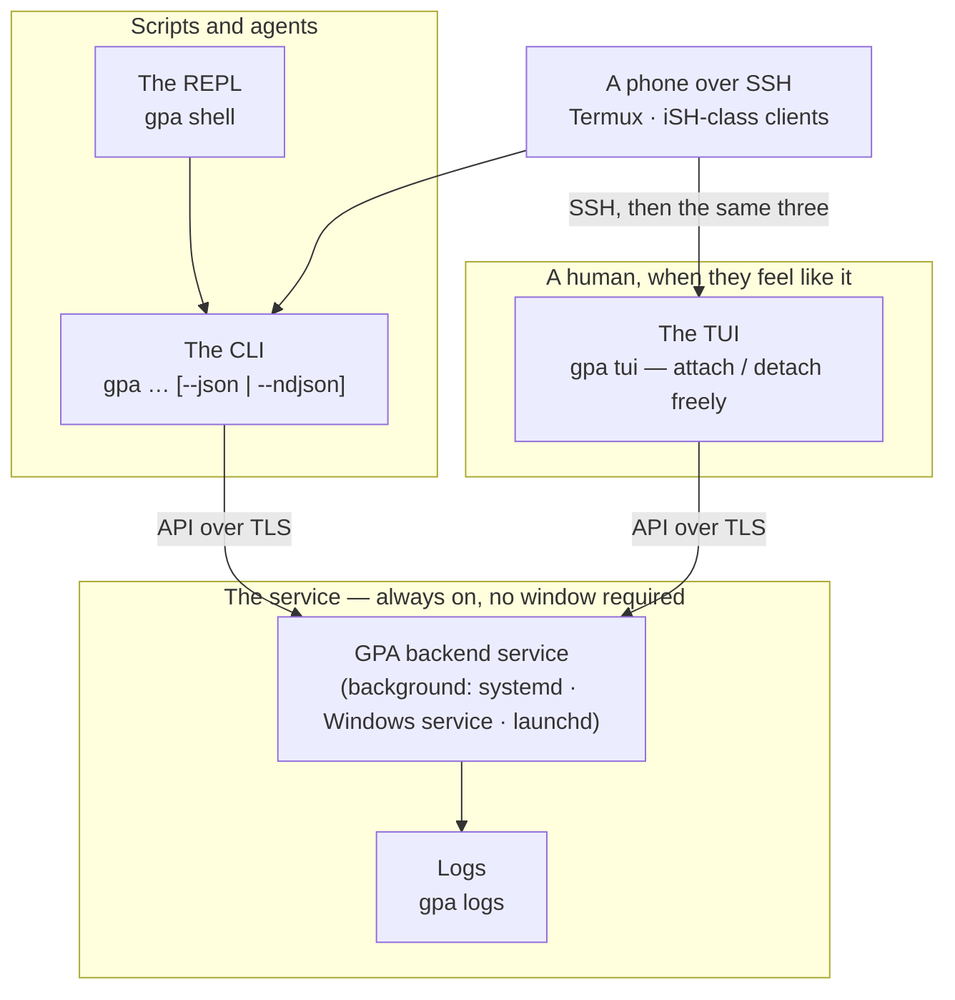
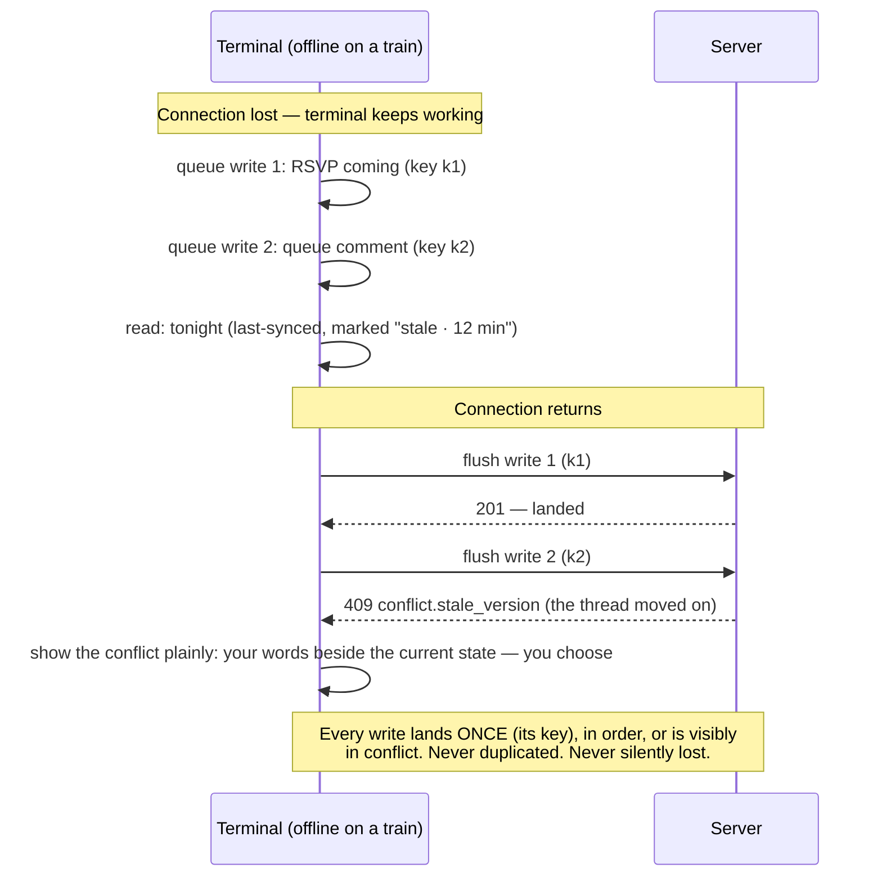

# 14 — Terminal App Guide

**For:** humans who prefer text, and AI agents whose native ground
is a shell. Both, equally — that is the design, not a slogan.
**Companion guides:** Doc 01 (every task here exists there in the
web-shaped telling), Doc 09 (the API the terminal lives on),
Doc 13 (MCP — the other agent door), Doc 12 (the Doctor and every
other term, in plain words).

**The one idea to carry in:** the terminal is a *door*, not a
version. The **service** runs in the background, headless, owing
nothing to any window. The **TUI** attaches to it when a human
wants a screen of text, and detaches without touching it. The
**CLI** does every task as a command — by hand, by script, or by an
agent. Same operations, same approval law, same audit as every
other door (parity, D-35 — and the terminal's own parity proof is
B-235).

---

## 1. The three pieces, and how they fit



*Walking tour:* at the centre, one box — the service — running in
the background under the operating system's own supervision, owing
its life to no terminal. A human's TUI hangs off it by a network
connection and can come and go like a phone call. Scripts and
agents drive the CLI, which the REPL simply wraps in a session.
The phone reaches everything through SSH and then faces exactly
the same three choices, because a phone in this design is a small
computer, not a special case. Logs flow out of the service to one
place, readable without attaching anything.

## 2. The background service (B-325)

### 2.1 Running it

The service is installed by the platform installer (Doc 11 §5) and
managed from the command line:

```
gpa service install     # register with the platform's service manager (asks before changing anything)
gpa service start
gpa service stop
gpa service status      # running? since when? profile? health summary, plain words
gpa logs                # follow the log; gpa logs --since 1h ; gpa logs --json for machines
```

| Platform | Supervision | Notes |
|---|---|---|
| Linux (incl. Raspberry Pi OS) | **systemd** unit (system or per-user) | The B-153/B-261 packaging; backup timer alongside |
| Windows | **Windows service** registration | Via the installer (Doc 11 §5); status also visible in Services |
| macOS | **launchd** agent | Starts at login or boot per the install choice |

No containers, anywhere (D-24). The service needs no logged-in
human, no open terminal, and no TUI — a Pi in a cupboard serving a
club for a year without a screen is a normal deployment, not an
edge case. `gpa service status` reads the same `/health`
( deep mode) the operator guide uses (Doc 02 B.5): database state,
job backlog, driver, backup freshness — in plain words for humans,
`--json` for scripts.

### 2.2 The Doctor lives here too

`gpa doctor` runs the full diagnostic suite (D-45) against the
installation — install and versions, database integrity and WAL
state, keys *present* (never values), disk, clock skew, profile
safety, ports, certificates, backup freshness and last restore,
job queue, model adapter — each finding as *what we found · what
it means for you · what to do*, each safe fix offered individually
for consent. `gpa doctor --json` emits the same findings with the
same ids, which is how an agent seat runs the Doctor and explains
it to its human. The TUI has a Doctor screen; the API has the
operation (admin); MCP has the tool (admin-scoped). One engine,
four doors, identical findings.

## 3. Installing the terminal

One install path per OS, from the release ZIP (B-234): `uv tool
install` (or `pipx`) of the shipped package, plus the launcher —
`gpa` on Linux/macOS, `gpa.cmd` on Windows. `gpa --version` reports
the terminal's version, which matches the backend it shipped with;
against an older or newer server it works within the API-version
policy and says so plainly on a real mismatch rather than failing
strangely later.

## 4. Signing in — three ways, one identity

**A human, interactively.** `gpa login` walks the same sign-in as
the web: enter your email, receive the magic link, open it (or
paste the code the terminal offers as the alternative), and the
terminal stores a **per-device credential** — listed and revocable
in the same device list as your phone and browser (B-174, B-243).
A password sign-in is offered where the account has one. No
long-lived password is ever typed into a terminal on a remote box
if you use the third way:

**Device pairing (for a terminal on a remote machine).** The
terminal displays a short pairing code; you, signed in on any
surface, confirm that code once; the terminal receives its own
revocable device credential (B-243). The code is short-lived and
single-use; the terminal it lands on is named in your device list
from that moment.

**A seat.** `gpa login --seat --key-file <path>` signs the terminal
in as an agent seat with the key an admin issued (Doc 02 A.5). The
session is named in the audit stream as a terminal session of that
seat (B-233) — a seat in a terminal is a seat: same scopes, same
role, same approval law, same instant revocation.

```mermaid
sequenceDiagram
    participant T as Terminal (on a remote box)
    participant S as Server
    participant H as You, signed in anywhere
    T->>S: request pairing
    S-->>T: short code: KESTREL-42 (10 minutes, single use)
    H->>S: confirm code KESTREL-42 (from phone / web / another terminal)
    S->>S: mint a per-device credential bound to this terminal; audit-chain the pairing
    S-->>T: device credential (stored in the OS keyring where available)
    Note over T,S: From here the terminal is a named device in your device list.<br/>Revoke it there and its next call fails — no password was ever typed on the remote box.
```

*Walking tour:* the terminal asks the server for a pairing and
receives a short, expiring, single-use code. You confirm that code
from a device you already trust. Only then does the server mint a
credential bound to that one terminal — stored in its OS keyring
where available — and the pairing itself enters the audit chain.
The note carries the security point: revocation is one action in
your device list, and the remote box never saw a password worth
stealing.

## 5. The CLI — every task, as a command (B-222, B-223)

The command tree mirrors the domains, and is *generated from the
same action register as the parity checker* (B-201) — a capability
missing here is missing visibly, and fails the same build gate.

| Area | Commands (representative — `gpa help <area>` is canonical) |
|---|---|
| Session | `gpa login`, `gpa logout`, `gpa whoami`, `gpa service …`, `gpa logs`, `gpa doctor` |
| Groups | `gpa groups list|show|create`, `gpa groups members`, `gpa groups switch <id>` |
| Sources | `gpa sources add --chat file.txt`, `gpa sources add --flyer photo.jpg`, `gpa sources add --board board.jpg`, `gpa sources list`, `gpa sources status <job>` |
| Queue | `gpa queue list`, `gpa queue show <id>`, `gpa queue approve <id>`, `gpa queue edit <id>`, `gpa queue reject <id> --why "…"`, `gpa queue merge <a> <b>` |
| Events | `gpa events list`, `gpa events tonight`, `gpa events show <id>`, `gpa events create`, `gpa events ics <id> --out f.ics` |
| Planning | `gpa tasks list|claim|done`, `gpa polls list|vote`, `gpa decisions`, `gpa questions list|answer` |
| Memory | `gpa ask "what did we decide about the hall?"`, `gpa briefing <event>` |
| Comms | `gpa inbox`, `gpa digest preview`, `gpa rsvp <event> coming|maybe|cant` |
| Help | `gpa help`, `gpa help queue`, `gpa <command> --help-topic <help-id>` — every command carries its help id (D-44) |

### 5.1 Human output, machine output

Default output is for a person: aligned, plain words, colour used
sparingly and never as the only carrier of meaning. Two flags turn
any command into a machine surface:

- **`--json`** — one JSON document, field names identical to the
  API's schemas. Stable: new fields may be added; existing fields
  are not renamed or retyped within a version.
- **`--ndjson`** — for lists and streams: one JSON object per line,
  so a harness can consume a queue, a log, or a live stream
  incrementally without holding a whole document.

**Errors** in machine mode go to **stderr** as problem+json (Doc 09
§5) — stdout stays parseable, always. **`--dry-run`** on writes
shows what *would* happen and performs nothing. **Idempotency keys
are generated per invocation** and can be echoed/pinned with
`--idempotency-key`, so a retried command is safe by construction.

### 5.2 Exit codes — stable, documented, contractual

| Code | Meaning | A harness should |
|---|---|---|
| 0 | Success | proceed |
| 2 | Usage error (bad flags/arguments) | fix the call; do not retry as-is |
| 3 | Auth (not signed in, expired, revoked) | re-authenticate; if a seat key, stop and tell its human |
| 4 | Not found (including another group's object — existence is not leaked) | treat as absent |
| 5 | Conflict (stale version, duplicate) | re-read, merge, retry deliberately |
| 6 | Unavailable (server down, driver unavailable, budget paused) | back off and retry later; nothing was lost |

## 6. The REPL — `gpa shell` (B-224)

`gpa shell` opens a persistent session: signed in, group selected,
the same commands without the `gpa` prefix, with line editing and
history. The prompt format is **stable and documented** precisely
so an agent harness can drive it as reliably as a person can — the
shell does not change its prompt's shape between patch releases.
A session transcript can be saved (`/transcript on`), and for a
seat the session is named in the audit stream either way. Humans
use it to work a queue quickly; harnesses use it to avoid process
start-up per command. Both get identical semantics — the REPL is
the CLI with memory, not a second implementation.

---

## 7. The TUI — attach when wanted, never required (B-225 → B-232, B-326)

`gpa tui` opens the full-screen text app against the same API.
Closing it — or killing the terminal, or losing the SSH session —
**detaches**: the service, your drafts, and any queued work are
entirely unaffected. Attach again later from anywhere; the TUI is
a window you carry, not a process you babysit.

```
┌ GPA ──────────────── Hall Secretary (seat) · North Club · ● connected ─┐
│ ▸ Home        │ TONIGHT — Saturday                            │
│   Calendar    │  20:00  Club Night — North Hall               │
│   Queue (2)   │ ────────────────────────────────────────────  │
│   Events      │ QUEUE — waiting for a person                  │
│   Planning    │  • Bonfire Night — draft, 1 field unsure      │
│   Discuss     │  • Projector task — proposed by Ana           │
│   Ask         │                                                 │
│   Admin       │ [tab] sections · [?] help · [ctrl-p] commands │
└───────────────┴─────────────────────────────────────────────────┘
```

*The same screen, in words (the screen-reader version of this
picture):* a header naming who is signed in, which group, and
whether the connection is live; a left column of sections — Home,
Calendar, Queue with its waiting count, Events, Planning, Discuss,
Ask, Admin; a main pane showing Tonight and the queue's headlines;
a footer of the three keys that matter: Tab moves, `?` explains,
Ctrl-P commands. Nothing on this screen exists only as a picture —
every element is text, reachable by keyboard, and announced in
linear mode (§7.2).

### 7.1 Working in it

- **Keyboard first, mouse as a bonus.** Every action has a key;
  nothing requires a pointer. Section keys mirror the CLI's areas
  (§5), so fluency transfers between the two.
- **`?` on every view** opens that view's help — the same help
  content the web shows and MCP serves (D-44), including the view's
  help id.
- **Ctrl-P, the command palette**, lists every action in plain
  words, searchable — the "I want to…" finder (B-315) in text form.
- **The queue screen is the trust screen** (B-227): confidence and
  flags in the list; in the detail, provenance quoted beside each
  field; edit, approve, reject, merge by key — identically to the
  API, because it *is* the API.
- **Ingest by path** (B-228): paste a chat from a file or stdin,
  add a flyer/board photo by path, and watch job progress live;
  an interrupted upload resumes from this same screen.
- **Dangerous admin actions** sit behind a typed confirmation that
  names the consequence (Doc 02's rule) — the terminal does not
  make courage cheaper than the web does.

### 7.2 Plain mode, colour, and screen readers (B-232, B-326)

`--plain` (or `GPA_PLAIN=1`) renders **linear mode**: no boxes, no
columns, one fact per line, in reading order — a first-class view,
built for screen readers and Braille displays, and the mode the
accessibility evidence runs against (B-289). `NO_COLOR` is honoured
everywhere; colour is never the only carrier of meaning (a flagged
field says "unsure" in words). The TUI is tested from 80×24 to
ultrawide — and down to a phone's narrow SSH column (§8).

## 8. From a phone, over SSH (B-258)

A phone with an SSH client (Termux on Android; an iSH-class client
on iOS) is a full terminal citizen:

1. SSH to the box running the service (or the box where your
   terminal profile lives).
2. `gpa login` once — or pair the device (§4) from your web
  session, so no password crosses the phone keyboard at all.
3. Work at **40-column layouts**: the agenda and queue render in a
   narrow profile proven on real phone SSH clients — the golden
   tasks (read tonight, clear the queue, RSVP) are completable
   one-handed.

Everything from §5 applies unchanged; the narrow screen changes the
layout, never the capability. A club organiser approving the
evening's queue from a phone on the bus is a designed case, not a
party trick.

## 9. Working offline, and the flush (B-240)

The terminal is an offline-tolerant client (Doc 09 §12 shows the
pattern): with no connection, reads show last-synced data **marked
stale, with its age**; writes queue locally, each carrying the
idempotency key minted at the moment of intention. On reconnect,
the queue flushes in order:



*Walking tour:* offline, the terminal does not sulk — it queues
two writes with their keys and keeps serving reads, honestly
labelled stale. When the connection returns, the flush replays in
order: the RSVP lands cleanly; the comment collides with a thread
that moved meanwhile and comes back as a 409 with the winning
state, which the terminal shows side by side for a human choice.
The invariant at the bottom is the same one the API guarantees
every client (B-240): landed once, in order, or visibly in
conflict — the three acceptable outcomes, and no fourth.

## 10. A worked example — an agent drives the CLI end to end (B-233)

The shipped example, abridged: an agent harness, signed in as the
*Hall Secretary* seat, plans the same club night Doc 13's agent
planned over MCP — through the CLI alone, in `--json` mode.

```bash
gpa login --seat --key-file ~/.keys/hall-secretary.key
gpa sources add --group north-club --flyer ./club-night.jpg --json
# → {"job_id": "j_881", "status": "queued", …}
gpa sources status j_881 --json          # poll until "extracted"
gpa queue list --group north-club --json
# → one candidate; end_at flagged low-confidence, provenance attached
gpa queue show c_1042 --json             # read the flyer's evidence per field
gpa queue edit c_1042 --field end_at --value "2026-11-01T00:00" \
    --note "Organiser confirmed midnight in the queue" --json
gpa queue approve c_1042 --json          # organiser seat: the same internal op as a click
gpa events tonight --group north-club --json
gpa rsvp ev_2077 coming --note "Bringing the playlist" --json
gpa ask "what is still undecided for Saturday?" --group north-club --json
```

Every line is checkable by its exit code (§5.2): the harness stops
on a `3` (its key was revoked — a human's decision to surface, not
retry around), merges on a `5`, backs off on a `6`. And the audit
afterwards shows the terminal session by name, each command under
the seat's identity — the same transparency Doc 13 §11 describes,
arrived by a different road. That is parity you can hold: one
story, three doors (API, MCP, terminal), same ending state, same
trail.

## 11. The terminal's promises, collected

- **Optional means optional, in both directions** (B-325): the
  service needs no TUI; the TUI needs no babysitting; background +
  CLI alone run the whole product, proven as a parity story
  alongside B-235's three-way run.
- **Nothing here is a lesser copy.** A missing capability in the
  terminal is a parity failure that blocks a release (B-201), not
  a known limitation to shrug at.
- **Your words survive the window.** Drafts are server-side
  (Doc 08 §10.3), queued writes carry their keys (§9), and a dead
  terminal — like a dead browser — costs at most seconds of typing,
  recovered on the next attach, from any machine.
