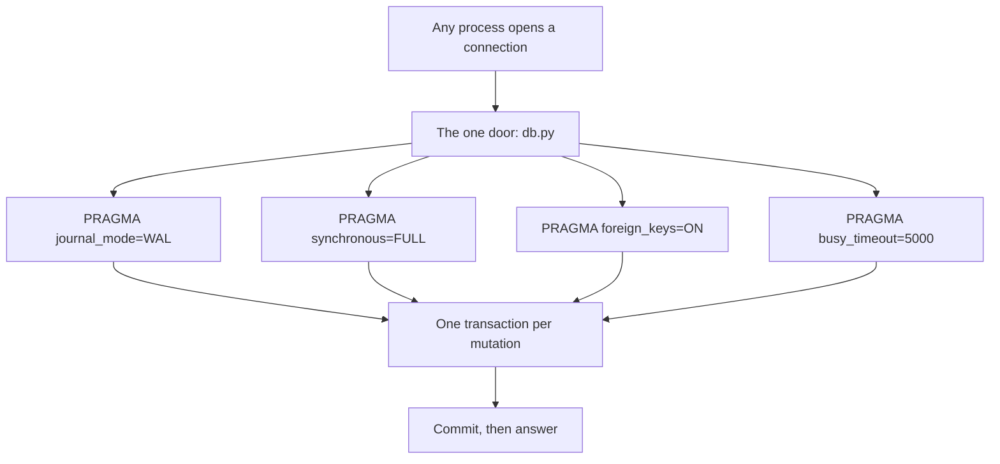
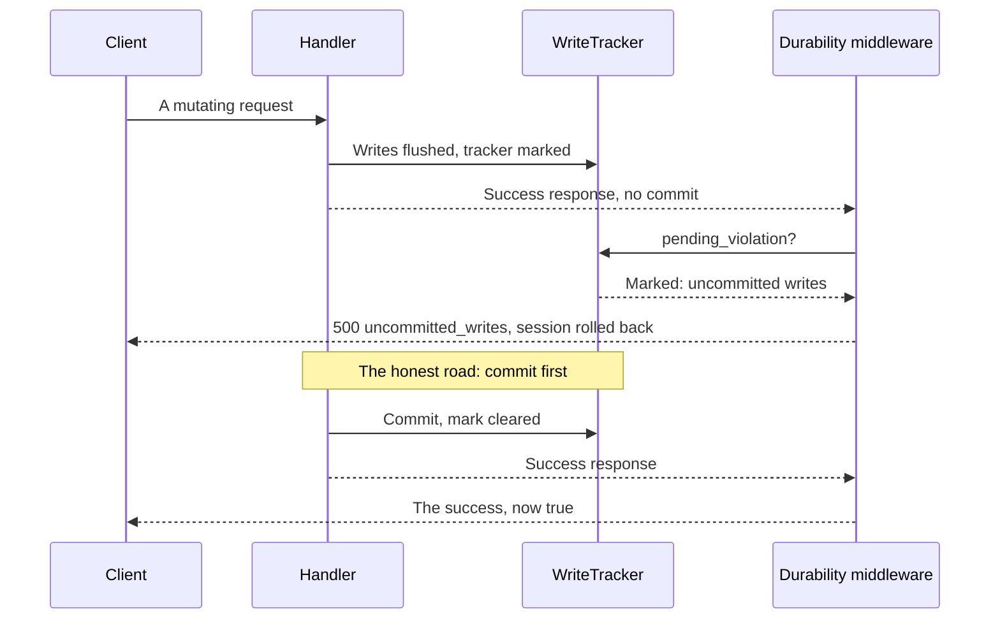
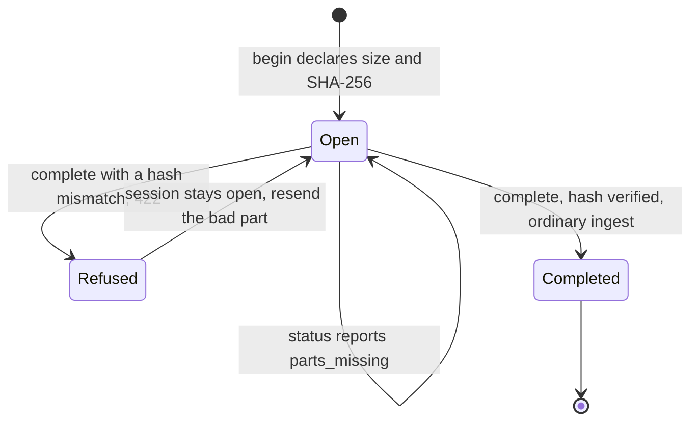
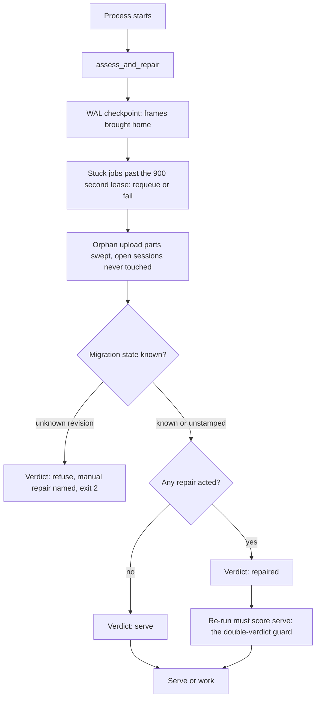
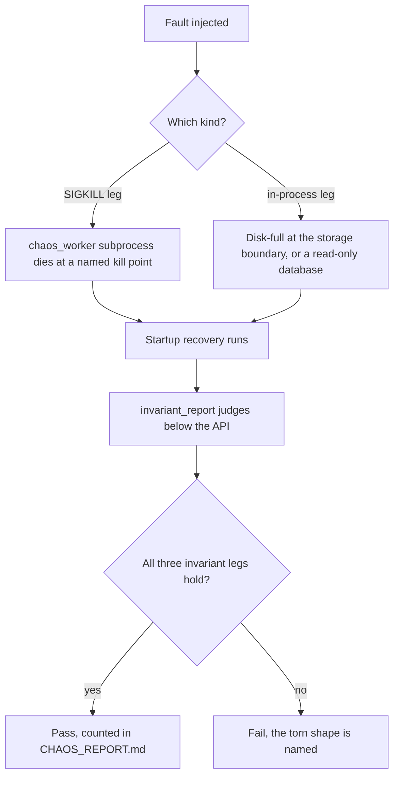

# Durability + recovery

*The Phase 18 durability chapter (slice B-195). For backend
developers, maintainers, and operators. The §6A.5 machinery
as diagrams and drills: transaction discipline, autosave,
resumable upload, boot recovery with the double-verdict
guard, watchdog, backup/restore and the chaos-harness
method.*

*Verified against the live tree at this slice: the storage
foundation is `src/gpa/db.py` (B-003); commit-before-answer
made structural is `src/gpa/durability.py` (B-171); draft
autosaves are `src/gpa/services/autosaves.py` and resumable
uploads are `src/gpa/services/uploads.py` with their doors
in `src/gpa/routers/uploads.py` (B-171); boot recovery is
`src/gpa/services/recovery.py` (B-172); backup and restore
are `scripts/backup.py`, `scripts/restore.py`, and
`scripts/restore_drill.py` (B-146); the chaos harness is
`src/gpa/services/chaos.py`, `tests/chaos_worker.py`, and
`scripts/chaos_report.py` (B-175). Honesty marker, stated
once here and again where it matters: there is no separate
watchdog daemon process in this build — the watchdog work
is done by the pieces named in the watchdog section below,
and this chapter does not pretend otherwise.*

## The promise, in one paragraph

Entered data is sacred (D-28). A crash must not lose data
a user has entered, a half-finished act must never become
visible as if it were finished, and an interrupted job
must never silently vanish. Everything in this chapter is
one of those three sentences made mechanical — and the
chaos harness at the end is how the project proves them
instead of merely saying them.

## The storage foundation

Every SQLite connection in this system — API, worker,
scripts, tests — is opened through the one door in
`src/gpa/db.py`, and that door sets the same pragmas on
every connection:

- `journal_mode=WAL` — readers never block the writer and
  the writer never blocks readers; a killed process leaves
  its committed frames in the write-ahead log for the next
  open to bring home.
- `synchronous=FULL` — a commit is not reported complete
  until it is on disk. This is the fsync promise the chaos
  harness's power-loss reasoning stands on.
- `foreign_keys=ON` — referential integrity is enforced by
  the database, not by hope.
- `busy_timeout=5000` — a contended writer waits up to
  five seconds instead of failing on first contact.

PostgreSQL deployments get the same discipline from the
engine itself; the pragmas above are the SQLite spelling
of the law, not a second law.

Walking tour. **Any process opens a connection** only
through **the one door: db.py**, which sets all four
pragmas — **WAL**, **synchronous=FULL**, **foreign
keys ON**, and the **busy timeout** — before any work is
done. Those settings make **one transaction per mutation**
safe to run concurrently, and that transaction shape is
what allows the system's central rule, **commit, then
answer**, to be a promise rather than a habit.

## Transaction discipline and commit-before-answer

The rule began as a convention from Samtal: a handler
that returns success from inside its transaction block
answers before the commit is visible, so a fast client
using a just-issued credential races its own grant. The
convention is now structural (B-171).

`WriteTracker` in `src/gpa/durability.py` wraps every
request session. Flush listeners mark the tracker when
real writes are flushed; a commit or a rollback clears
the mark. The durability middleware installed by
`create_app` asks `pending_violation` after the handler
answers: a marked tracker under a success response means
the handler forgot to commit — the session is rolled
back and the client receives a 500 `uncommitted_writes`
instead of a lie. Error responses pass untouched: a
refused request may leave its writes uncommitted on
purpose, and closing the session rolls them back.

Walking tour. The **client** sends a mutating request;
the **handler** flushes writes and the **WriteTracker**
is marked. If the handler tries to answer success without
committing, the **durability middleware** asks the tracker,
receives the violation, rolls the session back, and the
client gets `uncommitted_writes` — a loud failure instead
of silent data loss. On the honest road the handler
commits first, the mark clears, and the same success
response is allowed through because it is now true.

The drill that pins this (B-171 acceptance) uses a
deliberately forgetting handler: it answers 500, its
writes are gone on re-read, a committing control handler's
writes persist, and a handler's own error response stands
untouched. The B-173 repair found the same law catching a
real service — voice ingest had ridden on a later commit —
and that service now commits its own transaction.

## Draft autosaves

Candidates and events are edited as drafts; a browser
crash must never eat the words. `services/autosaves.py`
stores the editor's draft payload server-side as it
changes:

- Every save names the `base_version` it was written
  against.
- A save whose base is current replaces the payload and
  bumps the version.
- A save whose base is stale — someone else, or the same
  editor in another tab, saved since — never overwrites.
  It lands as a conflict copy beside the live draft, and
  the caller is answered 409 `draft_conflict` with both
  versions, so a human merges words instead of losing
  them.

The doors are `PUT` and `GET` under
`/groups/{id}/autosaves/{candidate|event}/{id}`. Autosave
is not publication: it changes no candidate, no event,
and no approval state — it only keeps the draft safe
until a person acts.

## Resumable uploads

The one-shot upload dies with its connection; a large
flyer on a bad network would start over forever. The
resumable road in `services/uploads.py` runs over the
same ingest:

- `begin` declares the file — name, total size, chunk
  size, and the whole-file SHA-256 — and opens a session.
- `put_part` accepts parts in any order. Each part's size
  is verified against its position — the offset law: part
  *i* covers bytes `[i·chunk, min((i+1)·chunk, total))` —
  and parts rest as files under the storage root's
  `uploads/` area, outside the content store.
- `status` reports received and missing parts
  (`parts_missing`): the resume contract is to send only
  what is missing — after a kill, after a restart, from a
  fresh client.
- `complete` assembles the parts in order, verifies the
  whole-file SHA-256, and hands the bytes to the ordinary
  ingest, where quota, content sniffing, and extraction
  apply exactly as for a one-shot upload. Completion
  dispatches on the sniffed kind — image bytes to the
  image ingest, everything else to file ingest; the
  Phase 17 gate drill caught and fixed an earlier road
  that sent every file to the text ingest and so refused
  flyers outright. A hash mismatch refuses completion
  with 422 and the session stays open for repair.

Walking tour. A session starts **Open** when **begin
declares size and SHA-256**. It stays open through
**put_part in any order** with the **offset law checked**
on every part, and through **status** reads that report
exactly which parts are missing. A **complete** attempt
whose assembled bytes fail the hash is **Refused** with
422 and returns to open — nothing is ingested and nothing
is lost. Only a verified hash moves the session to
**Completed**, where the bytes enter the ordinary ingest
and the session ends.

## Boot recovery and the double-verdict guard

Every process start runs `assess_and_repair` in
`services/recovery.py` before it serves or works. The
worker exits with code 2 on a refusal rather than serving
on damaged ground. The assessment answers exactly one of
three verdicts:

- `serve` — the ground is sound; start.
- `repaired` — named damage was healed, each repair in
  the report and, where a group's data moved, in the
  audit log; start.
- `refuse` — the damage is beyond automatic repair; the
  report names the problem and the manual repair, and the
  process must not serve on top of it.

The repairs, in the order the service performs them:

1. **WAL checkpoint** — a SQLite database left with a fat
   WAL by a killed process is checkpointed and truncated;
   frames brought home are reported by count.
2. **Stuck jobs** — a job still `running` past its lease
   (`LEASE_SECONDS = 900`, fifteen minutes) is requeued
   with an attempt counted, or failed when its attempts
   are spent, with a plain-words reason on the row and an
   audit row from `system:recovery`. Exactly-once holds
   because job handlers are idempotent.
3. **Orphan upload parts** — part files whose upload
   session no longer exists, or long completed, are
   swept. An open session's parts are the resume contract
   and are never touched.
4. **Migration state** — an `alembic_version` naming a
   revision this build does not know refuses, with the
   manual repair named. An unstamped database (the
   create_all posture first boots use) is noted, not
   refused.

The **double-verdict guard** is the acceptance shape:
repair is idempotent, so running the assessment twice on
the same ground gives `serve` with no actions the second
time. A healthy database is never "healed" aside, and a
repaired database must prove it by scoring `serve` on
the immediate re-run. The recovery tests pin exactly
that: healthy ground scores serve twice with zero
actions, a stuck job is requeued exactly once and then
the ground serves, and an unknown revision refuses
naming its repair.

Walking tour. A **process starts** and runs
**assess_and_repair** before anything else. It performs
the **WAL checkpoint**, resurrects **stuck jobs past the
900 second lease**, and **sweeps orphan upload parts**
while never touching an open session's parts. The
**migration state** question can end the boot with
**refuse** — the manual repair is named and the worker
exits 2. Otherwise the verdict is **repaired** if any
repair acted, or **serve** if none was needed; a repaired
verdict must immediately re-run to **serve** under the
**double-verdict guard** before the process may **serve
or work**.

## The watchdog, honestly

D-32 names a periodic integrity watchdog. What this
build actually has, with no daemon invented for the
diagram:

- **At boot**, recovery (above) is the integrity pass:
  checkpoint, stuck-job resurrection, orphan sweep, and
  migration check, every time, in every process.
- **While serving**, the deep `/health` check reports the
  jobs shape including `stuck_running` — running jobs
  untouched past the same fifteen-minute threshold — so
  an operator or a monitor can see a dead worker's work
  without reading the database.
- **By hand**, `scripts/requeue_stuck_jobs.py` lists
  stuck jobs (the default, changing nothing) and with
  `--apply` returns them to `queued`. Its own header
  carries the warning that matters: requeueing a job
  whose worker is actually alive and merely slow runs it
  twice, so the list is read before it is applied.
- **On a schedule**, the deployment's daily backup timer
  produces a verified bundle (next section), which is
  also a standing integrity probe of the database and
  storage together.

A separate long-running watchdog process, and index or
cache rebuilds as a recovery act, are not built; where
D-32's letter exceeds the build, this section is the
record of that gap, not a claim over it.

## Backup and restore

`scripts/backup.py` (B-146) takes a bundle without
stopping the world:

- `data.db` — the database copied with SQLite's
  online backup API, safe against a live WAL-mode
  database: no torn pages.
- `storage/` — every stored file, byte for byte.
- `manifest.json` — the SHA-256 and size of every file in
  the bundle.
- `RESTORE.md` — how to bring this bundle back, carried
  inside the bundle itself.

`scripts/restore.py` is verify-then-place: it checks
every SHA-256 in the manifest **before** placing
anything, and a damaged bundle restores nothing — the
instruction in the bundle is to use an older one, not to
force it. Key material never travels in a bundle: wrapped
keys and recovery escrow seals only, a fact the key
management tests grep for in raw and base64 forms
(chapter 13).

The restore drill (`scripts/restore_drill.py`) is the
proof, not the description: plant data, take a backup,
copy the tree, restore, run a fresh `uv sync`, run the
full suite, and read the data back through the API. The
Phase 13 addendum records what the drill caught — a
vacuum whose output still rode the WAL until a second
checkpoint made the on-disk file the vacuumed image —
because a drill that never finds anything is a ceremony,
not a test.

## The chaos-harness method

`services/chaos.py` (B-175) states the crash invariant
once, as code, and both the test suite and the operator
report judge every fault by it. After any fault — a
process killed with SIGKILL mid-transaction, a worker
dying mid-job, a disk refusing a write, a database opened
read-only — and after startup recovery has had its say:

1. **No committed user entry is lost.** A row a
   transaction committed is present afterwards, whole.
2. **No half-written entity is visible.** A multi-row
   entity (a source and its chunks, an approval and the
   event it minted) is present complete or absent
   entirely.
3. **No interrupted job is silently gone.** Its row
   exists and says what happened, in plain words.

The judgement is engine-level — `integrity_check` and
`foreign_key_check` pragmas and row-shape probes — because
a crash corrupts below the API, so the verdict must be
read below the API too.

Walking tour. A **fault injected** is one of two kinds:
a **SIGKILL leg**, where the `chaos_worker` subprocess
reaches a named kill point inside a real flow — ingest
after commit, ingest mid-transaction, a claimed
extraction or digest job, an approval mid-transaction, an
upload mid-session — and kills itself, proven by a marker
file and a `-SIGKILL` exit; or an **in-process leg**,
**disk-full at the storage boundary** or a **read-only
database**. **Startup recovery runs** first, then
**invariant_report judges below the API**; if **all three
invariant legs hold** the run is a **pass, counted in
CHAOS_REPORT.md**, and if not, the failure **names the
torn shape** so the defect can be fixed at its root.

The 100-run pass draws seeded-random faults over the five
kinds — `commit`, `rollback`, `job`, `diskfull`,
`readonly` — one fresh deployment per run, recovery
first, the invariant judged after every fault. The
recorded result is **100/100** holds, and
`scripts/chaos_report.py` re-runs the legs and the loop
as an operator road, writing `CHAOS_REPORT.md`.

The power-loss profile, stated honestly: a SIGKILL inside
an open transaction is the same event as a power cut for
committed rows under WAL + `synchronous=FULL`, so the
mid-transaction legs are the fsync-window legs. No VM or
container rig is used — the no-Docker law applies to the
test rig too — and no claim is made beyond what those
legs measure: real power loss on real hardware, with its
own disk-cache behaviour, is not run here.

## What a reader should be able to say

A reader who finishes this chapter should be able to say
exactly what happens when a worker dies mid-job, when a
browser dies mid-edit, when a connection dies mid-upload,
when a process is killed mid-transaction, and when a
backup bundle is damaged — and which mechanism, test, or
drill proves each answer. If any of those answers felt
vague, that vagueness is a defect in this chapter, with a
slice number — not a property of the system.
