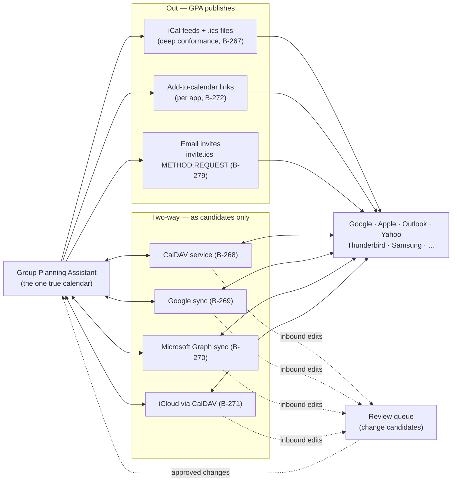
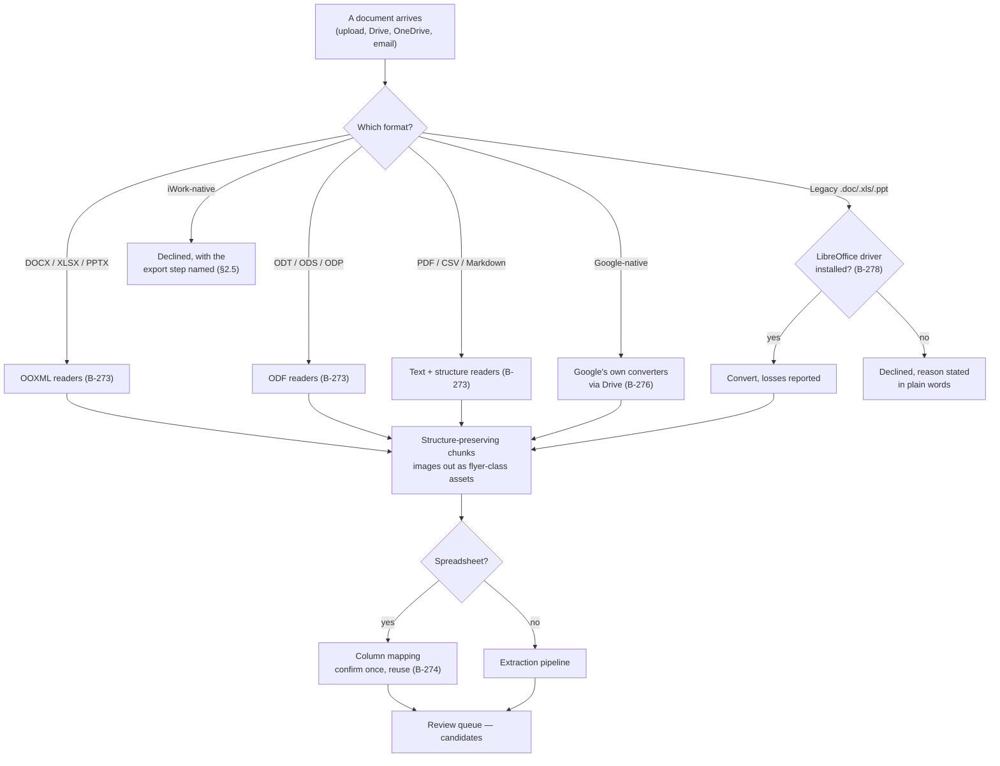

# 15 — Calendar and Office Interoperability

**Written for:** group organisers choosing what to connect, admins
connecting it, and developers maintaining the roads.
**Roadmap home:** decision D-40, standards §6A.13, Phase 23
(B-266 → B-280). The iCal engine's first version is B-053; Google
one-way sync is B-132; this document covers the deep versions.

## The one promise, and how it is kept honest

The Group Planning Assistant works with the calendar apps and
office suites your group already uses — **as far as it is
possible**, and it says plainly where it is not possible. Three
rules keep that promise honest:

1. **Standards first, vendor APIs second, honesty always.** The
   open roads — iCalendar (RFC 5545), CalDAV, vCard/CSV,
   DOCX/XLSX/PPTX, ODF, PDF, Markdown, HTML email — carry the
   product. Vendor APIs (Google, Microsoft Graph) deepen what
   standards cannot. Where a vendor offers no road at all, this
   document says so in those words and ships the closest honest
   alternative — usually a correct `.ics` or document file the
   app *can* open.
2. **No sync road bypasses the review queue.** Anything arriving
   from an outside calendar or document — an edit made in Google
   Calendar, a change pushed over CalDAV — arrives as a
   **candidate** in the group's review queue (the change-candidate
   law, B-077). A human or an authorised agent seat approves it
   before it touches the true event. Interoperability never
   smuggles in a second, unreviewed truth.
3. **Conformance claims are generated from tests, never
   asserted.** Every "works with X" statement in this document
   corresponds to a per-app fixture suite (B-267, B-279) that
   runs against real files exported from the real app, versioned
   in `tests/fixtures/interop/` (B-266). The conformance tables
   published in each release are **generated from those test
   runs**, not hand-written. If a suite fails, the claim comes
   out of the table — the table is not edited to match the hope.

**Walking tour.** Start at the box on the left: the Group
Planning Assistant, which holds the group's one true calendar —
the events the group has actually approved. Leaving it are three
one-way roads. The iCal road (B-267) publishes feeds and `.ics`
files shaped per target app. The links road (B-272) produces the
"add to Google / Outlook / Yahoo / Apple" links a member taps.
The mail road (B-279) sends invitation emails carrying an
`invite.ics` attachment, so the invite works from inside any
inbox. In the middle sit the four two-way roads: our own CalDAV
service (B-268), Google sync (B-269), Microsoft Graph sync
(B-270), and iCloud reached through CalDAV (B-271). Follow the
dotted arrows: every change that travels *inward* on a two-way
road lands in the review queue as a change candidate — it does
not touch the true calendar. Only when someone approves it does
the dotted arrow at the bottom carry it back into the Assistant.
That loop is the whole design: the outside world can propose;
the group disposes.

---

## Part 1 — Calendars

### 1.1 The calendar matrix

Tier meanings: **Tier 1** = a named per-app conformance suite
guards the claim. **Tier 2** = works via a standard road with
generic fixtures. Directions: **Out** = GPA publishes to it;
**In** = it can feed GPA (always as candidates); **Two-way** =
both, under the queue law.

| Calendar app | Road(s) | Direction | Tier | Slice |
|---|---|---|---|---|
| Google Calendar | iCal feed, add-links, Google Calendar API sync | Two-way | 1 | B-267, B-269, B-272 |
| Apple Calendar (macOS/iOS) | iCal feed, webcal, CalDAV service, `.ics` | Two-way | 1 | B-267, B-268 |
| Apple iCloud calendars | CalDAV with app-specific password | Two-way | 1 | B-271 |
| Microsoft Outlook desktop | iCal feed, `.ics`, `invite.ics` mail, Graph sync (365 accounts) | Two-way | 1 | B-267, B-270, B-279 |
| Outlook on the web / Microsoft 365 | Add-links, Graph sync, iCal subscribe | Two-way | 1 | B-270, B-272 |
| Yahoo Calendar | iCal subscribe, add-links, `invite.ics` mail | Out (+ invite replies by mail) | 1 | B-267, B-272 |
| Mozilla Thunderbird (Lightning) | iCal, CalDAV service | Two-way | 1 | B-267, B-268 |
| Samsung Calendar | iCal subscribe via the phone's account layer, `.ics` import | Out | 1 (fixtures) | B-267 |
| Fantastical and CalDAV/iCal clients generally | CalDAV service, iCal | Two-way | 2 | B-268 |
| Any app that opens `.ics` | Per-event `.ics` download | Out | 2 | B-053, B-267 |

### 1.2 iCal deep conformance (B-267) — why "an ICS file" is not enough

Every calendar app parses RFC 5545 with its own dialect. The
engine (first version B-053) emits per-target profiles wherever
a fixture proves a quirk:

- **Timezones.** Each app ships a different timezone database
  vintage; events carry full `VTIMEZONE` definitions so a
  7 p.m. in the group's IANA timezone is 7 p.m. everywhere,
  across DST changes, in every target.
- **Recurrence.** RRULE edge cases (monthly-on-the-last-Friday,
  exceptions, `UNTIL` in UTC vs local) are emitted in the form
  each app's parser demonstrably accepts — proven by round-trip
  tests: emit → parse the way that app parses → compare.
- **Alarms.** `VALARM` is honoured by some apps, ignored or
  duplicated by others; profiles set reminder alarms only where
  the fixture shows they behave.
- **People.** Organiser/attendee semantics differ (Outlook is
  strict about `ORGANIZER` mailto form; Apple is lenient);
  profiles shape the properties accordingly.
- **Bytes.** Line folding at 75 octets, CRLF endings, and
  escaping of commas/semicolons/newlines in text are per-profile
  where a dialect exists, because a folded-mid-character summary
  is the classic silent corruption.
- **All-day events.** Date-only in the profiles whose apps treat
  a midnight-to-midnight timed event differently.

### 1.3 The CalDAV service (B-268)

The Assistant itself speaks CalDAV, so any CalDAV client —
Apple Calendar, Thunderbird, Fantastical-class apps — can
subscribe to a group's calendars **and edit them natively**, as
if the group's calendar lived in the app.

- Collections per group (and per sub-group where the group
  chooses); standard `sync-token`, `CTag`/`ETag` discipline so
  clients sync incrementally instead of re-downloading.
- Credentials are **per-device app passwords**, issued and
  revoked in the same device list as the rest of the product
  (B-243) — losing a phone means revoking one password, not
  changing the group's.
- **Inbound edits land as change candidates** (B-077's law),
  showing in the queue with the same diff view as any other
  proposed change. Approval writes the true event; rejection
  leaves the client's next sync showing the true event again.
- Read-only collections are offered for guests and public views,
  so a member can hand a partner the "what's on" calendar
  without handing them editing rights.

### 1.4 Google Calendar, two-way (B-269)

Beyond B-132's one-way copy-out: watch channels and sync tokens
watch the connected Google calendar. A change made on the
Google side becomes a change candidate in the queue; approving
it updates the true event, and the approved state writes back
to Google. If **both** sides moved the same event, the result is
a contradiction flag (B-079) for a human to resolve — never a
silent overwrite in either direction. The connection is
OAuth-scoped to the calendars the organiser picks, and the
integration health board (B-136) shows sync state per calendar.

### 1.5 Microsoft calendars (B-270)

Microsoft Graph gives the same shape for Outlook personal and
Microsoft 365 calendars: delta queries detect changes, inbound
changes become candidates, approvals write back. The
add-to-calendar pack (§1.7) includes both Outlook-web and
Office 365 link variants, because their URL schemes differ and
both are golden-tested.

### 1.6 Apple iCloud, honestly (B-271)

Apple offers third parties exactly one road into iCloud
calendars: CalDAV with an app-specific password. So that is the
road we take — B-268's machinery run in the client direction —
and the guide says so in those words, including the step where
the member generates the app-specific password in their Apple
account. There is no iCloud API integration, and this document
does not pretend otherwise.

### 1.7 The universal add-to-calendar pack (B-272)

For each event, the API returns the full link set for frontends
and the terminal to render: Google, Outlook web, Office 365,
Yahoo, Apple (an `.ics` the Apple road opens), the `.ics`
download itself, and the webcal feed link for subscribers. Each
link form is guarded by golden-string tests that fail loudly
when a vendor changes their URL scheme — a broken add-link is
found by our tests, not by a member on the day.

### 1.8 Invitation email that works in every inbox (B-279)

Invitations and digests are proven in Outlook desktop (the
conditional-comment road its renderer requires), Outlook web,
Gmail (app and web), Apple Mail (iOS and macOS), Thunderbird,
and Yahoo Mail:

- Table-based HTML with inline styles — the dialect all of
  those renderers accept — a plain-text twin always attached,
  and dark-mode discipline so a dark inbox does not invert a
  light-only design into mush.
- Every invitation carries **`invite.ics` with
  `METHOD:REQUEST`**, so "add to calendar" works from the inbox
  itself in every one of those clients, even where the member
  never opens the app.
- Golden renders are screenshot-diffed in the test harness
  where automatable, and checklist-verified against real
  clients where not — the distinction is recorded per client
  in the generated matrix, not blurred.

---

## Part 2 — Office suites and documents

### 2.1 The office matrix

**In** = the suite's files become sources in the queue pipeline.
**Out** = the Assistant produces files the suite opens natively
and can edit. Formats are the roads; suites are the drivers.

| Suite | In (ingest) | Out (export) | Road notes | Slice |
|---|---|---|---|---|
| Microsoft 365 / Office | DOCX, XLSX, PPTX, PDF; OneDrive/SharePoint files via Graph | DOCX, XLSX, PPTX, PDF | First-class both ways | B-273–B-275, B-277 |
| Google Workspace | Docs/Sheets/Slides via Drive (Google's own converters), Gmail by label | Docs/Sheets targets via Drive upload + convert | Google converts its native formats; we never parse them directly | B-276 |
| LibreOffice / OpenOffice | ODT, ODS, ODP, PDF, plus the OOXML set | ODT, ODS, plus DOCX/XLSX set | Tier 1 via ODF — the suite's own native formats | B-273–B-275, B-278 |
| Apple iWork (Pages/Numbers/Keynote) | **Export-roads only:** files iWork itself exported (DOCX/XLSX/PPTX/PDF) | Files iWork opens natively (DOCX/XLSX/PPTX/PDF) | iWork's native formats are closed; see §2.5 | B-278 |
| WPS Office | DOCX/XLSX/PPTX, ODF, PDF | Same open-format set | Via the shared formats; cloud API where available | B-278 |
| Zoho | DOCX/XLSX/PPTX, ODF, PDF | Same open-format set | Via the shared formats; cloud API where available | B-278 |
| OnlyOffice / Nextcloud Office | DOCX/XLSX/PPTX, ODF as files/sources | Same set | Via file/source conventions | B-278 |
| Legacy Microsoft formats (`.doc`, `.xls`, `.ppt`) | Via the optional LibreOffice conversion driver | Not produced | See §2.5 — the degradation is stated when the driver is absent | B-278 |

### 2.2 Document ingest (B-273) — documents become sources

A document is a source like any other: it enters the pipeline,
gets chunked, and its plans become candidates in the queue —
never instant events. Structure is preserved into the chunks:
headings stay headings, table rows stay rows, slides keep their
order, and **speaker notes are read** (agendas hide in notes).
Images inside documents are pulled out as flyer-class assets,
with the same alt-text obligation as any image (every image
carries real alt text, or the gap is flagged). Two provenance
rules matter:

- **Tracked changes and comments are surfaced as provenance,**
  never silently merged into the text — a suggestion in the
  margin is shown as a suggestion in the margin.
- Readers are pure-Python wherever the platform rules allow
  (python-docx / openpyxl / python-pptx / odfpy class), so the
  same ingest works on a Raspberry Pi as on a server (B-252's
  dependency discipline).

### 2.3 Spreadsheet rotas and planning exports (B-274)

The rota is the nonprofit case that matters most: a term's
worth of dates in a spreadsheet, planned by someone in Excel
or LibreOffice, that used to be re-typed by hand.

**In:** XLSX / ODS / CSV timetables go through a
**column-mapping step** — which column is the date, which is
the title, which is the person? — that the organiser confirms
once and saves as a reusable mapping for the group. The rows
then become candidates, hundreds at a time, with **bulk
review** (approve the page, expand the odd one out). A column
the mapper cannot understand is flagged, never guessed.

**Out:** tasks, budgets (B-089), attendance aggregates, and
member lists export as **formatted** XLSX + ODS + CSV: styled
headers, frozen panes, and dates stored as real date cells —
not text that merely looks like a date, which is the failure
that breaks every downstream spreadsheet formula.

### 2.4 Document exports people can edit (B-275)

Briefings, agendas, minutes, recaps, and newsletters render
from one source document model — the same content the digest
renders — to **DOCX + ODT + PDF + Markdown + HTML**. Group
templates are stored as DOCX/ODT files, so a non-technical
organiser can restyle the template in Word or LibreOffice,
re-upload it, and every later export follows. The template is
data the group owns, not code a developer must touch.

### 2.5 The honest limits, in plain words

- **Apple iWork formats are export-roads only.** Pages,
  Numbers, and Keynote native files are closed formats with no
  public specification we may implement against. What works:
  files iWork itself exports (it exports DOCX/XLSX/PPTX/PDF
  well), and everything we export opens in iWork. What does
  not: dropping a raw `.pages` file on the ingest and expecting
  it to be read. The ingest says exactly that when it sees one,
  and names the export step that fixes it.
- **Google native formats are never parsed by us.** A Google
  Doc is converted by Google's own converters (via Drive,
  B-276); if the group has not connected Drive, the road is
  "download as DOCX/PDF from Google, then upload" — stated in
  the UI at the point of need.
- **Legacy `.doc`/`.xls`/`.ppt`** need the optional
  operator-side LibreOffice conversion driver (natively
  installed — never Docker, D-24). Without it, the ingest
  declines those files and says why; with it, conversion
  fidelity is the converter's, and heavily formatted legacy
  files can lose decoration (never text silently — losses are
  reported in the ingest result).
- **A vendor can change a dialect tomorrow.** That is why the
  claims in this document are generated from per-app suites
  (rule 3): when Outlook changes something, a suite goes red,
  the claim leaves the table, and the fix is a slice — not a
  press release.

**Walking tour.** A document arrives at the top — uploaded,
pulled from Drive or OneDrive, or forwarded by email. The first
diamond asks what format it is. Word/Excel/PowerPoint files go
to the OOXML readers; LibreOffice/OpenOffice files to the ODF
readers; PDF, CSV, and Markdown to the text-and-structure
readers — all three reader families are B-273. A Google-native
file is never opened by our code at all: it detours through
Google's own converters via the Drive connection (B-276). A
legacy binary file reaches a diamond: if the operator installed
the LibreOffice conversion driver (B-278), it is converted with
any losses reported; if not, it is declined with the reason
stated — the path ends there, honestly. An iWork-native file is
declined too, with the export step named (save as DOCX from
Pages, then bring that). Everything that survives becomes
structure-preserving chunks, with embedded images lifted out as
flyer-class assets. A second diamond asks whether the source is
a spreadsheet: if so, it passes through the column-mapping step
(B-274) where a human confirms what each column means; if not,
it goes straight to the extraction pipeline. Both roads end at
the same place — the review queue, as candidates. No document
road ends anywhere else.

### 2.6 Meeting links are first-class (B-277)

Extracted events recognise **Microsoft Teams, Google Meet, and
Zoom** join links as first-class join links — shown on the
event, carried into calendar exports where the target supports
a location/conference field, and never buried in a description
paragraph. A planning app in 2026 that cannot read a meeting
link is not finished; the extraction fixtures cover all three.

### 2.7 Drive, OneDrive, and mail sources (B-276, B-277)

- **Google Drive** files become sources (Docs/Sheets/Slides via
  Google's converters into B-273's pipeline); exports can land
  back in Drive as Docs/Sheets. **Gmail** can feed sources by
  label — the group's choice of label, and only that label.
  Google Contacts import (CSV/vCard/People API) feeds member
  invitations.
- **OneDrive / SharePoint** files become sources via Microsoft
  Graph, downloaded and converted into the same pipeline;
  Outlook mail can feed sources by folder; Outlook contacts
  import likewise.
- Both connections are OAuth-scoped to what the organiser
  grants, visible on the integration health board (B-136), and
  revocable in one action — revocation stops future pulls and
  says what already-imported sources remain (they remain; they
  were the group's data the moment they were approved).

---

## The generated conformance table — how to read a release

Each release ships `docs/interop/CONFORMANCE.md`, **generated
by the B-267/B-279 suites** (registered as evidence, B-292): one
row per app × road, the app version or fixture vintage, the
suite result, and the date of the run. The B-280 drill — a rota
arriving as an ODS from LibreOffice plus minutes as a DOCX from
Word, events landing correctly in Google, Outlook, and Apple
calendars, a Google-side edit returning as a candidate and
being approved, the digest read in four mail clients, and the
briefing leaving as DOCX + ODT to open clean in Word,
LibreOffice, and Google Docs — is the story that table proves,
run end to end and recorded before the release it gates. If you
are reading a claim in this document and want to know whether
it is true *of the build in your hand*, the generated table —
not this prose — is the authority.
