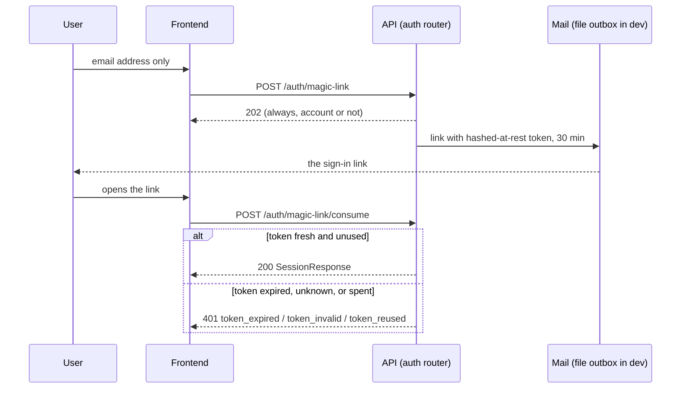
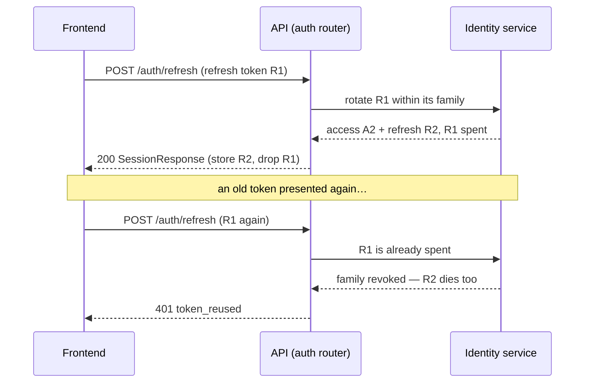
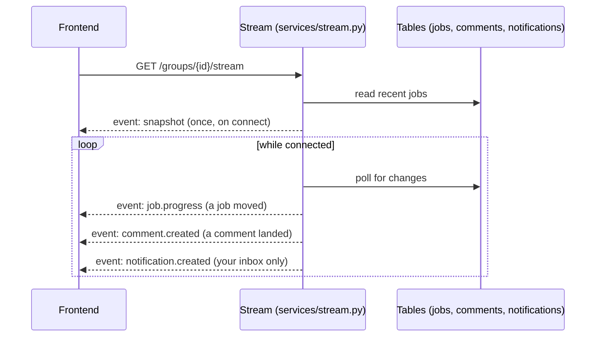

# API + frontend guide

*The Phase 18 frontend chapter (slice B-196). For Geoffrey and
Henry, and for anyone building a screen against this backend:
everything needed to build against the API without reading
backend code. Auth flows as sequence diagrams, pagination,
the complete error-code table, the SSE events, idempotency
told honestly, the Bruno walkthrough, and the mock-mode
guide.*

*Verified against the live tree at this slice: the contract
is `OPENAPI.json` (202 paths, 230 schemas) with generated
TypeScript types in `frontend_types.ts`; the error registry
is `src/gpa/errors.py` (B-004); the auth doors are
`src/gpa/routers/auth.py` (B-011 → B-014, B-174); the stream
is `src/gpa/services/stream.py` (B-033, B-060, B-101); the
Bruno collection is `collections/` (B-010 skeleton — see the
honesty marker in its section below). Two honesty markers
belong up front, because a frontend built on a wrong guess
here wastes real work: (1) the public HTTP API has **no
Idempotency-Key header store** in this build — the
idempotency section below says exactly what is and is not
safe to retry; (2) uploads are **raw request bodies, never
multipart** — there is no form-data door anywhere.*

## The shape of every call

- Base path: every application route lives under
  `/api/v1`. The only routes outside it are `/health` and
  the provider-shaped doors (mail webhooks, the email-in
  receiver) that other systems call.
- Bodies are JSON, except uploads, which are the raw bytes
  themselves with the filename as a query parameter
  (`POST /groups/{id}/sources/upload?filename=notes.pdf`).
- Times are ISO 8601 with offsets. Event times are always
  served already expanded and already zoned by the server —
  the frontend does **zero date maths**: agenda, month, and
  tonight arrive as occurrences, never as recurrence rules.
- Money is integer cents (`amount_cents`), AI spend is
  integer `cost_micros`. Floats for money are refused at
  the door (a float body is a 422 before any service runs).
- IDs are UUID strings. Slugs address public surfaces only;
  group-scoped work always goes by group id.

## The three credentials, kept apart

Three different callers knock, and they use three different
doors. Mixing them up is the most common integration bug —
the SDK's first draft made exactly this mistake (B-160) and
was refused `token_invalid` until it was fixed at the root.

| Caller | Credential | Header | Lifetime / notes |
|---|---|---|---|
| A signed-in person | Access token (HS256 JWT, 15 min) | `Authorization: Bearer …` | Paired with a rotating refresh token (below) |
| A script or agent seat | API key, shown once, prefix kept | `X-API-Key: gpa_…` | Hashed at rest; carries scopes `read` / `draft` / `publish` / `admin` |
| A calendar reader | Feed token, shown once | In the feed URL itself | Hashed at rest; revocable instantly; treat the URL as a secret |

API keys travel in the **`X-API-Key`** header, never as a
Bearer token. Session tokens travel as Bearer, never in
`X-API-Key`. Scopes gate what a key may do; a seat's key can
draft, and stands under the one approval law exactly as a
person of its role does (B-203): a seat below the group's
review floor is refused in-service with
`seat_cannot_approve` (403), a draft-scoped seat stops at
`insufficient_scope`, and an organiser seat holding the
`publish` scope approves through the same door — because
the law lives in the service, not in the scope check.

## Auth flow 1 — password sign-in, with and without MFA

Registration is `POST /auth/register` (201, a session is
returned directly). Password sign-in is `POST /auth/login`.
For an account without MFA the answer is the session
itself. For an MFA account the password earns **no
session**: the answer carries a 5-minute, single-use
`mfa_challenge` token instead, and the session is minted
only when `POST /auth/login/mfa` answers the challenge with
a current TOTP code. A mistyped code does not burn the
challenge; a correct code spends its TOTP step, so the same
code can never be replayed against a fresh challenge
(`mfa_code_invalid`, and the spent-step rule behind it).

```mermaid
sequenceDiagram
  participant U as User
  participant F as Frontend
  participant A as API (auth router)
  participant I as Identity service
  U->>F: email + password
  F->>A: POST /auth/login
  A->>I: verify password (Argon2id)
  alt MFA not enabled
    I-->>A: session (access 15 min + refresh family)
    A-->>F: 200 SessionResponse
    F-->>U: signed in
  else MFA enabled
    I-->>A: mfa_challenge (5 min, single-use)
    A-->>F: 200 challenge, NO session
    U->>F: six-digit TOTP code
    F->>A: POST /auth/login/mfa (challenge + code)
    A->>I: spend challenge, spend TOTP step
    I-->>A: session (access 15 min + refresh family)
    A-->>F: 200 SessionResponse
    F-->>U: signed in
  end
```



Walking tour. The **user** gives the **frontend** a password;
the frontend posts it once to the **auth router**, which hands
it to the **identity service** — the router itself checks
nothing. Without MFA the service returns the session pair
directly. With MFA the first answer is deliberately not a
session: it is a challenge, and only the second call — the
one carrying a live authenticator code — mints the pair.
Build the screen for both branches from the first day; the
branch is data (does the login answer carry a challenge?),
never a setting the frontend guesses at.

Auth routes sit behind a per-IP token-bucket rate limit
(B-021): bursts answer 429 `rate_limited` with a
`Retry-After` header — honour the header, never retry in a
tight loop. Five consecutive failed password sign-ins lock
the account progressively (`account_locked`, 423, one
minute doubling per further failure to a one-hour cap); a
success clears the count. Passwords must be at least 12
characters and clear a local breached/common list
(`password_too_weak`, 422) — the check is local, no password
fragment ever leaves the machine.

## Auth flow 2 — magic link

`POST /auth/magic-link` answers 202 whether or not the
address has an account (the answer never confirms an
account exists). The link carries a token that is hashed at
rest, lives 30 minutes, and is single-use; in development
the mail lands in the file outbox (`services/mail.py`), in
production it travels the configured mail transport.
`POST /auth/magic-link/consume` trades the token for a full
session. Recorded law (B-174): the magic link remains a
full sign-in even on MFA accounts — the link proves mailbox
control, which is itself a factor; the TOTP challenge
guards the password road.



Walking tour. The frontend asks once and always sees 202 —
design the screen to say "check your mail", never "account
found". The token's second use is refused as
`token_reused`, a spent link's first use after 30 minutes
as `token_expired`; both are terminal states for that link,
and the recovery is a fresh request, not a retry.

## Auth flow 3 — refresh rotation and logout

Access tokens live 15 minutes. The refresh token belongs
to a **family**: `POST /auth/refresh` spends the presented
token and returns a new access + refresh pair in the same
family. Presenting an already-spent refresh token is
treated as theft evidence — the **whole family is
revoked**, newest token included, and every device in it
must sign in again. `POST /auth/logout` revokes the
presented token's family. `GET /users/me/sessions` lists
the person's device families (carrying the birth
user-agent/IP words and a `current` mark), and
`DELETE /users/me/sessions/{family_id}` signs out exactly
that device — another person's family answers 404.



Walking tour. Rotation is a relay, not a pool: the frontend
must persist the newest refresh token from every refresh
answer and discard the one it presented. Two tabs racing
with the same stored token will revoke the family — the
correct frontend behaviour is one refresh at a time, and a
`token_reused` answer means "sign in again", never "try the
other token". This family rule holds unchanged with MFA on
(B-174's named guarantee).

## Pagination

Exactly one surface is cursor-paginated, and it is the one
whose window is open-ended: the agenda
(`GET /groups/{id}/calendar/agenda`). Everything else
returns its full list — groups keep these sets human-sized,
and pretending a cursor exists where none does would be a
lie in the contract.

- Query: `limit` (default 50, minimum 1, maximum 200) and
  `cursor` (omit for the first page).
- Answer: `items` plus `next_cursor`; `next_cursor` is
  `null` on the last page.
- The cursor is **opaque**: it names the last occurrence
  served (its start, event, and original start, encoded).
  Store it, pass it back verbatim, never parse it, never
  build one. An unreadable cursor is a 422
  `validation_error` naming the cursor, not a silent
  restart.
- Pages are stable while events stand still; an event
  edited between pages can shift what the next page holds.
  That is accepted and stated, not hidden.

The month view is not paginated at all: it returns whole
Monday-first weeks with `in_month` marks, so the grid is
rendered, never computed.

## Errors — one shape, every code

Every failure from this API has exactly one shape: RFC 9457
problem+json, media type `application/problem+json`.

```json
{
  "type": "about:blank#stale_version",
  "title": "That version is out of date",
  "status": 409,
  "code": "stale_version",
  "detail": "Event is at version 3; reload before editing.",
  "errors": [],
  "instance": "/api/v1/groups/…/events/…"
}
```

Branch on **`code`** — it is stable contract, never renamed,
only added to. Never branch on `title` or `detail`: those
are plain words for people and may be reworded. Field-level
validation failures arrive as `validation_error` (422) with
an `errors[]` list of `{field, message, code}` entries so a
form can point at the exact field. Framework failures
(unknown route, wrong method) are mapped into the same
shape, and unexpected failures arrive as `internal_error`
(500) with a deliberately vague detail — internals never
leak to clients.

### The complete code table

Every code in the registry (`src/gpa/errors.py`) at this
slice. Internal-API codes are listed too: a frontend never
raises them itself, but a refusal that crossed the internal
door can surface its code, and the table would be lying by
omission without them.

| Code | HTTP | What it means / what the frontend should do |
|---|---|---|
| `validation_error` | 422 | The request could not be understood; read `errors[]` and mark the fields |
| `not_authenticated` | 401 | No usable credential; start a sign-in |
| `invalid_credentials` | 401 | Email or password did not match; do not say which one |
| `token_expired` | 401 | Link or token past its life; offer a fresh one |
| `token_invalid` | 401 | Link or token not valid (wrong door counts: keys are not Bearer) |
| `token_reused` | 401 | Token already used; for refresh, the family is revoked — sign in again |
| `forbidden` | 403 | This principal may not do that; hide or disable the act |
| `insufficient_scope` | 403 | The API key lacks the needed scope; a person must use a stronger key or a session |
| `seat_cannot_approve` | 403 | This seat is below the group's review floor; route the draft to an approver at the floor (person or organiser seat) |
| `not_found` | 404 | Not found — private groups also answer 404, so 404 never proves non-existence |
| `conflict` | 409 | Conflicts with current state; reload and reconcile |
| `stale_version` | 409 | `If-Match` version is behind; reload, show the newer state, let the person re-apply |
| `last_owner` | 409 | A group must keep at least one owner; promote someone first |
| `email_taken` | 409 | That email already has an account; offer sign-in instead |
| `rate_limited` | 429 | Too many attempts; wait the `Retry-After` header's seconds |
| `quota_exceeded` | 422 | The group's storage quota would be exceeded; an organiser must raise it or free space |
| `fetch_blocked` | 422 | That address may not be fetched (private/metadata addresses); nothing was archived |
| `fetch_failed` | 502 | The page could not be read; nothing was archived; trying later is honest |
| `internal_error` | 500 | Something went wrong on the server's side; safe to report, pointless to retry blindly |
| `account_locked` | 423 | Progressive lockout after failed sign-ins; the detail names the wait |
| `mfa_code_invalid` | 401 | The TOTP code did not match; the challenge survives a mistype — let them retry |
| `password_too_weak` | 422 | Under 12 characters, breached/common, or the email name; explain all three rules |
| `sampling_disabled` | 403 | MCP server-initiated sampling is switched off (it is off by default, B-217); only the operator can enable it |
| `sampling_budget_exceeded` | 422 | The group's daily AI budget is spent, or its sampling calls for today are used up; sampling resumes at UTC midnight |
| `consent_required` | 403 | A destructive or open-world MCP tool was called without the caller's explicit per-call consent (B-218); call again with `consent=true` to mean this specific call |
| `recovery_code_invalid` | 401 | An operator recovery code is not valid; a frontend never sends these |
| `uncommitted_writes` | 500 | The server caught its own handler answering with uncommitted writes and rolled back; report it |
| `draft_conflict` | 409 | An autosave's `base_version` is stale; the answer carries both versions — show the conflict, keep both |
| `upload_incomplete` | 409 | A resumable upload is still missing parts; the status door names `parts_missing` |
| `upload_hash_mismatch` | 422 | The assembled upload fails its declared SHA-256; the session stays open — re-send the wrong part |
| `upload_part_size` | 422 | A part is not the size its position (the offset law) requires |
| `internal_unknown_operation` | 404 | Internal door: the operation does not exist |
| `internal_scope_denied` | 403 | Internal door: the calling module lacks the internal scope |
| `internal_bad_payload` | 422 | Internal door: the payload could not be understood |
| `internal_tampered` | 400 | Internal door: the message failed its integrity check |
| `internal_bad_signature` | 401 | Internal door: the signature did not verify |
| `internal_replayed` | 401 | Internal door: the message was already seen inside the replay window |
| `internal_bad_key` | 500 | Internal door: the key configuration is invalid; an operator problem |

## SSE — the group stream

`GET /groups/{id}/stream` (member+) is a Server-Sent
Events stream served from durable tables, polled — never
from an in-memory bus, so a reconnect misses nothing that
matters: reconnect and re-read the snapshot.



Walking tour. The **stream** opens by reading the **jobs
table** and sending the frontend exactly one `snapshot`
frame — the group's recent jobs with their states. After
that it polls the same durable tables and forwards three
frame kinds as they appear; there is no fourth kind, and a
frame's arrival is a nudge to re-read, not a payload to
render blindly (the notification frame deliberately carries
no body).

| Frame | When | Payload the frontend may rely on |
|---|---|---|
| `snapshot` | Once, on connect | The group's recent jobs (id, kind, status, progress, source) |
| `job.progress` | A job's status or progress changed | `job_id`, `kind`, `status`, `progress`, `source_id` |
| `comment.created` | A comment landed in the group | Comment id, parent type + id, author label, `created_at` |
| `notification.created` | A notification landed in **your** inbox | The notification's id and kind only — fetch the inbox for the body |

Honest boundary: synchronous ingests (paste, file,
newsletter, image, link) never pass through a job, so they
never appear on this stream — their create response already
carries the final `stage` + `progress`. The stream carries
job-driven work: transcription, vision, extraction, and the
notification nudges above. A job's `progress` is also
readable at any time from `GET /api/v1/jobs/{id}` (100 when
done) — the polling fallback when SSE is unavailable.

## Concurrency: ETag / If-Match

Event edits are version-guarded (B-050). A GET of an event
carries an `ETag` header of the form `"v<n>"`; a PATCH
must send that value back as `If-Match`. A stale value
answers 409 `stale_version` naming the current version,
and nothing was changed. Draft autosaves use the same idea
under a different name: the save body carries
`base_version`, and a stale save is kept as a conflict copy
and answered 409 `draft_conflict` with both versions in the
answer — the person's words are never silently overwritten
by either door.

## Idempotency — told honestly

**There is no `Idempotency-Key` header store on the public
HTTP API in this build.** Do not send the header expecting
deduplication; it is ignored. (The internal API's envelope
does carry an `idempotency_key` — that is module-to-module
machinery, chapter 10, not a frontend surface.) What the
public API does offer is narrower, and real:

- **Naturally idempotent acts.** An RSVP is an upsert per
  (event, principal); a poll vote is one current vote per
  (poll, voter) under a unique constraint; availability
  marks upsert per (slot, voter). Repeating these is safe
  and lands once.
- **Exactly-once receivers.** The inbound webhook door
  dedupes by receipt (a byte-identical replay answers 409);
  that protects webhook senders, not frontend retries.
- **Version guards instead of blind retries.** For edits,
  the safe retry pattern is: re-GET, compare the ETag,
  re-apply under `If-Match`. A create retried after a lost
  response can genuinely create twice — creates are the
  one unsafe retry, and the frontend should ask the person
  (or check the list) before repeating one.

This gap is recorded in the project's own memory map as
D-15's remaining half; if a later slice builds the store,
this section is where its contract will land.

## The Bruno walkthrough

The repo carries a Bruno collection at `collections/`
(`bruno.json`, the local environment, and requests).
**Honesty marker: the collection is still the B-010
skeleton** — one health request — not a tour of the API.
It proves the wiring, nothing more; the contract of record
is `OPENAPI.json` + `frontend_types.ts`, and the generated
SDKs under `sdk/` are the runnable examples.

1. Install Bruno (the desktop app or `bru` CLI) — no
   account, no sync; the collection is plain files in git.
2. Open the `collections/` folder as a collection and pick
   the **local** environment: it defines one variable,
   `baseUrl: http://127.0.0.1:8000`.
3. Start the backend (`./run.sh`, or `./run.sh --demo` for
   the seeded story) and send the **Health** request:
   `GET {{baseUrl}}/health`, no auth, asserting status 200
   and `res.body.status: ok`.
4. Grow the collection by hand as screens land: add a
   request per door, keep secrets in a local-only
   environment (never committed), and let each request
   carry the assertions its screen depends on — the
   collection grows with the frontend, by the frontend's
   own hand, which is why the skeleton stayed a skeleton.

## Mock-mode guide — building screens with no AI key

The backend runs fully offline. `GPA_AI_DRIVER` selects
the AI driver behind the adapter (default `mock`):

- **`mock`** — synthesises the smallest schema-valid answer
  for every prompt. Screens can be built end to end: paste
  a chat, run extraction, watch candidates arrive, approve,
  publish. The answers are shaped, not smart — the mock's
  flyer reading, for example, drafts no field values, so a
  mock read honestly mints **no candidate** (chapter 12).
  Never demo mock output as intelligence.
- **`fixture`** — replays recorded answers keyed by the
  hash of prompt + schema + media. This is the driver the
  golden flows run on: the demo story behaves identically
  every time. A prompt with no recording fails loudly
  (`FixtureMissError`) — never an invented answer.
- **The live driver** — speaks to a configured endpoint;
  no real Meta endpoint exists in this development
  environment, so every number in the papers ran on
  fixture/mock. Stubbed-transport tests only.

The demo itself: `./demo.sh` seeds the story (Riverbend
Community Trust, the Northside Hiking Club, the 40-message
trip argument, the 12-section newsletter) and serves it.
Demo logins use the password `demo-password-123` —
`mara@example.org` (Riverbend owner), `ana@example.org`
(Hiking Club owner), `demo@example.org`. Seed twice and
nothing duplicates: the loader is idempotent by natural
key, which is also what makes the demo safe to reset
against.

## What a reader should be able to say

- Which header carries which credential, and why a key sent
  as Bearer comes back `token_invalid`.
- Why an MFA login's first answer is not a session, and
  what the second call must carry.
- Why the newest refresh token is the only one worth
  storing, and what `token_reused` orders the screen to do.
- That only the agenda paginates, its cursor is opaque, and
  `next_cursor: null` is the last page.
- That every error is problem+json, branched on by `code`,
  with all 35 codes in one table.
- Which four SSE frames exist, that the stream is polled
  from tables, and why a notification frame has no body.
- That there is no Idempotency-Key store — and which acts
  are safe to repeat anyway.
