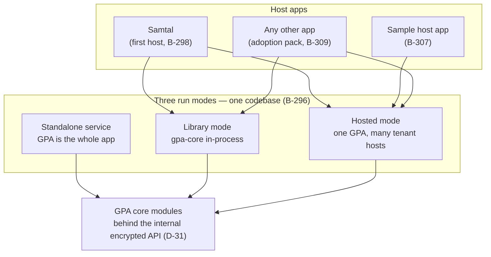
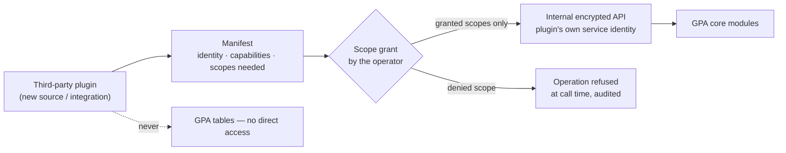

# 16 — Embedding and Host Apps: Building GPA Into Other Apps

**Written for:** maintainers of other apps — Samtal first — who
want group planning inside their own product, and for GPA
developers maintaining the embed surface.
**Roadmap home:** decision D-42, standards §6A.15, Phase 25
(B-296 → B-310). The architecture that makes this cheap was
decided early on purpose: real module boundaries (D-30, B-161),
one internal encrypted API between all parts (D-31, §6A.4), and
total API parity (D-35, B-201).

## The idea in one paragraph

The planning capability is the product; the standalone Group
Planning Assistant is its first home, not its only one. Because
every part of GPA already talks to every other part through one
typed, encrypted internal API, a host app does not integrate
with a tangle of code — it integrates with a **defined
capability**: groups, sources, a review queue, events, planning,
memory, delivered through whichever of three run modes fits the
host. Samtal is the named first host, and deliberately **not a
special case**: everything Samtal gets travels the same road
the sample host app proves for strangers (B-307). If Samtal
ever needs a private shortcut, that is a defect in the embed
surface, filed as a slice — our own apps eat the same cooking
we serve everyone else.



**Walking tour.** At the top sit three host apps: Samtal (the
first host), the deliberately tiny sample host app, and "any
other app" arriving via the adoption pack. In the middle are
the three run modes — one codebase with a mode flag, not three
products. Samtal can take either the library road (GPA core
running inside its own process) or the hosted road (a GPA
service serving it as a tenant); the sample host and other apps
have the same choice. At the bottom, all three modes converge
on the same GPA core modules, and everything a host asks for
travels through the internal encrypted API. The standalone mode
is drawn feeding the same core: it is what the hackathon ships,
and it is a host of one — which is exactly why embedding later
is an addition, not a rewrite.

---

## 1. The three run modes (B-296)

| Mode | What runs where | Database | Right for |
|---|---|---|---|
| **Standalone** | The GPA service, its own accounts, its own doors (web frontends, terminal, API, MCP) | GPA's own | The hackathon product; any group with no host app |
| **Library** | `gpa-core` imported into the host's own Python process; the host calls the internal API in-process | The host's choice (its own GPA database, managed by GPA migrations) | A Python host — Samtal included — that wants planning *inside* its own deployment |
| **Hosted** | One GPA service serving many host apps as isolated tenants | GPA's, partitioned per host (B-303) | Many hosts, one operator; non-Python hosts; hosts that want no GPA operations burden |

One codebase, mode-specific test profiles, and the golden demo
story must pass in all three modes (B-296's acceptance). A
capability that exists in one mode exists in all three — the
parity discipline (D-35) applied to deployment shapes.

## 2. Host identity bridging — no second password (B-297)

Identity belongs to the host. A person planning inside an app
they already use must never be asked to invent a second
password for the planning part of it.

- The host **asserts** its users and its agents to GPA by
  **signed token exchange**: an OIDC-shaped, short-lived token,
  audience set per host, signed with the host's key. GPA
  verifies the signature, the audience, and the expiry — and
  trusts nothing else in the token beyond the assertions it is
  entitled to make.
- A host principal arrives as **the same person**: mapped to a
  GPA identity by the bridge's mapping record, linked, and
  **never duplicated by name-guessing** (two people with the
  same name are two people). They keep their host name and
  avatar in GPA surfaces unless they change them there.
- Bridged users have **no GPA password unless they choose to
  set one** (for example, to also use the standalone doors).
  Signing out of the host ends the bridged session; the mapping
  remains so tomorrow's sign-in finds the same person.
- **Seats bridge too.** A host's agent — a Kindroid in Samtal —
  can hold its GPA agent seat through the bridge, with the GPA
  role the host's mapping grants it, bound by exactly the same
  approval law as any seat (B-203). Seat actions are attributed
  to the seat, never silently to a human owner, in both apps'
  audit trails.

```mermaid
sequenceDiagram
    participant U as "Person (in Samtal)"
    participant H as "Host app (Samtal)"
    participant B as "Identity bridge (gpa-embed)"
    participant G as "GPA core"
    U->>H: Signs in (Samtal's own sign-in)
    U->>H: Opens the planning hall feature
    H->>B: Mint assertion for this principal (short-lived, audience = this host)
    B->>G: Signed token exchange
    G->>G: Verify signature + audience + expiry; look up mapping
    alt First time
        G->>G: Create mapped GPA identity (host name/avatar carried over)
    end
    G-->>H: GPA session for the mapped identity
    H-->>U: Planning surfaces, already signed in — no second password
```

**Walking tour.** The person signs in once, to Samtal, with
Samtal's own sign-in — GPA is not involved yet. When they open
the planning feature, the host asks the bridge (the `gpa-embed`
helper, §5) to mint a short-lived assertion naming this
principal, addressed to this host's audience. The bridge
presents it to GPA in a signed token exchange. GPA checks three
things — signature, audience, expiry — then looks up its
mapping: if this host principal has been here before, the same
GPA identity answers; the first time, a mapped identity is
created with the host's name and avatar carried over. GPA
returns a session, the host renders the planning surfaces, and
the person is simply *in*. At no point was a password created,
asked for, or stored by GPA for this person.

## 3. The Samtal pack — the first host (B-298)

GPA as a citizen-app inside Samtal's village:

- **Hall commands** — the planning verbs a hall already speaks
  (`!plan`, and friends, shaped to Samtal's command conventions)
  carried into GPA operations through the bridge.
- **A panels data API** shaped for Samtal's own UI: the *queue
  badge* (how many drafts wait), the *tonight card* (what is on
  tonight), the *event card* (one event, whole and readable).
  Panels call the same projections the public API serves — no
  Samtal-only data path to drift.
- **Samtal chat as a source** (growing B-123): a hall's talk,
  with the group's permission recorded, feeds the extraction
  pipeline exactly as a pasted chat does.
- **The Samtal calendar as a two-way-as-candidates peer**
  (growing B-124): published GPA events stand on the Samtal
  calendar; edits made on the Samtal side return as change
  candidates under the same queue law as Google or CalDAV edits
  (Doc 15, rule 2).
- **Announcements home:** GPA events are announced into the hall
  by the group's GPA seat, and digests can be delivered as hall
  posts where the group chooses that over email.
- **Samtal remains sovereign.** The pack is a guest in Samtal's
  house: it installs beside Samtal's core, holds its data in
  GPA's own tables, and removing it leaves Samtal whole — no
  Samtal file is patched, no Samtal table is borrowed.

The Phase 25 gate (B-308) proves this live in a real village: a
plan spoken in the hall → GPA drafts it → the organiser approves
**from Samtal's own surface** (the panels calling the same
approval operation a GPA screen calls) → the event stands on
both calendars → a Kindroid seat takes a task through the
bridge. Recorded as evidence under Phase 24's rules.

## 4. The embed widget API (B-299, B-304)

For hosts with their own pages — Samtal's web surfaces, or any
app with a browser in it — five widgets cover the embedding
cases that matter:

| Widget | What it shows | Typical host page |
|---|---|---|
| Calendar widget | A group's calendar (agenda/month) | A community page, a village square |
| Tonight card | What is on tonight, in one card | A home screen, a hall header |
| Queue widget | Waiting drafts, with approve/edit for those allowed | An organiser's dashboard |
| Event card | One event — time, place, discussion link, RSVP | Anywhere an event is mentioned |
| Ask box | Ask-the-group-memory, with citations | A help page, a hall sidebar |

- **Scoped embed tokens.** Each widget instance is authorised
  by a token scoped to *one widget, one group, one host
  origin*, with the viewer's bridged identity where the widget
  is personal (the queue widget) and none where it is public
  (a public calendar widget). A token lifted from a page can do
  nothing beyond rendering that widget's data.
- **Data, not separate logic.** Widgets render from JSON data
  endpoints serving the same projections as the API. There is
  no embed-only business logic; the reference web components in
  the SDK are one renderer, and a host may render the same JSON
  its own way.
- **Theme variables (B-304).** The host supplies brand tokens —
  name, colours as data tokens, logo, locale, sender name — and
  widgets, emails, digests, and exported documents wear them.
  An embedded GPA should feel like the host app; its documents
  still name the capability honestly in their provenance.

## 5. The SDKs (B-300, B-301)

- **Python — `gpa-client`:** API + MCP client helpers, typed
  from the OpenAPI snapshot and the internal operation registry,
  so a Python host's calls are checked against the real
  contract.
- **Python — `gpa-embed`:** the server-side half — token
  exchange minting and verification helpers, widget signing,
  webhook signature verification. This is the package a Python
  host (Samtal included) actually installs to be a host.
- **TypeScript:** the same pair for JS/TS hosts, types
  generated from the same OpenAPI snapshot through B-006's
  pipeline, so the two SDK families cannot drift apart without
  a test noticing.

## 6. The plugin protocol (B-302) — modules that arrive late

Third parties extend sources and integrations — a new chat
platform, a new calendar, a new office suite — as **plugins**:
a module that arrived late, held to every module law.

- **Discovery + manifest.** Plugins are found by entry points
  and must ship a manifest declaring identity, version,
  capabilities offered (source kind / integration kind), and
  **the internal scopes it needs** — declared up front, in the
  open, reviewable before install.
- **Least privilege, enforced by the machinery that already
  exists.** The scope grant is enforced by the same internal
  scope machinery as first-party modules (B-164): a plugin
  granted "submit sources" cannot approve candidates, whatever
  its code tries.
- **One road in.** A plugin talks **only** through the internal
  encrypted API, with its own service identity (B-164). It
  never touches GPA's tables, another plugin's data, or the
  host's internals.
- **Listing has a price: evidence.** A plugin offered to others
  carries the Phase 24 evidence pack for its claims (§6A.14)
  and meets the comment standard (D-26) — the registry a host
  consults shows evidence, not marketing.



**Walking tour.** A plugin arrives carrying its manifest —
who it is, what it offers, and the internal scopes it asks for.
The operator's scope grant is the gate: scopes are granted or
not, by a human decision, before the plugin runs. When the
plugin works, every call it makes crosses the internal
encrypted API under its own service identity, and the core
checks the granted scopes at call time. The arrow to "operation
refused" is the denied path: an under-scoped call is refused
and audited, not warned about and allowed. The dotted arrow at
the bottom is the road that does not exist: a plugin never
reaches GPA's database tables directly — "never" is the label
because the architecture offers no such path to take.

## 7. Tenancy — one host's data is invisible to another (B-303)

In hosted mode, `host_id` partitions **everything**: rows,
files, encryption keys, audit streams. Host-level settings
(branding, default deployment profile, data-residency note)
apply per host. A host can export or erase **its** tenants'
data without touching another host's — the same sovereignty a
group has, one level up (§6A.15). Cross-host leakage sits on
the unforgivable-defects list, guarded by cross-host fuzz
testing in the style of B-246.

## 8. Group portability — leaving is as real as joining (B-305)

A whole group — members (by identity mapping), events,
history, files, decisions, provenance — can move between a
standalone GPA and an embedded home: into a Samtal village, or
out of one into standalone. The vehicle is the group export
archive; the import lands everything as **the same group** in
its new home, provenance intact, with members re-mapped to the
new home's identities by the bridge rather than re-invented.
Sovereignty means the door works both ways — between our own
apps most of all.

## 9. The stability promise for the embed surface (B-306)

The embed surface (token exchange, widgets, SDKs, plugin
protocol) is versioned **separately** from the product API,
because hosts upgrade on their own calendars:

- Additive changes within a major version; nothing a host
  depends on is removed or renamed inside a major.
- A **two-major deprecation window**: a deprecated embed
  feature keeps working for two major versions, with warnings,
  before it may retire.
- A **machine-readable changelog**, so a host's CI can notice
  an embed-surface change before its users do.

## 10. Becoming a host — the conformance road (B-307, B-309)

1. **Read the adoption pack (B-309):** what GPA gives a host,
   the three run modes, the conformance road, the evidence
   registry as the trust basis, and the licence position stated
   exactly as it stands — the licence is the GPA team's later
   decision; nothing in the pack presumes one in either
   direction (§6A.17).
2. **Run the sample host app (B-307):** deliberately tiny and
   deliberately *not* Samtal — a minimal Python host plus a
   static HTML page embedding two widgets. If the road works
   for this stranger, it works.
3. **Do the "first afternoon":** the pack's guided path ends
   with a working embedded calendar widget in the host's own
   page, fed by a real group.
4. **Run the host conformance kit against your integration:**
   token exchange correct, widgets properly signed, webhooks
   verified, tenancy respected. The kit's report is the
   integration's evidence pack.

## 11. The two-host proof (B-310)

Phase 25 closes with Samtal and the sample host running the
**same GPA core version at the same time**: data isolated
(fuzz-verified), identities bridged in both, one group ported
live from standalone into the sample host (B-305), parity and
evidence packs filed. From that day, "GPA can be built into
other apps" is not a design intention — it is a claim with an
evidence id, which is the only kind of claim this project
makes (D-41).
