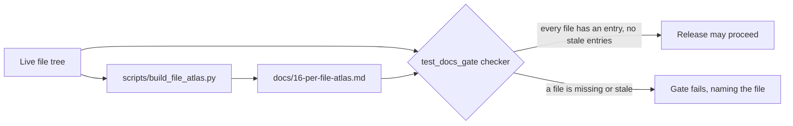

# Per-code-file atlas

*Roadmap slice B-197. For every code file in the tree: purpose,
module, public symbols with what each is for, allowed and
forbidden dependencies, data it owns or touches, failure
behaviour, tests that cover it, and the slice that created it.
The atlas is the contract behind D-26's comments: the header in
the file and the chapter in the atlas must agree.*

## How this atlas is made — and kept true

This chapter is GENERATED from the live tree by
`scripts/build_file_atlas.py` (stdlib AST + git history), and
is regenerated whenever the tree changes shape. That is the
honest way to keep 390-odd entries true: a hand-maintained list
would drift within a phase. (One entry ages by design: a new
file's "Created by" reads "pre-git" until its creating commit
lands, and the next regeneration corrects it.) Each entry
derives from evidence:

- **Purpose** is the file's own header docstring — the D-26
  comment the B-176 gate enforces — so a disagreement between
  header and atlas is impossible by construction, and a file
  with no header says so in its entry.
- **Public symbols** and **dependencies** are the file's AST:
  top-level public defs/classes/constants, and its imports.
- **Module** is the B-161 module map for service files; other
  layers name their family.
- **Allowed / forbidden dependencies** and **failure
  behaviour** are LAYER laws (§6A.3), stated once per layer in
  the generator and applied to each file — they are not
  per-file inventions.
- **Data** names the tables a model file owns; every other
  layer owns none, by the layering law.
- **Tests that name it** lists test modules whose text names
  the file's stem — an honest proxy, labelled as such; the
  full-suite gate is the real coverage proof.
- **Created by** is the first commit that added the file
  (`git log --diff-filter=A`), with its slice id when the
  commit subject carries one.

## The checker (B-197 acceptance)

The walking tour: the live tree feeds both the generator,
which writes this atlas, and the docs-gate checker, which
independently re-lists the tree and diffs it against the
entries below. Agreement lets a release proceed; any missing
or stale entry fails the gate naming the exact file — the
same by-file discipline as the Mermaid gate (B-181) and the
model checker (B-192).

Scope honesty: the atlas covers every Python file under
`src/`, `migrations/`, `scripts/`, and `tests/`. Non-Python
code (shell entry points `run.sh`/`test.sh`/`demo.sh`, the
`deploy/` units, Jinja templates, AI prompt templates) is
documented by its owning chapter — deployment (B-199),
durability (B-195), AI pipeline (B-193) — and the prompt
templates carry their own name+version front-matter under
the B-038 discipline.

The tree at generation time holds **429 Python code files**: migrations 23, scripts 22, src 203, tests 181. Every one has an entry below; the B-197 checker in `tests/test_docs_gate.py` re-derives this list from the live tree and fails, naming the file, if any file lacks an entry or any entry names a file that no longer exists.

## Files under `src/`

### `src/gpa/__init__.py`

- **Purpose:** Group Planning Assistant — backend package.
- **Module:** composition / foundation · **Layer:** root
- **Public symbols:** —
- **Dependencies (imports):** —
- **Allowed / forbidden:** Composition and foundation files: may wire any module's public surface (reviewed as composition). Forbidden: business rules that belong in a service.
- **Data:** Owns no tables (layer law); touches data only through the models/services named in its dependencies.
- **Failure behaviour:** Startup refusals are plain-words and fatal by design (prod secret law, half-configured mail); request-time failures ride the problem+json chassis.
- **Tests that name it:** `tests/test_architecture.py`, `tests/test_error_correction.py`, `tests/test_extraction.py`, `tests/test_internal_transport.py`, `tests/test_jobqueue.py`, `tests/test_links.py`
- **Created by:** B-001 — Phase 0: foundation chassis (B-001 to B-010)

### `src/gpa/ai/__init__.py`

- **Purpose:** The AI layer (roadmap Phase 3, B-035 → B-048).
- **Module:** ai · **Layer:** ai
- **Public symbols:** —
- **Dependencies (imports):** —
- **Allowed / forbidden:** May import: stdlib, httpx (live driver only), models for usage rows. Forbidden: routers; vendor SDKs anywhere.
- **Data:** Owns no tables (layer law); touches data only through the models/services named in its dependencies.
- **Failure behaviour:** Model failures raise ModelError in plain words; a fixture miss is a loud FixtureMissError, never an invented answer.
- **Tests that name it:** `tests/test_architecture.py`, `tests/test_error_correction.py`, `tests/test_extraction.py`, `tests/test_internal_transport.py`, `tests/test_jobqueue.py`, `tests/test_links.py`
- **Created by:** B-035 — Phase 3 (part 1): AI adapter protocol + mock/fixture/live drivers (B-035, B-036, B-037)

### `src/gpa/ai/client.py`

- **Purpose:** The model client protocol (roadmap B-035, decision D-18).
- **Module:** ai · **Layer:** ai
- **Public symbols:** `TIER_SPARK`, `TIER_WONDER`, `ModelError`, `FixtureMissError`, `ModelResult`, `MetaModelClient`, `estimate_tokens`, `cost_micros_for`, `set_client`, `get_client`, `build_client`
- **Dependencies (imports):** `dataclasses`, `gpa.ai.drivers_fixture`, `gpa.ai.drivers_live`, `gpa.ai.drivers_local`, `gpa.ai.drivers_mock`, `gpa.config`, `pathlib`, `typing`
- **Allowed / forbidden:** May import: stdlib, httpx (live driver only), models for usage rows. Forbidden: routers; vendor SDKs anywhere.
- **Data:** Owns no tables (layer law); touches data only through the models/services named in its dependencies.
- **Failure behaviour:** Model failures raise ModelError in plain words; a fixture miss is a loud FixtureMissError, never an invented answer.
- **Tests that name it:** `tests/conftest.py`, `tests/extraction_world.py`, `tests/internal_fixture_server.py`, `tests/test_account_security.py`, `tests/test_agent_pack.py`, `tests/test_ai_client.py`
- **Created by:** B-035 — Phase 3 (part 1): AI adapter protocol + mock/fixture/live drivers (B-035, B-036, B-037)

### `src/gpa/ai/dates.py`

- **Purpose:** The date resolver (roadmap B-039, decision D-22).
- **Module:** ai · **Layer:** ai
- **Public symbols:** `DateReading`, `DateResolution`, `TimeReading`, `TimeResolution`, `resolve_date_phrase`, `parse_time_phrase`
- **Dependencies (imports):** `dataclasses`, `datetime`, `re`, `zoneinfo`
- **Allowed / forbidden:** May import: stdlib, httpx (live driver only), models for usage rows. Forbidden: routers; vendor SDKs anywhere.
- **Data:** Owns no tables (layer law); touches data only through the models/services named in its dependencies.
- **Failure behaviour:** Model failures raise ModelError in plain words; a fixture miss is a loud FixtureMissError, never an invented answer.
- **Tests that name it:** `tests/extraction_world.py`, `tests/test_agent_pack.py`, `tests/test_architecture.py`, `tests/test_authz_fuzz.py`, `tests/test_availability.py`, `tests/test_candidates.py`
- **Created by:** B-039 — Phase 3 (part 3): deterministic date resolver (B-039, D-22)

### `src/gpa/ai/drivers_fixture.py`

- **Purpose:** The fixture driver (roadmap B-036).
- **Module:** ai · **Layer:** ai
- **Public symbols:** `prompt_key`, `FixtureDriver`
- **Dependencies (imports):** `base64`, `gpa.ai.client`, `hashlib`, `json`, `pathlib`, `typing`
- **Allowed / forbidden:** May import: stdlib, httpx (live driver only), models for usage rows. Forbidden: routers; vendor SDKs anywhere.
- **Data:** Owns no tables (layer law); touches data only through the models/services named in its dependencies.
- **Failure behaviour:** Model failures raise ModelError in plain words; a fixture miss is a loud FixtureMissError, never an invented answer.
- **Tests that name it:** `tests/extraction_world.py`, `tests/test_ai_client.py`, `tests/test_ask.py`, `tests/test_briefings.py`, `tests/test_change_candidates.py`, `tests/test_demo_flows.py`
- **Created by:** B-035 — Phase 3 (part 1): AI adapter protocol + mock/fixture/live drivers (B-035, B-036, B-037)

### `src/gpa/ai/drivers_live.py`

- **Purpose:** The live driver (roadmap B-037).
- **Module:** ai · **Layer:** ai
- **Public symbols:** `LiveDriver`
- **Dependencies (imports):** `base64`, `gpa.ai.client`, `httpx`, `json`, `random`, `time`, `typing`
- **Allowed / forbidden:** May import: stdlib, httpx (live driver only), models for usage rows. Forbidden: routers; vendor SDKs anywhere.
- **Data:** Owns no tables (layer law); touches data only through the models/services named in its dependencies.
- **Failure behaviour:** Model failures raise ModelError in plain words; a fixture miss is a loud FixtureMissError, never an invented answer.
- **Tests that name it:** `tests/test_ai_client.py`, `tests/test_phase10_gate.py`
- **Created by:** B-035 — Phase 3 (part 1): AI adapter protocol + mock/fixture/live drivers (B-035, B-036, B-037)

### `src/gpa/ai/drivers_local.py`

- **Purpose:** The local-inference driver (roadmap B-119).
- **Module:** ai · **Layer:** ai
- **Public symbols:** `LocalDriver`
- **Dependencies (imports):** `__future__`, `gpa.ai.client`, `httpx`, `json`
- **Allowed / forbidden:** May import: stdlib, httpx (live driver only), models for usage rows. Forbidden: routers; vendor SDKs anywhere.
- **Data:** Owns no tables (layer law); touches data only through the models/services named in its dependencies.
- **Failure behaviour:** Model failures raise ModelError in plain words; a fixture miss is a loud FixtureMissError, never an invented answer.
- **Tests that name it:** `tests/test_architecture.py`, `tests/test_local_driver.py`
- **Created by:** B-119 — B-119: local-inference driver — OpenAI-compatible chat-completions driver (text only, plai

### `src/gpa/ai/drivers_mock.py`

- **Purpose:** The mock driver (roadmap B-036).
- **Module:** ai · **Layer:** ai
- **Public symbols:** `synthesize`, `MockDriver`
- **Dependencies (imports):** `PIL`, `gpa.ai.client`, `hashlib`, `io`, `json`, `typing`
- **Allowed / forbidden:** May import: stdlib, httpx (live driver only), models for usage rows. Forbidden: routers; vendor SDKs anywhere.
- **Data:** Owns no tables (layer law); touches data only through the models/services named in its dependencies.
- **Failure behaviour:** Model failures raise ModelError in plain words; a fixture miss is a loud FixtureMissError, never an invented answer.
- **Tests that name it:** `tests/test_ai_client.py`, `tests/test_phase10_gate.py`, `tests/test_vision_pipeline.py`
- **Created by:** B-035 — Phase 3 (part 1): AI adapter protocol + mock/fixture/live drivers (B-035, B-036, B-037)

### `src/gpa/ai/evaluation.py`

- **Purpose:** The extraction evaluation harness (roadmap B-046).
- **Module:** ai · **Layer:** ai
- **Public symbols:** `HERE`, `CORPUS_PATH`, `BASELINE_PATH`, `GATE_TOLERANCE`, `load_corpus`, `load_baseline`, `evaluate`, `gate_failures`, `format_table`
- **Dependencies (imports):** `datetime`, `gpa.ai`, `gpa.ai.drivers_fixture`, `gpa.ai.extraction`, `gpa.services.quality`, `json`, `pathlib`
- **Allowed / forbidden:** May import: stdlib, httpx (live driver only), models for usage rows. Forbidden: routers; vendor SDKs anywhere.
- **Data:** Owns no tables (layer law); touches data only through the models/services named in its dependencies.
- **Failure behaviour:** Model failures raise ModelError in plain words; a fixture miss is a loud FixtureMissError, never an invented answer.
- **Tests that name it:** `tests/test_architecture.py`, `tests/test_docs_gate.py`, `tests/test_evaluation.py`, `tests/test_pruning_evaluation.py`, `tests/test_vision_evaluation.py`
- **Created by:** B-046 — Phase 3 (part 6): evaluation harness v1 (B-046)

### `src/gpa/ai/extraction.py`

- **Purpose:** The extraction pipeline (roadmap B-040, B-041, B-042).
- **Module:** ai · **Layer:** ai
- **Public symbols:** `MAX_WINDOW_CHARS`, `MAX_WINDOW_CHUNKS`, `ExtractedCandidate`, `chunk_windows`, `render_chunks`, `build_prompt`, `extract_kind`
- **Dependencies (imports):** `dataclasses`, `datetime`, `gpa.ai`, `gpa.ai.client`, `gpa.ai.dates`, `gpa.models.sources`, `typing`
- **Allowed / forbidden:** May import: stdlib, httpx (live driver only), models for usage rows. Forbidden: routers; vendor SDKs anywhere.
- **Data:** Owns no tables (layer law); touches data only through the models/services named in its dependencies.
- **Failure behaviour:** Model failures raise ModelError in plain words; a fixture miss is a loud FixtureMissError, never an invented answer.
- **Tests that name it:** `tests/chaos_worker.py`, `tests/extraction_world.py`, `tests/test_architecture.py`, `tests/test_ask.py`, `tests/test_candidates.py`, `tests/test_change_candidates.py`
- **Created by:** B-040 — Phase 3 (part 4): extraction pipeline (B-040, B-041, B-042)

### `src/gpa/ai/promptlib.py`

- **Purpose:** The versioned prompt library (roadmap B-038).
- **Module:** ai · **Layer:** ai
- **Public symbols:** `PROMPTS_DIR`, `PromptError`, `PromptTemplate`, `verify_manifest`, `write_manifest`, `load_prompt`, `prompt_version`, `render_prompt`
- **Dependencies (imports):** `dataclasses`, `functools`, `hashlib`, `json`, `pathlib`, `re`, `sys`
- **Allowed / forbidden:** May import: stdlib, httpx (live driver only), models for usage rows. Forbidden: routers; vendor SDKs anywhere.
- **Data:** Owns no tables (layer law); touches data only through the models/services named in its dependencies.
- **Failure behaviour:** Model failures raise ModelError in plain words; a fixture miss is a loud FixtureMissError, never an invented answer.
- **Tests that name it:** `tests/extraction_world.py`, `tests/test_architecture.py`, `tests/test_ask.py`, `tests/test_briefings.py`, `tests/test_candidates.py`, `tests/test_change_candidates.py`
- **Created by:** B-038 — Phase 3 (part 2): versioned prompt library (B-038)

### `src/gpa/ai/pruning.py`

- **Purpose:** The context-pruning engine (roadmap B-113, B-114).
- **Module:** ai · **Layer:** ai
- **Public symbols:** `PRUNE_TIER`, `MAX_PASSES_CEILING`, `MemoryChunk`, `PrunePass`, `PruneOutcome`, `render_chunks`, `build_prune_prompt`, `prune_once`, `reconsider_dropped`, `prune_multi`, `find_quote`, `verify_citations`
- **Dependencies (imports):** `dataclasses`, `datetime`, `gpa.ai`, `gpa.ai.client`, `gpa.ai.extraction`, `typing`
- **Allowed / forbidden:** May import: stdlib, httpx (live driver only), models for usage rows. Forbidden: routers; vendor SDKs anywhere.
- **Data:** Owns no tables (layer law); touches data only through the models/services named in its dependencies.
- **Failure behaviour:** Model failures raise ModelError in plain words; a fixture miss is a loud FixtureMissError, never an invented answer.
- **Tests that name it:** `tests/test_architecture.py`, `tests/test_ask.py`, `tests/test_briefings.py`, `tests/test_docs_gate.py`, `tests/test_local_driver.py`, `tests/test_memory_runs.py`
- **Created by:** B-113 — B-113: pruning core — Geoffrey's engine (a full model judges relevance; NOT embedding RAG,

### `src/gpa/ai/pruning_evaluation.py`

- **Purpose:** The pruning evaluation harness (roadmap B-121).
- **Module:** ai · **Layer:** ai
- **Public symbols:** `load_cases`, `evaluate_pruning`, `format_table`
- **Dependencies (imports):** `__future__`, `datetime`, `gpa.ai`, `gpa.ai.drivers_fixture`, `gpa.ai.extraction`, `json`, `pathlib`
- **Allowed / forbidden:** May import: stdlib, httpx (live driver only), models for usage rows. Forbidden: routers; vendor SDKs anywhere.
- **Data:** Owns no tables (layer law); touches data only through the models/services named in its dependencies.
- **Failure behaviour:** Model failures raise ModelError in plain words; a fixture miss is a loud FixtureMissError, never an invented answer.
- **Tests that name it:** `tests/test_pruning_evaluation.py`
- **Created by:** B-121 — B-121: pruning evaluation — golden questions with human-marked relevant chunks scored thro

### `src/gpa/ai/segmentation.py`

- **Purpose:** Board segmentation — the driver boundary (roadmap B-064, D-19).
- **Module:** ai · **Layer:** ai
- **Public symbols:** `PROMPT_NAME`, `SegmenterUnavailable`, `Region`, `BoardSegmenter`, `VisionBoxSegmenter`, `SamSegmenter`, `build_segmenter`
- **Dependencies (imports):** `dataclasses`, `gpa.ai`, `gpa.ai.client`, `gpa.ai.vision`, `httpx`, `typing`
- **Allowed / forbidden:** May import: stdlib, httpx (live driver only), models for usage rows. Forbidden: routers; vendor SDKs anywhere.
- **Data:** Owns no tables (layer law); touches data only through the models/services named in its dependencies.
- **Failure behaviour:** Model failures raise ModelError in plain words; a fixture miss is a loud FixtureMissError, never an invented answer.
- **Tests that name it:** `tests/test_architecture.py`, `tests/test_docs_gate.py`, `tests/test_images.py`, `tests/test_ingest_corpus.py`, `tests/test_prompts.py`, `tests/test_vision_api.py`
- **Created by:** B-063 — Phase 5 (part 1): vision pipeline + segmentation boundary (B-063/B-064 cores, B-066/B-067 

### `src/gpa/ai/vision.py`

- **Purpose:** The vision reading pipeline (roadmap B-063; Doc 07 §5).
- **Module:** ai · **Layer:** ai
- **Public symbols:** `PROMPT_NAME`, `DATE_FIELDS`, `VisionReading`, `build_vision_prompt`, `valid_region`, `read_flyer_image`
- **Dependencies (imports):** `dataclasses`, `datetime`, `gpa.ai`, `gpa.ai.client`, `gpa.ai.dates`, `typing`
- **Allowed / forbidden:** May import: stdlib, httpx (live driver only), models for usage rows. Forbidden: routers; vendor SDKs anywhere.
- **Data:** Owns no tables (layer law); touches data only through the models/services named in its dependencies.
- **Failure behaviour:** Model failures raise ModelError in plain words; a fixture miss is a loud FixtureMissError, never an invented answer.
- **Tests that name it:** `tests/conftest.py`, `tests/test_architecture.py`, `tests/test_docs_gate.py`, `tests/test_flyer_wall.py`, `tests/test_migrations_phase10.py`, `tests/test_migrations_phase11.py`
- **Created by:** B-063 — Phase 5 (part 1): vision pipeline + segmentation boundary (B-063/B-064 cores, B-066/B-067 

### `src/gpa/ai/vision_evaluation.py`

- **Purpose:** Vision evaluation harness (roadmap B-073) — the B-046 harness's vision edition.
- **Module:** ai · **Layer:** ai
- **Public symbols:** `ANCHOR`, `GROUP_TZ`, `build_golden_image`, `run_vision_evaluation`, `load_baseline`, `format_report`, `main`
- **Dependencies (imports):** `PIL`, `datetime`, `gpa.ai`, `gpa.ai.drivers_fixture`, `gpa.ai.vision`, `io`, `json`, `pathlib`
- **Allowed / forbidden:** May import: stdlib, httpx (live driver only), models for usage rows. Forbidden: routers; vendor SDKs anywhere.
- **Data:** Owns no tables (layer law); touches data only through the models/services named in its dependencies.
- **Failure behaviour:** Model failures raise ModelError in plain words; a fixture miss is a loud FixtureMissError, never an invented answer.
- **Tests that name it:** `tests/test_vision_evaluation.py`
- **Created by:** B-073 — Phase 5 (part 4): vision evaluation, phase gate, contract (B-073, B-074)

### `src/gpa/arq_worker.py`

- **Purpose:** External-queue worker entry point (roadmap B-157).
- **Module:** composition / foundation · **Layer:** root
- **Public symbols:** `main`
- **Dependencies (imports):** `arq.worker`, `gpa.config`, `gpa.internal`, `gpa.services.jobqueue`
- **Allowed / forbidden:** Composition and foundation files: may wire any module's public surface (reviewed as composition). Forbidden: business rules that belong in a service.
- **Data:** Owns no tables (layer law); touches data only through the models/services named in its dependencies.
- **Failure behaviour:** Startup refusals are plain-words and fatal by design (prod secret law, half-configured mail); request-time failures ride the problem+json chassis.
- **Tests that name it:** — (no test module names it; covered indirectly or a fixture/helper)
- **Created by:** B-157 — B-157 Multi-instance jobs: claim scan + handled collisions, queue interface with arq adapt

### `src/gpa/config.py`

- **Purpose:** Application configuration (roadmap B-002).
- **Module:** composition / foundation · **Layer:** root
- **Public symbols:** `KNOWN_DEFAULT_SECRETS`, `PROD_SECRET_MIN_LENGTH`, `DEV_SECRET`, `Settings`, `get_settings`
- **Dependencies (imports):** `functools`, `pathlib`, `pydantic`, `pydantic_settings`
- **Allowed / forbidden:** Composition and foundation files: may wire any module's public surface (reviewed as composition). Forbidden: business rules that belong in a service.
- **Data:** Owns no tables (layer law); touches data only through the models/services named in its dependencies.
- **Failure behaviour:** Startup refusals are plain-words and fatal by design (prod secret law, half-configured mail); request-time failures ride the problem+json chassis.
- **Tests that name it:** `tests/conftest.py`, `tests/test_ai_client.py`, `tests/test_authz_fuzz.py`, `tests/test_developer_pack.py`, `tests/test_docs_gate.py`, `tests/test_erasure.py`
- **Created by:** B-001 — Phase 0: foundation chassis (B-001 to B-010)

### `src/gpa/crypto/__init__.py`

- **Purpose:** Field-level encryption (roadmap B-167).
- **Module:** crypto · **Layer:** crypto
- **Public symbols:** —
- **Dependencies (imports):** —
- **Allowed / forbidden:** May import: stdlib, cryptography. Forbidden: services above the primitives, routers.
- **Data:** Owns no tables (layer law); touches data only through the models/services named in its dependencies.
- **Failure behaviour:** A seal that does not verify raises in plain words; opening never creates key material.
- **Tests that name it:** `tests/test_architecture.py`, `tests/test_error_correction.py`, `tests/test_extraction.py`, `tests/test_internal_transport.py`, `tests/test_jobqueue.py`, `tests/test_links.py`
- **Created by:** B-167 — B-167 Field-level encryption: gpa/crypto envelope scheme (master wraps per-group data keys

### `src/gpa/crypto/fields.py`

- **Purpose:** The field-encryption service (roadmap B-167).
- **Module:** crypto · **Layer:** crypto
- **Public symbols:** `FIELD_PREFIX`, `set_settings`, `master_key`, `wrap_aad`, `ensure_group_key`, `data_key`, `seal_text`, `open_text`, `blind_index`
- **Dependencies (imports):** `__future__`, `base64`, `gpa.config`, `gpa.errors`, `gpa.internal`, `gpa.models.crypto`, `hashlib`, `hmac`, `os`, `sqlalchemy.orm`
- **Allowed / forbidden:** May import: stdlib, cryptography. Forbidden: services above the primitives, routers.
- **Data:** Owns no tables (layer law); touches data only through the models/services named in its dependencies.
- **Failure behaviour:** A seal that does not verify raises in plain words; opening never creates key material.
- **Tests that name it:** `tests/test_ai_client.py`, `tests/test_availability.py`, `tests/test_calendar_views.py`, `tests/test_candidates.py`, `tests/test_change_candidates.py`, `tests/test_decisions.py`
- **Created by:** B-167 — B-167 Field-level encryption: gpa/crypto envelope scheme (master wraps per-group data keys

### `src/gpa/db.py`

- **Purpose:** Database chassis (roadmap B-003).
- **Module:** composition / foundation · **Layer:** root
- **Public symbols:** `Base`, `Database`, `get_db`
- **Dependencies (imports):** `fastapi`, `gpa`, `pathlib`, `sqlalchemy`, `sqlalchemy.orm`
- **Allowed / forbidden:** Composition and foundation files: may wire any module's public surface (reviewed as composition). Forbidden: business rules that belong in a service.
- **Data:** Owns no tables (layer law); touches data only through the models/services named in its dependencies.
- **Failure behaviour:** Startup refusals are plain-words and fatal by design (prod secret law, half-configured mail); request-time failures ride the problem+json chassis.
- **Tests that name it:** `tests/chaos_worker.py`, `tests/conftest.py`, `tests/extraction_world.py`, `tests/internal_fixture_server.py`, `tests/test_account_security.py`, `tests/test_ask.py`
- **Created by:** B-001 — Phase 0: foundation chassis (B-001 to B-010)

### `src/gpa/deps.py`

- **Purpose:** Authentication + permission dependencies (roadmap B-017).
- **Module:** composition / foundation · **Layer:** root
- **Public symbols:** `Principal`, `get_principal`, `require_scope`, `GroupContext`, `get_group_context`, `require_group_role`
- **Dependencies (imports):** `dataclasses`, `fastapi`, `gpa.db`, `gpa.errors`, `gpa.models.groups`, `gpa.models.identity`, `gpa.security`, `gpa.services.groups`, `sqlalchemy.orm`
- **Allowed / forbidden:** Composition and foundation files: may wire any module's public surface (reviewed as composition). Forbidden: business rules that belong in a service.
- **Data:** Owns no tables (layer law); touches data only through the models/services named in its dependencies.
- **Failure behaviour:** Startup refusals are plain-words and fatal by design (prod secret law, half-configured mail); request-time failures ride the problem+json chassis.
- **Tests that name it:** `tests/test_docs_gate.py`
- **Created by:** B-011 — Phase 1: identity, groups, permissions (B-011 to B-022)

### `src/gpa/durability.py`

- **Purpose:** The durability manager (roadmap B-171).
- **Module:** composition / foundation · **Layer:** root
- **Public symbols:** `WriteTracker`, `track`, `pending_violation`
- **Dependencies (imports):** `__future__`, `contextvars`, `sqlalchemy`, `sqlalchemy.orm`
- **Allowed / forbidden:** Composition and foundation files: may wire any module's public surface (reviewed as composition). Forbidden: business rules that belong in a service.
- **Data:** Owns no tables (layer law); touches data only through the models/services named in its dependencies.
- **Failure behaviour:** Startup refusals are plain-words and fatal by design (prod secret law, half-configured mail); request-time failures ride the problem+json chassis.
- **Tests that name it:** `tests/chaos_worker.py`, `tests/conftest.py`, `tests/test_chaos.py`, `tests/test_docs_gate.py`, `tests/test_foundation.py`, `tests/test_startup_recovery.py`
- **Created by:** B-171 — B-171 Durability manager: structural commit-before-answer (write tracker + guard middlewar

### `src/gpa/errors.py`

- **Purpose:** Error chassis (roadmap B-004, decision D-13).
- **Module:** composition / foundation · **Layer:** root
- **Public symbols:** `AppError`, `problem_body`, `install_error_handlers`
- **Dependencies (imports):** `fastapi`, `fastapi.exceptions`, `fastapi.responses`, `starlette.exceptions`
- **Allowed / forbidden:** Composition and foundation files: may wire any module's public surface (reviewed as composition). Forbidden: business rules that belong in a service.
- **Data:** Owns no tables (layer law); touches data only through the models/services named in its dependencies.
- **Failure behaviour:** Startup refusals are plain-words and fatal by design (prod secret law, half-configured mail); request-time failures ride the problem+json chassis.
- **Tests that name it:** `tests/test_ai_client.py`, `tests/test_digest.py`, `tests/test_docs_gate.py`, `tests/test_durability.py`, `tests/test_encrypted_storage.py`, `tests/test_field_encryption.py`
- **Created by:** B-001 — Phase 0: foundation chassis (B-001 to B-010)

### `src/gpa/internal/__init__.py`

- **Purpose:** The internal API package (roadmap Phase 17, B-161 → B-166).
- **Module:** internal · **Layer:** internal
- **Public symbols:** —
- **Dependencies (imports):** —
- **Allowed / forbidden:** May import: stdlib, cryptography, models, the audit writer. Forbidden: routers; payload content in logs or audit detail.
- **Data:** Owns no tables (layer law); touches data only through the models/services named in its dependencies.
- **Failure behaviour:** Refusals are the internal_* registry codes, signed even on the wire door; dispatch happens in the caller's transaction or not at all.
- **Tests that name it:** `tests/test_architecture.py`, `tests/test_error_correction.py`, `tests/test_extraction.py`, `tests/test_internal_transport.py`, `tests/test_jobqueue.py`, `tests/test_links.py`
- **Created by:** B-161 — B-161 Module boundaries: module map + architecture checker, pinned edge inventories, priva

### `src/gpa/internal/architecture.py`

- **Purpose:** The architecture checker — import-linter style rules (B-161).
- **Module:** internal · **Layer:** internal
- **Public symbols:** `Edge`, `Violation`, `ScanResult`, `scan_imports`, `edge_key`, `cross_module_edges`, `router_model_edges`, `check_tree`
- **Dependencies (imports):** `__future__`, `ast`, `dataclasses`, `gpa.internal`, `pathlib`
- **Allowed / forbidden:** May import: stdlib, cryptography, models, the audit writer. Forbidden: routers; payload content in logs or audit detail.
- **Data:** Owns no tables (layer law); touches data only through the models/services named in its dependencies.
- **Failure behaviour:** Refusals are the internal_* registry codes, signed even on the wire door; dispatch happens in the caller's transaction or not at all.
- **Tests that name it:** `tests/test_architecture.py`, `tests/test_docs_gate.py`, `tests/test_phase18_gate.py`, `tests/test_submission_pack.py`
- **Created by:** B-161 — B-161 Module boundaries: module map + architecture checker, pinned edge inventories, priva

### `src/gpa/internal/auditing.py`

- **Purpose:** Internal API audit (roadmap §6A.4, B-165).
- **Module:** internal · **Layer:** internal
- **Public symbols:** `make_audit_hook`, `install`
- **Dependencies (imports):** `__future__`, `gpa.config`, `gpa.internal`, `gpa.internal.client`, `gpa.services`
- **Allowed / forbidden:** May import: stdlib, cryptography, models, the audit writer. Forbidden: routers; payload content in logs or audit detail.
- **Data:** Owns no tables (layer law); touches data only through the models/services named in its dependencies.
- **Failure behaviour:** Refusals are the internal_* registry codes, signed even on the wire door; dispatch happens in the caller's transaction or not at all.
- **Tests that name it:** `tests/test_internal_audit.py`
- **Created by:** B-165 — B-165 Internal API audit: every dispatch writes its B-019 line (caller, key id, operation,

### `src/gpa/internal/ca.py`

- **Purpose:** The internal CA (roadmap §6A.4, B-163).
- **Module:** internal · **Layer:** internal
- **Public symbols:** `key_pem`, `cert_pem`, `load_cert`, `load_key`, `create_ca`, `issue_leaf`
- **Dependencies (imports):** `__future__`, `cryptography`, `cryptography.hazmat.primitives`, `cryptography.hazmat.primitives.asymmetric`, `cryptography.x509.oid`, `datetime`, `ipaddress`
- **Allowed / forbidden:** May import: stdlib, cryptography, models, the audit writer. Forbidden: routers; payload content in logs or audit detail.
- **Data:** Owns no tables (layer law); touches data only through the models/services named in its dependencies.
- **Failure behaviour:** Refusals are the internal_* registry codes, signed even on the wire door; dispatch happens in the caller's transaction or not at all.
- **Tests that name it:** `tests/chaos_worker.py`, `tests/conftest.py`, `tests/extraction_world.py`, `tests/internal_fixture_server.py`, `tests/test_account_security.py`, `tests/test_agent_pack.py`
- **Created by:** B-163 — B-163 Encrypted internal transport: AES-256-GCM + Ed25519 (HMAC profile) wire form, Unix s

### `src/gpa/internal/client.py`

- **Purpose:** The local client SDK — how a module asks another (B-162).
- **Module:** internal · **Layer:** internal
- **Public symbols:** `CallContext`, `InternalClient`, `default_client`, `call_internal`
- **Dependencies (imports):** `__future__`, `dataclasses`, `gpa.config`, `gpa.errors`, `gpa.internal`, `gpa.internal.envelope`, `secrets`, `sqlalchemy.orm`
- **Allowed / forbidden:** May import: stdlib, cryptography, models, the audit writer. Forbidden: routers; payload content in logs or audit detail.
- **Data:** Owns no tables (layer law); touches data only through the models/services named in its dependencies.
- **Failure behaviour:** Refusals are the internal_* registry codes, signed even on the wire door; dispatch happens in the caller's transaction or not at all.
- **Tests that name it:** `tests/conftest.py`, `tests/extraction_world.py`, `tests/internal_fixture_server.py`, `tests/test_account_security.py`, `tests/test_agent_pack.py`, `tests/test_ai_client.py`
- **Created by:** B-162 — B-162 Internal API core: typed envelope, operation registry with caller scopes, handlers i

### `src/gpa/internal/crypto.py`

- **Purpose:** Internal communications cryptography (roadmap §6A.4, B-163).
- **Module:** internal · **Layer:** internal
- **Public symbols:** `WIRE_VERSION`, `load_internal_key`, `generate_key_b64`, `canonical_header_bytes`, `seal`, `open_sealed`, `generate_signing_key`, `signing_key_from_seed`, `public_key_b64`, `key_id_of`, `seed_b64`, `sign`, `verify`, `sign_hmac`, `verify_hmac`
- **Dependencies (imports):** `__future__`, `base64`, `cryptography.exceptions`, `cryptography.hazmat.primitives`, `cryptography.hazmat.primitives.asymmetric.ed25519`, `cryptography.hazmat.primitives.ciphers.aead`, `gpa.errors`, `hashlib`, `hmac`, `json`, `os`
- **Allowed / forbidden:** May import: stdlib, cryptography, models, the audit writer. Forbidden: routers; payload content in logs or audit detail.
- **Data:** Owns no tables (layer law); touches data only through the models/services named in its dependencies.
- **Failure behaviour:** Refusals are the internal_* registry codes, signed even on the wire door; dispatch happens in the caller's transaction or not at all.
- **Tests that name it:** `tests/internal_fixture_server.py`, `tests/test_architecture.py`, `tests/test_comment_gate.py`, `tests/test_docs_gate.py`, `tests/test_events.py`, `tests/test_field_encryption.py`
- **Created by:** B-163 — B-163 Encrypted internal transport: AES-256-GCM + Ed25519 (HMAC profile) wire form, Unix s

### `src/gpa/internal/envelope.py`

- **Purpose:** The internal envelope — one message shape for every part (B-162).
- **Module:** internal · **Layer:** internal
- **Public symbols:** `utc_now_iso`, `InternalRequest`, `InternalResult`
- **Dependencies (imports):** `__future__`, `datetime`, `pydantic`
- **Allowed / forbidden:** May import: stdlib, cryptography, models, the audit writer. Forbidden: routers; payload content in logs or audit detail.
- **Data:** Owns no tables (layer law); touches data only through the models/services named in its dependencies.
- **Failure behaviour:** Refusals are the internal_* registry codes, signed even on the wire door; dispatch happens in the caller's transaction or not at all.
- **Tests that name it:** `tests/internal_fixture_server.py`, `tests/test_docs_gate.py`, `tests/test_field_encryption.py`, `tests/test_integrations_framework.py`, `tests/test_internal_api.py`, `tests/test_internal_audit.py`
- **Created by:** B-162 — B-162 Internal API core: typed envelope, operation registry with caller scopes, handlers i

### `src/gpa/internal/handlers.py`

- **Purpose:** Operation handlers — the internal API's composition root (B-162).
- **Module:** internal · **Layer:** internal
- **Public symbols:** `AI_JOB_KINDS`, `register_all`
- **Dependencies (imports):** `__future__`, `datetime`, `gpa.ai.client`, `gpa.errors`, `gpa.internal`, `gpa.internal.client`, `gpa.internal.registry`, `gpa.models.events`, `gpa.models.groups`, `gpa.models.identity`, `gpa.models.nonprofit`, `gpa.models.notifications`, `gpa.models.planning`, `gpa.models.sources`, `gpa.services`, `sqlalchemy.orm`
- **Allowed / forbidden:** May import: stdlib, cryptography, models, the audit writer. Forbidden: routers; payload content in logs or audit detail.
- **Data:** Owns no tables (layer law); touches data only through the models/services named in its dependencies.
- **Failure behaviour:** Refusals are the internal_* registry codes, signed even on the wire door; dispatch happens in the caller's transaction or not at all.
- **Tests that name it:** `tests/test_chaos.py`, `tests/test_internal_api.py`, `tests/test_internal_identity.py`, `tests/test_internal_profiles.py`, `tests/test_mcp_core.py`, `tests/test_mcp_subscriptions.py`
- **Created by:** B-162 — B-162 Internal API core: typed envelope, operation registry with caller scopes, handlers i

### `src/gpa/internal/identity.py`

- **Purpose:** Service identities (roadmap §6A.4, B-164).
- **Module:** internal · **Layer:** internal
- **Public symbols:** `key_id_of`, `Identity`, `IdentityStore`, `known_caller_names`, `derived_identity`, `load_store`
- **Dependencies (imports):** `__future__`, `cryptography.hazmat.primitives.asymmetric.ed25519`, `dataclasses`, `gpa.errors`, `gpa.internal`, `gpa.internal.transport`, `hashlib`, `hmac`, `pathlib`
- **Allowed / forbidden:** May import: stdlib, cryptography, models, the audit writer. Forbidden: routers; payload content in logs or audit detail.
- **Data:** Owns no tables (layer law); touches data only through the models/services named in its dependencies.
- **Failure behaviour:** Refusals are the internal_* registry codes, signed even on the wire door; dispatch happens in the caller's transaction or not at all.
- **Tests that name it:** `tests/test_account_security.py`, `tests/test_architecture.py`, `tests/test_attendance.py`, `tests/test_auth.py`, `tests/test_chaos.py`, `tests/test_docs_gate.py`
- **Created by:** B-164 — B-164 Service identities + replay protection: per-module Ed25519 identities with key ids a

### `src/gpa/internal/modulemap.py`

- **Purpose:** The module map — which files form which module (roadmap B-161).
- **Module:** internal · **Layer:** internal
- **Public symbols:** `service_module`, `layer_of`
- **Dependencies (imports):** `__future__`
- **Allowed / forbidden:** May import: stdlib, cryptography, models, the audit writer. Forbidden: routers; payload content in logs or audit detail.
- **Data:** Owns no tables (layer law); touches data only through the models/services named in its dependencies.
- **Failure behaviour:** Refusals are the internal_* registry codes, signed even on the wire door; dispatch happens in the caller's transaction or not at all.
- **Tests that name it:** `tests/test_phase18_gate.py`
- **Created by:** B-161 — B-161 Module boundaries: module map + architecture checker, pinned edge inventories, priva

### `src/gpa/internal/registry.py`

- **Purpose:** The operation registry — what may be asked, of whom (B-162).
- **Module:** internal · **Layer:** internal
- **Public symbols:** `Operation`, `register`, `get_operation`, `caller_may`, `grants_for`, `known_callers`, `grant`
- **Dependencies (imports):** `__future__`, `dataclasses`, `typing`
- **Allowed / forbidden:** May import: stdlib, cryptography, models, the audit writer. Forbidden: routers; payload content in logs or audit detail.
- **Data:** Owns no tables (layer law); touches data only through the models/services named in its dependencies.
- **Failure behaviour:** Refusals are the internal_* registry codes, signed even on the wire door; dispatch happens in the caller's transaction or not at all.
- **Tests that name it:** `tests/internal_fixture_server.py`, `tests/test_architecture.py`, `tests/test_chaos.py`, `tests/test_docs_gate.py`, `tests/test_error_correction.py`, `tests/test_internal_api.py`
- **Created by:** B-162 — B-162 Internal API core: typed envelope, operation registry with caller scopes, handlers i

### `src/gpa/internal/replay.py`

- **Purpose:** Replay protection (roadmap §6A.4, B-164).
- **Module:** internal · **Layer:** internal
- **Public symbols:** `DEFAULT_WINDOW_SECONDS`, `ReplayGuard`
- **Dependencies (imports):** `__future__`, `datetime`, `gpa.errors`, `time`
- **Allowed / forbidden:** May import: stdlib, cryptography, models, the audit writer. Forbidden: routers; payload content in logs or audit detail.
- **Data:** Owns no tables (layer law); touches data only through the models/services named in its dependencies.
- **Failure behaviour:** Refusals are the internal_* registry codes, signed even on the wire door; dispatch happens in the caller's transaction or not at all.
- **Tests that name it:** `tests/test_account_security.py`, `tests/test_ai_client.py`, `tests/test_auth.py`, `tests/test_docs_gate.py`, `tests/test_internal_identity.py`, `tests/test_pruning.py`
- **Created by:** B-164 — B-164 Service identities + replay protection: per-module Ed25519 identities with key ids a

### `src/gpa/internal/transport.py`

- **Purpose:** Encrypted internal transport (roadmap §6A.4, B-163).
- **Module:** internal · **Layer:** internal
- **Public symbols:** `MAX_FRAME`, `write_frame`, `read_frame`, `Channel`, `seal_request`, `open_request`, `open_request_detailed`, `seal_result`, `open_result`, `WireServer`, `UnixWireServer`, `TcpWireServer`, `serve_in_thread`, `serve_tcp_mtls`, `WireClient`, `unix_client`, `tcp_client`, `server_mtls_context`, `client_mtls_context`
- **Dependencies (imports):** `__future__`, `gpa.errors`, `gpa.internal`, `gpa.internal.envelope`, `hashlib`, `json`, `pathlib`, `socket`, `socketserver`, `ssl`, `struct`, `tempfile`, `threading`, `typing`
- **Allowed / forbidden:** May import: stdlib, cryptography, models, the audit writer. Forbidden: routers; payload content in logs or audit detail.
- **Data:** Owns no tables (layer law); touches data only through the models/services named in its dependencies.
- **Failure behaviour:** Refusals are the internal_* registry codes, signed even on the wire door; dispatch happens in the caller's transaction or not at all.
- **Tests that name it:** `tests/internal_fixture_server.py`, `tests/test_ai_client.py`, `tests/test_architecture.py`, `tests/test_docs_gate.py`, `tests/test_health_deep.py`, `tests/test_inbox.py`
- **Created by:** B-163 — B-163 Encrypted internal transport: AES-256-GCM + Ed25519 (HMAC profile) wire form, Unix s

### `src/gpa/main.py`

- **Purpose:** Application factory (roadmap B-002, B-010).
- **Module:** composition / foundation · **Layer:** root
- **Public symbols:** `create_app`
- **Dependencies (imports):** `fastapi`, `fastapi.responses`, `gpa`, `gpa.ai`, `gpa.config`, `gpa.crypto`, `gpa.db`, `gpa.errors`, `gpa.internal`, `gpa.ratelimit`, `gpa.routers`, `gpa.services`, `gpa.storage`, `gpa.storage.encrypted`, `logging`, `starlette.responses`, `uuid`
- **Allowed / forbidden:** Composition and foundation files: may wire any module's public surface (reviewed as composition). Forbidden: business rules that belong in a service.
- **Data:** Owns no tables (layer law); touches data only through the models/services named in its dependencies.
- **Failure behaviour:** Startup refusals are plain-words and fatal by design (prod secret law, half-configured mail); request-time failures ride the problem+json chassis.
- **Tests that name it:** `tests/chaos_worker.py`, `tests/conftest.py`, `tests/internal_fixture_server.py`, `tests/test_architecture.py`, `tests/test_audit_chain.py`, `tests/test_authz_fuzz.py`
- **Created by:** B-001 — Phase 0: foundation chassis (B-001 to B-010)

### `src/gpa/mcp/__init__.py`

- **Purpose:** The MCP surface package (roadmap Phase 19, B-204 onward).
- **Module:** mcp · **Layer:** mcp
- **Public symbols:** —
- **Dependencies (imports):** `__future__`
- **Allowed / forbidden:** May import: stdlib, the MCP SDK, the internal API, and the foundation files (config, db, errors). Forbidden: services, routers, models, schemas — the internal API is this surface's only door (B-204).
- **Data:** Owns no tables (layer law); touches data only through the models/services named in its dependencies.
- **Failure behaviour:** Refusals travel as MCP tool errors carrying the backend's problem code; log lines carry call facts only, never payloads or secrets.
- **Tests that name it:** `tests/test_architecture.py`, `tests/test_error_correction.py`, `tests/test_extraction.py`, `tests/test_internal_transport.py`, `tests/test_jobqueue.py`, `tests/test_links.py`
- **Created by:** B-204 — B-204 MCP server core: official SDK server package (src/gpa/mcp) talking only through the 

### `src/gpa/mcp/auth.py`

- **Purpose:** MCP authentication + authorisation (roadmap B-205, Phase 19).
- **Module:** mcp · **Layer:** mcp
- **Public symbols:** `KNOWN_SCOPES`, `INTERNAL_SCOPES`, `McpPrincipal`, `LOCAL_PRINCIPAL`, `require_tool_scope`, `authenticate_seat_key`, `seat_key_provider`, `resource_url`, `issuer_url`, `issue_oauth_token`, `verify_oauth_token`, `principal_from_access_token`, `OAuthTokenVerifier`
- **Dependencies (imports):** `__future__`, `base64`, `dataclasses`, `gpa.config`, `gpa.errors`, `gpa.security`, `hashlib`, `hmac`, `json`, `mcp.server.auth.provider`, `sqlalchemy`, `time`, `uuid`
- **Allowed / forbidden:** May import: stdlib, the MCP SDK, the internal API, and the foundation files (config, db, errors). Forbidden: services, routers, models, schemas — the internal API is this surface's only door (B-204).
- **Data:** Owns no tables (layer law); touches data only through the models/services named in its dependencies.
- **Failure behaviour:** Refusals travel as MCP tool errors carrying the backend's problem code; log lines carry call facts only, never payloads or secrets.
- **Tests that name it:** `tests/conftest.py`, `tests/test_account_security.py`, `tests/test_ai_client.py`, `tests/test_auth.py`, `tests/test_developer_pack.py`, `tests/test_discussion.py`
- **Created by:** B-205 — B-205 MCP authentication + authorisation: seat-key local road (re-resolved per call, revoc

### `src/gpa/mcp/bridge.py`

- **Purpose:** The MCP bridge — this surface's one door into the backend (B-204).
- **Module:** mcp · **Layer:** mcp
- **Public symbols:** `CALLER`, `package_version`, `InternalBridge`
- **Dependencies (imports):** `__future__`, `gpa.config`, `gpa.db`, `gpa.internal`, `gpa.internal.client`, `gpa.internal.handlers`, `importlib`, `sqlalchemy.orm`
- **Allowed / forbidden:** May import: stdlib, the MCP SDK, the internal API, and the foundation files (config, db, errors). Forbidden: services, routers, models, schemas — the internal API is this surface's only door (B-204).
- **Data:** Owns no tables (layer law); touches data only through the models/services named in its dependencies.
- **Failure behaviour:** Refusals travel as MCP tool errors carrying the backend's problem code; log lines carry call facts only, never payloads or secrets.
- **Tests that name it:** `tests/test_mcp_auth.py`, `tests/test_mcp_candidates.py`, `tests/test_mcp_conformance.py`, `tests/test_mcp_core.py`, `tests/test_mcp_elicitation.py`, `tests/test_mcp_events.py`
- **Created by:** B-204 — B-204 MCP server core: official SDK server package (src/gpa/mcp) talking only through the 

### `src/gpa/mcp/catalogue.py`

- **Purpose:** The MCP tool catalogue — worked examples + signed documentation (B-219).
- **Module:** mcp · **Layer:** mcp
- **Public symbols:** `NO_ARGUMENT_TOOLS`, `tool_catalogue`, `catalogue_digest`, `check_catalogue`, `render_catalogue_markdown`
- **Dependencies (imports):** `__future__`, `copy`, `gpa.internal`, `gpa.mcp.security`, `gpa.mcp.tools`
- **Allowed / forbidden:** May import: stdlib, the MCP SDK, the internal API, and the foundation files (config, db, errors). Forbidden: services, routers, models, schemas — the internal API is this surface's only door (B-204).
- **Data:** Owns no tables (layer law); touches data only through the models/services named in its dependencies.
- **Failure behaviour:** Refusals travel as MCP tool errors carrying the backend's problem code; log lines carry call facts only, never payloads or secrets.
- **Tests that name it:** `tests/test_mcp_auth.py`, `tests/test_mcp_conformance.py`, `tests/test_mcp_core.py`, `tests/test_mcp_prompts.py`, `tests/test_mcp_registry.py`, `tests/test_mcp_security.py`
- **Created by:** B-219 — B-219 MCP conformance + client pack: generated tool catalogue (every tool's credential + i

### `src/gpa/mcp/conformance.py`

- **Purpose:** MCP conformance — the automated spec-case half (roadmap B-219).
- **Module:** mcp · **Layer:** mcp
- **Public symbols:** `CATALOGUE_URI`, `STATIC_URIS`, `GROUP_TEMPLATES`, `DOCS_TEMPLATE`, `UNKNOWN_TOOL`, `UNKNOWN_RESOURCE`, `UNKNOWN_PROMPT`, `run_conformance`
- **Dependencies (imports):** `__future__`, `asyncio`, `gpa.mcp.catalogue`, `gpa.mcp.prompts`, `gpa.mcp.server`, `json`, `typing`
- **Allowed / forbidden:** May import: stdlib, the MCP SDK, the internal API, and the foundation files (config, db, errors). Forbidden: services, routers, models, schemas — the internal API is this surface's only door (B-204).
- **Data:** Owns no tables (layer law); touches data only through the models/services named in its dependencies.
- **Failure behaviour:** Refusals travel as MCP tool errors carrying the backend's problem code; log lines carry call facts only, never payloads or secrets.
- **Tests that name it:** `tests/test_mcp_conformance.py`
- **Created by:** B-219 — B-219 MCP conformance + client pack: generated tool catalogue (every tool's credential + i

### `src/gpa/mcp/elicitation.py`

- **Purpose:** MCP elicitation bridge — asking the human (roadmap B-216).
- **Module:** mcp · **Layer:** mcp
- **Public symbols:** `NOT_AN_APPROVAL`, `PlaceAnswer`, `TimeAnswer`, `YesNoAnswer`, `FreeTextAnswer`, `require_fact_kind`, `answer_schema`, `client_supports_elicitation`, `elicitation_message`, `degrade_to_open_question`
- **Dependencies (imports):** `__future__`, `gpa.errors`, `pydantic`, `typing`
- **Allowed / forbidden:** May import: stdlib, the MCP SDK, the internal API, and the foundation files (config, db, errors). Forbidden: services, routers, models, schemas — the internal API is this surface's only door (B-204).
- **Data:** Owns no tables (layer law); touches data only through the models/services named in its dependencies.
- **Failure behaviour:** Refusals travel as MCP tool errors carrying the backend's problem code; log lines carry call facts only, never payloads or secrets.
- **Tests that name it:** `tests/test_mcp_auth.py`, `tests/test_mcp_core.py`, `tests/test_mcp_elicitation.py`, `tests/test_mcp_registry.py`
- **Created by:** B-216 — B-216 MCP elicitation bridge: server may ask the human for one missing fact (place/time/ye

### `src/gpa/mcp/prompts.py`

- **Purpose:** MCP prompts — curated, versioned workflow templates (roadmap B-215).
- **Module:** mcp · **Layer:** mcp
- **Public symbols:** `DRAFTS_RULE`, `DATA_POSTURE`, `NOT_SPECIFIED`, `PromptArgument`, `PromptSpec`, `render_prompt`, `register_prompts`
- **Dependencies (imports):** `__future__`, `dataclasses`, `gpa.errors`, `pydantic`, `typing`
- **Allowed / forbidden:** May import: stdlib, the MCP SDK, the internal API, and the foundation files (config, db, errors). Forbidden: services, routers, models, schemas — the internal API is this surface's only door (B-204).
- **Data:** Owns no tables (layer law); touches data only through the models/services named in its dependencies.
- **Failure behaviour:** Refusals travel as MCP tool errors carrying the backend's problem code; log lines carry call facts only, never payloads or secrets.
- **Tests that name it:** `tests/extraction_world.py`, `tests/test_comment_gate.py`, `tests/test_extraction.py`, `tests/test_mcp_conformance.py`, `tests/test_mcp_prompts.py`, `tests/test_mcp_subscriptions.py`
- **Created by:** B-215 — B-215 MCP prompts: curated versioned workflow templates — five roadmap jobs (plan_event, b

### `src/gpa/mcp/resources.py`

- **Purpose:** MCP resources — the read-only ``gpa://`` shelf (roadmap B-213).
- **Module:** mcp · **Layer:** mcp
- **Public symbols:** `RESOURCE_ROLE`, `REPO_ROOT`, `DOCS_DIR`, `OPENAPI_PATH`, `register_resources`
- **Dependencies (imports):** `__future__`, `datetime`, `gpa.errors`, `gpa.mcp.catalogue`, `gpa.mcp.structured`, `json`, `pathlib`, `typing`
- **Allowed / forbidden:** May import: stdlib, the MCP SDK, the internal API, and the foundation files (config, db, errors). Forbidden: services, routers, models, schemas — the internal API is this surface's only door (B-204).
- **Data:** Owns no tables (layer law); touches data only through the models/services named in its dependencies.
- **Failure behaviour:** Refusals travel as MCP tool errors carrying the backend's problem code; log lines carry call facts only, never payloads or secrets.
- **Tests that name it:** `tests/test_architecture.py`, `tests/test_authz_fuzz.py`, `tests/test_calendar_views.py`, `tests/test_mcp_conformance.py`, `tests/test_mcp_prompts.py`, `tests/test_mcp_resources.py`
- **Created by:** B-213 — B-213 MCP resources: read-only gpa:// shelf — six group templates (calendar as JSON + iCal

### `src/gpa/mcp/sampling.py`

- **Purpose:** MCP sampling policy — the server asking the client's model (roadmap B-217).
- **Module:** mcp · **Layer:** mcp
- **Public symbols:** `DEFAULT_OFF_REASON`, `SAMPLING_OPERATION`, `sampling_policy`, `client_supports_sampling`, `require_sampling_enabled`, `effective_max_tokens`, `authorise_sampling_call`
- **Dependencies (imports):** `__future__`, `gpa.config`, `gpa.errors`, `typing`
- **Allowed / forbidden:** May import: stdlib, the MCP SDK, the internal API, and the foundation files (config, db, errors). Forbidden: services, routers, models, schemas — the internal API is this surface's only door (B-204).
- **Data:** Owns no tables (layer law); touches data only through the models/services named in its dependencies.
- **Failure behaviour:** Refusals travel as MCP tool errors carrying the backend's problem code; log lines carry call facts only, never payloads or secrets.
- **Tests that name it:** `tests/test_mcp_auth.py`, `tests/test_mcp_core.py`, `tests/test_mcp_registry.py`, `tests/test_mcp_sampling.py`, `tests/test_mcp_security.py`, `tests/test_parity.py`
- **Created by:** B-217 — B-217 MCP sampling policy: server-initiated sampling off by default (GPA_MCP_SAMPLING_ENAB

### `src/gpa/mcp/security.py`

- **Purpose:** MCP security hardening — annotations, consent, rate limits (roadmap B-218).
- **Module:** mcp · **Layer:** mcp
- **Public symbols:** `DESTRUCTIVE_TOOLS`, `OPEN_WORLD_TOOLS`, `CONSENT_TOOLS`, `IDEMPOTENT_WRITE_TOOLS`, `INJECTION_POSTURE`, `tool_annotations`, `all_annotations`, `check_annotations`, `consent_required`, `require_consent`, `principal_key`, `ToolRateLimiter`, `mark_as_data`
- **Dependencies (imports):** `__future__`, `gpa.errors`, `gpa.mcp.tools`, `threading`, `time`, `typing`
- **Allowed / forbidden:** May import: stdlib, the MCP SDK, the internal API, and the foundation files (config, db, errors). Forbidden: services, routers, models, schemas — the internal API is this surface's only door (B-204).
- **Data:** Owns no tables (layer law); touches data only through the models/services named in its dependencies.
- **Failure behaviour:** Refusals travel as MCP tool errors carrying the backend's problem code; log lines carry call facts only, never payloads or secrets.
- **Tests that name it:** `tests/test_account_security.py`, `tests/test_auth.py`, `tests/test_candidates.py`, `tests/test_docs_gate.py`, `tests/test_mcp_conformance.py`, `tests/test_mcp_security.py`
- **Created by:** B-218 — B-218 MCP security hardening: truthful tool annotations on every served tool (readOnly = t

### `src/gpa/mcp/server.py`

- **Purpose:** The MCP server core (roadmap B-204, Phase 19).
- **Module:** mcp · **Layer:** mcp
- **Public symbols:** `SERVER_NAME`, `INSTRUCTIONS`, `supported_protocol_versions`, `build_server`, `bridge_of`, `create_http_app`, `main`
- **Dependencies (imports):** `__future__`, `argparse`, `gpa.config`, `gpa.errors`, `gpa.mcp.auth`, `gpa.mcp.bridge`, `gpa.mcp.elicitation`, `gpa.mcp.prompts`, `gpa.mcp.resources`, `gpa.mcp.sampling`, `gpa.mcp.security`, `gpa.mcp.structured`, `gpa.mcp.subscriptions`, `gpa.mcp.tools`, `mcp.server.auth.middleware.auth_context`, `mcp.server.auth.settings`, `mcp.server.fastmcp`, `mcp.server.lowlevel.server`, `mcp.shared.version`, `mcp.types`, `typing`
- **Allowed / forbidden:** May import: stdlib, the MCP SDK, the internal API, and the foundation files (config, db, errors). Forbidden: services, routers, models, schemas — the internal API is this surface's only door (B-204).
- **Data:** Owns no tables (layer law); touches data only through the models/services named in its dependencies.
- **Failure behaviour:** Refusals travel as MCP tool errors carrying the backend's problem code; log lines carry call facts only, never payloads or secrets.
- **Tests that name it:** `tests/conftest.py`, `tests/internal_fixture_server.py`, `tests/test_candidates.py`, `tests/test_developer_pack.py`, `tests/test_durability.py`, `tests/test_injection_safety.py`
- **Created by:** B-204 — B-204 MCP server core: official SDK server package (src/gpa/mcp) talking only through the 

### `src/gpa/mcp/structured.py`

- **Purpose:** Structured logging for the MCP surface (roadmap B-204).
- **Module:** mcp · **Layer:** mcp
- **Public symbols:** `ALLOWED_FIELDS`, `JsonEventFormatter`, `get_logger`, `log_event`, `timed`
- **Dependencies (imports):** `__future__`, `json`, `logging`, `sys`, `time`
- **Allowed / forbidden:** May import: stdlib, the MCP SDK, the internal API, and the foundation files (config, db, errors). Forbidden: services, routers, models, schemas — the internal API is this surface's only door (B-204).
- **Data:** Owns no tables (layer law); touches data only through the models/services named in its dependencies.
- **Failure behaviour:** Refusals travel as MCP tool errors carrying the backend's problem code; log lines carry call facts only, never payloads or secrets.
- **Tests that name it:** `tests/test_briefings.py`, `tests/test_mcp_auth.py`, `tests/test_mcp_core.py`
- **Created by:** B-204 — B-204 MCP server core: official SDK server package (src/gpa/mcp) talking only through the 

### `src/gpa/mcp/subscriptions.py`

- **Purpose:** MCP subscriptions + change notifications (roadmap B-214).
- **Module:** mcp · **Layer:** mcp
- **Public symbols:** `SUBSCRIBABLE_KINDS`, `LIST_KINDS`, `parse_group_resource`, `require_subscribable`, `resource_kinds_for_frame`, `uris_for_frame`, `SubscriptionStore`, `dispatch_frame`, `send_list_changed`
- **Dependencies (imports):** `__future__`, `gpa.errors`, `gpa.mcp.structured`, `threading`, `typing`, `urllib.parse`
- **Allowed / forbidden:** May import: stdlib, the MCP SDK, the internal API, and the foundation files (config, db, errors). Forbidden: services, routers, models, schemas — the internal API is this surface's only door (B-204).
- **Data:** Owns no tables (layer law); touches data only through the models/services named in its dependencies.
- **Failure behaviour:** Refusals travel as MCP tool errors carrying the backend's problem code; log lines carry call facts only, never payloads or secrets.
- **Tests that name it:** `tests/test_mcp_subscriptions.py`
- **Created by:** B-214 — B-214 MCP subscriptions + notifications: resources/subscribe + unsubscribe protocol handle

### `src/gpa/mcp/tools.py`

- **Purpose:** The MCP tool registry — one source of truth (roadmap B-206).
- **Module:** mcp · **Layer:** mcp
- **Public symbols:** `ToolSpec`, `operation_specs`, `all_tool_specs`, `tool_scopes`, `check_tool_registry`, `description_sha256`, `tool_manifest`, `manifest_digest`
- **Dependencies (imports):** `__future__`, `dataclasses`, `gpa.internal`, `gpa.mcp.auth`, `gpa.mcp.security`, `hashlib`, `json`
- **Allowed / forbidden:** May import: stdlib, the MCP SDK, the internal API, and the foundation files (config, db, errors). Forbidden: services, routers, models, schemas — the internal API is this surface's only door (B-204).
- **Data:** Owns no tables (layer law); touches data only through the models/services named in its dependencies.
- **Failure behaviour:** Refusals travel as MCP tool errors carrying the backend's problem code; log lines carry call facts only, never payloads or secrets.
- **Tests that name it:** `tests/test_mcp_auth.py`, `tests/test_mcp_candidates.py`, `tests/test_mcp_conformance.py`, `tests/test_mcp_core.py`, `tests/test_mcp_groups.py`, `tests/test_mcp_notifications.py`
- **Created by:** B-206 — B-206 MCP tool registry from one source of truth: catalogue generated from the internal op

### `src/gpa/models/__init__.py`

- **Purpose:** SQLAlchemy models, one module per domain.
- **Module:** models family of the __init__ domain · **Layer:** models
- **Public symbols:** —
- **Dependencies (imports):** `gpa.models.ai`, `gpa.models.core`, `gpa.models.crypto`, `gpa.models.durability`, `gpa.models.events`, `gpa.models.groups`, `gpa.models.identity`, `gpa.models.integrations`, `gpa.models.memory`, `gpa.models.nonprofit`, `gpa.models.notifications`, `gpa.models.planning`, `gpa.models.sources`
- **Allowed / forbidden:** May import: stdlib, SQLAlchemy, sibling models. Forbidden: services, routers, schemas, AI, storage.
- **Data:** Owns no tables (layer law); touches data only through the models/services named in its dependencies.
- **Failure behaviour:** Import or mapping errors fail at process start; constraint violations surface as the caller's rollback.
- **Tests that name it:** `tests/test_architecture.py`, `tests/test_error_correction.py`, `tests/test_extraction.py`, `tests/test_internal_transport.py`, `tests/test_jobqueue.py`, `tests/test_links.py`
- **Created by:** B-011 — Phase 1: identity, groups, permissions (B-011 to B-022)

### `src/gpa/models/ai.py`

- **Purpose:** AI usage tables (roadmap Phase 3, B-037/B-047).
- **Module:** models family of the ai domain · **Layer:** models
- **Public symbols:** `AiUsage`
- **Dependencies (imports):** `datetime`, `gpa.db`, `gpa.models.identity`, `sqlalchemy`, `sqlalchemy.orm`
- **Allowed / forbidden:** May import: stdlib, SQLAlchemy, sibling models. Forbidden: services, routers, schemas, AI, storage.
- **Data:** Owns tables: `ai_usage`
- **Failure behaviour:** Import or mapping errors fail at process start; constraint violations surface as the caller's rollback.
- **Tests that name it:** `tests/chaos_worker.py`, `tests/conftest.py`, `tests/extraction_world.py`, `tests/internal_fixture_server.py`, `tests/test_account_security.py`, `tests/test_ai_client.py`
- **Created by:** B-035 — Phase 3 (part 1): AI adapter protocol + mock/fixture/live drivers (B-035, B-036, B-037)

### `src/gpa/models/core.py`

- **Purpose:** Core tables shared by every domain (roadmap B-007/B-008/B-019).
- **Module:** models family of the core domain · **Layer:** models
- **Public symbols:** `Job`, `Tombstone`, `AuditLog`, `AuditChainHead`, `FileAsset`
- **Dependencies (imports):** `datetime`, `gpa.db`, `gpa.models.identity`, `sqlalchemy`, `sqlalchemy.orm`
- **Allowed / forbidden:** May import: stdlib, SQLAlchemy, sibling models. Forbidden: services, routers, schemas, AI, storage.
- **Data:** Owns tables: `jobs`, `tombstones`, `audit_log`, `audit_chain_head`, `file_assets`
- **Failure behaviour:** Import or mapping errors fail at process start; constraint violations surface as the caller's rollback.
- **Tests that name it:** `tests/chaos_worker.py`, `tests/conftest.py`, `tests/test_architecture.py`, `tests/test_ask.py`, `tests/test_audit_chain.py`, `tests/test_briefings.py`
- **Created by:** B-011 — Phase 1: identity, groups, permissions (B-011 to B-022)

### `src/gpa/models/crypto.py`

- **Purpose:** Cryptographic storage models (roadmap B-167).
- **Module:** models family of the crypto domain · **Layer:** models
- **Public symbols:** `GroupKey`, `RecoveryEscrow`
- **Dependencies (imports):** `datetime`, `gpa.db`, `gpa.models.core`, `gpa.models.identity`, `sqlalchemy`, `sqlalchemy.orm`
- **Allowed / forbidden:** May import: stdlib, SQLAlchemy, sibling models. Forbidden: services, routers, schemas, AI, storage.
- **Data:** Owns tables: `group_keys`, `recovery_escrow`
- **Failure behaviour:** Import or mapping errors fail at process start; constraint violations surface as the caller's rollback.
- **Tests that name it:** `tests/internal_fixture_server.py`, `tests/test_architecture.py`, `tests/test_comment_gate.py`, `tests/test_docs_gate.py`, `tests/test_events.py`, `tests/test_field_encryption.py`
- **Created by:** B-167 — B-167 Field-level encryption: gpa/crypto envelope scheme (master wraps per-group data keys

### `src/gpa/models/durability.py`

- **Purpose:** Durability tables (roadmap B-171): draft autosaves and resumable upload sessions.
- **Module:** models family of the durability domain · **Layer:** models
- **Public symbols:** `DraftAutosave`, `UploadSession`
- **Dependencies (imports):** `datetime`, `gpa.db`, `gpa.models.identity`, `sqlalchemy`, `sqlalchemy.orm`
- **Allowed / forbidden:** May import: stdlib, SQLAlchemy, sibling models. Forbidden: services, routers, schemas, AI, storage.
- **Data:** Owns tables: `draft_autosaves`, `upload_sessions`
- **Failure behaviour:** Import or mapping errors fail at process start; constraint violations surface as the caller's rollback.
- **Tests that name it:** `tests/chaos_worker.py`, `tests/conftest.py`, `tests/test_chaos.py`, `tests/test_docs_gate.py`, `tests/test_foundation.py`, `tests/test_startup_recovery.py`
- **Created by:** B-171 — B-171 Durability manager: structural commit-before-answer (write tracker + guard middlewar

### `src/gpa/models/events.py`

- **Purpose:** Event tables (roadmap Phase 4, B-049 → B-061).
- **Module:** models family of the events domain · **Layer:** models
- **Public symbols:** `Event`, `EventSourceLink`, `EventContradiction`, `AnnouncementDraft`, `EventChange`, `Recurrence`, `CalendarFeed`, `Thread`, `Comment`, `Rsvp`, `etag_of`
- **Dependencies (imports):** `datetime`, `gpa.db`, `gpa.models.identity`, `sqlalchemy`, `sqlalchemy.orm`
- **Allowed / forbidden:** May import: stdlib, SQLAlchemy, sibling models. Forbidden: services, routers, schemas, AI, storage.
- **Data:** Owns tables: `events`, `event_source_links`, `event_contradictions`, `announcement_drafts`, `event_changes`, `recurrences`, `calendar_feeds`, `threads`, `comments`, `rsvps`
- **Failure behaviour:** Import or mapping errors fail at process start; constraint violations surface as the caller's rollback.
- **Tests that name it:** `tests/chaos_worker.py`, `tests/internal_fixture_server.py`, `tests/test_announce.py`, `tests/test_architecture.py`, `tests/test_attendance.py`, `tests/test_authz_fuzz.py`
- **Created by:** B-049 — Phase 4 (part 1): events core — minting, direct entry, change history, cancel/clone (B-049

### `src/gpa/models/groups.py`

- **Purpose:** Group tables (roadmap B-015 → B-018).
- **Module:** models family of the groups domain · **Layer:** models
- **Public symbols:** `role_at_least`, `Group`, `Membership`, `AgentSeat`, `Candidate`
- **Dependencies (imports):** `datetime`, `gpa.db`, `gpa.models.identity`, `sqlalchemy`, `sqlalchemy.orm`
- **Allowed / forbidden:** May import: stdlib, SQLAlchemy, sibling models. Forbidden: services, routers, schemas, AI, storage.
- **Data:** Owns tables: `groups`, `memberships`, `agent_seats`, `candidates`
- **Failure behaviour:** Import or mapping errors fail at process start; constraint violations surface as the caller's rollback.
- **Tests that name it:** `tests/chaos_worker.py`, `tests/conftest.py`, `tests/extraction_world.py`, `tests/test_agent_pack.py`, `tests/test_announce.py`, `tests/test_announcements.py`
- **Created by:** B-011 — Phase 1: identity, groups, permissions (B-011 to B-022)

### `src/gpa/models/identity.py`

- **Purpose:** Identity tables (roadmap Phase 1, B-011 → B-014, B-020).
- **Module:** models family of the identity domain · **Layer:** models
- **Public symbols:** `new_id`, `now_utc`, `User`, `OneTimeToken`, `RefreshToken`, `UserDevice`, `ApiKey`
- **Dependencies (imports):** `datetime`, `gpa.db`, `sqlalchemy`, `sqlalchemy.orm`, `uuid`
- **Allowed / forbidden:** May import: stdlib, SQLAlchemy, sibling models. Forbidden: services, routers, schemas, AI, storage.
- **Data:** Owns tables: `users`, `one_time_tokens`, `refresh_tokens`, `user_devices`, `api_keys`
- **Failure behaviour:** Import or mapping errors fail at process start; constraint violations surface as the caller's rollback.
- **Tests that name it:** `tests/test_account_security.py`, `tests/test_architecture.py`, `tests/test_attendance.py`, `tests/test_auth.py`, `tests/test_chaos.py`, `tests/test_docs_gate.py`
- **Created by:** B-011 — Phase 1: identity, groups, permissions (B-011 to B-022)

### `src/gpa/models/integrations.py`

- **Purpose:** Integration tables (roadmap Phase 11, B-123 → B-128).
- **Module:** models family of the integrations domain · **Layer:** models
- **Public symbols:** `ExternalAccountLink`, `LiveSyncState`, `Integration`, `WebhookEndpoint`, `WebhookReceipt`, `ExternalEventLink`, `OutboundWebhook`, `OutboundDelivery`
- **Dependencies (imports):** `datetime`, `gpa.db`, `gpa.models.identity`, `sqlalchemy`, `sqlalchemy.orm`
- **Allowed / forbidden:** May import: stdlib, SQLAlchemy, sibling models. Forbidden: services, routers, schemas, AI, storage.
- **Data:** Owns tables: `external_account_links`, `live_sync_states`, `integrations`, `webhook_endpoints`, `webhook_receipts`, `external_event_links`, `outbound_webhooks`, `outbound_deliveries`
- **Failure behaviour:** Import or mapping errors fail at process start; constraint violations surface as the caller's rollback.
- **Tests that name it:** `tests/conftest.py`, `tests/test_agent_pack.py`, `tests/test_architecture.py`, `tests/test_authz_fuzz.py`, `tests/test_docs_gate.py`, `tests/test_erasure.py`
- **Created by:** B-123 — B-123: Samtal source connector — a Samtal hall as a chat_live source: poll intake through 

### `src/gpa/models/memory.py`

- **Purpose:** Memory tables (roadmap Phase 10, B-113/B-115; Doc 04 §12).
- **Module:** models family of the memory domain · **Layer:** models
- **Public symbols:** `Summary`, `PruneRun`
- **Dependencies (imports):** `datetime`, `gpa.db`, `gpa.models.identity`, `sqlalchemy`, `sqlalchemy.orm`
- **Allowed / forbidden:** May import: stdlib, SQLAlchemy, sibling models. Forbidden: services, routers, schemas, AI, storage.
- **Data:** Owns tables: `summaries`, `prune_runs`
- **Failure behaviour:** Import or mapping errors fail at process start; constraint violations surface as the caller's rollback.
- **Tests that name it:** `tests/internal_fixture_server.py`, `tests/test_architecture.py`, `tests/test_ask.py`, `tests/test_briefings.py`, `tests/test_docs_gate.py`, `tests/test_error_correction.py`
- **Created by:** B-113 — B-113: pruning core — Geoffrey's engine (a full model judges relevance; NOT embedding RAG,

### `src/gpa/models/nonprofit.py`

- **Purpose:** Nonprofit-pack tables (roadmap Phase 9, B-105 → B-111).
- **Module:** models family of the nonprofit domain · **Layer:** models
- **Public symbols:** `SubGroup`, `SubGroupMembership`, `Announcement`, `Resource`, `ResourceBooking`, `AttendanceMark`, `CandidateApproval`
- **Dependencies (imports):** `datetime`, `gpa.db`, `gpa.models.identity`, `sqlalchemy`, `sqlalchemy.orm`
- **Allowed / forbidden:** May import: stdlib, SQLAlchemy, sibling models. Forbidden: services, routers, schemas, AI, storage.
- **Data:** Owns tables: `subgroups`, `subgroup_memberships`, `announcements`, `resources`, `resource_bookings`, `attendance_marks`, `candidate_approvals`
- **Failure behaviour:** Import or mapping errors fail at process start; constraint violations surface as the caller's rollback.
- **Tests that name it:** `tests/test_architecture.py`, `tests/test_demo_data.py`, `tests/test_docs_gate.py`, `tests/test_member_io.py`, `tests/test_migrations_phase10.py`, `tests/test_migrations_phase9.py`
- **Created by:** B-105 — B-105: sub-groups + chapters — named sub-groups, inherited membership, per-sub-group roles

### `src/gpa/models/notifications.py`

- **Purpose:** Notification tables (roadmap Phase 8, B-095 → B-103).
- **Module:** models family of the notifications domain · **Layer:** models
- **Public symbols:** `category_of`, `Notification`, `NotificationPreference`, `MemberNotificationSettings`, `EventInvite`, `Digest`, `MailEvent`
- **Dependencies (imports):** `datetime`, `gpa.db`, `gpa.models.identity`, `sqlalchemy`, `sqlalchemy.orm`
- **Allowed / forbidden:** May import: stdlib, SQLAlchemy, sibling models. Forbidden: services, routers, schemas, AI, storage.
- **Data:** Owns tables: `notifications`, `notification_preferences`, `member_notification_settings`, `event_invites`, `digests`, `mail_events`
- **Failure behaviour:** Import or mapping errors fail at process start; constraint violations surface as the caller's rollback.
- **Tests that name it:** `tests/test_architecture.py`, `tests/test_change_alerts_invites.py`, `tests/test_digest.py`, `tests/test_docs_gate.py`, `tests/test_error_correction.py`, `tests/test_inbox.py`
- **Created by:** B-095 — Phase 8 (part 1): notification schema + outbox core + mail boundary (B-095, B-102)

### `src/gpa/models/planning.py`

- **Purpose:** Planning tables (roadmap Phase 7, B-083 → B-093).
- **Module:** models family of the planning domain · **Layer:** models
- **Public symbols:** `Task`, `Decision`, `OpenQuestion`, `Poll`, `PollOption`, `PollVote`, `ChecklistItem`, `RoleSlot`, `CostLine`, `AvailabilitySlot`, `AvailabilityMark`, `Template`, `task_overdue`
- **Dependencies (imports):** `datetime`, `gpa.db`, `gpa.models.identity`, `sqlalchemy`, `sqlalchemy.orm`
- **Allowed / forbidden:** May import: stdlib, SQLAlchemy, sibling models. Forbidden: services, routers, schemas, AI, storage.
- **Data:** Owns tables: `tasks`, `decisions`, `open_questions`, `polls`, `poll_options`, `poll_votes`, `checklist_items`, `role_slots`, `cost_lines`, `availability_slots`, `availability_marks`, `templates`
- **Failure behaviour:** Import or mapping errors fail at process start; constraint violations surface as the caller's rollback.
- **Tests that name it:** `tests/test_architecture.py`, `tests/test_attendance.py`, `tests/test_authz_fuzz.py`, `tests/test_briefings.py`, `tests/test_docs_gate.py`, `tests/test_erasure.py`
- **Created by:** B-083 — Phase 7 foundation + B-083 tasks (B-083..B-093 services/routers, migration 0010)

### `src/gpa/models/sources.py`

- **Purpose:** Source tables (roadmap Phase 2, B-023).
- **Module:** models family of the sources domain · **Layer:** models
- **Public symbols:** `Source`, `SourceChunk`, `Provenance`, `Flyer`, `InboundAddress`
- **Dependencies (imports):** `datetime`, `gpa.db`, `gpa.models.identity`, `sqlalchemy`, `sqlalchemy.orm`
- **Allowed / forbidden:** May import: stdlib, SQLAlchemy, sibling models. Forbidden: services, routers, schemas, AI, storage.
- **Data:** Owns tables: `sources`, `source_chunks`, `provenance`, `flyers`, `inbound_addresses`
- **Failure behaviour:** Import or mapping errors fail at process start; constraint violations surface as the caller's rollback.
- **Tests that name it:** `tests/extraction_world.py`, `tests/test_agent_pack.py`, `tests/test_architecture.py`, `tests/test_ask.py`, `tests/test_authz_fuzz.py`, `tests/test_briefings.py`
- **Created by:** B-023 — B-023: sources core — Source/SourceChunk/Provenance, permission record, chunk ordering, to

### `src/gpa/ratelimit.py`

- **Purpose:** Rate limiting, v1 (roadmap B-021).
- **Module:** composition / foundation · **Layer:** root
- **Public symbols:** `TokenBucketLimiter`, `auth_rate_limit`
- **Dependencies (imports):** `fastapi`, `gpa.errors`, `time`
- **Allowed / forbidden:** Composition and foundation files: may wire any module's public surface (reviewed as composition). Forbidden: business rules that belong in a service.
- **Data:** Owns no tables (layer law); touches data only through the models/services named in its dependencies.
- **Failure behaviour:** Startup refusals are plain-words and fatal by design (prod secret law, half-configured mail); request-time failures ride the problem+json chassis.
- **Tests that name it:** — (no test module names it; covered indirectly or a fixture/helper)
- **Created by:** B-001 — Phase 0: foundation chassis (B-001 to B-010)

### `src/gpa/routers/__init__.py`

- **Purpose:** HTTP routers, one module per domain.
- **Module:** routers family of the __init__ domain · **Layer:** routers
- **Public symbols:** —
- **Dependencies (imports):** —
- **Allowed / forbidden:** May import: deps (the only door), schemas, services' public surface. Forbidden: direct model writes outside the pinned projection reads; business rules of its own.
- **Data:** Owns no tables (layer law); touches data only through the models/services named in its dependencies.
- **Failure behaviour:** Refusals come from the service layer as AppError; the router itself only shapes the response.
- **Tests that name it:** `tests/test_architecture.py`, `tests/test_error_correction.py`, `tests/test_extraction.py`, `tests/test_internal_transport.py`, `tests/test_jobqueue.py`, `tests/test_links.py`
- **Created by:** B-011 — Phase 1: identity, groups, permissions (B-011 to B-022)

### `src/gpa/routers/auth.py`

- **Purpose:** Auth routes (roadmap B-011 → B-013, B-020, B-021).
- **Module:** routers family of the auth domain · **Layer:** routers
- **Public symbols:** `register`, `login`, `login_mfa`, `magic_link`, `magic_link_consume`, `refresh`, `logout`, `password_reset`, `password_reset_confirm`
- **Dependencies (imports):** `fastapi`, `gpa.db`, `gpa.ratelimit`, `gpa.schemas.identity`, `gpa.services`, `sqlalchemy.orm`
- **Allowed / forbidden:** May import: deps (the only door), schemas, services' public surface. Forbidden: direct model writes outside the pinned projection reads; business rules of its own.
- **Data:** Owns no tables (layer law); touches data only through the models/services named in its dependencies.
- **Failure behaviour:** Refusals come from the service layer as AppError; the router itself only shapes the response.
- **Tests that name it:** `tests/conftest.py`, `tests/test_account_security.py`, `tests/test_ai_client.py`, `tests/test_auth.py`, `tests/test_developer_pack.py`, `tests/test_discussion.py`
- **Created by:** B-011 — Phase 1: identity, groups, permissions (B-011 to B-022)

### `src/gpa/routers/calendar.py`

- **Purpose:** Calendar routes (roadmap B-053 → B-059).
- **Module:** routers family of the calendar domain · **Layer:** routers
- **Public symbols:** `PublicPageResponse`, `FeedIssueRequest`, `FeedResponse`, `FeedIssueResponse`, `download_event_ics`, `issue_feed`, `list_feeds`, `revoke_feed`, `fetch_feed`, `AgendaResponse`, `MonthDay`, `MonthResponse`, `ConflictFlag`, `ConflictsResponse`, `agenda`, `month`, `tonight`, `conflicts`, `public_events`, `public_page`, `embed_page`
- **Dependencies (imports):** `datetime`, `fastapi`, `fastapi.responses`, `gpa.db`, `gpa.deps`, `gpa.errors`, `gpa.models.groups`, `gpa.schemas.events`, `gpa.services`, `json`, `pydantic`, `sqlalchemy.orm`
- **Allowed / forbidden:** May import: deps (the only door), schemas, services' public surface. Forbidden: direct model writes outside the pinned projection reads; business rules of its own.
- **Data:** Owns no tables (layer law); touches data only through the models/services named in its dependencies.
- **Failure behaviour:** Refusals come from the service layer as AppError; the router itself only shapes the response.
- **Tests that name it:** `tests/test_architecture.py`, `tests/test_authz_fuzz.py`, `tests/test_availability.py`, `tests/test_dates.py`, `tests/test_demo_flows.py`, `tests/test_docs_gate.py`
- **Created by:** B-052 — Phase 4 (part 2): recurrence API, iCal engine + secret feeds + links, calendar views, proj

### `src/gpa/routers/candidates.py`

- **Purpose:** Review-queue routes (roadmap B-043, B-045, B-047).
- **Module:** routers family of the candidates domain · **Layer:** routers
- **Public symbols:** `queue_status`, `list_candidates`, `get_candidate`, `edit_candidate`, `reject_candidate`, `merge_candidate`, `merge_candidate_into_event`, `request_extraction`, `request_vision_read`
- **Dependencies (imports):** `fastapi`, `gpa.db`, `gpa.deps`, `gpa.schemas.candidates`, `gpa.schemas.events`, `gpa.schemas.groups`, `gpa.schemas.sources`, `gpa.services`, `sqlalchemy.orm`
- **Allowed / forbidden:** May import: deps (the only door), schemas, services' public surface. Forbidden: direct model writes outside the pinned projection reads; business rules of its own.
- **Data:** Owns no tables (layer law); touches data only through the models/services named in its dependencies.
- **Failure behaviour:** Refusals come from the service layer as AppError; the router itself only shapes the response.
- **Tests that name it:** `tests/extraction_world.py`, `tests/test_agent_pack.py`, `tests/test_architecture.py`, `tests/test_authz_fuzz.py`, `tests/test_candidates.py`, `tests/test_change_candidates.py`
- **Created by:** B-043 — Phase 3 (part 5): review queue, extraction jobs, budget (B-043/044/045/047)

### `src/gpa/routers/checklists.py`

- **Purpose:** Checklist, role, supplies, and budget routes (roadmap B-088, B-089).
- **Module:** routers family of the checklists domain · **Layer:** routers
- **Public symbols:** `add_checklist_item`, `list_checklist_items`, `update_checklist_item`, `claim_checklist_item`, `unclaim_checklist_item`, `open_role_slots`, `list_role_slots`, `claim_role_slot`, `unclaim_role_slot`, `merged_supplies`, `add_cost_line`, `list_cost_lines`, `get_budget`
- **Dependencies (imports):** `datetime`, `fastapi`, `gpa.db`, `gpa.deps`, `gpa.schemas.events`, `gpa.schemas.planning`, `gpa.services`, `sqlalchemy.orm`
- **Allowed / forbidden:** May import: deps (the only door), schemas, services' public surface. Forbidden: direct model writes outside the pinned projection reads; business rules of its own.
- **Data:** Owns no tables (layer law); touches data only through the models/services named in its dependencies.
- **Failure behaviour:** Refusals come from the service layer as AppError; the router itself only shapes the response.
- **Tests that name it:** `tests/test_docs_gate.py`
- **Created by:** B-083 — Phase 7 foundation + B-083 tasks (B-083..B-093 services/routers, migration 0010)

### `src/gpa/routers/discussion.py`

- **Purpose:** Discussion routes (B-060, generalised by B-084).
- **Module:** routers family of the discussion domain · **Layer:** routers
- **Public symbols:** `list_event_comments`, `post_event_comment`, `edit_comment`, `delete_comment`, `hide_comment`, `unhide_comment`, `list_parent_comments`, `post_parent_comment`
- **Dependencies (imports):** `fastapi`, `gpa.db`, `gpa.deps`, `gpa.schemas.events`, `gpa.services`, `sqlalchemy.orm`
- **Allowed / forbidden:** May import: deps (the only door), schemas, services' public surface. Forbidden: direct model writes outside the pinned projection reads; business rules of its own.
- **Data:** Owns no tables (layer law); touches data only through the models/services named in its dependencies.
- **Failure behaviour:** Refusals come from the service layer as AppError; the router itself only shapes the response.
- **Tests that name it:** `tests/test_announcements.py`, `tests/test_architecture.py`, `tests/test_discussion.py`, `tests/test_docs_gate.py`, `tests/test_mcp_subscriptions.py`, `tests/test_phase10_gate.py`
- **Created by:** B-062 — Phase 4 (part 4): phase gate + contract + handoff (B-062)

### `src/gpa/routers/events.py`

- **Purpose:** Event routes (roadmap B-049 → B-052).
- **Module:** routers family of the events domain · **Layer:** routers
- **Public symbols:** `create_event`, `list_events`, `get_event`, `list_event_sources`, `list_contradictions`, `resolve_contradiction`, `update_event`, `list_changes`, `publish_event`, `cancel_event`, `clone_event`, `GenerateImageRequest`, `generate_image`, `list_occurrences`, `FacebookDraftResponse`, `facebook_draft`, `FacebookPublishResponse`, `facebook_publish`, `facebook_state`, `facebook_unpublish`, `get_recurrence`, `set_recurrence`, `add_exception`, `delete_recurrence`, `delete_event` (+4 more)
- **Dependencies (imports):** `datetime`, `fastapi`, `gpa.crypto`, `gpa.db`, `gpa.deps`, `gpa.errors`, `gpa.models.events`, `gpa.models.groups`, `gpa.schemas.events`, `gpa.services`, `pydantic`, `sqlalchemy.orm`
- **Allowed / forbidden:** May import: deps (the only door), schemas, services' public surface. Forbidden: direct model writes outside the pinned projection reads; business rules of its own.
- **Data:** Owns no tables (layer law); touches data only through the models/services named in its dependencies.
- **Failure behaviour:** Refusals come from the service layer as AppError; the router itself only shapes the response.
- **Tests that name it:** `tests/chaos_worker.py`, `tests/internal_fixture_server.py`, `tests/test_announce.py`, `tests/test_architecture.py`, `tests/test_attendance.py`, `tests/test_authz_fuzz.py`
- **Created by:** B-049 — Phase 4 (part 1): events core — minting, direct entry, change history, cancel/clone (B-049

### `src/gpa/routers/flyers.py`

- **Purpose:** Flyer routes (roadmap Phase 5: B-065, B-070, B-072).
- **Module:** routers family of the flyers domain · **Layer:** routers
- **Public symbols:** `flyer_wall`, `update_alt_text`, `print_month`
- **Dependencies (imports):** `fastapi`, `gpa.db`, `gpa.deps`, `gpa.schemas.flyers`, `gpa.schemas.sources`, `gpa.services`, `sqlalchemy.orm`
- **Allowed / forbidden:** May import: deps (the only door), schemas, services' public surface. Forbidden: direct model writes outside the pinned projection reads; business rules of its own.
- **Data:** Owns no tables (layer law); touches data only through the models/services named in its dependencies.
- **Failure behaviour:** Refusals come from the service layer as AppError; the router itself only shapes the response.
- **Tests that name it:** `tests/test_architecture.py`, `tests/test_authz_fuzz.py`, `tests/test_calendar_views.py`, `tests/test_error_correction.py`, `tests/test_flyer_wall.py`, `tests/test_generated_image.py`
- **Created by:** B-063 — Phase 5 (part 2): vision service, boards, wall, print, generated images (B-063..B-067, B-0

### `src/gpa/routers/groups.py`

- **Purpose:** Group routes (roadmap B-015 → B-019).
- **Module:** routers family of the groups domain · **Layer:** routers
- **Public symbols:** `create_group`, `read_group`, `update_group`, `list_members`, `invite_member`, `accept_invite`, `decline_invite`, `change_role`, `remove_member`, `leave_group`, `create_seat`, `list_seats`, `read_seat`, `update_seat_profile`, `create_candidate`, `approve_candidate`, `read_audit`, `verify_audit_chain`
- **Dependencies (imports):** `fastapi`, `gpa.db`, `gpa.deps`, `gpa.errors`, `gpa.schemas.core`, `gpa.schemas.groups`, `gpa.services`, `gpa.services.identity`, `json`, `sqlalchemy.orm`
- **Allowed / forbidden:** May import: deps (the only door), schemas, services' public surface. Forbidden: direct model writes outside the pinned projection reads; business rules of its own.
- **Data:** Owns no tables (layer law); touches data only through the models/services named in its dependencies.
- **Failure behaviour:** Refusals come from the service layer as AppError; the router itself only shapes the response.
- **Tests that name it:** `tests/chaos_worker.py`, `tests/conftest.py`, `tests/extraction_world.py`, `tests/test_agent_pack.py`, `tests/test_announce.py`, `tests/test_announcements.py`
- **Created by:** B-011 — Phase 1: identity, groups, permissions (B-011 to B-022)

### `src/gpa/routers/integrations.py`

- **Purpose:** Integration routes (roadmap Phase 11, B-123 → B-128).
- **Module:** routers family of the integrations domain · **Layer:** routers
- **Public symbols:** `create_account_link`, `list_account_links`, `delete_account_link`, `sync_live_source`, `list_speakers`, `sync_samtal_calendar`, `create_webhook_endpoint`, `list_webhook_endpoints`, `revoke_webhook_endpoint`, `create_integration`, `list_integrations`, `integration_health_board`, `reconcile_now`, `read_integration`, `update_integration`, `delete_integration`, `check_integration_health`, `connect_google`, `sync_google`, `pull_google`, `list_embed_origins`, `set_embed_origins`, `create_outbound_webhook`, `list_outbound_webhooks`, `delete_outbound_webhook` (+2 more)
- **Dependencies (imports):** `fastapi`, `gpa.db`, `gpa.deps`, `gpa.models.identity`, `gpa.schemas.integrations`, `gpa.services`, `json`, `sqlalchemy.orm`
- **Allowed / forbidden:** May import: deps (the only door), schemas, services' public surface. Forbidden: direct model writes outside the pinned projection reads; business rules of its own.
- **Data:** Owns no tables (layer law); touches data only through the models/services named in its dependencies.
- **Failure behaviour:** Refusals come from the service layer as AppError; the router itself only shapes the response.
- **Tests that name it:** `tests/conftest.py`, `tests/test_agent_pack.py`, `tests/test_architecture.py`, `tests/test_authz_fuzz.py`, `tests/test_docs_gate.py`, `tests/test_erasure.py`
- **Created by:** B-123 — B-123: Samtal source connector — a Samtal hall as a chat_live source: poll intake through 

### `src/gpa/routers/invites.py`

- **Purpose:** Invite routes (Phase 8, B-098).
- **Module:** routers family of the invites domain · **Layer:** routers
- **Public symbols:** `create_invite`, `list_invites`, `view_invite`, `respond_invite`
- **Dependencies (imports):** `fastapi`, `gpa.config`, `gpa.db`, `gpa.deps`, `gpa.models.notifications`, `gpa.schemas.events`, `gpa.schemas.notifications`, `gpa.services`, `gpa.services.groups`, `sqlalchemy.orm`
- **Allowed / forbidden:** May import: deps (the only door), schemas, services' public surface. Forbidden: direct model writes outside the pinned projection reads; business rules of its own.
- **Data:** Owns no tables (layer law); touches data only through the models/services named in its dependencies.
- **Failure behaviour:** Refusals come from the service layer as AppError; the router itself only shapes the response.
- **Tests that name it:** `tests/test_architecture.py`, `tests/test_authz_fuzz.py`, `tests/test_availability.py`, `tests/test_change_alerts_invites.py`, `tests/test_emailin.py`, `tests/test_groups.py`
- **Created by:** B-097 — Phase 8 (part 3): change alerts + invites (B-097, B-098)

### `src/gpa/routers/jobs.py`

- **Purpose:** Job routes (roadmap B-008): poll a job's status.
- **Module:** routers family of the jobs domain · **Layer:** routers
- **Public symbols:** `read_job`
- **Dependencies (imports):** `fastapi`, `gpa.db`, `gpa.deps`, `gpa.errors`, `gpa.models.groups`, `gpa.models.integrations`, `gpa.models.notifications`, `gpa.models.sources`, `gpa.schemas.core`, `gpa.services`, `gpa.services.groups`, `sqlalchemy.orm`
- **Allowed / forbidden:** May import: deps (the only door), schemas, services' public surface. Forbidden: direct model writes outside the pinned projection reads; business rules of its own.
- **Data:** Owns no tables (layer law); touches data only through the models/services named in its dependencies.
- **Failure behaviour:** Refusals come from the service layer as AppError; the router itself only shapes the response.
- **Tests that name it:** `tests/chaos_worker.py`, `tests/conftest.py`, `tests/extraction_world.py`, `tests/test_architecture.py`, `tests/test_authz_fuzz.py`, `tests/test_candidates.py`
- **Created by:** B-011 — Phase 1: identity, groups, permissions (B-011 to B-022)

### `src/gpa/routers/memory.py`

- **Purpose:** Memory routes (roadmap Phase 10, B-115 → B-120).
- **Module:** routers family of the memory domain · **Layer:** routers
- **Public symbols:** `ask`, `list_summaries`, `summarise_discussion`, `brief_event`, `recap_event`, `draft_newsletter`, `approve_summary`, `list_runs`, `purge_run`, `purge_all_runs`
- **Dependencies (imports):** `fastapi`, `gpa.db`, `gpa.deps`, `gpa.models.memory`, `gpa.schemas.memory`, `gpa.services`, `json`, `sqlalchemy.orm`
- **Allowed / forbidden:** May import: deps (the only door), schemas, services' public surface. Forbidden: direct model writes outside the pinned projection reads; business rules of its own.
- **Data:** Owns no tables (layer law); touches data only through the models/services named in its dependencies.
- **Failure behaviour:** Refusals come from the service layer as AppError; the router itself only shapes the response.
- **Tests that name it:** `tests/internal_fixture_server.py`, `tests/test_architecture.py`, `tests/test_ask.py`, `tests/test_briefings.py`, `tests/test_docs_gate.py`, `tests/test_error_correction.py`
- **Created by:** B-115 — B-115: ask-the-group-memory — POST /groups/{id}/ask: prune over approved history, draft fr

### `src/gpa/routers/meta.py`

- **Purpose:** Meta routes: health and deployment info (roadmap B-010, §5).
- **Module:** routers family of the meta domain · **Layer:** routers
- **Public symbols:** `health`, `meta`
- **Dependencies (imports):** `fastapi`, `fastapi.responses`, `gpa`, `gpa.db`, `gpa.deps`, `gpa.schemas.core`, `gpa.services`, `sqlalchemy.orm`
- **Allowed / forbidden:** May import: deps (the only door), schemas, services' public surface. Forbidden: direct model writes outside the pinned projection reads; business rules of its own.
- **Data:** Owns no tables (layer law); touches data only through the models/services named in its dependencies.
- **Failure behaviour:** Refusals come from the service layer as AppError; the router itself only shapes the response.
- **Tests that name it:** `tests/conftest.py`, `tests/test_docs_gate.py`, `tests/test_error_correction.py`, `tests/test_facebook_drafts.py`, `tests/test_foundation.py`, `tests/test_links.py`
- **Created by:** B-011 — Phase 1: identity, groups, permissions (B-011 to B-022)

### `src/gpa/routers/nonprofit.py`

- **Purpose:** Nonprofit-pack routers (roadmap Phase 9).
- **Module:** routers family of the nonprofit domain · **Layer:** routers
- **Public symbols:** `create_subgroup`, `list_subgroups`, `read_subgroup`, `update_subgroup`, `delete_subgroup`, `enroll_member`, `list_subgroup_members`, `create_announcement`, `list_announcements`, `read_announcement`, `update_announcement`, `delete_announcement`, `open_shift`, `list_shifts`, `shift_gaps`, `create_resource`, `list_resources`, `update_resource`, `delete_resource`, `book_resource`, `list_event_bookings`, `unbook_resource`, `mark_attendance`, `unmark_attendance`, `read_event_attendance` (+6 more)
- **Dependencies (imports):** `datetime`, `fastapi`, `gpa.db`, `gpa.deps`, `gpa.errors`, `gpa.models.groups`, `gpa.schemas.events`, `gpa.schemas.nonprofit`, `gpa.services`, `sqlalchemy.orm`
- **Allowed / forbidden:** May import: deps (the only door), schemas, services' public surface. Forbidden: direct model writes outside the pinned projection reads; business rules of its own.
- **Data:** Owns no tables (layer law); touches data only through the models/services named in its dependencies.
- **Failure behaviour:** Refusals come from the service layer as AppError; the router itself only shapes the response.
- **Tests that name it:** `tests/test_architecture.py`, `tests/test_demo_data.py`, `tests/test_docs_gate.py`, `tests/test_member_io.py`, `tests/test_migrations_phase10.py`, `tests/test_migrations_phase9.py`
- **Created by:** B-105 — B-105: sub-groups + chapters — named sub-groups, inherited membership, per-sub-group roles

### `src/gpa/routers/notifications.py`

- **Purpose:** Notification routes (Phase 8, B-100/B-101/B-102/B-099).
- **Module:** routers family of the notifications domain · **Layer:** routers
- **Public symbols:** `get_inbox`, `mark_inbox_read`, `get_preferences`, `put_preferences`, `get_failures`, `resend_notification`, `list_digests`, `run_digest_now`, `mail_webhook`
- **Dependencies (imports):** `fastapi`, `gpa.db`, `gpa.deps`, `gpa.errors`, `gpa.models.notifications`, `gpa.schemas.notifications`, `gpa.services`, `hashlib`, `hmac`, `sqlalchemy.orm`
- **Allowed / forbidden:** May import: deps (the only door), schemas, services' public surface. Forbidden: direct model writes outside the pinned projection reads; business rules of its own.
- **Data:** Owns no tables (layer law); touches data only through the models/services named in its dependencies.
- **Failure behaviour:** Refusals come from the service layer as AppError; the router itself only shapes the response.
- **Tests that name it:** `tests/test_architecture.py`, `tests/test_change_alerts_invites.py`, `tests/test_digest.py`, `tests/test_docs_gate.py`, `tests/test_error_correction.py`, `tests/test_inbox.py`
- **Created by:** B-099 — Phase 8 (part 4): digest + preferences + inbox + stream (B-099, B-100, B-101)

### `src/gpa/routers/planning.py`

- **Purpose:** Planning routes (roadmap B-083, B-085, B-086, B-092, B-093).
- **Module:** routers family of the planning domain · **Layer:** routers
- **Public symbols:** `create_task`, `list_tasks`, `list_event_tasks`, `get_task`, `update_task`, `create_decision`, `list_decisions`, `get_decision`, `get_decision_chain`, `create_question`, `list_questions`, `get_question`, `update_question`, `resolve_question`, `get_event_gaps`, `search`, `planning_digest`
- **Dependencies (imports):** `fastapi`, `gpa.db`, `gpa.deps`, `gpa.errors`, `gpa.schemas.events`, `gpa.schemas.planning`, `gpa.services`, `sqlalchemy.orm`
- **Allowed / forbidden:** May import: deps (the only door), schemas, services' public surface. Forbidden: direct model writes outside the pinned projection reads; business rules of its own.
- **Data:** Owns no tables (layer law); touches data only through the models/services named in its dependencies.
- **Failure behaviour:** Refusals come from the service layer as AppError; the router itself only shapes the response.
- **Tests that name it:** `tests/test_architecture.py`, `tests/test_attendance.py`, `tests/test_authz_fuzz.py`, `tests/test_briefings.py`, `tests/test_docs_gate.py`, `tests/test_erasure.py`
- **Created by:** B-083 — Phase 7 foundation + B-083 tasks (B-083..B-093 services/routers, migration 0010)

### `src/gpa/routers/polls.py`

- **Purpose:** Poll + availability routes (roadmap B-087, B-090).
- **Module:** routers family of the polls domain · **Layer:** routers
- **Public symbols:** `create_poll`, `list_polls`, `get_poll`, `cast_vote`, `close_poll`, `apply_winner`, `propose_slot`, `ranked_availability`, `mark_slot`
- **Dependencies (imports):** `fastapi`, `gpa.db`, `gpa.deps`, `gpa.schemas.events`, `gpa.schemas.planning`, `gpa.services`, `sqlalchemy.orm`
- **Allowed / forbidden:** May import: deps (the only door), schemas, services' public surface. Forbidden: direct model writes outside the pinned projection reads; business rules of its own.
- **Data:** Owns no tables (layer law); touches data only through the models/services named in its dependencies.
- **Failure behaviour:** Refusals come from the service layer as AppError; the router itself only shapes the response.
- **Tests that name it:** `tests/test_architecture.py`, `tests/test_authz_fuzz.py`, `tests/test_digest.py`, `tests/test_discussion.py`, `tests/test_docs_gate.py`, `tests/test_erasure.py`
- **Created by:** B-083 — Phase 7 foundation + B-083 tasks (B-083..B-093 services/routers, migration 0010)

### `src/gpa/routers/privacy.py`

- **Purpose:** Privacy routes (Phase 13): group export + erasure (B-143) and the per-group permission listing (B-144).
- **Module:** routers family of the privacy domain · **Layer:** routers
- **Public symbols:** `require_owner_person`, `export_group`, `erase_group_route`, `source_permissions`, `run_retention`
- **Dependencies (imports):** `fastapi`, `gpa.deps`, `gpa.errors`, `gpa.models.groups`, `gpa.models.identity`, `gpa.schemas.privacy`, `gpa.services`, `sqlalchemy.orm`
- **Allowed / forbidden:** May import: deps (the only door), schemas, services' public surface. Forbidden: direct model writes outside the pinned projection reads; business rules of its own.
- **Data:** Owns no tables (layer law); touches data only through the models/services named in its dependencies.
- **Failure behaviour:** Refusals come from the service layer as AppError; the router itself only shapes the response.
- **Tests that name it:** `tests/test_architecture.py`, `tests/test_docs_gate.py`, `tests/test_internal_transport.py`, `tests/test_migrations_phase17.py`, `tests/test_privacy_surfaces.py`
- **Created by:** B-143 — B-143: group export + hard erasure — one schema-derived deletion plan serves both acts (se

### `src/gpa/routers/rsvps.py`

- **Purpose:** RSVP routes (roadmap B-061).
- **Module:** routers family of the rsvps domain · **Layer:** routers
- **Public symbols:** `set_rsvp`, `remove_rsvp`, `list_rsvps`
- **Dependencies (imports):** `fastapi`, `gpa.db`, `gpa.deps`, `gpa.schemas.events`, `gpa.services`, `sqlalchemy.orm`
- **Allowed / forbidden:** May import: deps (the only door), schemas, services' public surface. Forbidden: direct model writes outside the pinned projection reads; business rules of its own.
- **Data:** Owns no tables (layer law); touches data only through the models/services named in its dependencies.
- **Failure behaviour:** Refusals come from the service layer as AppError; the router itself only shapes the response.
- **Tests that name it:** `tests/test_architecture.py`, `tests/test_authz_fuzz.py`, `tests/test_change_alerts_invites.py`, `tests/test_mcp_auth.py`, `tests/test_mcp_core.py`, `tests/test_mcp_events.py`
- **Created by:** B-062 — Phase 4 (part 4): phase gate + contract + handoff (B-062)

### `src/gpa/routers/sources.py`

- **Purpose:** Source routes (roadmap B-023, B-024).
- **Module:** routers family of the sources domain · **Layer:** routers
- **Public symbols:** `create_source`, `paste_source`, `list_sources`, `read_source`, `delete_source`, `restore_source`, `upload_source`, `upload_newsletter`, `upload_image`, `ingest_link`, `create_inbound_address`, `group_stream`, `ingest_voice`, `register_live_source`, `receive_email`
- **Dependencies (imports):** `fastapi`, `fastapi.responses`, `gpa.db`, `gpa.deps`, `gpa.schemas.sources`, `gpa.services`, `sqlalchemy.orm`
- **Allowed / forbidden:** May import: deps (the only door), schemas, services' public surface. Forbidden: direct model writes outside the pinned projection reads; business rules of its own.
- **Data:** Owns no tables (layer law); touches data only through the models/services named in its dependencies.
- **Failure behaviour:** Refusals come from the service layer as AppError; the router itself only shapes the response.
- **Tests that name it:** `tests/extraction_world.py`, `tests/test_agent_pack.py`, `tests/test_architecture.py`, `tests/test_ask.py`, `tests/test_authz_fuzz.py`, `tests/test_briefings.py`
- **Created by:** B-023 — B-023: sources core — Source/SourceChunk/Provenance, permission record, chunk ordering, to

### `src/gpa/routers/templates.py`

- **Purpose:** Template routes (roadmap B-091).
- **Module:** routers family of the templates domain · **Layer:** routers
- **Public symbols:** `list_templates`, `get_template`, `create_template`, `template_from_event`, `instantiate_template`
- **Dependencies (imports):** `fastapi`, `gpa.db`, `gpa.deps`, `gpa.schemas.events`, `gpa.schemas.planning`, `gpa.services`, `sqlalchemy.orm`
- **Allowed / forbidden:** May import: deps (the only door), schemas, services' public surface. Forbidden: direct model writes outside the pinned projection reads; business rules of its own.
- **Data:** Owns no tables (layer law); touches data only through the models/services named in its dependencies.
- **Failure behaviour:** Refusals come from the service layer as AppError; the router itself only shapes the response.
- **Tests that name it:** `tests/test_architecture.py`, `tests/test_digest.py`, `tests/test_docs_gate.py`, `tests/test_mcp_conformance.py`, `tests/test_mcp_prompts.py`, `tests/test_mcp_resources.py`
- **Created by:** B-083 — Phase 7 foundation + B-083 tasks (B-083..B-093 services/routers, migration 0010)

### `src/gpa/routers/truth.py`

- **Purpose:** Truth-keeping routes (Phase 6): the tombstone list (B-080) and the data-quality report (B-081).
- **Module:** routers family of the truth domain · **Layer:** routers
- **Public symbols:** `list_tombstones`, `quality_report`
- **Dependencies (imports):** `fastapi`, `gpa.db`, `gpa.deps`, `gpa.schemas.truth`, `gpa.services`, `sqlalchemy.orm`
- **Allowed / forbidden:** May import: deps (the only door), schemas, services' public surface. Forbidden: direct model writes outside the pinned projection reads; business rules of its own.
- **Data:** Owns no tables (layer law); touches data only through the models/services named in its dependencies.
- **Failure behaviour:** Refusals come from the service layer as AppError; the router itself only shapes the response.
- **Tests that name it:** `tests/test_ask.py`, `tests/test_checklists.py`, `tests/test_decisions.py`, `tests/test_docs_gate.py`, `tests/test_google_calendar.py`, `tests/test_internal_api.py`
- **Created by:** B-078 — Phase 6 (part 4): re-announce drafts, tombstones, quality report (B-078, B-080, B-081)

### `src/gpa/routers/uploads.py`

- **Purpose:** Durability routes (roadmap B-171).
- **Module:** routers family of the uploads domain · **Layer:** routers
- **Public symbols:** `begin_upload`, `upload_status`, `upload_part`, `complete_upload`, `save_autosave`, `read_autosave`
- **Dependencies (imports):** `fastapi`, `gpa.db`, `gpa.deps`, `gpa.errors`, `gpa.schemas.durability`, `gpa.services`, `sqlalchemy.orm`
- **Allowed / forbidden:** May import: deps (the only door), schemas, services' public surface. Forbidden: direct model writes outside the pinned projection reads; business rules of its own.
- **Data:** Owns no tables (layer law); touches data only through the models/services named in its dependencies.
- **Failure behaviour:** Refusals come from the service layer as AppError; the router itself only shapes the response.
- **Tests that name it:** `tests/chaos_worker.py`, `tests/test_chaos.py`, `tests/test_durability.py`, `tests/test_phase17_gate.py`, `tests/test_startup_recovery.py`
- **Created by:** B-171 — B-171 Durability manager: structural commit-before-answer (write tracker + guard middlewar

### `src/gpa/routers/users.py`

- **Purpose:** User routes: profile, password, email change, API keys.
- **Module:** routers family of the users domain · **Layer:** routers
- **Public symbols:** `me`, `my_data`, `update_me`, `change_password`, `request_email_change`, `confirm_email_change`, `mfa_status`, `mfa_setup`, `mfa_confirm`, `mfa_disable`, `list_sessions`, `revoke_session`, `create_api_key`, `list_api_keys`, `revoke_api_key`
- **Dependencies (imports):** `fastapi`, `gpa.db`, `gpa.deps`, `gpa.errors`, `gpa.schemas.identity`, `gpa.schemas.privacy`, `gpa.services`, `sqlalchemy.orm`
- **Allowed / forbidden:** May import: deps (the only door), schemas, services' public surface. Forbidden: direct model writes outside the pinned projection reads; business rules of its own.
- **Data:** Owns no tables (layer law); touches data only through the models/services named in its dependencies.
- **Failure behaviour:** Refusals come from the service layer as AppError; the router itself only shapes the response.
- **Tests that name it:** `tests/conftest.py`, `tests/test_account_security.py`, `tests/test_auth.py`, `tests/test_authz_fuzz.py`, `tests/test_candidates.py`, `tests/test_demo_data.py`
- **Created by:** B-011 — Phase 1: identity, groups, permissions (B-011 to B-022)

### `src/gpa/schemas/__init__.py`

- **Purpose:** Pydantic request/response schemas, one module per domain.
- **Module:** schemas family of the __init__ domain · **Layer:** schemas
- **Public symbols:** —
- **Dependencies (imports):** —
- **Allowed / forbidden:** May import: stdlib, pydantic, models (pure helpers only). Forbidden: services, routers.
- **Data:** Owns no tables (layer law); touches data only through the models/services named in its dependencies.
- **Failure behaviour:** Invalid input is refused as a 422 problem+json body by the validation door before any service runs.
- **Tests that name it:** `tests/test_architecture.py`, `tests/test_error_correction.py`, `tests/test_extraction.py`, `tests/test_internal_transport.py`, `tests/test_jobqueue.py`, `tests/test_links.py`
- **Created by:** B-011 — Phase 1: identity, groups, permissions (B-011 to B-022)

### `src/gpa/schemas/candidates.py`

- **Purpose:** Candidate / review-queue schemas (roadmap B-043, B-047).
- **Module:** schemas family of the candidates domain · **Layer:** schemas
- **Public symbols:** `ProvenanceEntry`, `MatchView`, `CandidateDetailResponse`, `CandidateEditRequest`, `CandidateMergeRequest`, `MergeEventRequest`, `MergeEventResponse`, `ExtractRequest`, `ExtractAcceptedResponse`, `QueueStatusResponse`, `candidate_row`, `candidate_detail`
- **Dependencies (imports):** `gpa.models.groups`, `gpa.schemas.events`, `gpa.schemas.groups`, `json`, `pydantic`, `typing`
- **Allowed / forbidden:** May import: stdlib, pydantic, models (pure helpers only). Forbidden: services, routers.
- **Data:** Owns no tables (layer law); touches data only through the models/services named in its dependencies.
- **Failure behaviour:** Invalid input is refused as a 422 problem+json body by the validation door before any service runs.
- **Tests that name it:** `tests/extraction_world.py`, `tests/test_agent_pack.py`, `tests/test_architecture.py`, `tests/test_authz_fuzz.py`, `tests/test_candidates.py`, `tests/test_change_candidates.py`
- **Created by:** B-043 — Phase 3 (part 5): review queue, extraction jobs, budget (B-043/044/045/047)

### `src/gpa/schemas/core.py`

- **Purpose:** Core schemas: health, job status, audit entries.
- **Module:** schemas family of the core domain · **Layer:** schemas
- **Public symbols:** `HealthResponse`, `MetaResponse`, `JobResponse`, `AuditEntryResponse`
- **Dependencies (imports):** `pydantic`
- **Allowed / forbidden:** May import: stdlib, pydantic, models (pure helpers only). Forbidden: services, routers.
- **Data:** Owns no tables (layer law); touches data only through the models/services named in its dependencies.
- **Failure behaviour:** Invalid input is refused as a 422 problem+json body by the validation door before any service runs.
- **Tests that name it:** `tests/chaos_worker.py`, `tests/conftest.py`, `tests/test_architecture.py`, `tests/test_ask.py`, `tests/test_audit_chain.py`, `tests/test_briefings.py`
- **Created by:** B-011 — Phase 1: identity, groups, permissions (B-011 to B-022)

### `src/gpa/schemas/durability.py`

- **Purpose:** Durability request/response shapes (roadmap B-171).
- **Module:** schemas family of the durability domain · **Layer:** schemas
- **Public symbols:** `BeginUploadRequest`, `UploadStatusResponse`, `AutosaveRequest`, `AutosaveConflict`, `AutosaveResponse`
- **Dependencies (imports):** `pydantic`
- **Allowed / forbidden:** May import: stdlib, pydantic, models (pure helpers only). Forbidden: services, routers.
- **Data:** Owns no tables (layer law); touches data only through the models/services named in its dependencies.
- **Failure behaviour:** Invalid input is refused as a 422 problem+json body by the validation door before any service runs.
- **Tests that name it:** `tests/chaos_worker.py`, `tests/conftest.py`, `tests/test_chaos.py`, `tests/test_docs_gate.py`, `tests/test_foundation.py`, `tests/test_startup_recovery.py`
- **Created by:** B-171 — B-171 Durability manager: structural commit-before-answer (write tracker + guard middlewar

### `src/gpa/schemas/events.py`

- **Purpose:** Event / calendar schemas (roadmap Phase 4).
- **Module:** schemas family of the events domain · **Layer:** schemas
- **Public symbols:** `iso_utc`, `to_utc_naive`, `EventCreateRequest`, `EventPatchRequest`, `CancelRequest`, `ResolveContradictionRequest`, `AnnouncementChangeView`, `AnnouncementDraftResponse`, `announcement_draft_view`, `RecurrenceRequest`, `ExceptionRequest`, `FlyerView`, `ContradictionValueView`, `ContradictionResponse`, `EventSourceLinkResponse`, `EventResponse`, `EventChangeResponse`, `RecurrenceResponse`, `OccurrenceResponse`, `project_event`, `occurrence_view`, `CommentCreateRequest`, `CommentEditRequest`, `CommentResponse`, `comment_view` (+7 more)
- **Dependencies (imports):** `datetime`, `gpa.models.events`, `json`, `pydantic`, `typing`, `zoneinfo`
- **Allowed / forbidden:** May import: stdlib, pydantic, models (pure helpers only). Forbidden: services, routers.
- **Data:** Owns no tables (layer law); touches data only through the models/services named in its dependencies.
- **Failure behaviour:** Invalid input is refused as a 422 problem+json body by the validation door before any service runs.
- **Tests that name it:** `tests/chaos_worker.py`, `tests/internal_fixture_server.py`, `tests/test_announce.py`, `tests/test_architecture.py`, `tests/test_attendance.py`, `tests/test_authz_fuzz.py`
- **Created by:** B-049 — Phase 4 (part 1): events core — minting, direct entry, change history, cancel/clone (B-049

### `src/gpa/schemas/flyers.py`

- **Purpose:** Flyer-surface schemas (roadmap Phase 5: B-065, B-070, B-072).
- **Module:** schemas family of the flyers domain · **Layer:** schemas
- **Public symbols:** `AltTextUpdateRequest`, `WallEventSummary`, `FlyerWallEntry`, `FlyerWallResponse`, `PrintEventRow`, `PrintMonthResponse`
- **Dependencies (imports):** `pydantic`
- **Allowed / forbidden:** May import: stdlib, pydantic, models (pure helpers only). Forbidden: services, routers.
- **Data:** Owns no tables (layer law); touches data only through the models/services named in its dependencies.
- **Failure behaviour:** Invalid input is refused as a 422 problem+json body by the validation door before any service runs.
- **Tests that name it:** `tests/test_architecture.py`, `tests/test_authz_fuzz.py`, `tests/test_calendar_views.py`, `tests/test_error_correction.py`, `tests/test_flyer_wall.py`, `tests/test_generated_image.py`
- **Created by:** B-063 — Phase 5 (part 2): vision service, boards, wall, print, generated images (B-063..B-067, B-0

### `src/gpa/schemas/groups.py`

- **Purpose:** Group schemas: groups, memberships, seats, candidates (Phase 1).
- **Module:** schemas family of the groups domain · **Layer:** schemas
- **Public symbols:** `GroupCreateRequest`, `ReminderRule`, `GroupUpdateRequest`, `GroupResponse`, `InviteRequest`, `RoleChangeRequest`, `MembershipResponse`, `SeatCreateRequest`, `SeatProfileUpdateRequest`, `SeatResponse`, `CandidateCreateRequest`, `CandidateResponse`
- **Dependencies (imports):** `pydantic`
- **Allowed / forbidden:** May import: stdlib, pydantic, models (pure helpers only). Forbidden: services, routers.
- **Data:** Owns no tables (layer law); touches data only through the models/services named in its dependencies.
- **Failure behaviour:** Invalid input is refused as a 422 problem+json body by the validation door before any service runs.
- **Tests that name it:** `tests/chaos_worker.py`, `tests/conftest.py`, `tests/extraction_world.py`, `tests/test_agent_pack.py`, `tests/test_announce.py`, `tests/test_announcements.py`
- **Created by:** B-011 — Phase 1: identity, groups, permissions (B-011 to B-022)

### `src/gpa/schemas/identity.py`

- **Purpose:** Identity schemas: accounts, sign-in, tokens, API keys (Phase 1).
- **Module:** schemas family of the identity domain · **Layer:** schemas
- **Public symbols:** `RegisterRequest`, `LoginRequest`, `MagicLinkRequest`, `TokenConsumeRequest`, `RefreshRequest`, `SessionResponse`, `UserResponse`, `ProfileUpdateRequest`, `PasswordChangeRequest`, `EmailChangeRequest`, `LoginResponse`, `MfaChallengeRequest`, `MfaCodeRequest`, `MfaSetupResponse`, `MfaStatusResponse`, `SessionItemResponse`, `ApiKeyCreateRequest`, `ApiKeyResponse`
- **Dependencies (imports):** `pydantic`
- **Allowed / forbidden:** May import: stdlib, pydantic, models (pure helpers only). Forbidden: services, routers.
- **Data:** Owns no tables (layer law); touches data only through the models/services named in its dependencies.
- **Failure behaviour:** Invalid input is refused as a 422 problem+json body by the validation door before any service runs.
- **Tests that name it:** `tests/test_account_security.py`, `tests/test_architecture.py`, `tests/test_attendance.py`, `tests/test_auth.py`, `tests/test_chaos.py`, `tests/test_docs_gate.py`
- **Created by:** B-011 — Phase 1: identity, groups, permissions (B-011 to B-022)

### `src/gpa/schemas/integrations.py`

- **Purpose:** Integration schemas (roadmap Phase 11, B-123 → B-128).
- **Module:** schemas family of the integrations domain · **Layer:** schemas
- **Public symbols:** `AccountLinkCreateRequest`, `AccountLinkResponse`, `SpeakerMember`, `SpeakerResponse`, `LiveSyncResponse`, `SamtalCalendarSyncResponse`, `IntegrationCreateRequest`, `IntegrationUpdateRequest`, `IntegrationResponse`, `GoogleSyncResponse`, `GooglePullResponse`, `DriftEntryResponse`, `ReconcileResponse`, `HealthBoardEntryResponse`, `EmbedOriginsRequest`, `EmbedOriginsResponse`, `WebhookEndpointCreateRequest`, `WebhookEndpointResponse`, `WebhookDeliveryResponse`, `OutboundWebhookCreateRequest`, `OutboundWebhookResponse`, `OutboundDeliveryResponse`
- **Dependencies (imports):** `datetime`, `pydantic`
- **Allowed / forbidden:** May import: stdlib, pydantic, models (pure helpers only). Forbidden: services, routers.
- **Data:** Owns no tables (layer law); touches data only through the models/services named in its dependencies.
- **Failure behaviour:** Invalid input is refused as a 422 problem+json body by the validation door before any service runs.
- **Tests that name it:** `tests/conftest.py`, `tests/test_agent_pack.py`, `tests/test_architecture.py`, `tests/test_authz_fuzz.py`, `tests/test_docs_gate.py`, `tests/test_erasure.py`
- **Created by:** B-123 — B-123: Samtal source connector — a Samtal hall as a chat_live source: poll intake through 

### `src/gpa/schemas/memory.py`

- **Purpose:** Memory wire shapes (roadmap Phase 10, B-115 → B-120).
- **Module:** schemas family of the memory domain · **Layer:** schemas
- **Public symbols:** `AskRequest`, `CitationResponse`, `AskResponse`, `SummaryResponse`, `PruneRunResponse`, `SummariseRequest`, `SummariseResponse`, `NewsletterDraftRequest`, `BriefingResponse`, `RecapResponse`
- **Dependencies (imports):** `datetime`, `pydantic`
- **Allowed / forbidden:** May import: stdlib, pydantic, models (pure helpers only). Forbidden: services, routers.
- **Data:** Owns no tables (layer law); touches data only through the models/services named in its dependencies.
- **Failure behaviour:** Invalid input is refused as a 422 problem+json body by the validation door before any service runs.
- **Tests that name it:** `tests/internal_fixture_server.py`, `tests/test_architecture.py`, `tests/test_ask.py`, `tests/test_briefings.py`, `tests/test_docs_gate.py`, `tests/test_error_correction.py`
- **Created by:** B-115 — B-115: ask-the-group-memory — POST /groups/{id}/ask: prune over approved history, draft fr

### `src/gpa/schemas/nonprofit.py`

- **Purpose:** Nonprofit-pack schemas (roadmap Phase 9).
- **Module:** schemas family of the nonprofit domain · **Layer:** schemas
- **Public symbols:** `SubGroupCreateRequest`, `SubGroupPatchRequest`, `SubGroupResponse`, `SubGroupEnrollRequest`, `SubGroupMemberResponse`, `AnnouncementCreateRequest`, `AnnouncementPatchRequest`, `AnnouncementResponse`, `announcement_view`, `ShiftCreateRequest`, `ShiftResponse`, `shift_view`, `MissingRole`, `ShiftGapResponse`, `ShiftGapReportResponse`, `shift_gap_view`, `ResourceCreateRequest`, `ResourcePatchRequest`, `ResourceResponse`, `resource_view`, `ResourceConflictFlag`, `ResourceBookingCreateRequest`, `ResourceBookingResponse`, `resource_booking_view`, `ImportRowIssue` (+10 more)
- **Dependencies (imports):** `datetime`, `gpa.schemas.groups`, `gpa.schemas.planning`, `pydantic`
- **Allowed / forbidden:** May import: stdlib, pydantic, models (pure helpers only). Forbidden: services, routers.
- **Data:** Owns no tables (layer law); touches data only through the models/services named in its dependencies.
- **Failure behaviour:** Invalid input is refused as a 422 problem+json body by the validation door before any service runs.
- **Tests that name it:** `tests/test_architecture.py`, `tests/test_demo_data.py`, `tests/test_docs_gate.py`, `tests/test_member_io.py`, `tests/test_migrations_phase10.py`, `tests/test_migrations_phase9.py`
- **Created by:** B-105 — B-105: sub-groups + chapters — named sub-groups, inherited membership, per-sub-group roles

### `src/gpa/schemas/notifications.py`

- **Purpose:** Notification shapes (Phase 8, B-095 → B-103).
- **Module:** schemas family of the notifications domain · **Layer:** schemas
- **Public symbols:** `NotificationResponse`, `InboxResponse`, `PreferenceSwitch`, `QuietHours`, `PreferencesUpdateRequest`, `PreferencesResponse`, `MailEventResponse`, `FailuresResponse`, `MailWebhookRequest`, `InviteCreateRequest`, `InviteResponse`, `PublicInviteResponse`, `InviteRespondRequest`, `InviteRespondResponse`, `DigestResponse`
- **Dependencies (imports):** `datetime`, `pydantic`
- **Allowed / forbidden:** May import: stdlib, pydantic, models (pure helpers only). Forbidden: services, routers.
- **Data:** Owns no tables (layer law); touches data only through the models/services named in its dependencies.
- **Failure behaviour:** Invalid input is refused as a 422 problem+json body by the validation door before any service runs.
- **Tests that name it:** `tests/test_architecture.py`, `tests/test_change_alerts_invites.py`, `tests/test_digest.py`, `tests/test_docs_gate.py`, `tests/test_error_correction.py`, `tests/test_inbox.py`
- **Created by:** B-095 — Phase 8 (part 1): notification schema + outbox core + mail boundary (B-095, B-102)

### `src/gpa/schemas/planning.py`

- **Purpose:** Planning schemas (roadmap Phase 7, B-083 → B-093).
- **Module:** schemas family of the planning domain · **Layer:** schemas
- **Public symbols:** `TaskCreateRequest`, `TaskPatchRequest`, `TaskResponse`, `task_view`, `DecisionCreateRequest`, `DecisionResponse`, `decision_view`, `QuestionCreateRequest`, `QuestionPatchRequest`, `QuestionResolveRequest`, `QuestionResponse`, `question_view`, `PollOptionRequest`, `PollCreateRequest`, `PollOptionResponse`, `PollResponse`, `PollVoteRequest`, `PollResultsResponse`, `ApplyWinnerRequest`, `poll_option_view`, `poll_view`, `results_view`, `ChecklistItemCreateRequest`, `ChecklistItemPatchRequest`, `ChecklistItemResponse` (+26 more)
- **Dependencies (imports):** `datetime`, `gpa.models.planning`, `gpa.schemas.events`, `pydantic`
- **Allowed / forbidden:** May import: stdlib, pydantic, models (pure helpers only). Forbidden: services, routers.
- **Data:** Owns no tables (layer law); touches data only through the models/services named in its dependencies.
- **Failure behaviour:** Invalid input is refused as a 422 problem+json body by the validation door before any service runs.
- **Tests that name it:** `tests/test_architecture.py`, `tests/test_attendance.py`, `tests/test_authz_fuzz.py`, `tests/test_briefings.py`, `tests/test_docs_gate.py`, `tests/test_erasure.py`
- **Created by:** B-083 — Phase 7 foundation + B-083 tasks (B-083..B-093 services/routers, migration 0010)

### `src/gpa/schemas/privacy.py`

- **Purpose:** Privacy wire shapes (Phase 13): group export + erasure (B-143) and the per-person / per-group privacy surfaces (B-144). Kept apart from the domain schemas because these shapes answer to privacy law, not to a domain.
- **Module:** schemas family of the privacy domain · **Layer:** schemas
- **Public symbols:** `EraseRequest`, `EraseResponse`, `MeDataResponse`, `SourcePermissionEntry`, `RetentionRunResponse`
- **Dependencies (imports):** `pydantic`
- **Allowed / forbidden:** May import: stdlib, pydantic, models (pure helpers only). Forbidden: services, routers.
- **Data:** Owns no tables (layer law); touches data only through the models/services named in its dependencies.
- **Failure behaviour:** Invalid input is refused as a 422 problem+json body by the validation door before any service runs.
- **Tests that name it:** `tests/test_architecture.py`, `tests/test_docs_gate.py`, `tests/test_internal_transport.py`, `tests/test_migrations_phase17.py`, `tests/test_privacy_surfaces.py`
- **Created by:** B-143 — B-143: group export + hard erasure — one schema-derived deletion plan serves both acts (se

### `src/gpa/schemas/sources.py`

- **Purpose:** Source schemas: sources and their chunks (Phase 2, B-023+).
- **Module:** schemas family of the sources domain · **Layer:** schemas
- **Public symbols:** `ChunkIn`, `ChunkResponse`, `FlyerResponse`, `SourceCreateRequest`, `SourceResponse`, `SourceDetailResponse`, `PasteIngestRequest`, `LinkIngestRequest`, `InboundAddressResponse`, `EmailInRequest`, `LiveSourceRequest`, `VoiceIngestResponse`, `VisionReadAcceptedResponse`
- **Dependencies (imports):** `pydantic`
- **Allowed / forbidden:** May import: stdlib, pydantic, models (pure helpers only). Forbidden: services, routers.
- **Data:** Owns no tables (layer law); touches data only through the models/services named in its dependencies.
- **Failure behaviour:** Invalid input is refused as a 422 problem+json body by the validation door before any service runs.
- **Tests that name it:** `tests/extraction_world.py`, `tests/test_agent_pack.py`, `tests/test_architecture.py`, `tests/test_ask.py`, `tests/test_authz_fuzz.py`, `tests/test_briefings.py`
- **Created by:** B-023 — B-023: sources core — Source/SourceChunk/Provenance, permission record, chunk ordering, to

### `src/gpa/schemas/truth.py`

- **Purpose:** Truth-keeping read models (Phase 6): tombstones (B-080) and the data-quality report (B-081).
- **Module:** schemas family of the truth domain · **Layer:** schemas
- **Public symbols:** `TombstoneResponse`, `tombstone_view`, `QualityEventRef`, `QualityFieldRef`, `QualityContradictionRef`, `QualityReportResponse`
- **Dependencies (imports):** `datetime`, `gpa.models.identity`, `pydantic`
- **Allowed / forbidden:** May import: stdlib, pydantic, models (pure helpers only). Forbidden: services, routers.
- **Data:** Owns no tables (layer law); touches data only through the models/services named in its dependencies.
- **Failure behaviour:** Invalid input is refused as a 422 problem+json body by the validation door before any service runs.
- **Tests that name it:** `tests/test_ask.py`, `tests/test_checklists.py`, `tests/test_decisions.py`, `tests/test_docs_gate.py`, `tests/test_google_calendar.py`, `tests/test_internal_api.py`
- **Created by:** B-078 — Phase 6 (part 4): re-announce drafts, tombstones, quality report (B-078, B-080, B-081)

### `src/gpa/security.py`

- **Purpose:** Security primitives (roadmap Phase 1, B-011 → B-014).
- **Module:** composition / foundation · **Layer:** root
- **Public symbols:** `hash_password`, `verify_password`, `hash_secret`, `new_token`, `issue_access_token`, `verify_access_token`, `API_KEY_PREFIX`, `new_api_key`
- **Dependencies (imports):** `argon2`, `argon2.exceptions`, `base64`, `gpa.errors`, `hashlib`, `hmac`, `json`, `secrets`, `time`, `uuid`
- **Allowed / forbidden:** Composition and foundation files: may wire any module's public surface (reviewed as composition). Forbidden: business rules that belong in a service.
- **Data:** Owns no tables (layer law); touches data only through the models/services named in its dependencies.
- **Failure behaviour:** Startup refusals are plain-words and fatal by design (prod secret law, half-configured mail); request-time failures ride the problem+json chassis.
- **Tests that name it:** `tests/test_account_security.py`, `tests/test_auth.py`, `tests/test_candidates.py`, `tests/test_docs_gate.py`, `tests/test_mcp_conformance.py`, `tests/test_mcp_security.py`
- **Created by:** B-001 — Phase 0: foundation chassis (B-001 to B-010)

### `src/gpa/services/__init__.py`

- **Purpose:** Services: where the product's rules live.
- **Module:** UNMAPPED — see B-161 map · **Layer:** services
- **Public symbols:** —
- **Dependencies (imports):** —
- **Allowed / forbidden:** May import: models, schemas, sibling services through the pinned architecture inventory, the internal API. Forbidden: routers; private names of other files.
- **Data:** Owns no tables (layer law); touches data only through the models/services named in its dependencies.
- **Failure behaviour:** Domain refusals are AppError problem+json with a registry code; unexpected errors propagate to the chassis and roll the transaction back.
- **Tests that name it:** `tests/test_architecture.py`, `tests/test_error_correction.py`, `tests/test_extraction.py`, `tests/test_internal_transport.py`, `tests/test_jobqueue.py`, `tests/test_links.py`
- **Created by:** B-011 — Phase 1: identity, groups, permissions (B-011 to B-022)

### `src/gpa/services/account_security.py`

- **Purpose:** Advanced account security (roadmap B-174).
- **Module:** identity · **Layer:** services
- **Public symbols:** `TOTP_PERIOD`, `TOTP_DIGITS`, `new_totp_secret`, `totp_code`, `match_totp_step`, `otpauth_uri`, `verify_user_code`, `mfa_offer_required`, `mfa_status`, `start_mfa_setup`, `confirm_mfa`, `disable_mfa`, `PASSWORD_MIN_LENGTH`, `validate_password_policy`, `LOCKOUT_THRESHOLD`, `LOCKOUT_BASE_SECONDS`, `LOCKOUT_MAX_SECONDS`, `assert_not_locked`, `note_login_failure`, `note_login_success`, `record_device`, `list_sessions`, `revoke_session`
- **Dependencies (imports):** `base64`, `datetime`, `gpa.config`, `gpa.errors`, `gpa.models.groups`, `gpa.models.identity`, `gpa.services`, `gpa.services.identity`, `hashlib`, `hmac`, `math`, `secrets`, `sqlalchemy.orm`, `struct`, `time`, `urllib.parse`
- **Allowed / forbidden:** May import: models, schemas, sibling services through the pinned architecture inventory, the internal API. Forbidden: routers; private names of other files.
- **Data:** Owns no tables (layer law); touches data only through the models/services named in its dependencies.
- **Failure behaviour:** Domain refusals are AppError problem+json with a registry code; unexpected errors propagate to the chassis and roll the transaction back.
- **Tests that name it:** `tests/test_account_security.py`
- **Created by:** B-174 — B-174 Advanced account security: TOTP MFA (sealed secret, single-use steps, 5-min challeng

### `src/gpa/services/agent_pack.py`

- **Purpose:** The agent API pack (roadmap B-129).
- **Module:** identity · **Layer:** services
- **Public symbols:** `AGENT_TAG`, `tag_agent_operations`
- **Dependencies (imports):** `fastapi.routing`
- **Allowed / forbidden:** May import: models, schemas, sibling services through the pinned architecture inventory, the internal API. Forbidden: routers; private names of other files.
- **Data:** Owns no tables (layer law); touches data only through the models/services named in its dependencies.
- **Failure behaviour:** Domain refusals are AppError problem+json with a registry code; unexpected errors propagate to the chassis and roll the transaction back.
- **Tests that name it:** `tests/test_agent_pack.py`
- **Created by:** B-128 — B-128: outbound webhooks — group acts (event.published/changed/cancelled, candidate.pendin

### `src/gpa/services/announce.py`

- **Purpose:** Re-announce drafts (roadmap B-078).
- **Module:** events · **Layer:** services
- **Public symbols:** `ANNOUNCE_FIELDS`, `draft_reannouncement`, `list_drafts`, `get_draft`, `approve_announcement`
- **Dependencies (imports):** `datetime`, `gpa.errors`, `gpa.internal.client`, `gpa.models.events`, `gpa.models.groups`, `gpa.models.identity`, `gpa.services`, `json`, `sqlalchemy.orm`, `zoneinfo`
- **Allowed / forbidden:** May import: models, schemas, sibling services through the pinned architecture inventory, the internal API. Forbidden: routers; private names of other files.
- **Data:** Owns no tables (layer law); touches data only through the models/services named in its dependencies.
- **Failure behaviour:** Domain refusals are AppError problem+json with a registry code; unexpected errors propagate to the chassis and roll the transaction back.
- **Tests that name it:** `tests/test_announce.py`, `tests/test_announcements.py`, `tests/test_architecture.py`, `tests/test_authz_fuzz.py`, `tests/test_change_alerts_invites.py`, `tests/test_change_candidates.py`
- **Created by:** B-078 — Phase 6 (part 4): re-announce drafts, tombstones, quality report (B-078, B-080, B-081)

### `src/gpa/services/announcements.py`

- **Purpose:** Announcements board (roadmap B-106).
- **Module:** nonprofit · **Layer:** services
- **Public symbols:** `get_announcement`, `create_announcement`, `list_announcements`, `update_announcement`, `delete_announcement`, `is_expired`
- **Dependencies (imports):** `datetime`, `gpa.errors`, `gpa.models.groups`, `gpa.models.identity`, `gpa.models.nonprofit`, `gpa.services`, `sqlalchemy.orm`
- **Allowed / forbidden:** May import: models, schemas, sibling services through the pinned architecture inventory, the internal API. Forbidden: routers; private names of other files.
- **Data:** Owns no tables (layer law); touches data only through the models/services named in its dependencies.
- **Failure behaviour:** Domain refusals are AppError problem+json with a registry code; unexpected errors propagate to the chassis and roll the transaction back.
- **Tests that name it:** `tests/test_announcements.py`, `tests/test_architecture.py`, `tests/test_authz_fuzz.py`, `tests/test_change_candidates.py`, `tests/test_demo_data.py`, `tests/test_erasure.py`
- **Created by:** B-106 — B-106: announcements board — organiser-posted, pinned + expiring, seat-refused in the serv

### `src/gpa/services/attendance.py`

- **Purpose:** Attendance (roadmap B-109) — aggregates only, by design.
- **Module:** nonprofit · **Layer:** services
- **Public symbols:** `mark_attendance`, `unmark_attendance`, `event_headcount`, `attendance_summary`
- **Dependencies (imports):** `gpa.errors`, `gpa.models.events`, `gpa.models.groups`, `gpa.models.identity`, `gpa.models.nonprofit`, `gpa.services`, `gpa.services.planning`, `sqlalchemy.orm`
- **Allowed / forbidden:** May import: models, schemas, sibling services through the pinned architecture inventory, the internal API. Forbidden: routers; private names of other files.
- **Data:** Owns no tables (layer law); touches data only through the models/services named in its dependencies.
- **Failure behaviour:** Domain refusals are AppError problem+json with a registry code; unexpected errors propagate to the chassis and roll the transaction back.
- **Tests that name it:** `tests/test_architecture.py`, `tests/test_attendance.py`, `tests/test_availability.py`, `tests/test_migrations_phase9.py`, `tests/test_phase9_gate.py`, `tests/test_recaps.py`
- **Created by:** B-109 — B-109: attendance — organiser-marked, aggregates only, the refusal is a test

### `src/gpa/services/audit.py`

- **Purpose:** Audit log writer (roadmap B-019; hash chain B-170).
- **Module:** audit · **Layer:** services
- **Public symbols:** `set_chain_secret`, `record`, `list_for_group`
- **Dependencies (imports):** `gpa.config`, `gpa.models.core`, `gpa.models.identity`, `gpa.services`, `json`, `sqlalchemy.exc`, `sqlalchemy.orm`
- **Allowed / forbidden:** May import: models, schemas, sibling services through the pinned architecture inventory, the internal API. Forbidden: routers; private names of other files.
- **Data:** Owns no tables (layer law); touches data only through the models/services named in its dependencies.
- **Failure behaviour:** Domain refusals are AppError problem+json with a registry code; unexpected errors propagate to the chassis and roll the transaction back.
- **Tests that name it:** `tests/test_audit_chain.py`, `tests/test_authz_fuzz.py`, `tests/test_discussion.py`, `tests/test_docs_gate.py`, `tests/test_emailin.py`, `tests/test_erasure.py`
- **Created by:** B-011 — Phase 1: identity, groups, permissions (B-011 to B-022)

### `src/gpa/services/audit_chain.py`

- **Purpose:** The tamper-evident audit hash chain (roadmap B-170).
- **Module:** audit · **Layer:** services
- **Public symbols:** `GENESIS`, `chain_key`, `canonical_fields`, `compute_hash`, `verify_chain`
- **Dependencies (imports):** `__future__`, `gpa.models.core`, `hashlib`, `hmac`, `json`, `sqlalchemy.orm`
- **Allowed / forbidden:** May import: models, schemas, sibling services through the pinned architecture inventory, the internal API. Forbidden: routers; private names of other files.
- **Data:** Owns no tables (layer law); touches data only through the models/services named in its dependencies.
- **Failure behaviour:** Domain refusals are AppError problem+json with a registry code; unexpected errors propagate to the chassis and roll the transaction back.
- **Tests that name it:** `tests/test_audit_chain.py`, `tests/test_migrations_phase17.py`, `tests/test_phase17_gate.py`
- **Created by:** B-170 — B-170 Tamper-evident audit hash chain: prev/row hashes extended inside the writer's transa

### `src/gpa/services/autosaves.py`

- **Purpose:** Server-side draft autosave (roadmap B-171).
- **Module:** platform · **Layer:** services
- **Public symbols:** `TARGET_KINDS`, `conflicts_for`, `read`, `save`
- **Dependencies (imports):** `__future__`, `gpa.models.durability`, `json`, `sqlalchemy.orm`
- **Allowed / forbidden:** May import: models, schemas, sibling services through the pinned architecture inventory, the internal API. Forbidden: routers; private names of other files.
- **Data:** Owns no tables (layer law); touches data only through the models/services named in its dependencies.
- **Failure behaviour:** Domain refusals are AppError problem+json with a registry code; unexpected errors propagate to the chassis and roll the transaction back.
- **Tests that name it:** `tests/test_durability.py`
- **Created by:** B-171 — B-171 Durability manager: structural commit-before-answer (write tracker + guard middlewar

### `src/gpa/services/availability.py`

- **Purpose:** Availability finder (roadmap B-090).
- **Module:** planning · **Layer:** services
- **Public symbols:** `get_slot`, `propose_slot`, `mark_slot`, `ranked_availability`
- **Dependencies (imports):** `gpa.errors`, `gpa.models.groups`, `gpa.models.identity`, `gpa.models.planning`, `gpa.services`, `sqlalchemy.orm`
- **Allowed / forbidden:** May import: models, schemas, sibling services through the pinned architecture inventory, the internal API. Forbidden: routers; private names of other files.
- **Data:** Owns no tables (layer law); touches data only through the models/services named in its dependencies.
- **Failure behaviour:** Domain refusals are AppError problem+json with a registry code; unexpected errors propagate to the chassis and roll the transaction back.
- **Tests that name it:** `tests/test_availability.py`, `tests/test_docs_gate.py`, `tests/test_migrations_phase7.py`
- **Created by:** B-083 — Phase 7 foundation + B-083 tasks (B-083..B-093 services/routers, migration 0010)

### `src/gpa/services/budget.py`

- **Purpose:** Budget-lite (roadmap B-089).
- **Module:** planning · **Layer:** services
- **Public symbols:** `add_cost_line`, `list_cost_lines`, `event_budget`
- **Dependencies (imports):** `gpa.errors`, `gpa.models.groups`, `gpa.models.planning`, `gpa.services`, `sqlalchemy`, `sqlalchemy.orm`
- **Allowed / forbidden:** May import: models, schemas, sibling services through the pinned architecture inventory, the internal API. Forbidden: routers; private names of other files.
- **Data:** Owns no tables (layer law); touches data only through the models/services named in its dependencies.
- **Failure behaviour:** Domain refusals are AppError problem+json with a registry code; unexpected errors propagate to the chassis and roll the transaction back.
- **Tests that name it:** `tests/test_budget.py`, `tests/test_docs_gate.py`, `tests/test_encrypted_storage.py`, `tests/test_extraction_jobs.py`, `tests/test_local_driver.py`, `tests/test_mcp_sampling.py`
- **Created by:** B-083 — Phase 7 foundation + B-083 tasks (B-083..B-093 services/routers, migration 0010)

### `src/gpa/services/calendar_views.py`

- **Purpose:** Calendar reads (roadmap B-055, B-056, B-057).
- **Module:** calendar · **Layer:** services
- **Public symbols:** `EVENING_START`, `EVENING_END`, `TRAVEL_SPEED_KMH`, `MAX_AGENDA_LIMIT`, `flyer_view`, `expand_group`, `agenda`, `month_grid`, `tonight`, `conflicts`
- **Dependencies (imports):** `base64`, `calendar`, `datetime`, `gpa.errors`, `gpa.models.events`, `gpa.models.groups`, `gpa.models.sources`, `gpa.schemas.events`, `gpa.services`, `json`, `math`, `sqlalchemy.orm`, `zoneinfo`
- **Allowed / forbidden:** May import: models, schemas, sibling services through the pinned architecture inventory, the internal API. Forbidden: routers; private names of other files.
- **Data:** Owns no tables (layer law); touches data only through the models/services named in its dependencies.
- **Failure behaviour:** Domain refusals are AppError problem+json with a registry code; unexpected errors propagate to the chassis and roll the transaction back.
- **Tests that name it:** `tests/test_architecture.py`
- **Created by:** B-052 — Phase 4 (part 2): recurrence API, iCal engine + secret feeds + links, calendar views, proj

### `src/gpa/services/candidates.py`

- **Purpose:** The review queue (roadmap B-043, B-044, B-047).
- **Module:** extraction · **Layer:** services
- **Public symbols:** `OPEN_STATUSES`, `create_candidate`, `get_candidate`, `draft_of`, `flags_of`, `list_candidates`, `provenance_of`, `refresh_flags`, `edit_candidate`, `reject_candidate`, `merge_candidates`
- **Dependencies (imports):** `gpa.errors`, `gpa.models.groups`, `gpa.models.sources`, `gpa.services`, `json`, `sqlalchemy.orm`
- **Allowed / forbidden:** May import: models, schemas, sibling services through the pinned architecture inventory, the internal API. Forbidden: routers; private names of other files.
- **Data:** Owns no tables (layer law); touches data only through the models/services named in its dependencies.
- **Failure behaviour:** Domain refusals are AppError problem+json with a registry code; unexpected errors propagate to the chassis and roll the transaction back.
- **Tests that name it:** `tests/extraction_world.py`, `tests/test_agent_pack.py`, `tests/test_architecture.py`, `tests/test_authz_fuzz.py`, `tests/test_candidates.py`, `tests/test_change_candidates.py`
- **Created by:** B-043 — Phase 3 (part 5): review queue, extraction jobs, budget (B-043/044/045/047)

### `src/gpa/services/chaos.py`

- **Purpose:** Crash-correction harness core (roadmap B-175).
- **Module:** platform · **Layer:** services
- **Public symbols:** `FAULT_KINDS`, `invariant_report`, `seed_group`, `seed_source`, `run_inprocess_chaos`, `file_sha256`
- **Dependencies (imports):** `__future__`, `datetime`, `gpa.config`, `gpa.db`, `gpa.models.core`, `gpa.models.groups`, `gpa.models.identity`, `gpa.models.sources`, `gpa.services`, `hashlib`, `pathlib`, `random`, `shutil`, `sqlalchemy`, `sqlalchemy.orm`, `sqlite3`
- **Allowed / forbidden:** May import: models, schemas, sibling services through the pinned architecture inventory, the internal API. Forbidden: routers; private names of other files.
- **Data:** Owns no tables (layer law); touches data only through the models/services named in its dependencies.
- **Failure behaviour:** Domain refusals are AppError problem+json with a registry code; unexpected errors propagate to the chassis and roll the transaction back.
- **Tests that name it:** `tests/chaos_worker.py`, `tests/test_chaos.py`, `tests/test_docs_gate.py`
- **Created by:** B-177 — B-177 Cross-platform verification matrix: portability audit (pathlib-only, explicit encodi

### `src/gpa/services/checklists.py`

- **Purpose:** Checklists + role slots per event (roadmap B-088), and the merged supplies view — the "buy once" read.
- **Module:** planning · **Layer:** services
- **Public symbols:** `get_item`, `get_slot`, `add_item`, `list_items`, `update_item`, `claim_item`, `add_role_slots`, `list_slots`, `claim_slot`, `merged_supplies`
- **Dependencies (imports):** `datetime`, `gpa.errors`, `gpa.models.events`, `gpa.models.groups`, `gpa.models.identity`, `gpa.models.planning`, `gpa.services`, `sqlalchemy.orm`
- **Allowed / forbidden:** May import: models, schemas, sibling services through the pinned architecture inventory, the internal API. Forbidden: routers; private names of other files.
- **Data:** Owns no tables (layer law); touches data only through the models/services named in its dependencies.
- **Failure behaviour:** Domain refusals are AppError problem+json with a registry code; unexpected errors propagate to the chassis and roll the transaction back.
- **Tests that name it:** `tests/test_docs_gate.py`
- **Created by:** B-083 — Phase 7 foundation + B-083 tasks (B-083..B-093 services/routers, migration 0010)

### `src/gpa/services/demo.py`

- **Purpose:** Demo data, final (roadmap B-147).
- **Module:** demo · **Layer:** services
- **Public symbols:** `SEEDS_DIR`, `TRIP_CHAT_LINES`, `TRIP_CHAT_TITLE`, `NEWSLETTER_TITLE`, `BOARD_TITLE`, `NEWSLETTER_SECTIONS`, `HISTORY_EVENTS`, `load_demo_story`
- **Dependencies (imports):** `datetime`, `gpa.models.events`, `gpa.models.groups`, `gpa.models.nonprofit`, `gpa.models.sources`, `gpa.services`, `pathlib`, `sqlalchemy.orm`
- **Allowed / forbidden:** May import: models, schemas, sibling services through the pinned architecture inventory, the internal API. Forbidden: routers; private names of other files.
- **Data:** Owns no tables (layer law); touches data only through the models/services named in its dependencies.
- **Failure behaviour:** Domain refusals are AppError problem+json with a registry code; unexpected errors propagate to the chassis and roll the transaction back.
- **Tests that name it:** `tests/test_ai_client.py`, `tests/test_architecture.py`, `tests/test_dates.py`, `tests/test_demo_data.py`, `tests/test_demo_flows.py`, `tests/test_docs_gate.py`
- **Created by:** B-147 — B-147: demo data, final — demo story seed (nonprofit + hiking club, cast via seed membersh

### `src/gpa/services/digests.py`

- **Purpose:** The weekly digest (roadmap B-099).
- **Module:** notifications · **Layer:** services
- **Public symbols:** `DIGEST_JOB_KIND`, `DEFAULT_DIGEST_WEEKDAY`, `DEFAULT_DIGEST_TIME`, `assert_alt_text`, `compose_digest`, `deliver_digest`, `run_digest`, `next_run_at`, `ensure_scheduled`, `handle_digest_run`, `register_handlers`
- **Dependencies (imports):** `datetime`, `gpa.config`, `gpa.errors`, `gpa.internal.client`, `gpa.models.core`, `gpa.models.events`, `gpa.models.groups`, `gpa.models.identity`, `gpa.models.notifications`, `gpa.services`, `jinja2`, `json`, `re`, `sqlalchemy.orm`, `zoneinfo`
- **Allowed / forbidden:** May import: models, schemas, sibling services through the pinned architecture inventory, the internal API. Forbidden: routers; private names of other files.
- **Data:** Owns no tables (layer law); touches data only through the models/services named in its dependencies.
- **Failure behaviour:** Domain refusals are AppError problem+json with a registry code; unexpected errors propagate to the chassis and roll the transaction back.
- **Tests that name it:** `tests/test_architecture.py`, `tests/test_digest.py`, `tests/test_docs_gate.py`, `tests/test_error_correction.py`, `tests/test_injection_safety.py`, `tests/test_mcp_auth.py`
- **Created by:** B-099 — Phase 8 (part 4): digest + preferences + inbox + stream (B-099, B-100, B-101)

### `src/gpa/services/discord.py`

- **Purpose:** The Discord client boundary (roadmap B-158).
- **Module:** integrations · **Layer:** services
- **Public symbols:** `DiscordUnavailable`, `DiscordClient`, `UnavailableDiscordClient`, `FixtureDiscordClient`, `set_client`, `get_client`
- **Dependencies (imports):** `typing`
- **Allowed / forbidden:** May import: models, schemas, sibling services through the pinned architecture inventory, the internal API. Forbidden: routers; private names of other files.
- **Data:** Owns no tables (layer law); touches data only through the models/services named in its dependencies.
- **Failure behaviour:** Domain refusals are AppError problem+json with a registry code; unexpected errors propagate to the chassis and roll the transaction back.
- **Tests that name it:** `tests/test_paste.py`, `tests/test_second_wave_sources.py`
- **Created by:** B-158 — B-158 Second-wave sources: Discord + Slack drivers behind the unchanged framework

### `src/gpa/services/discussion.py`

- **Purpose:** Discussion — one thread system for every parent (roadmap B-060, generalised by B-084).
- **Module:** events · **Layer:** services
- **Public symbols:** `resolve_parent`, `get_or_create_thread`, `thread_of_comment`, `post_comment`, `list_comments`, `edit_comment`, `delete_comment`, `set_hidden`
- **Dependencies (imports):** `gpa.errors`, `gpa.models.events`, `gpa.models.groups`, `gpa.models.identity`, `gpa.services`, `sqlalchemy.orm`
- **Allowed / forbidden:** May import: models, schemas, sibling services through the pinned architecture inventory, the internal API. Forbidden: routers; private names of other files.
- **Data:** Owns no tables (layer law); touches data only through the models/services named in its dependencies.
- **Failure behaviour:** Domain refusals are AppError problem+json with a registry code; unexpected errors propagate to the chassis and roll the transaction back.
- **Tests that name it:** `tests/test_announcements.py`, `tests/test_architecture.py`, `tests/test_discussion.py`, `tests/test_docs_gate.py`, `tests/test_mcp_subscriptions.py`, `tests/test_phase10_gate.py`
- **Created by:** B-062 — Phase 4 (part 4): phase gate + contract + handoff (B-062)

### `src/gpa/services/emailin.py`

- **Purpose:** Email-in ingest (roadmap B-030).
- **Module:** sources · **Layer:** services
- **Public symbols:** `ADDRESS_TEMPLATE`, `create_inbound_address`, `receive_email`
- **Dependencies (imports):** `gpa.errors`, `gpa.models.groups`, `gpa.models.sources`, `gpa.security`, `gpa.services`, `logging`, `sqlalchemy.orm`
- **Allowed / forbidden:** May import: models, schemas, sibling services through the pinned architecture inventory, the internal API. Forbidden: routers; private names of other files.
- **Data:** Owns no tables (layer law); touches data only through the models/services named in its dependencies.
- **Failure behaviour:** Domain refusals are AppError problem+json with a registry code; unexpected errors propagate to the chassis and roll the transaction back.
- **Tests that name it:** — (no test module names it; covered indirectly or a fixture/helper)
- **Created by:** B-030 — B-030: email-in ingest — per-group inbound token (hashed, shown once), webhook-shaped rece

### `src/gpa/services/embed.py`

- **Purpose:** Embed origins + the public page (roadmap B-135).
- **Module:** integrations · **Layer:** services
- **Public symbols:** `origins_of`, `set_origins`, `origin_registered`, `group_allows_origin`
- **Dependencies (imports):** `gpa.errors`, `gpa.models.groups`, `gpa.services`, `json`, `sqlalchemy.orm`, `urllib.parse`
- **Allowed / forbidden:** May import: models, schemas, sibling services through the pinned architecture inventory, the internal API. Forbidden: routers; private names of other files.
- **Data:** Owns no tables (layer law); touches data only through the models/services named in its dependencies.
- **Failure behaviour:** Domain refusals are AppError problem+json with a registry code; unexpected errors propagate to the chassis and roll the transaction back.
- **Tests that name it:** `tests/test_authz_fuzz.py`, `tests/test_docs_gate.py`, `tests/test_embed_public.py`, `tests/test_migrations_phase12.py`, `tests/test_migrations_phase13.py`, `tests/test_phase12_gate.py`
- **Created by:** B-135 — B-135: embed + public page data — a group registers the web origins allowed to embed its p

### `src/gpa/services/erasure.py`

- **Purpose:** Group export + hard erasure (roadmap B-143).
- **Module:** privacy · **Layer:** services
- **Public symbols:** `SECRET_COLUMNS`, `build_export`, `erase_group`
- **Dependencies (imports):** `datetime`, `gpa.crypto`, `gpa.db`, `gpa.models`, `gpa.models.core`, `gpa.models.groups`, `gpa.models.identity`, `gpa.models.notifications`, `gpa.models.sources`, `gpa.services`, `io`, `json`, `re`, `sqlalchemy`, `sqlalchemy.orm`, `zipfile`
- **Allowed / forbidden:** May import: models, schemas, sibling services through the pinned architecture inventory, the internal API. Forbidden: routers; private names of other files.
- **Data:** Owns no tables (layer law); touches data only through the models/services named in its dependencies.
- **Failure behaviour:** Domain refusals are AppError problem+json with a registry code; unexpected errors propagate to the chassis and roll the transaction back.
- **Tests that name it:** `tests/conftest.py`, `tests/test_architecture.py`, `tests/test_docs_gate.py`, `tests/test_erasure.py`, `tests/test_postgres_parity.py`
- **Created by:** B-143 — B-143: group export + hard erasure — one schema-derived deletion plan serves both acts (se

### `src/gpa/services/events.py`

- **Purpose:** Events: minting, direct entry, editing, cancellation (B-049 → B-051).
- **Module:** events · **Layer:** services
- **Public symbols:** `record_change`, `hard_delete_event`, `get_event`, `visible_to`, `get_visible_event`, `list_events`, `mint_from_candidate`, `create_event`, `apply_changes`, `update_event`, `list_changes`, `publish_event`, `apply_cancellation`, `cancel_event`, `clone_event`, `generate_event_image`
- **Dependencies (imports):** `PIL`, `datetime`, `gpa.ai`, `gpa.ai.client`, `gpa.crypto`, `gpa.errors`, `gpa.internal.client`, `gpa.models.core`, `gpa.models.events`, `gpa.models.groups`, `gpa.models.identity`, `gpa.models.sources`, `gpa.services`, `gpa.services.vision`, `hashlib`, `io`, `json`, `sqlalchemy.orm`, `zoneinfo`
- **Allowed / forbidden:** May import: models, schemas, sibling services through the pinned architecture inventory, the internal API. Forbidden: routers; private names of other files.
- **Data:** Owns no tables (layer law); touches data only through the models/services named in its dependencies.
- **Failure behaviour:** Domain refusals are AppError problem+json with a registry code; unexpected errors propagate to the chassis and roll the transaction back.
- **Tests that name it:** `tests/chaos_worker.py`, `tests/internal_fixture_server.py`, `tests/test_announce.py`, `tests/test_architecture.py`, `tests/test_attendance.py`, `tests/test_authz_fuzz.py`
- **Created by:** B-049 — Phase 4 (part 1): events core — minting, direct entry, change history, cancel/clone (B-049

### `src/gpa/services/extraction.py`

- **Purpose:** Extraction runs (roadmap B-045) + the budget gate (B-047).
- **Module:** extraction · **Layer:** services
- **Public symbols:** `JOB_KIND`, `ALL_KINDS`, `KNOWN_KINDS`, `WAITING_STAGES`, `MACHINE_AUTHOR`, `BudgetPaused`, `request_extraction`, `run_extraction`, `handle_extract`, `register_handlers`
- **Dependencies (imports):** `datetime`, `gpa.ai`, `gpa.config`, `gpa.errors`, `gpa.internal.client`, `gpa.models.core`, `gpa.models.groups`, `gpa.models.sources`, `gpa.services`, `json`, `sqlalchemy.orm`
- **Allowed / forbidden:** May import: models, schemas, sibling services through the pinned architecture inventory, the internal API. Forbidden: routers; private names of other files.
- **Data:** Owns no tables (layer law); touches data only through the models/services named in its dependencies.
- **Failure behaviour:** Domain refusals are AppError problem+json with a registry code; unexpected errors propagate to the chassis and roll the transaction back.
- **Tests that name it:** `tests/chaos_worker.py`, `tests/extraction_world.py`, `tests/test_architecture.py`, `tests/test_ask.py`, `tests/test_candidates.py`, `tests/test_change_candidates.py`
- **Created by:** B-043 — Phase 3 (part 5): review queue, extraction jobs, budget (B-043/044/045/047)

### `src/gpa/services/facebook.py`

- **Purpose:** Facebook Event drafts (roadmap B-058).
- **Module:** integrations · **Layer:** services
- **Public symbols:** `build_draft`
- **Dependencies (imports):** `datetime`, `gpa.errors`, `gpa.models.events`, `gpa.models.sources`, `gpa.services`, `zoneinfo`
- **Allowed / forbidden:** May import: models, schemas, sibling services through the pinned architecture inventory, the internal API. Forbidden: routers; private names of other files.
- **Data:** Owns no tables (layer law); touches data only through the models/services named in its dependencies.
- **Failure behaviour:** Domain refusals are AppError problem+json with a registry code; unexpected errors propagate to the chassis and roll the transaction back.
- **Tests that name it:** `tests/test_architecture.py`, `tests/test_docs_gate.py`, `tests/test_facebook_drafts.py`, `tests/test_facebook_events.py`, `tests/test_health_board.py`, `tests/test_phase12_gate.py`
- **Created by:** B-058 — Phase 4 (part 3): Facebook Event drafts (B-058)

### `src/gpa/services/facebook_events.py`

- **Purpose:** Facebook Event creation (roadmap B-131).
- **Module:** integrations · **Layer:** services
- **Public symbols:** `CONNECTOR_KIND`, `FacebookUnavailable`, `FacebookClient`, `UnavailableFacebookClient`, `FixtureFacebookClient`, `set_client`, `get_client`, `payload_for`, `payload_hash`, `projected`, `integration_config`, `facebook_state`, `publish_event`, `unpublish_event`
- **Dependencies (imports):** `gpa.config`, `gpa.errors`, `gpa.models.events`, `gpa.models.groups`, `gpa.models.integrations`, `gpa.services`, `hashlib`, `json`, `sqlalchemy.orm`, `typing`
- **Allowed / forbidden:** May import: models, schemas, sibling services through the pinned architecture inventory, the internal API. Forbidden: routers; private names of other files.
- **Data:** Owns no tables (layer law); touches data only through the models/services named in its dependencies.
- **Failure behaviour:** Domain refusals are AppError problem+json with a registry code; unexpected errors propagate to the chassis and roll the transaction back.
- **Tests that name it:** `tests/test_facebook_events.py`, `tests/test_health_board.py`, `tests/test_phase12_gate.py`, `tests/test_reconcile.py`
- **Created by:** B-131 — B-131: Facebook Event creation — the press: from B-058's draft, on an organiser's explicit

### `src/gpa/services/files.py`

- **Purpose:** File ingest (roadmap B-025).
- **Module:** sources · **Layer:** services
- **Public symbols:** `virus_scan`, `sniff_kind`, `extract_chunks`, `group_stored_bytes`, `enforce_upload_quota`, `ingest_file`
- **Dependencies (imports):** `gpa.config`, `gpa.errors`, `gpa.models.core`, `gpa.models.groups`, `gpa.services`, `hashlib`, `html.parser`, `re`, `sqlalchemy`, `sqlalchemy.orm`, `zlib`
- **Allowed / forbidden:** May import: models, schemas, sibling services through the pinned architecture inventory, the internal API. Forbidden: routers; private names of other files.
- **Data:** Owns no tables (layer law); touches data only through the models/services named in its dependencies.
- **Failure behaviour:** Domain refusals are AppError problem+json with a registry code; unexpected errors propagate to the chassis and roll the transaction back.
- **Tests that name it:** `tests/conftest.py`, `tests/test_ai_client.py`, `tests/test_architecture.py`, `tests/test_comment_gate.py`, `tests/test_docs_gate.py`, `tests/test_encrypted_storage.py`
- **Created by:** B-023 — B-023: sources core — Source/SourceChunk/Provenance, permission record, chunk ordering, to

### `src/gpa/services/flyers.py`

- **Purpose:** The flyer surfaces: the wall, the alt-text edit, the print month (roadmap B-070, B-065, B-072).
- **Module:** extraction · **Layer:** services
- **Public symbols:** `get_flyer`, `update_alt_text`, `flyer_wall`, `print_month`
- **Dependencies (imports):** `calendar`, `datetime`, `gpa.errors`, `gpa.models.events`, `gpa.models.groups`, `gpa.models.sources`, `gpa.schemas.events`, `gpa.schemas.flyers`, `gpa.services`, `gpa.services.vision`, `sqlalchemy.orm`, `zoneinfo`
- **Allowed / forbidden:** May import: models, schemas, sibling services through the pinned architecture inventory, the internal API. Forbidden: routers; private names of other files.
- **Data:** Owns no tables (layer law); touches data only through the models/services named in its dependencies.
- **Failure behaviour:** Domain refusals are AppError problem+json with a registry code; unexpected errors propagate to the chassis and roll the transaction back.
- **Tests that name it:** `tests/test_architecture.py`, `tests/test_authz_fuzz.py`, `tests/test_calendar_views.py`, `tests/test_error_correction.py`, `tests/test_flyer_wall.py`, `tests/test_generated_image.py`
- **Created by:** B-063 — Phase 5 (part 2): vision service, boards, wall, print, generated images (B-063..B-067, B-0

### `src/gpa/services/google_calendar.py`

- **Purpose:** Google Calendar sync, one-way out (roadmap B-132).
- **Module:** integrations · **Layer:** services
- **Public symbols:** `CONNECTOR_KIND`, `GoogleUnavailable`, `GoogleCalendarClient`, `UnavailableGoogleClient`, `FixtureGoogleClient`, `set_client`, `get_client`, `event_payload`, `payload_hash`, `projected`, `integration_config`, `connect`, `sync_group`
- **Dependencies (imports):** `datetime`, `gpa.config`, `gpa.errors`, `gpa.models.events`, `gpa.models.groups`, `gpa.models.identity`, `gpa.models.integrations`, `gpa.services`, `hashlib`, `json`, `sqlalchemy.orm`, `typing`
- **Allowed / forbidden:** May import: models, schemas, sibling services through the pinned architecture inventory, the internal API. Forbidden: routers; private names of other files.
- **Data:** Owns no tables (layer law); touches data only through the models/services named in its dependencies.
- **Failure behaviour:** Domain refusals are AppError problem+json with a registry code; unexpected errors propagate to the chassis and roll the transaction back.
- **Tests that name it:** `tests/test_google_calendar.py`, `tests/test_google_inbound.py`, `tests/test_health_board.py`, `tests/test_ical.py`, `tests/test_integrations_framework.py`, `tests/test_phase12_gate.py`
- **Created by:** B-132 — B-132: Google Calendar sync (one-way out) — OAuth connect per group (the sealed credential

### `src/gpa/services/google_inbound.py`

- **Purpose:** Google Calendar inbound edits (roadmap B-159).
- **Module:** integrations · **Layer:** services
- **Public symbols:** `RETURN_AUTHOR`, `pull_edits`
- **Dependencies (imports):** `datetime`, `gpa.config`, `gpa.internal.client`, `gpa.models.events`, `gpa.models.groups`, `gpa.models.integrations`, `gpa.services`, `json`, `sqlalchemy.orm`, `zoneinfo`
- **Allowed / forbidden:** May import: models, schemas, sibling services through the pinned architecture inventory, the internal API. Forbidden: routers; private names of other files.
- **Data:** Owns no tables (layer law); touches data only through the models/services named in its dependencies.
- **Failure behaviour:** Domain refusals are AppError problem+json with a registry code; unexpected errors propagate to the chassis and roll the transaction back.
- **Tests that name it:** `tests/test_architecture.py`
- **Created by:** B-158 — B-158 Second-wave sources: Discord + Slack drivers behind the unchanged framework

### `src/gpa/services/groups.py`

- **Purpose:** Group services (roadmap B-015 → B-018).
- **Module:** groups · **Layer:** services
- **Public symbols:** `slugify`, `create_group`, `get_group`, `update_group`, `active_membership`, `invite_member`, `accept_invite`, `decline_invite`, `change_role`, `remove_member`, `leave_group`, `list_members`, `create_seat`, `list_seats`, `get_seat`, `update_seat_profile`, `create_candidate`, `approvals_recorded`, `review_progress`, `approve_candidate`
- **Dependencies (imports):** `gpa.errors`, `gpa.internal.client`, `gpa.models.groups`, `gpa.models.identity`, `gpa.models.nonprofit`, `gpa.services`, `gpa.services.identity`, `gpa.services.notifications`, `json`, `re`, `sqlalchemy.orm`
- **Allowed / forbidden:** May import: models, schemas, sibling services through the pinned architecture inventory, the internal API. Forbidden: routers; private names of other files.
- **Data:** Owns no tables (layer law); touches data only through the models/services named in its dependencies.
- **Failure behaviour:** Domain refusals are AppError problem+json with a registry code; unexpected errors propagate to the chassis and roll the transaction back.
- **Tests that name it:** `tests/chaos_worker.py`, `tests/conftest.py`, `tests/extraction_world.py`, `tests/test_agent_pack.py`, `tests/test_announce.py`, `tests/test_announcements.py`
- **Created by:** B-011 — Phase 1: identity, groups, permissions (B-011 to B-022)

### `src/gpa/services/health.py`

- **Purpose:** Deep health (roadmap B-155).
- **Module:** platform · **Layer:** services
- **Public symbols:** `STUCK_RUNNING_AFTER`, `deep_health`
- **Dependencies (imports):** `datetime`, `gpa.config`, `gpa.models.core`, `sqlalchemy`, `sqlalchemy.orm`
- **Allowed / forbidden:** May import: models, schemas, sibling services through the pinned architecture inventory, the internal API. Forbidden: routers; private names of other files.
- **Data:** Owns no tables (layer law); touches data only through the models/services named in its dependencies.
- **Failure behaviour:** Domain refusals are AppError problem+json with a registry code; unexpected errors propagate to the chassis and roll the transaction back.
- **Tests that name it:** `tests/conftest.py`, `tests/test_authz_fuzz.py`, `tests/test_developer_pack.py`, `tests/test_docs_gate.py`, `tests/test_foundation.py`, `tests/test_health_board.py`
- **Created by:** B-152 — Phase 15 / B-152: PostgreSQL promotion — real parity suite, verified mover

### `src/gpa/services/health_board.py`

- **Purpose:** The integration health board (roadmap B-136).
- **Module:** integrations · **Layer:** services
- **Public symbols:** `advice_for`, `board`
- **Dependencies (imports):** `gpa.models.groups`, `gpa.models.integrations`, `sqlalchemy.orm`
- **Allowed / forbidden:** May import: models, schemas, sibling services through the pinned architecture inventory, the internal API. Forbidden: routers; private names of other files.
- **Data:** Owns no tables (layer law); touches data only through the models/services named in its dependencies.
- **Failure behaviour:** Domain refusals are AppError problem+json with a registry code; unexpected errors propagate to the chassis and roll the transaction back.
- **Tests that name it:** — (no test module names it; covered indirectly or a fixture/helper)
- **Created by:** B-136 — B-136: integration health board — GET /groups/{id}/integrations/health-board (organiser+, 

### `src/gpa/services/ical.py`

- **Purpose:** The iCal engine + calendar feeds (roadmap B-053, B-054).
- **Module:** calendar · **Layer:** services
- **Public symbols:** `PRODID`, `UID_DOMAIN`, `escape_text`, `unescape_text`, `fold_line`, `vtimezone_block`, `render_calendar`, `render_event_ics`, `parse_calendar`, `expand_parsed`, `issue_feed`, `revoke_feed`, `list_feeds`, `resolve_feed`, `feed_events`, `render_feed`, `event_links`, `feed_url_for`, `token_fingerprint`
- **Dependencies (imports):** `datetime`, `gpa.errors`, `gpa.models.events`, `gpa.models.groups`, `gpa.models.identity`, `gpa.security`, `gpa.services`, `hashlib`, `json`, `secrets`, `sqlalchemy.orm`, `urllib.parse`, `zoneinfo`
- **Allowed / forbidden:** May import: models, schemas, sibling services through the pinned architecture inventory, the internal API. Forbidden: routers; private names of other files.
- **Data:** Owns no tables (layer law); touches data only through the models/services named in its dependencies.
- **Failure behaviour:** Domain refusals are AppError problem+json with a registry code; unexpected errors propagate to the chassis and roll the transaction back.
- **Tests that name it:** `tests/test_architecture.py`, `tests/test_backup_restore.py`, `tests/test_dates.py`, `tests/test_developer_pack.py`, `tests/test_digest.py`, `tests/test_docs_gate.py`
- **Created by:** B-052 — Phase 4 (part 2): recurrence API, iCal engine + secret feeds + links, calendar views, proj

### `src/gpa/services/identity.py`

- **Purpose:** Identity services (roadmap B-011 → B-014, B-020).
- **Module:** identity · **Layer:** services
- **Public symbols:** `normalize_email`, `get_user`, `get_user_by_email`, `register_user`, `update_profile`, `authenticate`, `issue_session`, `rotate_refresh`, `logout`, `revoke_all_sessions`, `request_one_time_token`, `request_magic_link`, `consume_magic_link`, `request_password_reset`, `consume_password_reset`, `change_password`, `request_email_change`, `consume_email_change`, `MFA_CHALLENGE_MINUTES`, `begin_mfa_challenge`, `complete_mfa_challenge`, `validate_scopes`, `create_api_key`, `list_api_keys`, `revoke_api_key`
- **Dependencies (imports):** `datetime`, `gpa.config`, `gpa.errors`, `gpa.models.identity`, `gpa.security`, `gpa.services`, `re`, `sqlalchemy.orm`, `uuid`
- **Allowed / forbidden:** May import: models, schemas, sibling services through the pinned architecture inventory, the internal API. Forbidden: routers; private names of other files.
- **Data:** Owns no tables (layer law); touches data only through the models/services named in its dependencies.
- **Failure behaviour:** Domain refusals are AppError problem+json with a registry code; unexpected errors propagate to the chassis and roll the transaction back.
- **Tests that name it:** `tests/test_account_security.py`, `tests/test_architecture.py`, `tests/test_attendance.py`, `tests/test_auth.py`, `tests/test_chaos.py`, `tests/test_docs_gate.py`
- **Created by:** B-011 — Phase 1: identity, groups, permissions (B-011 to B-022)

### `src/gpa/services/images.py`

- **Purpose:** Image ingest: flyers and board photos (roadmap B-027, B-028).
- **Module:** sources · **Layer:** services
- **Public symbols:** `MAX_DIMENSION`, `THUMBNAIL_DIMENSION`, `sniff_image`, `get_flyer_for_source`, `AHASH_SIZE`, `perceptual_hash`, `hash_distance`, `ingest_image`
- **Dependencies (imports):** `PIL`, `gpa.config`, `gpa.errors`, `gpa.models.core`, `gpa.models.groups`, `gpa.models.sources`, `gpa.services`, `hashlib`, `io`, `json`, `sqlalchemy.orm`
- **Allowed / forbidden:** May import: models, schemas, sibling services through the pinned architecture inventory, the internal API. Forbidden: routers; private names of other files.
- **Data:** Owns no tables (layer law); touches data only through the models/services named in its dependencies.
- **Failure behaviour:** Domain refusals are AppError problem+json with a registry code; unexpected errors propagate to the chassis and roll the transaction back.
- **Tests that name it:** `tests/test_architecture.py`, `tests/test_digest.py`, `tests/test_ingest_corpus.py`, `tests/test_newsletter.py`, `tests/vision_world.py`
- **Created by:** B-027 — B-027+B-028: image ingest — EXIF-upright flyer normalisation + thumbnails + Flyer row with

### `src/gpa/services/integrations.py`

- **Purpose:** The integration framework (roadmap B-127).
- **Module:** integrations · **Layer:** services
- **Public symbols:** `create_integration`, `get_integration`, `list_integrations`, `read_config`, `config_keys`, `update_integration`, `delete_integration`, `check_health`
- **Dependencies (imports):** `gpa.config`, `gpa.errors`, `gpa.models.groups`, `gpa.models.identity`, `gpa.models.integrations`, `gpa.services`, `json`, `sqlalchemy.orm`
- **Allowed / forbidden:** May import: models, schemas, sibling services through the pinned architecture inventory, the internal API. Forbidden: routers; private names of other files.
- **Data:** Owns no tables (layer law); touches data only through the models/services named in its dependencies.
- **Failure behaviour:** Domain refusals are AppError problem+json with a registry code; unexpected errors propagate to the chassis and roll the transaction back.
- **Tests that name it:** `tests/conftest.py`, `tests/test_agent_pack.py`, `tests/test_architecture.py`, `tests/test_authz_fuzz.py`, `tests/test_docs_gate.py`, `tests/test_erasure.py`
- **Created by:** B-127 — B-127: integration framework — Integration model made general (kind vocabulary, name, heal

### `src/gpa/services/invites.py`

- **Purpose:** Event invites (roadmap B-098).
- **Module:** events · **Layer:** services
- **Public symbols:** `INVITE_TTL_DAYS`, `invite_link`, `create_invite`, `find_invite`, `respond`
- **Dependencies (imports):** `datetime`, `gpa.config`, `gpa.errors`, `gpa.internal.client`, `gpa.models.events`, `gpa.models.groups`, `gpa.models.identity`, `gpa.models.notifications`, `gpa.services`, `hashlib`, `secrets`, `sqlalchemy.orm`
- **Allowed / forbidden:** May import: models, schemas, sibling services through the pinned architecture inventory, the internal API. Forbidden: routers; private names of other files.
- **Data:** Owns no tables (layer law); touches data only through the models/services named in its dependencies.
- **Failure behaviour:** Domain refusals are AppError problem+json with a registry code; unexpected errors propagate to the chassis and roll the transaction back.
- **Tests that name it:** `tests/test_architecture.py`, `tests/test_authz_fuzz.py`, `tests/test_availability.py`, `tests/test_change_alerts_invites.py`, `tests/test_emailin.py`, `tests/test_groups.py`
- **Created by:** B-097 — Phase 8 (part 3): change alerts + invites (B-097, B-098)

### `src/gpa/services/jobqueue.py`

- **Purpose:** Queue backends behind one interface (roadmap B-157, D-09).
- **Module:** jobs · **Layer:** services
- **Public symbols:** `ARQ_FUNCTION_NAME`, `JobQueue`, `DatabaseJobQueue`, `ArqJobQueue`, `build_queue`, `execute_payload`, `run_gpa_job`, `arq_startup`, `worker_settings`
- **Dependencies (imports):** `arq`, `arq.connections`, `asyncio`, `datetime`, `gpa.ai`, `gpa.config`, `gpa.crypto`, `gpa.db`, `gpa.errors`, `gpa.services`, `gpa.storage`, `gpa.storage.encrypted`, `sqlalchemy.orm`, `typing`
- **Allowed / forbidden:** May import: models, schemas, sibling services through the pinned architecture inventory, the internal API. Forbidden: routers; private names of other files.
- **Data:** Owns no tables (layer law); touches data only through the models/services named in its dependencies.
- **Failure behaviour:** Domain refusals are AppError problem+json with a registry code; unexpected errors propagate to the chassis and roll the transaction back.
- **Tests that name it:** `tests/test_architecture.py`, `tests/test_jobqueue.py`
- **Created by:** B-157 — B-157 Multi-instance jobs: claim scan + handled collisions, queue interface with arq adapt

### `src/gpa/services/jobs.py`

- **Purpose:** Background job chassis (roadmap B-008).
- **Module:** jobs · **Layer:** services
- **Public symbols:** `PAYLOAD_PREFIX`, `set_settings`, `seal_payload`, `open_payload`, `payload_of`, `store_payload`, `register_handler`, `queue`, `enqueue`, `get_job`, `claim_next`, `process_one`
- **Dependencies (imports):** `datetime`, `gpa.config`, `gpa.errors`, `gpa.internal`, `gpa.models.core`, `gpa.models.identity`, `gpa.services`, `json`, `sqlalchemy`, `sqlalchemy.exc`, `sqlalchemy.orm`, `typing`
- **Allowed / forbidden:** May import: models, schemas, sibling services through the pinned architecture inventory, the internal API. Forbidden: routers; private names of other files.
- **Data:** Owns no tables (layer law); touches data only through the models/services named in its dependencies.
- **Failure behaviour:** Domain refusals are AppError problem+json with a registry code; unexpected errors propagate to the chassis and roll the transaction back.
- **Tests that name it:** `tests/chaos_worker.py`, `tests/conftest.py`, `tests/extraction_world.py`, `tests/test_architecture.py`, `tests/test_authz_fuzz.py`, `tests/test_candidates.py`
- **Created by:** B-011 — Phase 1: identity, groups, permissions (B-011 to B-022)

### `src/gpa/services/keymgmt.py`

- **Purpose:** Key management (roadmap B-169).
- **Module:** crypto · **Layer:** services
- **Public symbols:** `ROTATE_JOB_KIND`, `mint_recovery_codes`, `recover_master_key`, `rotate_master_key`, `register_handlers`
- **Dependencies (imports):** `__future__`, `base64`, `gpa.config`, `gpa.crypto`, `gpa.errors`, `gpa.internal`, `gpa.models.crypto`, `gpa.models.identity`, `gpa.services`, `hashlib`, `hmac`, `secrets`, `sqlalchemy.orm`
- **Allowed / forbidden:** May import: models, schemas, sibling services through the pinned architecture inventory, the internal API. Forbidden: routers; private names of other files.
- **Data:** Owns no tables (layer law); touches data only through the models/services named in its dependencies.
- **Failure behaviour:** Domain refusals are AppError problem+json with a registry code; unexpected errors propagate to the chassis and roll the transaction back.
- **Tests that name it:** `tests/test_architecture.py`, `tests/test_key_management.py`, `tests/test_migrations_phase17.py`, `tests/test_postgres_parity.py`
- **Created by:** B-169 — B-169 Key management: master rotation by re-wrap (one transaction, crypto.rotate_master jo

### `src/gpa/services/linkfetch.py`

- **Purpose:** The one guarded road out to the web (roadmap B-029).
- **Module:** sources · **Layer:** services
- **Public symbols:** `assert_public_url`, `fetch`
- **Dependencies (imports):** `gpa.errors`, `ipaddress`, `socket`, `urllib.error`, `urllib.parse`, `urllib.request`
- **Allowed / forbidden:** May import: models, schemas, sibling services through the pinned architecture inventory, the internal API. Forbidden: routers; private names of other files.
- **Data:** Owns no tables (layer law); touches data only through the models/services named in its dependencies.
- **Failure behaviour:** Domain refusals are AppError problem+json with a registry code; unexpected errors propagate to the chassis and roll the transaction back.
- **Tests that name it:** `tests/test_links.py`
- **Created by:** B-029 — B-029: link ingest — one SSRF-guarded fetch helper (public-address-only, per-hop redirect 

### `src/gpa/services/links.py`

- **Purpose:** Link ingest (roadmap B-029).
- **Module:** sources · **Layer:** services
- **Public symbols:** `ingest_link`
- **Dependencies (imports):** `gpa.config`, `gpa.errors`, `gpa.models.core`, `gpa.models.groups`, `gpa.services`, `hashlib`, `sqlalchemy.orm`
- **Allowed / forbidden:** May import: models, schemas, sibling services through the pinned architecture inventory, the internal API. Forbidden: routers; private names of other files.
- **Data:** Owns no tables (layer law); touches data only through the models/services named in its dependencies.
- **Failure behaviour:** Domain refusals are AppError problem+json with a registry code; unexpected errors propagate to the chassis and roll the transaction back.
- **Tests that name it:** `tests/test_audit_chain.py`, `tests/test_auth.py`, `tests/test_change_candidates.py`, `tests/test_decisions.py`, `tests/test_docs_gate.py`, `tests/test_events.py`
- **Created by:** B-029 — B-029: link ingest — one SSRF-guarded fetch helper (public-address-only, per-hop redirect 

### `src/gpa/services/live.py`

- **Purpose:** Live-chat source registration (roadmap B-032).
- **Module:** sources · **Layer:** services
- **Public symbols:** `register_live_source`
- **Dependencies (imports):** `gpa.errors`, `gpa.models.groups`, `gpa.services`, `sqlalchemy.orm`
- **Allowed / forbidden:** May import: models, schemas, sibling services through the pinned architecture inventory, the internal API. Forbidden: routers; private names of other files.
- **Data:** Owns no tables (layer law); touches data only through the models/services named in its dependencies.
- **Failure behaviour:** Domain refusals are AppError problem+json with a registry code; unexpected errors propagate to the chassis and roll the transaction back.
- **Tests that name it:** `tests/chaos_worker.py`, `tests/conftest.py`, `tests/test_agent_pack.py`, `tests/test_ai_client.py`, `tests/test_architecture.py`, `tests/test_backup_restore.py`
- **Created by:** B-031 — B-031 + B-032: voice-note ingest (magic-byte audio sniff, stored asset, awaiting-transcrip

### `src/gpa/services/livechat.py`

- **Purpose:** Live-source intake + identity links (roadmap B-123, B-125).
- **Module:** integrations · **Layer:** services
- **Public symbols:** `create_link`, `list_links`, `delete_link`, `resolve_link`, `speakers_of`, `sync_state`, `sync_live_source`
- **Dependencies (imports):** `datetime`, `gpa.errors`, `gpa.models.groups`, `gpa.models.identity`, `gpa.models.integrations`, `gpa.models.sources`, `gpa.services`, `gpa.services.groups`, `sqlalchemy.orm`
- **Allowed / forbidden:** May import: models, schemas, sibling services through the pinned architecture inventory, the internal API. Forbidden: routers; private names of other files.
- **Data:** Owns no tables (layer law); touches data only through the models/services named in its dependencies.
- **Failure behaviour:** Domain refusals are AppError problem+json with a registry code; unexpected errors propagate to the chassis and roll the transaction back.
- **Tests that name it:** `tests/test_architecture.py`
- **Created by:** B-123 — B-123: Samtal source connector — a Samtal hall as a chat_live source: poll intake through 

### `src/gpa/services/mail.py`

- **Purpose:** Outgoing mail — the dev file driver (roadmap B-012).
- **Module:** identity · **Layer:** services
- **Public symbols:** `send_mail`
- **Dependencies (imports):** `datetime`, `gpa.config`, `json`, `uuid`
- **Allowed / forbidden:** May import: models, schemas, sibling services through the pinned architecture inventory, the internal API. Forbidden: routers; private names of other files.
- **Data:** Owns no tables (layer law); touches data only through the models/services named in its dependencies.
- **Failure behaviour:** Domain refusals are AppError problem+json with a registry code; unexpected errors propagate to the chassis and roll the transaction back.
- **Tests that name it:** `tests/conftest.py`, `tests/test_account_security.py`, `tests/test_announcements.py`, `tests/test_architecture.py`, `tests/test_attendance.py`, `tests/test_auth.py`
- **Created by:** B-011 — Phase 1: identity, groups, permissions (B-011 to B-022)

### `src/gpa/services/mailer.py`

- **Purpose:** The mail transport boundary (roadmap B-095, B-133).
- **Module:** notifications · **Layer:** services
- **Public symbols:** `TransportError`, `MailTransport`, `FileTransport`, `CaptureTransport`, `FailingTransport`, `SmtpTransport`, `build_transport`, `set_transport`, `get_transport`
- **Dependencies (imports):** `email.message`, `email.utils`, `gpa.config`, `gpa.services`, `smtplib`, `typing`
- **Allowed / forbidden:** May import: models, schemas, sibling services through the pinned architecture inventory, the internal API. Forbidden: routers; private names of other files.
- **Data:** Owns no tables (layer law); touches data only through the models/services named in its dependencies.
- **Failure behaviour:** Domain refusals are AppError problem+json with a registry code; unexpected errors propagate to the chassis and roll the transaction back.
- **Tests that name it:** `tests/test_architecture.py`, `tests/test_inbox.py`, `tests/test_injection_safety.py`, `tests/test_mail_provider.py`, `tests/test_messenger_notifications.py`, `tests/test_notifications_core.py`
- **Created by:** B-095 — Phase 8 (part 1): notification schema + outbox core + mail boundary (B-095, B-102)

### `src/gpa/services/matching.py`

- **Purpose:** Cross-source matching (roadmap B-075, Doc 07 §6).
- **Module:** extraction · **Layer:** services
- **Public symbols:** `MATCH_THRESHOLD`, `normalised`, `title_similarity`, `place_similarity`, `host_similarity`, `time_score`, `score_candidate_event`, `match_candidate`, `match_by_name`
- **Dependencies (imports):** `datetime`, `gpa.models.events`, `gpa.models.groups`, `gpa.services`, `re`, `sqlalchemy.orm`, `zoneinfo`
- **Allowed / forbidden:** May import: models, schemas, sibling services through the pinned architecture inventory, the internal API. Forbidden: routers; private names of other files.
- **Data:** Owns no tables (layer law); touches data only through the models/services named in its dependencies.
- **Failure behaviour:** Domain refusals are AppError problem+json with a registry code; unexpected errors propagate to the chassis and roll the transaction back.
- **Tests that name it:** `tests/test_extraction.py`, `tests/test_matching.py`
- **Created by:** B-075 — Phase 6 (part 1): cross-source matching (B-075)

### `src/gpa/services/me_data.py`

- **Purpose:** Everything the system holds about one person (roadmap B-144): ``GET /api/v1/users/me/data``.
- **Module:** privacy · **Layer:** services
- **Public symbols:** `build_me_data`
- **Dependencies (imports):** `gpa.models.events`, `gpa.models.groups`, `gpa.models.identity`, `gpa.models.integrations`, `gpa.models.nonprofit`, `gpa.models.notifications`, `gpa.models.planning`, `sqlalchemy.orm`
- **Allowed / forbidden:** May import: models, schemas, sibling services through the pinned architecture inventory, the internal API. Forbidden: routers; private names of other files.
- **Data:** Owns no tables (layer law); touches data only through the models/services named in its dependencies.
- **Failure behaviour:** Domain refusals are AppError problem+json with a registry code; unexpected errors propagate to the chassis and roll the transaction back.
- **Tests that name it:** `tests/test_privacy_surfaces.py`
- **Created by:** B-144 — B-144: privacy surfaces — GET /users/me/data (whole footprint in plain sections; no hash/s

### `src/gpa/services/member_io.py`

- **Purpose:** Member import/export (roadmap B-110).
- **Module:** nonprofit · **Layer:** services
- **Public symbols:** `import_members`, `export_rows`, `export_csv`
- **Dependencies (imports):** `csv`, `gpa.errors`, `gpa.models.groups`, `gpa.models.identity`, `gpa.models.nonprofit`, `gpa.services`, `gpa.services.identity`, `io`, `sqlalchemy.orm`
- **Allowed / forbidden:** May import: models, schemas, sibling services through the pinned architecture inventory, the internal API. Forbidden: routers; private names of other files.
- **Data:** Owns no tables (layer law); touches data only through the models/services named in its dependencies.
- **Failure behaviour:** Domain refusals are AppError problem+json with a registry code; unexpected errors propagate to the chassis and roll the transaction back.
- **Tests that name it:** `tests/test_architecture.py`
- **Created by:** B-110 — B-110: member import/export — messy-CSV golden survives, dry-run reports then rolls back, 

### `src/gpa/services/memory.py`

- **Purpose:** Group memory (roadmap Phase 10, B-113 → B-122; Doc 04 §12).
- **Module:** memory · **Layer:** services
- **Public symbols:** `ASK_AUTHOR`, `approved_corpus`, `resolve_client`, `write_prune_run`, `run_prune`, `UNVERIFIED_LEAD`, `ask_question`, `list_summaries`, `list_runs`, `purge_run`, `purge_all_runs`, `get_summary`, `SUMMARY_AUTHOR`, `summarise_thread`, `BRIEF_AUTHOR`, `brief_event`, `recap_event`, `approve_summary`, `draft_newsletter`
- **Dependencies (imports):** `calendar`, `datetime`, `gpa.ai`, `gpa.ai.client`, `gpa.ai.drivers_local`, `gpa.config`, `gpa.errors`, `gpa.internal.client`, `gpa.models.groups`, `gpa.models.memory`, `gpa.models.planning`, `gpa.models.sources`, `gpa.services`, `gpa.services.quality`, `json`, `sqlalchemy.orm`
- **Allowed / forbidden:** May import: models, schemas, sibling services through the pinned architecture inventory, the internal API. Forbidden: routers; private names of other files.
- **Data:** Owns no tables (layer law); touches data only through the models/services named in its dependencies.
- **Failure behaviour:** Domain refusals are AppError problem+json with a registry code; unexpected errors propagate to the chassis and roll the transaction back.
- **Tests that name it:** `tests/internal_fixture_server.py`, `tests/test_architecture.py`, `tests/test_ask.py`, `tests/test_briefings.py`, `tests/test_docs_gate.py`, `tests/test_error_correction.py`
- **Created by:** B-113 — B-113: pruning core — Geoffrey's engine (a full model judges relevance; NOT embedding RAG,

### `src/gpa/services/merging.py`

- **Purpose:** The merge service and contradiction keeping (roadmap B-076, B-079; Doc 07 §6).
- **Module:** extraction · **Layer:** services
- **Public symbols:** `sources_for_field`, `link_candidate_sources`, `raise_contradiction`, `list_contradictions`, `resolve_contradiction`, `merge_candidate_into_event`, `apply_change_candidate`
- **Dependencies (imports):** `datetime`, `gpa.crypto`, `gpa.errors`, `gpa.models.events`, `gpa.models.groups`, `gpa.models.identity`, `gpa.models.sources`, `gpa.services`, `gpa.services.matching`, `json`, `sqlalchemy.orm`, `zoneinfo`
- **Allowed / forbidden:** May import: models, schemas, sibling services through the pinned architecture inventory, the internal API. Forbidden: routers; private names of other files.
- **Data:** Owns no tables (layer law); touches data only through the models/services named in its dependencies.
- **Failure behaviour:** Domain refusals are AppError problem+json with a registry code; unexpected errors propagate to the chassis and roll the transaction back.
- **Tests that name it:** `tests/test_architecture.py`
- **Created by:** B-076 — Phase 6 (part 2): merge service + contradictions (B-076, B-079)

### `src/gpa/services/messenger.py`

- **Purpose:** The Messenger source (roadmap B-125) — the honest fallback.
- **Module:** integrations · **Layer:** services
- **Public symbols:** `ACCESS_STATE`, `REFUSAL`, `access_state`, `fetch_messages`
- **Dependencies (imports):** `gpa.errors`, `gpa.models.sources`
- **Allowed / forbidden:** May import: models, schemas, sibling services through the pinned architecture inventory, the internal API. Forbidden: routers; private names of other files.
- **Data:** Owns no tables (layer law); touches data only through the models/services named in its dependencies.
- **Failure behaviour:** Domain refusals are AppError problem+json with a registry code; unexpected errors propagate to the chassis and roll the transaction back.
- **Tests that name it:** `tests/test_architecture.py`, `tests/test_messenger_fallback.py`, `tests/test_messenger_notifications.py`, `tests/test_migrations_phase12.py`, `tests/test_paste.py`, `tests/test_phase12_gate.py`
- **Created by:** B-123 — B-123: Samtal source connector — a Samtal hall as a chat_live source: poll intake through 

### `src/gpa/services/messenger_transport.py`

- **Purpose:** The Messenger notification transport (roadmap B-134).
- **Module:** notifications · **Layer:** services
- **Public symbols:** `MessengerUnavailable`, `MessengerTransportError`, `MessengerTransport`, `UnavailableMessengerTransport`, `CaptureMessengerTransport`, `FailingMessengerTransport`, `build_transport`, `set_transport`, `get_transport`
- **Dependencies (imports):** `gpa.config`, `typing`
- **Allowed / forbidden:** May import: models, schemas, sibling services through the pinned architecture inventory, the internal API. Forbidden: routers; private names of other files.
- **Data:** Owns no tables (layer law); touches data only through the models/services named in its dependencies.
- **Failure behaviour:** Domain refusals are AppError problem+json with a registry code; unexpected errors propagate to the chassis and roll the transaction back.
- **Tests that name it:** `tests/test_architecture.py`, `tests/test_messenger_notifications.py`, `tests/test_phase12_gate.py`
- **Created by:** B-134 — B-134: Messenger notifications — ships the roadmap's clean driver_unavailable: B-125's acc

### `src/gpa/services/newsletter.py`

- **Purpose:** Newsletter ingest (roadmap B-026).
- **Module:** sources · **Layer:** services
- **Public symbols:** `parse_newsletter_html`, `ingest_newsletter`
- **Dependencies (imports):** `gpa.config`, `gpa.errors`, `gpa.models.core`, `gpa.models.groups`, `gpa.services`, `hashlib`, `html.parser`, `sqlalchemy.orm`
- **Allowed / forbidden:** May import: models, schemas, sibling services through the pinned architecture inventory, the internal API. Forbidden: routers; private names of other files.
- **Data:** Owns no tables (layer law); touches data only through the models/services named in its dependencies.
- **Failure behaviour:** Domain refusals are AppError problem+json with a registry code; unexpected errors propagate to the chassis and roll the transaction back.
- **Tests that name it:** `tests/test_demo_data.py`, `tests/test_demo_flows.py`, `tests/test_docs_gate.py`, `tests/test_emailin.py`, `tests/test_extraction.py`, `tests/test_ingest_corpus.py`
- **Created by:** B-026 — B-026: newsletter ingest — HTML email to ordered section chunks, links kept with anchor te

### `src/gpa/services/notifications.py`

- **Purpose:** Notification core: the outbox, preferences, delivery (B-095).
- **Module:** notifications · **Layer:** services
- **Public symbols:** `NOTIFY_JOB_KIND`, `MAX_SEND_ATTEMPTS`, `channel_allowed`, `preferences_view`, `parse_hhmm`, `set_preferences`, `create_notification`, `event_recipients`, `notify_rsvp_promotion`, `messenger_ref`, `deliver`, `handle_notify`, `register_handlers`, `inbox`, `mark_read`, `list_failures`, `resend`, `record_mail_event`
- **Dependencies (imports):** `datetime`, `gpa.errors`, `gpa.models.events`, `gpa.models.groups`, `gpa.models.identity`, `gpa.models.integrations`, `gpa.models.notifications`, `gpa.services`, `sqlalchemy.orm`, `zoneinfo`
- **Allowed / forbidden:** May import: models, schemas, sibling services through the pinned architecture inventory, the internal API. Forbidden: routers; private names of other files.
- **Data:** Owns no tables (layer law); touches data only through the models/services named in its dependencies.
- **Failure behaviour:** Domain refusals are AppError problem+json with a registry code; unexpected errors propagate to the chassis and roll the transaction back.
- **Tests that name it:** `tests/test_architecture.py`, `tests/test_change_alerts_invites.py`, `tests/test_digest.py`, `tests/test_docs_gate.py`, `tests/test_error_correction.py`, `tests/test_inbox.py`
- **Created by:** B-095 — Phase 8 (part 1): notification schema + outbox core + mail boundary (B-095, B-102)

### `src/gpa/services/outbound.py`

- **Purpose:** Outbound webhooks (roadmap B-128).
- **Module:** integrations · **Layer:** services
- **Public symbols:** `JOB_KIND`, `DELIVERY_TIMEOUT_SECONDS`, `set_transport`, `set_settings`, `create_webhook`, `list_webhooks`, `get_webhook`, `delete_webhook`, `list_deliveries`, `emit`, `event_data`, `handle_deliver`, `register_handlers`
- **Dependencies (imports):** `datetime`, `gpa.config`, `gpa.errors`, `gpa.models.core`, `gpa.models.groups`, `gpa.models.identity`, `gpa.models.integrations`, `gpa.security`, `gpa.services`, `hashlib`, `hmac`, `httpx`, `json`, `sqlalchemy.orm`, `time`
- **Allowed / forbidden:** May import: models, schemas, sibling services through the pinned architecture inventory, the internal API. Forbidden: routers; private names of other files.
- **Data:** Owns no tables (layer law); touches data only through the models/services named in its dependencies.
- **Failure behaviour:** Domain refusals are AppError problem+json with a registry code; unexpected errors propagate to the chassis and roll the transaction back.
- **Tests that name it:** `tests/test_architecture.py`, `tests/test_google_inbound.py`, `tests/test_migrations_phase11.py`, `tests/test_outbound_webhooks.py`
- **Created by:** B-128 — B-128: outbound webhooks — group acts (event.published/changed/cancelled, candidate.pendin

### `src/gpa/services/parity.py`

- **Purpose:** API parity register + checker (roadmap B-201, Phase 19).
- **Module:** platform · **Layer:** services
- **Public symbols:** `ParityAction`, `check_mcp_parity`, `check_parity`, `parity_report`, `format_parity_report`
- **Dependencies (imports):** `__future__`, `dataclasses`, `fastapi.routing`, `gpa.internal`, `gpa.mcp.tools`, `importlib`
- **Allowed / forbidden:** May import: models, schemas, sibling services through the pinned architecture inventory, the internal API. Forbidden: routers; private names of other files.
- **Data:** Owns no tables (layer law); touches data only through the models/services named in its dependencies.
- **Failure behaviour:** Domain refusals are AppError problem+json with a registry code; unexpected errors propagate to the chassis and roll the transaction back.
- **Tests that name it:** `tests/conftest.py`, `tests/test_internal_profiles.py`, `tests/test_job_race.py`, `tests/test_mcp_registry.py`, `tests/test_parity.py`, `tests/test_phase19_gate.py`
- **Created by:** B-201 — B-201 API parity audit + checker: 256-action register (route + internal operation per acti

### `src/gpa/services/paste.py`

- **Purpose:** Paste ingest: chat exports and plain text (roadmap B-024).
- **Module:** sources · **Layer:** services
- **Public symbols:** `parse_timestamp`, `parse_paste`
- **Dependencies (imports):** `datetime`, `re`
- **Allowed / forbidden:** May import: models, schemas, sibling services through the pinned architecture inventory, the internal API. Forbidden: routers; private names of other files.
- **Data:** Owns no tables (layer law); touches data only through the models/services named in its dependencies.
- **Failure behaviour:** Domain refusals are AppError problem+json with a registry code; unexpected errors propagate to the chassis and roll the transaction back.
- **Tests that name it:** `tests/chaos_worker.py`, `tests/extraction_world.py`, `tests/test_architecture.py`, `tests/test_ask.py`, `tests/test_authz_fuzz.py`, `tests/test_briefings.py`
- **Created by:** B-023 — B-023: sources core — Source/SourceChunk/Provenance, permission record, chunk ordering, to

### `src/gpa/services/planning.py`

- **Purpose:** Planning: tasks, decisions, open questions (roadmap B-083, B-085, B-086), plus the cross-cutting reads — the event gaps view (B-086), planning search (B-092), and the digest data (B-093).
- **Module:** planning · **Layer:** services
- **Public symbols:** `parse_draft`, `draft_field`, `member_label`, `owner_display`, `get_task`, `get_decision`, `get_question`, `visible_event`, `mint_task_from_candidate`, `create_task`, `list_tasks`, `update_task`, `mint_decision_from_candidate`, `create_decision`, `list_decisions`, `decision_chain`, `mint_question_from_candidate`, `create_question`, `list_questions`, `update_question`, `resolve_question`, `event_gaps`, `search_planning`, `week_window`, `planning_digest`
- **Dependencies (imports):** `datetime`, `gpa.errors`, `gpa.models.events`, `gpa.models.groups`, `gpa.models.identity`, `gpa.models.planning`, `gpa.services`, `gpa.services.groups`, `json`, `sqlalchemy.orm`, `zoneinfo`
- **Allowed / forbidden:** May import: models, schemas, sibling services through the pinned architecture inventory, the internal API. Forbidden: routers; private names of other files.
- **Data:** Owns no tables (layer law); touches data only through the models/services named in its dependencies.
- **Failure behaviour:** Domain refusals are AppError problem+json with a registry code; unexpected errors propagate to the chassis and roll the transaction back.
- **Tests that name it:** `tests/test_architecture.py`, `tests/test_attendance.py`, `tests/test_authz_fuzz.py`, `tests/test_briefings.py`, `tests/test_docs_gate.py`, `tests/test_erasure.py`
- **Created by:** B-083 — Phase 7 foundation + B-083 tasks (B-083..B-093 services/routers, migration 0010)

### `src/gpa/services/polls.py`

- **Purpose:** Polls (roadmap B-087).
- **Module:** planning · **Layer:** services
- **Public symbols:** `get_poll`, `get_option`, `list_options`, `create_poll`, `list_polls`, `cast_vote`, `my_vote`, `poll_results`, `close_poll`, `apply_winner`
- **Dependencies (imports):** `gpa.errors`, `gpa.models.groups`, `gpa.models.identity`, `gpa.models.planning`, `gpa.services`, `sqlalchemy.exc`, `sqlalchemy.orm`, `time`
- **Allowed / forbidden:** May import: models, schemas, sibling services through the pinned architecture inventory, the internal API. Forbidden: routers; private names of other files.
- **Data:** Owns no tables (layer law); touches data only through the models/services named in its dependencies.
- **Failure behaviour:** Domain refusals are AppError problem+json with a registry code; unexpected errors propagate to the chassis and roll the transaction back.
- **Tests that name it:** `tests/test_architecture.py`, `tests/test_authz_fuzz.py`, `tests/test_digest.py`, `tests/test_discussion.py`, `tests/test_docs_gate.py`, `tests/test_erasure.py`
- **Created by:** B-083 — Phase 7 foundation + B-083 tasks (B-083..B-093 services/routers, migration 0010)

### `src/gpa/services/quality.py`

- **Purpose:** Candidate quality flags (roadmap B-044).
- **Module:** truth · **Layer:** services
- **Public symbols:** `LOW_CONFIDENCE_THRESHOLD`, `compute_flags`, `group_quality_report`
- **Dependencies (imports):** `gpa.models.events`, `gpa.models.groups`, `json`
- **Allowed / forbidden:** May import: models, schemas, sibling services through the pinned architecture inventory, the internal API. Forbidden: routers; private names of other files.
- **Data:** Owns no tables (layer law); touches data only through the models/services named in its dependencies.
- **Failure behaviour:** Domain refusals are AppError problem+json with a registry code; unexpected errors propagate to the chassis and roll the transaction back.
- **Tests that name it:** `tests/test_architecture.py`, `tests/test_authz_fuzz.py`, `tests/test_docs_gate.py`, `tests/test_mcp_groups.py`, `tests/test_permissions.py`, `tests/test_quality_gate.py`
- **Created by:** B-043 — Phase 3 (part 5): review queue, extraction jobs, budget (B-043/044/045/047)

### `src/gpa/services/reconcile.py`

- **Purpose:** The reconciliation job (roadmap B-137).
- **Module:** integrations · **Layer:** services
- **Public symbols:** `RECONCILE_JOB_KIND`, `RUN_AT`, `next_run_at`, `ensure_scheduled`, `reconcile_group`, `handle_reconcile`, `register_handlers`
- **Dependencies (imports):** `datetime`, `gpa.config`, `gpa.errors`, `gpa.internal.client`, `gpa.models.core`, `gpa.models.events`, `gpa.models.groups`, `gpa.models.identity`, `gpa.models.integrations`, `gpa.services`, `json`, `sqlalchemy.orm`, `zoneinfo`
- **Allowed / forbidden:** May import: models, schemas, sibling services through the pinned architecture inventory, the internal API. Forbidden: routers; private names of other files.
- **Data:** Owns no tables (layer law); touches data only through the models/services named in its dependencies.
- **Failure behaviour:** Domain refusals are AppError problem+json with a registry code; unexpected errors propagate to the chassis and roll the transaction back.
- **Tests that name it:** `tests/test_architecture.py`, `tests/test_docs_gate.py`, `tests/test_phase12_gate.py`, `tests/test_reconcile.py`
- **Created by:** B-137 — B-137: reconciliation job — nightly (02:30 group-local) and on an admin's demand, the grou

### `src/gpa/services/recovery.py`

- **Purpose:** Startup recovery & self-healing (roadmap B-172).
- **Module:** platform · **Layer:** services
- **Public symbols:** `LEASE_SECONDS`, `assess_and_repair`
- **Dependencies (imports):** `__future__`, `datetime`, `gpa.models.core`, `gpa.models.durability`, `gpa.models.identity`, `gpa.services`, `pathlib`, `sqlalchemy`, `sqlalchemy.orm`
- **Allowed / forbidden:** May import: models, schemas, sibling services through the pinned architecture inventory, the internal API. Forbidden: routers; private names of other files.
- **Data:** Owns no tables (layer law); touches data only through the models/services named in its dependencies.
- **Failure behaviour:** Domain refusals are AppError problem+json with a registry code; unexpected errors propagate to the chassis and roll the transaction back.
- **Tests that name it:** `tests/conftest.py`, `tests/test_chaos.py`, `tests/test_docs_gate.py`, `tests/test_key_management.py`, `tests/test_migrations_phase17.py`, `tests/test_phase17_gate.py`
- **Created by:** B-172 — B-172 Startup recovery & self-healing: assess_and_repair (serve/repaired/refuse verdicts, 

### `src/gpa/services/recurrence.py`

- **Purpose:** Recurrence: RRULE storage + occurrence expansion (roadmap B-052).
- **Module:** calendar · **Layer:** services
- **Public symbols:** `MAX_STEPS`, `Rrule`, `Occurrence`, `parse_rrule`, `load_exceptions`, `get_recurrence`, `set_recurrence`, `add_exception`, `delete_recurrence`, `expand`
- **Dependencies (imports):** `calendar`, `dataclasses`, `datetime`, `gpa.errors`, `gpa.models.events`, `gpa.services`, `json`, `zoneinfo`
- **Allowed / forbidden:** May import: models, schemas, sibling services through the pinned architecture inventory, the internal API. Forbidden: routers; private names of other files.
- **Data:** Owns no tables (layer law); touches data only through the models/services named in its dependencies.
- **Failure behaviour:** Domain refusals are AppError problem+json with a registry code; unexpected errors propagate to the chassis and roll the transaction back.
- **Tests that name it:** `tests/test_architecture.py`, `tests/test_docs_gate.py`, `tests/test_ical.py`, `tests/test_recurrence.py`
- **Created by:** B-049 — Phase 4 (part 1): events core — minting, direct entry, change history, cancel/clone (B-049

### `src/gpa/services/reminders.py`

- **Purpose:** The reminder engine (roadmap B-096) + AI wording (B-103).
- **Module:** notifications · **Layer:** services
- **Public symbols:** `rules_for`, `rule_label`, `facts_for`, `template_body`, `facts_preserved`, `schedule_reminders`
- **Dependencies (imports):** `datetime`, `gpa.ai`, `gpa.ai.client`, `gpa.models.core`, `gpa.models.events`, `gpa.models.groups`, `gpa.models.identity`, `gpa.models.notifications`, `gpa.services`, `json`, `sqlalchemy.orm`, `zoneinfo`
- **Allowed / forbidden:** May import: models, schemas, sibling services through the pinned architecture inventory, the internal API. Forbidden: routers; private names of other files.
- **Data:** Owns no tables (layer law); touches data only through the models/services named in its dependencies.
- **Failure behaviour:** Domain refusals are AppError problem+json with a registry code; unexpected errors propagate to the chassis and roll the transaction back.
- **Tests that name it:** `tests/test_architecture.py`, `tests/test_docs_gate.py`, `tests/test_messenger_notifications.py`, `tests/test_phase8_gate.py`, `tests/test_reminders.py`, `tests/test_rsvps.py`
- **Created by:** B-096 — Phase 8 (part 2): reminder engine + AI wording (B-096, B-103)

### `src/gpa/services/repair.py`

- **Purpose:** Automatic data-repair jobs (roadmap B-173).
- **Module:** platform · **Layer:** services
- **Public symbols:** `REPAIR_JOB_KIND`, `repair_job_progress`, `repair_orphaned_provenance`, `repair_chunk_positions`, `repair_flyer_alt_status`, `repair_stale_digests`, `run_repairs`, `handle_data_repair`, `register_handlers`
- **Dependencies (imports):** `__future__`, `gpa.models.core`, `gpa.models.groups`, `gpa.models.notifications`, `gpa.models.sources`, `gpa.services`, `sqlalchemy.orm`
- **Allowed / forbidden:** May import: models, schemas, sibling services through the pinned architecture inventory, the internal API. Forbidden: routers; private names of other files.
- **Data:** Owns no tables (layer law); touches data only through the models/services named in its dependencies.
- **Failure behaviour:** Domain refusals are AppError problem+json with a registry code; unexpected errors propagate to the chassis and roll the transaction back.
- **Tests that name it:** `tests/conftest.py`, `tests/test_architecture.py`, `tests/test_chaos.py`, `tests/test_docs_gate.py`, `tests/test_error_correction.py`, `tests/test_extraction.py`
- **Created by:** B-173 — B-173 Error-correction services: circuit breakers + bulkheads per dependency enforced by t

### `src/gpa/services/resilience.py`

- **Purpose:** Error-correction: circuit breakers + bulkheads (roadmap B-173).
- **Module:** platform · **Layer:** services
- **Public symbols:** `DEFAULT_FAILURE_THRESHOLD`, `DEFAULT_COOLDOWN_SECONDS`, `DEFAULT_MAX_IN_FLIGHT`, `DependencyUnavailable`, `CircuitBreaker`, `Bulkhead`, `configure`, `breaker_for`, `bulkhead_for`, `reset_all`, `dependency_of_kind`, `try_begin`, `end`, `refusal_reason`, `T`, `call`, `status`
- **Dependencies (imports):** `__future__`, `collections.abc`, `threading`, `time`, `typing`
- **Allowed / forbidden:** May import: models, schemas, sibling services through the pinned architecture inventory, the internal API. Forbidden: routers; private names of other files.
- **Data:** Owns no tables (layer law); touches data only through the models/services named in its dependencies.
- **Failure behaviour:** Domain refusals are AppError problem+json with a registry code; unexpected errors propagate to the chassis and roll the transaction back.
- **Tests that name it:** `tests/test_architecture.py`, `tests/test_error_correction.py`
- **Created by:** B-173 — B-173 Error-correction services: circuit breakers + bulkheads per dependency enforced by t

### `src/gpa/services/resources.py`

- **Purpose:** Resources + bookings (roadmap B-108; lands B-057's other half).
- **Module:** nonprofit · **Layer:** services
- **Public symbols:** `get_resource`, `create_resource`, `list_resources`, `update_resource`, `delete_resource`, `get_booking`, `bookings_by_event`, `conflicts_for_booking`, `book_resource`, `unbook`, `list_bookings_for_event`
- **Dependencies (imports):** `gpa.errors`, `gpa.models.events`, `gpa.models.groups`, `gpa.models.nonprofit`, `gpa.services`, `gpa.services.planning`, `sqlalchemy.orm`
- **Allowed / forbidden:** May import: models, schemas, sibling services through the pinned architecture inventory, the internal API. Forbidden: routers; private names of other files.
- **Data:** Owns no tables (layer law); touches data only through the models/services named in its dependencies.
- **Failure behaviour:** Domain refusals are AppError problem+json with a registry code; unexpected errors propagate to the chassis and roll the transaction back.
- **Tests that name it:** `tests/test_architecture.py`, `tests/test_authz_fuzz.py`, `tests/test_calendar_views.py`, `tests/test_mcp_conformance.py`, `tests/test_mcp_prompts.py`, `tests/test_mcp_resources.py`
- **Created by:** B-108 — B-108: resources — items with a keeper, bookings per event, double-booking as a B-057 flag

### `src/gpa/services/retention.py`

- **Purpose:** Source retention (roadmap B-144).
- **Module:** privacy · **Layer:** services
- **Public symbols:** `RETENTION_JOB_KIND`, `SWEEP_TIME`, `next_run_at`, `ensure_scheduled`, `expire_source`, `run_sweep`, `handle_retention_sweep`, `register_handlers`
- **Dependencies (imports):** `datetime`, `gpa.config`, `gpa.internal.client`, `gpa.models.core`, `gpa.models.groups`, `gpa.models.identity`, `gpa.models.integrations`, `gpa.models.sources`, `gpa.services`, `gpa.storage`, `sqlalchemy.orm`, `zoneinfo`
- **Allowed / forbidden:** May import: models, schemas, sibling services through the pinned architecture inventory, the internal API. Forbidden: routers; private names of other files.
- **Data:** Owns no tables (layer law); touches data only through the models/services named in its dependencies.
- **Failure behaviour:** Domain refusals are AppError problem+json with a registry code; unexpected errors propagate to the chassis and roll the transaction back.
- **Tests that name it:** `tests/test_architecture.py`, `tests/test_migrations_phase13.py`, `tests/test_privacy_surfaces.py`
- **Created by:** B-144 — B-144: privacy surfaces — GET /users/me/data (whole footprint in plain sections; no hash/s

### `src/gpa/services/rsvps.py`

- **Purpose:** RSVPs (roadmap B-061).
- **Module:** events · **Layer:** services
- **Public symbols:** `NOTIFY_JOB_KIND`, `set_rsvp`, `remove_rsvp`, `rebalance_and_notify`, `list_rsvps`, `summary`
- **Dependencies (imports):** `gpa.config`, `gpa.errors`, `gpa.internal.client`, `gpa.models.events`, `gpa.models.groups`, `gpa.services`, `sqlalchemy.orm`
- **Allowed / forbidden:** May import: models, schemas, sibling services through the pinned architecture inventory, the internal API. Forbidden: routers; private names of other files.
- **Data:** Owns no tables (layer law); touches data only through the models/services named in its dependencies.
- **Failure behaviour:** Domain refusals are AppError problem+json with a registry code; unexpected errors propagate to the chassis and roll the transaction back.
- **Tests that name it:** `tests/test_architecture.py`, `tests/test_authz_fuzz.py`, `tests/test_change_alerts_invites.py`, `tests/test_mcp_auth.py`, `tests/test_mcp_core.py`, `tests/test_mcp_events.py`
- **Created by:** B-062 — Phase 4 (part 4): phase gate + contract + handoff (B-062)

### `src/gpa/services/samtal.py`

- **Purpose:** The Samtal client boundary (roadmap B-123, B-124).
- **Module:** integrations · **Layer:** services
- **Public symbols:** `SamtalUnavailable`, `SamtalClient`, `UnavailableSamtalClient`, `FixtureSamtalClient`, `set_client`, `get_client`
- **Dependencies (imports):** `typing`
- **Allowed / forbidden:** May import: models, schemas, sibling services through the pinned architecture inventory, the internal API. Forbidden: routers; private names of other files.
- **Data:** Owns no tables (layer law); touches data only through the models/services named in its dependencies.
- **Failure behaviour:** Domain refusals are AppError problem+json with a registry code; unexpected errors propagate to the chassis and roll the transaction back.
- **Tests that name it:** `tests/test_agent_pack.py`, `tests/test_architecture.py`, `tests/test_authz_fuzz.py`, `tests/test_docs_gate.py`, `tests/test_erasure.py`, `tests/test_health_board.py`
- **Created by:** B-123 — B-123: Samtal source connector — a Samtal hall as a chat_live source: poll intake through 

### `src/gpa/services/samtal_calendar.py`

- **Purpose:** The Samtal calendar return path (roadmap B-124).
- **Module:** integrations · **Layer:** services
- **Public symbols:** `RETURN_AUTHOR`, `event_payload`, `sync_calendar`
- **Dependencies (imports):** `datetime`, `gpa.errors`, `gpa.internal.client`, `gpa.models.events`, `gpa.models.groups`, `gpa.models.integrations`, `gpa.models.sources`, `gpa.services`, `hashlib`, `json`, `sqlalchemy.orm`, `zoneinfo`
- **Allowed / forbidden:** May import: models, schemas, sibling services through the pinned architecture inventory, the internal API. Forbidden: routers; private names of other files.
- **Data:** Owns no tables (layer law); touches data only through the models/services named in its dependencies.
- **Failure behaviour:** Domain refusals are AppError problem+json with a registry code; unexpected errors propagate to the chassis and roll the transaction back.
- **Tests that name it:** `tests/test_architecture.py`
- **Created by:** B-123 — B-123: Samtal source connector — a Samtal hall as a chat_live source: poll intake through 

### `src/gpa/services/sealing.py`

- **Purpose:** Envelope sealing for secrets at rest (roadmap B-127).
- **Module:** crypto · **Layer:** services
- **Public symbols:** `seal`, `open_sealed`
- **Dependencies (imports):** `base64`, `gpa.config`, `hashlib`, `hmac`, `secrets`
- **Allowed / forbidden:** May import: models, schemas, sibling services through the pinned architecture inventory, the internal API. Forbidden: routers; private names of other files.
- **Data:** Owns no tables (layer law); touches data only through the models/services named in its dependencies.
- **Failure behaviour:** Domain refusals are AppError problem+json with a registry code; unexpected errors propagate to the chassis and roll the transaction back.
- **Tests that name it:** `tests/test_architecture.py`, `tests/test_encrypted_storage.py`, `tests/test_field_encryption.py`, `tests/test_integrations_framework.py`, `tests/test_internal_profiles.py`, `tests/test_phase17_gate.py`
- **Created by:** B-127 — B-127: integration framework — Integration model made general (kind vocabulary, name, heal

### `src/gpa/services/seed.py`

- **Purpose:** Seed chassis (roadmap B-009).
- **Module:** demo · **Layer:** services
- **Public symbols:** `load_seed_data`, `load_seed_file`, `load_all_seeds`
- **Dependencies (imports):** `gpa.models.groups`, `gpa.models.identity`, `gpa.security`, `gpa.services.groups`, `gpa.services.templates`, `json`, `pathlib`, `sqlalchemy.orm`
- **Allowed / forbidden:** May import: models, schemas, sibling services through the pinned architecture inventory, the internal API. Forbidden: routers; private names of other files.
- **Data:** Owns no tables (layer law); touches data only through the models/services named in its dependencies.
- **Failure behaviour:** Domain refusals are AppError problem+json with a registry code; unexpected errors propagate to the chassis and roll the transaction back.
- **Tests that name it:** `tests/chaos_worker.py`, `tests/internal_fixture_server.py`, `tests/test_account_security.py`, `tests/test_architecture.py`, `tests/test_chaos.py`, `tests/test_demo_data.py`
- **Created by:** B-011 — Phase 1: identity, groups, permissions (B-011 to B-022)

### `src/gpa/services/settings_pack.py`

- **Purpose:** The group settings pack (roadmap B-111).
- **Module:** nonprofit · **Layer:** services
- **Public symbols:** `PRUNE_MAX_PASSES_CAP`, `PRUNE_TOKEN_BUDGET_MAX`, `settings_view`, `update_settings`
- **Dependencies (imports):** `gpa.errors`, `gpa.models.groups`, `gpa.services`, `gpa.services.notifications`, `json`, `sqlalchemy.orm`
- **Allowed / forbidden:** May import: models, schemas, sibling services through the pinned architecture inventory, the internal API. Forbidden: routers; private names of other files.
- **Data:** Owns no tables (layer law); touches data only through the models/services named in its dependencies.
- **Failure behaviour:** Domain refusals are AppError problem+json with a registry code; unexpected errors propagate to the chassis and roll the transaction back.
- **Tests that name it:** `tests/test_architecture.py`
- **Created by:** B-111 — B-111: group settings pack — one validated schema (review rules, reminders, digest, templa

### `src/gpa/services/shifts.py`

- **Purpose:** Volunteer shifts (roadmap B-107).
- **Module:** nonprofit · **Layer:** services
- **Public symbols:** `open_shift`, `shift_groups`, `gap_report`
- **Dependencies (imports):** `datetime`, `gpa.errors`, `gpa.models.events`, `gpa.models.groups`, `gpa.models.planning`, `gpa.services`, `sqlalchemy.orm`, `zoneinfo`
- **Allowed / forbidden:** May import: models, schemas, sibling services through the pinned architecture inventory, the internal API. Forbidden: routers; private names of other files.
- **Data:** Owns no tables (layer law); touches data only through the models/services named in its dependencies.
- **Failure behaviour:** Domain refusals are AppError problem+json with a registry code; unexpected errors propagate to the chassis and roll the transaction back.
- **Tests that name it:** `tests/test_architecture.py`, `tests/test_phase9_gate.py`, `tests/test_shifts.py`
- **Created by:** B-107 — B-107: volunteer shifts — B-088 role slots generalised with start/end + headcount, gap rep

### `src/gpa/services/slack.py`

- **Purpose:** The Slack client boundary (roadmap B-158).
- **Module:** integrations · **Layer:** services
- **Public symbols:** `SlackUnavailable`, `SlackClient`, `UnavailableSlackClient`, `FixtureSlackClient`, `set_client`, `get_client`
- **Dependencies (imports):** `typing`
- **Allowed / forbidden:** May import: models, schemas, sibling services through the pinned architecture inventory, the internal API. Forbidden: routers; private names of other files.
- **Data:** Owns no tables (layer law); touches data only through the models/services named in its dependencies.
- **Failure behaviour:** Domain refusals are AppError problem+json with a registry code; unexpected errors propagate to the chassis and roll the transaction back.
- **Tests that name it:** `tests/test_paste.py`, `tests/test_second_wave_sources.py`
- **Created by:** B-158 — B-158 Second-wave sources: Discord + Slack drivers behind the unchanged framework

### `src/gpa/services/sources.py`

- **Purpose:** Source services (roadmap B-023).
- **Module:** sources · **Layer:** services
- **Public symbols:** `create_source`, `append_chunks`, `get_source`, `list_sources`, `seal_chunk_text`, `seal_chunk_sender`, `seal_flyer_transcript`, `open_flyer_transcript`, `opened_flyer_transcript`, `list_chunks`, `chunk_count`, `add_provenance`, `open_quote`, `delete_source`
- **Dependencies (imports):** `gpa.crypto`, `gpa.errors`, `gpa.models.groups`, `gpa.models.identity`, `gpa.models.sources`, `gpa.services`, `sqlalchemy`, `sqlalchemy.orm`
- **Allowed / forbidden:** May import: models, schemas, sibling services through the pinned architecture inventory, the internal API. Forbidden: routers; private names of other files.
- **Data:** Owns no tables (layer law); touches data only through the models/services named in its dependencies.
- **Failure behaviour:** Domain refusals are AppError problem+json with a registry code; unexpected errors propagate to the chassis and roll the transaction back.
- **Tests that name it:** `tests/extraction_world.py`, `tests/test_agent_pack.py`, `tests/test_architecture.py`, `tests/test_ask.py`, `tests/test_authz_fuzz.py`, `tests/test_briefings.py`
- **Created by:** B-023 — B-023: sources core — Source/SourceChunk/Provenance, permission record, chunk ordering, to

### `src/gpa/services/stream.py`

- **Purpose:** The group event stream (roadmap B-033, §5's stream contract).
- **Module:** sources · **Layer:** services
- **Public symbols:** `SNAPSHOT_LIMIT`, `group_jobs`, `snapshot`, `group_events`
- **Dependencies (imports):** `gpa.errors`, `gpa.models.core`, `gpa.models.events`, `gpa.models.notifications`, `gpa.services`, `json`, `sqlalchemy.orm`, `time`, `typing`
- **Allowed / forbidden:** May import: models, schemas, sibling services through the pinned architecture inventory, the internal API. Forbidden: routers; private names of other files.
- **Data:** Owns no tables (layer law); touches data only through the models/services named in its dependencies.
- **Failure behaviour:** Domain refusals are AppError problem+json with a registry code; unexpected errors propagate to the chassis and roll the transaction back.
- **Tests that name it:** `tests/test_architecture.py`, `tests/test_discussion.py`, `tests/test_encrypted_storage.py`, `tests/test_erasure.py`, `tests/test_files.py`, `tests/test_inbox.py`
- **Created by:** B-033 — B-033: ingest status + progress — sources report stage/progress (since B-027); jobs gain a

### `src/gpa/services/subgroups.py`

- **Purpose:** Sub-groups + chapters (roadmap B-105), and THE scoping rule.
- **Module:** groups · **Layer:** services
- **Public symbols:** `get_subgroup`, `create_subgroup`, `list_subgroups`, `update_subgroup`, `delete_subgroup`, `enrolment_of`, `ensure_enrolment`, `enroll_member`, `unenroll_member`, `list_members`, `member_count`, `enrolled_subgroup_ids`, `visible_subgroup_ids`, `can_see_scoped`
- **Dependencies (imports):** `gpa.errors`, `gpa.models.events`, `gpa.models.groups`, `gpa.models.identity`, `gpa.models.nonprofit`, `gpa.models.planning`, `gpa.services`, `gpa.services.groups`, `sqlalchemy.orm`
- **Allowed / forbidden:** May import: models, schemas, sibling services through the pinned architecture inventory, the internal API. Forbidden: routers; private names of other files.
- **Data:** Owns no tables (layer law); touches data only through the models/services named in its dependencies.
- **Failure behaviour:** Domain refusals are AppError problem+json with a registry code; unexpected errors propagate to the chassis and roll the transaction back.
- **Tests that name it:** `tests/test_announcements.py`, `tests/test_architecture.py`, `tests/test_authz_fuzz.py`, `tests/test_erasure.py`, `tests/test_member_io.py`, `tests/test_migrations_phase10.py`
- **Created by:** B-105 — B-105: sub-groups + chapters — named sub-groups, inherited membership, per-sub-group roles

### `src/gpa/services/templates.py`

- **Purpose:** Templates (roadmap B-091).
- **Module:** planning · **Layer:** services
- **Public symbols:** `seed_starter_templates`, `parse_payload`, `list_templates`, `get_template`, `create_template`, `template_from_event`, `instantiate_template`
- **Dependencies (imports):** `datetime`, `gpa.errors`, `gpa.models.groups`, `gpa.models.planning`, `gpa.services`, `json`, `sqlalchemy.orm`
- **Allowed / forbidden:** May import: models, schemas, sibling services through the pinned architecture inventory, the internal API. Forbidden: routers; private names of other files.
- **Data:** Owns no tables (layer law); touches data only through the models/services named in its dependencies.
- **Failure behaviour:** Domain refusals are AppError problem+json with a registry code; unexpected errors propagate to the chassis and roll the transaction back.
- **Tests that name it:** `tests/test_architecture.py`, `tests/test_digest.py`, `tests/test_docs_gate.py`, `tests/test_mcp_conformance.py`, `tests/test_mcp_prompts.py`, `tests/test_mcp_resources.py`
- **Created by:** B-083 — Phase 7 foundation + B-083 tasks (B-083..B-093 services/routers, migration 0010)

### `src/gpa/services/tombstones.py`

- **Purpose:** Tombstones + undelete (roadmap B-080).
- **Module:** truth · **Layer:** services
- **Public symbols:** `WINDOW_DAYS`, `delete_event`, `restore_event`, `snapshot_source`, `tombstone_source`, `restore_source`, `list_tombstones`, `purge_expired`
- **Dependencies (imports):** `datetime`, `gpa.errors`, `gpa.models.core`, `gpa.models.events`, `gpa.models.groups`, `gpa.models.identity`, `gpa.models.sources`, `gpa.services`, `json`, `sqlalchemy.orm`
- **Allowed / forbidden:** May import: models, schemas, sibling services through the pinned architecture inventory, the internal API. Forbidden: routers; private names of other files.
- **Data:** Owns no tables (layer law); touches data only through the models/services named in its dependencies.
- **Failure behaviour:** Domain refusals are AppError problem+json with a registry code; unexpected errors propagate to the chassis and roll the transaction back.
- **Tests that name it:** `tests/test_architecture.py`, `tests/test_docs_gate.py`, `tests/test_migrations_phase6.py`, `tests/test_tombstones.py`
- **Created by:** B-078 — Phase 6 (part 4): re-announce drafts, tombstones, quality report (B-078, B-080, B-081)

### `src/gpa/services/transcribe.py`

- **Purpose:** Transcription job — the real driver (roadmap B-031 → B-068).
- **Module:** extraction · **Layer:** services
- **Public symbols:** `JOB_KIND`, `transcript_chunks`, `handle_transcribe`, `register_handlers`
- **Dependencies (imports):** `gpa.ai`, `gpa.models.core`, `gpa.models.groups`, `gpa.models.sources`, `gpa.services`, `gpa.storage`, `re`, `sqlalchemy.orm`
- **Allowed / forbidden:** May import: models, schemas, sibling services through the pinned architecture inventory, the internal API. Forbidden: routers; private names of other files.
- **Data:** Owns no tables (layer law); touches data only through the models/services named in its dependencies.
- **Failure behaviour:** Domain refusals are AppError problem+json with a registry code; unexpected errors propagate to the chassis and roll the transaction back.
- **Tests that name it:** `tests/test_architecture.py`, `tests/test_extraction.py`, `tests/test_local_driver.py`, `tests/test_startup_recovery.py`, `tests/test_stream.py`, `tests/test_transcription.py`
- **Created by:** B-031 — B-031 + B-032: voice-note ingest (magic-byte audio sniff, stored asset, awaiting-transcrip

### `src/gpa/services/uploads.py`

- **Purpose:** Resumable chunked uploads (roadmap B-171).
- **Module:** sources · **Layer:** services
- **Public symbols:** `part_count`, `expected_part_size`, `received_parts`, `status_dict`, `begin`, `get_session`, `put_part`, `complete`
- **Dependencies (imports):** `__future__`, `gpa.config`, `gpa.errors`, `gpa.models.durability`, `gpa.models.groups`, `gpa.models.identity`, `gpa.models.sources`, `gpa.services`, `hashlib`, `json`, `os`, `pathlib`, `sqlalchemy.orm`, `tempfile`
- **Allowed / forbidden:** May import: models, schemas, sibling services through the pinned architecture inventory, the internal API. Forbidden: routers; private names of other files.
- **Data:** Owns no tables (layer law); touches data only through the models/services named in its dependencies.
- **Failure behaviour:** Domain refusals are AppError problem+json with a registry code; unexpected errors propagate to the chassis and roll the transaction back.
- **Tests that name it:** `tests/chaos_worker.py`, `tests/test_chaos.py`, `tests/test_durability.py`, `tests/test_phase17_gate.py`, `tests/test_startup_recovery.py`
- **Created by:** B-171 — B-171 Durability manager: structural commit-before-answer (write tracker + guard middlewar

### `src/gpa/services/usage.py`

- **Purpose:** The AI usage ledger + per-group budget (roadmap B-047).
- **Module:** extraction · **Layer:** services
- **Public symbols:** `record_usage`, `spent_today_micros`, `budget_state`, `count_operation_today`, `next_budget_reset`
- **Dependencies (imports):** `datetime`, `gpa.ai.client`, `gpa.models.ai`, `gpa.models.groups`, `sqlalchemy.orm`
- **Allowed / forbidden:** May import: models, schemas, sibling services through the pinned architecture inventory, the internal API. Forbidden: routers; private names of other files.
- **Data:** Owns no tables (layer law); touches data only through the models/services named in its dependencies.
- **Failure behaviour:** Domain refusals are AppError problem+json with a registry code; unexpected errors propagate to the chassis and roll the transaction back.
- **Tests that name it:** `tests/extraction_world.py`, `tests/test_ai_client.py`, `tests/test_architecture.py`, `tests/test_extraction_jobs.py`, `tests/test_local_driver.py`, `tests/test_packaging.py`
- **Created by:** B-043 — Phase 3 (part 5): review queue, extraction jobs, budget (B-043/044/045/047)

### `src/gpa/services/vision.py`

- **Purpose:** Vision runs: flyer reading + board segmentation (roadmap B-063, B-064, B-065, B-066, B-069, B-071).
- **Module:** extraction · **Layer:** services
- **Public symbols:** `JOB_KIND`, `MACHINE_AUTHOR`, `READABLE_KINDS`, `DUPLICATE_MAX_DISTANCE`, `ALT_PLACEHOLDER`, `MIN_ALT_LENGTH`, `request_vision_read`, `is_genuine_alt`, `run_vision_read`, `handle_vision`, `register_handlers`
- **Dependencies (imports):** `PIL`, `gpa.ai`, `gpa.ai.client`, `gpa.config`, `gpa.errors`, `gpa.internal.client`, `gpa.models.core`, `gpa.models.groups`, `gpa.models.sources`, `gpa.services`, `gpa.storage`, `hashlib`, `io`, `json`, `re`, `sqlalchemy.orm`
- **Allowed / forbidden:** May import: models, schemas, sibling services through the pinned architecture inventory, the internal API. Forbidden: routers; private names of other files.
- **Data:** Owns no tables (layer law); touches data only through the models/services named in its dependencies.
- **Failure behaviour:** Domain refusals are AppError problem+json with a registry code; unexpected errors propagate to the chassis and roll the transaction back.
- **Tests that name it:** `tests/conftest.py`, `tests/test_architecture.py`, `tests/test_docs_gate.py`, `tests/test_flyer_wall.py`, `tests/test_migrations_phase10.py`, `tests/test_migrations_phase11.py`
- **Created by:** B-063 — Phase 5 (part 2): vision service, boards, wall, print, generated images (B-063..B-067, B-0

### `src/gpa/services/voice.py`

- **Purpose:** Voice-note ingest (roadmap B-031).
- **Module:** sources · **Layer:** services
- **Public symbols:** `AWAITING_CHUNK`, `sniff_audio`, `ingest_voice`
- **Dependencies (imports):** `gpa.config`, `gpa.errors`, `gpa.internal.client`, `gpa.models.core`, `gpa.models.groups`, `gpa.services`, `gpa.services.transcribe`, `hashlib`, `sqlalchemy.orm`
- **Allowed / forbidden:** May import: models, schemas, sibling services through the pinned architecture inventory, the internal API. Forbidden: routers; private names of other files.
- **Data:** Owns no tables (layer law); touches data only through the models/services named in its dependencies.
- **Failure behaviour:** Domain refusals are AppError problem+json with a registry code; unexpected errors propagate to the chassis and roll the transaction back.
- **Tests that name it:** `tests/test_architecture.py`, `tests/test_docs_gate.py`, `tests/test_extraction_jobs.py`, `tests/test_ingest_corpus.py`, `tests/test_merging.py`, `tests/test_pruning.py`
- **Created by:** B-031 — B-031 + B-032: voice-note ingest (magic-byte audio sniff, stored asset, awaiting-transcrip

### `src/gpa/services/webhooks_in.py`

- **Purpose:** Generic inbound webhook sources (roadmap B-126).
- **Module:** integrations · **Layer:** services
- **Public symbols:** `REPLAY_WINDOW_SECONDS`, `derive_signing_secret`, `signature_for`, `create_endpoint`, `list_endpoints`, `revoke_endpoint`, `receive_delivery`
- **Dependencies (imports):** `datetime`, `gpa.config`, `gpa.errors`, `gpa.models.groups`, `gpa.models.identity`, `gpa.models.integrations`, `gpa.models.sources`, `gpa.security`, `gpa.services`, `hashlib`, `hmac`, `json`, `logging`, `sqlalchemy.exc`, `sqlalchemy.orm`, `time`
- **Allowed / forbidden:** May import: models, schemas, sibling services through the pinned architecture inventory, the internal API. Forbidden: routers; private names of other files.
- **Data:** Owns no tables (layer law); touches data only through the models/services named in its dependencies.
- **Failure behaviour:** Domain refusals are AppError problem+json with a registry code; unexpected errors propagate to the chassis and roll the transaction back.
- **Tests that name it:** `tests/conftest.py`, `tests/test_architecture.py`, `tests/test_outbound_webhooks.py`, `tests/test_webhooks_in.py`
- **Created by:** B-126 — B-126: generic webhook source — a signed door onto any source: URL token hashed at rest, H

### `src/gpa/storage/__init__.py`

- **Purpose:** File storage behind one interface (roadmap B-007, D-17).
- **Module:** storage · **Layer:** storage
- **Public symbols:** `set_storage`, `get_storage`
- **Dependencies (imports):** `gpa.config`, `gpa.storage.base`, `gpa.storage.encrypted`, `gpa.storage.local`
- **Allowed / forbidden:** May import: stdlib, cryptography (encrypted driver). Forbidden: everything above the data layer.
- **Data:** Owns no tables (layer law); touches data only through the models/services named in its dependencies.
- **Failure behaviour:** Writes are atomic (temp + rename); a bad key is refused by the strict key pattern before any byte moves.
- **Tests that name it:** `tests/test_architecture.py`, `tests/test_error_correction.py`, `tests/test_extraction.py`, `tests/test_internal_transport.py`, `tests/test_jobqueue.py`, `tests/test_links.py`
- **Created by:** B-001 — Phase 0: foundation chassis (B-001 to B-010)

### `src/gpa/storage/base.py`

- **Purpose:** The storage interface (roadmap B-007).
- **Module:** storage · **Layer:** storage
- **Public symbols:** `KEY_PATTERN`, `validate_key`, `StorageBackend`
- **Dependencies (imports):** `gpa.errors`, `re`, `typing`
- **Allowed / forbidden:** May import: stdlib, cryptography (encrypted driver). Forbidden: everything above the data layer.
- **Data:** Owns no tables (layer law); touches data only through the models/services named in its dependencies.
- **Failure behaviour:** Writes are atomic (temp + rename); a bad key is refused by the strict key pattern before any byte moves.
- **Tests that name it:** `tests/chaos_worker.py`, `tests/conftest.py`, `tests/internal_fixture_server.py`, `tests/test_account_security.py`, `tests/test_agent_pack.py`, `tests/test_ai_client.py`
- **Created by:** B-001 — Phase 0: foundation chassis (B-001 to B-010)

### `src/gpa/storage/encrypted.py`

- **Purpose:** The encrypted storage driver (roadmap B-168).
- **Module:** storage · **Layer:** storage
- **Public symbols:** `EncryptedStorage`, `build_storage`
- **Dependencies (imports):** `__future__`, `base64`, `cryptography.hazmat.primitives.ciphers.aead`, `gpa.crypto`, `gpa.internal`, `gpa.storage.base`, `gpa.storage.local`, `hashlib`, `json`, `os`
- **Allowed / forbidden:** May import: stdlib, cryptography (encrypted driver). Forbidden: everything above the data layer.
- **Data:** Owns no tables (layer law); touches data only through the models/services named in its dependencies.
- **Failure behaviour:** Writes are atomic (temp + rename); a bad key is refused by the strict key pattern before any byte moves.
- **Tests that name it:** `tests/test_docs_gate.py`, `tests/test_encrypted_storage.py`, `tests/test_internal_transport.py`, `tests/test_jobqueue.py`, `tests/test_mcp_core.py`, `tests/test_phase17_gate.py`
- **Created by:** B-168 — B-168 Encrypted file storage: EncryptedStorage driver (per-file keys wrapped under the mas

### `src/gpa/storage/local.py`

- **Purpose:** Local-disk storage driver (roadmap B-007).
- **Module:** storage · **Layer:** storage
- **Public symbols:** `LocalStorage`
- **Dependencies (imports):** `gpa.errors`, `gpa.storage.base`, `hashlib`, `os`, `pathlib`, `tempfile`
- **Allowed / forbidden:** May import: stdlib, cryptography (encrypted driver). Forbidden: everything above the data layer.
- **Data:** Owns no tables (layer law); touches data only through the models/services named in its dependencies.
- **Failure behaviour:** Writes are atomic (temp + rename); a bad key is refused by the strict key pattern before any byte moves.
- **Tests that name it:** `tests/test_account_security.py`, `tests/test_architecture.py`, `tests/test_change_candidates.py`, `tests/test_dates.py`, `tests/test_digest.py`, `tests/test_emailin.py`
- **Created by:** B-001 — Phase 0: foundation chassis (B-001 to B-010)

### `src/gpa/worker.py`

- **Purpose:** Background worker entry point (roadmap B-008).
- **Module:** composition / foundation · **Layer:** root
- **Public symbols:** `main`
- **Dependencies (imports):** `gpa.ai`, `gpa.config`, `gpa.crypto`, `gpa.db`, `gpa.internal`, `gpa.services`, `gpa.storage`, `gpa.storage.encrypted`, `time`, `uuid`
- **Allowed / forbidden:** Composition and foundation files: may wire any module's public surface (reviewed as composition). Forbidden: business rules that belong in a service.
- **Data:** Owns no tables (layer law); touches data only through the models/services named in its dependencies.
- **Failure behaviour:** Startup refusals are plain-words and fatal by design (prod secret law, half-configured mail); request-time failures ride the problem+json chassis.
- **Tests that name it:** `tests/chaos_worker.py`, `tests/extraction_world.py`, `tests/test_change_candidates.py`, `tests/test_chaos.py`, `tests/test_docs_gate.py`, `tests/test_erasure.py`
- **Created by:** B-001 — Phase 0: foundation chassis (B-001 to B-010)

## Files under `migrations/`

### `migrations/env.py`

- **Purpose:** Alembic environment — wired to the app's own models and settings.
- **Module:** migrations · **Layer:** migrations
- **Public symbols:** `run_migrations_offline`, `run_migrations_online`
- **Dependencies (imports):** `alembic`, `gpa`, `gpa.config`, `gpa.db`, `logging.config`, `sqlalchemy`
- **Allowed / forbidden:** May import: Alembic, SQLAlchemy, the models' metadata (0001 only). Forbidden: application services.
- **Data:** Owns no tables (layer law); touches data only through the models/services named in its dependencies.
- **Failure behaviour:** A failed migration leaves the previous revision stamped; guarded revisions are idempotent by inspector checks.
- **Tests that name it:** `tests/conftest.py`, `tests/internal_fixture_server.py`, `tests/test_ai_client.py`, `tests/test_backup_restore.py`, `tests/test_chaos.py`, `tests/test_comment_gate.py`
- **Created by:** B-001 — Phase 0: foundation chassis (B-001 to B-010)

### `migrations/versions/0001_initial.py`

- **Purpose:** Initial schema — every Phase 0/1 table (roadmap B-003/B-011…).
- **Module:** migrations · **Layer:** migrations
- **Public symbols:** `upgrade`, `downgrade`
- **Dependencies (imports):** `alembic`, `gpa`, `gpa.db`, `typing`
- **Allowed / forbidden:** May import: Alembic, SQLAlchemy, the models' metadata (0001 only). Forbidden: application services.
- **Data:** Owns no tables (layer law); touches data only through the models/services named in its dependencies.
- **Failure behaviour:** A failed migration leaves the previous revision stamped; guarded revisions are idempotent by inspector checks.
- **Tests that name it:** `tests/test_migrations_phase2.py`
- **Created by:** B-001 — Phase 0: foundation chassis (B-001 to B-010)

### `migrations/versions/0002_phase2_sources.py`

- **Purpose:** Phase 2 source schema (roadmap B-023 → B-033).
- **Module:** migrations · **Layer:** migrations
- **Public symbols:** `upgrade`, `downgrade`
- **Dependencies (imports):** `alembic`, `gpa`, `gpa.models.sources`, `sqlalchemy`, `typing`
- **Allowed / forbidden:** May import: Alembic, SQLAlchemy, the models' metadata (0001 only). Forbidden: application services.
- **Data:** Owns no tables (layer law); touches data only through the models/services named in its dependencies.
- **Failure behaviour:** A failed migration leaves the previous revision stamped; guarded revisions are idempotent by inspector checks.
- **Tests that name it:** — (no test module names it; covered indirectly or a fixture/helper)
- **Created by:** B-027 — B-027+B-028: image ingest — EXIF-upright flyer normalisation + thumbnails + Flyer row with

### `migrations/versions/0003_link_url.py`

- **Purpose:** Link-source URL column (roadmap B-029).
- **Module:** migrations · **Layer:** migrations
- **Public symbols:** `upgrade`, `downgrade`
- **Dependencies (imports):** `alembic`, `sqlalchemy`, `typing`
- **Allowed / forbidden:** May import: Alembic, SQLAlchemy, the models' metadata (0001 only). Forbidden: application services.
- **Data:** Owns no tables (layer law); touches data only through the models/services named in its dependencies.
- **Failure behaviour:** A failed migration leaves the previous revision stamped; guarded revisions are idempotent by inspector checks.
- **Tests that name it:** — (no test module names it; covered indirectly or a fixture/helper)
- **Created by:** B-029 — B-029: link ingest — one SSRF-guarded fetch helper (public-address-only, per-hop redirect 

### `migrations/versions/0004_live_registration.py`

- **Purpose:** Live-chat registration columns (roadmap B-032).
- **Module:** migrations · **Layer:** migrations
- **Public symbols:** `upgrade`, `downgrade`
- **Dependencies (imports):** `alembic`, `sqlalchemy`, `typing`
- **Allowed / forbidden:** May import: Alembic, SQLAlchemy, the models' metadata (0001 only). Forbidden: application services.
- **Data:** Owns no tables (layer law); touches data only through the models/services named in its dependencies.
- **Failure behaviour:** A failed migration leaves the previous revision stamped; guarded revisions are idempotent by inspector checks.
- **Tests that name it:** — (no test module names it; covered indirectly or a fixture/helper)
- **Created by:** B-031 — B-031 + B-032: voice-note ingest (magic-byte audio sniff, stored asset, awaiting-transcrip

### `migrations/versions/0005_job_progress.py`

- **Purpose:** Job progress column (roadmap B-033).
- **Module:** migrations · **Layer:** migrations
- **Public symbols:** `upgrade`, `downgrade`
- **Dependencies (imports):** `alembic`, `sqlalchemy`, `typing`
- **Allowed / forbidden:** May import: Alembic, SQLAlchemy, the models' metadata (0001 only). Forbidden: application services.
- **Data:** Owns no tables (layer law); touches data only through the models/services named in its dependencies.
- **Failure behaviour:** A failed migration leaves the previous revision stamped; guarded revisions are idempotent by inspector checks.
- **Tests that name it:** — (no test module names it; covered indirectly or a fixture/helper)
- **Created by:** B-033 — B-033: ingest status + progress — sources report stage/progress (since B-027); jobs gain a

### `migrations/versions/0006_phase3_ai.py`

- **Purpose:** Phase 3 AI schema (roadmap B-037, B-043, B-047).
- **Module:** migrations · **Layer:** migrations
- **Public symbols:** `upgrade`, `downgrade`
- **Dependencies (imports):** `alembic`, `gpa`, `gpa.models.ai`, `sqlalchemy`, `typing`
- **Allowed / forbidden:** May import: Alembic, SQLAlchemy, the models' metadata (0001 only). Forbidden: application services.
- **Data:** Owns no tables (layer law); touches data only through the models/services named in its dependencies.
- **Failure behaviour:** A failed migration leaves the previous revision stamped; guarded revisions are idempotent by inspector checks.
- **Tests that name it:** — (no test module names it; covered indirectly or a fixture/helper)
- **Created by:** B-035 — Phase 3 (part 1): AI adapter protocol + mock/fixture/live drivers (B-035, B-036, B-037)

### `migrations/versions/0007_phase4_events.py`

- **Purpose:** Phase 4 events schema (roadmap B-049 → B-061).
- **Module:** migrations · **Layer:** migrations
- **Public symbols:** `upgrade`, `downgrade`
- **Dependencies (imports):** `alembic`, `gpa`, `gpa.models.events`, `sqlalchemy`, `typing`
- **Allowed / forbidden:** May import: Alembic, SQLAlchemy, the models' metadata (0001 only). Forbidden: application services.
- **Data:** Owns no tables (layer law); touches data only through the models/services named in its dependencies.
- **Failure behaviour:** A failed migration leaves the previous revision stamped; guarded revisions are idempotent by inspector checks.
- **Tests that name it:** `tests/test_migrations_phase5.py`
- **Created by:** B-049 — Phase 4 (part 1): events core — minting, direct entry, change history, cancel/clone (B-049

### `migrations/versions/0008_phase5_vision.py`

- **Purpose:** Phase 5 vision schema (roadmap B-063 → B-071).
- **Module:** migrations · **Layer:** migrations
- **Public symbols:** `upgrade`, `downgrade`
- **Dependencies (imports):** `alembic`, `sqlalchemy`, `typing`
- **Allowed / forbidden:** May import: Alembic, SQLAlchemy, the models' metadata (0001 only). Forbidden: application services.
- **Data:** Owns no tables (layer law); touches data only through the models/services named in its dependencies.
- **Failure behaviour:** A failed migration leaves the previous revision stamped; guarded revisions are idempotent by inspector checks.
- **Tests that name it:** `tests/test_migrations_phase6.py`
- **Created by:** B-063 — Phase 5 (part 1): vision pipeline + segmentation boundary (B-063/B-064 cores, B-066/B-067 

### `migrations/versions/0009_phase6_truth.py`

- **Purpose:** Phase 6 truth-keeping schema (roadmap B-076 → B-080).
- **Module:** migrations · **Layer:** migrations
- **Public symbols:** `upgrade`, `downgrade`
- **Dependencies (imports):** `alembic`, `sqlalchemy`, `typing`
- **Allowed / forbidden:** May import: Alembic, SQLAlchemy, the models' metadata (0001 only). Forbidden: application services.
- **Data:** Owns no tables (layer law); touches data only through the models/services named in its dependencies.
- **Failure behaviour:** A failed migration leaves the previous revision stamped; guarded revisions are idempotent by inspector checks.
- **Tests that name it:** `tests/test_migrations_phase7.py`
- **Created by:** B-076 — Phase 6 (part 2): merge service + contradictions (B-076, B-079)

### `migrations/versions/0010_phase7_planning.py`

- **Purpose:** Phase 7 planning schema (roadmap B-083 → B-093).
- **Module:** migrations · **Layer:** migrations
- **Public symbols:** `upgrade`, `downgrade`
- **Dependencies (imports):** `alembic`, `sqlalchemy`, `typing`
- **Allowed / forbidden:** May import: Alembic, SQLAlchemy, the models' metadata (0001 only). Forbidden: application services.
- **Data:** Owns no tables (layer law); touches data only through the models/services named in its dependencies.
- **Failure behaviour:** A failed migration leaves the previous revision stamped; guarded revisions are idempotent by inspector checks.
- **Tests that name it:** `tests/test_migrations_phase8.py`
- **Created by:** B-083 — Phase 7 foundation + B-083 tasks (B-083..B-093 services/routers, migration 0010)

### `migrations/versions/0011_phase8_notifications.py`

- **Purpose:** Phase 8 notifications schema (roadmap B-095 → B-103).
- **Module:** migrations · **Layer:** migrations
- **Public symbols:** `upgrade`, `downgrade`
- **Dependencies (imports):** `alembic`, `sqlalchemy`, `typing`
- **Allowed / forbidden:** May import: Alembic, SQLAlchemy, the models' metadata (0001 only). Forbidden: application services.
- **Data:** Owns no tables (layer law); touches data only through the models/services named in its dependencies.
- **Failure behaviour:** A failed migration leaves the previous revision stamped; guarded revisions are idempotent by inspector checks.
- **Tests that name it:** `tests/test_migrations_phase9.py`
- **Created by:** B-095 — Phase 8 (part 1): notification schema + outbox core + mail boundary (B-095, B-102)

### `migrations/versions/0012_phase9_nonprofit.py`

- **Purpose:** Phase 9 nonprofit-pack schema (roadmap B-105 → B-111).
- **Module:** migrations · **Layer:** migrations
- **Public symbols:** `upgrade`, `downgrade`
- **Dependencies (imports):** `alembic`, `sqlalchemy`, `typing`
- **Allowed / forbidden:** May import: Alembic, SQLAlchemy, the models' metadata (0001 only). Forbidden: application services.
- **Data:** Owns no tables (layer law); touches data only through the models/services named in its dependencies.
- **Failure behaviour:** A failed migration leaves the previous revision stamped; guarded revisions are idempotent by inspector checks.
- **Tests that name it:** `tests/test_migrations_phase10.py`
- **Created by:** B-105 — B-105: sub-groups + chapters — named sub-groups, inherited membership, per-sub-group roles

### `migrations/versions/0013_phase10_memory.py`

- **Purpose:** Phase 10 memory schema (roadmap B-113 → B-122).
- **Module:** migrations · **Layer:** migrations
- **Public symbols:** `upgrade`, `downgrade`
- **Dependencies (imports):** `alembic`, `sqlalchemy`, `typing`
- **Allowed / forbidden:** May import: Alembic, SQLAlchemy, the models' metadata (0001 only). Forbidden: application services.
- **Data:** Owns no tables (layer law); touches data only through the models/services named in its dependencies.
- **Failure behaviour:** A failed migration leaves the previous revision stamped; guarded revisions are idempotent by inspector checks.
- **Tests that name it:** `tests/test_migrations_phase11.py`
- **Created by:** B-113 — B-113: pruning core — Geoffrey's engine (a full model judges relevance; NOT embedding RAG,

### `migrations/versions/0014_phase11_integrations.py`

- **Purpose:** Phase 11 integrations schema (roadmap B-123 → B-128).
- **Module:** migrations · **Layer:** migrations
- **Public symbols:** `upgrade`, `downgrade`
- **Dependencies (imports):** `alembic`, `sqlalchemy`, `typing`
- **Allowed / forbidden:** May import: Alembic, SQLAlchemy, the models' metadata (0001 only). Forbidden: application services.
- **Data:** Owns no tables (layer law); touches data only through the models/services named in its dependencies.
- **Failure behaviour:** A failed migration leaves the previous revision stamped; guarded revisions are idempotent by inspector checks.
- **Tests that name it:** `tests/test_migrations_phase12.py`
- **Created by:** B-123 — B-123: Samtal source connector — a Samtal hall as a chat_live source: poll intake through 

### `migrations/versions/0015_phase12_publishing.py`

- **Purpose:** Phase 12 publishing schema (roadmap B-131 → B-137).
- **Module:** migrations · **Layer:** migrations
- **Public symbols:** `upgrade`, `downgrade`
- **Dependencies (imports):** `alembic`, `sqlalchemy`, `typing`
- **Allowed / forbidden:** May import: Alembic, SQLAlchemy, the models' metadata (0001 only). Forbidden: application services.
- **Data:** Owns no tables (layer law); touches data only through the models/services named in its dependencies.
- **Failure behaviour:** A failed migration leaves the previous revision stamped; guarded revisions are idempotent by inspector checks.
- **Tests that name it:** `tests/test_migrations_phase13.py`
- **Created by:** B-131 — B-131: Facebook Event creation — the press: from B-058's draft, on an organiser's explicit

### `migrations/versions/0016_phase13_privacy.py`

- **Purpose:** Phase 13 privacy + storage schema (roadmap B-141 → B-144).
- **Module:** migrations · **Layer:** migrations
- **Public symbols:** `upgrade`, `downgrade`
- **Dependencies (imports):** `alembic`, `sqlalchemy`, `typing`
- **Allowed / forbidden:** May import: Alembic, SQLAlchemy, the models' metadata (0001 only). Forbidden: application services.
- **Data:** Owns no tables (layer law); touches data only through the models/services named in its dependencies.
- **Failure behaviour:** A failed migration leaves the previous revision stamped; guarded revisions are idempotent by inspector checks.
- **Tests that name it:** `tests/test_migrations_phase17.py`
- **Created by:** B-141 — B-141: upload hardening — sniffing proofs, image re-encode strips payloads, per-group stor

### `migrations/versions/0017_phase17_crypto.py`

- **Purpose:** Phase 17 field-encryption schema (roadmap B-167).
- **Module:** migrations · **Layer:** migrations
- **Public symbols:** `upgrade`, `downgrade`
- **Dependencies (imports):** `alembic`, `sqlalchemy`, `typing`
- **Allowed / forbidden:** May import: Alembic, SQLAlchemy, the models' metadata (0001 only). Forbidden: application services.
- **Data:** Owns no tables (layer law); touches data only through the models/services named in its dependencies.
- **Failure behaviour:** A failed migration leaves the previous revision stamped; guarded revisions are idempotent by inspector checks.
- **Tests that name it:** `tests/test_migrations_phase17.py`
- **Created by:** B-167 — B-167 Field-level encryption: gpa/crypto envelope scheme (master wraps per-group data keys

### `migrations/versions/0018_phase17_keymgmt.py`

- **Purpose:** Phase 17 key-management schema (roadmap B-169).
- **Module:** migrations · **Layer:** migrations
- **Public symbols:** `upgrade`, `downgrade`
- **Dependencies (imports):** `alembic`, `sqlalchemy`, `typing`
- **Allowed / forbidden:** May import: Alembic, SQLAlchemy, the models' metadata (0001 only). Forbidden: application services.
- **Data:** Owns no tables (layer law); touches data only through the models/services named in its dependencies.
- **Failure behaviour:** A failed migration leaves the previous revision stamped; guarded revisions are idempotent by inspector checks.
- **Tests that name it:** — (no test module names it; covered indirectly or a fixture/helper)
- **Created by:** B-169 — B-169 Key management: master rotation by re-wrap (one transaction, crypto.rotate_master jo

### `migrations/versions/0019_phase17_audit_chain.py`

- **Purpose:** Phase 17 audit-chain schema (roadmap B-170).
- **Module:** migrations · **Layer:** migrations
- **Public symbols:** `upgrade`, `downgrade`
- **Dependencies (imports):** `alembic`, `sqlalchemy`, `typing`
- **Allowed / forbidden:** May import: Alembic, SQLAlchemy, the models' metadata (0001 only). Forbidden: application services.
- **Data:** Owns no tables (layer law); touches data only through the models/services named in its dependencies.
- **Failure behaviour:** A failed migration leaves the previous revision stamped; guarded revisions are idempotent by inspector checks.
- **Tests that name it:** — (no test module names it; covered indirectly or a fixture/helper)
- **Created by:** B-169 — B-169 Key management: master rotation by re-wrap (one transaction, crypto.rotate_master jo

### `migrations/versions/0020_phase17_durability.py`

- **Purpose:** Phase 17 durability schema (roadmap B-171).
- **Module:** migrations · **Layer:** migrations
- **Public symbols:** `upgrade`, `downgrade`
- **Dependencies (imports):** `alembic`, `sqlalchemy`, `typing`
- **Allowed / forbidden:** May import: Alembic, SQLAlchemy, the models' metadata (0001 only). Forbidden: application services.
- **Data:** Owns no tables (layer law); touches data only through the models/services named in its dependencies.
- **Failure behaviour:** A failed migration leaves the previous revision stamped; guarded revisions are idempotent by inspector checks.
- **Tests that name it:** — (no test module names it; covered indirectly or a fixture/helper)
- **Created by:** B-171 — B-171 Durability manager: structural commit-before-answer (write tracker + guard middlewar

### `migrations/versions/0021_phase17_account_security.py`

- **Purpose:** Phase 17 advanced account security schema (roadmap B-174).
- **Module:** migrations · **Layer:** migrations
- **Public symbols:** `upgrade`, `downgrade`
- **Dependencies (imports):** `alembic`, `sqlalchemy`, `typing`
- **Allowed / forbidden:** May import: Alembic, SQLAlchemy, the models' metadata (0001 only). Forbidden: application services.
- **Data:** Owns no tables (layer law); touches data only through the models/services named in its dependencies.
- **Failure behaviour:** A failed migration leaves the previous revision stamped; guarded revisions are idempotent by inspector checks.
- **Tests that name it:** — (no test module names it; covered indirectly or a fixture/helper)
- **Created by:** B-174 — B-174 Advanced account security: TOTP MFA (sealed secret, single-use steps, 5-min challeng

### `migrations/versions/0022_phase19_seat_equality.py`

- **Purpose:** Phase 19 agent-seat equality schema (roadmap B-202).
- **Module:** migrations · **Layer:** migrations
- **Public symbols:** `upgrade`, `downgrade`
- **Dependencies (imports):** `alembic`, `sqlalchemy`, `typing`
- **Allowed / forbidden:** May import: Alembic, SQLAlchemy, the models' metadata (0001 only). Forbidden: application services.
- **Data:** Owns no tables (layer law); touches data only through the models/services named in its dependencies.
- **Failure behaviour:** A failed migration leaves the previous revision stamped; guarded revisions are idempotent by inspector checks.
- **Tests that name it:** — (no test module names it; covered indirectly or a fixture/helper)
- **Created by:** B-202 — B-202 agent-seat equality pack + B-203 the one approval law: seat profile (name/descriptio

## Files under `scripts/`

### `scripts/backup.py`

- **Purpose:** Take a backup bundle (roadmap B-146).
- **Module:** scripts · **Layer:** scripts
- **Public symbols:** `ROOT`, `RESTORE_MD`, `main`
- **Dependencies (imports):** `argparse`, `datetime`, `gpa.config`, `hashlib`, `json`, `pathlib`, `shutil`, `sqlite3`, `sys`
- **Allowed / forbidden:** Operator tools: may import the package and stdlib. Forbidden: shipping in the request path; secrets in output.
- **Data:** Owns no tables (layer law); touches data only through the models/services named in its dependencies.
- **Failure behaviour:** Tools refuse in plain words and exit non-zero; destructive tools verify before they place or delete.
- **Tests that name it:** `tests/conftest.py`, `tests/test_backup_restore.py`, `tests/test_docs_gate.py`, `tests/test_key_management.py`, `tests/test_packaging.py`, `tests/test_postgres_parity.py`
- **Created by:** B-146 — B-146: backup + restore drill — scripts/backup.py (online backup + storage + sha256 manife

### `scripts/build_file_atlas.py`

- **Purpose:** Build the B-197 per-code-file atlas from the live tree.
- **Module:** scripts · **Layer:** scripts
- **Public symbols:** `ROOT`, `OUT`, `layer_of`, `module_of`, `first_commit`, `public_symbols`, `imports_of`, `entry`, `main`, `HEADER`
- **Dependencies (imports):** `__future__`, `ast`, `gpa.internal.modulemap`, `pathlib`, `re`, `subprocess`, `sys`
- **Allowed / forbidden:** Operator tools: may import the package and stdlib. Forbidden: shipping in the request path; secrets in output.
- **Data:** Owns no tables (layer law); touches data only through the models/services named in its dependencies.
- **Failure behaviour:** Tools refuse in plain words and exit non-zero; destructive tools verify before they place or delete.
- **Tests that name it:** `tests/test_docs_gate.py`
- **Created by:** B-197 — B-197 Per-code-file atlas: generated docs/16 chapter with one entry per code file (391 fil

### `scripts/chaos_report.py`

- **Purpose:** Chaos report runner (roadmap B-175).
- **Module:** scripts · **Layer:** scripts
- **Public symbols:** `REPO_ROOT`, `WORKER`, `SCENARIOS`, `main`
- **Dependencies (imports):** `argparse`, `datetime`, `gpa.config`, `gpa.db`, `gpa.services`, `pathlib`, `signal`, `subprocess`, `sys`, `tempfile`
- **Allowed / forbidden:** Operator tools: may import the package and stdlib. Forbidden: shipping in the request path; secrets in output.
- **Data:** Owns no tables (layer law); touches data only through the models/services named in its dependencies.
- **Failure behaviour:** Tools refuse in plain words and exit non-zero; destructive tools verify before they place or delete.
- **Tests that name it:** `tests/test_docs_gate.py`
- **Created by:** B-177 — B-177 Cross-platform verification matrix: portability audit (pathlib-only, explicit encodi

### `scripts/check_mermaid.py`

- **Purpose:** Mermaid render check — roadmap B-181 (documentation architecture).
- **Module:** scripts · **Layer:** scripts
- **Public symbols:** `KNOWN_DIAGRAM_TYPES`, `extract_blocks`, `check_block`, `check_file`, `iter_markdown`, `main`
- **Dependencies (imports):** `__future__`, `pathlib`, `sys`
- **Allowed / forbidden:** Operator tools: may import the package and stdlib. Forbidden: shipping in the request path; secrets in output.
- **Data:** Owns no tables (layer law); touches data only through the models/services named in its dependencies.
- **Failure behaviour:** Tools refuse in plain words and exit non-zero; destructive tools verify before they place or delete.
- **Tests that name it:** `tests/test_docs_gate.py`, `tests/test_phase18_gate.py`
- **Created by:** B-181 — B-181 Documentation architecture: docs/ tree + reader-ordered index + docs-as-code rules, 

### `scripts/comment_gate.py`

- **Purpose:** Comment + documentation gate (roadmap B-176, standard §6A.1).
- **Module:** scripts · **Layer:** scripts
- **Public symbols:** `PY_TREES`, `Gap`, `Report`, `check_tree`, `main`
- **Dependencies (imports):** `__future__`, `ast`, `dataclasses`, `pathlib`, `sys`
- **Allowed / forbidden:** Operator tools: may import the package and stdlib. Forbidden: shipping in the request path; secrets in output.
- **Data:** Owns no tables (layer law); touches data only through the models/services named in its dependencies.
- **Failure behaviour:** Tools refuse in plain words and exit non-zero; destructive tools verify before they place or delete.
- **Tests that name it:** `tests/test_comment_gate.py`
- **Created by:** B-176 — B-176 Comment + documentation gate: AST checker (purpose headers, migration/prompt whys, e

### `scripts/export_openapi.py`

- **Purpose:** Export the live OpenAPI schema to OPENAPI.json (roadmap B-006).
- **Module:** scripts · **Layer:** scripts
- **Public symbols:** `ROOT`, `main`
- **Dependencies (imports):** `gpa.main`, `json`, `pathlib`, `sys`
- **Allowed / forbidden:** Operator tools: may import the package and stdlib. Forbidden: shipping in the request path; secrets in output.
- **Data:** Owns no tables (layer law); touches data only through the models/services named in its dependencies.
- **Failure behaviour:** Tools refuse in plain words and exit non-zero; destructive tools verify before they place or delete.
- **Tests that name it:** `tests/test_openapi_snapshot.py`
- **Created by:** B-001 — Phase 0: foundation chassis (B-001 to B-010)

### `scripts/generate_mcp_catalogue.py`

- **Purpose:** Regenerate Doc 13's generated MCP tool catalogue section (B-219).
- **Module:** scripts · **Layer:** scripts
- **Public symbols:** `ROOT`, `CHAPTER`, `BEGIN`, `END`, `regenerate`, `main`
- **Dependencies (imports):** `__future__`, `gpa.mcp.catalogue`, `pathlib`, `sys`
- **Allowed / forbidden:** Operator tools: may import the package and stdlib. Forbidden: shipping in the request path; secrets in output.
- **Data:** Owns no tables (layer law); touches data only through the models/services named in its dependencies.
- **Failure behaviour:** Tools refuse in plain words and exit non-zero; destructive tools verify before they place or delete.
- **Tests that name it:** `tests/test_mcp_conformance.py`
- **Created by:** B-219 — B-219 MCP conformance + client pack: generated tool catalogue (every tool's credential + i

### `scripts/generate_sdk.py`

- **Purpose:** Generate the developer pack's machine-made half (B-160).
- **Module:** scripts · **Layer:** scripts
- **Public symbols:** `ROOT`, `SPEC_PATH`, `SDK_PATH`, `TS_SOURCE`, `TS_PATH`, `METHOD_ORDER`, `HEADER`, `FOOTER`, `render_sdk`, `main`
- **Dependencies (imports):** `__future__`, `hashlib`, `json`, `keyword`, `pathlib`
- **Allowed / forbidden:** Operator tools: may import the package and stdlib. Forbidden: shipping in the request path; secrets in output.
- **Data:** Owns no tables (layer law); touches data only through the models/services named in its dependencies.
- **Failure behaviour:** Tools refuse in plain words and exit non-zero; destructive tools verify before they place or delete.
- **Tests that name it:** `tests/test_developer_pack.py`
- **Created by:** B-160 — B-160 Public API + developer pack: versioned surface, key self-service, generated SDK, pub

### `scripts/generate_ts_types.py`

- **Purpose:** Generate TypeScript types from OPENAPI.json (roadmap B-006).
- **Module:** scripts · **Layer:** scripts
- **Public symbols:** `ROOT`, `ts_type`, `main`
- **Dependencies (imports):** `json`, `pathlib`, `sys`
- **Allowed / forbidden:** Operator tools: may import the package and stdlib. Forbidden: shipping in the request path; secrets in output.
- **Data:** Owns no tables (layer law); touches data only through the models/services named in its dependencies.
- **Failure behaviour:** Tools refuse in plain words and exit non-zero; destructive tools verify before they place or delete.
- **Tests that name it:** `tests/test_openapi_snapshot.py`
- **Created by:** B-001 — Phase 0: foundation chassis (B-001 to B-010)

### `scripts/make_release_zip.py`

- **Purpose:** Build a release ZIP (roadmap B-010; anatomy in roadmap §8).
- **Module:** scripts · **Layer:** scripts
- **Public symbols:** `ROOT`, `EXCLUDED_DIRS`, `EXCLUDED_SUFFIXES`, `TOP_LEVEL_DOCS`, `build_flat`, `build_train`, `main`
- **Dependencies (imports):** `gpa.mcp.tools`, `hashlib`, `importlib.util`, `json`, `os`, `pathlib`, `re`, `subprocess`, `sys`, `time`, `zipfile`
- **Allowed / forbidden:** Operator tools: may import the package and stdlib. Forbidden: shipping in the request path; secrets in output.
- **Data:** Owns no tables (layer law); touches data only through the models/services named in its dependencies.
- **Failure behaviour:** Tools refuse in plain words and exit non-zero; destructive tools verify before they place or delete.
- **Tests that name it:** `tests/test_release_zip.py`, `tests/test_signed_releases.py`
- **Created by:** B-001 — Phase 0: foundation chassis (B-001 to B-010)

### `scripts/make_results.py`

- **Purpose:** Generate RESULTS.md — the numbers page (roadmap B-149).
- **Module:** scripts · **Layer:** scripts
- **Public symbols:** `ROOT`, `render`, `main`
- **Dependencies (imports):** `gpa.ai`, `pathlib`, `sys`
- **Allowed / forbidden:** Operator tools: may import the package and stdlib. Forbidden: shipping in the request path; secrets in output.
- **Data:** Owns no tables (layer law); touches data only through the models/services named in its dependencies.
- **Failure behaviour:** Tools refuse in plain words and exit non-zero; destructive tools verify before they place or delete.
- **Tests that name it:** `tests/test_results_page.py`
- **Created by:** B-149 — B-149: numbers page — scripts/make_results.py regenerates RESULTS.md from the three evalua

### `scripts/migrate_to_postgres.py`

- **Purpose:** SQLite → PostgreSQL data mover (roadmap B-152, decision D-06).
- **Module:** scripts · **Layer:** scripts
- **Public symbols:** `MoverError`, `table_digest`, `verify`, `migrate`, `main`
- **Dependencies (imports):** `alembic`, `alembic.config`, `argparse`, `datetime`, `gpa`, `gpa.db`, `hashlib`, `pathlib`, `sqlalchemy`, `sqlalchemy.orm`, `sys`
- **Allowed / forbidden:** Operator tools: may import the package and stdlib. Forbidden: shipping in the request path; secrets in output.
- **Data:** Owns no tables (layer law); touches data only through the models/services named in its dependencies.
- **Failure behaviour:** Tools refuse in plain words and exit non-zero; destructive tools verify before they place or delete.
- **Tests that name it:** `tests/test_postgres_parity.py`
- **Created by:** B-152 — Phase 15 / B-152: PostgreSQL promotion — real parity suite, verified mover

### `scripts/parity_report.py`

- **Purpose:** Print the B-201 API parity report for the test report.
- **Module:** scripts · **Layer:** scripts
- **Public symbols:** `main`
- **Dependencies (imports):** `__future__`, `gpa.config`, `gpa.main`, `gpa.services.parity`, `pathlib`, `sys`
- **Allowed / forbidden:** Operator tools: may import the package and stdlib. Forbidden: shipping in the request path; secrets in output.
- **Data:** Owns no tables (layer law); touches data only through the models/services named in its dependencies.
- **Failure behaviour:** Tools refuse in plain words and exit non-zero; destructive tools verify before they place or delete.
- **Tests that name it:** `tests/test_parity.py`
- **Created by:** B-201 — B-201 API parity audit + checker: 256-action register (route + internal operation per acti

### `scripts/platform_audit.py`

- **Purpose:** Cross-platform audit (roadmap B-177): the portability law as tooling.
- **Module:** scripts · **Layer:** scripts
- **Public symbols:** `audit_tree`, `main`
- **Dependencies (imports):** `__future__`, `ast`, `pathlib`, `sys`
- **Allowed / forbidden:** Operator tools: may import the package and stdlib. Forbidden: shipping in the request path; secrets in output.
- **Data:** Owns no tables (layer law); touches data only through the models/services named in its dependencies.
- **Failure behaviour:** Tools refuse in plain words and exit non-zero; destructive tools verify before they place or delete.
- **Tests that name it:** `tests/test_platform_matrix.py`
- **Created by:** B-177 — B-177 Cross-platform verification matrix: portability audit (pathlib-only, explicit encodi

### `scripts/quality_gate.py`

- **Purpose:** Production-quality pipeline gate (roadmap B-178).
- **Module:** scripts · **Layer:** scripts
- **Public symbols:** `MYPY_STRICT_CEILING`, `MYPY_TREES`, `ruff_problems`, `mypy_problems`, `run_gate`, `main`
- **Dependencies (imports):** `__future__`, `pathlib`, `re`, `subprocess`, `sys`
- **Allowed / forbidden:** Operator tools: may import the package and stdlib. Forbidden: shipping in the request path; secrets in output.
- **Data:** Owns no tables (layer law); touches data only through the models/services named in its dependencies.
- **Failure behaviour:** Tools refuse in plain words and exit non-zero; destructive tools verify before they place or delete.
- **Tests that name it:** `tests/test_quality_gate.py`
- **Created by:** B-178 — B-178 Production-quality pipeline: ruff+mypy+pytest-cov+pre-commit as locked dev deps, enf

### `scripts/release_signing.py`

- **Purpose:** Signed releases + SBOM (roadmap B-179, standard §6A.7 / D-33).
- **Module:** scripts · **Layer:** scripts
- **Public symbols:** `ROOT`, `SPDX_VERSION`, `SBOM_NAME`, `key_fingerprint`, `load_private_key`, `sign_zip`, `build_sbom`, `sbom_bytes`, `lock_package_names`, `verify_release`, `main`
- **Dependencies (imports):** `__future__`, `base64`, `cryptography.exceptions`, `cryptography.hazmat.primitives.asymmetric.ed25519`, `hashlib`, `json`, `os`, `pathlib`, `sys`, `tomllib`, `zipfile`
- **Allowed / forbidden:** Operator tools: may import the package and stdlib. Forbidden: shipping in the request path; secrets in output.
- **Data:** Owns no tables (layer law); touches data only through the models/services named in its dependencies.
- **Failure behaviour:** Tools refuse in plain words and exit non-zero; destructive tools verify before they place or delete.
- **Tests that name it:** `tests/test_docs_gate.py`, `tests/test_signed_releases.py`
- **Created by:** B-179 — B-179 Signed releases + SBOM: SPDX 2.3 bill of materials generated from uv.lock inside eve

### `scripts/requeue_stuck_jobs.py`

- **Purpose:** Requeue stuck jobs (roadmap B-155; RUNBOOK.md entry 5).
- **Module:** scripts · **Layer:** scripts
- **Public symbols:** `stuck_jobs`, `main`
- **Dependencies (imports):** `argparse`, `datetime`, `gpa.config`, `gpa.db`, `gpa.models.core`, `pathlib`, `sqlalchemy`, `sys`
- **Allowed / forbidden:** Operator tools: may import the package and stdlib. Forbidden: shipping in the request path; secrets in output.
- **Data:** Owns no tables (layer law); touches data only through the models/services named in its dependencies.
- **Failure behaviour:** Tools refuse in plain words and exit non-zero; destructive tools verify before they place or delete.
- **Tests that name it:** `tests/test_docs_gate.py`, `tests/test_runbook.py`
- **Created by:** B-152 — Phase 15 / B-152: PostgreSQL promotion — real parity suite, verified mover

### `scripts/restore.py`

- **Purpose:** Restore a backup bundle (roadmap B-146).
- **Module:** scripts · **Layer:** scripts
- **Public symbols:** `main`
- **Dependencies (imports):** `hashlib`, `json`, `pathlib`, `shutil`, `sys`
- **Allowed / forbidden:** Operator tools: may import the package and stdlib. Forbidden: shipping in the request path; secrets in output.
- **Data:** Owns no tables (layer law); touches data only through the models/services named in its dependencies.
- **Failure behaviour:** Tools refuse in plain words and exit non-zero; destructive tools verify before they place or delete.
- **Tests that name it:** `tests/conftest.py`, `tests/test_backup_restore.py`, `tests/test_chaos.py`, `tests/test_discussion.py`, `tests/test_docs_gate.py`, `tests/test_error_correction.py`
- **Created by:** B-146 — B-146: backup + restore drill — scripts/backup.py (online backup + storage + sha256 manife

### `scripts/restore_drill.py`

- **Purpose:** The restore drill (roadmap B-146) — backup is a promise; this script is the promise KEPT, on a timer.
- **Module:** scripts · **Layer:** scripts
- **Public symbols:** `ROOT`, `MARKER`, `PLANT_PY`, `VERIFY_PY`, `main`
- **Dependencies (imports):** `argparse`, `os`, `pathlib`, `shutil`, `subprocess`, `sys`, `tempfile`, `time`
- **Allowed / forbidden:** Operator tools: may import the package and stdlib. Forbidden: shipping in the request path; secrets in output.
- **Data:** Owns no tables (layer law); touches data only through the models/services named in its dependencies.
- **Failure behaviour:** Tools refuse in plain words and exit non-zero; destructive tools verify before they place or delete.
- **Tests that name it:** `tests/test_backup_restore.py`, `tests/test_docs_gate.py`
- **Created by:** B-146 — B-146: backup + restore drill — scripts/backup.py (online backup + storage + sha256 manife

### `scripts/seed.py`

- **Purpose:** Load seed data (roadmap B-009/B-010).
- **Module:** scripts · **Layer:** scripts
- **Public symbols:** `ROOT`, `main`
- **Dependencies (imports):** `argparse`, `gpa.config`, `gpa.db`, `gpa.services.demo`, `gpa.services.seed`, `pathlib`, `sys`
- **Allowed / forbidden:** Operator tools: may import the package and stdlib. Forbidden: shipping in the request path; secrets in output.
- **Data:** Owns no tables (layer law); touches data only through the models/services named in its dependencies.
- **Failure behaviour:** Tools refuse in plain words and exit non-zero; destructive tools verify before they place or delete.
- **Tests that name it:** `tests/chaos_worker.py`, `tests/internal_fixture_server.py`, `tests/test_account_security.py`, `tests/test_architecture.py`, `tests/test_chaos.py`, `tests/test_demo_data.py`
- **Created by:** B-001 — Phase 0: foundation chassis (B-001 to B-010)

### `scripts/upgrade.py`

- **Purpose:** In-place upgrade (roadmap B-156).
- **Module:** scripts · **Layer:** scripts
- **Public symbols:** `ROOT`, `UpgradeError`, `verify_bundle`, `read_env_file`, `stage_zip`, `smoke`, `upgrade`, `main`
- **Dependencies (imports):** `argparse`, `datetime`, `hashlib`, `json`, `os`, `pathlib`, `shutil`, `subprocess`, `sys`, `time`, `urllib.request`, `zipfile`
- **Allowed / forbidden:** Operator tools: may import the package and stdlib. Forbidden: shipping in the request path; secrets in output.
- **Data:** Owns no tables (layer law); touches data only through the models/services named in its dependencies.
- **Failure behaviour:** Tools refuse in plain words and exit non-zero; destructive tools verify before they place or delete.
- **Tests that name it:** `tests/test_comment_gate.py`, `tests/test_docs_gate.py`, `tests/test_field_encryption.py`, `tests/test_internal_profiles.py`, `tests/test_migrations_phase10.py`, `tests/test_migrations_phase11.py`
- **Created by:** B-152 — Phase 15 / B-152: PostgreSQL promotion — real parity suite, verified mover

### `scripts/upgrade_drill.py`

- **Purpose:** The upgrade drill (roadmap B-156): two real ZIPs.
- **Module:** scripts · **Layer:** scripts
- **Public symbols:** `ROOT`, `MARKER_EMAIL`, `main`
- **Dependencies (imports):** `argparse`, `glob`, `json`, `os`, `pathlib`, `shutil`, `sqlite3`, `subprocess`, `sys`, `time`, `urllib.request`, `zipfile`
- **Allowed / forbidden:** Operator tools: may import the package and stdlib. Forbidden: shipping in the request path; secrets in output.
- **Data:** Owns no tables (layer law); touches data only through the models/services named in its dependencies.
- **Failure behaviour:** Tools refuse in plain words and exit non-zero; destructive tools verify before they place or delete.
- **Tests that name it:** `tests/test_upgrade.py`
- **Created by:** B-156 — Phase 15 / B-156: upgrade path — backup, migrate, smoke, swap; rollback is restore

## Files under `tests/`

### `tests/chaos_worker.py`

- **Purpose:** Chaos worker — the subprocess that dies (roadmap B-175).
- **Module:** tests · **Layer:** tests
- **Public symbols:** `UPLOAD_PART_0`, `UPLOAD_PART_1`, `main`
- **Dependencies (imports):** `datetime`, `gpa.db`, `gpa.models.core`, `gpa.models.durability`, `gpa.models.events`, `gpa.models.groups`, `gpa.services`, `gpa.services.chaos`, `hashlib`, `os`, `pathlib`, `signal`, `sys`
- **Allowed / forbidden:** May import: the whole tree, through public surfaces and fixtures. Forbidden: touching the real network or a real third-party account.
- **Data:** Owns no tables (layer law); touches data only through the models/services named in its dependencies.
- **Failure behaviour:** A failure here is the gate working: the suite is red until the code or the superseded assertion is fixed.
- **Tests that name it:** `tests/test_chaos.py`
- **Created by:** B-177 — B-177 Cross-platform verification matrix: portability audit (pathlib-only, explicit encodi

### `tests/conftest.py`

- **Purpose:** Test chassis (roadmap B-005).
- **Module:** tests · **Layer:** tests
- **Public symbols:** `PG_URL`, `PG_FILE_TESTS`, `pytest_collection_modifyitems`, `make_settings`, `settings`, `app`, `client`, `db_session`, `unique_email`, `register`, `bearer`, `latest_token`, `make_group`
- **Dependencies (imports):** `fastapi.testclient`, `gpa`, `gpa.config`, `gpa.db`, `gpa.main`, `json`, `os`, `pathlib`, `pytest`, `sqlalchemy`, `uuid`
- **Allowed / forbidden:** May import: the whole tree, through public surfaces and fixtures. Forbidden: touching the real network or a real third-party account.
- **Data:** Owns no tables (layer law); touches data only through the models/services named in its dependencies.
- **Failure behaviour:** A failure here is the gate working: the suite is red until the code or the superseded assertion is fixed.
- **Tests that name it:** `tests/extraction_world.py`, `tests/test_account_security.py`, `tests/test_agent_pack.py`, `tests/test_ai_client.py`, `tests/test_announce.py`, `tests/test_announcements.py`
- **Created by:** Tests, frozen contract, and project docs

### `tests/extraction_world.py`

- **Purpose:** A shared end-to-end world for Phase 3 tests: the Doc 07 golden chat pasted into a real group, extracted by the fixture driver through the real job queue.
- **Module:** tests · **Layer:** tests
- **Public symbols:** `CHAT_TEXT`, `ANSWERS`, `GROUP_TZ`, `record_answers`, `build_world`, `run_extraction_job`, `candidates_by_kind`
- **Dependencies (imports):** `conftest`, `gpa.ai`, `gpa.ai.drivers_fixture`, `gpa.ai.extraction`, `gpa.models.groups`, `gpa.models.sources`, `gpa.services`, `test_extraction`
- **Allowed / forbidden:** May import: the whole tree, through public surfaces and fixtures. Forbidden: touching the real network or a real third-party account.
- **Data:** Owns no tables (layer law); touches data only through the models/services named in its dependencies.
- **Failure behaviour:** A failure here is the gate working: the suite is red until the code or the superseded assertion is fixed.
- **Tests that name it:** `tests/test_candidates.py`, `tests/test_demo_flows.py`, `tests/test_events.py`, `tests/test_extraction_jobs.py`, `tests/test_phase11_gate.py`, `tests/test_phase3_gate.py`
- **Created by:** B-043 — Phase 3 (part 5): review queue, extraction jobs, budget (B-043/044/045/047)

### `tests/internal_fixture_server.py`

- **Purpose:** A standalone internal-API server for the transport tests.
- **Module:** tests · **Layer:** tests
- **Public symbols:** `main`
- **Dependencies (imports):** `base64`, `gpa.internal`, `gpa.internal.client`, `gpa.internal.transport`, `os`, `sqlalchemy`, `sqlalchemy.orm`, `sys`, `threading`
- **Allowed / forbidden:** May import: the whole tree, through public surfaces and fixtures. Forbidden: touching the real network or a real third-party account.
- **Data:** Owns no tables (layer law); touches data only through the models/services named in its dependencies.
- **Failure behaviour:** A failure here is the gate working: the suite is red until the code or the superseded assertion is fixed.
- **Tests that name it:** `tests/test_internal_transport.py`
- **Created by:** B-163 — B-163 Encrypted internal transport: AES-256-GCM + Ed25519 (HMAC profile) wire form, Unix s

### `tests/test_account_security.py`

- **Purpose:** Advanced account security acceptance (roadmap B-174).
- **Module:** tests · **Layer:** tests
- **Public symbols:** `test_totp_rfc6238_vectors`, `test_password_policy`, `test_mfa_full_flow_and_code_single_use`, `test_mfa_setup_does_not_protect_until_confirmed`, `test_mfa_offer_required_for_group_owners`, `test_disable_mfa_revokes_sessions`, `test_stolen_refresh_still_dies_with_mfa_on`, `test_session_list_and_per_device_revoke`, `test_progressive_lockout`, `test_new_device_signin_sends_notice`
- **Dependencies (imports):** `conftest`, `datetime`, `gpa.models.identity`, `gpa.services.account_security`, `json`, `pathlib`
- **Allowed / forbidden:** May import: the whole tree, through public surfaces and fixtures. Forbidden: touching the real network or a real third-party account.
- **Data:** Owns no tables (layer law); touches data only through the models/services named in its dependencies.
- **Failure behaviour:** A failure here is the gate working: the suite is red until the code or the superseded assertion is fixed.
- **Tests that name it:** — (no test module names it; covered indirectly or a fixture/helper)
- **Created by:** B-174 — B-174 Advanced account security: TOTP MFA (sealed secret, single-use steps, 5-min challeng

### `tests/test_agent_pack.py`

- **Purpose:** Agent API pack (roadmap B-129): the seat experience.
- **Module:** tests · **Layer:** tests
- **Public symbols:** `HALL_ID`, `load_example`, `test_agent_operations_are_tagged_in_the_schema`, `test_scope_guide_names_every_scope`, `test_secretary_seat_example_runs_in_mock_mode`
- **Dependencies (imports):** `conftest`, `gpa.services`, `importlib.util`, `pathlib`, `pytest`
- **Allowed / forbidden:** May import: the whole tree, through public surfaces and fixtures. Forbidden: touching the real network or a real third-party account.
- **Data:** Owns no tables (layer law); touches data only through the models/services named in its dependencies.
- **Failure behaviour:** A failure here is the gate working: the suite is red until the code or the superseded assertion is fixed.
- **Tests that name it:** — (no test module names it; covered indirectly or a fixture/helper)
- **Created by:** B-129 — B-129: agent API pack — the seat's working surface (sources read, queue read/draft, events

### `tests/test_ai_client.py`

- **Purpose:** AI adapter tests (roadmap B-035, B-036, B-037).
- **Module:** tests · **Layer:** tests
- **Public symbols:** `EVENT_SCHEMA`, `test_all_drivers_satisfy_the_protocol`, `test_driver_swap_is_a_config_change`, `test_live_driver_refuses_to_start_without_env_secrets`, `test_mock_complete_json_is_schema_valid`, `test_synthesize_handles_refs_and_types`, `test_fixture_driver_replays_by_prompt_hash`, `test_fixture_driver_miss_is_loud_not_invented`, `test_fixture_recordings_load_from_directory`, `test_live_driver_success_accounts_usage_and_cost`, `test_live_driver_429_storm_backs_off_then_succeeds`, `test_live_driver_never_duplicates_a_succeeded_call`, `test_live_driver_does_not_retry_client_errors`, `test_live_driver_gives_up_after_max_attempts`, `test_live_driver_complete_json_parses_and_unwraps_fences`, `test_live_driver_bad_json_is_a_failed_call`
- **Dependencies (imports):** `conftest`, `gpa.ai`, `gpa.ai.client`, `gpa.ai.drivers_fixture`, `gpa.ai.drivers_live`, `gpa.ai.drivers_mock`, `httpx`, `json`, `pytest`
- **Allowed / forbidden:** May import: the whole tree, through public surfaces and fixtures. Forbidden: touching the real network or a real third-party account.
- **Data:** Owns no tables (layer law); touches data only through the models/services named in its dependencies.
- **Failure behaviour:** A failure here is the gate working: the suite is red until the code or the superseded assertion is fixed.
- **Tests that name it:** `tests/test_phase3_gate.py`
- **Created by:** B-035 — Phase 3 (part 1): AI adapter protocol + mock/fixture/live drivers (B-035, B-036, B-037)

### `tests/test_announce.py`

- **Purpose:** B-078 — re-announce drafts: a materially changed event gets a drafted announcement naming what changed, old → new, in plain words. Drafting only (sending is Phase 10), and drafting never clears needs_reannounce — a draft in a drawer tells nobody.
- **Module:** tests · **Layer:** tests
- **Public symbols:** `test_draft_names_old_and_new_values`, `test_nothing_to_announce_is_refused_plainly`, `test_second_draft_covers_only_what_changed_since`, `test_drafting_does_not_clear_needs_reannounce`, `test_cancellation_is_announced_as_a_change`, `test_member_cannot_draft`
- **Dependencies (imports):** `conftest`, `test_groups`
- **Allowed / forbidden:** May import: the whole tree, through public surfaces and fixtures. Forbidden: touching the real network or a real third-party account.
- **Data:** Owns no tables (layer law); touches data only through the models/services named in its dependencies.
- **Failure behaviour:** A failure here is the gate working: the suite is red until the code or the superseded assertion is fixed.
- **Tests that name it:** `tests/test_mcp_notifications.py`
- **Created by:** B-078 — Phase 6 (part 4): re-announce drafts, tombstones, quality report (B-078, B-080, B-081)

### `tests/test_announcements.py`

- **Purpose:** Announcements board (roadmap B-106).
- **Module:** tests · **Layer:** tests
- **Public symbols:** `NY`, `world`, `test_member_cannot_announce`, `test_seat_cannot_announce`, `test_board_pinning_expiry_and_editing`, `test_scoped_announcement_follows_b105`
- **Dependencies (imports):** `conftest`, `pytest`, `test_groups`
- **Allowed / forbidden:** May import: the whole tree, through public surfaces and fixtures. Forbidden: touching the real network or a real third-party account.
- **Data:** Owns no tables (layer law); touches data only through the models/services named in its dependencies.
- **Failure behaviour:** A failure here is the gate working: the suite is red until the code or the superseded assertion is fixed.
- **Tests that name it:** — (no test module names it; covered indirectly or a fixture/helper)
- **Created by:** B-106 — B-106: announcements board — organiser-posted, pinned + expiring, seat-refused in the serv

### `tests/test_architecture.py`

- **Purpose:** Architecture tests — the module boundary law (roadmap B-161).
- **Module:** tests · **Layer:** tests
- **Public symbols:** `REPO_ROOT`, `PINNED_SERVICE_EDGES`, `PINNED_ROUTER_MODEL_EDGES`, `test_real_tree_obeys_the_boundary_law`, `test_checker_bites_on_a_violating_fixture`, `test_stale_pin_is_a_violation`
- **Dependencies (imports):** `gpa.internal.architecture`, `pathlib`
- **Allowed / forbidden:** May import: the whole tree, through public surfaces and fixtures. Forbidden: touching the real network or a real third-party account.
- **Data:** Owns no tables (layer law); touches data only through the models/services named in its dependencies.
- **Failure behaviour:** A failure here is the gate working: the suite is red until the code or the superseded assertion is fixed.
- **Tests that name it:** `tests/test_docs_gate.py`, `tests/test_submission_pack.py`
- **Created by:** B-161 — B-161 Module boundaries: module map + architecture checker, pinned edge inventories, priva

### `tests/test_ask.py`

- **Purpose:** Ask-the-group-memory (roadmap B-115).
- **Module:** tests · **Layer:** tests
- **Public symbols:** `QUESTION`, `DECISION_TEXT`, `DECISION_QUOTE`, `world`, `record_ask`, `ask`, `test_verified_answer_carries_its_citations`, `test_unverifiable_answer_returns_the_honest_refusal`, `test_gap_pass_rescues_the_evidence_and_the_answer_verifies`, `test_nothing_relevant_is_a_refusal_not_a_guess`, `test_a_stranger_cannot_ask_a_private_groups_memory`
- **Dependencies (imports):** `conftest`, `datetime`, `gpa.ai`, `gpa.ai.drivers_fixture`, `gpa.ai.extraction`, `gpa.models.groups`, `gpa.services`, `pytest`, `test_pruning`
- **Allowed / forbidden:** May import: the whole tree, through public surfaces and fixtures. Forbidden: touching the real network or a real third-party account.
- **Data:** Owns no tables (layer law); touches data only through the models/services named in its dependencies.
- **Failure behaviour:** A failure here is the gate working: the suite is red until the code or the superseded assertion is fixed.
- **Tests that name it:** `tests/test_memory_runs.py`, `tests/test_questions.py`
- **Created by:** B-115 — B-115: ask-the-group-memory — POST /groups/{id}/ask: prune over approved history, draft fr

### `tests/test_attendance.py`

- **Purpose:** Attendance (roadmap B-109) — aggregates only, by design.
- **Module:** tests · **Layer:** tests
- **Public symbols:** `NY`, `world`, `test_marking_and_headcount`, `test_summary_is_counts_only`, `test_the_refusal_no_per_person_reads`
- **Dependencies (imports):** `conftest`, `pytest`, `test_groups`
- **Allowed / forbidden:** May import: the whole tree, through public surfaces and fixtures. Forbidden: touching the real network or a real third-party account.
- **Data:** Owns no tables (layer law); touches data only through the models/services named in its dependencies.
- **Failure behaviour:** A failure here is the gate working: the suite is red until the code or the superseded assertion is fixed.
- **Tests that name it:** — (no test module names it; covered indirectly or a fixture/helper)
- **Created by:** B-109 — B-109: attendance — organiser-marked, aggregates only, the refusal is a test

### `tests/test_audit_chain.py`

- **Purpose:** Tamper-evident audit chain tests (roadmap B-170).
- **Module:** tests · **Layer:** tests
- **Public symbols:** `test_chain_verifies_and_links_in_order`, `test_an_edited_row_fails_at_the_wound`, `test_a_deleted_row_breaks_the_chain`, `test_a_forged_inserted_row_is_detected`, `test_the_verify_endpoint_answers`
- **Dependencies (imports):** `conftest`, `fastapi.testclient`, `gpa.db`, `gpa.main`, `gpa.models.core`, `gpa.services`, `pytest`
- **Allowed / forbidden:** May import: the whole tree, through public surfaces and fixtures. Forbidden: touching the real network or a real third-party account.
- **Data:** Owns no tables (layer law); touches data only through the models/services named in its dependencies.
- **Failure behaviour:** A failure here is the gate working: the suite is red until the code or the superseded assertion is fixed.
- **Tests that name it:** — (no test module names it; covered indirectly or a fixture/helper)
- **Created by:** B-170 — B-170 Tamper-evident audit hash chain: prev/row hashes extended inside the writer's transa

### `tests/test_auth.py`

- **Purpose:** Identity acceptance (B-011 → B-014): registration, login, magic links, rotating sessions with theft detection, profile, API keys. Passwords and hashes must never appear in any response.
- **Module:** tests · **Layer:** tests
- **Public symbols:** `test_register_login_and_me`, `test_password_and_hash_never_in_responses`, `test_duplicate_email_rejected`, `test_profile_update`, `test_magic_link_flow_and_single_use`, `test_magic_link_expired_fails`, `test_magic_link_for_unknown_email_stays_silent`, `test_refresh_rotation_and_reuse_revokes_family`, `test_logout_kills_refresh`, `test_api_keys_lifecycle_and_hash_only_storage`, `test_api_key_authenticates_and_stamps_last_used`
- **Dependencies (imports):** `conftest`, `datetime`, `gpa.models.identity`, `gpa.security`
- **Allowed / forbidden:** May import: the whole tree, through public surfaces and fixtures. Forbidden: touching the real network or a real third-party account.
- **Data:** Owns no tables (layer law); touches data only through the models/services named in its dependencies.
- **Failure behaviour:** A failure here is the gate working: the suite is red until the code or the superseded assertion is fixed.
- **Tests that name it:** `tests/conftest.py`, `tests/test_mcp_sampling.py`, `tests/test_recovery.py`
- **Created by:** Tests, frozen contract, and project docs

### `tests/test_authz_fuzz.py`

- **Purpose:** Authorisation fuzz (roadmap B-140).
- **Module:** tests · **Layer:** tests
- **Public symbols:** `MARK`, `PWN`, `world`, `REFUSALS`, `test_positive_control_owner_reads_everything`, `test_fuzz_foreign_reads_never_leak`, `test_fuzz_foreign_writes_never_stick`, `test_fuzz_swapped_group_ids_never_resolve`, `test_capability_surfaces_refuse_everyone_for_a_private_group`, `test_group_jobs_readable_by_their_own_members`
- **Dependencies (imports):** `PIL`, `conftest`, `fastapi.testclient`, `gpa.main`, `gpa.services`, `io`, `pytest`, `random`
- **Allowed / forbidden:** May import: the whole tree, through public surfaces and fixtures. Forbidden: touching the real network or a real third-party account.
- **Data:** Owns no tables (layer law); touches data only through the models/services named in its dependencies.
- **Failure behaviour:** A failure here is the gate working: the suite is red until the code or the superseded assertion is fixed.
- **Tests that name it:** `tests/conftest.py`
- **Created by:** B-140 — B-140: authorisation fuzz — two marked groups, 8 attacker principals (foreign owner/admin/

### `tests/test_availability.py`

- **Purpose:** Availability finder (roadmap B-090).
- **Module:** tests · **Layer:** tests
- **Public symbols:** `NY`, `NAMES`, `world`, `test_ranking_golden_group_of_five`, `test_remark_updates_the_one_mark`, `test_slot_must_end_after_it_starts`, `test_members_mark_but_cannot_propose`
- **Dependencies (imports):** `conftest`, `pytest`, `test_groups`
- **Allowed / forbidden:** May import: the whole tree, through public surfaces and fixtures. Forbidden: touching the real network or a real third-party account.
- **Data:** Owns no tables (layer law); touches data only through the models/services named in its dependencies.
- **Failure behaviour:** A failure here is the gate working: the suite is red until the code or the superseded assertion is fixed.
- **Tests that name it:** — (no test module names it; covered indirectly or a fixture/helper)
- **Created by:** B-088 — B-088/B-089/B-090 tests: checklist claims, merged-supplies golden, budget integer-cents go

### `tests/test_backup_restore.py`

- **Purpose:** Backup + restore scripts (roadmap B-146): a fast round trip — build a small instance (a real SQLite file + storage objects), back it up, restore it, and find the marker data byte-identical. A tampered bundle must refuse to restore. The full drill (fresh uv sync + the whole suite + a booted read-back in a copied tree) is scripts/restore_drill.py; its latest timings live in TEST_REPORT.md.
- **Module:** tests · **Layer:** tests
- **Public symbols:** `ROOT`, `test_backup_restore_round_trip`
- **Dependencies (imports):** `os`, `pathlib`, `sqlite3`, `subprocess`, `sys`
- **Allowed / forbidden:** May import: the whole tree, through public surfaces and fixtures. Forbidden: touching the real network or a real third-party account.
- **Data:** Owns no tables (layer law); touches data only through the models/services named in its dependencies.
- **Failure behaviour:** A failure here is the gate working: the suite is red until the code or the superseded assertion is fixed.
- **Tests that name it:** `tests/conftest.py`
- **Created by:** B-146 — B-146: backup + restore drill — scripts/backup.py (online backup + storage + sha256 manife

### `tests/test_briefings.py`

- **Purpose:** Event briefings (roadmap B-117).
- **Module:** tests · **Layer:** tests
- **Public symbols:** `LANDMINE`, `DECISION_TEXT`, `BRIEFING_TEXT`, `world`, `test_briefing_carries_the_landmine`
- **Dependencies (imports):** `conftest`, `datetime`, `gpa.ai`, `gpa.ai.drivers_fixture`, `gpa.models.events`, `gpa.models.groups`, `gpa.models.memory`, `gpa.models.planning`, `gpa.services`, `json`, `pytest`, `test_pruning`
- **Allowed / forbidden:** May import: the whole tree, through public surfaces and fixtures. Forbidden: touching the real network or a real third-party account.
- **Data:** Owns no tables (layer law); touches data only through the models/services named in its dependencies.
- **Failure behaviour:** A failure here is the gate working: the suite is red until the code or the superseded assertion is fixed.
- **Tests that name it:** — (no test module names it; covered indirectly or a fixture/helper)
- **Created by:** B-117 — B-117: event briefings — POST /groups/{id}/events/{id}/briefing weaves the structured pres

### `tests/test_budget.py`

- **Purpose:** Budget-lite (roadmap B-089).
- **Module:** tests · **Layer:** tests
- **Public symbols:** `NY`, `world`, `test_budget_arithmetic_golden`, `test_float_amount_is_refused_at_the_door`, `test_payer_must_be_a_member`
- **Dependencies (imports):** `conftest`, `pytest`, `test_groups`
- **Allowed / forbidden:** May import: the whole tree, through public surfaces and fixtures. Forbidden: touching the real network or a real third-party account.
- **Data:** Owns no tables (layer law); touches data only through the models/services named in its dependencies.
- **Failure behaviour:** A failure here is the gate working: the suite is red until the code or the superseded assertion is fixed.
- **Tests that name it:** `tests/test_extraction_jobs.py`
- **Created by:** B-088 — B-088/B-089/B-090 tests: checklist claims, merged-supplies golden, budget integer-cents go

### `tests/test_calendar_views.py`

- **Purpose:** Calendar views (roadmap B-055, B-056, B-057, B-059).
- **Module:** tests · **Layer:** tests
- **Public symbols:** `NY`, `WINDOW`, `world`, `create`, `evening`, `test_agenda_expands_searches_and_paginates`, `test_month_grid_places_occurrences`, `test_tonight_orders_pinned_first_and_carries_flyers`, `test_conflict_flags_are_exact`, `test_public_projection_leaks_nothing_member_only`
- **Dependencies (imports):** `conftest`, `gpa.models.events`, `gpa.models.sources`, `pytest`, `test_groups`
- **Allowed / forbidden:** May import: the whole tree, through public surfaces and fixtures. Forbidden: touching the real network or a real third-party account.
- **Data:** Owns no tables (layer law); touches data only through the models/services named in its dependencies.
- **Failure behaviour:** A failure here is the gate working: the suite is red until the code or the superseded assertion is fixed.
- **Tests that name it:** — (no test module names it; covered indirectly or a fixture/helper)
- **Created by:** B-052 — Phase 4 (part 2): recurrence API, iCal engine + secret feeds + links, calendar views, proj

### `tests/test_candidates.py`

- **Purpose:** Review-queue API tests (roadmap B-043, B-044) + its security suite.
- **Module:** tests · **Layer:** tests
- **Public symbols:** `world`, `test_queue_lists_all_four_kinds`, `test_queue_filters`, `test_detail_carries_full_provenance`, `test_edit_recomputes_flags_and_then_approves`, `test_reject_keeps_the_draft_and_refuses_later_decisions`, `test_merge_keeps_both_drafts`, `test_no_direct_event_creation_from_a_candidate`, `test_plain_member_cannot_approve_edit_or_extract`, `test_draft_scoped_key_cannot_approve`, `test_cross_group_candidate_is_invisible`, `test_conflicting_sources_flag_each_other`
- **Dependencies (imports):** `conftest`, `extraction_world`, `gpa.ai`, `gpa.ai.extraction`, `gpa.models.sources`, `gpa.services`, `pytest`, `test_groups`
- **Allowed / forbidden:** May import: the whole tree, through public surfaces and fixtures. Forbidden: touching the real network or a real third-party account.
- **Data:** Owns no tables (layer law); touches data only through the models/services named in its dependencies.
- **Failure behaviour:** A failure here is the gate working: the suite is red until the code or the superseded assertion is fixed.
- **Tests that name it:** `tests/test_internal_api.py`, `tests/test_internal_profiles.py`
- **Created by:** B-043 — Phase 3 (part 5): review queue, extraction jobs, budget (B-043/044/045/047)

### `tests/test_change_alerts_invites.py`

- **Purpose:** Change alerts (B-097) + event invites (B-098).
- **Module:** tests · **Layer:** tests
- **Public symbols:** `NY`, `world`, `answer`, `make_invite`, `token_of`, `alerts`, `test_approval_alerts_only_rsvpd_members`, `test_guest_alerted_at_their_invited_address`, `test_invite_public_face_and_guest_rsvp`, `test_tampered_token_fails_and_creates_nothing`, `test_member_invite_also_notifies_the_member`
- **Dependencies (imports):** `conftest`, `gpa.models.notifications`, `pytest`, `test_groups`
- **Allowed / forbidden:** May import: the whole tree, through public surfaces and fixtures. Forbidden: touching the real network or a real third-party account.
- **Data:** Owns no tables (layer law); touches data only through the models/services named in its dependencies.
- **Failure behaviour:** A failure here is the gate working: the suite is red until the code or the superseded assertion is fixed.
- **Tests that name it:** — (no test module names it; covered indirectly or a fixture/helper)
- **Created by:** Phase 8 (part 5): tests — 31 new (642 → 673)

### `tests/test_change_candidates.py`

- **Purpose:** B-077 — change detection: words about an existing event draft as a CHANGE candidate, and approval applies it.
- **Module:** tests · **Layer:** tests
- **Public symbols:** `SUPPER_BODY`, `MOVE_TEXT`, `CANCEL_TEXT`, `UNKNOWN_TEXT`, `MOVE_ANSWER`, `CANCEL_ANSWER`, `UNKNOWN_ANSWER`, `test_move_candidate_links_to_its_event`, `test_golden_move_thread`, `test_golden_cancel_thread`, `test_unknown_target_is_flagged_and_cannot_apply`, `test_rejected_change_leaves_the_event_standing`, `test_change_kinds_are_requestable_not_default`
- **Dependencies (imports):** `conftest`, `gpa.ai`, `gpa.ai.drivers_fixture`, `gpa.ai.extraction`, `gpa.models.sources`, `gpa.services`, `test_extraction`
- **Allowed / forbidden:** May import: the whole tree, through public surfaces and fixtures. Forbidden: touching the real network or a real third-party account.
- **Data:** Owns no tables (layer law); touches data only through the models/services named in its dependencies.
- **Failure behaviour:** A failure here is the gate working: the suite is red until the code or the superseded assertion is fixed.
- **Tests that name it:** `tests/test_phase6_gate.py`
- **Created by:** B-077 — Phase 6 (part 3): change candidates (B-077)

### `tests/test_chaos.py`

- **Purpose:** Crash-correction harness (roadmap B-175).
- **Module:** tests · **Layer:** tests
- **Public symbols:** `REPO_ROOT`, `WORKER`, `test_kill_after_ingest_commit_loses_nothing`, `test_kill_mid_ingest_transaction_shows_nothing_half_written`, `test_kill_mid_extraction_job_is_recovered_and_completes`, `test_kill_mid_digest_job_is_recovered_and_completes`, `test_kill_mid_approval_leaves_candidate_pending_and_no_event`, `test_kill_mid_upload_keeps_the_resume_contract`, `test_hundred_run_chaos_pass`
- **Dependencies (imports):** `conftest`, `datetime`, `gpa.db`, `gpa.models.core`, `gpa.models.durability`, `gpa.models.events`, `gpa.models.groups`, `gpa.models.identity`, `gpa.models.sources`, `gpa.services`, `hashlib`, `os`, `pathlib`, `signal`, `subprocess`, `sys`
- **Allowed / forbidden:** May import: the whole tree, through public surfaces and fixtures. Forbidden: touching the real network or a real third-party account.
- **Data:** Owns no tables (layer law); touches data only through the models/services named in its dependencies.
- **Failure behaviour:** A failure here is the gate working: the suite is red until the code or the superseded assertion is fixed.
- **Tests that name it:** `tests/chaos_worker.py`
- **Created by:** B-177 — B-177 Cross-platform verification matrix: portability audit (pathlib-only, explicit encodi

### `tests/test_checklists.py`

- **Purpose:** Checklists + roles (roadmap B-088).
- **Module:** tests · **Layer:** tests
- **Public symbols:** `NY`, `world`, `test_items_claims_and_done`, `test_role_slots_claim_and_release`, `test_merged_supplies_golden`
- **Dependencies (imports):** `conftest`, `pytest`, `test_groups`
- **Allowed / forbidden:** May import: the whole tree, through public surfaces and fixtures. Forbidden: touching the real network or a real third-party account.
- **Data:** Owns no tables (layer law); touches data only through the models/services named in its dependencies.
- **Failure behaviour:** A failure here is the gate working: the suite is red until the code or the superseded assertion is fixed.
- **Tests that name it:** — (no test module names it; covered indirectly or a fixture/helper)
- **Created by:** B-088 — B-088/B-089/B-090 tests: checklist claims, merged-supplies golden, budget integer-cents go

### `tests/test_comment_gate.py`

- **Purpose:** Comment + documentation gate (roadmap B-176, standard §6A.1).
- **Module:** tests · **Layer:** tests
- **Public symbols:** `ROOT`, `test_real_tree_passes_the_gate`, `STRIPPED`, `test_stripped_fixture_fails_by_file_and_line`, `test_migration_without_why_docstring_fails`, `test_prompt_without_version_header_fails`, `test_unexplained_setting_block_fails`, `test_restating_docstring_fails`
- **Dependencies (imports):** `__future__`, `importlib.util`, `pathlib`, `sys`
- **Allowed / forbidden:** May import: the whole tree, through public surfaces and fixtures. Forbidden: touching the real network or a real third-party account.
- **Data:** Owns no tables (layer law); touches data only through the models/services named in its dependencies.
- **Failure behaviour:** A failure here is the gate working: the suite is red until the code or the superseded assertion is fixed.
- **Tests that name it:** — (no test module names it; covered indirectly or a fixture/helper)
- **Created by:** B-176 — B-176 Comment + documentation gate: AST checker (purpose headers, migration/prompt whys, e

### `tests/test_dates.py`

- **Purpose:** Date resolver golden suite (roadmap B-039, decision D-22).
- **Module:** tests · **Layer:** tests
- **Public symbols:** `WEEK_A`, `WEEK_B`, `NAMES`, `MISC_CASES`, `ALL_CASES`, `test_golden_suite_is_really_200_cases`, `test_date_phrase_golden`, `test_passed_this_weekday_readings_carry_past_flags`, `test_resolution_is_deterministic`, `TIME_CASES`, `test_time_phrase_golden`
- **Dependencies (imports):** `datetime`, `gpa.ai.dates`, `pytest`
- **Allowed / forbidden:** May import: the whole tree, through public surfaces and fixtures. Forbidden: touching the real network or a real third-party account.
- **Data:** Owns no tables (layer law); touches data only through the models/services named in its dependencies.
- **Failure behaviour:** A failure here is the gate working: the suite is red until the code or the superseded assertion is fixed.
- **Tests that name it:** — (no test module names it; covered indirectly or a fixture/helper)
- **Created by:** B-039 — Phase 3 (part 3): deterministic date resolver (B-039, D-22)

### `tests/test_decisions.py`

- **Purpose:** Decisions log (roadmap B-085).
- **Module:** tests · **Layer:** tests
- **Public symbols:** `NY`, `world`, `test_minted_decision_from_candidate`, `test_supersede_chain_and_settled_truth`, `test_superseding_a_superseded_decision_is_refused`, `test_decisions_are_group_scoped`
- **Dependencies (imports):** `conftest`, `gpa.models.groups`, `json`, `pytest`, `test_groups`
- **Allowed / forbidden:** May import: the whole tree, through public surfaces and fixtures. Forbidden: touching the real network or a real third-party account.
- **Data:** Owns no tables (layer law); touches data only through the models/services named in its dependencies.
- **Failure behaviour:** A failure here is the gate working: the suite is red until the code or the superseded assertion is fixed.
- **Tests that name it:** `tests/test_mcp_resources.py`
- **Created by:** B-085 — B-085/B-086 tests: decisions supersede chain + settled truth; questions assign/resolve-min

### `tests/test_demo_data.py`

- **Purpose:** Demo data, final (roadmap B-147).
- **Module:** tests · **Layer:** tests
- **Public symbols:** `test_demo_story_loads_the_whole_cast_and_month`, `test_demo_story_is_idempotent`
- **Dependencies (imports):** `gpa.models.events`, `gpa.models.groups`, `gpa.models.nonprofit`, `gpa.models.sources`, `gpa.services`, `gpa.services.demo`, `sqlalchemy`
- **Allowed / forbidden:** May import: the whole tree, through public surfaces and fixtures. Forbidden: touching the real network or a real third-party account.
- **Data:** Owns no tables (layer law); touches data only through the models/services named in its dependencies.
- **Failure behaviour:** A failure here is the gate working: the suite is red until the code or the superseded assertion is fixed.
- **Tests that name it:** — (no test module names it; covered indirectly or a fixture/helper)
- **Created by:** B-147 — B-147: demo data, final — demo story seed (nonprofit + hiking club, cast via seed membersh

### `tests/test_demo_flows.py`

- **Purpose:** Demo script → tests (roadmap B-148).
- **Module:** tests · **Layer:** tests
- **Public symbols:** `GOLDEN_NEWSLETTER`, `EVENT_TITLES`, `test_flow_c_newsletter_twelve_drafts_then_calendar`, `test_flow_d_saturday_night_tonight_view`
- **Dependencies (imports):** `conftest`, `extraction_world`, `gpa.ai`, `gpa.ai.drivers_fixture`, `gpa.models.sources`, `gpa.services`, `pathlib`
- **Allowed / forbidden:** May import: the whole tree, through public surfaces and fixtures. Forbidden: touching the real network or a real third-party account.
- **Data:** Owns no tables (layer law); touches data only through the models/services named in its dependencies.
- **Failure behaviour:** A failure here is the gate working: the suite is red until the code or the superseded assertion is fixed.
- **Tests that name it:** `tests/test_submission_pack.py`
- **Created by:** B-148 — B-148: demo script to tests — Flows C (newsletter: 12 drafts, re-extraction supersedes not

### `tests/test_developer_pack.py`

- **Purpose:** The developer pack (roadmap B-160).
- **Module:** tests · **Layer:** tests
- **Public symbols:** `ROOT`, `SDK_PY`, `TS_DIR`, `EXAMPLE`, `test_sdk_regenerates_byte_identically`, `test_sdk_is_stdlib_only_and_exposes_the_public_sugar`, `test_typescript_package_packs`, `test_key_self_service_round_trip`, `test_example_lists_public_events_against_a_booted_server`
- **Dependencies (imports):** `ast`, `conftest`, `hashlib`, `importlib.util`, `json`, `os`, `pathlib`, `pytest`, `shutil`, `subprocess`, `sys`, `tarfile`, `tempfile`, `time`, `urllib.request`
- **Allowed / forbidden:** May import: the whole tree, through public surfaces and fixtures. Forbidden: touching the real network or a real third-party account.
- **Data:** Owns no tables (layer law); touches data only through the models/services named in its dependencies.
- **Failure behaviour:** A failure here is the gate working: the suite is red until the code or the superseded assertion is fixed.
- **Tests that name it:** — (no test module names it; covered indirectly or a fixture/helper)
- **Created by:** B-160 — B-160 Public API + developer pack: versioned surface, key self-service, generated SDK, pub

### `tests/test_digest.py`

- **Purpose:** The weekly digest (roadmap B-099).
- **Module:** tests · **Layer:** tests
- **Public symbols:** `NY`, `job_group`, `world`, `test_golden_week_renders_both_formats`, `test_digest_run_anchors_the_weekly_chain`, `test_saving_digest_settings_reanchors`, `test_alt_text_law_is_executable`
- **Dependencies (imports):** `conftest`, `datetime`, `gpa.errors`, `gpa.models.core`, `gpa.models.notifications`, `gpa.services`, `json`, `pytest`, `test_groups`
- **Allowed / forbidden:** May import: the whole tree, through public surfaces and fixtures. Forbidden: touching the real network or a real third-party account.
- **Data:** Owns no tables (layer law); touches data only through the models/services named in its dependencies.
- **Failure behaviour:** A failure here is the gate working: the suite is red until the code or the superseded assertion is fixed.
- **Tests that name it:** `tests/test_injection_safety.py`, `tests/test_mcp_notifications.py`, `tests/test_search_digest.py`
- **Created by:** Phase 8 (part 5): tests — 31 new (642 → 673)

### `tests/test_discussion.py`

- **Purpose:** Event discussion (roadmap B-060).
- **Module:** tests · **Layer:** tests
- **Public symbols:** `NY`, `world`, `comments_url`, `post`, `test_post_edit_delete_own`, `test_hiding_is_audited_and_reversible`, `test_comment_created_arrives_on_the_stream`
- **Dependencies (imports):** `conftest`, `gpa.services`, `pytest`, `test_groups`
- **Allowed / forbidden:** May import: the whole tree, through public surfaces and fixtures. Forbidden: touching the real network or a real third-party account.
- **Data:** Owns no tables (layer law); touches data only through the models/services named in its dependencies.
- **Failure behaviour:** A failure here is the gate working: the suite is red until the code or the superseded assertion is fixed.
- **Tests that name it:** — (no test module names it; covered indirectly or a fixture/helper)
- **Created by:** B-062 — Phase 4 (part 4): phase gate + contract + handoff (B-062)

### `tests/test_docs_gate.py`

- **Purpose:** B-181 documentation gate: index present, diagrams sound.
- **Module:** tests · **Layer:** tests
- **Public symbols:** `ROOT`, `test_docs_index_orders_every_reader`, `test_shipped_diagrams_all_parse`, `test_broken_diagram_fails_by_file`, `test_unknown_diagram_type_fails_by_file`, `test_unterminated_fence_fails_by_file`, `test_user_guide_1_covers_its_roadmap_topics`, `test_user_guide_2_covers_every_way_in`, `test_user_guide_3_covers_the_trust_workflow`, `test_user_guide_4_covers_calendar_and_events`, `test_user_guide_5_covers_planning`, `test_user_guide_6_covers_reminders_digests_memory`, `test_admin_guide_8_covers_dangerous_buttons_consequence_first`, `test_architecture_pack_covers_its_six_diagrams`, `test_module_atlas_covers_every_module`, `test_internal_api_document_covers_the_protocol`, `test_data_model_document_covers_every_table`, `test_ai_pipeline_document_covers_its_pipelines`, `test_erdiagram_crows_foot_is_not_a_broken_brace`, `test_sound_diagram_passes`, `test_security_document_covers_threat_crypto_account_audit`, `test_durability_document_covers_recovery_machinery`, `test_file_atlas_covers_every_code_file`, `test_testing_quality_document_covers_every_suite`, `test_deployment_release_document_covers_operations` (+1 more)
- **Dependencies (imports):** `__future__`, `importlib.util`, `pathlib`, `re`
- **Allowed / forbidden:** May import: the whole tree, through public surfaces and fixtures. Forbidden: touching the real network or a real third-party account.
- **Data:** Owns no tables (layer law); touches data only through the models/services named in its dependencies.
- **Failure behaviour:** A failure here is the gate working: the suite is red until the code or the superseded assertion is fixed.
- **Tests that name it:** — (no test module names it; covered indirectly or a fixture/helper)
- **Created by:** B-181 — B-181 Documentation architecture: docs/ tree + reader-ordered index + docs-as-code rules, 

### `tests/test_durability.py`

- **Purpose:** Durability manager tests (roadmap B-171).
- **Module:** tests · **Layer:** tests
- **Public symbols:** `test_forgetting_handler_cannot_answer`, `test_autosave_conflict_keeps_both_versions`, `test_resumable_upload_survives_a_kill`, `test_hash_mismatch_refuses_and_stays_open`
- **Dependencies (imports):** `conftest`, `fastapi`, `fastapi.testclient`, `gpa.db`, `gpa.errors`, `gpa.main`, `gpa.models.groups`, `hashlib`, `pytest`, `sqlalchemy.orm`
- **Allowed / forbidden:** May import: the whole tree, through public surfaces and fixtures. Forbidden: touching the real network or a real third-party account.
- **Data:** Owns no tables (layer law); touches data only through the models/services named in its dependencies.
- **Failure behaviour:** A failure here is the gate working: the suite is red until the code or the superseded assertion is fixed.
- **Tests that name it:** `tests/test_docs_gate.py`
- **Created by:** B-171 — B-171 Durability manager: structural commit-before-answer (write tracker + guard middlewar

### `tests/test_emailin.py`

- **Purpose:** Email-in ingest tests (roadmap B-030).
- **Module:** tests · **Layer:** tests
- **Public symbols:** `test_email_in_turns_a_delivered_email_into_a_source`, `test_email_in_html_only_mail_uses_newsletter_sections`, `test_forged_token_is_refused_and_logged`, `test_opening_a_channel_needs_admin`
- **Dependencies (imports):** `conftest`, `gpa.models.core`
- **Allowed / forbidden:** May import: the whole tree, through public surfaces and fixtures. Forbidden: touching the real network or a real third-party account.
- **Data:** Owns no tables (layer law); touches data only through the models/services named in its dependencies.
- **Failure behaviour:** A failure here is the gate working: the suite is red until the code or the superseded assertion is fixed.
- **Tests that name it:** — (no test module names it; covered indirectly or a fixture/helper)
- **Created by:** B-030 — B-030: email-in ingest — per-group inbound token (hashed, shown once), webhook-shaped rece

### `tests/test_embed_public.py`

- **Purpose:** Embed + public page data (roadmap B-135).
- **Module:** tests · **Layer:** tests
- **Public symbols:** `ORIGIN`, `world`, `test_the_register_normalises_and_validates`, `test_public_page_carries_public_facts_only`, `test_cors_answers_only_for_registered_origins`, `test_embed_door_refuses_an_unregistered_origin`, `test_a_private_group_has_no_page_anywhere`
- **Dependencies (imports):** `conftest`, `pytest`, `test_groups`
- **Allowed / forbidden:** May import: the whole tree, through public surfaces and fixtures. Forbidden: touching the real network or a real third-party account.
- **Data:** Owns no tables (layer law); touches data only through the models/services named in its dependencies.
- **Failure behaviour:** A failure here is the gate working: the suite is red until the code or the superseded assertion is fixed.
- **Tests that name it:** — (no test module names it; covered indirectly or a fixture/helper)
- **Created by:** B-135 — B-135: embed + public page data — a group registers the web origins allowed to embed its p

### `tests/test_encrypted_storage.py`

- **Purpose:** Encrypted file storage tests (roadmap B-168).
- **Module:** tests · **Layer:** tests
- **Public symbols:** `PLANTED_TEXT`, `FAKE_PNG`, `test_raw_upload_grep_finds_nothing`, `test_dedup_and_legacy_objects_survive`, `test_wrong_master_opens_nothing`, `test_build_storage_honours_the_flag`, `test_app_level_upload_is_sealed_on_disk`
- **Dependencies (imports):** `conftest`, `fastapi.testclient`, `gpa.errors`, `gpa.main`, `gpa.models.sources`, `gpa.storage.encrypted`, `gpa.storage.local`, `hashlib`, `pytest`
- **Allowed / forbidden:** May import: the whole tree, through public surfaces and fixtures. Forbidden: touching the real network or a real third-party account.
- **Data:** Owns no tables (layer law); touches data only through the models/services named in its dependencies.
- **Failure behaviour:** A failure here is the gate working: the suite is red until the code or the superseded assertion is fixed.
- **Tests that name it:** — (no test module names it; covered indirectly or a fixture/helper)
- **Created by:** B-168 — B-168 Encrypted file storage: EncryptedStorage driver (per-file keys wrapped under the mas

### `tests/test_erasure.py`

- **Purpose:** Group export + erasure (roadmap B-143) — the acceptance test, taken literally: build a group full of unique strings, EXPORT it (the archive must be real and complete, and carry no secrets), then ERASE it and grep — the raw database file, the storage directory, the audit log. The group's strings are gone; the neighbouring group, sharing the same database and even one identical stored file, is untouched.
- **Module:** tests · **Layer:** tests
- **Public symbols:** `SHARED_BYTES`, `test_export_is_a_real_archive_without_secrets`, `test_erase_then_grep`
- **Dependencies (imports):** `PIL`, `conftest`, `gpa.ai`, `gpa.ai.drivers_fixture`, `gpa.ai.extraction`, `gpa.models.core`, `gpa.models.sources`, `gpa.services`, `io`, `json`, `pathlib`, `test_groups`, `zipfile`
- **Allowed / forbidden:** May import: the whole tree, through public surfaces and fixtures. Forbidden: touching the real network or a real third-party account.
- **Data:** Owns no tables (layer law); touches data only through the models/services named in its dependencies.
- **Failure behaviour:** A failure here is the gate working: the suite is red until the code or the superseded assertion is fixed.
- **Tests that name it:** `tests/conftest.py`
- **Created by:** B-143 — B-143: group export + hard erasure — one schema-derived deletion plan serves both acts (se

### `tests/test_error_correction.py`

- **Purpose:** Error-correction services (roadmap B-173).
- **Module:** tests · **Layer:** tests
- **Public symbols:** `FakeClock`, `test_kill_each_dependency_opens_its_breaker`, `test_half_open_probe_decides`, `test_bulkhead_full_refuses_only_that_dependency`, `test_mail_outage_defers_jobs_without_spending_attempts`, `test_meta_outage_defers_extraction_but_not_mail`, `test_data_repair_fixes_forward_and_names_every_fix`, `test_data_repair_job_runs_through_the_chassis`
- **Dependencies (imports):** `conftest`, `gpa.models.core`, `gpa.models.groups`, `gpa.models.notifications`, `gpa.models.sources`, `gpa.services`, `json`, `pytest`, `sqlalchemy`
- **Allowed / forbidden:** May import: the whole tree, through public surfaces and fixtures. Forbidden: touching the real network or a real third-party account.
- **Data:** Owns no tables (layer law); touches data only through the models/services named in its dependencies.
- **Failure behaviour:** A failure here is the gate working: the suite is red until the code or the superseded assertion is fixed.
- **Tests that name it:** `tests/conftest.py`
- **Created by:** B-173 — B-173 Error-correction services: circuit breakers + bulkheads per dependency enforced by t

### `tests/test_evaluation.py`

- **Purpose:** Evaluation harness tests (roadmap B-046) — including the phase-gate comparison itself.
- **Module:** tests · **Layer:** tests
- **Public symbols:** `test_harness_reproduces_the_baseline`, `test_gate_passes_on_the_shipped_corpus`, `test_gate_catches_a_regression`
- **Dependencies (imports):** `copy`, `gpa.ai.evaluation`
- **Allowed / forbidden:** May import: the whole tree, through public surfaces and fixtures. Forbidden: touching the real network or a real third-party account.
- **Data:** Owns no tables (layer law); touches data only through the models/services named in its dependencies.
- **Failure behaviour:** A failure here is the gate working: the suite is red until the code or the superseded assertion is fixed.
- **Tests that name it:** — (no test module names it; covered indirectly or a fixture/helper)
- **Created by:** B-046 — Phase 3 (part 6): evaluation harness v1 (B-046)

### `tests/test_events.py`

- **Purpose:** Events core (roadmap B-049, B-050, B-051).
- **Module:** tests · **Layer:** tests
- **Public symbols:** `TZ`, `world`, `create_event`, `test_direct_entry_records_a_manual_source`, `test_draft_event_is_invisible_below_organiser`, `test_approval_mints_a_published_event`, `test_approval_of_a_dateless_draft_is_refused_in_plain_words`, `test_member_cannot_create_events`, `test_patch_requires_if_match_and_rejects_stale_versions`, `test_change_history_is_complete_and_ordered`, `test_nonmaterial_patch_does_not_set_needs_reannounce`, `test_noop_patch_changes_nothing`, `test_cancellation_is_a_visible_state_with_a_reason`, `test_clone_copies_structure_never_answers`
- **Dependencies (imports):** `conftest`, `extraction_world`, `gpa.crypto`, `gpa.models.events`, `gpa.models.sources`, `pytest`, `test_groups`
- **Allowed / forbidden:** May import: the whole tree, through public surfaces and fixtures. Forbidden: touching the real network or a real third-party account.
- **Data:** Owns no tables (layer law); touches data only through the models/services named in its dependencies.
- **Failure behaviour:** A failure here is the gate working: the suite is red until the code or the superseded assertion is fixed.
- **Tests that name it:** `tests/test_internal_api.py`
- **Created by:** B-049 — Phase 4 (part 1): events core — minting, direct entry, change history, cancel/clone (B-049

### `tests/test_extraction.py`

- **Purpose:** Extraction pipeline tests (roadmap B-040, B-041, B-042).
- **Module:** tests · **Layer:** tests
- **Public symbols:** `TZ`, `chunk`, `golden_chat`, `field`, `EVENT_ANSWER`, `TASK_ANSWER`, `DECISION_ANSWER`, `QUESTION_ANSWER`, `record`, `recorded_driver`, `test_golden_chat_event_extraction`, `test_hallucinated_quote_is_caught`, `test_all_four_kinds_coexist_in_one_thread`, `test_newsletter_yields_twelve_candidates`, `test_unflagged_shared_chunk_is_flagged_on_both_claimants`, `test_flagged_shared_chunk_is_not_flagged`, `test_chunk_windows_respect_both_bounds`, `QueueClient`, `test_malformed_output_gets_one_repair_retry`, `test_second_malformed_output_fails_visibly`, `test_ambiguous_date_keeps_all_readings`
- **Dependencies (imports):** `datetime`, `gpa.ai`, `gpa.ai.client`, `gpa.ai.drivers_fixture`, `gpa.ai.extraction`, `gpa.models.sources`, `pytest`
- **Allowed / forbidden:** May import: the whole tree, through public surfaces and fixtures. Forbidden: touching the real network or a real third-party account.
- **Data:** Owns no tables (layer law); touches data only through the models/services named in its dependencies.
- **Failure behaviour:** A failure here is the gate working: the suite is red until the code or the superseded assertion is fixed.
- **Tests that name it:** `tests/extraction_world.py`, `tests/test_change_candidates.py`, `tests/test_phase6_gate.py`, `tests/test_prompts.py`
- **Created by:** B-040 — Phase 3 (part 4): extraction pipeline (B-040, B-041, B-042)

### `tests/test_extraction_jobs.py`

- **Purpose:** Extraction jobs + budget tests (roadmap B-045, B-047).
- **Module:** tests · **Layer:** tests
- **Public symbols:** `test_rerun_supersedes_undecided_and_keeps_decided`, `test_rerun_of_one_kind_leaves_other_kinds_alone`, `test_waiting_source_is_skipped_not_failed`, `test_unknown_kind_is_refused_at_the_door`, `test_budget_pause_defers_the_run_and_says_so`, `test_no_budget_means_never_paused`
- **Dependencies (imports):** `conftest`, `extraction_world`, `gpa.models.core`, `gpa.models.groups`, `gpa.services`, `pytest`
- **Allowed / forbidden:** May import: the whole tree, through public surfaces and fixtures. Forbidden: touching the real network or a real third-party account.
- **Data:** Owns no tables (layer law); touches data only through the models/services named in its dependencies.
- **Failure behaviour:** A failure here is the gate working: the suite is red until the code or the superseded assertion is fixed.
- **Tests that name it:** — (no test module names it; covered indirectly or a fixture/helper)
- **Created by:** B-043 — Phase 3 (part 5): review queue, extraction jobs, budget (B-043/044/045/047)

### `tests/test_facebook_drafts.py`

- **Purpose:** Facebook Event drafts (roadmap B-058).
- **Module:** tests · **Layer:** tests
- **Public symbols:** `NY`, `world`, `create`, `test_draft_is_complete_against_metas_required_fields`, `test_draft_and_cancelled_events_refuse`
- **Dependencies (imports):** `conftest`, `gpa.services`, `pytest`
- **Allowed / forbidden:** May import: the whole tree, through public surfaces and fixtures. Forbidden: touching the real network or a real third-party account.
- **Data:** Owns no tables (layer law); touches data only through the models/services named in its dependencies.
- **Failure behaviour:** A failure here is the gate working: the suite is red until the code or the superseded assertion is fixed.
- **Tests that name it:** — (no test module names it; covered indirectly or a fixture/helper)
- **Created by:** B-058 — Phase 4 (part 3): Facebook Event drafts (B-058)

### `tests/test_facebook_events.py`

- **Purpose:** Facebook Event creation (roadmap B-131).
- **Module:** tests · **Layer:** tests
- **Public symbols:** `PAGE_ID`, `world`, `press`, `state`, `test_fixture_life_create_differs_update_cancel_remove`, `test_press_refusals_are_plain_words`, `test_member_cannot_press_and_draft_never_travels`
- **Dependencies (imports):** `conftest`, `gpa.services`, `pytest`, `test_groups`
- **Allowed / forbidden:** May import: the whole tree, through public surfaces and fixtures. Forbidden: touching the real network or a real third-party account.
- **Data:** Owns no tables (layer law); touches data only through the models/services named in its dependencies.
- **Failure behaviour:** A failure here is the gate working: the suite is red until the code or the superseded assertion is fixed.
- **Tests that name it:** — (no test module names it; covered indirectly or a fixture/helper)
- **Created by:** B-131 — B-131: Facebook Event creation — the press: from B-058's draft, on an organiser's explicit

### `tests/test_field_encryption.py`

- **Purpose:** Field-level encryption tests (roadmap B-167).
- **Module:** tests · **Layer:** tests
- **Public symbols:** `SECRET_TEXT`, `SECRET_SENDER`, `SECRET_QUOTE`, `test_raw_database_grep_finds_nothing`, `test_per_group_keys_are_wrapped_and_distinct`, `test_seals_are_bound_to_group_and_field`, `test_provenance_quotes_are_sealed_too`, `test_legacy_plaintext_chunks_still_read`, `test_blind_index_is_deterministic_and_one_way`
- **Dependencies (imports):** `base64`, `conftest`, `gpa.crypto`, `gpa.errors`, `gpa.models.crypto`, `gpa.models.groups`, `gpa.models.sources`, `gpa.services`, `pytest`
- **Allowed / forbidden:** May import: the whole tree, through public surfaces and fixtures. Forbidden: touching the real network or a real third-party account.
- **Data:** Owns no tables (layer law); touches data only through the models/services named in its dependencies.
- **Failure behaviour:** A failure here is the gate working: the suite is red until the code or the superseded assertion is fixed.
- **Tests that name it:** `tests/conftest.py`
- **Created by:** B-167 — B-167 Field-level encryption: gpa/crypto envelope scheme (master wraps per-group data keys

### `tests/test_files.py`

- **Purpose:** File ingest acceptance (B-025): sniffing beats extension, the virus hook refuses hostile bytes, a FileAsset row + stored bytes + extracted chunks land together, and each readable kind extracts.
- **Module:** tests · **Layer:** tests
- **Public symbols:** `test_text_upload_creates_asset_source_and_chunks`, `test_html_upload_extracts_readable_text`, `test_pdf_upload_reads_the_text_layer`, `test_ics_upload_makes_one_chunk_per_event`, `test_disguised_executable_is_rejected_by_content_not_extension`, `test_virus_signature_hook_refuses_eicar`, `test_oversize_upload_is_refused`
- **Dependencies (imports):** `conftest`, `gpa.models.core`, `gpa.models.sources`, `hashlib`, `zlib`
- **Allowed / forbidden:** May import: the whole tree, through public surfaces and fixtures. Forbidden: touching the real network or a real third-party account.
- **Data:** Owns no tables (layer law); touches data only through the models/services named in its dependencies.
- **Failure behaviour:** A failure here is the gate working: the suite is red until the code or the superseded assertion is fixed.
- **Tests that name it:** — (no test module names it; covered indirectly or a fixture/helper)
- **Created by:** B-025 — B-025: file ingest — content sniffing over extension, virus hook, FileAsset + storage + ex

### `tests/test_flyer_wall.py`

- **Purpose:** Flyer wall + print month tests (roadmap B-070, B-072).
- **Module:** tests · **Layer:** tests
- **Public symbols:** `RED`, `world`, `test_wall_shows_pending_then_the_event`, `test_wall_period_filters_other_months`, `test_print_month_is_text_complete`, `test_print_month_empty_month_says_so`
- **Dependencies (imports):** `conftest`, `datetime`, `gpa.ai`, `pytest`, `vision_world`, `zoneinfo`
- **Allowed / forbidden:** May import: the whole tree, through public surfaces and fixtures. Forbidden: touching the real network or a real third-party account.
- **Data:** Owns no tables (layer law); touches data only through the models/services named in its dependencies.
- **Failure behaviour:** A failure here is the gate working: the suite is red until the code or the superseded assertion is fixed.
- **Tests that name it:** `tests/test_generated_image.py`
- **Created by:** B-063 — Phase 5 (part 2): vision service, boards, wall, print, generated images (B-063..B-067, B-0

### `tests/test_foundation.py`

- **Purpose:** Phase 0 acceptance: chassis, errors, config, durability pragmas.
- **Module:** tests · **Layer:** tests
- **Public symbols:** `test_health_and_meta`, `test_request_id_header`, `test_error_shape_unknown_route`, `test_error_shape_method_not_allowed`, `test_error_shape_validation`, `test_prod_refuses_dev_secret`, `test_sqlite_pragmas`, `test_concurrent_writers_do_not_lock_error`, `test_database_opens_in_a_directory_that_does_not_exist_yet`
- **Dependencies (imports):** `conftest`, `gpa.config`, `gpa.db`, `gpa.services.identity`, `pytest`, `sqlalchemy`, `threading`
- **Allowed / forbidden:** May import: the whole tree, through public surfaces and fixtures. Forbidden: touching the real network or a real third-party account.
- **Data:** Owns no tables (layer law); touches data only through the models/services named in its dependencies.
- **Failure behaviour:** A failure here is the gate working: the suite is red until the code or the superseded assertion is fixed.
- **Tests that name it:** `tests/conftest.py`
- **Created by:** Tests, frozen contract, and project docs

### `tests/test_generated_image.py`

- **Purpose:** Generated event image tests (roadmap B-067).
- **Module:** tests · **Layer:** tests
- **Public symbols:** `test_generated_image_is_flagged_in_every_projection`, `test_generated_image_without_a_description_stays_flagged`, `test_an_event_with_a_picture_refuses_a_generated_one`
- **Dependencies (imports):** `conftest`, `test_flyer_wall`
- **Allowed / forbidden:** May import: the whole tree, through public surfaces and fixtures. Forbidden: touching the real network or a real third-party account.
- **Data:** Owns no tables (layer law); touches data only through the models/services named in its dependencies.
- **Failure behaviour:** A failure here is the gate working: the suite is red until the code or the superseded assertion is fixed.
- **Tests that name it:** — (no test module names it; covered indirectly or a fixture/helper)
- **Created by:** B-063 — Phase 5 (part 2): vision service, boards, wall, print, generated images (B-063..B-067, B-0

### `tests/test_google_calendar.py`

- **Purpose:** Google Calendar sync, one-way out (roadmap B-132).
- **Module:** tests · **Layer:** tests
- **Public symbols:** `CALENDAR_ID`, `world`, `make_event`, `sync`, `test_connect_records_its_verdict`, `test_sync_upserts_edits_and_propagates_cancellation`, `test_one_way_scope_google_edits_are_never_read_back`, `test_sync_refusals_are_plain_words`
- **Dependencies (imports):** `conftest`, `gpa.models.events`, `gpa.services`, `pytest`
- **Allowed / forbidden:** May import: the whole tree, through public surfaces and fixtures. Forbidden: touching the real network or a real third-party account.
- **Data:** Owns no tables (layer law); touches data only through the models/services named in its dependencies.
- **Failure behaviour:** A failure here is the gate working: the suite is red until the code or the superseded assertion is fixed.
- **Tests that name it:** — (no test module names it; covered indirectly or a fixture/helper)
- **Created by:** B-132 — B-132: Google Calendar sync (one-way out) — OAuth connect per group (the sealed credential

### `tests/test_google_inbound.py`

- **Purpose:** Two-way Google, revisited (roadmap B-159).
- **Module:** tests · **Layer:** tests
- **Public symbols:** `CALENDAR_ID`, `world`, `make_event`, `sync_out`, `pull`, `pending_changes`, `test_google_edit_waits_for_a_human_visibly`, `test_our_own_unsynced_edit_drafts_nothing`, `test_google_cancellation_drafts_a_cancellation`, `test_missing_copy_is_drift_not_an_edit`, `test_pull_without_a_connection_refuses_plainly`
- **Dependencies (imports):** `conftest`, `datetime`, `gpa.models.events`, `gpa.services`, `pytest`
- **Allowed / forbidden:** May import: the whole tree, through public surfaces and fixtures. Forbidden: touching the real network or a real third-party account.
- **Data:** Owns no tables (layer law); touches data only through the models/services named in its dependencies.
- **Failure behaviour:** A failure here is the gate working: the suite is red until the code or the superseded assertion is fixed.
- **Tests that name it:** — (no test module names it; covered indirectly or a fixture/helper)
- **Created by:** B-159 — B-159 Two-way Google (revisited): inbound edits arrive as change candidates

### `tests/test_groups.py`

- **Purpose:** Groups + memberships acceptance (B-015/B-016): visibility and the 404 rule, slug collisions, the invite flow, role-change rules, and the last-owner rule.
- **Module:** tests · **Layer:** tests
- **Public symbols:** `invite_and_accept`, `test_create_group_and_slug_collision`, `test_private_group_invisible_to_non_member`, `test_public_listed_group_readable_by_non_member`, `test_update_group_needs_admin`, `test_invite_decline`, `test_role_change_rules`, `test_last_owner_cannot_leave_or_be_removed`, `test_member_can_leave_and_admin_can_remove`
- **Dependencies (imports):** `conftest`
- **Allowed / forbidden:** May import: the whole tree, through public surfaces and fixtures. Forbidden: touching the real network or a real third-party account.
- **Data:** Owns no tables (layer law); touches data only through the models/services named in its dependencies.
- **Failure behaviour:** A failure here is the gate working: the suite is red until the code or the superseded assertion is fixed.
- **Tests that name it:** `tests/test_announce.py`, `tests/test_announcements.py`, `tests/test_attendance.py`, `tests/test_availability.py`, `tests/test_budget.py`, `tests/test_calendar_views.py`
- **Created by:** Tests, frozen contract, and project docs

### `tests/test_health_board.py`

- **Purpose:** Integration health board (roadmap B-136).
- **Module:** tests · **Layer:** tests
- **Public symbols:** `RefusingFacebookClient`, `make_integration`, `board`, `test_broken_token_advice_names_the_reconnect_step`, `test_unconfigured_and_unchecked_advice`, `test_a_working_integration_needs_nothing`
- **Dependencies (imports):** `conftest`, `gpa.services`, `pytest`, `test_groups`
- **Allowed / forbidden:** May import: the whole tree, through public surfaces and fixtures. Forbidden: touching the real network or a real third-party account.
- **Data:** Owns no tables (layer law); touches data only through the models/services named in its dependencies.
- **Failure behaviour:** A failure here is the gate working: the suite is red until the code or the superseded assertion is fixed.
- **Tests that name it:** — (no test module names it; covered indirectly or a fixture/helper)
- **Created by:** B-136 — B-136: integration health board — GET /groups/{id}/integrations/health-board (organiser+, 

### `tests/test_health_deep.py`

- **Purpose:** Deep health contracts (roadmap B-155).
- **Module:** tests · **Layer:** tests
- **Public symbols:** `test_health_reports_the_deep_checks`, `test_health_counts_jobs_and_flags_stuck_and_dead`, `test_health_storage_failure_degrades`, `test_health_database_down_is_503_with_the_health_body`, `test_deep_health_unit_reports_down_without_raising`
- **Dependencies (imports):** `conftest`, `datetime`, `fastapi.testclient`, `gpa.main`, `gpa.models.core`, `gpa.services`, `sqlalchemy`, `sqlalchemy.orm`
- **Allowed / forbidden:** May import: the whole tree, through public surfaces and fixtures. Forbidden: touching the real network or a real third-party account.
- **Data:** Owns no tables (layer law); touches data only through the models/services named in its dependencies.
- **Failure behaviour:** A failure here is the gate working: the suite is red until the code or the superseded assertion is fixed.
- **Tests that name it:** — (no test module names it; covered indirectly or a fixture/helper)
- **Created by:** B-155 — Phase 15 / B-155: observability — deep /health, the runbook, the requeue fix

### `tests/test_ical.py`

- **Purpose:** The iCal engine + feeds + links (roadmap B-053, B-054).
- **Module:** tests · **Layer:** tests
- **Public symbols:** `NY`, `world`, `create`, `issue_feed`, `fetch`, `test_event_ics_download_and_draft_refusal`, `test_feed_carries_published_and_cancelled_never_drafts`, `test_feed_round_trip_expands_to_the_same_times`, `test_feed_exceptions_ride_along`, `test_feed_token_is_hashed_and_revocation_is_total`, `test_feed_filters_narrow_what_a_leaked_url_leaks`, `test_feed_carries_a_real_vtimezone`, `test_google_link_matches_the_event_exactly`
- **Dependencies (imports):** `conftest`, `datetime`, `gpa.models.events`, `gpa.services`, `pytest`, `test_groups`
- **Allowed / forbidden:** May import: the whole tree, through public surfaces and fixtures. Forbidden: touching the real network or a real third-party account.
- **Data:** Owns no tables (layer law); touches data only through the models/services named in its dependencies.
- **Failure behaviour:** A failure here is the gate working: the suite is red until the code or the superseded assertion is fixed.
- **Tests that name it:** `tests/test_injection_safety.py`
- **Created by:** B-052 — Phase 4 (part 2): recurrence API, iCal engine + secret feeds + links, calendar views, proj

### `tests/test_images.py`

- **Purpose:** Image ingest tests (roadmap B-027, B-028).
- **Module:** tests · **Layer:** tests
- **Public symbols:** `test_flyer_upload_creates_flyer_with_awaiting_description`, `test_rotated_phone_photo_reads_upright`, `test_board_photo_is_one_source_awaiting_segmentation`, `test_image_ingest_rejects_a_program_wearing_a_jpg_name`
- **Dependencies (imports):** `PIL`, `conftest`, `gpa.models.sources`, `io`, `json`
- **Allowed / forbidden:** May import: the whole tree, through public surfaces and fixtures. Forbidden: touching the real network or a real third-party account.
- **Data:** Owns no tables (layer law); touches data only through the models/services named in its dependencies.
- **Failure behaviour:** A failure here is the gate working: the suite is red until the code or the superseded assertion is fixed.
- **Tests that name it:** — (no test module names it; covered indirectly or a fixture/helper)
- **Created by:** B-027 — B-027+B-028: image ingest — EXIF-upright flyer normalisation + thumbnails + Flyer row with

### `tests/test_inbox.py`

- **Purpose:** The in-app inbox (roadmap B-101) + preferences plumbing.
- **Module:** tests · **Layer:** tests
- **Public symbols:** `NY`, `capture_transport`, `world`, `inbox`, `test_inbox_lists_and_mark_read`, `test_inbox_is_private`, `test_inbox_and_email_never_disagree`, `test_stream_nudges_the_recipient`, `test_preferences_switch_stops_a_channel`
- **Dependencies (imports):** `conftest`, `gpa.models.notifications`, `gpa.services`, `pytest`, `test_groups`
- **Allowed / forbidden:** May import: the whole tree, through public surfaces and fixtures. Forbidden: touching the real network or a real third-party account.
- **Data:** Owns no tables (layer law); touches data only through the models/services named in its dependencies.
- **Failure behaviour:** A failure here is the gate working: the suite is red until the code or the superseded assertion is fixed.
- **Tests that name it:** `tests/test_mcp_notifications.py`
- **Created by:** Phase 8 (part 5): tests — 31 new (642 → 673)

### `tests/test_ingest_corpus.py`

- **Purpose:** The Phase 2 golden corpus (roadmap B-034, the phase gate).
- **Module:** tests · **Layer:** tests
- **Public symbols:** `GOLDEN_NEWSLETTER`, `OCTET`, `test_the_whole_corpus_ingests_clean`
- **Dependencies (imports):** `PIL`, `collections`, `conftest`, `io`, `pathlib`, `wave`
- **Allowed / forbidden:** May import: the whole tree, through public surfaces and fixtures. Forbidden: touching the real network or a real third-party account.
- **Data:** Owns no tables (layer law); touches data only through the models/services named in its dependencies.
- **Failure behaviour:** A failure here is the gate working: the suite is red until the code or the superseded assertion is fixed.
- **Tests that name it:** — (no test module names it; covered indirectly or a fixture/helper)
- **Created by:** B-034 — B-034: Phase 2 gate — golden ingest corpus test (chat + newsletter + 3 flyers + board + vo

### `tests/test_injection_safety.py`

- **Purpose:** Injection + output-safety suite (roadmap B-142).
- **Module:** tests · **Layer:** tests
- **Public symbols:** `capture_transport`, `test_values_are_never_rescanned_for_placeholders`, `test_one_pass_render_matches_sequential_for_benign_values`, `POISON_CHAT`, `OBEDIENT_ANSWER`, `test_poisoned_source_produces_at_most_a_pending_candidate`, `test_digest_html_escapes_group_and_event_words`, `test_ical_title_cannot_forge_a_second_event`, `test_api_json_carries_markup_as_data`
- **Dependencies (imports):** `conftest`, `datetime`, `gpa.ai`, `gpa.ai.drivers_fixture`, `gpa.ai.extraction`, `gpa.ai.promptlib`, `gpa.models.groups`, `gpa.models.sources`, `gpa.services`, `pytest`, `test_groups`
- **Allowed / forbidden:** May import: the whole tree, through public surfaces and fixtures. Forbidden: touching the real network or a real third-party account.
- **Data:** Owns no tables (layer law); touches data only through the models/services named in its dependencies.
- **Failure behaviour:** A failure here is the gate working: the suite is red until the code or the superseded assertion is fixed.
- **Tests that name it:** — (no test module names it; covered indirectly or a fixture/helper)
- **Created by:** B-142 — B-142: injection + output safety — one-pass prompt render (values never rescanned; placeho

### `tests/test_integrations_framework.py`

- **Purpose:** Integration framework (roadmap B-127).
- **Module:** tests · **Layer:** tests
- **Public symbols:** `MARKER`, `test_seal_round_trip_and_tamper`, `test_config_is_sealed_at_rest_and_reads_back`, `test_health_records_plain_words_verdicts`, `test_update_replaces_config_whole_and_kind_vocabulary`, `test_framework_doors`
- **Dependencies (imports):** `conftest`, `gpa.models.groups`, `gpa.services`, `pathlib`, `pytest`
- **Allowed / forbidden:** May import: the whole tree, through public surfaces and fixtures. Forbidden: touching the real network or a real third-party account.
- **Data:** Owns no tables (layer law); touches data only through the models/services named in its dependencies.
- **Failure behaviour:** A failure here is the gate working: the suite is red until the code or the superseded assertion is fixed.
- **Tests that name it:** `tests/conftest.py`, `tests/test_postgres_parity.py`
- **Created by:** B-127 — B-127: integration framework — Integration model made general (kind vocabulary, name, heal

### `tests/test_internal_api.py`

- **Purpose:** Internal API tests — the envelope, the registry, the door (B-162).
- **Module:** tests · **Layer:** tests
- **Public symbols:** `NY`, `test_registry_names_the_roadmaps_five_families`, `test_envelope_carries_the_roadmaps_fields`, `test_unknown_operation_is_refused`, `test_scope_denial_is_refused`, `test_jobs_enqueue_and_ai_submit`, `test_candidates_create_writes_the_row`, `test_notify_request_writes_outbox_rows`, `test_events_publish_through_the_envelope`, `test_integrations_emit_counts_deliveries`
- **Dependencies (imports):** `conftest`, `datetime`, `gpa.errors`, `gpa.internal`, `gpa.internal.client`, `gpa.internal.envelope`, `gpa.internal.handlers`, `gpa.models.core`, `gpa.models.events`, `gpa.models.groups`, `gpa.models.notifications`, `pytest`
- **Allowed / forbidden:** May import: the whole tree, through public surfaces and fixtures. Forbidden: touching the real network or a real third-party account.
- **Data:** Owns no tables (layer law); touches data only through the models/services named in its dependencies.
- **Failure behaviour:** A failure here is the gate working: the suite is red until the code or the superseded assertion is fixed.
- **Tests that name it:** `tests/test_docs_gate.py`
- **Created by:** B-162 — B-162 Internal API core: typed envelope, operation registry with caller scopes, handlers i

### `tests/test_internal_audit.py`

- **Purpose:** Internal API audit tests (roadmap §6A.4, B-165).
- **Module:** tests · **Layer:** tests
- **Public symbols:** `DISTINCTIVE_TITLE`, `test_every_call_leaves_its_line`, `test_a_refusal_leaves_its_line_too`, `test_the_story_reconstructs_without_user_content`, `test_hook_can_be_installed_on_a_standalone_client`
- **Dependencies (imports):** `conftest`, `gpa.errors`, `gpa.internal`, `gpa.internal.client`, `gpa.models.core`, `json`, `pytest`
- **Allowed / forbidden:** May import: the whole tree, through public surfaces and fixtures. Forbidden: touching the real network or a real third-party account.
- **Data:** Owns no tables (layer law); touches data only through the models/services named in its dependencies.
- **Failure behaviour:** A failure here is the gate working: the suite is red until the code or the superseded assertion is fixed.
- **Tests that name it:** — (no test module names it; covered indirectly or a fixture/helper)
- **Created by:** B-165 — B-165 Internal API audit: every dispatch writes its B-019 line (caller, key id, operation,

### `tests/test_internal_identity.py`

- **Purpose:** Service identities + replay protection tests (roadmap §6A.4, B-164).
- **Module:** tests · **Layer:** tests
- **Public symbols:** `test_derived_identities_are_distinct_scoped_and_stable`, `test_directory_identities_with_rotation_overlap`, `test_impersonation_is_denied_at_every_layer`, `test_replay_is_denied_and_stale_messages_too`, `test_rotation_overlap_loses_nothing`, `test_hmac_channel_key_id_is_stable`
- **Dependencies (imports):** `base64`, `datetime`, `gpa.config`, `gpa.errors`, `gpa.internal`, `gpa.internal.client`, `gpa.internal.envelope`, `gpa.internal.handlers`, `gpa.internal.replay`, `gpa.internal.transport`, `json`, `os`, `pytest`
- **Allowed / forbidden:** May import: the whole tree, through public surfaces and fixtures. Forbidden: touching the real network or a real third-party account.
- **Data:** Owns no tables (layer law); touches data only through the models/services named in its dependencies.
- **Failure behaviour:** A failure here is the gate working: the suite is red until the code or the superseded assertion is fixed.
- **Tests that name it:** — (no test module names it; covered indirectly or a fixture/helper)
- **Created by:** B-164 — B-164 Service identities + replay protection: per-module Ed25519 identities with key ids a

### `tests/test_internal_profiles.py`

- **Purpose:** In-process profile, honestly (roadmap §6A.4, B-166).
- **Module:** tests · **Layer:** tests
- **Public symbols:** `probe_candidates_create`, `probe_jobs_and_ai`, `probe_scope_denial`, `probe_unknown_operation`, `PROBES`, `profile`, `test_probe_passes_in_both_profiles`, `test_candidates_probe_in_both_profiles`, `SECRET`, `test_job_payloads_are_sealed_at_rest`, `test_legacy_plaintext_job_rows_still_read`, `test_arq_boundary_seals_too`
- **Dependencies (imports):** `conftest`, `gpa.errors`, `gpa.internal`, `gpa.internal.client`, `gpa.internal.handlers`, `gpa.internal.transport`, `gpa.models.core`, `gpa.models.groups`, `gpa.services`, `json`, `os`, `pytest`
- **Allowed / forbidden:** May import: the whole tree, through public surfaces and fixtures. Forbidden: touching the real network or a real third-party account.
- **Data:** Owns no tables (layer law); touches data only through the models/services named in its dependencies.
- **Failure behaviour:** A failure here is the gate working: the suite is red until the code or the superseded assertion is fixed.
- **Tests that name it:** — (no test module names it; covered indirectly or a fixture/helper)
- **Created by:** B-166 — B-166 In-process profile honestly: wire-mode internal client (split profile is composition

### `tests/test_internal_transport.py`

- **Purpose:** Encrypted internal transport tests (roadmap §6A.4, B-163).
- **Module:** tests · **Layer:** tests
- **Public symbols:** `SECRET_TEXT`, `SECRET_EMAIL`, `echo_world`, `test_wire_roundtrip_and_tamper_refusals`, `test_unix_socket_tap_finds_no_readable_personal_content`, `test_unsigned_frame_is_refused_before_dispatch`, `test_cross_process_unix_roundtrip`, `test_loopback_mtls_roundtrip_and_wrong_ca_refused`, `test_hmac_profile_roundtrip`
- **Dependencies (imports):** `base64`, `gpa.errors`, `gpa.internal`, `gpa.internal.client`, `gpa.internal.envelope`, `gpa.internal.transport`, `json`, `os`, `pytest`, `secrets`, `socket`, `ssl`, `subprocess`, `sys`, `threading`, `time`
- **Allowed / forbidden:** May import: the whole tree, through public surfaces and fixtures. Forbidden: touching the real network or a real third-party account.
- **Data:** Owns no tables (layer law); touches data only through the models/services named in its dependencies.
- **Failure behaviour:** A failure here is the gate working: the suite is red until the code or the superseded assertion is fixed.
- **Tests that name it:** `tests/internal_fixture_server.py`
- **Created by:** B-163 — B-163 Encrypted internal transport: AES-256-GCM + Ed25519 (HMAC profile) wire form, Unix s

### `tests/test_job_race.py`

- **Purpose:** Multi-instance job races (B-157): the D-09 claim protocol under N competing workers.
- **Module:** tests · **Layer:** tests
- **Public symbols:** `WORKERS`, `JOB_COUNT`, `test_four_workers_no_double_runs`, `test_claim_storm_on_one_job_has_exactly_one_winner`, `test_claim_scans_past_a_contended_head`
- **Dependencies (imports):** `gpa.models.core`, `gpa.services`, `threading`, `time`
- **Allowed / forbidden:** May import: the whole tree, through public surfaces and fixtures. Forbidden: touching the real network or a real third-party account.
- **Data:** Owns no tables (layer law); touches data only through the models/services named in its dependencies.
- **Failure behaviour:** A failure here is the gate working: the suite is red until the code or the superseded assertion is fixed.
- **Tests that name it:** — (no test module names it; covered indirectly or a fixture/helper)
- **Created by:** B-157 — B-157 Multi-instance jobs: claim scan + handled collisions, queue interface with arq adapt

### `tests/test_jobqueue.py`

- **Purpose:** Queue backends behind the interface (B-157).
- **Module:** tests · **Layer:** tests
- **Public symbols:** `test_database_backend_is_default_and_delegates`, `test_unknown_backend_is_refused_in_plain_words`, `test_arq_backend_requires_a_redis_url`, `test_arq_submit_translates_the_submission`, `test_arq_dispatch_runs_the_registered_handler`, `test_arq_dispatch_failure_raises_for_the_backend_retry`, `test_arq_dispatch_unknown_kind_is_a_plain_refusal`
- **Dependencies (imports):** `asyncio`, `datetime`, `gpa.config`, `gpa.errors`, `gpa.services`, `json`, `pytest`
- **Allowed / forbidden:** May import: the whole tree, through public surfaces and fixtures. Forbidden: touching the real network or a real third-party account.
- **Data:** Owns no tables (layer law); touches data only through the models/services named in its dependencies.
- **Failure behaviour:** A failure here is the gate working: the suite is red until the code or the superseded assertion is fixed.
- **Tests that name it:** — (no test module names it; covered indirectly or a fixture/helper)
- **Created by:** B-157 — B-157 Multi-instance jobs: claim scan + handled collisions, queue interface with arq adapt

### `tests/test_jobs.py`

- **Purpose:** Job chassis acceptance (B-008): enqueue, claim-by-update with no double-run, retry with backoff, dead-letter, worker survival, and the status route.
- **Module:** tests · **Layer:** tests
- **Public symbols:** `test_job_runs_to_done`, `test_failing_job_retries_then_dead_letters`, `test_claim_by_update_no_double_run`, `test_job_status_route`
- **Dependencies (imports):** `conftest`, `gpa.services`
- **Allowed / forbidden:** May import: the whole tree, through public surfaces and fixtures. Forbidden: touching the real network or a real third-party account.
- **Data:** Owns no tables (layer law); touches data only through the models/services named in its dependencies.
- **Failure behaviour:** A failure here is the gate working: the suite is red until the code or the superseded assertion is fixed.
- **Tests that name it:** `tests/test_internal_api.py`
- **Created by:** Tests, frozen contract, and project docs

### `tests/test_key_management.py`

- **Purpose:** Key management tests (roadmap B-169).
- **Module:** tests · **Layer:** tests
- **Public symbols:** `MASTER_A`, `MASTER_B`, `test_mint_lose_restore_round_trip`, `test_codes_are_one_time_and_minting_kills_the_old_set`, `test_rotation_rewraps_and_sealed_data_survives`, `test_backup_bundle_holds_no_key_material`
- **Dependencies (imports):** `base64`, `conftest`, `gpa.crypto`, `gpa.db`, `gpa.errors`, `gpa.models.crypto`, `gpa.models.groups`, `gpa.services`, `os`, `pathlib`, `pytest`, `subprocess`, `sys`
- **Allowed / forbidden:** May import: the whole tree, through public surfaces and fixtures. Forbidden: touching the real network or a real third-party account.
- **Data:** Owns no tables (layer law); touches data only through the models/services named in its dependencies.
- **Failure behaviour:** A failure here is the gate working: the suite is red until the code or the superseded assertion is fixed.
- **Tests that name it:** `tests/conftest.py`, `tests/test_postgres_parity.py`
- **Created by:** B-169 — B-169 Key management: master rotation by re-wrap (one transaction, crypto.rotate_master jo

### `tests/test_links.py`

- **Purpose:** Link ingest tests (roadmap B-029) — the SSRF attack suite.
- **Module:** tests · **Layer:** tests
- **Public symbols:** `PUBLIC`, `PAGE`, `FakeNet`, `fake_net`, `test_link_archives_page_text_and_records_final_url`, `test_cloud_metadata_address_is_blocked_before_any_fetch`, `test_private_and_loopback_addresses_are_blocked`, `test_metadata_hostname_is_blocked_by_name`, `test_redirect_into_the_lan_is_blocked_at_the_hop`, `test_public_redirect_chain_archives_the_final_page`, `test_unreadable_page_archives_nothing`, `test_non_http_schemes_are_blocked`
- **Dependencies (imports):** `conftest`, `gpa.services`, `pytest`
- **Allowed / forbidden:** May import: the whole tree, through public surfaces and fixtures. Forbidden: touching the real network or a real third-party account.
- **Data:** Owns no tables (layer law); touches data only through the models/services named in its dependencies.
- **Failure behaviour:** A failure here is the gate working: the suite is red until the code or the superseded assertion is fixed.
- **Tests that name it:** — (no test module names it; covered indirectly or a fixture/helper)
- **Created by:** B-029 — B-029: link ingest — one SSRF-guarded fetch helper (public-address-only, per-hop redirect 

### `tests/test_local_driver.py`

- **Purpose:** The local-inference driver (roadmap B-119).
- **Module:** tests · **Layer:** tests
- **Public symbols:** `QUESTION`, `CHUNKS`, `local_settings`, `stub_transport`, `test_local_driver_judges_over_the_wire_shape`, `test_local_driver_is_text_only_and_says_so`, `test_local_driver_needs_its_endpoint_configured`, `test_group_setting_selects_the_driver`, `test_driver_swap_keeps_the_same_survivors`
- **Dependencies (imports):** `conftest`, `datetime`, `gpa.ai`, `gpa.ai.client`, `gpa.ai.drivers_fixture`, `gpa.ai.drivers_local`, `gpa.config`, `gpa.models.groups`, `gpa.services`, `httpx`, `json`, `pytest`, `test_pruning`
- **Allowed / forbidden:** May import: the whole tree, through public surfaces and fixtures. Forbidden: touching the real network or a real third-party account.
- **Data:** Owns no tables (layer law); touches data only through the models/services named in its dependencies.
- **Failure behaviour:** A failure here is the gate working: the suite is red until the code or the superseded assertion is fixed.
- **Tests that name it:** — (no test module names it; covered indirectly or a fixture/helper)
- **Created by:** B-119 — B-119: local-inference driver — OpenAI-compatible chat-completions driver (text only, plai

### `tests/test_mail_provider.py`

- **Purpose:** The real mail provider driver (roadmap B-133).
- **Module:** tests · **Layer:** tests
- **Public symbols:** `FakeSmtpServer`, `smtp_settings`, `test_smtp_driver_sends_a_real_message_shape`, `test_smtp_refusal_becomes_a_transport_error`, `test_smtp_configuration_fails_startup_in_plain_words`, `test_outbox_delivers_through_the_smtp_driver`, `test_mail_webhook_requires_a_verifying_signature`
- **Dependencies (imports):** `conftest`, `fastapi.testclient`, `gpa.config`, `gpa.main`, `gpa.models.groups`, `gpa.models.identity`, `gpa.services`, `hashlib`, `hmac`, `json`, `pytest`
- **Allowed / forbidden:** May import: the whole tree, through public surfaces and fixtures. Forbidden: touching the real network or a real third-party account.
- **Data:** Owns no tables (layer law); touches data only through the models/services named in its dependencies.
- **Failure behaviour:** A failure here is the gate working: the suite is red until the code or the superseded assertion is fixed.
- **Tests that name it:** — (no test module names it; covered indirectly or a fixture/helper)
- **Created by:** B-133 — B-133: real mail provider — the SMTP driver behind B-095's boundary (stdlib smtplib, START

### `tests/test_matching.py`

- **Purpose:** Cross-source matching (roadmap B-075, Doc 07 §6).
- **Module:** tests · **Layer:** tests
- **Public symbols:** `GROUP_TZ`, `test_title_similarity_words`, `test_place_similarity_containment`, `test_detail_shows_likely_match_best_first`, `test_triple_story_chat_draft_matches_the_event`, `test_ambiguous_date_reading_still_counts`, `test_bare_title_resemblance_never_proposes`, `test_decided_and_other_kind_candidates_have_no_matches`
- **Dependencies (imports):** `conftest`, `gpa.models.groups`, `gpa.services`, `json`
- **Allowed / forbidden:** May import: the whole tree, through public surfaces and fixtures. Forbidden: touching the real network or a real third-party account.
- **Data:** Owns no tables (layer law); touches data only through the models/services named in its dependencies.
- **Failure behaviour:** A failure here is the gate working: the suite is red until the code or the superseded assertion is fixed.
- **Tests that name it:** — (no test module names it; covered indirectly or a fixture/helper)
- **Created by:** B-075 — Phase 6 (part 1): cross-source matching (B-075)

### `tests/test_mcp_auth.py`

- **Purpose:** MCP authentication + authorisation tests (roadmap B-205).
- **Module:** tests · **Layer:** tests
- **Public symbols:** `test_expired_token_fails_token_expired`, `test_wrong_audience_token_fails_token_invalid`, `test_bad_signature_and_unknown_scope_fail_token_invalid`, `test_valid_token_resolves_seat_principal_and_internal_mapping`, `test_sdk_verifier_accepts_good_and_refuses_bad`, `test_seat_key_resolves_and_revocation_lands_on_next_call`, `test_person_key_and_garbage_key_do_not_resolve_as_seat_keys`, `test_under_scoped_principal_fails_insufficient_scope`, `test_tool_call_rechecks_scope_at_call_time`
- **Dependencies (imports):** `__future__`, `asyncio`, `conftest`, `gpa.errors`, `gpa.mcp.auth`, `gpa.mcp.bridge`, `gpa.mcp.server`, `pytest`, `sqlalchemy`
- **Allowed / forbidden:** May import: the whole tree, through public surfaces and fixtures. Forbidden: touching the real network or a real third-party account.
- **Data:** Owns no tables (layer law); touches data only through the models/services named in its dependencies.
- **Failure behaviour:** A failure here is the gate working: the suite is red until the code or the superseded assertion is fixed.
- **Tests that name it:** `tests/test_mcp_core.py`
- **Created by:** B-205 — B-205 MCP authentication + authorisation: seat-key local road (re-resolved per call, revoc

### `tests/test_mcp_candidates.py`

- **Purpose:** MCP candidates / review-queue tool tests (roadmap B-208).
- **Module:** tests · **Layer:** tests
- **Public symbols:** `test_queue_tools_list_filter_and_read_in_full`, `test_approve_tool_mints_through_the_one_approval_law`, `test_approve_tool_applies_the_seat_law_identically`, `test_edit_marks_edited_and_reject_decides_once`, `test_decision_tools_refuse_a_draft_scoped_principal`
- **Dependencies (imports):** `__future__`, `asyncio`, `conftest`, `gpa.mcp.auth`, `gpa.mcp.bridge`, `gpa.mcp.server`, `pytest`
- **Allowed / forbidden:** May import: the whole tree, through public surfaces and fixtures. Forbidden: touching the real network or a real third-party account.
- **Data:** Owns no tables (layer law); touches data only through the models/services named in its dependencies.
- **Failure behaviour:** A failure here is the gate working: the suite is red until the code or the superseded assertion is fixed.
- **Tests that name it:** — (no test module names it; covered indirectly or a fixture/helper)
- **Created by:** B-208 — B-208 MCP tools — candidates and the review queue: second domain family — five new interna

### `tests/test_mcp_conformance.py`

- **Purpose:** MCP conformance + client pack tests (roadmap B-219, Phase 19).
- **Module:** tests · **Layer:** tests
- **Public symbols:** `ROOT`, `BEGIN`, `END`, `test_catalogue_check_is_clean`, `test_catalogue_tamper_dropped_example_fails_by_name`, `test_catalogue_tamper_wrong_internal_scope_fails_by_name`, `test_catalogue_tamper_flipped_annotation_fails_by_name`, `test_catalogue_resource_is_listed_and_reads_whole`, `test_conformance_run_passes_every_named_case`, `test_doc13_generated_section_matches_the_renderer`, `test_stdio_example_runs_and_names_the_server`, `test_http_example_runs_and_names_the_server`
- **Dependencies (imports):** `__future__`, `asyncio`, `copy`, `gpa.mcp.auth`, `gpa.mcp.bridge`, `gpa.mcp.catalogue`, `gpa.mcp.conformance`, `gpa.mcp.server`, `json`, `os`, `pathlib`, `socket`, `subprocess`, `sys`, `time`
- **Allowed / forbidden:** May import: the whole tree, through public surfaces and fixtures. Forbidden: touching the real network or a real third-party account.
- **Data:** Owns no tables (layer law); touches data only through the models/services named in its dependencies.
- **Failure behaviour:** A failure here is the gate working: the suite is red until the code or the superseded assertion is fixed.
- **Tests that name it:** — (no test module names it; covered indirectly or a fixture/helper)
- **Created by:** B-219 — B-219 MCP conformance + client pack: generated tool catalogue (every tool's credential + i

### `tests/test_mcp_core.py`

- **Purpose:** MCP server core tests (roadmap B-204, Phase 19).
- **Module:** tests · **Layer:** tests
- **Public symbols:** `ROOT`, `MCP_PACKAGE`, `CORE_TOOLS`, `test_mcp_package_talks_only_through_the_internal_api`, `test_bridge_identity_is_the_mcp_service_identity`, `test_bridge_call_commits_and_audits_without_payload`, `test_server_builds_with_the_core_tools`, `test_structured_log_drops_payloads_and_secrets`, `test_timed_span_logs_outcome_and_error_code`, `test_stdio_transport_negotiates_and_drafts_a_candidate`, `test_streamable_http_transport_serves_the_same_server`
- **Dependencies (imports):** `__future__`, `ast`, `asyncio`, `conftest`, `gpa.db`, `gpa.internal`, `gpa.mcp.auth`, `gpa.mcp.bridge`, `gpa.mcp.server`, `gpa.mcp.structured`, `gpa.models.core`, `gpa.models.groups`, `io`, `json`, `logging`, `mcp`, `mcp.client.stdio`, `mcp.client.streamable_http`, `os`, `pathlib`, `socket`, `subprocess`, `sys`, `time`
- **Allowed / forbidden:** May import: the whole tree, through public surfaces and fixtures. Forbidden: touching the real network or a real third-party account.
- **Data:** Owns no tables (layer law); touches data only through the models/services named in its dependencies.
- **Failure behaviour:** A failure here is the gate working: the suite is red until the code or the superseded assertion is fixed.
- **Tests that name it:** `tests/test_mcp_conformance.py`
- **Created by:** B-204 — B-204 MCP server core: official SDK server package (src/gpa/mcp) talking only through the 

### `tests/test_mcp_elicitation.py`

- **Purpose:** MCP elicitation bridge tests (roadmap B-216).
- **Module:** tests · **Layer:** tests
- **Public symbols:** `test_fact_kinds_carry_typed_answer_schemas`, `test_an_invented_fact_kind_is_a_typed_refusal`, `test_capability_detection_reads_the_handshake`, `test_no_context_degrades_to_a_filed_question`, `test_degradation_leaves_a_linked_candidate_pending`, `test_a_decided_or_unknown_candidate_refuses_the_filing`, `test_an_accepted_elicitation_returns_data_and_files_nothing`, `test_a_declined_elicitation_still_files_the_question`, `test_a_read_only_principal_cannot_ask`, `test_the_helper_validates_before_it_calls`
- **Dependencies (imports):** `__future__`, `asyncio`, `conftest`, `gpa.errors`, `gpa.mcp.auth`, `gpa.mcp.bridge`, `gpa.mcp.elicitation`, `gpa.mcp.server`, `gpa.models.notifications`, `pytest`, `types`
- **Allowed / forbidden:** May import: the whole tree, through public surfaces and fixtures. Forbidden: touching the real network or a real third-party account.
- **Data:** Owns no tables (layer law); touches data only through the models/services named in its dependencies.
- **Failure behaviour:** A failure here is the gate working: the suite is red until the code or the superseded assertion is fixed.
- **Tests that name it:** — (no test module names it; covered indirectly or a fixture/helper)
- **Created by:** B-216 — B-216 MCP elicitation bridge: server may ask the human for one missing fact (place/time/ye

### `tests/test_mcp_events.py`

- **Purpose:** MCP events / RSVPs / calendar tool tests (roadmap B-209).
- **Module:** tests · **Layer:** tests
- **Public symbols:** `START`, `END`, `test_event_reads_honour_the_bright_line`, `test_rsvp_set_and_list_travel_the_service_road`, `test_cancel_needs_the_organiser_role_and_stays_visible`, `test_agenda_returns_the_window_occurrences`, `test_family_scopes_are_checked_at_call_time`
- **Dependencies (imports):** `__future__`, `asyncio`, `conftest`, `gpa.mcp.auth`, `gpa.mcp.bridge`, `gpa.mcp.server`, `pytest`
- **Allowed / forbidden:** May import: the whole tree, through public surfaces and fixtures. Forbidden: touching the real network or a real third-party account.
- **Data:** Owns no tables (layer law); touches data only through the models/services named in its dependencies.
- **Failure behaviour:** A failure here is the gate working: the suite is red until the code or the superseded assertion is fixed.
- **Tests that name it:** — (no test module names it; covered indirectly or a fixture/helper)
- **Created by:** B-209 — B-209 MCP tools — events, RSVPs, and the calendar: third domain family — six new internal 

### `tests/test_mcp_groups.py`

- **Purpose:** MCP groups / members / profile tool tests (roadmap B-207).
- **Module:** tests · **Layer:** tests
- **Public symbols:** `test_get_group_tool_reads_the_group_through_the_bridge`, `test_list_members_tool_returns_people_and_seats_in_one_roster`, `test_update_group_tool_edits_settings_and_commits`, `test_profile_tools_read_and_edit_a_person`, `test_profile_tools_read_and_edit_a_seat_as_itself`, `test_operations_refuse_out_of_family_fields_by_name`, `test_family_tools_recheck_scope_at_call_time`
- **Dependencies (imports):** `__future__`, `asyncio`, `conftest`, `gpa.errors`, `gpa.mcp.auth`, `gpa.mcp.bridge`, `gpa.mcp.server`, `gpa.models.groups`, `pytest`
- **Allowed / forbidden:** May import: the whole tree, through public surfaces and fixtures. Forbidden: touching the real network or a real third-party account.
- **Data:** Owns no tables (layer law); touches data only through the models/services named in its dependencies.
- **Failure behaviour:** A failure here is the gate working: the suite is red until the code or the superseded assertion is fixed.
- **Tests that name it:** — (no test module names it; covered indirectly or a fixture/helper)
- **Created by:** B-207 — B-207 MCP tools — groups, members, profile: first domain family on the generated catalogue

### `tests/test_mcp_notifications.py`

- **Purpose:** MCP notifications / digests / announcements tests (roadmap B-212).
- **Module:** tests · **Layer:** tests
- **Public symbols:** `test_an_organiser_person_announces_and_the_board_lists_it`, `test_a_seat_cannot_announce_in_the_services_own_words`, `test_a_member_role_person_cannot_announce`, `test_inbox_and_preferences_reads_belong_to_the_person`, `test_digest_preview_composes_and_stores_unsent`, `test_announce_and_compose_refuse_a_draft_principal`
- **Dependencies (imports):** `__future__`, `asyncio`, `conftest`, `gpa.mcp.auth`, `gpa.mcp.bridge`, `gpa.mcp.server`, `pytest`
- **Allowed / forbidden:** May import: the whole tree, through public surfaces and fixtures. Forbidden: touching the real network or a real third-party account.
- **Data:** Owns no tables (layer law); touches data only through the models/services named in its dependencies.
- **Failure behaviour:** A failure here is the gate working: the suite is red until the code or the superseded assertion is fixed.
- **Tests that name it:** — (no test module names it; covered indirectly or a fixture/helper)
- **Created by:** B-212 — B-212 MCP tools — notifications, digests, and announcements: sixth and last domain family 

### `tests/test_mcp_planning.py`

- **Purpose:** MCP planning tool tests (roadmap B-211): tasks, decisions, questions — the things approval mints.
- **Module:** tests · **Layer:** tests
- **Public symbols:** `test_lists_carry_the_minted_rows_with_provenance`, `test_a_suggested_owner_is_not_an_assignment`, `test_update_task_and_resolve_question_with_truth`, `test_decision_chain_walks_the_supersede_history`, `test_upkeep_tools_refuse_a_read_only_principal`
- **Dependencies (imports):** `__future__`, `asyncio`, `conftest`, `gpa.mcp.auth`, `gpa.mcp.bridge`, `gpa.mcp.server`, `pytest`
- **Allowed / forbidden:** May import: the whole tree, through public surfaces and fixtures. Forbidden: touching the real network or a real third-party account.
- **Data:** Owns no tables (layer law); touches data only through the models/services named in its dependencies.
- **Failure behaviour:** A failure here is the gate working: the suite is red until the code or the superseded assertion is fixed.
- **Tests that name it:** — (no test module names it; covered indirectly or a fixture/helper)
- **Created by:** B-211 — B-211 MCP tools — planning (tasks, decisions, questions): fifth domain family — six new in

### `tests/test_mcp_prompts.py`

- **Purpose:** MCP prompt tests (roadmap B-215).
- **Module:** tests · **Layer:** tests
- **Public symbols:** `EXPECTED`, `test_catalogue_is_the_roadmaps_five_versioned_prompts`, `test_arguments_are_typed_and_required_is_told_from_optional`, `test_every_render_states_drafts_go_to_the_queue`, `test_render_fills_supplied_and_marks_unsupplied`, `test_render_opens_with_title_name_and_version`, `test_prompts_compose_only_served_resources_and_tools`, `test_bad_argument_sets_are_typed_prompt_errors`, `test_server_serves_the_catalogue_through_the_sdk`
- **Dependencies (imports):** `__future__`, `asyncio`, `gpa.errors`, `gpa.mcp.bridge`, `gpa.mcp.prompts`, `gpa.mcp.server`, `pytest`
- **Allowed / forbidden:** May import: the whole tree, through public surfaces and fixtures. Forbidden: touching the real network or a real third-party account.
- **Data:** Owns no tables (layer law); touches data only through the models/services named in its dependencies.
- **Failure behaviour:** A failure here is the gate working: the suite is red until the code or the superseded assertion is fixed.
- **Tests that name it:** — (no test module names it; covered indirectly or a fixture/helper)
- **Created by:** B-215 — B-215 MCP prompts: curated versioned workflow templates — five roadmap jobs (plan_event, b

### `tests/test_mcp_registry.py`

- **Purpose:** MCP tool registry tests (roadmap B-206, Phase 19).
- **Module:** tests · **Layer:** tests
- **Public symbols:** `test_every_operation_has_exactly_one_generated_tool`, `test_registry_checker_fails_by_name_in_both_directions`, `test_registry_checker_catches_scope_table_and_mapping_drift`, `test_server_serves_exactly_the_registry_with_its_descriptions`, `test_manifest_entries_and_digest_detect_a_swapped_description`, `test_generated_job_tool_travels_the_bridge`, `test_operations_listing_tool_reports_the_registry`
- **Dependencies (imports):** `__future__`, `asyncio`, `gpa.internal`, `gpa.mcp.auth`, `gpa.mcp.bridge`, `gpa.mcp.server`, `gpa.mcp.tools`, `gpa.models.core`
- **Allowed / forbidden:** May import: the whole tree, through public surfaces and fixtures. Forbidden: touching the real network or a real third-party account.
- **Data:** Owns no tables (layer law); touches data only through the models/services named in its dependencies.
- **Failure behaviour:** A failure here is the gate working: the suite is red until the code or the superseded assertion is fixed.
- **Tests that name it:** `tests/test_mcp_core.py`
- **Created by:** B-206 — B-206 MCP tool registry from one source of truth: catalogue generated from the internal op

### `tests/test_mcp_resources.py`

- **Purpose:** MCP resource tests (roadmap B-213).
- **Module:** tests · **Layer:** tests
- **Public symbols:** `START`, `END`, `test_the_shelf_lists_its_templates_and_statics_with_mime_types`, `test_calendar_forms_agree_and_drafts_are_absent`, `test_event_resource_is_the_bright_line_in_one_read`, `test_decisions_queue_and_memory_map`, `test_the_static_shelf_serves_the_products_own_paper`, `test_the_docs_shelf_refuses_names_that_are_not_chapters`, `test_a_principal_without_read_scope_cannot_read_the_shelf`
- **Dependencies (imports):** `__future__`, `asyncio`, `conftest`, `gpa.mcp.auth`, `gpa.mcp.bridge`, `gpa.mcp.server`, `json`, `pytest`
- **Allowed / forbidden:** May import: the whole tree, through public surfaces and fixtures. Forbidden: touching the real network or a real third-party account.
- **Data:** Owns no tables (layer law); touches data only through the models/services named in its dependencies.
- **Failure behaviour:** A failure here is the gate working: the suite is red until the code or the superseded assertion is fixed.
- **Tests that name it:** — (no test module names it; covered indirectly or a fixture/helper)
- **Created by:** B-213 — B-213 MCP resources: read-only gpa:// shelf — six group templates (calendar as JSON + iCal

### `tests/test_mcp_sampling.py`

- **Purpose:** MCP sampling policy tests (roadmap B-217).
- **Module:** tests · **Layer:** tests
- **Public symbols:** `test_sampling_is_off_by_default_and_says_why`, `test_capability_detection_reads_the_handshake`, `test_the_token_cap_clamps_and_refuses_nonpositive`, `test_a_disabled_server_refuses_and_records_nothing`, `test_authorise_refuses_a_blank_prompt_and_unknown_group`, `test_an_authorised_call_is_ledgered_and_audited_without_words`, `test_the_day_cap_refuses_the_call_after_the_last_one`, `test_a_group_at_its_ai_budget_cap_may_not_sample`, `test_a_capable_client_answers_and_the_text_is_data`, `test_a_principal_without_publish_cannot_sample`
- **Dependencies (imports):** `__future__`, `asyncio`, `conftest`, `gpa.errors`, `gpa.mcp.auth`, `gpa.mcp.bridge`, `gpa.mcp.sampling`, `gpa.mcp.server`, `gpa.models.ai`, `gpa.models.core`, `gpa.models.groups`, `pytest`, `types`
- **Allowed / forbidden:** May import: the whole tree, through public surfaces and fixtures. Forbidden: touching the real network or a real third-party account.
- **Data:** Owns no tables (layer law); touches data only through the models/services named in its dependencies.
- **Failure behaviour:** A failure here is the gate working: the suite is red until the code or the superseded assertion is fixed.
- **Tests that name it:** — (no test module names it; covered indirectly or a fixture/helper)
- **Created by:** B-217 — B-217 MCP sampling policy: server-initiated sampling off by default (GPA_MCP_SAMPLING_ENAB

### `tests/test_mcp_security.py`

- **Purpose:** MCP security hardening tests (roadmap B-218).
- **Module:** tests · **Layer:** tests
- **Public symbols:** `START`, `END`, `test_annotations_are_truthful_for_every_spec`, `test_served_tools_carry_the_derived_annotations`, `test_approve_without_consent_is_refused_and_decides_nothing`, `test_cancel_without_consent_leaves_the_event_live`, `test_rate_limit_is_per_principal`, `test_planted_instructions_return_as_inert_data`, `test_a_consented_decision_lands_its_hash_chained_audit_row`
- **Dependencies (imports):** `__future__`, `asyncio`, `conftest`, `gpa.mcp.auth`, `gpa.mcp.bridge`, `gpa.mcp.security`, `gpa.mcp.server`, `gpa.mcp.tools`, `gpa.models.core`, `json`, `pytest`
- **Allowed / forbidden:** May import: the whole tree, through public surfaces and fixtures. Forbidden: touching the real network or a real third-party account.
- **Data:** Owns no tables (layer law); touches data only through the models/services named in its dependencies.
- **Failure behaviour:** A failure here is the gate working: the suite is red until the code or the superseded assertion is fixed.
- **Tests that name it:** — (no test module names it; covered indirectly or a fixture/helper)
- **Created by:** B-218 — B-218 MCP security hardening: truthful tool annotations on every served tool (readOnly = t

### `tests/test_mcp_sources.py`

- **Purpose:** MCP sources / extraction-request tool tests (roadmap B-210).
- **Module:** tests · **Layer:** tests
- **Public symbols:** `CHUNKS`, `test_create_files_the_permission_record_and_chunks`, `test_get_returns_chunks_opened_in_position_order`, `test_append_continues_the_one_true_order`, `test_create_refuses_an_unnamed_kind`, `test_request_queues_a_job_and_needs_the_organiser_role`, `test_a_draft_principal_files_but_cannot_commission`
- **Dependencies (imports):** `__future__`, `asyncio`, `conftest`, `gpa.mcp.auth`, `gpa.mcp.bridge`, `gpa.mcp.server`, `pytest`
- **Allowed / forbidden:** May import: the whole tree, through public surfaces and fixtures. Forbidden: touching the real network or a real third-party account.
- **Data:** Owns no tables (layer law); touches data only through the models/services named in its dependencies.
- **Failure behaviour:** A failure here is the gate working: the suite is red until the code or the superseded assertion is fixed.
- **Tests that name it:** — (no test module names it; covered indirectly or a fixture/helper)
- **Created by:** B-210 — B-210 MCP tools — sources and extraction requests: fourth domain family — five new interna

### `tests/test_mcp_subscriptions.py`

- **Purpose:** MCP subscription + notification tests (roadmap B-214).
- **Module:** tests · **Layer:** tests
- **Public symbols:** `test_only_calendar_and_queue_are_subscribable`, `test_store_is_per_session_and_forgetful_by_design`, `test_server_registers_subscribe_handlers_and_advertises_them`, `test_subscribe_handler_records_the_watch`, `test_subscribe_handler_checks_read_scope`, `test_frame_translation_uses_the_stream_vocabulary`, `test_dispatch_notifies_only_watchers_exactly_once`, `test_list_changed_rides_its_own_verbs_and_refuses_inventions`
- **Dependencies (imports):** `__future__`, `asyncio`, `conftest`, `gpa.errors`, `gpa.mcp.auth`, `gpa.mcp.bridge`, `gpa.mcp.server`, `gpa.mcp.subscriptions`, `mcp.types`, `pytest`
- **Allowed / forbidden:** May import: the whole tree, through public surfaces and fixtures. Forbidden: touching the real network or a real third-party account.
- **Data:** Owns no tables (layer law); touches data only through the models/services named in its dependencies.
- **Failure behaviour:** A failure here is the gate working: the suite is red until the code or the superseded assertion is fixed.
- **Tests that name it:** — (no test module names it; covered indirectly or a fixture/helper)
- **Created by:** B-214 — B-214 MCP subscriptions + notifications: resources/subscribe + unsubscribe protocol handle

### `tests/test_member_io.py`

- **Purpose:** Member import/export (roadmap B-110).
- **Module:** tests · **Layer:** tests
- **Public symbols:** `GOLDEN`, `world`, `test_dry_run_reports_everything_and_changes_nothing`, `test_import_survives_the_messy_golden`, `test_reimport_counts_members_instead_of_duplicating`, `test_export_round_trips_the_comma_name`, `test_import_and_export_are_admin_doors`
- **Dependencies (imports):** `conftest`, `csv`, `io`, `pathlib`, `pytest`, `test_groups`
- **Allowed / forbidden:** May import: the whole tree, through public surfaces and fixtures. Forbidden: touching the real network or a real third-party account.
- **Data:** Owns no tables (layer law); touches data only through the models/services named in its dependencies.
- **Failure behaviour:** A failure here is the gate working: the suite is red until the code or the superseded assertion is fixed.
- **Tests that name it:** — (no test module names it; covered indirectly or a fixture/helper)
- **Created by:** B-110 — B-110: member import/export — messy-CSV golden survives, dry-run reports then rolls back, 

### `tests/test_memory_runs.py`

- **Purpose:** Memory transparency (roadmap B-120).
- **Module:** tests · **Layer:** tests
- **Public symbols:** `QUESTION`, `world_with_runs`, `runs_url`, `test_runs_are_inspectable`, `test_purge_one_then_all_and_summaries_survive`, `test_purge_needs_organiser_and_stays_in_group`
- **Dependencies (imports):** `conftest`, `gpa.ai`, `gpa.ai.drivers_fixture`, `gpa.models.groups`, `gpa.services`, `pytest`, `test_ask`, `test_groups`, `test_pruning`
- **Allowed / forbidden:** May import: the whole tree, through public surfaces and fixtures. Forbidden: touching the real network or a real third-party account.
- **Data:** Owns no tables (layer law); touches data only through the models/services named in its dependencies.
- **Failure behaviour:** A failure here is the gate working: the suite is red until the code or the superseded assertion is fixed.
- **Tests that name it:** — (no test module names it; covered indirectly or a fixture/helper)
- **Created by:** B-120 — B-120: memory transparency — GET /groups/{id}/memory/runs lists every prune/ask/brief run 

### `tests/test_merging.py`

- **Purpose:** The merge service + contradictions (roadmap B-076, B-079).
- **Module:** tests · **Layer:** tests
- **Public symbols:** `GROUP_TZ`, `test_merge_fills_refines_and_agrees`, `test_merge_tie_keeps_value_and_raises_contradiction`, `test_resolve_contradiction_applies_the_chosen_value`, `test_a_second_source_settles_the_dispute`, `test_unsupported_claim_never_fills`, `test_merge_guards`, `test_triple_announcement_resolves_to_one_event`
- **Dependencies (imports):** `conftest`, `gpa.models.groups`, `gpa.models.sources`, `gpa.services`, `json`, `test_groups`
- **Allowed / forbidden:** May import: the whole tree, through public surfaces and fixtures. Forbidden: touching the real network or a real third-party account.
- **Data:** Owns no tables (layer law); touches data only through the models/services named in its dependencies.
- **Failure behaviour:** A failure here is the gate working: the suite is red until the code or the superseded assertion is fixed.
- **Tests that name it:** — (no test module names it; covered indirectly or a fixture/helper)
- **Created by:** B-076 — Phase 6 (part 2): merge service + contradictions (B-076, B-079)

### `tests/test_messenger_fallback.py`

- **Purpose:** Messenger source, read path (roadmap B-125) — the fallback IS the acceptance test.
- **Module:** tests · **Layer:** tests
- **Public symbols:** `MESSENGER_EXPORT`, `test_messenger_access_state_is_plain_and_honest`, `test_messenger_sync_refuses_and_records_it`, `test_the_fallback_paste_ingest_lands_as_speaker_chunks`
- **Dependencies (imports):** `conftest`, `gpa.models.integrations`, `gpa.services`
- **Allowed / forbidden:** May import: the whole tree, through public surfaces and fixtures. Forbidden: touching the real network or a real third-party account.
- **Data:** Owns no tables (layer law); touches data only through the models/services named in its dependencies.
- **Failure behaviour:** A failure here is the gate working: the suite is red until the code or the superseded assertion is fixed.
- **Tests that name it:** — (no test module names it; covered indirectly or a fixture/helper)
- **Created by:** B-125 — B-125: Messenger source (read path) ships as the honest fallback — platform access was nev

### `tests/test_messenger_notifications.py`

- **Purpose:** Messenger notifications (roadmap B-134).
- **Module:** tests · **Layer:** tests
- **Public symbols:** `MSGR_REF`, `world`, `link_messenger`, `remind`, `test_messenger_opt_in_needs_link_and_switch`, `test_driver_unavailable_recorded_while_email_carries`, `test_capture_driver_marks_the_messenger_leg_sent`, `test_quiet_hours_hold_is_shared_by_every_channel`
- **Dependencies (imports):** `conftest`, `datetime`, `gpa.models.groups`, `gpa.models.identity`, `gpa.services`, `pytest`, `test_groups`
- **Allowed / forbidden:** May import: the whole tree, through public surfaces and fixtures. Forbidden: touching the real network or a real third-party account.
- **Data:** Owns no tables (layer law); touches data only through the models/services named in its dependencies.
- **Failure behaviour:** A failure here is the gate working: the suite is red until the code or the superseded assertion is fixed.
- **Tests that name it:** — (no test module names it; covered indirectly or a fixture/helper)
- **Created by:** B-134 — B-134: Messenger notifications — ships the roadmap's clean driver_unavailable: B-125's acc

### `tests/test_migrations_phase10.py`

- **Purpose:** Phase 10 migration tests (roadmap B-003 discipline).
- **Module:** tests · **Layer:** tests
- **Public symbols:** `PHASE10_TABLES`, `GROUP_COLUMNS`, `test_phase10_migration_up_down_up`
- **Dependencies (imports):** `os`, `pathlib`, `sqlite3`, `subprocess`, `sys`
- **Allowed / forbidden:** May import: the whole tree, through public surfaces and fixtures. Forbidden: touching the real network or a real third-party account.
- **Data:** Owns no tables (layer law); touches data only through the models/services named in its dependencies.
- **Failure behaviour:** A failure here is the gate working: the suite is red until the code or the superseded assertion is fixed.
- **Tests that name it:** `tests/conftest.py`
- **Created by:** B-113 — B-113: pruning core — Geoffrey's engine (a full model judges relevance; NOT embedding RAG,

### `tests/test_migrations_phase11.py`

- **Purpose:** Phase 11 migration tests (roadmap B-003 discipline).
- **Module:** tests · **Layer:** tests
- **Public symbols:** `PHASE11_TABLES`, `test_phase11_migration_up_down_up`
- **Dependencies (imports):** `os`, `pathlib`, `sqlite3`, `subprocess`, `sys`
- **Allowed / forbidden:** May import: the whole tree, through public surfaces and fixtures. Forbidden: touching the real network or a real third-party account.
- **Data:** Owns no tables (layer law); touches data only through the models/services named in its dependencies.
- **Failure behaviour:** A failure here is the gate working: the suite is red until the code or the superseded assertion is fixed.
- **Tests that name it:** `tests/conftest.py`
- **Created by:** B-123 — B-123: Samtal source connector — a Samtal hall as a chat_live source: poll intake through 

### `tests/test_migrations_phase12.py`

- **Purpose:** Phase 12 migration tests (roadmap B-003 discipline).
- **Module:** tests · **Layer:** tests
- **Public symbols:** `ADDED`, `test_phase12_migration_up_down_up`
- **Dependencies (imports):** `os`, `pathlib`, `sqlite3`, `subprocess`, `sys`
- **Allowed / forbidden:** May import: the whole tree, through public surfaces and fixtures. Forbidden: touching the real network or a real third-party account.
- **Data:** Owns no tables (layer law); touches data only through the models/services named in its dependencies.
- **Failure behaviour:** A failure here is the gate working: the suite is red until the code or the superseded assertion is fixed.
- **Tests that name it:** `tests/conftest.py`
- **Created by:** B-131 — B-131: Facebook Event creation — the press: from B-058's draft, on an organiser's explicit

### `tests/test_migrations_phase13.py`

- **Purpose:** Phase 13 migration tests (roadmap B-003 discipline).
- **Module:** tests · **Layer:** tests
- **Public symbols:** `ADDED`, `test_phase13_migration_up_down_up`
- **Dependencies (imports):** `os`, `pathlib`, `sqlite3`, `subprocess`, `sys`
- **Allowed / forbidden:** May import: the whole tree, through public surfaces and fixtures. Forbidden: touching the real network or a real third-party account.
- **Data:** Owns no tables (layer law); touches data only through the models/services named in its dependencies.
- **Failure behaviour:** A failure here is the gate working: the suite is red until the code or the superseded assertion is fixed.
- **Tests that name it:** `tests/conftest.py`
- **Created by:** B-141 — B-141: upload hardening — sniffing proofs, image re-encode strips payloads, per-group stor

### `tests/test_migrations_phase17.py`

- **Purpose:** Phase 17 migration tests (roadmap B-003 discipline).
- **Module:** tests · **Layer:** tests
- **Public symbols:** `test_phase17_migration_up_down_up`, `test_phase17_migration_from_scratch_is_a_noop`, `test_phase17_keymgmt_and_chain_migrations_up_down_up`
- **Dependencies (imports):** `os`, `pathlib`, `sqlite3`, `subprocess`, `sys`
- **Allowed / forbidden:** May import: the whole tree, through public surfaces and fixtures. Forbidden: touching the real network or a real third-party account.
- **Data:** Owns no tables (layer law); touches data only through the models/services named in its dependencies.
- **Failure behaviour:** A failure here is the gate working: the suite is red until the code or the superseded assertion is fixed.
- **Tests that name it:** — (no test module names it; covered indirectly or a fixture/helper)
- **Created by:** B-167 — B-167 Field-level encryption: gpa/crypto envelope scheme (master wraps per-group data keys

### `tests/test_migrations_phase2.py`

- **Purpose:** Phase 2 migration tests (roadmap B-003 discipline, B-027).
- **Module:** tests · **Layer:** tests
- **Public symbols:** `test_phase2_migration_up_down_up`
- **Dependencies (imports):** `os`, `pathlib`, `sqlite3`, `subprocess`, `sys`
- **Allowed / forbidden:** May import: the whole tree, through public surfaces and fixtures. Forbidden: touching the real network or a real third-party account.
- **Data:** Owns no tables (layer law); touches data only through the models/services named in its dependencies.
- **Failure behaviour:** A failure here is the gate working: the suite is red until the code or the superseded assertion is fixed.
- **Tests that name it:** `tests/conftest.py`
- **Created by:** B-027 — B-027+B-028: image ingest — EXIF-upright flyer normalisation + thumbnails + Flyer row with

### `tests/test_migrations_phase5.py`

- **Purpose:** Phase 5 migration tests (roadmap B-003 discipline).
- **Module:** tests · **Layer:** tests
- **Public symbols:** `test_phase5_migration_up_down_up`
- **Dependencies (imports):** `os`, `pathlib`, `sqlite3`, `subprocess`, `sys`
- **Allowed / forbidden:** May import: the whole tree, through public surfaces and fixtures. Forbidden: touching the real network or a real third-party account.
- **Data:** Owns no tables (layer law); touches data only through the models/services named in its dependencies.
- **Failure behaviour:** A failure here is the gate working: the suite is red until the code or the superseded assertion is fixed.
- **Tests that name it:** `tests/conftest.py`
- **Created by:** B-073 — Phase 5 (part 4): vision evaluation, phase gate, contract (B-073, B-074)

### `tests/test_migrations_phase6.py`

- **Purpose:** Phase 6 migration tests (roadmap B-003 discipline).
- **Module:** tests · **Layer:** tests
- **Public symbols:** `test_phase6_migration_up_down_up`
- **Dependencies (imports):** `os`, `pathlib`, `sqlite3`, `subprocess`, `sys`
- **Allowed / forbidden:** May import: the whole tree, through public surfaces and fixtures. Forbidden: touching the real network or a real third-party account.
- **Data:** Owns no tables (layer law); touches data only through the models/services named in its dependencies.
- **Failure behaviour:** A failure here is the gate working: the suite is red until the code or the superseded assertion is fixed.
- **Tests that name it:** `tests/conftest.py`
- **Created by:** B-076 — Phase 6 (part 2): merge service + contradictions (B-076, B-079)

### `tests/test_migrations_phase7.py`

- **Purpose:** Phase 7 migration tests (roadmap B-003 discipline).
- **Module:** tests · **Layer:** tests
- **Public symbols:** `PLANNING_TABLES`, `test_phase7_migration_up_down_up`
- **Dependencies (imports):** `os`, `pathlib`, `sqlite3`, `subprocess`, `sys`
- **Allowed / forbidden:** May import: the whole tree, through public surfaces and fixtures. Forbidden: touching the real network or a real third-party account.
- **Data:** Owns no tables (layer law); touches data only through the models/services named in its dependencies.
- **Failure behaviour:** A failure here is the gate working: the suite is red until the code or the superseded assertion is fixed.
- **Tests that name it:** `tests/conftest.py`
- **Created by:** B-083 — Phase 7 foundation + B-083 tasks (B-083..B-093 services/routers, migration 0010)

### `tests/test_migrations_phase8.py`

- **Purpose:** Phase 8 migration tests (roadmap B-003 discipline).
- **Module:** tests · **Layer:** tests
- **Public symbols:** `PHASE8_TABLES`, `GROUP_COLUMNS`, `test_phase8_migration_up_down_up`
- **Dependencies (imports):** `os`, `pathlib`, `sqlite3`, `subprocess`, `sys`
- **Allowed / forbidden:** May import: the whole tree, through public surfaces and fixtures. Forbidden: touching the real network or a real third-party account.
- **Data:** Owns no tables (layer law); touches data only through the models/services named in its dependencies.
- **Failure behaviour:** A failure here is the gate working: the suite is red until the code or the superseded assertion is fixed.
- **Tests that name it:** `tests/conftest.py`
- **Created by:** Phase 8 (part 5): tests — 31 new (642 → 673)

### `tests/test_migrations_phase9.py`

- **Purpose:** Phase 9 migration tests (roadmap B-003 discipline).
- **Module:** tests · **Layer:** tests
- **Public symbols:** `PHASE9_TABLES`, `GROUP_COLUMNS`, `test_phase9_migration_up_down_up`
- **Dependencies (imports):** `os`, `pathlib`, `sqlite3`, `subprocess`, `sys`
- **Allowed / forbidden:** May import: the whole tree, through public surfaces and fixtures. Forbidden: touching the real network or a real third-party account.
- **Data:** Owns no tables (layer law); touches data only through the models/services named in its dependencies.
- **Failure behaviour:** A failure here is the gate working: the suite is red until the code or the superseded assertion is fixed.
- **Tests that name it:** `tests/conftest.py`
- **Created by:** B-105 — B-105: sub-groups + chapters — named sub-groups, inherited membership, per-sub-group roles

### `tests/test_newsletter.py`

- **Purpose:** Newsletter ingest tests (roadmap B-026).
- **Module:** tests · **Layer:** tests
- **Public symbols:** `GOLDEN`, `EVENT_TITLES`, `test_golden_newsletter_twelve_events_stay_twelve_sections`, `test_newsletter_links_kept_with_anchor_text`, `test_newsletter_images_become_alt_text_or_marked_placeholder`, `test_newsletter_script_and_style_never_become_chunks`, `test_newsletter_rejects_plain_text_and_empty`
- **Dependencies (imports):** `conftest`, `pathlib`
- **Allowed / forbidden:** May import: the whole tree, through public surfaces and fixtures. Forbidden: touching the real network or a real third-party account.
- **Data:** Owns no tables (layer law); touches data only through the models/services named in its dependencies.
- **Failure behaviour:** A failure here is the gate working: the suite is red until the code or the superseded assertion is fixed.
- **Tests that name it:** `tests/test_extraction.py`
- **Created by:** B-026 — B-026: newsletter ingest — HTML email to ordered section chunks, links kept with anchor te

### `tests/test_notifications_core.py`

- **Purpose:** Notification core: the outbox (roadmap B-095) + deliverability records (B-102).
- **Module:** tests · **Layer:** tests
- **Public symbols:** `NY`, `capture_transport`, `world`, `invite`, `notifications`, `run_due_jobs`, `test_invite_writes_outbox_row_and_job_but_sends_nothing_inline`, `test_kill_the_mail_server_flows_survive_and_retry`, `test_dead_after_max_attempts_and_admin_failure_list`, `test_bounce_webhook_marks_failed_and_lists`
- **Dependencies (imports):** `conftest`, `gpa.models.core`, `gpa.models.identity`, `gpa.models.notifications`, `gpa.services`, `pytest`, `test_groups`
- **Allowed / forbidden:** May import: the whole tree, through public surfaces and fixtures. Forbidden: touching the real network or a real third-party account.
- **Data:** Owns no tables (layer law); touches data only through the models/services named in its dependencies.
- **Failure behaviour:** A failure here is the gate working: the suite is red until the code or the superseded assertion is fixed.
- **Tests that name it:** `tests/test_runbook.py`
- **Created by:** Phase 8 (part 5): tests — 31 new (642 → 673)

### `tests/test_openapi_snapshot.py`

- **Purpose:** Contract snapshot (B-006): the committed OPENAPI.json must equal the live schema. Change a schema → this goes red → regenerate with scripts/export_openapi.py (+ generate_ts_types.py) → green again.
- **Module:** tests · **Layer:** tests
- **Public symbols:** `ROOT`, `test_openapi_snapshot_matches_live_schema`
- **Dependencies (imports):** `json`, `pathlib`
- **Allowed / forbidden:** May import: the whole tree, through public surfaces and fixtures. Forbidden: touching the real network or a real third-party account.
- **Data:** Owns no tables (layer law); touches data only through the models/services named in its dependencies.
- **Failure behaviour:** A failure here is the gate working: the suite is red until the code or the superseded assertion is fixed.
- **Tests that name it:** — (no test module names it; covered indirectly or a fixture/helper)
- **Created by:** Tests, frozen contract, and project docs

### `tests/test_outbound_webhooks.py`

- **Purpose:** Outbound webhooks (roadmap B-128): delivery + retry golden.
- **Module:** tests · **Layer:** tests
- **Public symbols:** `Capture`, `world`, `publish_event`, `deliveries`, `test_delivery_is_signed_and_inspectable`, `test_retry_after_a_500_then_success`, `test_dead_at_the_attempt_cap`, `test_subscription_and_candidate_pending`
- **Dependencies (imports):** `conftest`, `gpa.models.core`, `gpa.services`, `httpx`, `json`, `pytest`
- **Allowed / forbidden:** May import: the whole tree, through public surfaces and fixtures. Forbidden: touching the real network or a real third-party account.
- **Data:** Owns no tables (layer law); touches data only through the models/services named in its dependencies.
- **Failure behaviour:** A failure here is the gate working: the suite is red until the code or the superseded assertion is fixed.
- **Tests that name it:** — (no test module names it; covered indirectly or a fixture/helper)
- **Created by:** B-128 — B-128: outbound webhooks — group acts (event.published/changed/cancelled, candidate.pendin

### `tests/test_packaging.py`

- **Purpose:** Native service packaging contracts (roadmap B-153).
- **Module:** tests · **Layer:** tests
- **Public symbols:** `ROOT`, `DEPLOY`, `test_units_run_the_app_and_worker_as_the_service_user`, `test_backup_timer_is_daily_persistent_and_uses_default_bundles`, `test_installer_is_plain_bash_and_honours_the_laws`, `test_no_docker_anywhere_in_the_deployment_story`
- **Dependencies (imports):** `pathlib`, `re`, `subprocess`
- **Allowed / forbidden:** May import: the whole tree, through public surfaces and fixtures. Forbidden: touching the real network or a real third-party account.
- **Data:** Owns no tables (layer law); touches data only through the models/services named in its dependencies.
- **Failure behaviour:** A failure here is the gate working: the suite is red until the code or the superseded assertion is fixed.
- **Tests that name it:** — (no test module names it; covered indirectly or a fixture/helper)
- **Created by:** B-153 — Phase 15 / B-153: native service packaging — systemd units + plain installer

### `tests/test_parity.py`

- **Purpose:** API parity register + checker (roadmap B-201, Phase 19).
- **Module:** tests · **Layer:** tests
- **Public symbols:** `test_every_registered_action_has_its_route_and_operation`, `test_register_covers_every_live_route`, `test_ui_only_fixture_action_fails_by_name`, `test_missing_internal_operation_fails_by_name`, `test_bus_backed_actions_name_registered_operations`, `test_parity_report_counts_and_pending_surfaces`
- **Dependencies (imports):** `gpa.services`, `gpa.services.parity`
- **Allowed / forbidden:** May import: the whole tree, through public surfaces and fixtures. Forbidden: touching the real network or a real third-party account.
- **Data:** Owns no tables (layer law); touches data only through the models/services named in its dependencies.
- **Failure behaviour:** A failure here is the gate working: the suite is red until the code or the superseded assertion is fixed.
- **Tests that name it:** — (no test module names it; covered indirectly or a fixture/helper)
- **Created by:** B-201 — B-201 API parity audit + checker: 256-action register (route + internal operation per acti

### `tests/test_paste.py`

- **Purpose:** Paste ingest golden files (B-024): one realistic export per format — WhatsApp (both shapes), Discord, Slack, Messenger, generic Name: lines, and plain text — plus the never-drop law and one end-to-end paste through the API.
- **Module:** tests · **Layer:** tests
- **Public symbols:** `test_whatsapp_bracket_golden`, `test_whatsapp_dash_golden`, `test_discord_golden`, `test_slack_golden`, `test_messenger_golden`, `test_name_colon_golden`, `test_wrapped_lines_and_leading_text_are_never_dropped`, `test_plain_text_is_preserved_verbatim`, `test_paste_through_the_api`
- **Dependencies (imports):** `conftest`, `datetime`, `gpa.services.paste`
- **Allowed / forbidden:** May import: the whole tree, through public surfaces and fixtures. Forbidden: touching the real network or a real third-party account.
- **Data:** Owns no tables (layer law); touches data only through the models/services named in its dependencies.
- **Failure behaviour:** A failure here is the gate working: the suite is red until the code or the superseded assertion is fixed.
- **Tests that name it:** — (no test module names it; covered indirectly or a fixture/helper)
- **Created by:** B-024 — B-024: paste ingest golden tests — WhatsApp/Discord/Slack/Messenger/Name-colon parsers, ne

### `tests/test_permissions.py`

- **Purpose:** Phase gate material (B-014/B-017/B-018/B-022): the role matrix, agent-seat rules, API-key scope rules, and the audit trail.
- **Module:** tests · **Layer:** tests
- **Public symbols:** `ROLES`, `world`, `perform`, `test_role_matrix`, `test_seat_can_draft_cannot_approve`, `test_seat_activity_audited_as_seat`, `test_read_key_cannot_create_candidate`, `test_audit_survives_entity_deletion`
- **Dependencies (imports):** `conftest`, `pytest`, `test_groups`
- **Allowed / forbidden:** May import: the whole tree, through public surfaces and fixtures. Forbidden: touching the real network or a real third-party account.
- **Data:** Owns no tables (layer law); touches data only through the models/services named in its dependencies.
- **Failure behaviour:** A failure here is the gate working: the suite is red until the code or the superseded assertion is fixed.
- **Tests that name it:** `tests/test_seat_equality.py`
- **Created by:** Tests, frozen contract, and project docs

### `tests/test_phase10_gate.py`

- **Purpose:** Phase 10 gate (roadmap B-122): the three memory demos.
- **Module:** tests · **Layer:** tests
- **Public symbols:** `LANDMINE`, `HALL_TEXT`, `HALL_QUOTE`, `RECAP_TEXT`, `world`, `demo_ask`, `demo_briefing`, `demo_recap`, `test_phase10_demos_in_mock_mode`, `live_handler`, `test_phase10_demos_in_live_mode`
- **Dependencies (imports):** `conftest`, `datetime`, `gpa.ai`, `gpa.ai.drivers_live`, `gpa.ai.drivers_mock`, `gpa.config`, `gpa.models.groups`, `gpa.models.nonprofit`, `gpa.models.planning`, `gpa.services`, `httpx`, `json`, `pytest`, `re`
- **Allowed / forbidden:** May import: the whole tree, through public surfaces and fixtures. Forbidden: touching the real network or a real third-party account.
- **Data:** Owns no tables (layer law); touches data only through the models/services named in its dependencies.
- **Failure behaviour:** A failure here is the gate working: the suite is red until the code or the superseded assertion is fixed.
- **Tests that name it:** — (no test module names it; covered indirectly or a fixture/helper)
- **Created by:** B-122 — B-122: Phase 10 gate — the three memory demos (ask, briefing, recap) run on the golden cor

### `tests/test_phase11_gate.py`

- **Purpose:** Phase 11 gate (roadmap B-130): the bridge, walked end to end.
- **Module:** tests · **Layer:** tests
- **Public symbols:** `HALL_ID`, `HALL_MESSAGES`, `test_phase11_gate_hall_to_candidate_to_event_to_calendar`
- **Dependencies (imports):** `conftest`, `extraction_world`, `gpa.ai`, `gpa.ai.drivers_fixture`, `gpa.models.groups`, `gpa.models.sources`, `gpa.services`, `pytest`
- **Allowed / forbidden:** May import: the whole tree, through public surfaces and fixtures. Forbidden: touching the real network or a real third-party account.
- **Data:** Owns no tables (layer law); touches data only through the models/services named in its dependencies.
- **Failure behaviour:** A failure here is the gate working: the suite is red until the code or the superseded assertion is fixed.
- **Tests that name it:** — (no test module names it; covered indirectly or a fixture/helper)
- **Created by:** B-130 — B-130: Phase 11 gate — the bridge walked end to end in one scripted test (Samtal hall sync

### `tests/test_phase12_gate.py`

- **Purpose:** Phase 12 gate (roadmap B-138).
- **Module:** tests · **Layer:** tests
- **Public symbols:** `PAGE_ID`, `CALENDAR_ID`, `capture_transport`, `drain`, `make_integration`, `test_one_events_full_outward_life`
- **Dependencies (imports):** `conftest`, `gpa.models.notifications`, `gpa.services`, `pytest`, `test_groups`
- **Allowed / forbidden:** May import: the whole tree, through public surfaces and fixtures. Forbidden: touching the real network or a real third-party account.
- **Data:** Owns no tables (layer law); touches data only through the models/services named in its dependencies.
- **Failure behaviour:** A failure here is the gate working: the suite is red until the code or the superseded assertion is fixed.
- **Tests that name it:** — (no test module names it; covered indirectly or a fixture/helper)
- **Created by:** B-138 — B-138: Phase 12 gate — one event's full outward life in a single scripted test (draft → pr

### `tests/test_phase17_gate.py`

- **Purpose:** Phase 17 gate — the addendum proof (roadmap B-180).
- **Module:** tests · **Layer:** tests
- **Public symbols:** `RED`, `TOKEN`, `ANSWER`, `test_phase17_addendum_drill`
- **Dependencies (imports):** `conftest`, `datetime`, `fastapi.testclient`, `gpa.ai`, `gpa.ai.drivers_fixture`, `gpa.ai.vision`, `gpa.main`, `gpa.models.core`, `gpa.models.identity`, `gpa.models.sources`, `gpa.services`, `hashlib`, `pathlib`, `vision_world`
- **Allowed / forbidden:** May import: the whole tree, through public surfaces and fixtures. Forbidden: touching the real network or a real third-party account.
- **Data:** Owns no tables (layer law); touches data only through the models/services named in its dependencies.
- **Failure behaviour:** A failure here is the gate working: the suite is red until the code or the superseded assertion is fixed.
- **Tests that name it:** — (no test module names it; covered indirectly or a fixture/helper)
- **Created by:** B-180 — B-180 Phase 17 gate drill: resumable-upload flyer -> worker dies mid-vision-job -> startup

### `tests/test_phase18_gate.py`

- **Purpose:** Phase 18 gate (B-200): the documentation proof.
- **Module:** tests · **Layer:** tests
- **Public symbols:** `ROOT`, `DOCS`, `test_cold_read_user_golden_tasks_execute_from_the_guide`, `test_cold_read_frontend_claims_rederived_from_live_contract`, `test_cold_read_backend_publish_flow_matches_the_registry`, `test_diagram_accuracy_and_module_names_are_the_live_ones`, `test_every_phase18_chapter_is_present_and_indexed`
- **Dependencies (imports):** `__future__`, `conftest`, `gpa.internal.modulemap`, `importlib.util`, `json`, `pathlib`, `re`, `sys`
- **Allowed / forbidden:** May import: the whole tree, through public surfaces and fixtures. Forbidden: touching the real network or a real third-party account.
- **Data:** Owns no tables (layer law); touches data only through the models/services named in its dependencies.
- **Failure behaviour:** A failure here is the gate working: the suite is red until the code or the superseded assertion is fixed.
- **Tests that name it:** — (no test module names it; covered indirectly or a fixture/helper)
- **Created by:** B-200 — B-200 Documentation proof — Phase 18 gate: three cold reads as executable/audit legs (guid

### `tests/test_phase19_gate.py`

- **Purpose:** Phase 19 gate (roadmap B-220): the parity proof.
- **Module:** tests · **Layer:** tests
- **Public symbols:** `NY`, `RED`, `test_human_story_via_api`, `test_agent_story_via_mcp_only`, `test_mcp_surface_gaps_are_named`
- **Dependencies (imports):** `__future__`, `asyncio`, `conftest`, `datetime`, `gpa.ai`, `gpa.ai.drivers_fixture`, `gpa.ai.extraction`, `gpa.ai.vision`, `gpa.mcp.auth`, `gpa.mcp.bridge`, `gpa.mcp.catalogue`, `gpa.mcp.server`, `gpa.models.core`, `gpa.models.groups`, `gpa.models.sources`, `gpa.services`, `json`, `test_groups`, `vision_world`
- **Allowed / forbidden:** May import: the whole tree, through public surfaces and fixtures. Forbidden: touching the real network or a real third-party account.
- **Data:** Owns no tables (layer law); touches data only through the models/services named in its dependencies.
- **Failure behaviour:** A failure here is the gate working: the suite is red until the code or the superseded assertion is fixed.
- **Tests that name it:** — (no test module names it; covered indirectly or a fixture/helper)
- **Created by:** pre-git or generated (see git history)

### `tests/test_phase3_gate.py`

- **Purpose:** The Phase 3 gate (roadmap B-048).
- **Module:** tests · **Layer:** tests
- **Public symbols:** `GOLDEN_NEWSLETTER`, `EVENT_TITLES`, `test_gate_chat_to_approved_candidate`, `test_gate_newsletter_yields_twelve_candidates`
- **Dependencies (imports):** `conftest`, `extraction_world`, `gpa.ai`, `gpa.ai.drivers_fixture`, `gpa.ai.extraction`, `gpa.models.sources`, `gpa.services`, `pathlib`, `pytest`
- **Allowed / forbidden:** May import: the whole tree, through public surfaces and fixtures. Forbidden: touching the real network or a real third-party account.
- **Data:** Owns no tables (layer law); touches data only through the models/services named in its dependencies.
- **Failure behaviour:** A failure here is the gate working: the suite is red until the code or the superseded assertion is fixed.
- **Tests that name it:** — (no test module names it; covered indirectly or a fixture/helper)
- **Created by:** B-048 — Phase 3 (part 7): phase gate + contract + handoff (B-048)

### `tests/test_phase4_gate.py`

- **Purpose:** The Phase 4 gate (roadmap B-062).
- **Module:** tests · **Layer:** tests
- **Public symbols:** `test_gate_full_path`
- **Dependencies (imports):** `PIL`, `conftest`, `extraction_world`, `gpa.models.events`, `gpa.services`, `io`
- **Allowed / forbidden:** May import: the whole tree, through public surfaces and fixtures. Forbidden: touching the real network or a real third-party account.
- **Data:** Owns no tables (layer law); touches data only through the models/services named in its dependencies.
- **Failure behaviour:** A failure here is the gate working: the suite is red until the code or the superseded assertion is fixed.
- **Tests that name it:** — (no test module names it; covered indirectly or a fixture/helper)
- **Created by:** B-062 — Phase 4 (part 4): phase gate + contract + handoff (B-062)

### `tests/test_phase5_gate.py`

- **Purpose:** Phase 5 gate (roadmap B-074).
- **Module:** tests · **Layer:** tests
- **Public symbols:** `RED`, `FIXTURE_ANSWER`, `test_flow_a_with_the_fixture_driver`, `test_flow_a_with_the_mock_driver_is_honest`
- **Dependencies (imports):** `conftest`, `gpa.ai`, `gpa.ai.drivers_fixture`, `gpa.ai.vision`, `gpa.models.sources`, `vision_world`
- **Allowed / forbidden:** May import: the whole tree, through public surfaces and fixtures. Forbidden: touching the real network or a real third-party account.
- **Data:** Owns no tables (layer law); touches data only through the models/services named in its dependencies.
- **Failure behaviour:** A failure here is the gate working: the suite is red until the code or the superseded assertion is fixed.
- **Tests that name it:** `tests/test_demo_flows.py`, `tests/test_submission_pack.py`, `tests/test_vision_api.py`
- **Created by:** B-073 — Phase 5 (part 4): vision evaluation, phase gate, contract (B-073, B-074)

### `tests/test_phase6_gate.py`

- **Purpose:** B-082 — the Phase 6 gate: the whole story as ONE scripted integration test. This is the submission video's second act, proven by a test instead of narrated over a hope:
- **Module:** tests · **Layer:** tests
- **Public symbols:** `CHAT_TEXT`, `NEWSLETTER_TEXT`, `FLYER_TEXT`, `MOVE_TEXT`, `CANCEL_TEXT`, `CHAT_ANSWER`, `NEWSLETTER_ANSWER`, `FLYER_ANSWER`, `test_the_whole_phase6_story`
- **Dependencies (imports):** `conftest`, `gpa.ai`, `gpa.ai.drivers_fixture`, `gpa.ai.extraction`, `gpa.models.sources`, `gpa.services`, `test_change_candidates`, `test_extraction`
- **Allowed / forbidden:** May import: the whole tree, through public surfaces and fixtures. Forbidden: touching the real network or a real third-party account.
- **Data:** Owns no tables (layer law); touches data only through the models/services named in its dependencies.
- **Failure behaviour:** A failure here is the gate working: the suite is red until the code or the superseded assertion is fixed.
- **Tests that name it:** — (no test module names it; covered indirectly or a fixture/helper)
- **Created by:** B-082 — Phase 6 (part 5a): the phase gate (B-082)

### `tests/test_phase7_gate.py`

- **Purpose:** Phase 7 gate (roadmap B-094): Flow B, end to end.
- **Module:** tests · **Layer:** tests
- **Public symbols:** `GROUP_TZ`, `TRIP_CHAT`, `TRIP_ANSWERS`, `world`, `test_flow_b_chat_becomes_a_plan`
- **Dependencies (imports):** `conftest`, `extraction_world`, `gpa.ai`, `gpa.ai.drivers_fixture`, `gpa.models.groups`, `gpa.models.sources`, `gpa.services`, `pytest`, `test_groups`
- **Allowed / forbidden:** May import: the whole tree, through public surfaces and fixtures. Forbidden: touching the real network or a real third-party account.
- **Data:** Owns no tables (layer law); touches data only through the models/services named in its dependencies.
- **Failure behaviour:** A failure here is the gate working: the suite is red until the code or the superseded assertion is fixed.
- **Tests that name it:** `tests/test_demo_flows.py`, `tests/test_submission_pack.py`
- **Created by:** B-094 — B-094 phase gate: Flow B (40-message trip argument) end-to-end into event + tasks + decisi

### `tests/test_phase8_gate.py`

- **Purpose:** Phase 8 gate (roadmap B-104): a published event's full comms life, end to end, with a fake clock.
- **Module:** tests · **Layer:** tests
- **Public symbols:** `NY`, `capture_transport`, `drain`, `make_due`, `mail_to`, `test_full_comms_life`
- **Dependencies (imports):** `conftest`, `datetime`, `gpa.models.core`, `gpa.models.groups`, `gpa.models.identity`, `gpa.models.notifications`, `gpa.services`, `pytest`, `test_groups`
- **Allowed / forbidden:** May import: the whole tree, through public surfaces and fixtures. Forbidden: touching the real network or a real third-party account.
- **Data:** Owns no tables (layer law); touches data only through the models/services named in its dependencies.
- **Failure behaviour:** A failure here is the gate working: the suite is red until the code or the superseded assertion is fixed.
- **Tests that name it:** — (no test module names it; covered indirectly or a fixture/helper)
- **Created by:** Phase 8 (part 5): tests — 31 new (642 → 673)

### `tests/test_phase9_gate.py`

- **Purpose:** Phase 9 gate (roadmap B-112): the nonprofit story, end to end.
- **Module:** tests · **Layer:** tests
- **Public symbols:** `NY`, `RED`, `FIXTURE_ANSWER`, `ROSTER`, `capture_transport`, `drain`, `test_the_nonprofit_story`
- **Dependencies (imports):** `conftest`, `datetime`, `gpa.ai`, `gpa.ai.drivers_fixture`, `gpa.ai.vision`, `gpa.models.groups`, `gpa.models.sources`, `gpa.services`, `pytest`, `test_groups`, `vision_world`
- **Allowed / forbidden:** May import: the whole tree, through public surfaces and fixtures. Forbidden: touching the real network or a real third-party account.
- **Data:** Owns no tables (layer law); touches data only through the models/services named in its dependencies.
- **Failure behaviour:** A failure here is the gate working: the suite is red until the code or the superseded assertion is fixed.
- **Tests that name it:** — (no test module names it; covered indirectly or a fixture/helper)
- **Created by:** B-112 — B-112: Phase 9 gate — the nonprofit story end-to-end; contract regenerated (151 paths / 17

### `tests/test_platform_matrix.py`

- **Purpose:** B-177 — cross-platform verification matrix fixtures.
- **Module:** tests · **Layer:** tests
- **Public symbols:** `ROOT`, `test_platform_audit_passes_on_the_real_tree`, `test_platform_audit_fails_an_unportable_fixture`, `test_utf8_bom_and_crlf_round_trip`, `test_storage_round_trips_non_ascii_bytes`, `test_dst_fixtures_from_zoneinfo_not_the_os`, `test_loopback_tcp_transport_works_here`, `test_unix_socket_door_where_the_os_offers_one`, `test_case_sensitivity_is_probed_not_assumed`, `test_storage_paths_stay_short_by_construction`
- **Dependencies (imports):** `__future__`, `datetime`, `gpa.storage.local`, `pathlib`, `platform_audit`, `pytest`, `socket`, `sys`, `zoneinfo`
- **Allowed / forbidden:** May import: the whole tree, through public surfaces and fixtures. Forbidden: touching the real network or a real third-party account.
- **Data:** Owns no tables (layer law); touches data only through the models/services named in its dependencies.
- **Failure behaviour:** A failure here is the gate working: the suite is red until the code or the superseded assertion is fixed.
- **Tests that name it:** — (no test module names it; covered indirectly or a fixture/helper)
- **Created by:** B-177 — B-177 Cross-platform verification matrix: portability audit (pathlib-only, explicit encodi

### `tests/test_polls.py`

- **Purpose:** Polls (roadmap B-087).
- **Module:** tests · **Layer:** tests
- **Public symbols:** `NY`, `world`, `test_vote_change_vote_and_results`, `test_vote_is_committed_before_the_tally_is_answered`, `test_concurrent_votes_one_member_one_current_vote`, `test_close_freezes_the_tally`, `test_closes_at_ends_voting`, `test_option_from_another_poll_is_refused`, `test_date_poll_needs_instants_and_labels_come_from_them`, `test_date_poll_winner_mints_an_event`, `test_date_poll_winner_moves_the_attached_event`, `test_tied_date_poll_refuses_to_choose`, `test_unvoted_and_choice_polls_refuse_the_calendar`
- **Dependencies (imports):** `conftest`, `gpa.models.groups`, `gpa.models.planning`, `gpa.services`, `pytest`, `test_groups`, `threading`
- **Allowed / forbidden:** May import: the whole tree, through public surfaces and fixtures. Forbidden: touching the real network or a real third-party account.
- **Data:** Owns no tables (layer law); touches data only through the models/services named in its dependencies.
- **Failure behaviour:** A failure here is the gate working: the suite is red until the code or the superseded assertion is fixed.
- **Tests that name it:** — (no test module names it; covered indirectly or a fixture/helper)
- **Created by:** B-087 — B-087 tests: polls vote/change/close, commit-before-answer proof, concurrent-vote invarian

### `tests/test_postgres_parity.py`

- **Purpose:** PostgreSQL parity (roadmap B-152, decision D-06).
- **Module:** tests · **Layer:** tests
- **Public symbols:** `ADMIN_URL`, `REPO_ROOT`, `MASTER_A`, `pg_url`, `test_migration_chain_on_postgres`, `test_mover_counts_hashes_and_refusals`, `test_core_flow_and_erasure_on_postgres`, `test_sealed_secret_not_in_raw_pg_storage`, `test_sealed_fields_and_group_keys_on_postgres`, `test_no_key_material_in_pg_backup_forms`, `test_data_repair_on_postgres`
- **Dependencies (imports):** `base64`, `conftest`, `fastapi.testclient`, `gpa`, `gpa.config`, `gpa.crypto`, `gpa.db`, `gpa.main`, `gpa.models.core`, `gpa.models.crypto`, `gpa.models.groups`, `gpa.models.notifications`, `gpa.models.sources`, `gpa.services`, `gpa.services.demo`, `json`, `migrate_to_postgres`, `os`, `pathlib`, `pytest`, `sqlalchemy`, `sqlalchemy.engine`, `sqlalchemy.exc`, `subprocess`, `sys`, `uuid`
- **Allowed / forbidden:** May import: the whole tree, through public surfaces and fixtures. Forbidden: touching the real network or a real third-party account.
- **Data:** Owns no tables (layer law); touches data only through the models/services named in its dependencies.
- **Failure behaviour:** A failure here is the gate working: the suite is red until the code or the superseded assertion is fixed.
- **Tests that name it:** `tests/conftest.py`
- **Created by:** B-152 — Phase 15 / B-152: PostgreSQL promotion — real parity suite, verified mover

### `tests/test_privacy_surfaces.py`

- **Purpose:** Privacy surfaces (roadmap B-144).
- **Module:** tests · **Layer:** tests
- **Public symbols:** `test_me_data_is_the_whole_footprint_without_secrets`, `test_me_data_refuses_seats`, `test_source_permissions_listing`, `test_retention_expires_old_sources_only`
- **Dependencies (imports):** `conftest`, `datetime`, `gpa.models.core`, `gpa.models.groups`, `gpa.models.identity`, `gpa.models.sources`, `test_groups`
- **Allowed / forbidden:** May import: the whole tree, through public surfaces and fixtures. Forbidden: touching the real network or a real third-party account.
- **Data:** Owns no tables (layer law); touches data only through the models/services named in its dependencies.
- **Failure behaviour:** A failure here is the gate working: the suite is red until the code or the superseded assertion is fixed.
- **Tests that name it:** — (no test module names it; covered indirectly or a fixture/helper)
- **Created by:** B-144 — B-144: privacy surfaces — GET /users/me/data (whole footprint in plain sections; no hash/s

### `tests/test_prompts.py`

- **Purpose:** Prompt library tests (roadmap B-038).
- **Module:** tests · **Layer:** tests
- **Public symbols:** `EXPECTED_PROMPTS`, `EXPECTED_VERSIONS`, `test_every_named_prompt_loads_with_version_and_schema`, `test_the_library_verifies_clean`, `test_render_substitutes_placeholders`, `test_silent_edit_without_version_bump_fails`, `test_header_bump_without_manifest_update_fails`, `test_proper_bump_flow_passes`, `test_extraction_schema_shape_is_the_contract`
- **Dependencies (imports):** `gpa.ai`, `gpa.ai.promptlib`, `pytest`, `shutil`
- **Allowed / forbidden:** May import: the whole tree, through public surfaces and fixtures. Forbidden: touching the real network or a real third-party account.
- **Data:** Owns no tables (layer law); touches data only through the models/services named in its dependencies.
- **Failure behaviour:** A failure here is the gate working: the suite is red until the code or the superseded assertion is fixed.
- **Tests that name it:** `tests/test_mcp_prompts.py`
- **Created by:** B-038 — Phase 3 (part 2): versioned prompt library (B-038)

### `tests/test_proxy_guide.py`

- **Purpose:** Reverse-proxy guide contracts (roadmap B-154).
- **Module:** tests · **Layer:** tests
- **Public symbols:** `ROOT`, `DEPLOY`, `test_both_examples_carry_hsts_and_the_b141_upload_limit`, `test_secret_bearing_paths_are_called_out`, `test_sse_is_unbuffered_in_both_examples`
- **Dependencies (imports):** `gpa.config`, `pathlib`
- **Allowed / forbidden:** May import: the whole tree, through public surfaces and fixtures. Forbidden: touching the real network or a real third-party account.
- **Data:** Owns no tables (layer law); touches data only through the models/services named in its dependencies.
- **Failure behaviour:** A failure here is the gate working: the suite is red until the code or the superseded assertion is fixed.
- **Tests that name it:** — (no test module names it; covered indirectly or a fixture/helper)
- **Created by:** B-154 — Phase 15 / B-154: reverse-proxy + TLS guide — followed literally, live

### `tests/test_pruning.py`

- **Purpose:** Pruning core (roadmap B-113).
- **Module:** tests · **Layer:** tests
- **Public symbols:** `QUESTION`, `RELEVANT_TEXTS`, `FILLER_TOPICS`, `NAMES`, `golden_corpus`, `record_judgements`, `test_the_engine_says_plainly_it_is_not_embedding_rag`, `test_golden_500_message_corpus_recall_floor_and_token_budget`, `test_a_run_is_written_with_kept_dropped_model_and_cost`, `test_corpus_is_approved_history_only`
- **Dependencies (imports):** `conftest`, `datetime`, `gpa.ai`, `gpa.ai.client`, `gpa.ai.drivers_fixture`, `gpa.ai.extraction`, `gpa.models.ai`, `gpa.models.groups`, `gpa.models.memory`, `gpa.models.planning`, `gpa.services`, `inspect`, `json`
- **Allowed / forbidden:** May import: the whole tree, through public surfaces and fixtures. Forbidden: touching the real network or a real third-party account.
- **Data:** Owns no tables (layer law); touches data only through the models/services named in its dependencies.
- **Failure behaviour:** A failure here is the gate working: the suite is red until the code or the superseded assertion is fixed.
- **Tests that name it:** `tests/test_ask.py`, `tests/test_briefings.py`, `tests/test_local_driver.py`, `tests/test_memory_runs.py`, `tests/test_pruning_evaluation.py`, `tests/test_recaps.py`
- **Created by:** B-113 — B-113: pruning core — Geoffrey's engine (a full model judges relevance; NOT embedding RAG,

### `tests/test_pruning_evaluation.py`

- **Purpose:** Pruning evaluation (roadmap B-121).
- **Module:** tests · **Layer:** tests
- **Public symbols:** `test_pruning_evaluation_scores_the_golden_set`, `test_pruning_evaluation_table_renders`
- **Dependencies (imports):** `gpa.ai.pruning_evaluation`
- **Allowed / forbidden:** May import: the whole tree, through public surfaces and fixtures. Forbidden: touching the real network or a real third-party account.
- **Data:** Owns no tables (layer law); touches data only through the models/services named in its dependencies.
- **Failure behaviour:** A failure here is the gate working: the suite is red until the code or the superseded assertion is fixed.
- **Tests that name it:** — (no test module names it; covered indirectly or a fixture/helper)
- **Created by:** B-121 — B-121: pruning evaluation — golden questions with human-marked relevant chunks scored thro

### `tests/test_pruning_multipass.py`

- **Purpose:** Multi-pass pruning (roadmap B-114).
- **Module:** tests · **Layer:** tests
- **Public symbols:** `QUESTION`, `TEXTS`, `LANDMINE`, `corpus`, `record`, `test_pass_two_recovers_a_chunk_pass_one_dropped`, `test_pass_cap_one_means_no_recovery`, `test_the_pass_ceiling_is_hard_whatever_the_caller_asks`, `test_token_budget_stops_the_engine_before_it_spends`, `test_group_settings_carry_the_caps_and_refuse_past_them`
- **Dependencies (imports):** `conftest`, `gpa.ai`, `gpa.ai.drivers_fixture`, `gpa.ai.extraction`
- **Allowed / forbidden:** May import: the whole tree, through public surfaces and fixtures. Forbidden: touching the real network or a real third-party account.
- **Data:** Owns no tables (layer law); touches data only through the models/services named in its dependencies.
- **Failure behaviour:** A failure here is the gate working: the suite is red until the code or the superseded assertion is fixed.
- **Tests that name it:** — (no test module names it; covered indirectly or a fixture/helper)
- **Created by:** B-114 — B-114: multi-pass pruning — pass 2 re-judges the dropped set and rescues what pass 1 misse

### `tests/test_quality_gate.py`

- **Purpose:** B-178 — the production-quality pipeline, enforced in-suite.
- **Module:** tests · **Layer:** tests
- **Public symbols:** `ROOT`, `test_ruff_enforced_set_is_clean`, `test_mypy_ceiling_is_recorded_and_positive`, `test_pipeline_config_ships_in_pyproject`
- **Dependencies (imports):** `__future__`, `pathlib`, `quality_gate`, `sys`
- **Allowed / forbidden:** May import: the whole tree, through public surfaces and fixtures. Forbidden: touching the real network or a real third-party account.
- **Data:** Owns no tables (layer law); touches data only through the models/services named in its dependencies.
- **Failure behaviour:** A failure here is the gate working: the suite is red until the code or the superseded assertion is fixed.
- **Tests that name it:** — (no test module names it; covered indirectly or a fixture/helper)
- **Created by:** B-178 — B-178 Production-quality pipeline: ruff+mypy+pytest-cov+pre-commit as locked dev deps, enf

### `tests/test_quality_report.py`

- **Purpose:** B-081 — the data-quality report: one endpoint, four lists, one count. The golden shape is a mixed-quality group: an event missing its place, an event missing its host, a low-confidence field waiting in the queue, and an unresolved contradiction — needs_attention counts them all, and the frontend's badge is that number. A draft missing its place is unfinished, not a defect, and stays out of the lists.
- **Module:** tests · **Layer:** tests
- **Public symbols:** `test_empty_group_reports_all_zeros`, `test_golden_mixed_quality_group`
- **Dependencies (imports):** `conftest`, `gpa.models.events`, `gpa.models.groups`, `json`
- **Allowed / forbidden:** May import: the whole tree, through public surfaces and fixtures. Forbidden: touching the real network or a real third-party account.
- **Data:** Owns no tables (layer law); touches data only through the models/services named in its dependencies.
- **Failure behaviour:** A failure here is the gate working: the suite is red until the code or the superseded assertion is fixed.
- **Tests that name it:** — (no test module names it; covered indirectly or a fixture/helper)
- **Created by:** B-078 — Phase 6 (part 4): re-announce drafts, tombstones, quality report (B-078, B-080, B-081)

### `tests/test_questions.py`

- **Purpose:** Open questions (roadmap B-086).
- **Module:** tests · **Layer:** tests
- **Public symbols:** `NY`, `world`, `test_minted_question_from_candidate`, `test_ask_assign_and_drop`, `test_resolve_mints_a_decision_in_the_same_call`, `test_resolve_without_decision_text`, `test_gaps_golden_half_planned_event`
- **Dependencies (imports):** `conftest`, `gpa.models.groups`, `json`, `pytest`, `test_groups`
- **Allowed / forbidden:** May import: the whole tree, through public surfaces and fixtures. Forbidden: touching the real network or a real third-party account.
- **Data:** Owns no tables (layer law); touches data only through the models/services named in its dependencies.
- **Failure behaviour:** A failure here is the gate working: the suite is red until the code or the superseded assertion is fixed.
- **Tests that name it:** — (no test module names it; covered indirectly or a fixture/helper)
- **Created by:** B-085 — B-085/B-086 tests: decisions supersede chain + settled truth; questions assign/resolve-min

### `tests/test_recaps.py`

- **Purpose:** Recaps, newsletters, and the loop (roadmap B-118).
- **Module:** tests · **Layer:** tests
- **Public symbols:** `ALT_TEXT`, `RECAP_TEXT`, `NEWSLETTER_BODY`, `GOLDEN_PHRASE`, `world`, `record_recap`, `approve`, `test_the_loop_closes`
- **Dependencies (imports):** `calendar`, `conftest`, `datetime`, `gpa.ai`, `gpa.ai.drivers_fixture`, `gpa.models.events`, `gpa.models.groups`, `gpa.models.nonprofit`, `gpa.models.sources`, `gpa.services`, `pytest`, `test_pruning`
- **Allowed / forbidden:** May import: the whole tree, through public surfaces and fixtures. Forbidden: touching the real network or a real third-party account.
- **Data:** Owns no tables (layer law); touches data only through the models/services named in its dependencies.
- **Failure behaviour:** A failure here is the gate working: the suite is red until the code or the superseded assertion is fixed.
- **Tests that name it:** — (no test module names it; covered indirectly or a fixture/helper)
- **Created by:** B-118 — B-118: recaps + newsletter loop — recap drafts from discussion + attendance count + COMPLE

### `tests/test_reconcile.py`

- **Purpose:** Reconciliation job (roadmap B-137).
- **Module:** tests · **Layer:** tests
- **Public symbols:** `make_integration`, `world`, `drift_notes`, `test_drift_is_reported_and_never_repaired`, `test_the_nightly_chain_anchors_and_perpetuates`
- **Dependencies (imports):** `conftest`, `datetime`, `gpa.models.core`, `gpa.models.identity`, `gpa.models.integrations`, `gpa.models.notifications`, `gpa.services`, `pytest`, `test_groups`
- **Allowed / forbidden:** May import: the whole tree, through public surfaces and fixtures. Forbidden: touching the real network or a real third-party account.
- **Data:** Owns no tables (layer law); touches data only through the models/services named in its dependencies.
- **Failure behaviour:** A failure here is the gate working: the suite is red until the code or the superseded assertion is fixed.
- **Tests that name it:** — (no test module names it; covered indirectly or a fixture/helper)
- **Created by:** B-137 — B-137: reconciliation job — nightly (02:30 group-local) and on an admin's demand, the grou

### `tests/test_recovery.py`

- **Purpose:** Recovery acceptance (B-020 + B-021): password reset, password change, email change — sessions die when credentials change — and the auth rate limiter's hammer test.
- **Module:** tests · **Layer:** tests
- **Public symbols:** `test_password_reset_flow_and_old_sessions_die`, `test_password_change_revokes_sessions`, `test_email_change_flow`, `test_auth_rate_limit_hammer`
- **Dependencies (imports):** `conftest`, `fastapi.testclient`, `gpa.main`
- **Allowed / forbidden:** May import: the whole tree, through public surfaces and fixtures. Forbidden: touching the real network or a real third-party account.
- **Data:** Owns no tables (layer law); touches data only through the models/services named in its dependencies.
- **Failure behaviour:** A failure here is the gate working: the suite is red until the code or the superseded assertion is fixed.
- **Tests that name it:** — (no test module names it; covered indirectly or a fixture/helper)
- **Created by:** Tests, frozen contract, and project docs

### `tests/test_recurrence.py`

- **Purpose:** Recurrence (roadmap B-052).
- **Module:** tests · **Layer:** tests
- **Public symbols:** `NY`, `utc`, `expand_local`, `test_weekly_series_keeps_wall_time_across_dst`, `test_daily_count_and_until`, `test_monthly_ordinal_weekday_and_month_end`, `test_weekly_byday_multiple_days`, `test_exceptions_move_and_cancel`, `test_unexpandable_rules_are_refused_in_plain_words`, `world`, `test_api_returns_occurrences_not_rules`, `test_api_exception_moves_one_occurrence`
- **Dependencies (imports):** `conftest`, `datetime`, `gpa.services`, `json`, `pytest`
- **Allowed / forbidden:** May import: the whole tree, through public surfaces and fixtures. Forbidden: touching the real network or a real third-party account.
- **Data:** Owns no tables (layer law); touches data only through the models/services named in its dependencies.
- **Failure behaviour:** A failure here is the gate working: the suite is red until the code or the superseded assertion is fixed.
- **Tests that name it:** — (no test module names it; covered indirectly or a fixture/helper)
- **Created by:** B-052 — Phase 4 (part 2): recurrence API, iCal engine + secret feeds + links, calendar views, proj

### `tests/test_release_zip.py`

- **Purpose:** Release ZIP permission guard (roadmap B-151).
- **Module:** tests · **Layer:** tests
- **Public symbols:** `ROOT`, `test_zip_info_carries_an_executable_mode`, `test_zip_info_carries_a_plain_mode`, `test_entry_point_scripts_are_executable_at_the_source`
- **Dependencies (imports):** `importlib.util`, `pathlib`, `stat`
- **Allowed / forbidden:** May import: the whole tree, through public surfaces and fixtures. Forbidden: touching the real network or a real third-party account.
- **Data:** Owns no tables (layer law); touches data only through the models/services named in its dependencies.
- **Failure behaviour:** A failure here is the gate working: the suite is red until the code or the superseded assertion is fixed.
- **Tests that name it:** — (no test module names it; covered indirectly or a fixture/helper)
- **Created by:** B-151 — B-151 (drill fix): release ZIPs now carry Unix permissions — the freeze drill's first run 

### `tests/test_reminders.py`

- **Purpose:** The reminder engine (B-096), quiet hours (B-100), and AI reminder wording (B-103).
- **Module:** tests · **Layer:** tests
- **Public symbols:** `NY`, `START`, `END`, `world`, `answer`, `reminders_for`, `test_publish_then_rsvp_materialises_default_rules`, `test_reminder_body_carries_facts`, `test_move_event_reschedules_no_orphans`, `test_custom_group_rules`, `test_withdrawn_answer_stops_reminders`, `test_quiet_hours_hold_new_york`, `test_quiet_hours_hold_auckland`, `test_quiet_hours_do_not_hold_other_kinds`, `test_urgent_cancellation_never_held`, `StubClient`, `ai_world`, `test_ai_wording_ships_when_facts_survive`, `test_ai_wording_falls_back_when_a_fact_is_lost`
- **Dependencies (imports):** `conftest`, `datetime`, `gpa.ai`, `gpa.ai.client`, `gpa.models.core`, `gpa.models.groups`, `gpa.models.identity`, `gpa.models.notifications`, `gpa.services`, `pytest`, `test_groups`, `zoneinfo`
- **Allowed / forbidden:** May import: the whole tree, through public surfaces and fixtures. Forbidden: touching the real network or a real third-party account.
- **Data:** Owns no tables (layer law); touches data only through the models/services named in its dependencies.
- **Failure behaviour:** A failure here is the gate working: the suite is red until the code or the superseded assertion is fixed.
- **Tests that name it:** — (no test module names it; covered indirectly or a fixture/helper)
- **Created by:** Phase 8 (part 5): tests — 31 new (642 → 673)

### `tests/test_resources.py`

- **Purpose:** Resources + bookings (roadmap B-108) — and B-057's other half.
- **Module:** tests · **Layer:** tests
- **Public symbols:** `NY`, `WINDOW`, `world`, `test_resource_crud_and_keeper_rules`, `test_double_booking_golden`, `test_booking_a_cancelled_event_is_refused`
- **Dependencies (imports):** `conftest`, `pytest`, `test_groups`
- **Allowed / forbidden:** May import: the whole tree, through public surfaces and fixtures. Forbidden: touching the real network or a real third-party account.
- **Data:** Owns no tables (layer law); touches data only through the models/services named in its dependencies.
- **Failure behaviour:** A failure here is the gate working: the suite is red until the code or the superseded assertion is fixed.
- **Tests that name it:** — (no test module names it; covered indirectly or a fixture/helper)
- **Created by:** B-108 — B-108: resources — items with a keeper, bookings per event, double-booking as a B-057 flag

### `tests/test_results_page.py`

- **Purpose:** Numbers page (roadmap B-149).
- **Module:** tests · **Layer:** tests
- **Public symbols:** `ROOT`, `test_results_page_regenerates_identically`, `test_results_page_quotes_the_honest_imperfections`
- **Dependencies (imports):** `importlib.util`, `pathlib`
- **Allowed / forbidden:** May import: the whole tree, through public surfaces and fixtures. Forbidden: touching the real network or a real third-party account.
- **Data:** Owns no tables (layer law); touches data only through the models/services named in its dependencies.
- **Failure behaviour:** A failure here is the gate working: the suite is red until the code or the superseded assertion is fixed.
- **Tests that name it:** — (no test module names it; covered indirectly or a fixture/helper)
- **Created by:** B-149 — B-149: numbers page — scripts/make_results.py regenerates RESULTS.md from the three evalua

### `tests/test_rsvps.py`

- **Purpose:** RSVPs (roadmap B-061).
- **Module:** tests · **Layer:** tests
- **Public symbols:** `NY`, `promotion_jobs`, `world`, `answer`, `listing`, `test_waitlist_order_and_promotion_with_notification`, `test_waitlist_is_strictly_next_in_line`, `test_raising_capacity_promotes_the_line`, `test_upsert_and_withdrawal`, `test_rsvp_refusals`
- **Dependencies (imports):** `conftest`, `gpa.models.core`, `gpa.services`, `json`, `pytest`, `test_groups`
- **Allowed / forbidden:** May import: the whole tree, through public surfaces and fixtures. Forbidden: touching the real network or a real third-party account.
- **Data:** Owns no tables (layer law); touches data only through the models/services named in its dependencies.
- **Failure behaviour:** A failure here is the gate working: the suite is red until the code or the superseded assertion is fixed.
- **Tests that name it:** — (no test module names it; covered indirectly or a fixture/helper)
- **Created by:** B-062 — Phase 4 (part 4): phase gate + contract + handoff (B-062)

### `tests/test_runbook.py`

- **Purpose:** RUNBOOK.md, reproduced (roadmap B-155).
- **Module:** tests · **Layer:** tests
- **Public symbols:** `ROOT`, `NY`, `capture_transport`, `test_runbook_mail_down_fix_and_resend`, `test_runbook_ai_quota_raise_the_cap_and_proceed`, `test_runbook_disk_full_and_recovery`, `test_runbook_token_expired_and_fresh_login`, `test_runbook_job_stuck_requeue_and_drain`
- **Dependencies (imports):** `conftest`, `datetime`, `extraction_world`, `fastapi.testclient`, `gpa.main`, `gpa.models.core`, `gpa.services`, `os`, `pathlib`, `pytest`, `subprocess`, `sys`, `test_groups`, `test_notifications_core`
- **Allowed / forbidden:** May import: the whole tree, through public surfaces and fixtures. Forbidden: touching the real network or a real third-party account.
- **Data:** Owns no tables (layer law); touches data only through the models/services named in its dependencies.
- **Failure behaviour:** A failure here is the gate working: the suite is red until the code or the superseded assertion is fixed.
- **Tests that name it:** — (no test module names it; covered indirectly or a fixture/helper)
- **Created by:** B-155 — Phase 15 / B-155: observability — deep /health, the runbook, the requeue fix

### `tests/test_samtal_calendar.py`

- **Purpose:** Samtal calendar return path (roadmap B-124).
- **Module:** tests · **Layer:** tests
- **Public symbols:** `HALL_ID`, `world`, `calendar_sync`, `pending_changes`, `test_round_trip_event_out_edit_back_in`, `test_rejected_edit_leaves_the_event_standing`, `test_samtal_side_cancellation_is_a_candidate_not_a_write`, `test_drafts_never_travel_and_foreign_events_are_not_imported`
- **Dependencies (imports):** `conftest`, `datetime`, `gpa.models.events`, `gpa.services`, `pytest`
- **Allowed / forbidden:** May import: the whole tree, through public surfaces and fixtures. Forbidden: touching the real network or a real third-party account.
- **Data:** Owns no tables (layer law); touches data only through the models/services named in its dependencies.
- **Failure behaviour:** A failure here is the gate working: the suite is red until the code or the superseded assertion is fixed.
- **Tests that name it:** — (no test module names it; covered indirectly or a fixture/helper)
- **Created by:** B-124 — B-124: Samtal calendar return path — published events push to the hall's calendar (Externa

### `tests/test_samtal_connector.py`

- **Purpose:** Samtal source connector (roadmap B-123).
- **Module:** tests · **Layer:** tests
- **Public symbols:** `HALL_ID`, `HALL_MESSAGES`, `HALL_PASTE`, `invite_member`, `register_hall`, `chunk_tuples`, `test_golden_hall_ingests_identically_to_a_paste`, `test_cursor_advances_and_never_reingests`, `test_identity_resolves_only_through_links`, `test_link_rules_are_enforced`, `test_unconfigured_samtal_refuses_in_plain_words`, `test_sync_rejects_a_non_live_source`
- **Dependencies (imports):** `conftest`, `gpa.models.integrations`, `gpa.services`, `pytest`
- **Allowed / forbidden:** May import: the whole tree, through public surfaces and fixtures. Forbidden: touching the real network or a real third-party account.
- **Data:** Owns no tables (layer law); touches data only through the models/services named in its dependencies.
- **Failure behaviour:** A failure here is the gate working: the suite is red until the code or the superseded assertion is fixed.
- **Tests that name it:** — (no test module names it; covered indirectly or a fixture/helper)
- **Created by:** B-123 — B-123: Samtal source connector — a Samtal hall as a chat_live source: poll intake through 

### `tests/test_search_digest.py`

- **Purpose:** Search across planning (B-092) + planning digest data (B-093).
- **Module:** tests · **Layer:** tests
- **Public symbols:** `NY`, `world`, `test_search_golden_ranking_and_types`, `test_search_hit_links_back_to_its_source`, `test_digest_golden_snapshot`, `test_digest_endpoint_shape`
- **Dependencies (imports):** `conftest`, `datetime`, `gpa.models.groups`, `gpa.services`, `json`, `pytest`, `test_groups`
- **Allowed / forbidden:** May import: the whole tree, through public surfaces and fixtures. Forbidden: touching the real network or a real third-party account.
- **Data:** Owns no tables (layer law); touches data only through the models/services named in its dependencies.
- **Failure behaviour:** A failure here is the gate working: the suite is red until the code or the superseded assertion is fixed.
- **Tests that name it:** — (no test module names it; covered indirectly or a fixture/helper)
- **Created by:** B-092 — B-092/B-093 tests: search golden ranking + source links; digest golden snapshot at fixed m

### `tests/test_seat_equality.py`

- **Purpose:** Seat equality + the one approval law (roadmap B-202/B-203, Phase 19).
- **Module:** tests · **Layer:** tests
- **Public symbols:** `ROLES`, `ALL_SCOPES`, `world`, `seat_headers`, `perform`, `test_role_matrix_runs_for_people`, `test_role_matrix_runs_unchanged_for_seats`, `test_organiser_seat_approval_is_attributed_to_the_seat`, `test_draft_scoped_organiser_seat_stops_at_the_scope_door`, `test_seat_counts_as_a_distinct_approver`, `test_seat_profile_lifecycle`, `test_seat_participates_rsvp_poll_discussion_task_feed`, `test_seat_cannot_create_seats_or_invite_people`
- **Dependencies (imports):** `conftest`, `pytest`, `test_groups`
- **Allowed / forbidden:** May import: the whole tree, through public surfaces and fixtures. Forbidden: touching the real network or a real third-party account.
- **Data:** Owns no tables (layer law); touches data only through the models/services named in its dependencies.
- **Failure behaviour:** A failure here is the gate working: the suite is red until the code or the superseded assertion is fixed.
- **Tests that name it:** `tests/test_permissions.py`
- **Created by:** B-202 — B-202 agent-seat equality pack + B-203 the one approval law: seat profile (name/descriptio

### `tests/test_second_wave_sources.py`

- **Purpose:** Second-wave live sources (roadmap B-158): Discord + Slack.
- **Module:** tests · **Layer:** tests
- **Public symbols:** `DISCORD_CHANNEL`, `DISCORD_MESSAGES`, `SLACK_CHANNEL`, `SLACK_MESSAGES`, `test_discord_source_syncs_through_the_framework`, `test_slack_source_syncs_through_the_framework`, `test_unavailable_platforms_refuse_plainly_and_on_the_record`, `test_discord_speakers_resolve_only_through_links`, `test_platform_integrations_check_health_through_the_framework`
- **Dependencies (imports):** `conftest`, `gpa.models.integrations`, `gpa.services`, `pytest`
- **Allowed / forbidden:** May import: the whole tree, through public surfaces and fixtures. Forbidden: touching the real network or a real third-party account.
- **Data:** Owns no tables (layer law); touches data only through the models/services named in its dependencies.
- **Failure behaviour:** A failure here is the gate working: the suite is red until the code or the superseded assertion is fixed.
- **Tests that name it:** — (no test module names it; covered indirectly or a fixture/helper)
- **Created by:** B-158 — B-158 Second-wave sources: Discord + Slack drivers behind the unchanged framework

### `tests/test_secrets_audit.py`

- **Purpose:** Secrets + config audit (roadmap B-145).
- **Module:** tests · **Layer:** tests
- **Public symbols:** `test_prod_refuses_known_default_secrets`, `test_prod_refuses_short_secrets`, `test_prod_accepts_a_real_secret_and_dev_is_unaffected`, `test_access_log_redacts_token_carrying_paths`, `test_no_env_file_is_tracked`
- **Dependencies (imports):** `conftest`, `gpa.config`, `logging`, `pathlib`, `pydantic`, `pytest`, `subprocess`
- **Allowed / forbidden:** May import: the whole tree, through public surfaces and fixtures. Forbidden: touching the real network or a real third-party account.
- **Data:** Owns no tables (layer law); touches data only through the models/services named in its dependencies.
- **Failure behaviour:** A failure here is the gate working: the suite is red until the code or the superseded assertion is fixed.
- **Tests that name it:** — (no test module names it; covered indirectly or a fixture/helper)
- **Created by:** B-145 — B-145: secrets + config audit — prod startup refuses known-default secrets (denylist) and 

### `tests/test_seed.py`

- **Purpose:** Seed chassis acceptance (B-009/B-010): the double-seed test — running the loader twice changes nothing the second time.
- **Module:** tests · **Layer:** tests
- **Public symbols:** `DEMO`, `test_double_seed_changes_nothing`, `test_demo_login_works`
- **Dependencies (imports):** `gpa.services.seed`, `pathlib`, `sqlalchemy`
- **Allowed / forbidden:** May import: the whole tree, through public surfaces and fixtures. Forbidden: touching the real network or a real third-party account.
- **Data:** Owns no tables (layer law); touches data only through the models/services named in its dependencies.
- **Failure behaviour:** A failure here is the gate working: the suite is red until the code or the superseded assertion is fixed.
- **Tests that name it:** — (no test module names it; covered indirectly or a fixture/helper)
- **Created by:** Tests, frozen contract, and project docs

### `tests/test_settings_pack.py`

- **Purpose:** The group settings pack (roadmap B-111).
- **Module:** tests · **Layer:** tests
- **Public symbols:** `world`, `test_defaults_are_the_founding_rules`, `test_settings_change_audits_then_governs_approval`, `test_review_floor_opens_and_closes`, `test_pack_validation_and_doors`, `test_partial_pack_and_budget_clearing`
- **Dependencies (imports):** `conftest`, `pytest`, `test_groups`
- **Allowed / forbidden:** May import: the whole tree, through public surfaces and fixtures. Forbidden: touching the real network or a real third-party account.
- **Data:** Owns no tables (layer law); touches data only through the models/services named in its dependencies.
- **Failure behaviour:** A failure here is the gate working: the suite is red until the code or the superseded assertion is fixed.
- **Tests that name it:** — (no test module names it; covered indirectly or a fixture/helper)
- **Created by:** B-111 — B-111: group settings pack — one validated schema (review rules, reminders, digest, templa

### `tests/test_shifts.py`

- **Purpose:** Volunteer shifts (roadmap B-107).
- **Module:** tests · **Layer:** tests
- **Public symbols:** `NY`, `SAT_START`, `SAT_END`, `world`, `test_open_shift_creates_headcount_slots_with_window`, `test_gap_report_golden`, `test_claiming_a_shift_slot_closes_its_gap`, `test_gap_report_counts_headcount_and_skips_covered_events`
- **Dependencies (imports):** `conftest`, `pytest`, `test_groups`
- **Allowed / forbidden:** May import: the whole tree, through public surfaces and fixtures. Forbidden: touching the real network or a real third-party account.
- **Data:** Owns no tables (layer law); touches data only through the models/services named in its dependencies.
- **Failure behaviour:** A failure here is the gate working: the suite is red until the code or the superseded assertion is fixed.
- **Tests that name it:** — (no test module names it; covered indirectly or a fixture/helper)
- **Created by:** B-107 — B-107: volunteer shifts — B-088 role slots generalised with start/end + headcount, gap rep

### `tests/test_signed_releases.py`

- **Purpose:** Signed releases + SBOM (roadmap B-179).
- **Module:** tests · **Layer:** tests
- **Public symbols:** `ROOT`, `built_zip`, `test_built_zip_verifies_clean`, `test_one_flipped_byte_is_refused_loudly`, `test_sbom_inside_zip_matches_the_shipped_lock`, `test_key_file_inside_the_repo_is_refused`, `test_keygen_refuses_to_write_inside_the_repo`
- **Dependencies (imports):** `importlib.util`, `json`, `os`, `pathlib`, `pytest`, `zipfile`
- **Allowed / forbidden:** May import: the whole tree, through public surfaces and fixtures. Forbidden: touching the real network or a real third-party account.
- **Data:** Owns no tables (layer law); touches data only through the models/services named in its dependencies.
- **Failure behaviour:** A failure here is the gate working: the suite is red until the code or the superseded assertion is fixed.
- **Tests that name it:** — (no test module names it; covered indirectly or a fixture/helper)
- **Created by:** B-179 — B-179 Signed releases + SBOM: SPDX 2.3 bill of materials generated from uv.lock inside eve

### `tests/test_sources.py`

- **Purpose:** Sources core acceptance (B-023): create/list/get/delete, the permission record, chunk ordering, group scoping, and the tombstone rule — deleting a source removes its chunks and their provenance, and never touches a candidate drafted from it.
- **Module:** tests · **Layer:** tests
- **Public symbols:** `test_create_source_records_permission_and_order`, `test_list_and_get_source`, `test_unknown_kind_is_refused`, `test_source_ids_do_not_leak_across_groups`, `test_non_member_cannot_see_sources_of_private_group`, `test_delete_needs_organiser_and_removes_chunks`, `test_delete_leaves_candidate_as_tombstone`
- **Dependencies (imports):** `conftest`, `gpa.models.groups`, `gpa.models.sources`, `gpa.services`, `test_groups`
- **Allowed / forbidden:** May import: the whole tree, through public surfaces and fixtures. Forbidden: touching the real network or a real third-party account.
- **Data:** Owns no tables (layer law); touches data only through the models/services named in its dependencies.
- **Failure behaviour:** A failure here is the gate working: the suite is red until the code or the superseded assertion is fixed.
- **Tests that name it:** — (no test module names it; covered indirectly or a fixture/helper)
- **Created by:** B-023 — B-023: sources core — Source/SourceChunk/Provenance, permission record, chunk ordering, to

### `tests/test_startup_recovery.py`

- **Purpose:** Startup recovery tests (roadmap B-172).
- **Module:** tests · **Layer:** tests
- **Public symbols:** `test_healthy_database_scores_serve_twice`, `test_stuck_job_is_requeued_once_then_serve`, `test_spent_job_fails_instead_of_requeueing`, `test_orphan_parts_swept_open_sessions_kept`, `test_unknown_migration_revision_refuses_with_the_repair`
- **Dependencies (imports):** `conftest`, `datetime`, `gpa.db`, `gpa.models.core`, `gpa.models.durability`, `gpa.models.groups`, `gpa.models.identity`, `gpa.services`, `sqlalchemy`
- **Allowed / forbidden:** May import: the whole tree, through public surfaces and fixtures. Forbidden: touching the real network or a real third-party account.
- **Data:** Owns no tables (layer law); touches data only through the models/services named in its dependencies.
- **Failure behaviour:** A failure here is the gate working: the suite is red until the code or the superseded assertion is fixed.
- **Tests that name it:** — (no test module names it; covered indirectly or a fixture/helper)
- **Created by:** B-172 — B-172 Startup recovery & self-healing: assess_and_repair (serve/repaired/refuse verdicts, 

### `tests/test_storage.py`

- **Purpose:** Storage acceptance (B-007): content addressing, dedupe, atomics, and the path-traversal proofs.
- **Module:** tests · **Layer:** tests
- **Public symbols:** `store`, `test_put_get_round_trip`, `test_same_content_same_key`, `test_missing_key_is_not_found`, `test_traversal_attacks_rejected`
- **Dependencies (imports):** `gpa.errors`, `gpa.storage.local`, `pytest`
- **Allowed / forbidden:** May import: the whole tree, through public surfaces and fixtures. Forbidden: touching the real network or a real third-party account.
- **Data:** Owns no tables (layer law); touches data only through the models/services named in its dependencies.
- **Failure behaviour:** A failure here is the gate working: the suite is red until the code or the superseded assertion is fixed.
- **Tests that name it:** `tests/test_platform_matrix.py`
- **Created by:** Tests, frozen contract, and project docs

### `tests/test_stream.py`

- **Purpose:** Ingest status + progress stream tests (roadmap B-033).
- **Module:** tests · **Layer:** tests
- **Public symbols:** `test_source_get_reports_stage_and_progress`, `test_stream_snapshot_then_progress_events`, `test_stream_http_smoke_snapshot_arrives`
- **Dependencies (imports):** `conftest`, `gpa.services`, `io`, `wave`
- **Allowed / forbidden:** May import: the whole tree, through public surfaces and fixtures. Forbidden: touching the real network or a real third-party account.
- **Data:** Owns no tables (layer law); touches data only through the models/services named in its dependencies.
- **Failure behaviour:** A failure here is the gate working: the suite is red until the code or the superseded assertion is fixed.
- **Tests that name it:** `tests/test_inbox.py`, `tests/test_mcp_core.py`
- **Created by:** B-033 — B-033: ingest status + progress — sources report stage/progress (since B-027); jobs gain a

### `tests/test_subgroups.py`

- **Purpose:** Sub-groups + chapters (roadmap B-105) — and the leak tests.
- **Module:** tests · **Layer:** tests
- **Public symbols:** `NY`, `world`, `test_subgroup_crud_and_unique_names`, `test_enrolment_rules`, `test_scoped_event_leak`, `test_scoped_task_leak`, `test_delete_subgroup_refused_while_scoped`
- **Dependencies (imports):** `conftest`, `pytest`, `test_groups`
- **Allowed / forbidden:** May import: the whole tree, through public surfaces and fixtures. Forbidden: touching the real network or a real third-party account.
- **Data:** Owns no tables (layer law); touches data only through the models/services named in its dependencies.
- **Failure behaviour:** A failure here is the gate working: the suite is red until the code or the superseded assertion is fixed.
- **Tests that name it:** — (no test module names it; covered indirectly or a fixture/helper)
- **Created by:** B-105 — B-105: sub-groups + chapters — named sub-groups, inherited membership, per-sub-group roles

### `tests/test_submission_pack.py`

- **Purpose:** Submission pack coherence (roadmap B-150).
- **Module:** tests · **Layer:** tests
- **Public symbols:** `ROOT`, `PACK`, `DOCS`, `LICENCE_LINE`, `test_pack_documents_exist`, `test_licence_is_stated_in_its_ruled_words`, `test_no_superseded_licence_language_anywhere_in_the_pack`, `test_waiver_names_the_pre_existing_projects_and_the_one_carve_out`, `test_model_mapping_is_honest_about_never_running_live`, `test_model_mapping_matches_the_shipped_defaults`, `test_architecture_carries_the_diagram_and_the_tour`, `test_cover_and_run_point_at_the_evidence`
- **Dependencies (imports):** `pathlib`, `re`
- **Allowed / forbidden:** May import: the whole tree, through public surfaces and fixtures. Forbidden: touching the real network or a real third-party account.
- **Data:** Owns no tables (layer law); touches data only through the models/services named in its dependencies.
- **Failure behaviour:** A failure here is the gate working: the suite is red until the code or the superseded assertion is fixed.
- **Tests that name it:** — (no test module names it; covered indirectly or a fixture/helper)
- **Created by:** B-150 — B-150: submission pack (backend's half) — submission/ cover, honest Meta-model mapping (ti

### `tests/test_summaries.py`

- **Purpose:** Discussion summaries (roadmap B-116).
- **Module:** tests · **Layer:** tests
- **Public symbols:** `COMMENTS`, `SUMMARY_TEXT`, `world`, `record_all`, `test_summary_proposes_candidates_and_writes_nothing_itself`, `test_summarising_an_empty_thread_is_refused_plainly`
- **Dependencies (imports):** `conftest`, `gpa.ai`, `gpa.ai.drivers_fixture`, `gpa.ai.extraction`, `gpa.models.groups`, `gpa.models.planning`, `gpa.services`, `pytest`
- **Allowed / forbidden:** May import: the whole tree, through public surfaces and fixtures. Forbidden: touching the real network or a real third-party account.
- **Data:** Owns no tables (layer law); touches data only through the models/services named in its dependencies.
- **Failure behaviour:** A failure here is the gate working: the suite is red until the code or the superseded assertion is fixed.
- **Tests that name it:** — (no test module names it; covered indirectly or a fixture/helper)
- **Created by:** B-116 — B-116: discussion summaries — a thread summarised into a draft Summary; the decisions/next

### `tests/test_tasks.py`

- **Purpose:** Tasks (roadmap B-083).
- **Module:** tests · **Layer:** tests
- **Public symbols:** `NY`, `world`, `test_direct_create_lists_and_owner`, `test_create_with_nonmember_owner_is_refused`, `test_minted_task_owner_words_never_assign`, `test_mint_with_reviewer_named_owner_assigns`, `test_mint_refuses_a_draft_naming_a_nonmember`, `test_minted_task_due_date_is_end_of_local_day`, `test_overdue_is_computed_not_stored`, `test_status_flow_forward_cancel_reopen`, `test_assign_and_unassign_by_patch`
- **Dependencies (imports):** `conftest`, `gpa.models.groups`, `json`, `pytest`, `test_groups`
- **Allowed / forbidden:** May import: the whole tree, through public surfaces and fixtures. Forbidden: touching the real network or a real third-party account.
- **Data:** Owns no tables (layer law); touches data only through the models/services named in its dependencies.
- **Failure behaviour:** A failure here is the gate working: the suite is red until the code or the superseded assertion is fixed.
- **Tests that name it:** — (no test module names it; covered indirectly or a fixture/helper)
- **Created by:** B-083 — Phase 7 foundation + B-083 tasks (B-083..B-093 services/routers, migration 0010)

### `tests/test_templates.py`

- **Purpose:** Templates (roadmap B-091).
- **Module:** tests · **Layer:** tests
- **Public symbols:** `NY`, `STARTERS`, `world`, `test_starter_set_ships_as_seed`, `test_instantiate_a_starter`, `test_template_round_trip_from_event`, `test_duplicate_name_and_foreign_template`
- **Dependencies (imports):** `conftest`, `gpa.services.seed`, `pytest`, `test_groups`
- **Allowed / forbidden:** May import: the whole tree, through public surfaces and fixtures. Forbidden: touching the real network or a real third-party account.
- **Data:** Owns no tables (layer law); touches data only through the models/services named in its dependencies.
- **Failure behaviour:** A failure here is the gate working: the suite is red until the code or the superseded assertion is fixed.
- **Tests that name it:** — (no test module names it; covered indirectly or a fixture/helper)
- **Created by:** B-084 — B-084/B-091 tests: one thread system four parents (same rows both paths, moderation on tas

### `tests/test_threads_generalised.py`

- **Purpose:** Generalised discussion threads (roadmap B-084).
- **Module:** tests · **Layer:** tests
- **Public symbols:** `NY`, `world`, `test_task_thread`, `test_decision_and_poll_threads`, `test_event_thread_is_the_same_rows_on_both_paths`, `test_moderation_works_on_a_task_thread`, `test_unknown_parent_type_and_missing_parent_404`
- **Dependencies (imports):** `conftest`, `gpa.models.events`, `pytest`, `test_groups`
- **Allowed / forbidden:** May import: the whole tree, through public surfaces and fixtures. Forbidden: touching the real network or a real third-party account.
- **Data:** Owns no tables (layer law); touches data only through the models/services named in its dependencies.
- **Failure behaviour:** A failure here is the gate working: the suite is red until the code or the superseded assertion is fixed.
- **Tests that name it:** — (no test module names it; covered indirectly or a fixture/helper)
- **Created by:** B-084 — B-084/B-091 tests: one thread system four parents (same rows both paths, moderation on tas

### `tests/test_threat_model.py`

- **Purpose:** Threat model coherence + gap tests (roadmap B-139).
- **Module:** tests · **Layer:** tests
- **Public symbols:** `ROOT`, `DOC`, `test_threat_model_names_only_tests_that_exist`, `test_threat_model_covers_every_router_module`, `test_threat_model_opens_with_case_one`, `test_meta_and_health_leak_nothing`, `test_anonymous_callers_are_refused_group_surfaces`, `test_seat_is_nobody_in_a_foreign_group`
- **Dependencies (imports):** `conftest`, `fastapi.testclient`, `gpa.main`, `pathlib`, `re`
- **Allowed / forbidden:** May import: the whole tree, through public surfaces and fixtures. Forbidden: touching the real network or a real third-party account.
- **Data:** Owns no tables (layer law); touches data only through the models/services named in its dependencies.
- **Failure behaviour:** A failure here is the gate working: the suite is red until the code or the superseded assertion is fixed.
- **Tests that name it:** — (no test module names it; covered indirectly or a fixture/helper)
- **Created by:** B-139 — B-139: threat-model pass — THREAT_MODEL.md in-repo (assets, actors, Henry's-first-version 

### `tests/test_tombstones.py`

- **Purpose:** B-080 — tombstones + undelete: deletion is a door that swings both ways for thirty days, then closes for good.
- **Module:** tests · **Layer:** tests
- **Public symbols:** `test_delete_hides_event_and_restore_brings_it_back_whole`, `test_member_cannot_delete_an_event`, `test_source_delete_snapshots_and_restore_rebuilds`, `test_restore_after_the_window_is_refused_plainly`, `test_purge_makes_the_ending_final`
- **Dependencies (imports):** `conftest`, `datetime`, `gpa.models.core`, `gpa.models.events`, `gpa.models.groups`, `gpa.models.identity`, `gpa.models.sources`, `gpa.services`, `test_groups`
- **Allowed / forbidden:** May import: the whole tree, through public surfaces and fixtures. Forbidden: touching the real network or a real third-party account.
- **Data:** Owns no tables (layer law); touches data only through the models/services named in its dependencies.
- **Failure behaviour:** A failure here is the gate working: the suite is red until the code or the superseded assertion is fixed.
- **Tests that name it:** — (no test module names it; covered indirectly or a fixture/helper)
- **Created by:** B-078 — Phase 6 (part 4): re-announce drafts, tombstones, quality report (B-078, B-080, B-081)

### `tests/test_transcription.py`

- **Purpose:** Transcription tests (roadmap B-068).
- **Module:** tests · **Layer:** tests
- **Public symbols:** `TRANSCRIPT`, `VOICE_EVENT_ANSWER`, `test_golden_voice_note_becomes_a_text_source`, `test_transcribed_words_are_extractable_downstream`, `test_a_failed_transcription_keeps_the_note_waiting`
- **Dependencies (imports):** `conftest`, `gpa.ai`, `gpa.ai.drivers_fixture`, `gpa.ai.extraction`, `gpa.models.core`, `gpa.models.groups`, `gpa.models.sources`, `gpa.services`, `io`, `vision_world`, `wave`
- **Allowed / forbidden:** May import: the whole tree, through public surfaces and fixtures. Forbidden: touching the real network or a real third-party account.
- **Data:** Owns no tables (layer law); touches data only through the models/services named in its dependencies.
- **Failure behaviour:** A failure here is the gate working: the suite is red until the code or the superseded assertion is fixed.
- **Tests that name it:** `tests/test_voice_live.py`
- **Created by:** B-068 — Phase 5 (part 3): real transcription through the adapter (B-068)

### `tests/test_upgrade.py`

- **Purpose:** Upgrade tool contracts (roadmap B-156).
- **Module:** tests · **Layer:** tests
- **Public symbols:** `ROOT`, `test_env_file_parser_takes_only_gpa_keys`, `test_stage_zip_refuses_anything_but_a_release`, `test_stage_zip_accepts_the_release_shape`, `test_verify_bundle_checks_the_real_manifest_shape`, `test_staged_venv_is_built_non_editable`, `test_serving_venv_is_rebuilt_at_its_final_address`, `test_upgrade_refuses_a_non_installation`
- **Dependencies (imports):** `hashlib`, `importlib.util`, `json`, `pathlib`, `pytest`, `zipfile`
- **Allowed / forbidden:** May import: the whole tree, through public surfaces and fixtures. Forbidden: touching the real network or a real third-party account.
- **Data:** Owns no tables (layer law); touches data only through the models/services named in its dependencies.
- **Failure behaviour:** A failure here is the gate working: the suite is red until the code or the superseded assertion is fixed.
- **Tests that name it:** — (no test module names it; covered indirectly or a fixture/helper)
- **Created by:** B-156 — Phase 15 / B-156: upgrade path — backup, migrate, smoke, swap; rollback is restore

### `tests/test_upload_hardening.py`

- **Purpose:** Upload attack suite (roadmap B-141).
- **Module:** tests · **Layer:** tests
- **Public symbols:** `EICAR`, `test_executables_in_costume_are_refused`, `test_pdf_script_is_data_never_a_program`, `test_image_payloads_do_not_survive_reencode`, `test_group_upload_quota_bites_and_lifts`, `test_voice_upload_respects_the_quota_too`, `test_no_guessed_url_serves_a_stored_file`, `test_ics_download_door_equals_the_view_door`
- **Dependencies (imports):** `PIL`, `PIL.PngImagePlugin`, `conftest`, `gpa.models.sources`, `io`, `test_groups`, `wave`
- **Allowed / forbidden:** May import: the whole tree, through public surfaces and fixtures. Forbidden: touching the real network or a real third-party account.
- **Data:** Owns no tables (layer law); touches data only through the models/services named in its dependencies.
- **Failure behaviour:** A failure here is the gate working: the suite is red until the code or the superseded assertion is fixed.
- **Tests that name it:** — (no test module names it; covered indirectly or a fixture/helper)
- **Created by:** B-141 — B-141: upload hardening — sniffing proofs, image re-encode strips payloads, per-group stor

### `tests/test_vision_api.py`

- **Purpose:** Vision API tests (roadmap Phase 5: B-063 → B-071).
- **Module:** tests · **Layer:** tests
- **Public symbols:** `RED`, `GREEN`, `BLUE`, `GOLD`, `HARVEST_TRANSCRIPT`, `HARVEST_ALT`, `driver`, `world`, `driver_into_world`, `test_flyer_reading_lands_in_the_queue_with_regions`, `test_approval_mints_the_event_with_its_flyer`, `test_read_request_refuses_a_text_source`, `test_candidate_carries_qr_and_printed_links`, `test_alt_law_placeholder_is_always_flagged`, `test_a_thin_machine_alt_draft_does_not_complete`, `test_a_person_can_describe_a_flyer`, `BOARD_BOXES`, `BOARD_POSTERS`, `test_board_segments_and_reads_each_poster`, `test_board_partial_failure_is_a_state_not_a_silence`, `test_board_via_sam_driver_and_vision_fallback`, `test_the_same_poster_twice_earns_a_merge_suggestion`, `test_a_different_poster_earns_no_suggestion`
- **Dependencies (imports):** `conftest`, `datetime`, `gpa.ai`, `gpa.ai.dates`, `gpa.ai.segmentation`, `gpa.models.core`, `gpa.models.groups`, `gpa.models.sources`, `gpa.services`, `httpx`, `json`, `pytest`, `vision_world`
- **Allowed / forbidden:** May import: the whole tree, through public surfaces and fixtures. Forbidden: touching the real network or a real third-party account.
- **Data:** Owns no tables (layer law); touches data only through the models/services named in its dependencies.
- **Failure behaviour:** A failure here is the gate working: the suite is red until the code or the superseded assertion is fixed.
- **Tests that name it:** — (no test module names it; covered indirectly or a fixture/helper)
- **Created by:** B-063 — Phase 5 (part 2): vision service, boards, wall, print, generated images (B-063..B-067, B-0

### `tests/test_vision_evaluation.py`

- **Purpose:** Vision evaluation gate (roadmap B-073) — B-046's pattern, vision edition.
- **Module:** tests · **Layer:** tests
- **Public symbols:** `TOLERANCE`, `test_vision_evaluation_holds_its_baseline`, `test_the_report_prints_the_per_type_table`, `test_the_gate_has_teeth`
- **Dependencies (imports):** `gpa.ai`, `json`
- **Allowed / forbidden:** May import: the whole tree, through public surfaces and fixtures. Forbidden: touching the real network or a real third-party account.
- **Data:** Owns no tables (layer law); touches data only through the models/services named in its dependencies.
- **Failure behaviour:** A failure here is the gate working: the suite is red until the code or the superseded assertion is fixed.
- **Tests that name it:** — (no test module names it; covered indirectly or a fixture/helper)
- **Created by:** B-073 — Phase 5 (part 4): vision evaluation, phase gate, contract (B-073, B-074)

### `tests/test_vision_pipeline.py`

- **Purpose:** Vision pipeline tests (roadmap B-063, B-064) — the pure half.
- **Module:** tests · **Layer:** tests
- **Public symbols:** `IMAGE`, `HARVEST_ANSWER`, `test_reading_carries_region_provenance_and_resolved_dates`, `test_a_regionless_field_is_unsupported_not_hidden`, `test_transcript_alt_and_links_ride_the_reading`, `test_valid_region_rules`, `test_malformed_answer_gets_one_repair_retry_then_fails_loudly`, `test_mock_driver_reads_an_empty_but_valid_draft`, `BOARD`, `BOXES`, `test_sam_segmenter_against_a_stubbed_transport`, `test_sam_segmenter_without_an_endpoint_is_unavailable_in_plain_words`, `test_vision_fallback_segmenter_reads_boxes_from_the_model`, `test_build_segmenter_defaults_to_the_vision_fallback`
- **Dependencies (imports):** `datetime`, `gpa.ai`, `gpa.ai.client`, `gpa.ai.drivers_fixture`, `gpa.ai.drivers_mock`, `gpa.ai.segmentation`, `gpa.ai.vision`, `gpa.config`, `httpx`, `pytest`
- **Allowed / forbidden:** May import: the whole tree, through public surfaces and fixtures. Forbidden: touching the real network or a real third-party account.
- **Data:** Owns no tables (layer law); touches data only through the models/services named in its dependencies.
- **Failure behaviour:** A failure here is the gate working: the suite is red until the code or the superseded assertion is fixed.
- **Tests that name it:** — (no test module names it; covered indirectly or a fixture/helper)
- **Created by:** B-063 — Phase 5 (part 1): vision pipeline + segmentation boundary (B-063/B-064 cores, B-066/B-067 

### `tests/test_voice_live.py`

- **Purpose:** Voice-note and live-chat source tests (roadmap B-031/B-032).
- **Module:** tests · **Layer:** tests
- **Public symbols:** `test_voice_note_is_stored_and_its_job_is_visible`, `test_voice_rejects_a_disguised_program`, `test_live_registration_records_the_grant`, `test_live_registration_without_scope_does_not_exist`, `test_a_seat_cannot_grant_live_access`
- **Dependencies (imports):** `conftest`, `gpa.services`, `io`, `wave`
- **Allowed / forbidden:** May import: the whole tree, through public surfaces and fixtures. Forbidden: touching the real network or a real third-party account.
- **Data:** Owns no tables (layer law); touches data only through the models/services named in its dependencies.
- **Failure behaviour:** A failure here is the gate working: the suite is red until the code or the superseded assertion is fixed.
- **Tests that name it:** — (no test module names it; covered indirectly or a fixture/helper)
- **Created by:** B-031 — B-031 + B-032: voice-note ingest (magic-byte audio sniff, stored asset, awaiting-transcrip

### `tests/test_webhooks_in.py`

- **Purpose:** Generic webhook source (roadmap B-126): signature + replay.
- **Module:** tests · **Layer:** tests
- **Public symbols:** `world`, `deliver`, `chunk_texts`, `PAYLOAD`, `test_signed_delivery_lands_as_chunks`, `test_bad_signature_and_unknown_token_archive_nothing`, `test_stale_timestamp_is_refused_even_with_a_true_signature`, `test_replay_is_refused_and_never_duplicates`, `test_resigned_fresh_delivery_is_not_a_replay`, `test_revoked_endpoint_refuses`, `test_secrets_are_nowhere_in_the_database_file`
- **Dependencies (imports):** `conftest`, `gpa.services`, `json`, `pathlib`, `time`
- **Allowed / forbidden:** May import: the whole tree, through public surfaces and fixtures. Forbidden: touching the real network or a real third-party account.
- **Data:** Owns no tables (layer law); touches data only through the models/services named in its dependencies.
- **Failure behaviour:** A failure here is the gate working: the suite is red until the code or the superseded assertion is fixed.
- **Tests that name it:** `tests/conftest.py`
- **Created by:** B-126 — B-126: generic webhook source — a signed door onto any source: URL token hashed at rest, H

### `tests/vision_world.py`

- **Purpose:** A shared world for Phase 5 API tests: synthetic poster/board images and a scripted vision driver.
- **Module:** tests · **Layer:** tests
- **Public symbols:** `poster_bytes`, `board_bytes`, `dominant_colour`, `ScriptedVisionDriver`, `flyer_answer`, `run_one_job`, `upload_image`, `request_read`
- **Dependencies (imports):** `PIL`, `gpa.ai`, `gpa.ai.client`, `gpa.services`, `io`
- **Allowed / forbidden:** May import: the whole tree, through public surfaces and fixtures. Forbidden: touching the real network or a real third-party account.
- **Data:** Owns no tables (layer law); touches data only through the models/services named in its dependencies.
- **Failure behaviour:** A failure here is the gate working: the suite is red until the code or the superseded assertion is fixed.
- **Tests that name it:** `tests/test_flyer_wall.py`, `tests/test_phase17_gate.py`, `tests/test_phase19_gate.py`, `tests/test_phase5_gate.py`, `tests/test_phase9_gate.py`, `tests/test_transcription.py`
- **Created by:** B-063 — Phase 5 (part 2): vision service, boards, wall, print, generated images (B-063..B-067, B-0
