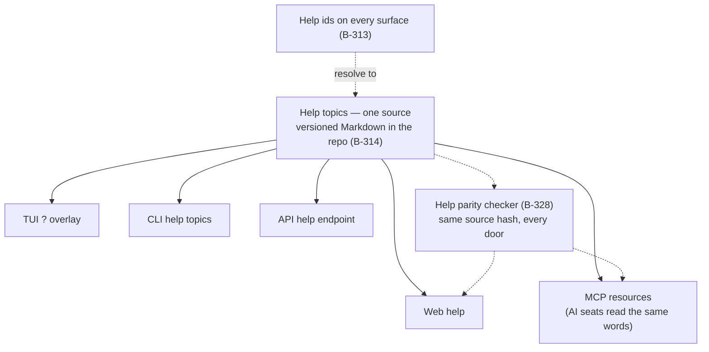
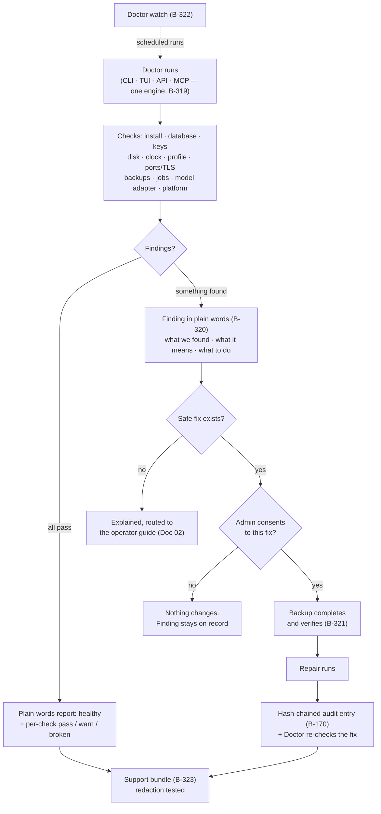

# 17 — User-Friendliness, the Built-In Help, and the Doctor

**Written for:** everyone who uses the app (Part 1 is for you),
everyone who supports the people who use it (Parts 2–3), and
developers held to these standards (throughout).
**Roadmap home:** decisions D-43 (friendliness is a release
gate), D-44 (massive built-in help), D-45 (a built-in Doctor);
standards §6A.16; Phase 26 (B-311 → B-330). The evidence gate
behind all of it is Phase 24 (D-41).

## Part 1 — The friendliness standard, as checkable rules

"Really user friendly" is a release gate here (D-43), not a
polish pass and not a compliment. The standard is written as
**checks** (B-311) — a checklist that is itself a test fixture —
and a release whose measured friendliness falls below the
Phase 24 thresholds **does not ship** (B-329). The rules:

### 1.1 Golden tasks have step budgets

The tasks a group actually lives on — *plan one thing from one
source, approve a draft, RSVP, find Saturday's events, ask the
memory a question* — each carry a step budget: how many actions
a first-time user needs, on each door. Usability sessions with
real design-partner groups (B-286) measure the real numbers; a
task over budget is a defect with a slice attached, not a
training problem for the user.

### 1.2 No dead ends

Every screen, view, and message a user can reach offers a
sensible next step: forward, back, or help. An empty result
says what to try; a refused action says why and what would make
it allowed. A surface that strands the user fails review even
if every button on it works.

### 1.3 Empty states teach

A new group's calendar is not a blank void — it says *"Nothing
planned yet. Give me something to read — a chat, a newsletter,
a photo of a flyer — and I will draft your first event for your
approval"* and offers the button that does it. Every empty
state in the product follows that shape: what belongs here,
why it is empty, the one action that fills it.

### 1.4 Forgiveness is built in (B-317)

- **Undo windows** follow every mutation on every surface —
  delete, approve, reject, send — long enough to catch the
  "oh no" moment, on web, terminal, and API alike.
- **Trash, not vapour.** Deleted groups, events, and tasks go
  to a trash view with restore, for a stated retention period.
  Soft-delete underneath (roadmap §4) makes this honest.
- **Drafts are never lost.** Every long form autosaves
  server-side as a draft row (B-171): kill the browser mid-edit,
  lose the network, let the battery die — reopening restores
  the draft to the last autosave. This is D-28's durability law
  felt at the surface.
- **Confirmations are reserved for the truly irreversible**
  (group erasure, key destruction), and each one names exactly
  what cannot be undone — so the rare confirmation still means
  something.

### 1.5 Errors speak plainly (B-316)

Every user-visible error is in the error catalogue, and every
catalogue entry has the same five parts: **what happened · why
(if known) · what to do next · how to undo anything that was
touched · its help id**, plus a "make a report bundle" action
(§3.4). A raw exception or a stack trace reaching a user
surface is a defect; a test sweeps the surfaces for exactly
that.

### 1.6 Comfort defaults (B-318)

- **Large text, reduce motion, high contrast** preferences are
  honoured on **every** surface — web and TUI alike — and full
  keyboard paths exist everywhere a pointer path does.
- **Sensible defaults that need no spelunking:** quiet hours
  on, the digest weekly, alt text asked for at the moment of
  upload (not buried in a settings page).
- First run is a guided path (B-312) — account → first group →
  invite one person → plan one thing from one real source —
  skippable at every step, resumable where you left it, with a
  deletable sample group to practise on safely.

### 1.7 The terminal is an option, never an obligation (B-325)

The service runs happily **in the background** under the
platform's own service manager (`gpa service
install|start|stop|status`, `gpa logs`), and the TUI is an
*attachable* front end: `gpa tui` connects when wanted and
detaches without touching the service. Terminal-first people
can run the whole product from background service + scriptable
CLI and never open the TUI — or live in the TUI, whose own
friendliness pass (B-326) gives it mouse *and* keyboard, a `?`
help overlay on every view, a plain-words command palette, and
a linear screen-reader mode as a first-class view.

---

## Part 2 — The massive built-in help (D-44)

The design rule: **a group volunteer should never need to
leave the app — or ask a developer — to learn it.** Nor should
an AI seat: agents read the same help humans read, through the
same connection they work through.

### 2.1 Help ids — help that has an address (B-313)

Every screen, panel, field, CLI command, TUI view, API
operation, and error code carries a **stable help id**
(`help.queue.approve`, `help.doctor.disk`, …). Pressing `?`,
tapping Help, or passing `--help-topic` anywhere resolves the
id for *where you are right now*. Because help is addressable,
it is also testable: a surface without a help id fails the
checker beside the documentation gate (B-182-style) — a missing
manual page is a build failure, not an oversight discovered by
a confused user.

### 2.2 One content source, every door (B-314)

Help topics live in the repository as **versioned Markdown —
one source** — and are rendered into each door: the web app's
help, the TUI help overlay, the CLI's topic output, an API help
endpoint, and **MCP resources**. The words an AI seat reads
through MCP are the identical words a human reads on the web,
because they are rendered from the same file. A **parity
checker** (B-328) proves it per release: same source hash per
topic per door, or the build fails.

**Walking tour.** In the middle sits the single source: the
help topics as versioned Markdown in the repository. Five
arrows leave it to the five doors — web help, the TUI's `?`
overlay, CLI topics, the API help endpoint, and MCP resources,
which is the door an AI seat uses. The dotted arrow from "help
ids" shows how any surface reaches the source: the id attached
to the screen or error you are looking at resolves to its
topic. At the bottom, the parity checker compares the source
hash of every topic as rendered on every door; drift between
doors fails the build. One source, five renderings, one proof
they agree.

### 2.3 "I want to…" — help that starts from the goal (B-315)

Topic lists are for people who already know the vocabulary.
The **goal finder** starts from the sentence the user actually
has — *"I want to plan a picnic from this flyer"*, *"I want to
see who hasn't replied"* — and maps plain-words goals to steps
plus a **deep link** that lands on the right screen with the
right thing half-done. The top goals are full **interactive
walkthroughs**: they do it *with* the user on sandbox data
first (the deletable sample group, §1.6), then offer the real
thing. Walkthrough completion is measured (B-329): a
walkthrough nobody finishes is treated as broken and fixed —
the measure is the product's problem, never the user's.

### 2.4 Help works fully offline

Topics ship **inside the app**. Help opens on a Raspberry Pi
in a village hall with no internet, with no account, in
airplane mode, at 2 a.m. before the fete. Anything less would
make help a feature of the network, not of the product.

### 2.5 "This didn't work" — help for the helpers (B-324)

Every help topic and every error ends with a feedback action.
It **drafts** a support packet — the topic or error id, what
the user was doing, their optional note, and a Doctor support
bundle (§3.4) — and it **never auto-sends**. The user reviews
the packet and sends it where *they* choose. Feedback that
does arrive becomes evidence for the friendliness gate
(B-329): recurring confusion is a fix-list, not an anecdote.

---

## Part 3 — The Doctor (D-45)

The Doctor is the app examining itself and explaining what it
finds in plain words — the pattern of `brew doctor` and
`flutter doctor`, held to this project's safety laws. One
diagnostics engine, **four doors**: `gpa doctor` in the CLI, a
Doctor screen in the TUI, an admin-only API operation, and an
**MCP tool** (admin-scoped) — so an AI seat can run the Doctor
and explain the findings to its human, word for word, from the
same finding ids.

### 3.1 The check list (B-319)

Every check returns **pass / warn / broken** plus the time it
took:

| Area | What the Doctor checks |
|---|---|
| Install | Files complete, version sane, the running build matches its manifest |
| Runtime | Python version and dependency set present and as-locked |
| Database | Integrity check passes; WAL state healthy; no stuck write transaction |
| Keys | Master key and per-module service keys **present and loadable** (presence only — see §3.3) |
| Disk | Free space now, and growth trend vs the backup + data footprint |
| Clock | Skew vs the tolerance authentication depends on (a wrong clock breaks sign-ins first) |
| Deployment profile | The D-38 profile (`local/lan/vpn/internet`) is honestly set; an unsafe internet configuration is a *broken*, not a warning |
| Ports + TLS | Expected ports listening; certificates valid and not near expiry |
| Backups | Last backup completed, verified, and — separately — the last **restore test** is fresh (an unrestored backup is a hope, not a backup) |
| Jobs | Queue depth, stuck-job leases, scheduler ticking (reminders and digests depend on it) |
| Model adapter | The AI driver in use is reachable — and labelled honestly (mock/fixture/live never blur, D-18) |
| Platform | The §6A.12 platform specifics for this host (Pi storage warnings, Windows path/length quirks, service-manager state) |

### 3.2 Findings in plain words (B-320)

Every finding renders the same way, on every door:

> **What we found** — "The last successful backup finished
> 9 days ago."
> **What it means for you** — "If this machine failed tonight,
> the group would lose everything planned since then."
> **What to do** — the safe fix, offered right there when one
> exists (§3.3); or the dangerous fix explained and routed to
> the operator guide (Doc 02), never one-clicked.

The same findings exist as `--json` with the same finding ids,
so the CLI, the TUI, the API, the MCP tool, and a support
conversation are all talking about the *same* finding.

### 3.3 Safe auto-repair — the rules (B-321)

The Doctor may fix things — under rules that bind it hardest
of all:

1. **Per-fix consent.** Each offered fix is accepted or declined
   individually. There is no "fix everything" button.
2. **Backup first.** No repair runs until a backup completes
   and verifies.
3. **Safe fixes only.** The menu is short and dull on purpose:
   run pending migrations, rebuild a corrupt *derived* index,
   clear provably-stuck jobs, fix data-file permissions, rotate
   bloated logs, re-register the watchdog, refresh an expired
   *local* development certificate.
4. **Never destructive.** No data deletion, no key regeneration,
   and — by name — never "healing" a healthy database aside:
   the double-verdict guard (B-172) means a corruption verdict
   needs two independent confirmations before the Doctor will
   even *offer* a database repair.
5. **Audit-logged and reversible.** Every repair enters the
   hash-chained audit log (B-170). A fix that cannot be reversed
   is not offered as a fix; it is a procedure, and it lives in
   the operator guide with its warnings in front of it.
6. **Secrets are never values here.** Doctor output shows keys
   as **present / absent / loadable** — never a value, never a
   prefix, in no door, in no bundle (§3.4).

### 3.4 The support bundle (B-323)

One command or screen makes the file a user hands to support:
the Doctor report, versions, log excerpts, and configuration
**shape** — settings named, secrets shown as present/absent
only. The redaction is itself **tested** (evidence filed under
B-290): a support bundle found to contain a secret is a
release-blocking defect, and the bundle builder's tests plant
secrets in every crevice the builder reads from and grep for
them in what it writes.

### 3.5 Doctor watch — warned before it breaks (B-322)

The same checks run on a schedule. Admins hear about trouble
**before** it becomes failure — disk nearly full, backups going
stale, a certificate expiring, the reliability error budget
burning (B-291) — through the group's chosen channel, **once
per finding until acknowledged**, so the watch informs without
nagging. A watchdog that cries wolf is tuned by evidence
(B-329), not by hope.

**Walking tour.** A Doctor run starts at the top — from any of
its four doors, it is the same engine. The checks box lists the
families from §3.1. If everything passes, the road is short: a
plain-words healthy report, and from there the support bundle
can be made if someone wants one. If something is found, it is
first turned into words — what we found, what it means, what to
do. Then a diamond asks whether a *safe* fix exists. If not,
the finding is explained and routed to the operator guide; the
Doctor does not improvise. If a safe fix exists, a second
diamond asks for an admin's consent to *this* fix — a "no"
changes nothing and leaves the finding on record. A "yes" goes
through the backup gate: the backup must complete and verify
before any repair runs. After the repair, the Doctor writes a
hash-chained audit entry and re-checks its own fix, and that
record can join a support bundle. The dotted line at the side
is the Doctor watch feeding scheduled runs into the same
engine — same checks, same words, same rules.

### 3.6 The proof these features are real (B-329, B-330)

Phase 26 closes with the **stranger drill**, recorded as
evidence: a real first-time user from the design partners
completes the golden story using **only in-app help**, no human
coaching; and a deliberately broken install (stale backup,
stuck job, skewed clock, nearly full disk) is diagnosed and
safely repaired by a **non-technical admin using only the
Doctor's own words**. If either stranger fails, the phase is
not done — the fixes are. Friendliness, help, and the Doctor
are claims; under D-41, claims here ship with evidence or they
do not ship.
