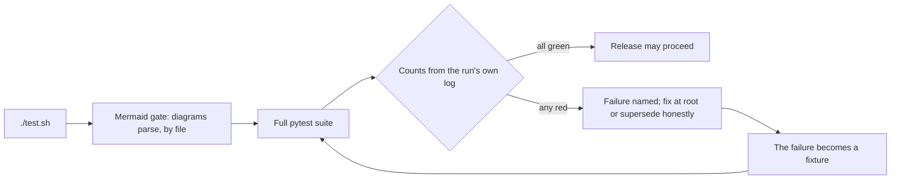

# Testing + quality

*Roadmap slice B-198. Every suite explained: what it guards,
how to run it, how to read the test report that ships in the
ZIP, and how a new failure becomes a new fixture.*

## How to run the suite

```sh
./test.sh                 # the whole gate, exactly as a release runs it
uv run pytest tests/test_events.py -q        # one file
uv run pytest -k waitlist -q                 # one idea, by name
uv run pytest tests/test_phase8_gate.py -q   # one phase's gate story
```

`test.sh` (B-005) does two things, in order:

1. **The Mermaid gate** (B-181): `scripts/check_mermaid.py`
   over the shipped documentation surface. A broken diagram
   fails the run BY FILE before a single test executes —
   documentation is gated like code (D-34).
2. **The full pytest suite**, captured to a log, followed by
   the one-page report: the counts line (`N passed, M failed`)
   and the plain statement that failures, if any, are named
   in the output above. The script's exit code is pytest's.

Two running notes that matter on small machines: the suite
takes minutes, most of it Argon2 hashing in registration
fixtures; and pytest's temporary directory must have room —
on a host with a small `/tmp`, point it at real disk with
`PYTEST_ADDOPTS="--basetemp=<a fresh directory>"` or the run
dies mid-suite for a reason that is not a test failure.

The PostgreSQL leg (B-152) runs the same suite against a real
PostgreSQL server with `GPA_TEST_PG_URL` set (see
`tests/test_postgres_parity.py` and TEST_REPORT's Phase 15
addendum): parity tests skip on SQLite by design, named
SQLite-file tests skip on PostgreSQL with pointers to where
their guarantee is re-proven, and a gate is only claimed when
BOTH engines' totals are read from their own logs.

## The gate flow



The walking tour: `test.sh` first proves the documentation
renders, then runs the suite; the verdict is read from that
run's own log — never from a summary somebody wrote about a
different run. Green lets a release proceed. Red names the
failure; the discipline below turns it into a fixture and
the suite runs again.

## How to read TEST_REPORT.md in the ZIP

Every release ZIP carries `TEST_REPORT.md` (§8 anatomy). Read
it in this order:

1. **The Suite section** — the headline counts, the collected
   total, and the RECONCILIATION arithmetic: this gate's total
   equals the previous gate's total plus the new tests, each
   named. If the arithmetic does not close, the report is
   wrong, not the suite.
2. **The new-tests table** — one row per new test file: what
   it covers, slice by slice. This is the fastest way to see
   what a release actually added.
3. **Superseded assertions** — when a later phase changes a
   behaviour an earlier test pinned (the Phase 4 pattern),
   the updated assertion is listed with its reason and the
   note that its INTENT is unchanged and still asserted. A
   supersession with no reason is a smell; ask.
4. **Evaluation tables** — the three harnesses (extraction,
   vision, pruning) print precision/recall or accuracy
   against their recorded baselines with a 0.02 tolerance.
   The corpora are DELIBERATELY IMPERFECT — a cost field the
   fixture never predicts, a place scored 0.50 — so the gate
   can be seen to go red when quality drops. A perfect table
   would prove nothing.
5. **NOT RUN markers** — live third-party legs that do not
   exist in this environment (a real Meta endpoint, a real
   inbox, a live Samtal) are recorded NOT RUN in plain words.
   Their absence is information, not a gap in the counts:
   those behaviours are proven against fixture doubles and
   stub transports, and the report says so at the point of
   use.

## What each suite guards

The suite is organised one file per concern, named
`test_<concern>.py`, with a phase gate file per phase
(`test_phase<N>_gate.py`) that tells the phase's whole story
as one scripted flow on a fresh database. Families:

- **Foundation + contract** — the app factory, health, the
  problem+json chassis, the OpenAPI snapshot (the committed
  contract must equal the live schema, byte for byte in
  meaning), packaging and the release ZIP itself.
- **Identity + permissions** — registration, sessions and
  refresh families, API keys, MFA and account security, the
  role matrix (5 roles × 8 actions), the authorisation fuzz
  (seeded attacker principals, zero leaks), rate limits.
- **Ingest** — every way in (paste parsers, files, newsletter
  golden, images, links under the guarded fetch, email-in,
  voice), plus the whole-corpus gate that runs them together.
- **AI + extraction** — the adapter drivers, the prompt
  manifest pins, the 268-case date goldens, the pipeline's
  quote verification, the review queue, quality flags,
  extraction jobs, budget, and the evaluation harness.
- **Events + calendar** — minting, editing under If-Match,
  recurrence over DST, iCal round-trips, agenda/month/
  tonight, conflicts, RSVPs and the strict waitlist,
  discussion, Facebook drafts.
- **Vision** — flyer reading with region provenance, board
  segmentation in both driver modes, duplicates by
  perceptual hash, the flyer wall, print month, the vision
  evaluation gate.
- **Truth-keeping** — matching weights, merge by source
  support, change candidates, contradictions, tombstones
  with the 30-day restore, the quality report.
- **Planning** — tasks and the owner law, decisions and
  supersede chains, questions and gaps, polls, checklists,
  budget in integer cents, availability, templates, search,
  the digest data.
- **Notifications** — the outbox law (a row and a job, never
  an inline send), reminders at exact moments, quiet hours,
  change alerts, invites, digests, the inbox, deliverability
  and dead letters.
- **Nonprofit pack** — sub-group scoping (the 404 rule),
  announcements, shifts and gap reports, resources and
  double-booking flags, counts-only attendance, member
  import/export, the settings pack, multi-approver review.
- **Memory** — the approved-history-only corpus, pruning
  (NOT embedding RAG), multi-pass reconsideration, verified
  citations and the honest refusal, summaries/briefings/
  recaps as drafts, run transparency and purge, the local
  driver, the pruning evaluation floors.
- **Integrations** — the Samtal bridge against fixtures,
  inbound webhooks (signature, window, exactly-once),
  sealed integration config, outbound webhooks, the agent
  pack, Discord/Slack boundaries, health board, reconcile
  (never writes outward).
- **Publishing out** — Facebook press semantics, Google
  one-way sync and inbound change candidates, the SMTP
  boundary and signed provider webhooks, Messenger's honest
  `driver_unavailable`, embed origins and CORS.
- **Security + privacy** — the threat-model coherence test,
  injection safety (single-pass prompt render), field
  encryption, encrypted storage, key management and
  recovery, the audit chain, export/erasure (the raw DB
  file greps clean), retention, secrets audit.
- **Platform + resilience** — the architecture checker
  (pinned shrink-only inventories), the internal API and
  its encrypted transports, identities and replay,
  durability (commit-before-answer made structural),
  startup recovery, error correction (breakers, bulkheads,
  data repair), the chaos harness (SIGKILL legs and the
  seeded 100-run pass), the comment gate, the platform
  audit, migration up/down/up per phase.
- **Demo + submission** — the demo story's idempotence,
  Flows A–D as tests, the RESULTS page regenerating
  byte-identically, the submission pack's claims parsed
  against the code so they cannot drift.
- **Phase gates** — one file per phase telling the whole
  phase story end to end (Phases 3–17 have gate files; the
  earlier phases gate through their family files above).

The complete file-by-file inventory, with each file's own
stated purpose, is the table that follows — generated from
the test files' headers so it cannot drift from the suite.

## How a new failure becomes a new fixture

The standing discipline, proven across every phase:

1. **Reproduce it alone.** Run the single failing test; if
   it only fails in the full suite, that ordering fact is
   itself the first clue (shared state, a race, a clock).
2. **Name the root, not the symptom.** The fix lands in the
   code that owns the truth — a service, the chassis, the
   checker — never in a workaround at the call site. The
   history is full of these: a commit-before-answer race, a
   log filter on the wrong object, a ZIP that dropped file
   permissions.
3. **Freeze the failure as a fixture.** The smallest input
   that reproduces it becomes a golden file, a corpus entry,
   or a regression test named for the behaviour — so the
   same failure can never return silently. Deliberate
   imperfections in the evaluation corpora are fixtures of
   exactly this kind.
4. **If the test was wrong, supersede it honestly.** When a
   later phase changes the behaviour by design, update the
   assertion, record the supersession in TEST_REPORT and
   the memory map with the reason, and keep the original
   intent asserted at its new strength. Never delete a red
   test to make a suite green; never commit red.
5. **Read the totals from the run's own log.** A phase gate
   claims only numbers a clean full run printed, reconciled
   against the previous gate. Summaries of summaries are
   how wrong totals ship.

## Quality gates beyond pytest

- **Architecture** (`tests/test_architecture.py`): layering,
  no cross-file private imports, and two pinned inventories
  that may only shrink.
- **Comment gate** (B-176, inside the suite): every file
  opens with a purpose header; per-module documentation
  floors that only rise; every gap reported by file and
  line.
- **Docs gate** (B-181 → B-197, inside the suite): diagrams
  parse, chapters cover their roadmap topics, the data
  model and the per-file atlas diff clean against the tree.
- **Platform audit** (B-177): pathlib-only paths, explicit
  encodings, no platform branching in domain code.
- **Mermaid gate**: runs in `test.sh` before pytest, above.

A release whose any gate is red does not ship; the gates
are the release's evidence, and Phase 24's registry (B-281
onward) grades every claim from them.

## Appendix — every test file, in its own words

Generated from each file's header docstring (first line) at the B-198 landing.

| File | What it guards (the file's own first line) |
|---|---|
| `tests/test_account_security.py` | Advanced account security acceptance (roadmap B-174). |
| `tests/test_agent_pack.py` | Agent API pack (roadmap B-129): the seat experience. |
| `tests/test_ai_client.py` | AI adapter tests (roadmap B-035, B-036, B-037). |
| `tests/test_announce.py` | B-078 — re-announce drafts: a materially changed event gets |
| `tests/test_announcements.py` | Announcements board (roadmap B-106). |
| `tests/test_architecture.py` | Architecture tests — the module boundary law (roadmap B-161). |
| `tests/test_ask.py` | Ask-the-group-memory (roadmap B-115). |
| `tests/test_attendance.py` | Attendance (roadmap B-109) — aggregates only, by design. |
| `tests/test_audit_chain.py` | Tamper-evident audit chain tests (roadmap B-170). |
| `tests/test_auth.py` | Identity acceptance (B-011 → B-014): registration, login, magic |
| `tests/test_authz_fuzz.py` | Authorisation fuzz (roadmap B-140). |
| `tests/test_availability.py` | Availability finder (roadmap B-090). |
| `tests/test_backup_restore.py` | Backup + restore scripts (roadmap B-146): a fast round |
| `tests/test_briefings.py` | Event briefings (roadmap B-117). |
| `tests/test_budget.py` | Budget-lite (roadmap B-089). |
| `tests/test_calendar_views.py` | Calendar views (roadmap B-055, B-056, B-057, B-059). |
| `tests/test_candidates.py` | Review-queue API tests (roadmap B-043, B-044) + its security |
| `tests/test_change_alerts_invites.py` | Change alerts (B-097) + event invites (B-098). |
| `tests/test_change_candidates.py` | B-077 — change detection: words about an existing event |
| `tests/test_chaos.py` | Crash-correction harness (roadmap B-175). |
| `tests/test_checklists.py` | Checklists + roles (roadmap B-088). |
| `tests/test_comment_gate.py` | Comment + documentation gate (roadmap B-176, standard §6A.1). |
| `tests/test_dates.py` | Date resolver golden suite (roadmap B-039, decision D-22). |
| `tests/test_decisions.py` | Decisions log (roadmap B-085). |
| `tests/test_demo_data.py` | Demo data, final (roadmap B-147). |
| `tests/test_demo_flows.py` | Demo script → tests (roadmap B-148). |
| `tests/test_developer_pack.py` | The developer pack (roadmap B-160). |
| `tests/test_digest.py` | The weekly digest (roadmap B-099). |
| `tests/test_discussion.py` | Event discussion (roadmap B-060). |
| `tests/test_docs_gate.py` | B-181 documentation gate: index present, diagrams sound. |
| `tests/test_durability.py` | Durability manager tests (roadmap B-171). |
| `tests/test_emailin.py` | Email-in ingest tests (roadmap B-030). |
| `tests/test_embed_public.py` | Embed + public page data (roadmap B-135). |
| `tests/test_encrypted_storage.py` | Encrypted file storage tests (roadmap B-168). |
| `tests/test_erasure.py` | Group export + erasure (roadmap B-143) — the acceptance |
| `tests/test_error_correction.py` | Error-correction services (roadmap B-173). |
| `tests/test_evaluation.py` | Evaluation harness tests (roadmap B-046) — including the |
| `tests/test_events.py` | Events core (roadmap B-049, B-050, B-051). |
| `tests/test_extraction.py` | Extraction pipeline tests (roadmap B-040, B-041, B-042). |
| `tests/test_extraction_jobs.py` | Extraction jobs + budget tests (roadmap B-045, B-047). |
| `tests/test_facebook_drafts.py` | Facebook Event drafts (roadmap B-058). |
| `tests/test_facebook_events.py` | Facebook Event creation (roadmap B-131). |
| `tests/test_field_encryption.py` | Field-level encryption tests (roadmap B-167). |
| `tests/test_files.py` | File ingest acceptance (B-025): sniffing beats extension, the |
| `tests/test_flyer_wall.py` | Flyer wall + print month tests (roadmap B-070, B-072). |
| `tests/test_foundation.py` | Phase 0 acceptance: chassis, errors, config, durability pragmas. |
| `tests/test_generated_image.py` | Generated event image tests (roadmap B-067). |
| `tests/test_google_calendar.py` | Google Calendar sync, one-way out (roadmap B-132). |
| `tests/test_google_inbound.py` | Two-way Google, revisited (roadmap B-159). |
| `tests/test_groups.py` | Groups + memberships acceptance (B-015/B-016): visibility and |
| `tests/test_health_board.py` | Integration health board (roadmap B-136). |
| `tests/test_health_deep.py` | Deep health contracts (roadmap B-155). |
| `tests/test_ical.py` | The iCal engine + feeds + links (roadmap B-053, B-054). |
| `tests/test_images.py` | Image ingest tests (roadmap B-027, B-028). |
| `tests/test_inbox.py` | The in-app inbox (roadmap B-101) + preferences plumbing. |
| `tests/test_ingest_corpus.py` | The Phase 2 golden corpus (roadmap B-034, the phase gate). |
| `tests/test_injection_safety.py` | Injection + output-safety suite (roadmap B-142). |
| `tests/test_integrations_framework.py` | Integration framework (roadmap B-127). |
| `tests/test_internal_api.py` | Internal API tests — the envelope, the registry, the door (B-162). |
| `tests/test_internal_audit.py` | Internal API audit tests (roadmap §6A.4, B-165). |
| `tests/test_internal_identity.py` | Service identities + replay protection tests (roadmap §6A.4, B-164). |
| `tests/test_internal_profiles.py` | In-process profile, honestly (roadmap §6A.4, B-166). |
| `tests/test_internal_transport.py` | Encrypted internal transport tests (roadmap §6A.4, B-163). |
| `tests/test_job_race.py` | Multi-instance job races (B-157): the D-09 claim protocol |
| `tests/test_jobqueue.py` | Queue backends behind the interface (B-157). |
| `tests/test_jobs.py` | Job chassis acceptance (B-008): enqueue, claim-by-update with no |
| `tests/test_key_management.py` | Key management tests (roadmap B-169). |
| `tests/test_links.py` | Link ingest tests (roadmap B-029) — the SSRF attack suite. |
| `tests/test_local_driver.py` | The local-inference driver (roadmap B-119). |
| `tests/test_mail_provider.py` | The real mail provider driver (roadmap B-133). |
| `tests/test_matching.py` | Cross-source matching (roadmap B-075, Doc 07 §6). |
| `tests/test_member_io.py` | Member import/export (roadmap B-110). |
| `tests/test_memory_runs.py` | Memory transparency (roadmap B-120). |
| `tests/test_merging.py` | The merge service + contradictions (roadmap B-076, B-079). |
| `tests/test_messenger_fallback.py` | Messenger source, read path (roadmap B-125) — the fallback |
| `tests/test_messenger_notifications.py` | Messenger notifications (roadmap B-134). |
| `tests/test_migrations_phase10.py` | Phase 10 migration tests (roadmap B-003 discipline). |
| `tests/test_migrations_phase11.py` | Phase 11 migration tests (roadmap B-003 discipline). |
| `tests/test_migrations_phase12.py` | Phase 12 migration tests (roadmap B-003 discipline). |
| `tests/test_migrations_phase13.py` | Phase 13 migration tests (roadmap B-003 discipline). |
| `tests/test_migrations_phase17.py` | Phase 17 migration tests (roadmap B-003 discipline). |
| `tests/test_migrations_phase2.py` | Phase 2 migration tests (roadmap B-003 discipline, B-027). |
| `tests/test_migrations_phase5.py` | Phase 5 migration tests (roadmap B-003 discipline). |
| `tests/test_migrations_phase6.py` | Phase 6 migration tests (roadmap B-003 discipline). |
| `tests/test_migrations_phase7.py` | Phase 7 migration tests (roadmap B-003 discipline). |
| `tests/test_migrations_phase8.py` | Phase 8 migration tests (roadmap B-003 discipline). |
| `tests/test_migrations_phase9.py` | Phase 9 migration tests (roadmap B-003 discipline). |
| `tests/test_mcp_auth.py` | MCP authentication + authorisation tests (roadmap B-205). |
| `tests/test_mcp_candidates.py` | MCP candidates / review-queue tool tests (roadmap B-208, Phase 19). |
| `tests/test_mcp_conformance.py` | MCP conformance + client pack tests (roadmap B-219, Phase 19). |
| `tests/test_mcp_core.py` | MCP server core tests (roadmap B-204, Phase 19). |
| `tests/test_mcp_events.py` | MCP events / RSVPs / calendar tool tests (roadmap B-209, Phase 19). |
| `tests/test_mcp_groups.py` | MCP groups / members / profile tool tests (roadmap B-207, Phase 19). |
| `tests/test_mcp_notifications.py` | MCP notifications / digests / announcements tool tests (roadmap B-212, Phase 19). |
| `tests/test_mcp_resources.py` | MCP resources tests (roadmap B-213, Phase 19). |
| `tests/test_mcp_subscriptions.py` | MCP subscriptions + notifications tests (roadmap B-214, Phase 19). |
| `tests/test_mcp_prompts.py` | MCP prompts tests (roadmap B-215, Phase 19). |
| `tests/test_mcp_elicitation.py` | MCP elicitation bridge tests (roadmap B-216, Phase 19). |
| `tests/test_mcp_sampling.py` | MCP sampling policy tests (roadmap B-217, Phase 19). |
| `tests/test_mcp_security.py` | MCP security hardening tests (roadmap B-218, Phase 19). |
| `tests/test_mcp_planning.py` | MCP planning (tasks / decisions / questions) tool tests (roadmap B-211, Phase 19). |
| `tests/test_mcp_registry.py` | MCP tool registry tests (roadmap B-206, Phase 19). |
| `tests/test_mcp_sources.py` | MCP sources / extraction-request tool tests (roadmap B-210, Phase 19). |
| `src/gpa/mcp/catalogue.py` | MCP tool catalogue — worked examples + signed documentation (roadmap B-219, Phase 19). |
| `src/gpa/mcp/conformance.py` | MCP conformance — the automated spec-case half (roadmap B-219, Phase 19). |
| `examples/mcp_stdio_client.py` | Worked MCP client example — the official SDK over stdio (roadmap B-219, Phase 19). |
| `examples/mcp_http_client.py` | Worked MCP client example — hand-rolled JSON-RPC over HTTP (roadmap B-219, Phase 19). |
| `scripts/generate_mcp_catalogue.py` | Regenerates Doc 13's generated MCP tool catalogue section (roadmap B-219, Phase 19). |
| `tests/test_newsletter.py` | Newsletter ingest tests (roadmap B-026). |
| `tests/test_notifications_core.py` | Notification core: the outbox (roadmap B-095) + deliverability |
| `tests/test_openapi_snapshot.py` | Contract snapshot (B-006): the committed OPENAPI.json must equal |
| `tests/test_outbound_webhooks.py` | Outbound webhooks (roadmap B-128): delivery + retry golden. |
| `tests/test_packaging.py` | Native service packaging contracts (roadmap B-153). |
| `tests/test_parity.py` | API parity register + checker (roadmap B-201). |
| `tests/test_paste.py` | Paste ingest golden files (B-024): one realistic export per |
| `tests/test_permissions.py` | Phase gate material (B-014/B-017/B-018/B-022): the role matrix, |
| `tests/test_phase10_gate.py` | Phase 10 gate (roadmap B-122): the three memory demos. |
| `tests/test_phase11_gate.py` | Phase 11 gate (roadmap B-130): the bridge, walked end to end. |
| `tests/test_phase12_gate.py` | Phase 12 gate (roadmap B-138). |
| `tests/test_phase17_gate.py` | Phase 17 gate — the addendum proof (roadmap B-180). |
| `tests/test_phase19_gate.py` | Phase 19 gate — the parity proof (roadmap B-220, Phase 19). |
| `tests/test_phase3_gate.py` | The Phase 3 gate (roadmap B-048). |
| `tests/test_phase4_gate.py` | The Phase 4 gate (roadmap B-062). |
| `tests/test_phase5_gate.py` | Phase 5 gate (roadmap B-074). |
| `tests/test_phase6_gate.py` | B-082 — the Phase 6 gate: the whole story as ONE scripted |
| `tests/test_phase7_gate.py` | Phase 7 gate (roadmap B-094): Flow B, end to end. |
| `tests/test_phase8_gate.py` | Phase 8 gate (roadmap B-104): a published event's full |
| `tests/test_phase9_gate.py` | Phase 9 gate (roadmap B-112): the nonprofit story, end to end. |
| `tests/test_platform_matrix.py` | B-177 — cross-platform verification matrix fixtures. |
| `tests/test_polls.py` | Polls (roadmap B-087). |
| `tests/test_postgres_parity.py` | PostgreSQL parity (roadmap B-152, decision D-06). |
| `tests/test_privacy_surfaces.py` | Privacy surfaces (roadmap B-144). |
| `tests/test_prompts.py` | Prompt library tests (roadmap B-038). |
| `tests/test_proxy_guide.py` | Reverse-proxy guide contracts (roadmap B-154). |
| `tests/test_pruning.py` | Pruning core (roadmap B-113). |
| `tests/test_pruning_evaluation.py` | Pruning evaluation (roadmap B-121). |
| `tests/test_pruning_multipass.py` | Multi-pass pruning (roadmap B-114). |
| `tests/test_quality_gate.py` | B-178 — the production-quality pipeline, enforced in-suite. |
| `tests/test_quality_report.py` | B-081 — the data-quality report: one endpoint, four lists, |
| `tests/test_questions.py` | Open questions (roadmap B-086). |
| `tests/test_recaps.py` | Recaps, newsletters, and the loop (roadmap B-118). |
| `tests/test_reconcile.py` | Reconciliation job (roadmap B-137). |
| `tests/test_recovery.py` | Recovery acceptance (B-020 + B-021): password reset, password |
| `tests/test_recurrence.py` | Recurrence (roadmap B-052). |
| `tests/test_release_zip.py` | Release ZIP permission guard (roadmap B-151). |
| `tests/test_reminders.py` | The reminder engine (B-096), quiet hours (B-100), and AI |
| `tests/test_resources.py` | Resources + bookings (roadmap B-108) — and B-057's other half. |
| `tests/test_results_page.py` | Numbers page (roadmap B-149). |
| `tests/test_rsvps.py` | RSVPs (roadmap B-061). |
| `tests/test_runbook.py` | RUNBOOK.md, reproduced (roadmap B-155). |
| `tests/test_samtal_calendar.py` | Samtal calendar return path (roadmap B-124). |
| `tests/test_samtal_connector.py` | Samtal source connector (roadmap B-123). |
| `tests/test_seat_equality.py` | Seat equality + the one approval law (roadmap B-202/B-203): the role matrix for both kinds of citizen, seat profile, participation, distinct-approver counting. |
| `tests/test_search_digest.py` | Search across planning (B-092) + planning digest data |
| `tests/test_second_wave_sources.py` | Second-wave live sources (roadmap B-158): Discord + Slack. |
| `tests/test_secrets_audit.py` | Secrets + config audit (roadmap B-145). |
| `tests/test_seed.py` | Seed chassis acceptance (B-009/B-010): the double-seed test — |
| `tests/test_settings_pack.py` | The group settings pack (roadmap B-111). |
| `tests/test_shifts.py` | Volunteer shifts (roadmap B-107). |
| `tests/test_signed_releases.py` | Signed releases + SBOM (roadmap B-179). |
| `tests/test_sources.py` | Sources core acceptance (B-023): create/list/get/delete, the |
| `tests/test_startup_recovery.py` | Startup recovery tests (roadmap B-172). |
| `tests/test_storage.py` | Storage acceptance (B-007): content addressing, dedupe, atomics, |
| `tests/test_stream.py` | Ingest status + progress stream tests (roadmap B-033). |
| `tests/test_subgroups.py` | Sub-groups + chapters (roadmap B-105) — and the leak tests. |
| `tests/test_submission_pack.py` | Submission pack coherence (roadmap B-150). |
| `tests/test_summaries.py` | Discussion summaries (roadmap B-116). |
| `tests/test_tasks.py` | Tasks (roadmap B-083). |
| `tests/test_templates.py` | Templates (roadmap B-091). |
| `tests/test_threads_generalised.py` | Generalised discussion threads (roadmap B-084). |
| `tests/test_threat_model.py` | Threat model coherence + gap tests (roadmap B-139). |
| `tests/test_tombstones.py` | B-080 — tombstones + undelete: deletion is a door that |
| `tests/test_transcription.py` | Transcription tests (roadmap B-068). |
| `tests/test_upgrade.py` | Upgrade tool contracts (roadmap B-156). |
| `tests/test_upload_hardening.py` | Upload attack suite (roadmap B-141). |
| `tests/test_vision_api.py` | Vision API tests (roadmap Phase 5: B-063 → B-071). |
| `tests/test_vision_evaluation.py` | Vision evaluation gate (roadmap B-073) — B-046's pattern, |
| `tests/test_vision_pipeline.py` | Vision pipeline tests (roadmap B-063, B-064) — the pure half. |
| `tests/test_voice_live.py` | Voice-note and live-chat source tests (roadmap B-031/B-032). |
| `tests/test_webhooks_in.py` | Generic webhook source (roadmap B-126): signature + replay. |
| `tests/test_phase18_gate.py` | Phase 18 gate (B-200): the documentation proof. |
