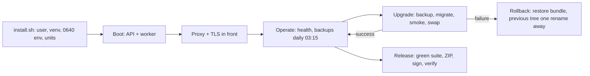

# Deployment + release

*Roadmap slice B-199. Native install, service supervision,
TLS, backups in operations, upgrades and rollback, and the
ZIP's anatomy with its signature check — the operator's half
of the runbook, in full. The mail-provider half lives in
`DEPLOYMENT.md` (repo root); the five real failures and their
fixes live in `RUNBOOK.md`; this chapter is the lifecycle
around them.*

## Native install — no Docker, ever (D-24)

The backend installs natively on every target: a Python
environment built from the committed lockfile by `uv`, the
code tree, and the operating system's own service manager.
There is no container image and no Docker step anywhere in
this project, by standing law.

### Linux (the supervised road, rehearsed)

```sh
sudo deploy/install.sh            # into /opt/gpa by default
```

`install.sh` (B-153) creates the dedicated service user,
builds the venv from `uv.lock` with `uv sync --extra dev`
(non-editable, so the venv is born at its final address —
the B-156 drill's lesson), generates the environment file
at `/etc/gpa/gpa.env` with mode **0640** (root:service-user;
never overwritten on re-run), renders the three systemd
units, and enables — but does NOT start — them. The
rehearsal into a throwaway prefix is part of the Phase 15
evidence: env proven 0640, units pass
`systemd-analyze verify`, the installed tree boots and
answers `/health`.

### Windows and macOS (the run road, stated honestly)

`run.ps1` is the byte-parity twin of `run.sh` (B-001), and
`uv sync` + `./run.sh` works on macOS as on Linux: both run
the server natively today. What is NOT shipped: Windows
Service or launchd unit files — supervision on those OSes
is the operator's own supervisor (NSSM-class tooling on
Windows, a hand-written launchd plist on macOS) around the
same `run` entry points. That gap is recorded, not claimed
over; the platform matrix (Phase 22) owns deepening it.
Pi-class and cloud-VM installs are likewise NOT RUN in this
environment — the exact invocations are recorded in
TEST_REPORT's Phase 15 addendum.

## Service supervision

Three units, one per process (B-153 templates in `deploy/`):

| Unit | Runs | Notes |
|---|---|---|
| `gpa.service` | the API (`gpa.main`) | binds localhost; the proxy is the only public face |
| `gpa-worker.service` | `gpa-worker` | runs startup recovery (B-172) before its first job; exits 2 on a refuse verdict |
| `gpa-backup.service` + `gpa-backup.timer` | `scripts/backup.py` | daily verified backup (03:15), bundle + sha256 manifest |

Logs are structured JSON (B-002) with the request id; the
access log REDACTS the secret-bearing path segments (feed /
invite / email-in / source tokens, B-145). `deploy/gpa.logrotate`
ships the rotation snippet. Deep health is disclosed to
signed-in callers only (B-155): anonymous `/health` is the
minimal liveness surface.

## TLS and the reverse proxy

The API never faces the internet directly. `deploy/PROXY.md`
+ `deploy/Caddyfile.example` + `deploy/nginx.conf.example`
(B-154) carry the whole arrangement: TLS 1.3 at the proxy,
HSTS, a body limit matched to the upload cap (10 MiB), SSE
unbuffered, and every secret-bearing path called out (signed
webhooks verify HMAC over the RAW body — a proxy that
re-encodes bodies breaks them, and the guide says so).
Followed literally with real Caddy in the Phase 15 live
test: `/health` 200 over HTTP/2 with HSTS, an 11 MiB body
refused 413 by the proxy itself, a feed token appearing
nowhere in the access log. The nginx example ships
reviewed; its live validation is NOT RUN (no nginx binary
was obtainable in the build environment) and PROXY.md
says so.

## Backups in operations

`scripts/backup.py` (B-146) makes the bundle: SQLite online
backup (or the PostgreSQL equivalent), the content-addressed
storage tree, and a sha256 manifest, with `RESTORE.md`
inside. `scripts/restore.py` is verify-then-place: the
manifest is checked BEFORE anything is placed, and a
damaged bundle restores nothing. The backup timer runs the
bundle daily; the restore drill (B-146, re-run at the
B-151 freeze) plants data, backs up, restores into a fresh
tree, runs a fresh `uv sync` + the full suite + an API
read-back. Two operational laws ride along: backups grep
clean for key material (B-169's acceptance runs the real
bundle script), and erasure's compact is checkpoint →
VACUUM → checkpoint (the B-143/B-146 drill find).

## Upgrades and rollback

```sh
uv run python scripts/upgrade.py <staged-tree-or-zip>
```

`scripts/upgrade.py` (B-156) runs, in order: stage + build
the new tree → back up with the CURRENT tree's backup
script (or the staged tree's, when the install predates
backup tooling) and hash-verify the bundle → migrate the
live database → smoke the staged server against the real
data → swap, keeping the old tree whole as
`<root>.previous-<stamp>` with data, backups, and `.env`
carried. **Rollback is printed on every run**: restore the
backup bundle; the previous tree is one rename away. The
drill between the two real ZIPs (v0.4 → v0.5) passed in
12.8 s with the marker user intact, and caught the two
boot-killers now fixed at root (editable-install `.pth`
paths and absolute venv shebangs).

## The release ZIP — anatomy and signature check

Releases travel as ZIPs on the roadmap's train (ZIP-0 →
Alpha → Beta → RC → Final), built by
`scripts/make_release_zip.py`. The train anatomy (§8):

```text
gpa-backend-v<VERSION>-<DATE>.zip
  gpa-backend/…            the repo tree, runnable as-is
  OPENAPI.json             the frozen contract
  FRONTEND_HANDOFF.md      plain words first
  CHANGELOG.md             per-slice list
  TEST_REPORT.md           this ZIP's real test counts (B-198)
  RESULTS.md               the generated numbers page (B-149)
  SHA256SUMS.txt           hash of every file in the ZIP
  sbom.spdx.json           SPDX bill of materials from uv.lock (B-179)
  release-manifest.json    version, git hash, slice range,
                           driver modes, known limits, and the
                           signing key's fingerprint
```

Beside the ZIP: `<zip>.sha256` (the plain checksum),
`<zip>.sig` (the detached Ed25519 signature), and
`<zip>.pub` (the signer's public key). Excluded always:
`.git`, virtualenvs, caches, databases, runtime data, and
ANY `.env` file — a ZIP never carries a secret (D-25).
File permissions ride inside the ZIP (the B-151 drill
find: an early shape wrote every entry 0644 and the shell
entry points landed non-executable).

**Verify before you unzip** (B-179):

```sh
uv run python scripts/release_signing.py verify releases/gpa-backend-v0.6-2026-10-26.zip
```

The check answers two questions without trusting the
sender: the signature proves these are exactly the bytes
the team's key signed (any flipped byte fails, loudly),
and the fingerprint in the manifest — the first 16 hex
chars of the public key's SHA-256 — is compared against
the fingerprint the team published out of band. The
private key never lives in the repo: it reaches a build
only through `GPA_RELEASE_PRIVATE_KEY_B64` or a
`GPA_RELEASE_KEY_FILE` outside the tree. The SBOM is the
third reading of one pinned truth: `uv.lock`, the SBOM,
and the installed environment agree package by package,
hash by hash.

## Release discipline

- A ZIP is cut only from a tree whose full suite is green
  on its stated engines, with totals read from the run's
  own log (B-198) — and the TEST_REPORT inside is generated
  from that run.
- The freeze drill (B-151) is the release's rehearsal: the
  demo runs cold from a clean unzip — unpack, `uv sync`,
  seed, boot, sign in, read the story back — timed, logged,
  and the log ships inside the ZIP.
- Known limits travel WITH the release (the limits file in
  the manifest), never as a rumour: what is NOT RUN, what
  is fixture-proven only, and what a later phase owns are
  stated in the release's own papers.

## The deployment lifecycle, in one picture



The walking tour: installation births the service under
its own user with its secrets file locked down; the proxy
is the only public face; operation is health plus a daily
verified backup; an upgrade backs up before it migrates
and smokes before it swaps, so rollback is a restore and
a rename, never a rebuild; and a release leaves only as a
signed ZIP whose recipient can verify it before unzipping.
