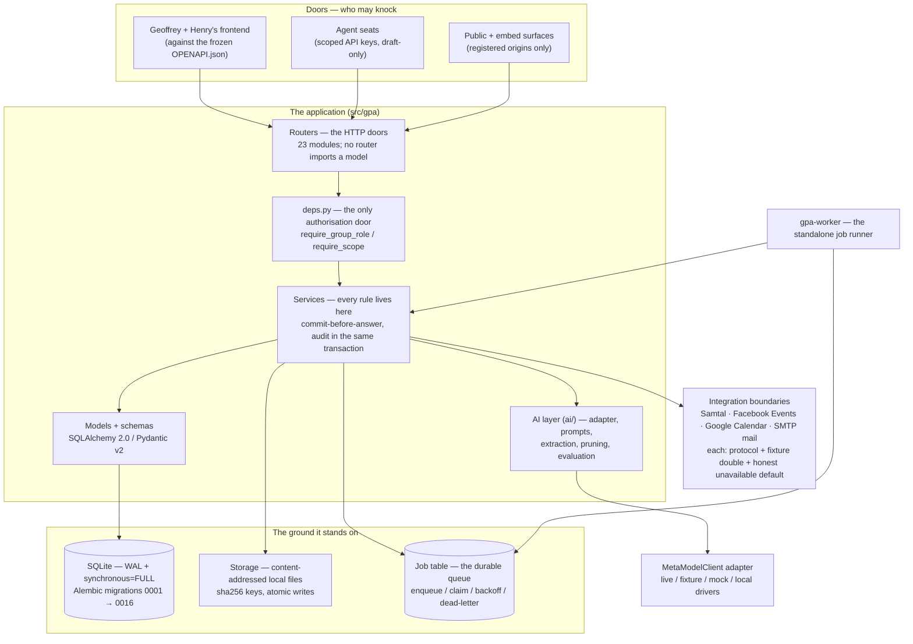

# Architecture — one diagram, then the walking tour

*Derived from the project's `PROJECT_MEMORY_MAP.md`, the living
map that is updated in the same session as any architectural
change. This page is the map's shape, drawn once and then
walked block by block.*

## The walking tour

**The doors.** Three kinds of caller arrive. The team's
frontend works against the frozen contract in `OPENAPI.json`
(187 paths, 217 schemas at this freeze) and the generated
TypeScript types beside it. **Agent seats** are API-key
principals with scopes (read / draft / publish / admin) — a
seat stands under the one approval law exactly as a person
of its role (B-203): below the group's review floor its
approval is refused in the service layer, not the route
(`seat_cannot_approve`), while an organiser seat holding
publish approves through the same door, audited as itself. **Public and embed surfaces**
serve the B-059 public projection (member-only fields absent,
not blanked) and answer CORS only for origins a group has
registered.

**Routers** (`src/gpa/routers/`, 23 modules) are thin HTTP
doors: parse, authorise, call one service, answer. A verified
rule of the codebase: **no router imports a model** — all
authorisation flows through `deps.py` (`require_group_role`,
`require_scope`), the single door every route passes.

**Services** (`src/gpa/services/`, ~70 modules) hold every
rule: identity and sessions, sources and ingest, the review
queue, events and recurrence, planning, notifications and the
outbox, memory, integrations, privacy and erasure. Two laws
shape them all. **Commit-before-answer:** a service commits
its transaction, and only then does the router respond — the
poll-vote and approval paths carry tests that read the result
back from a *separate* session to prove it. **Audit in the
same transaction:** the append-only audit row is written by
the act itself, so the record can never disagree with the
deed.

**The AI layer** (`src/gpa/ai/`) sits behind the services,
never beside the routers. One adapter protocol
(`MetaModelClient`), a versioned prompt library whose manifest
pins a SHA-256 per template, the extraction pipeline (chunk
windows, per-field quote verification, a deterministic date
resolver — 268 golden cases), the vision pipeline (region
provenance on every field), and the pruning engine that powers
group memory. `MODEL_MAPPING.md` is this layer's honest page.

**The ground.** SQLite in WAL mode with `synchronous=FULL`
and foreign keys on, on every connection — entered data is
sacred, and the durability settings are code, not deployment
advice. Alembic migrations 0001 → 0016 carry the schema;
PostgreSQL is the documented swap-point (roadmap D-06, Phase
15). Files live in a **content-addressed local store** (sha256
keys, atomic writes, a strict key pattern that makes traversal
impossible); storage keys never appear in the API (D-17).

**Jobs are rows, not messages.** Background work — extraction,
transcription, vision, notification delivery, webhook
delivery, digests, reminders, retention, reconciliation — is
the B-008 job table: enqueue, claim-by-update, exponential
backoff, dead-letter. The standalone `gpa-worker` runs them;
the SSE stream *polls the job table*, the durable record,
rather than trusting an in-memory bus. A notification is a
row plus its send job in the caller's transaction, so a
reminder can never exist without its delivery, nor a delivery
without its record.

**Integration boundaries** are protocols with three faces
each: the real client shape, a recorded-fixture double the
tests run against, and an unavailable default that refuses in
plain words. Samtal (Phase 11), Facebook Events and Google
Calendar (Phase 12), and the SMTP mail provider (B-133) all
follow the pattern. Which of them have ever touched a live
third party is stated, without varnish, in
`WAIVER_AND_SCOPE.md`.

**Erasure is a plan, not a pile of deletes.** One schema-
derived deletion plan (B-143) serves both group export and
hard erasure; the same symmetry runs through the build —
approval mints through one door whether the candidate is an
event, a task, or a decision, and merges, edits, and changes
share one change-writing engine so the history can never fork.
